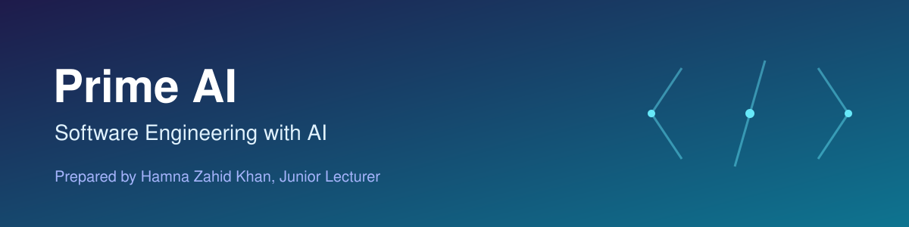
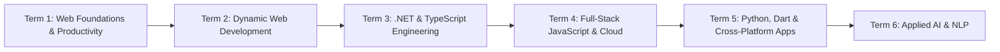

# Prime AI – Software Engineering with AI

Prepared by **Hamna Zahid Khan**, Junior Lecturer

A six-term programme that takes you from everyday productivity tools and web foundations to full-stack, cloud, mobile and applied AI development. Every session has notes, diagrams, runnable code, labs, a quiz and viva questions; every module ends with a practice test.

> 🚧 This course is being built module by module. Linked modules are ready; the rest are coming soon.

## Roadmap

## Contents

### Term 1 · Web Foundations & Productivity

1. [Effective Productivity through Office Automation](term-1/01-office-automation/README.md)
2. [Progressive Website Development (HTML5, CSS3, JavaScript)](term-1/02-progressive-website-development/README.md)
3. [Bootstrap & jQuery for Responsive Web Pages](term-1/03-bootstrap-jquery/README.md)
4. [Optimize Web for Search Engines](term-1/04-seo/README.md)
5. [Distributed Version Control with Git & GitHub](term-1/05-git-github/README.md)
6. Term 1 Capstone Project — *coming soon*

### Term 2 · Dynamic Web Development

1. Programming with JavaScript — *coming soon*
2. Data Processing with XML & JSON — *coming soon*
3. Working with MySQL — *coming soon*
4. Dynamic Web Development with PHP — *coming soon*
5. Laravel Framework — *coming soon*
6. Build & Manage Websites with CMS — *coming soon*
7. Fundamentals of Entrepreneurship — *coming soon*

### Term 3 · .NET & TypeScript Engineering

1. Programming with C# — *coming soon*
2. SQL Server — *coming soon*
3. TypeScript & Angular — *coming soon*
4. Material UI — *coming soon*
5. ASP.NET Core — *coming soon*
6. Term 3 Capstone Project — *coming soon*

### Term 4 · Full-Stack JavaScript & Cloud

1. React — *coming soon*
2. Node.js — *coming soon*
3. MongoDB — *coming soon*
4. Microsoft Azure — *coming soon*
5. Term 4 Capstone Project — *coming soon*

### Term 5 · Python, Dart & Cross-Platform Apps

1. Application-Based Programming in Python — *coming soon*
2. Dart Programming — *coming soon*
3. Cross-Platform App Development with Flutter — *coming soon*
4. Agile & DevOps — *coming soon*
5. Term 5 Capstone Project — *coming soon*

### Term 6 · Applied AI & NLP

1. AI Essentials — *coming soon*
2. Next-Gen NLP Applications with AI — *coming soon*

## How to use this repository

- Open a module and work through its sessions in order; each page links to the next.
- Type the examples yourself, then run the matching files in the module's `code/` folder and compare with the **Output** blocks.
- Attempt the labs before opening hints, and finish each module with its practice test.

---

Prepared by Hamna Zahid Khan, Junior Lecturer · Prime AI – Software Engineering with AI
