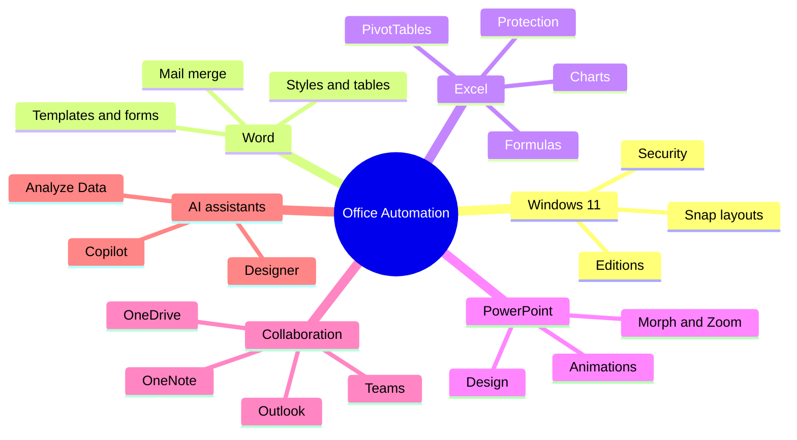

# Module 01 · Effective Productivity with Office Automation

> [Prime AI – Software Engineering with AI](../../README.md) › [Term 1](../README.md) › **Effective Productivity with Office Automation**

Before we write a single line of code, every software engineer needs to be fast and professional with the everyday
tools of office work: the operating system, documents, spreadsheets, slides, notes, mail, meetings and cloud storage.
This module turns you into a confident **power user** of Windows 11 and the Microsoft Office 2021 / Microsoft 365 family,
and shows where built-in **AI assistants** (Copilot, Designer, Ideas, Analyze Data) save you time.

## 🎯 Module objectives

- Use Windows 11 efficiently: editions, Start, Snap layouts, virtual desktops, settings and security.
- Produce professional Word documents with styles, tables, templates, forms, review tools and mail merge.
- Build Excel workbooks with formulas, functions, charts, data tools, protection, PivotTables and PivotCharts.
- Design clear PowerPoint presentations with animations, Morph, Zoom, icons, SVG and 3D models.
- Organise information and collaborate with OneNote, Outlook, Skype/Teams and OneDrive.
- Apply AI features inside Office responsibly to speed up everyday work.

## 🗂️ Sessions

| # | Session | Time | What you will cover |
|---|---|---|---|
| 1 | [Getting Started with Windows 11](session-01-getting-started-with-windows-11.md) | 2 hours | Explain what an operating system does and where Windows 11 fits; Compare the Windows 11 editions and choose the right one for a scenario; Use the Start menu, taskbar, Snap layouts, widgets and virtual desktops efficiently |
| 2 | [Introducing Microsoft Office 2021](session-02-introducing-microsoft-office-2021.md) | 1.5 hours | List the applications in Office 2021 / Microsoft 365 and what each is used for; Distinguish a one-time Office 2021 licence from a Microsoft 365 subscription; Navigate the common ribbon interface, Backstage view and Quick Access Toolbar |
| 3 | [Working with Microsoft Word – Part I](session-03-microsoft-word-part-1.md) | 2 hours | Navigate the Word 2021 interface and views; Format professional documents with styles, themes, headers/footers and a table of contents; Create and format bulleted, numbered and multilevel lists |
| 4 | [Working with Microsoft Word – Part II](session-04-microsoft-word-part-2.md) | 2 hours | Insert and arrange pictures, shapes, icons and SmartArt with text wrapping; Review documents with comments, Track Changes and Compare; Perform a Mail Merge for letters, envelopes and labels |
| 5 | [Introduction to Microsoft Excel 2021](session-05-introduction-to-microsoft-excel.md) | 2.5 hours | Create, find, save and share Excel workbooks; Format worksheets with number formats, styles, tables and conditional formatting; Write formulas using relative, absolute and mixed references |
| 6 | [Data Analysis and Security of Data in Microsoft Excel 2021](session-06-data-analysis-and-security-in-excel.md) | 2 hours | Sort, filter, validate and clean data with Excel data tools; Use What-If Analysis: Goal Seek, Scenario Manager and Data Tables; Summarise data with Subtotals and Analyze Data |
| 7 | [PivotTable and PivotCharts in Microsoft Excel 2021](session-07-pivottables-and-pivotcharts.md) | 2 hours | Explain why PivotTables are the fastest way to summarise large data; Create a PivotTable using Rows, Columns, Values and Filters; Group, sort, filter, use slicers/timelines and change value calculations |
| 8 | [Understanding Microsoft PowerPoint 2021 – I](session-08-microsoft-powerpoint-part-1.md) | 2 hours | Describe what PowerPoint is used for and the principles of a good presentation; Identify the PowerPoint window, views and slide layouts; Create a presentation from a blank deck, a theme or a template |
| 9 | [Understanding Microsoft PowerPoint 2021 – II](session-09-microsoft-powerpoint-part-2.md) | 2 hours | Use the Home, Insert and Design tabs to their full potential; Apply animations purposefully and control their timing; Use Review and View tools, Zoom (Summary/Section/Slide) and the Morph transition |
| 10 | [Understanding Microsoft OneNote 2021](session-10-microsoft-onenote.md) | 1.5 hours | Explain the notebook › section › page structure of OneNote; Use OneNote tools: tags, drawing, math, audio/video recording, screen clipping; Organise and search notes across notebooks |
| 11 | [Using Outlook 2021](session-11-using-outlook.md) | 1.5 hours | Explain the functions of Outlook: mail, calendar, people, tasks; Organise e-mail with folders, rules, categories, flags, Quick Steps and search folders; Schedule meetings and manage a calendar professionally |
| 12 | [Skype and Microsoft Teams](session-12-skype-and-microsoft-teams.md) | 1.5 hours | Explain the purpose of Skype, Skype for Business and Microsoft Teams; Use Skype options for calls, chat and screen sharing; Describe how Microsoft Teams organises teams, channels, chats, meetings and files |
| 13 | [Using Microsoft OneDrive 2021](session-13-using-microsoft-onedrive.md) | 1.5 hours | Describe OneDrive and how cloud storage works; Navigate the OneDrive web and desktop interfaces; Share files and folders securely and collaborate in real time |
| 📝 | [Module practice test](practice-test.md) | 1 hour | 20 MCQs + 3 practical questions |

## 🧭 Concept map

## 📄 One-page cheat-sheet

| Area | Must-know shortcuts & facts |
|---|---|
| **Windows 11** | `Win` Start · `Win+E` File Explorer · `Win+Z` Snap layouts · `Win+Tab` Task view / desktops · `Win+V` clipboard history · `Win+Shift+S` screenshot · `Win+L` lock · `Win+I` Settings |
| **Editions** | Home (personal) · Pro (BitLocker, Hyper-V, domain join) · Enterprise/Education (volume licensing, advanced security) |
| **Word** | `Ctrl+Alt+1/2/3` Heading 1/2/3 · `Ctrl+Enter` page break · References › Table of Contents · Review › Track Changes (`Ctrl+Shift+E`) · Mailings › Start Mail Merge · save templates as `.dotx` |
| **Excel basics** | Formulas start with `=` · `$A$1` absolute, `A$1` mixed, `A1` relative · `F4` toggles `$` · `Ctrl+T` makes a Table · `Ctrl+Shift+L` filter · `Alt+=` AutoSum |
| **Excel functions** | `SUM AVERAGE COUNT COUNTA MIN MAX ROUND IF IFS AND OR XLOOKUP VLOOKUP INDEX MATCH SUMIFS COUNTIFS TEXT TODAY UNIQUE SORT FILTER` |
| **Excel data** | Sort/Filter · Data Validation · Conditional Formatting · Goal Seek · Scenario Manager · Data Table · Remove Duplicates · Text to Columns |
| **Protection** | File (password to open/modify) › Workbook (structure) › Sheet (cells; unlock input cells first) |
| **Pivot** | Rows · Columns · Values · Filters; PivotTable = numbers, PivotChart = picture of the PivotTable; refresh after source changes |
| **PowerPoint** | `Ctrl+M` new slide · `F5` from start · `Shift+F5` from current · Morph needs the same object on consecutive slides · Zoom = Summary/Section/Slide zoom |
| **OneNote** | Notebook › Section › Page · tags (`Ctrl+1` To Do) · Dictate · Math assistant · Immersive Reader |
| **Outlook** | Rules automate filing · Categories colour-code · Quick Steps · `Ctrl+Shift+A` new appointment · Schedule send |
| **Teams/OneDrive** | Teams = chat + meetings + channels + files · OneDrive = personal cloud, Files On-Demand, version history, share links with permissions |
| **AI** | Copilot drafts/summarises · Designer suggests layouts · Analyze Data finds patterns · always **review** AI output and never paste confidential data into public tools |

## 🚀 How to study this module

1. Read each session in order; type every example yourself instead of copy-pasting.
2. Run the files in [`code/`](code/) and compare your output with the **Output** blocks.
3. Finish the 🟢 and 🟡 labs before class; attempt 🔴/🏆 labs with a partner.
4. Close the module with the [practice test](practice-test.md) and revise the cheat-sheet above.

---

Prepared by **Hamna Zahid Khan**, Junior Lecturer · Prime AI – Software Engineering with AI
