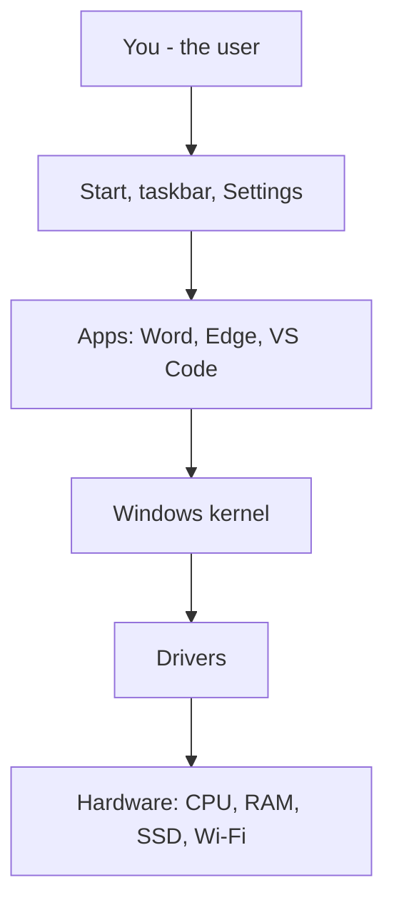
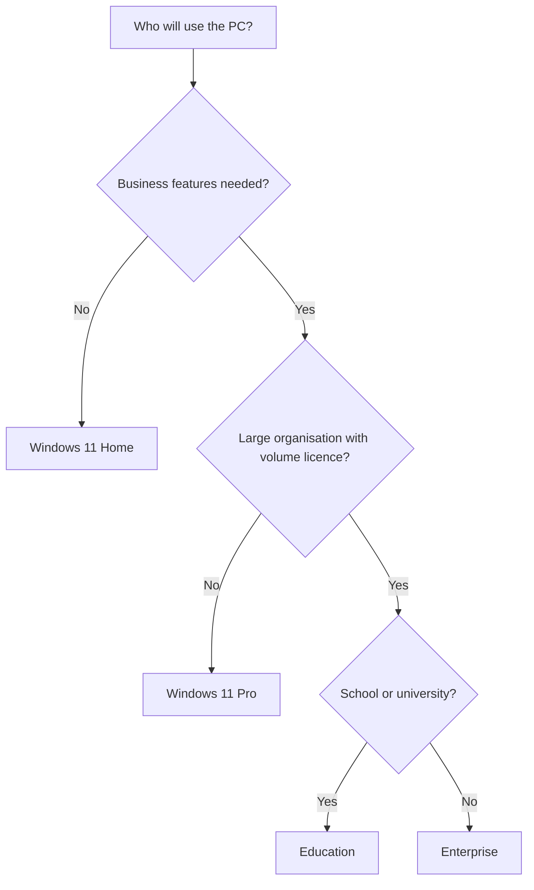
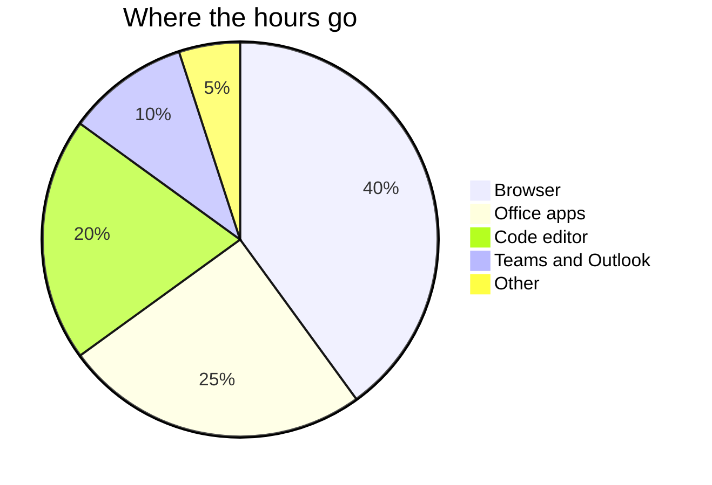

# Session 1 · Getting Started with Windows 11

> [Prime AI – Software Engineering with AI](../../README.md) › [Term 1](../README.md) › [Effective Productivity with Office Automation](README.md) › **Session 1**

| ⏱ Estimated time | 🧩 Prerequisites |
|---|---|
| 2 hours | None – just a Windows 11 PC or lab machine |

[⬅ Module overview](README.md) &nbsp;|&nbsp; [Next: Introducing Microsoft Office 2021 ➡](session-02-introducing-microsoft-office-2021.md)

---

## 🎯 Learning objectives

By the end of this session you will be able to:

- Explain what an operating system does and where Windows 11 fits.
- Compare the Windows 11 editions and choose the right one for a scenario.
- Use the Start menu, taskbar, Snap layouts, widgets and virtual desktops efficiently.
- Manage files in File Explorer and adjust key Settings safely.
- Describe the main security features (Windows Security, BitLocker, Windows Hello).

## 📖 Concepts

### What an operating system does
An **operating system (OS)** is the manager that sits between you, your apps and the hardware. It decides which program
gets the CPU, keeps memory separate for each app, talks to disks and devices through **drivers**, and gives you a
**user interface** (UI). Think of it as the principal of a school: teachers (apps) teach, but the principal allocates
classrooms (memory), timetables (CPU time) and keeps everyone safe (security).

| OS job | Example in Windows 11 |
|---|---|
| Process management | Task Manager (`Ctrl+Shift+Esc`) shows running apps and CPU use |
| Memory management | Each app gets its own address space; unused apps are suspended |
| File management | NTFS file system, File Explorer, OneDrive integration |
| Device management | Device Manager and automatic driver updates |
| Security | User accounts, Windows Security, BitLocker, Windows Hello |
| User interface | Start menu, taskbar, Settings, notifications |

### Windows 11 editions
| Edition | Who it is for | Notable extras |
|---|---|---|
| **Home** | Students and families | Core features, Microsoft account sign-in |
| **Pro** | Freelancers and small offices | **BitLocker**, Hyper-V, Remote Desktop host, join a domain / Entra ID |
| **Enterprise** | Large organisations (volume licence) | Advanced security & management, long-term servicing options |
| **Education** | Schools and universities | Enterprise-level features at academic pricing |
| **Pro for Workstations** | Heavy engineering/data machines | Support for server-grade CPUs and lots of RAM |

**Minimum hardware** (worth remembering for viva): 64-bit CPU at 1 GHz with 2+ cores, **4 GB RAM**, **64 GB storage**,
**TPM 2.0**, UEFI with **Secure Boot**, DirectX 12 graphics.

### Features you will use every day
- **Centred Start menu** with *Pinned* apps and *Recommended* files; type to search apps, files and settings.
- **Snap layouts** (`Win+Z`) and **Snap groups** – tile two to four windows; perfect for code on the left, browser on the right.
- **Virtual desktops** (`Win+Tab` › New desktop) – one desktop for "Class", one for "Project".
- **Widgets** (`Win+W`) – news, weather, calendar at a glance.
- **Focus sessions** in the Clock app – a Pomodoro timer that silences notifications.
- **Clipboard history** (`Win+V`) and **Snipping Tool** (`Win+Shift+S`).
- **Microsoft Store** with Android apps support (region dependent) and **winget** for installing developer tools from the terminal.
- **Windows Terminal** – tabs for PowerShell, Command Prompt and WSL (Linux) in one window.

### File Explorer essentials
Files live in **folders**; a full **path** such as `C:\Users\Ayesha\Documents\cv.docx` tells Windows exactly where.
File **extensions** (`.docx`, `.xlsx`, `.png`) tell Windows which app opens the file – turn on *View › Show › File name
extensions* so you can always see them (an important security habit: `invoice.pdf.exe` is not a PDF!).

### Security in Windows 11
- **Windows Security**: antivirus (Microsoft Defender), firewall, app & browser control.
- **Windows Hello**: sign in with face, fingerprint or PIN; the PIN is tied to the device, so it is safer than a reused password.
- **BitLocker** (Pro+): encrypts the whole drive so a stolen laptop's data cannot be read.
- **Windows Update**: patches security holes – keep it on.

## 🧭 Diagrams

### How the OS sits between you and the hardware



### Choosing an edition



## 💻 Worked examples

### Example 1 — A productive study set-up in 5 minutes

```text
1. Win+I > Personalization > Taskbar: pin File Explorer, Edge, VS Code, Teams.
2. Win+Tab > New desktop. Rename desktop 1 "Class" and desktop 2 "Project".
3. On "Project": open VS Code and Edge, press Win+Z on VS Code and choose the left half.
4. Clock app > Focus sessions: 25 minutes, turn on "Do not disturb".
5. Win+V > Turn on clipboard history (copy several snippets and paste any of them).
```

**Result**

```text
Two desktops, apps snapped side by side, notifications silenced for 25 minutes,
and a clipboard that remembers your last 25 copied items.
```

### Example 2 — Checking your system from the terminal

Open **Windows Terminal** (PowerShell) and run these read-only commands. They are safe – they only display information.

```bash
# Edition, version and build
Get-ComputerInfo -Property OsName, OsVersion, OsBuildNumber
# How much RAM is installed (in GB)
[math]::Round((Get-CimInstance Win32_ComputerSystem).TotalPhysicalMemory / 1GB, 1)
# Is BitLocker on for drive C:? (run terminal as administrator)
Get-BitLockerVolume -MountPoint "C:" | Select-Object MountPoint, ProtectionStatus
# Install a developer tool with winget
winget install --id Git.Git -e
```

📄 Saved as [`code/session-01_system-info.ps1`](code/session-01_system-info.ps1)

**Sample output** (values differ on every PC)

```text
OsName                     OsVersion     OsBuildNumber
------                     ---------     -------------
Microsoft Windows 11 Pro   10.0.22631    22631
15.8
MountPoint ProtectionStatus
---------- ----------------
C:                       On
(winget then downloads and installs Git)
```

## 📊 At a glance

Typical share of a student's screen time on a Windows lab PC (class survey example):



## 🧪 Lab / practice tasks

**🟢 Easy** — Create two virtual desktops named **Class** and **Project** and snap three windows on one of them.

<details><summary>💡 Hint</summary>

Win+Tab, then right-click a desktop thumbnail to rename. Win+Z on each window to pick a slot.

</details>

**🟡 Medium** — Turn on file name extensions and create the folder structure `Documents/PrimeAI/Term1/Office` and save a text file with your name in it.

<details><summary>💡 Hint</summary>

File Explorer › View › Show › File name extensions. Right-click › New › Folder / Text Document.

</details>

**🔴 Hard** — Using Settings, find your Windows edition, version, RAM and whether your device meets the TPM 2.0 requirement. Record them in a table.

<details><summary>💡 Hint</summary>

Settings › System › About; for TPM press Win+R and run `tpm.msc`.

</details>

**🏆 Challenge** — Write a one-page recommendation: which edition should a 12-person architecture firm buy, and why? Include security and remote-work points.

<details><summary>💡 Hint</summary>

Think Pro vs Enterprise: BitLocker, Remote Desktop, central management, licence cost.

</details>

## ✅ Quick quiz

**Q1. Which component lets Windows communicate with a printer?**

- A) Widget
- B) Driver
- C) Theme
- D) Shortcut

<details><summary>Show answer</summary>

**B** — Drivers translate OS requests into device-specific commands.

</details>

**Q2. BitLocker is NOT available in which edition?**

- A) Home
- B) Pro
- C) Enterprise
- D) Education

<details><summary>Show answer</summary>

**A** — Home has only basic device encryption on some hardware, not full BitLocker.

</details>

**Q3. Win+V opens:**

- A) Settings
- B) Clipboard history
- C) Task view
- D) Voice typing

<details><summary>Show answer</summary>

**B** — Clipboard history keeps multiple copied items.

</details>

**Q4. Which is a Windows 11 hardware requirement?**

- A) TPM 2.0
- B) 1 GB RAM
- C) 32-bit CPU
- D) DVD drive

<details><summary>Show answer</summary>

**A** — TPM 2.0 and Secure Boot are required.

</details>

**Q5. Why should you show file extensions?**

- A) Faster PC
- B) To spot disguised files like report.pdf.exe
- C) To save space
- D) To enable Snap

<details><summary>Show answer</summary>

**B** — It is a simple anti-malware habit.

</details>

## 📝 Summary / cheat-sheet

- An OS manages processes, memory, files, devices, security and the UI.
- Editions: Home → Pro (BitLocker, Hyper-V, domain) → Enterprise/Education.
- Requirements: 4 GB RAM, 64 GB storage, TPM 2.0, Secure Boot, 64-bit CPU.
- Productivity: Snap layouts (Win+Z), virtual desktops (Win+Tab), clipboard (Win+V), Focus sessions.
- Security: Windows Security, Windows Hello, BitLocker, Windows Update.

## 🎤 Interview / viva questions

1. **What is the difference between an operating system and an application?**
   <details><summary>Model answer</summary>

   The OS manages hardware and provides services to all programs; an application uses those services to do a specific user task, such as writing a document.

   </details>

2. **Why does Windows 11 require TPM 2.0?**
   <details><summary>Model answer</summary>

   TPM is a security chip that stores encryption keys and verifies boot integrity, enabling BitLocker, Windows Hello and protection against firmware attacks.

   </details>

3. **When would you choose Pro over Home?**
   <details><summary>Model answer</summary>

   When you need BitLocker, Remote Desktop hosting, Hyper-V virtual machines or joining a company domain.

   </details>

4. **What are virtual desktops useful for?**
   <details><summary>Model answer</summary>

   Separating contexts – for example class work and a personal project – so each desktop has only the windows that belong to it.

   </details>

---

[⬅ Module overview](README.md) &nbsp;|&nbsp; [Next: Introducing Microsoft Office 2021 ➡](session-02-introducing-microsoft-office-2021.md)

<sub>Prepared by **Hamna Zahid Khan**, Junior Lecturer · Prime AI – Software Engineering with AI</sub>
