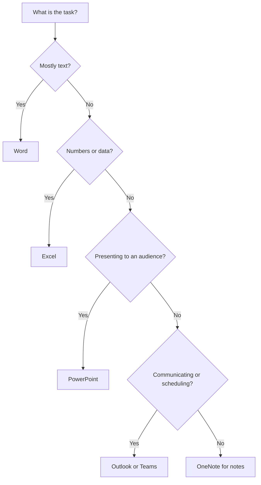
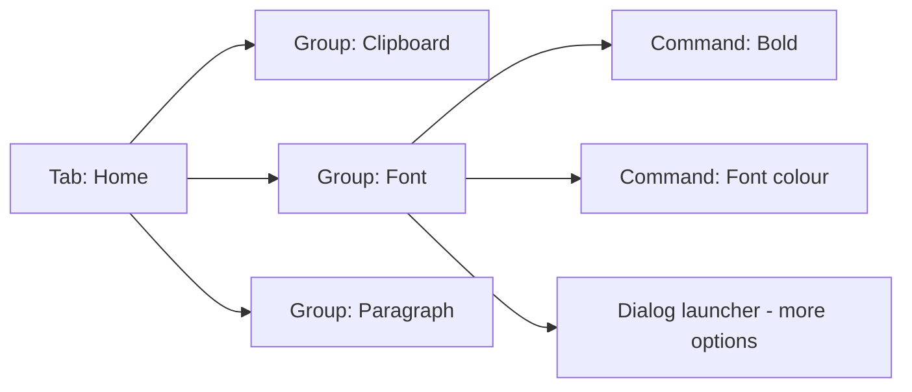
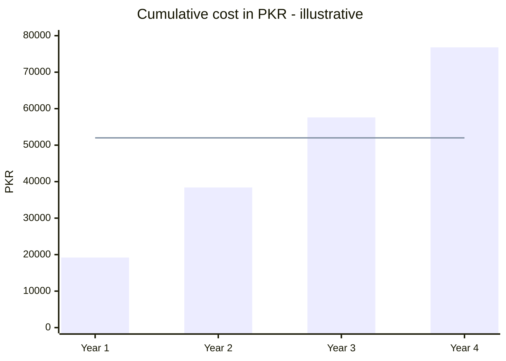

# Session 2 · Introducing Microsoft Office 2021

> [Prime AI – Software Engineering with AI](../../README.md) › [Term 1](../README.md) › [Effective Productivity with Office Automation](README.md) › **Session 2**

| ⏱ Estimated time | 🧩 Prerequisites |
|---|---|
| 1.5 hours | Session 1 |

[⬅ Previous: Getting Started with Windows 11](session-01-getting-started-with-windows-11.md) &nbsp;|&nbsp; [Next: Working with Microsoft Word – Part I ➡](session-03-microsoft-word-part-1.md)

---

## 🎯 Learning objectives

By the end of this session you will be able to:

- List the applications in Office 2021 / Microsoft 365 and what each is used for.
- Distinguish a one-time Office 2021 licence from a Microsoft 365 subscription.
- Navigate the common ribbon interface, Backstage view and Quick Access Toolbar.
- Describe the new features of Office 2021, including co-authoring and dark mode.
- Explain how AI assistance appears across modern Office apps.

## 📖 Concepts

### The Office family at a glance
| App | Use it for | File type |
|---|---|---|
| **Word** | Letters, reports, CVs, assignments | `.docx` |
| **Excel** | Calculations, data analysis, charts | `.xlsx` |
| **PowerPoint** | Presentations and visual storytelling | `.pptx` |
| **Outlook** | Email, calendar, contacts, tasks | `.pst`/`.ost` data files |
| **OneNote** | Free-form digital notebooks | notebook stored in OneDrive |
| **Access** *(PC, some editions)* | Small desktop databases | `.accdb` |
| **Publisher** *(being retired)* | Flyers, brochures | `.pub` |
| **Teams** | Chat, meetings, channels, shared files | – |

### Office 2021 vs Microsoft 365
| | Office 2021 (perpetual) | Microsoft 365 (subscription) |
|---|---|---|
| Payment | Pay once | Monthly / yearly |
| Updates | Security fixes only | New features every month |
| Cloud storage | Not included | 1 TB OneDrive per user |
| Devices | One PC/Mac | Several devices incl. phones |
| AI features | Very limited | Copilot and AI tools (plan dependent) |

**Analogy:** Office 2021 is buying a car; Microsoft 365 is a ride-sharing subscription that always gives you the newest model.

### The common interface – learn once, use everywhere
- **Ribbon**: tabs (Home, Insert, Design…) → groups (Font, Paragraph) → commands. Press `Alt` to reveal **KeyTips** and drive the ribbon from the keyboard.
- **Backstage view** (`File` tab): New, Open, Save As, Print, Share, Export, Info (protect, inspect, version history).
- **Quick Access Toolbar (QAT)**: your own always-visible commands (Save, Undo, Redo + anything you add).
- **Search / Tell me** (`Alt+Q`): type what you want to do ("insert table of contents").
- **Contextual tabs** appear only when relevant, e.g. *Table Design* when the cursor is in a table.
- **Status bar**: page/word count in Word, Sum/Average in Excel, zoom slider everywhere.

### What is new in Office 2021
1. **Real-time co-authoring** – see colleagues' cursors when files are in OneDrive/SharePoint.
2. **Dark mode** across apps (Word even darkens the page canvas).
3. **Modern comments** with @mentions.
4. **Excel dynamic arrays and new functions**: `XLOOKUP`, `XMATCH`, `LET`, `UNIQUE`, `SORT`, `FILTER`, `SEQUENCE`.
5. **Stock media**: free images, icons, cut-out people, stickers and illustrations.
6. **Line focus** and **Immersive Reader** in Word for accessibility.
7. **PowerPoint**: record slideshows with ink and laser pointer, reorder objects for screen readers.
8. **Accessibility Checker** in the status bar of every app.

### AI inside Office (Microsoft 365)
| Feature | App | What it does |
|---|---|---|
| **Editor** | Word, Outlook | Grammar, clarity, conciseness and tone suggestions |
| **Designer** | PowerPoint | Suggests professional slide layouts from your content |
| **Analyze Data** | Excel | Asks questions of your data in plain English, proposes charts |
| **Copilot** | All (licence) | Drafts, summarises, rewrites, builds formulas and slides from prompts |
| **Dictate / Transcribe** | Word, OneNote | Speech to text |

> ⚠️ **Responsible AI:** AI output may be wrong or biased. Read it, verify facts and numbers, and do not paste confidential student or company data into public AI tools.

## 🧭 Diagrams

### Which Office app should I open?



### Anatomy of the ribbon



## 💻 Worked examples

### Example 1 — Customise the Quick Access Toolbar

```text
1. Open Word. Click the small arrow at the end of the Quick Access Toolbar.
2. Tick: New, Open, Quick Print, Read Aloud.
3. Choose "More Commands..." > "All Commands" > add "Insert Table of Contents".
4. Click "Show below the ribbon" so it is near your work.
5. Export the customisation: File > Options > Quick Access Toolbar > Import/Export
   so you can carry it to the lab PC.
```

**Result**

```text
Your favourite commands are one click away in every Word document, and you have a .exportedUI file you can re-import.
```

### Example 2 — Comparing licence costs over 4 years (Python check)

A small calculation to decide between a one-time licence and a subscription. Prices are illustrative, in PKR.

```python
one_time = 52000          # Office Home & Business 2021 (illustrative)
monthly = 1600            # Microsoft 365 Personal per month (illustrative)
for years in range(1, 5):
    sub = monthly * 12 * years
    better = "subscription" if sub < one_time else "one-time"
    print(f"Year {years}: subscription total = {sub:>6} PKR -> cheaper: {better}")
```

📄 Saved as [`code/session-02_example-2.py`](code/session-02_example-2.py)

**Output** (real run)

```text
Year 1: subscription total =  19200 PKR -> cheaper: subscription
Year 2: subscription total =  38400 PKR -> cheaper: subscription
Year 3: subscription total =  57600 PKR -> cheaper: one-time
Year 4: subscription total =  76800 PKR -> cheaper: one-time
```

## 📊 At a glance


Bars = subscription total, line = one-time licence. The break-even point is in year 3 – but remember the subscription also includes 1 TB storage and new features.

## 🧪 Lab / practice tasks

**🟢 Easy** — Open Word, Excel and PowerPoint and write down three tabs that appear in all three ribbons.

<details><summary>💡 Hint</summary>

Look for File, Home, Insert, Review, View.

</details>

**🟡 Medium** — Press `Alt` in Word and use only KeyTips to make a line bold and centred. Write the key sequence you used.

<details><summary>💡 Hint</summary>

Alt → H → 1 for bold, Alt → H → A → C for centre.

</details>

**🔴 Hard** — Turn on dark mode in Word and run the Accessibility Checker on one of your old assignments; fix three issues it reports.

<details><summary>💡 Hint</summary>

File › Account › Office Theme › Black; Review › Check Accessibility.

</details>

**🏆 Challenge** — Use an AI feature (Editor, Designer or Copilot if available) on a paragraph you wrote. Record the suggestion, what you accepted, and one suggestion you rejected and why.

<details><summary>💡 Hint</summary>

Responsible use means you remain the author – justify every change.

</details>

## ✅ Quick quiz

**Q1. Which Office app is designed for slide-based presentations?**

- A) Word
- B) PowerPoint
- C) Excel
- D) Access

<details><summary>Show answer</summary>

**B** — PowerPoint builds .pptx slide decks.

</details>

**Q2. The File tab opens:**

- A) Ribbon
- B) Backstage view
- C) Status bar
- D) Navigation pane

<details><summary>Show answer</summary>

**B** — Backstage holds file-level commands.

</details>

**Q3. A key advantage of Microsoft 365 over Office 2021 is:**

- A) Works offline only
- B) Continuous feature updates
- C) Cheaper forever
- D) No sign-in needed

<details><summary>Show answer</summary>

**B** — Subscriptions get monthly feature updates.

</details>

**Q4. Which new Excel function in 2021 returns only distinct values?**

- A) UNIQUE
- B) SUMIF
- C) CONCAT
- D) LEN

<details><summary>Show answer</summary>

**A** — UNIQUE is a dynamic array function.

</details>

**Q5. Pressing Alt in an Office app shows:**

- A) Macros
- B) KeyTips
- C) Comments
- D) Styles

<details><summary>Show answer</summary>

**B** — KeyTips let you drive the ribbon by keyboard.

</details>

## 📝 Summary / cheat-sheet

- Office = Word, Excel, PowerPoint, Outlook, OneNote, Teams (+ Access, Publisher on PC).
- Office 2021 is a one-time purchase; Microsoft 365 is a subscription with cloud storage and new features.
- Ribbon → tabs → groups → commands; Backstage = File; QAT = your shortcuts; Alt = KeyTips.
- New in 2021: co-authoring, dark mode, XLOOKUP/dynamic arrays, stock media, accessibility tools.
- AI helpers: Editor, Designer, Analyze Data, Copilot – always review their output.

## 🎤 Interview / viva questions

1. **What is a contextual tab?**
   <details><summary>Model answer</summary>

   A ribbon tab that appears only when a certain object is selected, like Picture Format when a picture is selected.

   </details>

2. **Name two dynamic array functions.**
   <details><summary>Model answer</summary>

   UNIQUE, SORT, FILTER, SEQUENCE – they spill results into neighbouring cells.

   </details>

3. **Why is co-authoring only possible with cloud storage?**
   <details><summary>Model answer</summary>

   All authors must edit the same single copy, which must live on OneDrive or SharePoint so changes sync in real time.

   </details>

4. **Give one risk of AI assistants in Office.**
   <details><summary>Model answer</summary>

   They can invent facts (hallucinate) or leak sensitive data if used carelessly, so output must be verified.

   </details>

---

[⬅ Previous: Getting Started with Windows 11](session-01-getting-started-with-windows-11.md) &nbsp;|&nbsp; [Next: Working with Microsoft Word – Part I ➡](session-03-microsoft-word-part-1.md)

<sub>Prepared by **Hamna Zahid Khan**, Junior Lecturer · Prime AI – Software Engineering with AI</sub>
