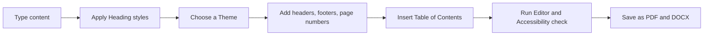
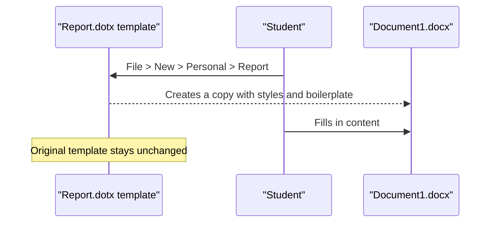

# Session 3 · Working with Microsoft Word – Part I

> [Prime AI – Software Engineering with AI](../../README.md) › [Term 1](../README.md) › [Effective Productivity with Office Automation](README.md) › **Session 3**

| ⏱ Estimated time | 🧩 Prerequisites |
|---|---|
| 2 hours | Session 2 |

[⬅ Previous: Introducing Microsoft Office 2021](session-02-introducing-microsoft-office-2021.md) &nbsp;|&nbsp; [Next: Working with Microsoft Word – Part II ➡](session-04-microsoft-word-part-2.md)

---

## 🎯 Learning objectives

By the end of this session you will be able to:

- Navigate the Word 2021 interface and views.
- Format professional documents with styles, themes, headers/footers and a table of contents.
- Create and format bulleted, numbered and multilevel lists.
- Insert, format and calculate inside Word tables.
- Build reusable templates and fillable forms with content controls.

## 📖 Concepts

### The Word window
| Part | Purpose |
|---|---|
| Ribbon | Home, Insert, Draw, Design, Layout, References, Mailings, Review, View |
| Navigation pane (`Ctrl+F`) | Jump between headings, search, reorder sections by dragging |
| Views | **Print Layout** (default), **Read Mode**, **Web Layout**, **Outline**, **Draft**, **Focus** |
| Status bar | Page x of y, word count, language, zoom |
| Rulers | Indents and tab stops (View › Ruler) |

### Styles: the secret of professional documents
A **style** is a saved bundle of formatting (font, size, colour, spacing). Instead of making every heading bold 16 pt
by hand, apply **Heading 1**. Benefits:
1. Consistent look; change the style once and every heading updates.
2. The **Navigation pane** and **Table of Contents** are built from heading styles.
3. Screen readers use headings – better **accessibility**.

**Themes** (Design tab) change the fonts and colours of all styles at once. **Style sets** change spacing and character.

### Page set-up
- Layout › **Margins**, **Orientation**, **Size** (A4 in Pakistan, Letter in the USA).
- **Section breaks** (Layout › Breaks › Next Page) let one part be landscape or have different headers.
- **Headers/footers** with **page numbers** (Insert › Page Number) and *Different First Page* for title pages.
- **Table of contents**: References › Table of Contents › Automatic; update with *Update Table* (`F9`).

### Lists
| List type | When to use | Tip |
|---|---|---|
| Bulleted | Items with no order | Type `* ` + space to start automatically |
| Numbered | Steps in order | Type `1. ` + space |
| Multilevel | Outlines, legal documents | `Tab` demotes, `Shift+Tab` promotes |

### Tables
Insert › Table (grid or *Insert Table…* for exact size). Use **Table Design** for styles, header row and banded rows;
**Layout** for merge/split cells, alignment, **Repeat Header Rows** (essential for long tables) and **Formula**
(e.g. `=SUM(ABOVE)`). Convert existing tab-separated text with *Convert Text to Table*.

### Templates and forms
A **template** (`.dotx`) is a starting point that protects the original: every "new document" from it is a fresh copy.
A **form** uses **content controls** (Developer tab): Plain Text, Rich Text, Date Picker, Drop-Down List, Check Box.
Then *Restrict Editing › Filling in forms* so users can only fill the controls.

> Enable the Developer tab: File › Options › Customize Ribbon › tick **Developer**.

## 🧭 Diagrams

### From blank page to professional report



### How a template is used



## 💻 Worked examples

### Example 1 — A lab report skeleton built with styles

```text
Title                         -> style: Title
Prepared by: Your Name        -> style: Subtitle
[Insert > Table of Contents]
1 Introduction                -> Heading 1
  1.1 Aim                     -> Heading 2
  1.2 Apparatus               -> Heading 2
2 Method                      -> Heading 1
3 Results                     -> Heading 1
  [Insert > Table 4x3, Table Design: Grid Table 4 - Accent 1]
4 Conclusion                  -> Heading 1
Footer: "Page X of Y" (Insert > Page Number > Bottom > Bold Numbers)
```

**Result**

```text
A 3-page report with an automatic contents page (headings and page numbers),
consistent colours from the theme, and a footer that reads "Page 1 of 3".
```

### Example 2 — Totals inside a Word table

Word tables can do simple maths with *Layout › Formula*.

```text
| Item        | Qty | Price |
| Notebook    |  3  |  250  |
| Pen pack    |  2  |  180  |
| USB drive   |  1  | 1500  |
| Total       |     | {=SUM(ABOVE)} |
```

**Result**

```text
Total cell shows 1930  (250 + 180 + 1500). Note: SUM(ABOVE) adds the column values, not qty × price.
Right-click › Update Field after changing numbers.
```

### Example 3 — The same price × quantity check in Python

```python
items = [("Notebook", 3, 250), ("Pen pack", 2, 180), ("USB drive", 1, 1500)]
for name, qty, price in items:
    print(f"{name:<10} {qty} x {price:>5} = {qty*price:>5}")
print("Column sum of prices :", sum(p for _, _, p in items))
print("Real bill (qty*price):", sum(q*p for _, q, p in items))
```

📄 Saved as [`code/session-03_example-3.py`](code/session-03_example-3.py)

**Output** (real run)

```text
Notebook   3 x   250 =   750
Pen pack   2 x   180 =   360
USB drive  1 x  1500 =  1500
Column sum of prices : 1930
Real bill (qty*price): 2610
```

This shows why you must design the table carefully: add a **Line total** column if you need qty × price.

## 📊 At a glance

| Formatting approach | Time to restyle a 30-page report | Consistent? | TOC possible? |
|---|---|---|---|
| Manual bold/size on each heading | ~30 minutes | ❌ Often not | ❌ |
| Heading styles + theme | ~10 seconds | ✅ | ✅ |

## 🧪 Lab / practice tasks

**🟢 Easy** — Type a one-page article about your city and apply Title, Heading 1 and Heading 2 styles. Show the Navigation pane.

<details><summary>💡 Hint</summary>

View › Navigation Pane, or Ctrl+F.

</details>

**🟡 Medium** — Add a cover page, page numbers starting from page 2 and an automatic table of contents.

<details><summary>💡 Hint</summary>

Insert › Cover Page; Header & Footer › Different First Page.

</details>

**🔴 Hard** — Create a 5-column timetable table with a repeated header row and merged cells for the lunch break.

<details><summary>💡 Hint</summary>

Layout › Repeat Header Rows; select cells › Merge Cells.

</details>

**🏆 Challenge** — Build a **Student Registration Form** template (.dotx) with text, date picker, drop-down (programme) and check-box controls, then restrict editing to filling in forms.

<details><summary>💡 Hint</summary>

Developer › Controls; Review › Restrict Editing › Filling in forms › Start Enforcing Protection.

</details>

## ✅ Quick quiz

**Q1. Which feature builds a table of contents automatically?**

- A) Bold text
- B) Heading styles
- C) Text boxes
- D) WordArt

<details><summary>Show answer</summary>

**B** — The TOC reads heading styles.

</details>

**Q2. Template files use which extension?**

- A) .docx
- B) .dotx
- C) .pdf
- D) .txt

<details><summary>Show answer</summary>

**B** — .dotx (or .dotm with macros).

</details>

**Q3. Which key demotes an item in a multilevel list?**

- A) Enter
- B) Tab
- C) Esc
- D) F4

<details><summary>Show answer</summary>

**B** — Shift+Tab promotes.

</details>

**Q4. `=SUM(ABOVE)` in a Word table:**

- A) Adds cells above in the same column
- B) Adds the whole table
- C) Multiplies cells
- D) Counts rows

<details><summary>Show answer</summary>

**A** — It sums numbers above the cell.

</details>

**Q5. Content controls are inserted from which tab?**

- A) Insert
- B) Developer
- C) Mailings
- D) Layout

<details><summary>Show answer</summary>

**B** — Enable Developer in Options first.

</details>

## 📝 Summary / cheat-sheet

- Use **styles** for every heading – consistency, navigation, TOC and accessibility.
- Themes change fonts/colours globally; section breaks allow mixed orientation and headers.
- Lists: bullets (no order), numbers (steps), multilevel (outlines; Tab/Shift+Tab).
- Tables: Table Design for looks, Layout for structure, Repeat Header Rows, Formula.
- Templates (.dotx) + content controls + Restrict Editing = reusable forms.

## 🎤 Interview / viva questions

1. **Why are styles better than manual formatting?**
   <details><summary>Model answer</summary>

   They give consistency, allow global changes, power the Navigation pane and TOC, and improve accessibility.

   </details>

2. **What is a section break used for?**
   <details><summary>Model answer</summary>

   To change page layout (orientation, margins, headers, numbering) for part of a document.

   </details>

3. **How do you stop users editing anything except form fields?**
   <details><summary>Model answer</summary>

   Review › Restrict Editing › allow only Filling in forms and start enforcing protection.

   </details>

4. **What happens to a template when you create a document from it?**
   <details><summary>Model answer</summary>

   Nothing – Word creates a new untitled copy so the template remains unchanged.

   </details>

---

[⬅ Previous: Introducing Microsoft Office 2021](session-02-introducing-microsoft-office-2021.md) &nbsp;|&nbsp; [Next: Working with Microsoft Word – Part II ➡](session-04-microsoft-word-part-2.md)

<sub>Prepared by **Hamna Zahid Khan**, Junior Lecturer · Prime AI – Software Engineering with AI</sub>
