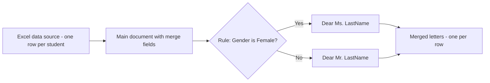
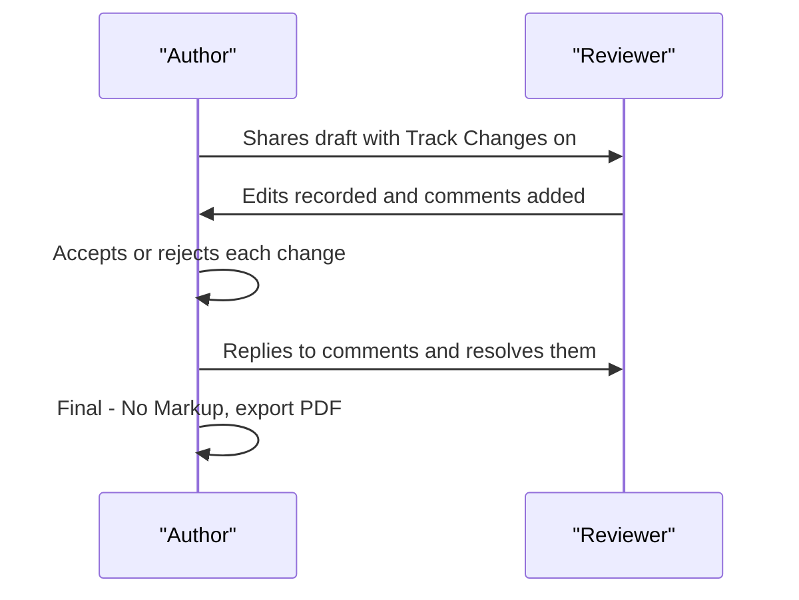

# Session 4 · Working with Microsoft Word – Part II

> [Prime AI – Software Engineering with AI](../../README.md) › [Term 1](../README.md) › [Effective Productivity with Office Automation](README.md) › **Session 4**

| ⏱ Estimated time | 🧩 Prerequisites |
|---|---|
| 2 hours | Session 3 |

[⬅ Previous: Working with Microsoft Word – Part I](session-03-microsoft-word-part-1.md) &nbsp;|&nbsp; [Next: Introduction to Microsoft Excel 2021 ➡](session-05-introduction-to-microsoft-excel.md)

---

## 🎯 Learning objectives

By the end of this session you will be able to:

- Insert and arrange pictures, shapes, icons and SmartArt with text wrapping.
- Review documents with comments, Track Changes and Compare.
- Perform a Mail Merge for letters, envelopes and labels.
- Use AI features (Editor, Rewrite, Copilot, Dictate) to improve writing responsibly.

## 📖 Concepts

### Pictures, shapes and graphics
| Insert option | Typical use |
|---|---|
| Pictures (device, stock, online) | Photos, screenshots, logos |
| Shapes | Arrows, callouts, simple diagrams |
| Icons / 3D models | Modern visual cues |
| SmartArt | Process, hierarchy, cycle diagrams from bullet text |
| Chart | A small Excel chart embedded in Word |
| Screenshot | Capture another open window |

**Text wrapping** decides how text flows around an object: *In Line with Text* (moves like a character – safest),
*Square*, *Tight*, *Behind Text*, *In Front of Text*. Use **Picture Format** to crop, add styles, remove background,
and **Alt Text** for screen readers (an accessibility must).

### The review cycle
1. **Comments** (`Ctrl+Alt+M`) – ask questions without changing text; @mention a colleague to notify them.
2. **Track Changes** – every insertion/deletion is recorded with author and time.
3. **Simple Markup / All Markup / No Markup / Original** – choose how much you see.
4. **Accept / Reject** – one by one or all at once.
5. **Compare** – produce a redline between two versions when someone forgot to track changes.
6. **Restrict editing** – allow only comments or tracked changes.

### Mail Merge – one document, many personalised copies
Mail Merge = **main document** (the letter) + **data source** (Excel, Outlook contacts, CSV) → **merged output**.
Fields like «FirstName» are placeholders replaced by each record. Rules add logic: *If…Then…Else*, *Skip Record If*.

| Output | Use |
|---|---|
| Letters | Admission letters, certificates |
| E-mail messages | Personalised emails through Outlook |
| Envelopes | Printed addresses |
| Labels | Sheets of address/name labels |
| Directory | A single list of all records |

### AI in Word
- **Editor**: spelling, grammar, clarity, conciseness, formality; *Similarity* checks for unoriginal text.
- **Dictate** and **Transcribe**: speak instead of typing; transcribe an audio recording.
- **Copilot** (Microsoft 365 licence): *Draft with Copilot* from a prompt, *Rewrite*, *Summarise this document*, turn text into a table.
- **Good prompt pattern:** *Role + Task + Context + Format* – e.g. "As a university admissions officer, write a 150-word acceptance letter for the Software Engineering programme, warm and formal, with three bullet points about orientation."

## 🧭 Diagrams

### Mail merge data flow



### Review cycle with Track Changes



## 💻 Worked examples

### Example 1 — Generating merged letters with Python (to understand what Word does)

Word performs exactly this loop internally: read each record, fill placeholders, apply rules.

```python
students = [
    {"first": "Ayesha", "last": "Khan", "gender": "F", "programme": "Software Engineering"},
    {"first": "Bilal", "last": "Ahmed", "gender": "M", "programme": "Software Engineering"},
    {"first": "Sana", "last": "Raza", "gender": "F", "programme": "AI Track"},
]
template = """{salutation} {last},
Congratulations! You have been accepted into {programme}.
Orientation starts on 3 November.
"""
for s in students:
    salutation = "Dear Ms." if s["gender"] == "F" else "Dear Mr."
    print(template.format(salutation=salutation, last=s["last"], programme=s["programme"]))
```

📄 Saved as [`code/session-04_example-1.py`](code/session-04_example-1.py)

**Output** (real run)

```text
Dear Ms. Khan,
Congratulations! You have been accepted into Software Engineering.
Orientation starts on 3 November.

Dear Mr. Ahmed,
Congratulations! You have been accepted into Software Engineering.
Orientation starts on 3 November.

Dear Ms. Raza,
Congratulations! You have been accepted into AI Track.
Orientation starts on 3 November.
```

### Example 2 — Word steps for the same merge

```text
Mailings > Start Mail Merge > Letters
Select Recipients > Use an Existing List > students.xlsx > Sheet1$
Rules > If...Then...Else:  If gender = F  then "Dear Ms." else "Dear Mr."
Insert Merge Field > last  , then type a comma
Type the body, Insert Merge Field > programme
Preview Results (check record 1..3)
Finish & Merge > Edit Individual Documents > All
```

**Result**

```text
A new document "Letters1" with 3 pages, one personalised letter per student.
```

## 📊 At a glance

| Text wrapping | Moves with text? | Best for |
|---|---|---|
| In Line with Text | ✅ | Screenshots in reports |
| Square / Tight | ❌ (anchored) | Magazine-style photos |
| Behind Text | ❌ | Watermarks |
| In Front of Text | ❌ | Stickers, callouts |

## 🧪 Lab / practice tasks

**🟢 Easy** — Insert a picture into a document, set wrapping to Square, add a style and Alt Text.

<details><summary>💡 Hint</summary>

Select picture › Layout Options icon; right-click › View Alt Text.

</details>

**🟡 Medium** — Swap documents with a classmate. Turn on Track Changes, make five edits and two comments, then accept/reject theirs.

<details><summary>💡 Hint</summary>

Review › Track Changes; Review › Accept/Reject.

</details>

**🔴 Hard** — Create 10 name badges using Mail Merge › Labels from an Excel list of classmates.

<details><summary>💡 Hint</summary>

Choose a label vendor/product, Update Labels to repeat fields on every label.

</details>

**🏆 Challenge** — Write a cover letter with an AI assistant using the Role-Task-Context-Format prompt, then edit it so at least 40% is your own words. Submit both versions with a note on what you changed.

<details><summary>💡 Hint</summary>

Use Review › Compare to show the differences.

</details>

## ✅ Quick quiz

**Q1. Which wrapping keeps a picture moving with its paragraph?**

- A) Square
- B) In Line with Text
- C) Behind Text
- D) Tight

<details><summary>Show answer</summary>

**B** — It behaves like a big character in the line.

</details>

**Q2. Which feature shows differences between two document versions that were not tracked?**

- A) Compare
- B) Thesaurus
- C) Word Count
- D) Styles

<details><summary>Show answer</summary>

**A** — Review › Compare.

</details>

**Q3. In Mail Merge, «FirstName» is a:**

- A) Comment
- B) Merge field
- C) Macro
- D) Style

<details><summary>Show answer</summary>

**B** — It is replaced by data from each record.

</details>

**Q4. Alt Text is mainly for:**

- A) Printing
- B) Screen-reader accessibility
- C) File size
- D) Wrapping

<details><summary>Show answer</summary>

**B** — Describes images for visually impaired users.

</details>

**Q5. A good AI prompt includes:**

- A) Only one word
- B) Role, task, context and format
- C) Your password
- D) Random keywords

<details><summary>Show answer</summary>

**B** — Structure gives better results.

</details>

## 📝 Summary / cheat-sheet

- Pictures/shapes/SmartArt + wrapping control layout; always add Alt Text.
- Review: comments, Track Changes, markup views, accept/reject, Compare, restrict editing.
- Mail Merge = main document + data source → letters/emails/envelopes/labels; rules add logic.
- AI: Editor, Dictate, Copilot; prompt with Role–Task–Context–Format; always review.

## 🎤 Interview / viva questions

1. **What is the difference between a comment and a tracked change?**
   <details><summary>Model answer</summary>

   A comment is a note that does not alter text; a tracked change is an actual edit that is recorded for approval.

   </details>

2. **Which data sources can Mail Merge use?**
   <details><summary>Model answer</summary>

   Excel workbooks, CSV/text files, Access databases, Outlook contacts or a new list typed in Word.

   </details>

3. **Why preview results before finishing a merge?**
   <details><summary>Model answer</summary>

   To catch empty fields, wrong salutations or formatting problems before printing or emailing hundreds of copies.

   </details>

4. **How can AI writing tools be misused in academic work?**
   <details><summary>Model answer</summary>

   Submitting AI text as your own or including unverified facts; responsible use means disclosure and verification.

   </details>

---

[⬅ Previous: Working with Microsoft Word – Part I](session-03-microsoft-word-part-1.md) &nbsp;|&nbsp; [Next: Introduction to Microsoft Excel 2021 ➡](session-05-introduction-to-microsoft-excel.md)

<sub>Prepared by **Hamna Zahid Khan**, Junior Lecturer · Prime AI – Software Engineering with AI</sub>
