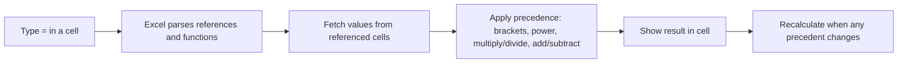
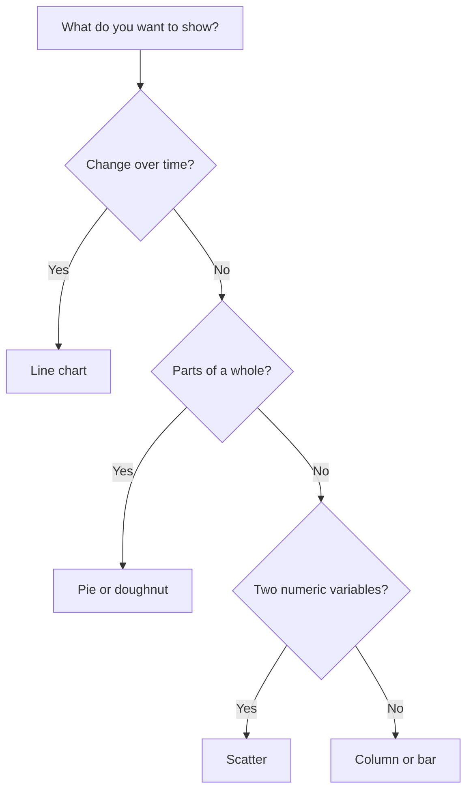
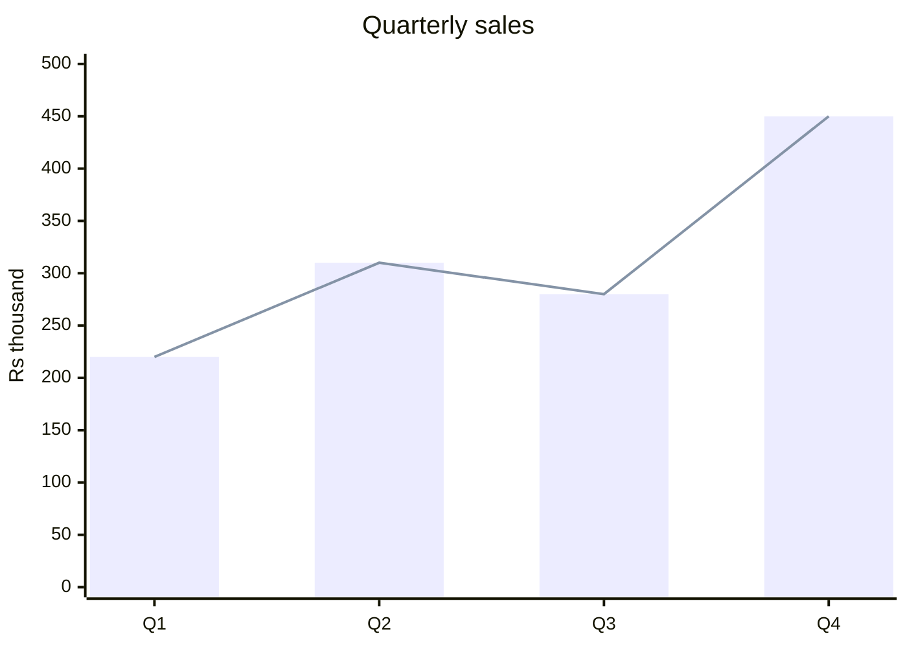

# Session 5 · Introduction to Microsoft Excel 2021

> [Prime AI – Software Engineering with AI](../../README.md) › [Term 1](../README.md) › [Effective Productivity with Office Automation](README.md) › **Session 5**

| ⏱ Estimated time | 🧩 Prerequisites |
|---|---|
| 2.5 hours | Session 2; basic arithmetic |

[⬅ Previous: Working with Microsoft Word – Part II](session-04-microsoft-word-part-2.md) &nbsp;|&nbsp; [Next: Data Analysis and Security of Data in Microsoft Excel 2021 ➡](session-06-data-analysis-and-security-in-excel.md)

---

## 🎯 Learning objectives

By the end of this session you will be able to:

- Create, find, save and share Excel workbooks.
- Format worksheets with number formats, styles, tables and conditional formatting.
- Write formulas using relative, absolute and mixed references.
- Use core functions: SUM, AVERAGE, IF, IFS, COUNTIF(S), SUMIF(S), XLOOKUP, TEXT, dynamic arrays.
- Create and format charts and use AI-powered Analyze Data.

## 📖 Concepts

### Workbook vocabulary
**Workbook** (file `.xlsx`) → **worksheets** (tabs) → **cells** addressed by column letter + row number (`B3`).
A **range** is a rectangle of cells (`A1:D10`). The **Name Box** shows the active cell; the **Formula Bar** shows its content.

### Formatting for clarity
- **Number formats**: General, Number, Currency (Rs), Percentage, Date, Custom (e.g. `0.0" kg"`).
- **Cell styles** and **Format as Table** (`Ctrl+T`): banded rows, filter buttons, structured references like `=SUM(Sales[Amount])`, auto-expanding ranges.
- **Conditional formatting**: data bars, colour scales, icon sets, or a formula rule.
- **Freeze Panes** keeps headers visible while scrolling.

### Formulas and references
Every formula starts with `=`. Operator precedence: `( )` → `^` → `* /` → `+ -` → `&` (join text) → comparisons.

| Reference | Written | When copied down/right |
|---|---|---|
| Relative | `A1` | Row and column both shift |
| Absolute | `$A$1` | Never shifts |
| Mixed (lock column) | `$A1` | Row shifts, column fixed |
| Mixed (lock row) | `A$1` | Column shifts, row fixed |

Press **F4** while editing a reference to cycle through these.

### Functions you must know
| Category | Functions | Example |
|---|---|---|
| Math | `SUM`, `ROUND`, `SUMIFS` | `=SUMIFS(D:D,B:B,"Lahore")` |
| Statistics | `AVERAGE`, `MEDIAN`, `MIN`, `MAX`, `COUNT`, `COUNTA`, `COUNTIFS` | `=COUNTIF(E2:E40,"Pass")` |
| Logical | `IF`, `IFS`, `AND`, `OR`, `IFERROR` | `=IF(AND(B2>=50,C2>=75%),"Eligible","No")` |
| Lookup | `XLOOKUP`, `VLOOKUP`, `INDEX`/`MATCH` | `=XLOOKUP(H2,A:A,C:C,"Not found")` |
| Text | `LEFT`, `RIGHT`, `MID`, `LEN`, `TRIM`, `UPPER`, `TEXTJOIN`, `CONCAT` | `=TRIM(A2)&" "&UPPER(B2)` |
| Date | `TODAY`, `DATEDIF`, `EOMONTH`, `NETWORKDAYS` | `=NETWORKDAYS(A2,B2)` |
| Dynamic arrays | `UNIQUE`, `SORT`, `FILTER`, `SEQUENCE` | `=FILTER(A2:D40,D2:D40>80)` |

Common errors: `#DIV/0!` (divide by zero), `#N/A` (lookup not found), `#VALUE!` (wrong type), `#REF!` (deleted cell),
`#NAME?` (misspelt function), `#SPILL!` (dynamic array blocked by data).

### Charts
| Chart | Best for |
|---|---|
| Column / Bar | Comparing categories |
| Line | Trends over time |
| Pie / Doughnut | Parts of a whole (≤ 6 slices) |
| Scatter | Relationship between two numbers |
| Combo | Two measures with different scales |

Select data → Insert › Recommended Charts → use the **+** button for titles, labels and legend.
**Sparklines** are tiny in-cell charts. **Analyze Data** (Home tab) suggests charts and answers questions like "total sales by city".

## 🧭 Diagrams

### How Excel evaluates a formula



### Choosing a chart



## 💻 Worked examples

### Example 1 — A mark sheet with formulas

```text
     A        B      C        D       E         F            G
1  Name     Quiz   Midterm  Final   Total     Percent      Grade
2  Ayesha    18      27      44    =SUM(B2:D2) =E2/100     =IFS(F2>=0.8,"A",F2>=0.65,"B",F2>=0.5,"C",TRUE,"F")
3  Bilal     12      19      30
4  Sana      20      25      41
5  Usman      8      14      22
7  Class average:            =AVERAGE(E2:E5)
8  Passed:                   =COUNTIF(G2:G5,"<>F")
```

**How to use it**

```text
Fill E2:G2 down to row 5 (double-click the fill handle).
```

### Example 2 — Verifying the mark sheet with Python

Programmers often double-check spreadsheet logic in code. The results below match what Excel shows.

```python
rows = [("Ayesha", 18, 27, 44), ("Bilal", 12, 19, 30), ("Sana", 20, 25, 41), ("Usman", 8, 14, 22)]

def grade(p):            # same logic as =IFS(...)
    if p >= 0.8: return "A"
    if p >= 0.65: return "B"
    if p >= 0.5: return "C"
    return "F"

totals = []
for name, q, m, f in rows:
    total = q + m + f
    totals.append(total)
    print(f"{name:<7} total={total:>3}  percent={total/100:.0%}  grade={grade(total/100)}")
print("Class average:", sum(totals) / len(totals))
print("Passed:", sum(1 for t in totals if grade(t/100) != "F"))
```

📄 Saved as [`code/session-05_example-2.py`](code/session-05_example-2.py)

**Output** (real run)

```text
Ayesha  total= 89  percent=89%  grade=A
Bilal   total= 61  percent=61%  grade=C
Sana    total= 86  percent=86%  grade=A
Usman   total= 44  percent=44%  grade=F
Class average: 70.0
Passed: 3
```

### Example 3 — Absolute references: commission table

In Excel: commission rate in `B1`, sales in `A4:A7`, formula in `B4` is `=A4*$B$1` copied down. Python mirrors it:

```python
rate = 0.05                      # cell B1 (absolute: $B$1)
sales = [120000, 85000, 240000, 56000]   # A4:A7 (relative: A4, A5, ...)
for row, s in enumerate(sales, start=4):
    print(f"B{row}: =A{row}*$B$1 -> {s * rate:,.0f}")
```

📄 Saved as [`code/session-05_example-3.py`](code/session-05_example-3.py)

**Output** (real run)

```text
B4: =A4*$B$1 -> 6,000
B5: =A5*$B$1 -> 4,250
B6: =A6*$B$1 -> 12,000
B7: =A7*$B$1 -> 2,800
```

## 📊 At a glance

Quarterly sales of a small shop (Rs thousand) – the kind of chart you will build in the lab:



## 🧪 Lab / practice tasks

**🟢 Easy** — Recreate the mark sheet above for 10 students and format Percent as %, Total with data bars.

<details><summary>💡 Hint</summary>

Home › Number › %; Home › Conditional Formatting › Data Bars.

</details>

**🟡 Medium** — Convert the range into a Table named `Marks` and use `=AVERAGE(Marks[Total])`. Add a slicer for Grade.

<details><summary>💡 Hint</summary>

Ctrl+T, then Table Design › Table Name; Insert › Slicer.

</details>

**🔴 Hard** — On a second sheet build a lookup: type a name in H2 and show that student’s grade with XLOOKUP and a friendly "Not found" message.

<details><summary>💡 Hint</summary>

`=XLOOKUP(H2,Marks[Name],Marks[Grade],"Not found")`

</details>

**🏆 Challenge** — Use `=FILTER()` and `=SORT()` to produce a live "Top performers" list (percent ≥ 80%), sorted highest first, and chart it.

<details><summary>💡 Hint</summary>

`=SORT(FILTER(Marks[[Name]:[Percent]],Marks[Percent]>=0.8),2,-1)`

</details>

## ✅ Quick quiz

**Q1. `=A1*$B$1` copied to the next row becomes:**

- A) =A2*$B$2
- B) =A2*$B$1
- C) =B1*$B$1
- D) =A1*$B$1

<details><summary>Show answer</summary>

**B** — Only the relative part moves.

</details>

**Q2. Which error means a lookup value was not found?**

- A) #REF!
- B) #N/A
- C) #DIV/0!
- D) #NAME?

<details><summary>Show answer</summary>

**B** — #N/A = not available.

</details>

**Q3. Which chart is best for a trend over 12 months?**

- A) Pie
- B) Line
- C) Doughnut
- D) Radar

<details><summary>Show answer</summary>

**B** — Lines show change over time.

</details>

**Q4. `=COUNTIF(G2:G5,"<>F")` counts cells that are:**

- A) Equal to F
- B) Not equal to F
- C) Empty
- D) Numbers

<details><summary>Show answer</summary>

**B** — <> means not equal.

</details>

**Q5. What does Ctrl+T do?**

- A) Insert table/format as Table
- B) Insert chart
- C) Toggle formulas
- D) Save

<details><summary>Show answer</summary>

**A** — It converts a range to an Excel Table.

</details>

## 📝 Summary / cheat-sheet

- Workbook → sheets → cells; ranges like A1:D10; formulas begin with =.
- References: relative A1, absolute $A$1, mixed $A1 / A$1; F4 toggles.
- Key functions: SUM, AVERAGE, COUNTIF(S), SUMIF(S), IF/IFS, XLOOKUP, TEXT, UNIQUE/SORT/FILTER.
- Tables (Ctrl+T) give structured references and auto-expanding ranges.
- Choose charts by question: compare (column), trend (line), share (pie), relationship (scatter).

## 🎤 Interview / viva questions

1. **Why use an Excel Table instead of a plain range?**
   <details><summary>Model answer</summary>

   Tables auto-expand, keep formatting, give filter buttons and readable structured references.

   </details>

2. **Explain mixed references with an example.**
   <details><summary>Model answer</summary>

   `$A2` keeps column A fixed while the row changes – useful for multiplication tables.

   </details>

3. **What causes #SPILL!?**
   <details><summary>Model answer</summary>

   A dynamic array formula cannot output because cells in its spill range are not empty.

   </details>

4. **XLOOKUP vs VLOOKUP?**
   <details><summary>Model answer</summary>

   XLOOKUP can look left, defaults to exact match, has a built-in not-found argument and does not break when columns are inserted.

   </details>

---

[⬅ Previous: Working with Microsoft Word – Part II](session-04-microsoft-word-part-2.md) &nbsp;|&nbsp; [Next: Data Analysis and Security of Data in Microsoft Excel 2021 ➡](session-06-data-analysis-and-security-in-excel.md)

<sub>Prepared by **Hamna Zahid Khan**, Junior Lecturer · Prime AI – Software Engineering with AI</sub>
