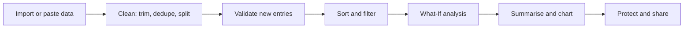
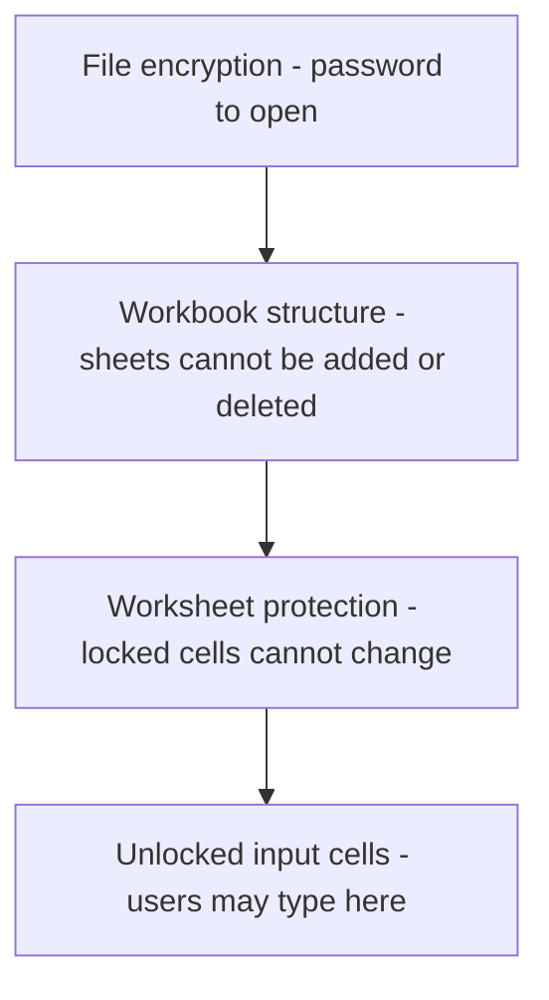

# Session 6 · Data Analysis and Security of Data in Microsoft Excel 2021

> [Prime AI – Software Engineering with AI](../../README.md) › [Term 1](../README.md) › [Effective Productivity with Office Automation](README.md) › **Session 6**

| ⏱ Estimated time | 🧩 Prerequisites |
|---|---|
| 2 hours | Session 5 |

[⬅ Previous: Introduction to Microsoft Excel 2021](session-05-introduction-to-microsoft-excel.md) &nbsp;|&nbsp; [Next: PivotTable and PivotCharts in Microsoft Excel 2021 ➡](session-07-pivottables-and-pivotcharts.md)

---

## 🎯 Learning objectives

By the end of this session you will be able to:

- Sort, filter, validate and clean data with Excel data tools.
- Use What-If Analysis: Goal Seek, Scenario Manager and Data Tables.
- Summarise data with Subtotals and Analyze Data.
- Apply the three levels of protection: file, workbook and worksheet.

## 📖 Concepts

### Getting data ready
Real data is messy. Before analysing, **clean** it:
| Tool | Where | What it fixes |
|---|---|---|
| Sort (single / custom multi-level) | Data › Sort | Order by city, then by sales descending |
| Filter / Advanced Filter | Data › Filter (`Ctrl+Shift+L`) | Show only rows that meet criteria |
| Remove Duplicates | Data › Data Tools | Repeated entries |
| Text to Columns / Flash Fill (`Ctrl+E`) | Data › Data Tools | Split "Khan, Ayesha" into two columns |
| `TRIM`, `PROPER`, `CLEAN` | Formulas | Extra spaces, inconsistent case |
| **Data Validation** | Data › Data Validation | Stop bad input: lists, whole numbers 0–100, dates, custom formulas |

### What-If Analysis
| Tool | Question it answers | Example |
|---|---|---|
| **Goal Seek** | "What input gives me this output?" | What final exam mark do I need to reach 75% overall? |
| **Scenario Manager** | "Compare named sets of inputs" | Best/likely/worst case budgets |
| **Data Table** | "Show output for many input values" | Loan instalment for rates 10–20% |
| **Forecast Sheet** | "Predict the trend" | Next 6 months of sales |

### Summarising
- **Subtotal** (Data › Outline): sort by a column first, then insert SUM/COUNT at each change – with outline buttons 1-2-3.
- **Consolidate**: combine ranges from several sheets.
- **Analyze Data** (AI): automatic insights, e.g. "Karachi has noticeably higher sales than other cities".

### Protection levels
| Level | Protects | How |
|---|---|---|
| **File** | Opening/modifying the whole file | File › Info › Protect Workbook › Encrypt with Password; or Save As › Tools › General Options |
| **Workbook structure** | Adding, deleting, renaming, hiding sheets | Review › Protect Workbook |
| **Worksheet** | Editing locked cells, formatting, inserting rows | Format Cells › Protection › untick *Locked* for input cells → Review › Protect Sheet |
| Allow Edit Ranges | Different passwords for different ranges | Review › Allow Edit Ranges |
| Mark as Final / Inspect Document | Discourage edits; remove hidden personal info | File › Info |

> 🔐 Sheet/workbook protection is about **preventing accidents**, not strong security. Only **file encryption** really protects confidential data – and if you forget that password, Microsoft cannot recover it.

## 🧭 Diagrams

### A data-analysis workflow



### Layers of protection



## 💻 Worked examples

### Example 1 — Goal Seek: what final-exam mark do I need?

Excel set-up: B1 = coursework % (weight 40%), B2 = final % (weight 60%), B3 = `=B1*0.4+B2*0.6`. Goal Seek: set B3 to 75 by changing B2. Python reproduces the search that Goal Seek performs (bisection):

```python
coursework = 68.0
def overall(final):
    return coursework * 0.4 + final * 0.6

lo, hi = 0.0, 100.0
for _ in range(40):                 # Goal Seek iterates in a similar way
    mid = (lo + hi) / 2
    if overall(mid) < 75: lo = mid
    else: hi = mid
print(f"Final exam needed: {hi:.2f}%")
print(f"Check: overall = {overall(hi):.2f}%")
```

📄 Saved as [`code/session-06_example-1.py`](code/session-06_example-1.py)

**Output** (real run)

```text
Final exam needed: 79.67%
Check: overall = 75.00%
```

### Example 2 — Data Table: monthly loan instalment at different rates

In Excel you would put `=PMT(rate/12, months, -amount)` and use *What-If › Data Table* with a column of rates. Here is the same table computed in Python:

```python
amount, months = 500000, 36          # Rs 500,000 over 3 years
def pmt(annual_rate):
    r = annual_rate / 12
    return amount * r / (1 - (1 + r) ** -months)
print("Rate   Monthly instalment")
for rate in [0.10, 0.12, 0.14, 0.16, 0.18, 0.20]:
    print(f"{rate:>4.0%}   Rs {pmt(rate):>10,.0f}")
```

📄 Saved as [`code/session-06_example-2.py`](code/session-06_example-2.py)

**Output** (real run)

```text
Rate   Monthly instalment
 10%   Rs     16,134
 12%   Rs     16,607
 14%   Rs     17,089
 16%   Rs     17,579
 18%   Rs     18,076
 20%   Rs     18,582
```

### Example 3 — Data Validation rule for a marks column

```text
Select C2:C41 > Data > Data Validation
  Allow: Whole number   Data: between   Minimum: 0   Maximum: 100
  Input Message tab:  "Enter marks out of 100"
  Error Alert tab:    Style = Stop, "Marks must be 0-100"
Then: Data > Data Validation > Circle Invalid Data   (finds old bad values)
```

**Result**

```text
Typing 105 in C5 shows a Stop dialog: "Marks must be 0-100". Existing invalid entries get red circles.
```

## 📊 At a glance

| Protection | Strength | Use it when… |
|---|---|---|
| Worksheet | ⭐ | You want to stop accidental formula edits |
| Workbook structure | ⭐ | Sheets must not be deleted/renamed |
| File encryption | ⭐⭐⭐⭐ | The file contains salaries, grades, personal data |

## 🧪 Lab / practice tasks

**🟢 Easy** — Download any public sample dataset (e.g. 100 sales rows). Remove duplicates and sort by Region then Amount (largest first).

<details><summary>💡 Hint</summary>

Data › Sort › Add Level.

</details>

**🟡 Medium** — Add a drop-down list for the Region column using Data Validation, and an error alert.

<details><summary>💡 Hint</summary>

Allow: List, Source: `Karachi,Lahore,Islamabad,Peshawar`.

</details>

**🔴 Hard** — Build a loan calculator with PMT and a one-variable Data Table for rates 8%–20% in 2% steps.

<details><summary>💡 Hint</summary>

Formula above the column of rates; select both; Data › What-If › Data Table › Column input cell = rate cell.

</details>

**🏆 Challenge** — Create a fee-calculator sheet where only the yellow input cells are editable, the sheet structure is locked and the file needs a password to open. Document every step.

<details><summary>💡 Hint</summary>

Unlock input cells → Protect Sheet → Protect Workbook → Encrypt with Password.

</details>

## ✅ Quick quiz

**Q1. Goal Seek changes:**

- A) Many inputs
- B) One input cell to reach a target
- C) Chart type
- D) Protection

<details><summary>Show answer</summary>

**B** — It adjusts a single input.

</details>

**Q2. Before using Subtotal you should:**

- A) Protect the sheet
- B) Sort by the grouping column
- C) Delete headers
- D) Insert a chart

<details><summary>Show answer</summary>

**B** — Subtotals insert breaks where values change.

</details>

**Q3. All cells are ____ by default.**

- A) Hidden
- B) Locked
- C) Unlocked
- D) Validated

<details><summary>Show answer</summary>

**B** — Locking only takes effect when the sheet is protected.

</details>

**Q4. Which tool compares best/likely/worst sets of inputs?**

- A) Scenario Manager
- B) Flash Fill
- C) Freeze Panes
- D) Sparklines

<details><summary>Show answer</summary>

**A** — Scenarios store named input sets.

</details>

**Q5. Which protection actually encrypts the data?**

- A) Protect Sheet
- B) Protect Workbook structure
- C) Encrypt with Password
- D) Mark as Final

<details><summary>Show answer</summary>

**C** — Only file encryption scrambles the content.

</details>

## 📝 Summary / cheat-sheet

- Clean first: TRIM, Remove Duplicates, Text to Columns, Flash Fill (Ctrl+E).
- Data Validation prevents bad input; Circle Invalid Data finds old errors.
- What-If: Goal Seek (one input → target), Scenario Manager (named sets), Data Table (many values).
- Subtotal needs sorted data; Analyze Data gives AI insights.
- Protection layers: file encryption (strong) › workbook structure › worksheet (unlock inputs first).

## 🎤 Interview / viva questions

1. **What is the difference between Goal Seek and a Data Table?**
   <details><summary>Model answer</summary>

   Goal Seek finds one input for a desired output; a Data Table shows the output for a whole list of input values.

   </details>

2. **Why is worksheet protection considered weak?**
   <details><summary>Model answer</summary>

   Its password only blocks the UI; the data is not encrypted and can be read by other tools.

   </details>

3. **How do you make some cells editable on a protected sheet?**
   <details><summary>Model answer</summary>

   Select them, Format Cells › Protection › untick Locked, then protect the sheet.

   </details>

4. **Give a real use of Data Validation.**
   <details><summary>Model answer</summary>

   A drop-down of allowed departments in an HR sheet so names are spelled consistently.

   </details>

---

[⬅ Previous: Introduction to Microsoft Excel 2021](session-05-introduction-to-microsoft-excel.md) &nbsp;|&nbsp; [Next: PivotTable and PivotCharts in Microsoft Excel 2021 ➡](session-07-pivottables-and-pivotcharts.md)

<sub>Prepared by **Hamna Zahid Khan**, Junior Lecturer · Prime AI – Software Engineering with AI</sub>
