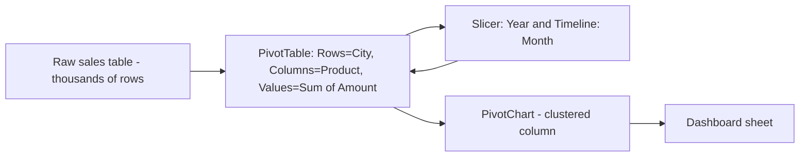
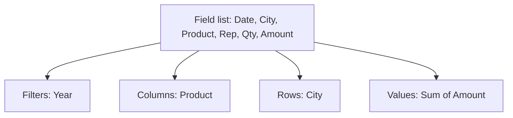
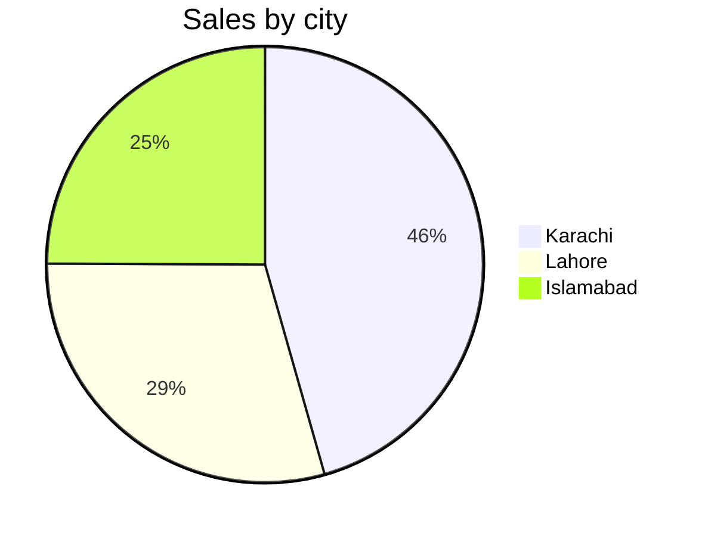

# Session 7 · PivotTable and PivotCharts in Microsoft Excel 2021

> [Prime AI – Software Engineering with AI](../../README.md) › [Term 1](../README.md) › [Effective Productivity with Office Automation](README.md) › **Session 7**

| ⏱ Estimated time | 🧩 Prerequisites |
|---|---|
| 2 hours | Sessions 5–6 |

[⬅ Previous: Data Analysis and Security of Data in Microsoft Excel 2021](session-06-data-analysis-and-security-in-excel.md) &nbsp;|&nbsp; [Next: Understanding Microsoft PowerPoint 2021 – I ➡](session-08-microsoft-powerpoint-part-1.md)

---

## 🎯 Learning objectives

By the end of this session you will be able to:

- Explain why PivotTables are the fastest way to summarise large data.
- Create a PivotTable using Rows, Columns, Values and Filters.
- Group, sort, filter, use slicers/timelines and change value calculations.
- Create PivotCharts and list the differences between PivotTables and PivotCharts.

## 📖 Concepts

### Why pivot?
Imagine 10,000 sales rows: Date, City, Product, Salesperson, Quantity, Amount. Your manager asks "total sales by city
for each product, only for 2026". With formulas you would write many `SUMIFS`; with a **PivotTable** you drag four
fields and get the answer in seconds. "Pivot" means you can **rotate** the view freely.

### Preparing source data
- One header row, unique header names, no blank rows/columns, one record per row.
- Format it as an **Excel Table** (`Ctrl+T`) so new rows are included on refresh.

### The four areas
| Area | Holds | Example |
|---|---|---|
| **Rows** | Categories listed down | City |
| **Columns** | Categories across | Product |
| **Values** | Numbers summarised (Sum, Count, Average, Max…) | Sum of Amount |
| **Filters** | Report-level filter | Year = 2026 |

### Power features
- **Value Field Settings** › *Show Values As*: % of Grand Total, % of Column, Running Total, Rank.
- **Group**: dates into Months/Quarters/Years; numbers into bands (0–999, 1000–1999).
- **Calculated Field**: e.g. `Profit = Amount - Cost`.
- **Slicers** (buttons) and **Timelines** (date sliders) for friendly filtering; one slicer can control several PivotTables (*Report Connections*).
- **Refresh** (`Alt+F5`) after source data changes; *Refresh All* (`Ctrl+Alt+F5`).
- **Drill-down**: double-click any value to see the rows behind it on a new sheet.
- **Recommended PivotTables** and **Analyze Data** suggest layouts automatically.

### PivotChart vs PivotTable
| | PivotTable | PivotChart |
|---|---|---|
| Output | Numbers in a grid | Visual chart |
| Depends on | Source data | Its PivotTable (always linked) |
| Field buttons | Row/column labels | Axis/legend field buttons on chart |
| Change one → | Chart updates | Table updates |
| Best for | Exact values, drill-down | Spotting patterns, dashboards |

## 🧭 Diagrams

### From raw rows to insight



### PivotTable field areas



## 💻 Worked examples

### Example 1 — A PivotTable computed with pandas (same result Excel gives)

pandas' `pivot_table` is the programmer's equivalent of an Excel PivotTable – useful later in the Python term.

```python
import pandas as pd
sales = pd.DataFrame({
    "City":    ["Karachi", "Lahore", "Karachi", "Islamabad", "Lahore", "Karachi", "Islamabad", "Lahore"],
    "Product": ["Laptop", "Laptop", "Phone", "Phone", "Phone", "Laptop", "Laptop", "Tablet"],
    "Amount":  [180000, 175000, 60000, 65000, 58000, 190000, 170000, 45000],
})
pt = pd.pivot_table(sales, index="City", columns="Product", values="Amount",
                    aggfunc="sum", fill_value=0, margins=True, margins_name="Grand Total")
print(pt)
print()
share = (sales.groupby("City")["Amount"].sum() / sales["Amount"].sum() * 100).round(1)
print("% of grand total by city:")
print(share.to_string())
```

📄 Saved as [`code/session-07_example-1.py`](code/session-07_example-1.py)

**Output** (real run)

```text
Product      Laptop   Phone  Tablet  Grand Total
City                                            
Islamabad    170000   65000       0       235000
Karachi      370000   60000       0       430000
Lahore       175000   58000   45000       278000
Grand Total  715000  183000   45000       943000

% of grand total by city:
City
Islamabad    24.9
Karachi      45.6
Lahore       29.5
```

### Example 2 — Excel steps for the same report

```text
1. Click inside the sales Table > Insert > PivotTable > New Worksheet > OK
2. Drag City -> Rows, Product -> Columns, Amount -> Values (Sum of Amount)
3. Right-click a value > Number Format > Currency, 0 decimals
4. PivotTable Analyze > Insert Slicer > Product
5. PivotTable Analyze > PivotChart > Clustered Column
6. Second copy of Amount in Values > Show Values As > % of Grand Total
```

**Result**

```text
A grid identical to the pandas output above, a Product slicer and a linked column chart.
```

## 📊 At a glance

Share of sales by city from the example data:



## 🧪 Lab / practice tasks

**🟢 Easy** — Create a PivotTable from a 50-row sales table showing Sum of Amount by City.

<details><summary>💡 Hint</summary>

Insert › PivotTable; drag City to Rows, Amount to Values.

</details>

**🟡 Medium** — Add Product to Columns, format values as currency and show % of Grand Total in a second value field.

<details><summary>💡 Hint</summary>

Value Field Settings › Show Values As.

</details>

**🔴 Hard** — Group the Date field by Quarter and Year and add a Timeline. Add a calculated field Profit = Amount - Cost.

<details><summary>💡 Hint</summary>

Right-click a date › Group; PivotTable Analyze › Fields, Items & Sets › Calculated Field.

</details>

**🏆 Challenge** — Build a one-sheet dashboard: two PivotCharts and one slicer connected to both PivotTables. Hide gridlines and field buttons.

<details><summary>💡 Hint</summary>

Slicer › Report Connections; PivotChart Analyze › Field Buttons.

</details>

## ✅ Quick quiz

**Q1. Which area would you use for "Sum of Amount"?**

- A) Rows
- B) Columns
- C) Values
- D) Filters

<details><summary>Show answer</summary>

**C** — Values hold the aggregated numbers.

</details>

**Q2. After adding new rows to the source Table you must:**

- A) Recreate the PivotTable
- B) Refresh
- C) Protect the sheet
- D) Sort

<details><summary>Show answer</summary>

**B** — Refresh pulls the new data.

</details>

**Q3. Double-clicking a value in a PivotTable:**

- A) Deletes it
- B) Shows the underlying records
- C) Creates a chart
- D) Groups it

<details><summary>Show answer</summary>

**B** — This is drill-down.

</details>

**Q4. A PivotChart is linked to:**

- A) A Word file
- B) Its PivotTable
- C) A macro
- D) Nothing

<details><summary>Show answer</summary>

**B** — They always stay in sync.

</details>

**Q5. Timelines filter by:**

- A) Text
- B) Dates
- C) Colours
- D) Formulas

<details><summary>Show answer</summary>

**B** — Timelines are date slicers.

</details>

## 📝 Summary / cheat-sheet

- Clean, tabular source data (Excel Table) → Insert › PivotTable.
- Rows, Columns, Values, Filters – drag to rotate the view.
- Value settings: Sum/Count/Average, Show Values As %, Running Total.
- Group dates/numbers, calculated fields, slicers and timelines, refresh after changes.
- PivotChart = visual of the PivotTable; both update together.

## 🎤 Interview / viva questions

1. **Why should source data be an Excel Table?**
   <details><summary>Model answer</summary>

   The PivotTable range then grows automatically with new rows, so a refresh includes them.

   </details>

2. **What is a calculated field?**
   <details><summary>Model answer</summary>

   A new field defined by a formula on other PivotTable fields, e.g. Profit = Amount − Cost.

   </details>

3. **PivotTable vs SUMIFS?**
   <details><summary>Model answer</summary>

   SUMIFS gives fixed formulas; a PivotTable lets you reorganise the summary interactively without rewriting formulas.

   </details>

4. **What does Show Values As › % of Column Total do?**
   <details><summary>Model answer</summary>

   Displays each value as its share of the column total instead of the raw number.

   </details>

---

[⬅ Previous: Data Analysis and Security of Data in Microsoft Excel 2021](session-06-data-analysis-and-security-in-excel.md) &nbsp;|&nbsp; [Next: Understanding Microsoft PowerPoint 2021 – I ➡](session-08-microsoft-powerpoint-part-1.md)

<sub>Prepared by **Hamna Zahid Khan**, Junior Lecturer · Prime AI – Software Engineering with AI</sub>
