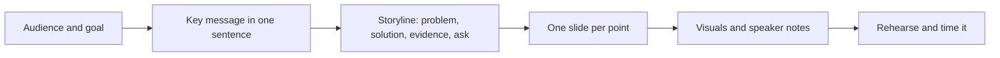
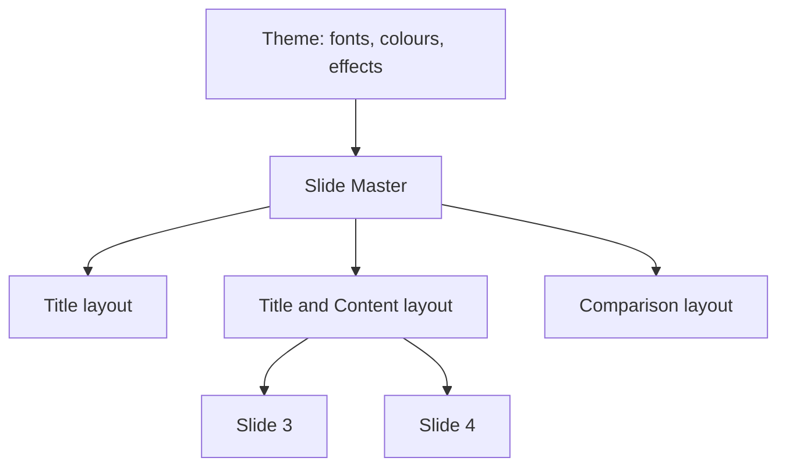

# Session 8 · Understanding Microsoft PowerPoint 2021 – I

> [Prime AI – Software Engineering with AI](../../README.md) › [Term 1](../README.md) › [Effective Productivity with Office Automation](README.md) › **Session 8**

| ⏱ Estimated time | 🧩 Prerequisites |
|---|---|
| 2 hours | Session 2 |

[⬅ Previous: PivotTable and PivotCharts in Microsoft Excel 2021](session-07-pivottables-and-pivotcharts.md) &nbsp;|&nbsp; [Next: Understanding Microsoft PowerPoint 2021 – II ➡](session-09-microsoft-powerpoint-part-2.md)

---

## 🎯 Learning objectives

By the end of this session you will be able to:

- Describe what PowerPoint is used for and the principles of a good presentation.
- Identify the PowerPoint window, views and slide layouts.
- Create a presentation from a blank deck, a theme or a template.
- Add text, images, tables and charts; use Slide Master for consistency; deliver with Presenter View.

## 📖 Concepts

### Why presentations matter for engineers
You will present project proposals, sprint demos, capstone defences and job-interview case studies. A good deck
**supports** the speaker; it is not a document to read aloud.

**Design rules of thumb**
- **One idea per slide**; a headline that states the point ("Load time fell 40%"), not a topic ("Results").
- **6×6 guideline**: at most ~6 bullets of ~6 words – or better, a picture and a sentence.
- Font ≥ 24 pt for body text; high contrast; max 2 fonts; consistent colour palette.
- Prefer visuals: charts, diagrams, screenshots, icons.

### The PowerPoint window
| Part | Use |
|---|---|
| Slide thumbnails pane | Reorder, duplicate (`Ctrl+D`), hide slides |
| Slide pane | Edit the current slide |
| Notes pane | Speaker notes – visible only to you in Presenter View |
| Views | Normal, Outline, Slide Sorter, Notes Page, Reading View, Slide Show |
| Status bar | Notes, comments, view buttons, zoom |

### Creating a deck
1. File › New › blank, a **theme** (fonts + colours + effects) or a **template** (theme + sample content).
2. `Ctrl+M` adds a slide using a **layout** (Title, Title and Content, Two Content, Comparison, Section Header, Blank…).
3. Use **placeholders** – they keep text consistent and feed the Outline view and accessibility tools.
4. **Design › Designer** suggests layouts for images and text automatically.
5. **Slide Master** (View › Slide Master): change the logo, fonts or footer once; every slide using that layout updates.

### Inserting content
Tables, Charts (opens a mini Excel sheet), SmartArt, Pictures, Icons, Video/Audio, Screen Recording, Equation, Links.

### Delivering
- `F5` from start, `Shift+F5` from current slide.
- **Presenter View**: current slide, next slide, notes, timer, pen and laser tools.
- `B` black screen, `W` white screen, type a slide number + `Enter` to jump.
- **Rehearse with Coach** gives feedback on pace, filler words and reading the slide.
- Export: PDF, video (MP4), or *Package Presentation for CD* (embeds media).

## 🧭 Diagrams

### Planning a talk



### Theme, master, layout, slide



## 💻 Worked examples

### Example 1 — Storyboard for a 5-minute project pitch

```text
Slide 1  Title: "StudyBuddy - find a study partner in 2 minutes"  + team names
Slide 2  Problem: photo of a crowded library + "62% of first-years study alone"
Slide 3  Solution: app screenshot + three icons (Match, Chat, Meet)
Slide 4  How it works: SmartArt process (Sign up > Choose course > Match > Meet)
Slide 5  Evidence: column chart of pilot results
Slide 6  Ask: "We need 3 classrooms on Friday evenings" + QR code to the demo
Notes on every slide: 3 bullet talking points and time cue (e.g. 0:45)
```

**Result**

```text
Six focused slides, ~50 seconds each, every slide answering one question.
```

### Example 2 — Checking slide timing with Python

```python
plan = {"Title": 20, "Problem": 50, "Solution": 60, "How it works": 60, "Evidence": 60, "Ask": 30}
total = sum(plan.values())
print(f"Total: {total} s = {total // 60} min {total % 60} s")
for slide, sec in plan.items():
    bar = "#" * (sec // 10)
    print(f"{slide:<13}{sec:>3}s {bar}")
print("Within 5 minutes?", total <= 300)
```

📄 Saved as [`code/session-08_example-2.py`](code/session-08_example-2.py)

**Output** (real run)

```text
Total: 280 s = 4 min 40 s
Title         20s ##
Problem       50s #####
Solution      60s ######
How it works  60s ######
Evidence      60s ######
Ask           30s ###
Within 5 minutes? True
```

## 📊 At a glance

| View | Use it for |
|---|---|
| Normal | Building slides |
| Outline | Writing/restructuring text quickly |
| Slide Sorter | Reordering and transitions overview |
| Notes Page | Printing speaker notes |
| Presenter View | Delivering the talk |

## 🧪 Lab / practice tasks

**🟢 Easy** — Create a 4-slide deck about yourself with a theme, a title slide and one picture.

<details><summary>💡 Hint</summary>

Design tab › Themes; Insert › Pictures.

</details>

**🟡 Medium** — Open Slide Master and add a footer with your name and a small logo to every content slide.

<details><summary>💡 Hint</summary>

View › Slide Master; edit the parent master; close master view.

</details>

**🔴 Hard** — Insert a chart of your weekly study hours and a SmartArt process of your daily routine; add speaker notes.

<details><summary>💡 Hint</summary>

Insert › Chart opens a datasheet; Insert › SmartArt › Process.

</details>

**🏆 Challenge** — Build the 6-slide pitch storyboard above for your own idea and rehearse it with Rehearse with Coach; note your pace and filler-word report.

<details><summary>💡 Hint</summary>

Slide Show › Rehearse with Coach (Microsoft 365).

</details>

## ✅ Quick quiz

**Q1. `Ctrl+M` in PowerPoint:**

- A) Starts the show
- B) Adds a new slide
- C) Opens Slide Master
- D) Mutes audio

<details><summary>Show answer</summary>

**B** — New slide.

</details>

**Q2. Speaker notes are visible to the audience in Presenter View.**

- A) True
- B) False
- C) Only in PDF
- D) Only on Mac

<details><summary>Show answer</summary>

**B** — Only the presenter sees them.

</details>

**Q3. To change the logo on every slide at once use:**

- A) Slide Sorter
- B) Slide Master
- C) Outline
- D) Reading view

<details><summary>Show answer</summary>

**B** — The master controls layouts.

</details>

**Q4. Pressing B during a slide show:**

- A) Bolds text
- B) Shows a black screen
- C) Goes back
- D) Ends show

<details><summary>Show answer</summary>

**B** — B again returns.

</details>

**Q5. A strong slide headline is:**

- A) "Results"
- B) "Load time fell 40% after caching"
- C) "Slide 5"
- D) "Misc"

<details><summary>Show answer</summary>

**B** — It states the point.

</details>

## 📝 Summary / cheat-sheet

- One idea per slide, big fonts, visuals over text, headline states the point.
- Theme → Slide Master → layouts → slides; use placeholders.
- Ctrl+M new slide, F5/Shift+F5 to present, Presenter View with notes and timer.
- Designer suggests layouts; Rehearse with Coach improves delivery.

## 🎤 Interview / viva questions

1. **Difference between a theme and a template?**
   <details><summary>Model answer</summary>

   A theme is fonts, colours and effects; a template is a theme plus layouts and sample content.

   </details>

2. **Why use placeholders rather than text boxes?**
   <details><summary>Model answer</summary>

   They keep formatting consistent, appear in Outline view and are read correctly by screen readers.

   </details>

3. **What is Presenter View?**
   <details><summary>Model answer</summary>

   A private presenter screen showing current and next slides, notes, timer and tools while the audience sees only the slide.

   </details>

4. **How do you share a deck with embedded video safely?**
   <details><summary>Model answer</summary>

   Export as MP4 or use Package Presentation so media files travel with the deck.

   </details>

---

[⬅ Previous: PivotTable and PivotCharts in Microsoft Excel 2021](session-07-pivottables-and-pivotcharts.md) &nbsp;|&nbsp; [Next: Understanding Microsoft PowerPoint 2021 – II ➡](session-09-microsoft-powerpoint-part-2.md)

<sub>Prepared by **Hamna Zahid Khan**, Junior Lecturer · Prime AI – Software Engineering with AI</sub>
