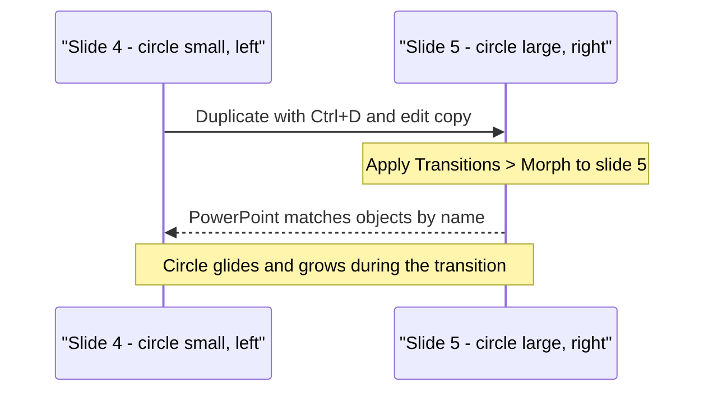
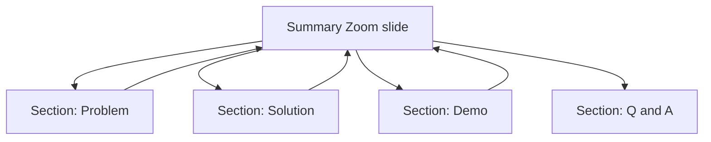
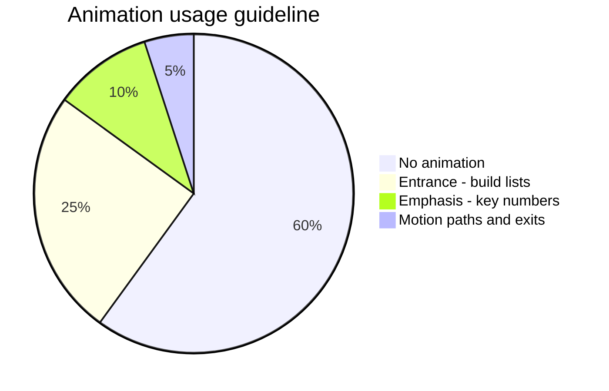

# Session 9 · Understanding Microsoft PowerPoint 2021 – II

> [Prime AI – Software Engineering with AI](../../README.md) › [Term 1](../README.md) › [Effective Productivity with Office Automation](README.md) › **Session 9**

| ⏱ Estimated time | 🧩 Prerequisites |
|---|---|
| 2 hours | Session 8 |

[⬅ Previous: Understanding Microsoft PowerPoint 2021 – I](session-08-microsoft-powerpoint-part-1.md) &nbsp;|&nbsp; [Next: Understanding Microsoft OneNote 2021 ➡](session-10-microsoft-onenote.md)

---

## 🎯 Learning objectives

By the end of this session you will be able to:

- Use the Home, Insert and Design tabs to their full potential.
- Apply animations purposefully and control their timing.
- Use Review and View tools, Zoom (Summary/Section/Slide) and the Morph transition.
- Insert and edit icons, SVG graphics and 3D models.
- Create presentations with AI assistance (Designer, Copilot) and evaluate the output.

## 📖 Concepts

### Tabs in depth
| Tab | Power features |
|---|---|
| **Home** | Layout, Reset, Section (group slides), Arrange & Align, Shape Format painter |
| **Insert** | Icons, 3D Models, SVG, Cameo/Screen recording, Zoom, Action buttons, Hyperlinks |
| **Design** | Themes, Variants, Slide Size (16:9 vs 4:3), Format Background, **Designer** |
| **Transitions** | Morph, Fade, Push; duration; *After* timing for kiosks |
| **Animations** | Entrance, Emphasis, Exit, Motion Paths; Animation Pane; triggers |
| **Review** | Spelling, Comments, Compare, Accessibility Checker, Translate |
| **View** | Normal, Slide Sorter, Notes, Masters, Guides & Gridlines |

### Animations with purpose
| Type | Colour in gallery | Example use |
|---|---|---|
| Entrance | Green | Reveal bullets one at a time |
| Emphasis | Yellow | Pulse the key number |
| Exit | Red | Remove a distractor |
| Motion path | Lines | Show data travelling client → server |

**Timing options:** *On Click*, *With Previous*, *After Previous*; Duration; Delay. Use the **Animation Pane** to reorder.
A **trigger** starts an animation when a specific object is clicked – great for quizzes.
Rule: animation should explain, not decorate.

### Zoom – non-linear presentations
- **Summary Zoom**: one overview slide with thumbnails of each section; click to jump, it returns automatically.
- **Section Zoom**: link to a section.
- **Slide Zoom**: link to a single slide.

### Morph
Morph animates the **difference** between two consecutive slides. Duplicate a slide (`Ctrl+D`), move/resize/recolour
objects on the second copy, then apply **Transitions › Morph** to the second slide. To match differently named objects,
name them `!!sun` on both slides (Selection Pane `Alt+F10`).

### Icons, SVG and 3D
- **Icons** are SVG – scalable without blur; *Convert to Shape* to recolour parts.
- **3D models** (`.glb`, `.fbx`, `.obj`): rotate with the 3D handle; combined with Morph they spin smoothly.

### AI-assisted decks
- **Designer** proposes layouts; **Copilot** can *Create a presentation from a prompt or a Word file*, add a slide, summarise the deck.
- Check: facts, image licensing, consistent tone, slide count, accessibility (alt text, reading order).

## 🧭 Diagrams

### How Morph works



### Non-linear deck with Summary Zoom



## 💻 Worked examples

### Example 1 — Morph product reveal – step by step

```text
Slide 6: phone image small at bottom-left, title "Meet StudyBuddy"
Ctrl+D -> Slide 7: enlarge the phone, move to centre, rotate 10 degrees,
          add three icons around it
Select Slide 7 > Transitions > Morph > Effect Options: Objects  > Duration 1.50
Selection Pane (Alt+F10): ensure the phone is named the same on both slides
```

**Result**

```text
During the transition the phone glides to the centre, grows and tilts while the icons fade in – no animation pane needed.
```

### Example 2 — Animation sequence for a bullet reveal

```text
Select body placeholder > Animations > Fade
Effect Options > By Paragraph
Animation Pane: item 1 On Click; items 2-4 After Previous, delay 0.5 s
Emphasis "Pulse" on the KPI number, With Previous (start of item 4)
```

**Result**

```text
Each bullet fades in half a second after the previous one; the key number pulses as the last bullet appears.
```

## 📊 At a glance

How often each animation category should appear in a professional 20-slide deck (guideline):



## 🧪 Lab / practice tasks

**🟢 Easy** — Add Fade entrance animations to a bullet list so it builds by paragraph.

<details><summary>💡 Hint</summary>

Animations › Effect Options › By Paragraph.

</details>

**🟡 Medium** — Create a Summary Zoom for a 4-section deck.

<details><summary>💡 Hint</summary>

Create sections first (Home › Section), then Insert › Zoom › Summary Zoom.

</details>

**🔴 Hard** — Make a Morph sequence of three slides where a 3D model rotates and moves.

<details><summary>💡 Hint</summary>

Insert › 3D Models › Stock; duplicate slides; rotate; Morph.

</details>

**🏆 Challenge** — Generate a 6-slide deck with an AI tool, then audit it: list 5 issues (facts, design, accessibility) and fix them. Submit before/after.

<details><summary>💡 Hint</summary>

Use Review › Check Accessibility and verify every statistic with a source.

</details>

## ✅ Quick quiz

**Q1. Morph requires objects to:**

- A) Be pictures only
- B) Exist on two consecutive slides
- C) Be animated
- D) Be in the master

<details><summary>Show answer</summary>

**B** — It interpolates between slides.

</details>

**Q2. Green animation icons represent:**

- A) Exit
- B) Emphasis
- C) Entrance
- D) Motion

<details><summary>Show answer</summary>

**C** — Green = entrance.

</details>

**Q3. Summary Zoom is inserted from:**

- A) Insert › Zoom
- B) Design
- C) Review
- D) Transitions

<details><summary>Show answer</summary>

**A** — Insert tab › Zoom.

</details>

**Q4. Why are icons sharp at any size?**

- A) They are JPG
- B) They are SVG vectors
- C) They are 3D
- D) They are GIF

<details><summary>Show answer</summary>

**B** — Vectors scale without pixelation.

</details>

**Q5. "After Previous" means the animation starts:**

- A) On click
- B) When the previous one finishes
- C) With previous
- D) At slide end

<details><summary>Show answer</summary>

**B** — Sequential automatic start.

</details>

## 📝 Summary / cheat-sheet

- Insert: icons, SVG, 3D, Zoom; Design: Designer, slide size; Review: accessibility.
- Animations: entrance/emphasis/exit/motion; On Click / With / After Previous; Animation Pane.
- Zoom (summary/section/slide) enables non-linear talks.
- Morph = duplicate slide, change objects, apply Morph; name objects `!!name` to force matching.
- AI decks need human review for facts, licensing and accessibility.

## 🎤 Interview / viva questions

1. **When would you avoid animation?**
   <details><summary>Model answer</summary>

   When it distracts or slows the message, e.g. on every bullet in a technical review.

   </details>

2. **Explain an animation trigger.**
   <details><summary>Model answer</summary>

   An animation set to start when a specific object is clicked, letting you build interactive quizzes.

   </details>

3. **How does Morph decide which objects to animate?**
   <details><summary>Model answer</summary>

   It matches objects that exist on both slides, by type and name; names starting with !! force a match.

   </details>

4. **What is the benefit of SVG?**
   <details><summary>Model answer</summary>

   Small file size, infinite scaling and recolourable parts.

   </details>

---

[⬅ Previous: Understanding Microsoft PowerPoint 2021 – I](session-08-microsoft-powerpoint-part-1.md) &nbsp;|&nbsp; [Next: Understanding Microsoft OneNote 2021 ➡](session-10-microsoft-onenote.md)

<sub>Prepared by **Hamna Zahid Khan**, Junior Lecturer · Prime AI – Software Engineering with AI</sub>
