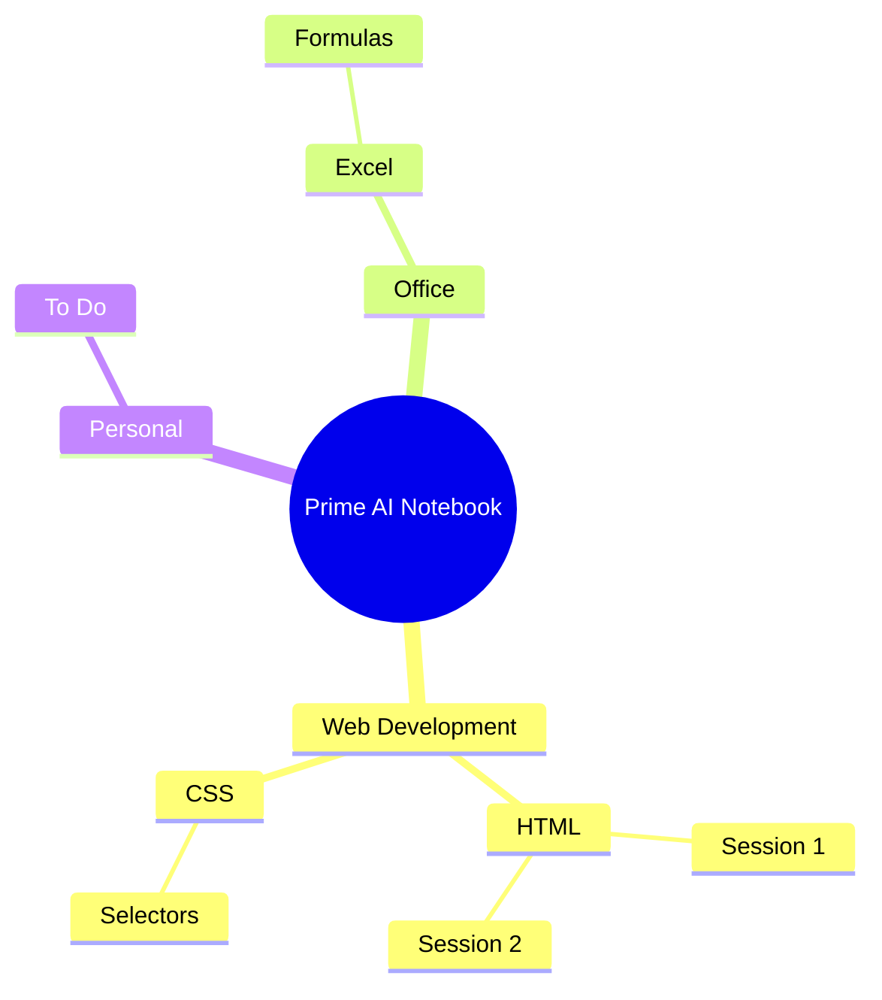

# Session 10 · Understanding Microsoft OneNote 2021

> [Prime AI – Software Engineering with AI](../../README.md) › [Term 1](../README.md) › [Effective Productivity with Office Automation](README.md) › **Session 10**

| ⏱ Estimated time | 🧩 Prerequisites |
|---|---|
| 1.5 hours | Session 2 |

[⬅ Previous: Understanding Microsoft PowerPoint 2021 – II](session-09-microsoft-powerpoint-part-2.md) &nbsp;|&nbsp; [Next: Using Outlook 2021 ➡](session-11-using-outlook.md)

---

## 🎯 Learning objectives

By the end of this session you will be able to:

- Explain the notebook › section › page structure of OneNote.
- Use OneNote tools: tags, drawing, math, audio/video recording, screen clipping.
- Organise and search notes across notebooks.
- Describe new features such as Immersive Reader, dictation and syncing.

## 📖 Concepts

### The structure
| Level | Analogy | Example |
|---|---|---|
| **Notebook** | A physical binder | "Prime AI – Term 1" |
| **Section group** | Divider set | "Web Development" |
| **Section** | Coloured tab | "HTML", "CSS" |
| **Page / Subpage** | Sheet of paper | "Session 3 – Selectors" |

Pages are a **free-form canvas** – click anywhere and type. Notebooks live in **OneDrive**, so they sync automatically
across laptop, phone and web. There is no Save button.

### Tools worth mastering
- **Tags** (Home): To Do (`Ctrl+1`), Important (`Ctrl+2`), Question (`Ctrl+3`), custom tags; *Find Tags* builds a summary page.
- **Draw**: pens, highlighters, **Ink to Text**, **Ink to Shape**, **Math** (handwrite an equation → solve, graph).
- **Insert**: tables, files as printouts, **audio/video recording** linked to typed notes, **screen clipping** (`Win+Shift+S`), links, date/time stamps.
- **Page templates**: lecture notes, to-do lists, meeting notes.
- **Linked notes** and `[[Page name]]` wiki links between pages.
- **Search** (`Ctrl+E`) across all notebooks – including text inside images (OCR) and handwriting.
- **Password-protect sections** for private content.

### New / modern features
- **Immersive Reader**: read aloud, line focus, syllables – great for language learners.
- **Dictate** (`Win+H`) for hands-free notes.
- **Sticky Notes** integration and **Copilot** (licence) to summarise pages or create to-do lists.
- Improved **Dark mode** and sync reliability.

### OneNote vs Word
| | OneNote | Word |
|---|---|---|
| Structure | Free-form canvas | Linear document |
| Saving | Automatic | Manual/AutoSave |
| Best for | Notes, research, brainstorming | Final, formatted documents |

## 🧭 Diagrams

### Notebook structure



## 💻 Worked examples

### Example 1 — Lecture-notes workflow for this course

```text
1. New notebook "Prime AI - Term 1" on OneDrive; share with your study group (Can view).
2. Section per module: Office, PWD, Bootstrap, SEO, Git.
3. Before class: page "Session N" from the Lecture Notes template.
4. During class: Insert > Audio recording; type key points - each line is time-linked to the audio.
5. Tag questions with Ctrl+3; screen-clip the teacher's diagram.
6. After class: Home > Find Tags > create summary page of all open questions.
```

**Result**

```text
A searchable notebook where clicking any note replays the lecture audio at that moment, and one page lists every unanswered question.
```

### Example 2 — A tiny "find tags" summary in Python

OneNote's *Find Tags* scans every page for tagged lines – this mimics the idea.

```python
pages = {
    "HTML - Session 1": ["[todo] install VS Code", "DOCTYPE tells browser HTML5", "[question] why lang attr?"],
    "CSS - Selectors": ["[question] specificity of :is()?", "class beats element", "[todo] finish lab 2"],
}
summary = {"todo": [], "question": []}
for page, lines in pages.items():
    for line in lines:
        for tag in summary:
            if line.startswith(f"[{tag}]"):
                summary[tag].append(f"{line[len(tag)+3:]}  ({page})")
for tag, items in summary.items():
    print(tag.upper())
    for i in items:
        print("  -", i)
```

📄 Saved as [`code/session-10_example-2.py`](code/session-10_example-2.py)

**Output** (real run)

```text
TODO
  - install VS Code  (HTML - Session 1)
  - finish lab 2  (CSS - Selectors)
QUESTION
  - why lang attr?  (HTML - Session 1)
  - specificity of :is()?  (CSS - Selectors)
```

## 📊 At a glance

| Task | Best app |
|---|---|
| Capturing class notes with audio | OneNote |
| Writing a formal assignment | Word |
| Shared team research board | OneNote (shared notebook) |
| Calculations | Excel |

## 🧪 Lab / practice tasks

**🟢 Easy** — Create a notebook with sections for each Term 1 module and one page per session so far.

<details><summary>💡 Hint</summary>

File › New › OneDrive.

</details>

**🟡 Medium** — Tag five items (To Do, Question, Important) across pages and generate a tag summary page.

<details><summary>💡 Hint</summary>

Home › Find Tags › Create Summary Page.

</details>

**🔴 Hard** — Handwrite (or type) `2x + 6 = 14` with the Math tool and get the solution and steps.

<details><summary>💡 Hint</summary>

Draw › Lasso select › Math.

</details>

**🏆 Challenge** — Share a notebook with three classmates and build a collaborative glossary of 30 web terms with internal links between pages.

<details><summary>💡 Hint</summary>

Use [[Term]] syntax to create links.

</details>

## ✅ Quick quiz

**Q1. The top level of OneNote organisation is a:**

- A) Page
- B) Section
- C) Notebook
- D) Tag

<details><summary>Show answer</summary>

**C** — Notebook › section › page.

</details>

**Q2. OneNote saves your work:**

- A) Manually
- B) Automatically
- C) Only on close
- D) Only to USB

<details><summary>Show answer</summary>

**B** — Continuous autosave and sync.

</details>

**Q3. `Ctrl+1` applies which tag?**

- A) Important
- B) To Do
- C) Question
- D) Idea

<details><summary>Show answer</summary>

**B** — To Do checkbox.

</details>

**Q4. Which feature reads text aloud with line focus?**

- A) Immersive Reader
- B) Ink to Shape
- C) Find Tags
- D) Page templates

<details><summary>Show answer</summary>

**A** — An accessibility tool.

</details>

**Q5. OneNote search can find text inside:**

- A) Only typed text
- B) Images and handwriting too
- C) Only titles
- D) Nothing

<details><summary>Show answer</summary>

**B** — OCR and ink recognition.

</details>

## 📝 Summary / cheat-sheet

- Notebook › section group › section › page/subpage; free-form canvas.
- Autosave + OneDrive sync; share notebooks for collaboration.
- Tags + Find Tags, Draw/Math, audio recordings linked to notes, screen clipping.
- Immersive Reader, Dictate, Copilot summaries; password-protected sections.

## 🎤 Interview / viva questions

1. **When is OneNote better than Word?**
   <details><summary>Model answer</summary>

   For unstructured note-taking, research collection and collaborative brainstorming where layout is free-form.

   </details>

2. **How do linked audio notes help revision?**
   <details><summary>Model answer</summary>

   Clicking a typed note jumps to the moment in the recording when it was written.

   </details>

3. **How can you keep a section private in a shared notebook?**
   <details><summary>Model answer</summary>

   Password-protect the section (or keep it in a separate personal notebook).

   </details>

---

[⬅ Previous: Understanding Microsoft PowerPoint 2021 – II](session-09-microsoft-powerpoint-part-2.md) &nbsp;|&nbsp; [Next: Using Outlook 2021 ➡](session-11-using-outlook.md)

<sub>Prepared by **Hamna Zahid Khan**, Junior Lecturer · Prime AI – Software Engineering with AI</sub>
