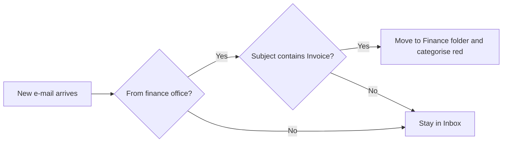
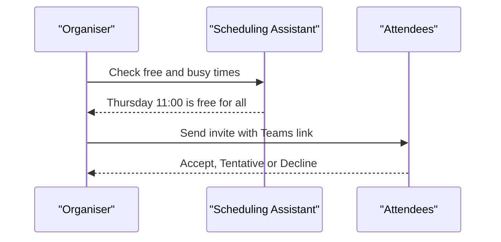

# Session 11 · Using Outlook 2021

> [Prime AI – Software Engineering with AI](../../README.md) › [Term 1](../README.md) › [Effective Productivity with Office Automation](README.md) › **Session 11**

| ⏱ Estimated time | 🧩 Prerequisites |
|---|---|
| 1.5 hours | Session 2 |

[⬅ Previous: Understanding Microsoft OneNote 2021](session-10-microsoft-onenote.md) &nbsp;|&nbsp; [Next: Skype and Microsoft Teams ➡](session-12-skype-and-microsoft-teams.md)

---

## 🎯 Learning objectives

By the end of this session you will be able to:

- Explain the functions of Outlook: mail, calendar, people, tasks.
- Organise e-mail with folders, rules, categories, flags, Quick Steps and search folders.
- Schedule meetings and manage a calendar professionally.
- Write professional e-mails and use new Outlook 2021 features.

## 📖 Concepts

### Outlook in one picture
| Module | Purpose | Shortcut |
|---|---|---|
| Mail | Send/receive, organise | `Ctrl+1` |
| Calendar | Appointments, meetings, scheduling | `Ctrl+2` |
| People | Contacts and groups | `Ctrl+3` |
| Tasks / To Do | Flagged items and task lists | `Ctrl+4` |

### Professional e-mail anatomy
1. **Clear subject**: "Request: Lab 3 extension – Ayesha Khan, Section B".
2. Greeting → purpose in the first line → details → clear **call to action** → polite closing → **signature**.
3. **To** = must act, **CC** = keep informed, **BCC** = hidden recipients (mass mail privacy).
4. Check attachments, tone and recipients before sending; use **Delay delivery / Schedule send** and *Undo send*.

### Organising the inbox
- **Folders** by project; **Categories** (colour labels) across folders – an e-mail can have several.
- **Flags** turn mail into tasks with due dates.
- **Rules**: *When a message arrives from X with "Invoice" in the subject → move to Finance and mark as read.*
- **Quick Steps**: one-click multi-action (move + categorise + reply).
- **Focused Inbox** separates important mail from the rest.
- **Search**: `from:ali subject:report hasattachments:yes received:last week`; **Search Folders** save these queries.
- **Clean Up Conversation** removes redundant replies.

### Calendar
- **Appointment** (just you) vs **Meeting** (invites attendees) vs **Event** (all-day).
- **Scheduling Assistant** shows attendees' free/busy; **Teams meeting** button adds an online link.
- Recurrence, reminders, categories, multiple time zones, **share** your calendar or publish free/busy.

### New in Outlook 2021 / modern Outlook
Translator, read-aloud, **@mentions**, inline Microsoft Search, improved dark mode, Teams integration, and in Microsoft 365:
Copilot *Summarise thread* and *Draft reply* (review before sending!).

## 🧭 Diagrams

### How an inbox rule works



### Scheduling a meeting



## 💻 Worked examples

### Example 1 — A professional request e-mail

```text
To: lab.instructor@university.edu
Subject: Request: 2-day extension for Lab 5 - Ayesha Khan (Section B)

Dear Ms. Hamna,

I am writing to request a two-day extension for Lab 5 (CSS Layouts), due Friday.
I was unwell on Wednesday and Thursday; the medical note is attached.

I have completed tasks 1-3 and will submit the full lab by Sunday 9 pm.
Could you please confirm whether this is acceptable?

Thank you for your understanding.

Kind regards,
Ayesha Khan | Prime AI - Term 1 | Roll No. 24-117
```

**Why it works**

```text
Subject states purpose and identity; first line states the request; clear deadline and question; attachment mentioned.
```

### Example 2 — Simulating an inbox rule in Python

```python
inbox = [
    {"from": "finance@uni.edu", "subject": "Invoice #2231", "folder": "Inbox"},
    {"from": "ali@gmail.com", "subject": "Group project", "folder": "Inbox"},
    {"from": "finance@uni.edu", "subject": "Fee reminder", "folder": "Inbox"},
]
def rule(mail):
    if mail["from"].startswith("finance@") and "invoice" in mail["subject"].lower():
        mail["folder"] = "Finance"; mail["category"] = "Red"
for m in inbox:
    rule(m)
    print(f'{m["subject"]:<15} -> {m["folder"]:<8} {m.get("category", "")}')
```

📄 Saved as [`code/session-11_example-2.py`](code/session-11_example-2.py)

**Output** (real run)

```text
Invoice #2231   -> Finance  Red
Group project   -> Inbox    
Fee reminder    -> Inbox
```

## 📊 At a glance

| Field | Use for |
|---|---|
| **To** | People who must act |
| **CC** | People who need to know |
| **BCC** | Large lists where addresses must stay private |

## 🧪 Lab / practice tasks

**🟢 Easy** — Create folders for each module and colour categories for Urgent, Assignment and Admin.

<details><summary>💡 Hint</summary>

Right-click Inbox › New Folder; Home › Categorize › All Categories.

</details>

**🟡 Medium** — Create a rule that moves all mail with "Prime AI" in the subject to a folder and plays a sound.

<details><summary>💡 Hint</summary>

Home › Rules › Create Rule › Advanced Options.

</details>

**🔴 Hard** — Schedule a recurring weekly study-group meeting with a Teams link and a 15-minute reminder.

<details><summary>💡 Hint</summary>

New Meeting › Teams Meeting › Recurrence.

</details>

**🏆 Challenge** — Write three e-mails (request, apology, follow-up) with subjects and calls to action; peer-review each other with a 5-point checklist.

<details><summary>💡 Hint</summary>

Checklist: subject, purpose first, details, CTA, signature.

</details>

## ✅ Quick quiz

**Q1. BCC is used to:**

- A) Highlight a recipient
- B) Hide recipients from each other
- C) Encrypt mail
- D) Request a receipt

<details><summary>Show answer</summary>

**B** — Blind carbon copy.

</details>

**Q2. An e-mail can belong to several ____ but only one folder.**

- A) Rules
- B) Categories
- C) Signatures
- D) Calendars

<details><summary>Show answer</summary>

**B** — Categories are labels.

</details>

**Q3. Which tool finds a time when all attendees are free?**

- A) Scheduling Assistant
- B) Focused Inbox
- C) Quick Steps
- D) Clean Up

<details><summary>Show answer</summary>

**A** — It shows free/busy.

</details>

**Q4. An all-day item with no time slot is an:**

- A) Appointment
- B) Event
- C) Task
- D) Note

<details><summary>Show answer</summary>

**B** — Events span whole days.

</details>

**Q5. Quick Steps are:**

- A) Shortcuts that perform several actions in one click
- B) Spam filters
- C) Signatures
- D) Calendars

<details><summary>Show answer</summary>

**A** — Multi-action buttons.

</details>

## 📝 Summary / cheat-sheet

- Outlook = Mail, Calendar, People, Tasks (Ctrl+1..4).
- Professional mail: clear subject, purpose first, CTA, signature; To/CC/BCC correctly.
- Organise: folders, categories, flags, rules, Quick Steps, Focused Inbox, search folders.
- Calendar: appointment vs meeting vs event; Scheduling Assistant; Teams links; sharing.

## 🎤 Interview / viva questions

1. **Difference between a rule and a Quick Step?**
   <details><summary>Model answer</summary>

   A rule runs automatically on incoming mail; a Quick Step runs several actions when you click it.

   </details>

2. **Why should you avoid "Reply All" casually?**
   <details><summary>Model answer</summary>

   It floods inboxes and may leak information to people who do not need it.

   </details>

3. **How do you send an email later?**
   <details><summary>Model answer</summary>

   Options › Delay Delivery (or Schedule send) and choose the date/time.

   </details>

---

[⬅ Previous: Understanding Microsoft OneNote 2021](session-10-microsoft-onenote.md) &nbsp;|&nbsp; [Next: Skype and Microsoft Teams ➡](session-12-skype-and-microsoft-teams.md)

<sub>Prepared by **Hamna Zahid Khan**, Junior Lecturer · Prime AI – Software Engineering with AI</sub>
