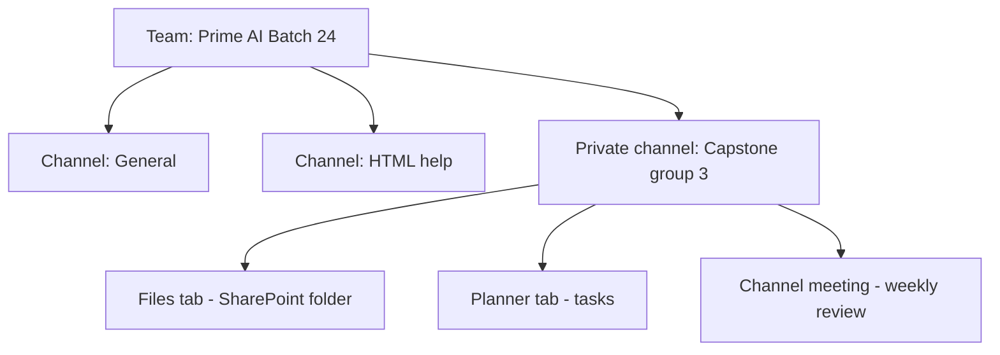
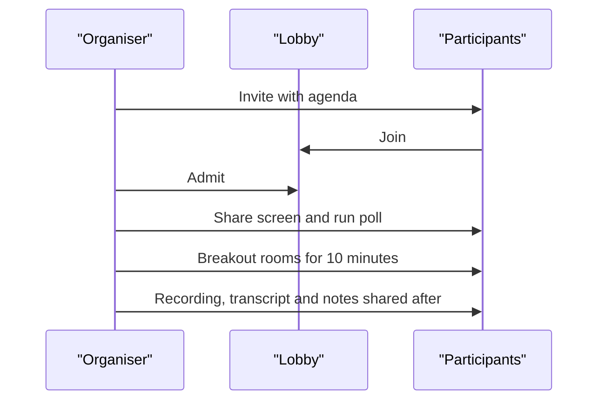

# Session 12 · Skype and Microsoft Teams

> [Prime AI – Software Engineering with AI](../../README.md) › [Term 1](../README.md) › [Effective Productivity with Office Automation](README.md) › **Session 12**

| ⏱ Estimated time | 🧩 Prerequisites |
|---|---|
| 1.5 hours | Session 11 |

[⬅ Previous: Using Outlook 2021](session-11-using-outlook.md) &nbsp;|&nbsp; [Next: Using Microsoft OneDrive 2021 ➡](session-13-using-microsoft-onedrive.md)

---

## 🎯 Learning objectives

By the end of this session you will be able to:

- Explain the purpose of Skype, Skype for Business and Microsoft Teams.
- Use Skype options for calls, chat and screen sharing.
- Describe how Microsoft Teams organises teams, channels, chats, meetings and files.
- Run an effective online meeting with good etiquette.

## 📖 Concepts

### From Skype to Teams
| Tool | Audience | Status |
|---|---|---|
| **Skype** | Consumers – calls, video, chat, cheap international calls | Retired by Microsoft in 2025; free users were moved to Teams (free) |
| **Skype for Business** | Organisations | Retired (2021 online); replaced by Teams |
| **Microsoft Teams** | Organisations, schools, and free personal use | The current hub for chat, meetings and collaboration |

You may still meet Skype in older documentation, so know its core ideas: **contacts**, **presence status**
(Available, Away, Do not disturb), one-to-one and group **calls**, **screen sharing**, file sending, chat history,
call recording and live subtitles. Teams keeps all of these and adds structured teamwork.

### Teams building blocks
| Concept | What it is | Example |
|---|---|---|
| **Team** | A group of people with shared space | "Prime AI – Batch 24" |
| **Channel** | Topic area inside a team (standard, private, shared) | #general, #html-help, #capstone-group-3 |
| **Post / thread** | Conversation in a channel | Teacher announces Lab 4 |
| **Chat** | Private 1:1 or group conversation | You + teammate |
| **Tabs** | Apps pinned to a channel | Files, OneNote, Planner, a website |
| **Meetings** | Scheduled or "Meet now" calls | Weekly sprint review |
| **Files** | Stored in SharePoint (channels) / OneDrive (chats) | Shared capstone folder |

### Meeting features
Lobby, mute all, raise hand, reactions, **breakout rooms**, live captions and **transcription**, recording, whiteboard,
**Together mode**, polls (Forms), PowerPoint Live (speaker notes stay private), meeting notes, and (licence) Copilot
summaries with action items.

### Online etiquette checklist
- Join on time, mic **muted** when not speaking, camera on when appropriate, neutral background.
- Use **raise hand**; keep chat relevant; share the right window only.
- Organisers: agenda in the invite, record only with consent, share notes and action items afterwards.

## 🧭 Diagrams

### How Teams is organised



### Life of a Teams meeting



## 💻 Worked examples

### Example 1 — Setting up a capstone team space

```text
Teams > Join or create a team > Create team > From scratch > Private
Name: "Capstone - Group 3"; add 4 members
Channels: General, Design, Development, Testing
In Development: + Tab > Planner "Sprint board"; + Tab > Website (GitHub repo URL)
Schedule: Calendar > New meeting > every Monday 6 pm > Channel: General
Files > New folder "Report" > upload template.docx (co-author it live)
```

**Result**

```text
One place for chat, files, tasks and the weekly meeting – no more lost WhatsApp messages.
```

### Example 2 — Meeting minutes generator (Python)

Teams/Copilot can produce action items automatically; here is the structure good minutes follow.

```python
from datetime import date
minutes = {
    "meeting": "Capstone Group 3 - Weekly review",
    "date": date(2026, 11, 2).isoformat(),
    "attendees": ["Ayesha", "Bilal", "Sana", "Usman"],
    "decisions": ["Use Bootstrap 5 grid", "Freeze design by Friday"],
    "actions": [("Ayesha", "Navbar + footer", "Wed"), ("Bilal", "Contact form validation", "Thu")],
}
print(f'{minutes["meeting"]} ({minutes["date"]})')
print("Attendees:", ", ".join(minutes["attendees"]))
print("Decisions:")
for d in minutes["decisions"]:
    print("  *", d)
print("Action items:")
for who, what, due in minutes["actions"]:
    print(f"  [ ] {what:<25} owner={who:<7} due={due}")
```

📄 Saved as [`code/session-12_example-2.py`](code/session-12_example-2.py)

**Output** (real run)

```text
Capstone Group 3 - Weekly review (2026-11-02)
Attendees: Ayesha, Bilal, Sana, Usman
Decisions:
  * Use Bootstrap 5 grid
  * Freeze design by Friday
Action items:
  [ ] Navbar + footer           owner=Ayesha  due=Wed
  [ ] Contact form validation   owner=Bilal   due=Thu
```

## 📊 At a glance

| Need | Use |
|---|---|
| Quick private question | Teams chat |
| Announcement to the whole class | Channel post |
| Live discussion | Meeting |
| Long formal communication / external people | Outlook e-mail |

## 🧪 Lab / practice tasks

**🟢 Easy** — Set your Teams status message and presence; send a formatted channel post with a code block.

<details><summary>💡 Hint</summary>

Use the Format (A with pen) button for rich text.

</details>

**🟡 Medium** — Create a team with three channels and pin a Planner and OneNote tab.

<details><summary>💡 Hint</summary>

Click + next to channel tabs.

</details>

**🔴 Hard** — Organise a 20-minute mock meeting with agenda, a poll, breakout rooms and a recording; share minutes.

<details><summary>💡 Hint</summary>

Meeting options › Breakout rooms; Forms app for polls.

</details>

**🏆 Challenge** — Write a one-page "Team communication charter" for your capstone group: which tool for what, response times, meeting rules.

<details><summary>💡 Hint</summary>

Use the table above as a starting point.

</details>

## ✅ Quick quiz

**Q1. In Teams, a topic area inside a team is a:**

- A) Tab
- B) Channel
- C) Chat
- D) Lobby

<details><summary>Show answer</summary>

**B** — Channels organise conversations.

</details>

**Q2. Channel files are stored in:**

- A) Local disk
- B) SharePoint
- C) Outlook
- D) USB

<details><summary>Show answer</summary>

**B** — Each team has a SharePoint site.

</details>

**Q3. Which feature splits a meeting into small groups?**

- A) Lobby
- B) Breakout rooms
- C) Together mode
- D) Reactions

<details><summary>Show answer</summary>

**B** — Breakout rooms.

</details>

**Q4. Skype for Business was replaced by:**

- A) Zoom
- B) Microsoft Teams
- C) OneNote
- D) Yammer

<details><summary>Show answer</summary>

**B** — Teams is the successor.

</details>

**Q5. Good meeting etiquette includes:**

- A) Unmuted background noise
- B) Muting when not speaking
- C) Sharing the whole desktop with notifications
- D) Recording without consent

<details><summary>Show answer</summary>

**B** — Respect others' attention.

</details>

## 📝 Summary / cheat-sheet

- Skype (consumer) and Skype for Business are retired; Teams is the hub.
- Team › channels (standard/private/shared) › posts; chats are private.
- Tabs pin apps; channel files live in SharePoint, chat files in OneDrive.
- Meetings: lobby, breakout rooms, captions, recording, polls, PowerPoint Live.
- Etiquette: agenda, mute, raise hand, consent for recording, follow-up notes.

## 🎤 Interview / viva questions

1. **Why is a channel better than a big group chat?**
   <details><summary>Model answer</summary>

   Conversations are threaded by topic, files and tabs are organised, and new members can see history.

   </details>

2. **What is presence status?**
   <details><summary>Model answer</summary>

   An indicator (Available, Busy, Away, DND) showing whether a colleague can be contacted.

   </details>

3. **How can you keep speaker notes private in Teams?**
   <details><summary>Model answer</summary>

   Use PowerPoint Live, which shows notes only to the speaker.

   </details>

---

[⬅ Previous: Using Outlook 2021](session-11-using-outlook.md) &nbsp;|&nbsp; [Next: Using Microsoft OneDrive 2021 ➡](session-13-using-microsoft-onedrive.md)

<sub>Prepared by **Hamna Zahid Khan**, Junior Lecturer · Prime AI – Software Engineering with AI</sub>
