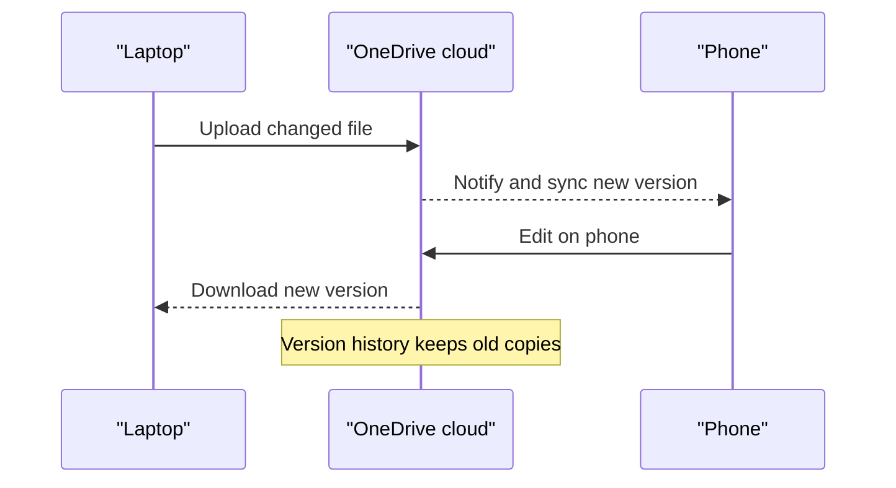
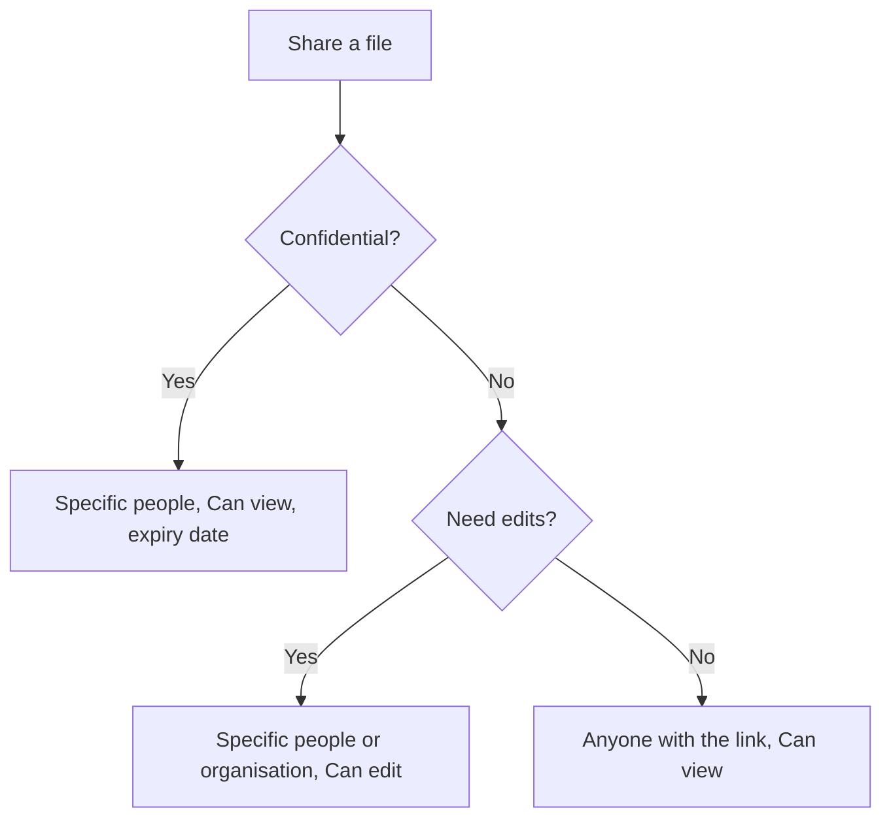
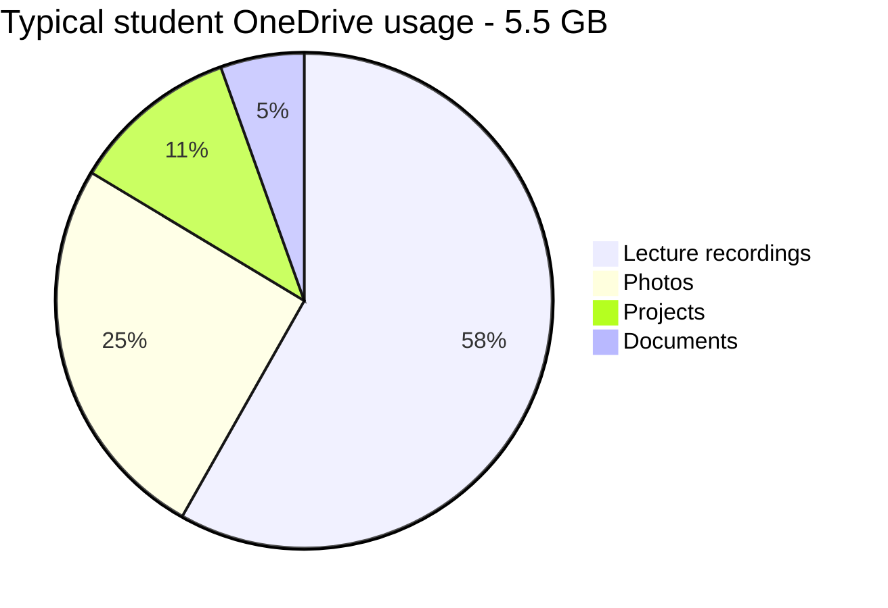

# Session 13 · Using Microsoft OneDrive 2021

> [Prime AI – Software Engineering with AI](../../README.md) › [Term 1](../README.md) › [Effective Productivity with Office Automation](README.md) › **Session 13**

| ⏱ Estimated time | 🧩 Prerequisites |
|---|---|
| 1.5 hours | Session 12 |

[⬅ Previous: Skype and Microsoft Teams](session-12-skype-and-microsoft-teams.md) &nbsp;|&nbsp; [Practice test ➡](practice-test.md)

---

## 🎯 Learning objectives

By the end of this session you will be able to:

- Describe OneDrive and how cloud storage works.
- Navigate the OneDrive web and desktop interfaces.
- Share files and folders securely and collaborate in real time.
- Sync online content with local folders using Files On-Demand and recover files with version history.

## 📖 Concepts

### What OneDrive is
**OneDrive** is Microsoft's personal **cloud storage**: your files are stored in Microsoft data centres and synced to
every device you sign in on. Free accounts get 5 GB; Microsoft 365 gives 1 TB per user. **OneDrive for Business**
is the work/school version (managed by your organisation). Team files live in **SharePoint**, which uses the same sync app.

### Interfaces
| Interface | How to reach | Highlights |
|---|---|---|
| Web (onedrive.com) | Browser | My files, Recent, Photos, Shared, Recycle bin, Version history |
| Desktop sync app | Cloud icon in taskbar | OneDrive folder in File Explorer, sync status, pause syncing |
| Office apps | File › Save to OneDrive | AutoSave and co-authoring |
| Mobile app | Android/iOS | Scan documents to PDF, camera upload |

### Sync status icons (File Explorer)
| Icon | Meaning |
|---|---|
| ☁️ Blue cloud | **Online-only** – no disk space used, downloads when opened |
| ✅ Green tick (outline) | **Locally available** – downloaded, can be freed |
| ✅ Solid green circle | **Always keep on this device** |
| 🔄 Arrows | Syncing |
| ❌ Red cross | Sync problem |

**Files On-Demand** lets you see all your cloud files without downloading them. **Known Folder Backup** protects your
Desktop, Documents and Pictures automatically.

### Sharing and collaboration
- **Share** › *Anyone with the link*, *People in your organisation*, or *Specific people*.
- Permissions: **Can edit**, **Can view**, **Can't download** (review only); set **expiry dates** and **passwords** (Microsoft 365).
- **Co-authoring**: several people edit the same Word/Excel/PowerPoint file simultaneously.
- **Manage access** to revoke links; **Shared** view shows files others shared with you.
- **Version history** restores earlier versions; the **Recycle bin** keeps deleted files for 30 days (93 for work accounts).
- **Personal Vault**: a section protected with extra verification for ID documents.

### Cloud safety
Use least privilege (view unless edit is needed), avoid "Anyone" links for confidential data, turn on two-step
verification, and remember that sync is **not** a backup if you delete everywhere – check the recycle bin and version history.

## 🧭 Diagrams

### How sync works



### Choosing a sharing option



## 💻 Worked examples

### Example 1 — Collaborating on the capstone report

```text
1. OneDrive web > New > Folder "Capstone-G3" > Share > Specific people (4 emails) > Can edit
2. Upload Report.docx; everyone opens it in Word (desktop or web) -> live co-authoring
3. Ayesha accidentally deletes section 3 -> File > Info > Version History > open yesterday 9 pm > Restore
4. Share the final PDF with the examiner: Specific people > Can view > Expires in 14 days
5. After grading: Manage access > Stop sharing
```

**Result**

```text
Everyone edits one copy, mistakes are reversible, and outside access expires automatically.
```

### Example 2 — Storage planner (Python)

```python
files_gb = {"Lecture recordings": 3.2, "Photos": 1.4, "Projects": 0.6, "Documents": 0.3}
for plan, quota in [("Free", 5), ("Microsoft 365", 1024)]:
    used = sum(files_gb.values())
    print(f"{plan:<14} used {used:.1f} / {quota} GB  ->  {used/quota:.1%} full")
online_only = files_gb["Lecture recordings"]
print(f"Making recordings online-only frees {online_only} GB on your laptop disk")
```

📄 Saved as [`code/session-13_example-2.py`](code/session-13_example-2.py)

**Output** (real run)

```text
Free           used 5.5 / 5 GB  ->  110.0% full
Microsoft 365  used 5.5 / 1024 GB  ->  0.5% full
Making recordings online-only frees 3.2 GB on your laptop disk
```

## 📊 At a glance



## 🧪 Lab / practice tasks

**🟢 Easy** — Upload three files to OneDrive web and open one in Word for the web.

<details><summary>💡 Hint</summary>

onedrive.live.com › Upload.

</details>

**🟡 Medium** — Install/sign in to the desktop app, make one folder online-only and another "Always keep on this device".

<details><summary>💡 Hint</summary>

Right-click the folder in File Explorer.

</details>

**🔴 Hard** — Share a folder with a classmate as Can view with an expiry date, then change it to Can edit and finally revoke it.

<details><summary>💡 Hint</summary>

Share › link settings; Manage access.

</details>

**🏆 Challenge** — Simulate a disaster: edit a document badly, delete it, then recover the original content using Recycle bin and Version history. Write the recovery steps.

<details><summary>💡 Hint</summary>

Recycle bin first, then Version history on the restored file.

</details>

## ✅ Quick quiz

**Q1. A blue cloud icon means the file is:**

- A) Corrupted
- B) Online-only
- C) Shared
- D) Encrypted

<details><summary>Show answer</summary>

**B** — It downloads on demand.

</details>

**Q2. Free OneDrive accounts include:**

- A) 1 TB
- B) 5 GB
- C) 50 GB
- D) Unlimited

<details><summary>Show answer</summary>

**B** — Microsoft 365 raises this to 1 TB.

</details>

**Q3. Which permission lets someone read but not change a file?**

- A) Can edit
- B) Can view
- C) Owner
- D) Contributor

<details><summary>Show answer</summary>

**B** — View-only.

</details>

**Q4. Deleted personal files stay in the recycle bin for about:**

- A) 1 day
- B) 30 days
- C) 1 year
- D) Forever

<details><summary>Show answer</summary>

**B** — 30 days for personal accounts.

</details>

**Q5. Known Folder Backup protects:**

- A) Program Files
- B) Desktop, Documents, Pictures
- C) Registry
- D) Downloads only

<details><summary>Show answer</summary>

**B** — Your main user folders.

</details>

## 📝 Summary / cheat-sheet

- OneDrive = personal cloud storage synced across devices; SharePoint for team files.
- Files On-Demand: online-only vs locally available vs always keep.
- Share with least privilege: specific people, view vs edit, expiry, passwords; Manage access.
- Co-authoring, version history, recycle bin, Personal Vault, Known Folder Backup.

## 🎤 Interview / viva questions

1. **Is sync the same as backup?**
   <details><summary>Model answer</summary>

   No – a deletion syncs everywhere. Recycle bin and version history provide limited recovery; a true backup is a separate copy.

   </details>

2. **What is Files On-Demand?**
   <details><summary>Model answer</summary>

   A feature that shows all cloud files in File Explorer but downloads them only when opened, saving disk space.

   </details>

3. **How do you stop a shared link working?**
   <details><summary>Model answer</summary>

   Open Manage access and delete the link or remove the person.

   </details>

---

[⬅ Previous: Skype and Microsoft Teams](session-12-skype-and-microsoft-teams.md) &nbsp;|&nbsp; [Practice test ➡](practice-test.md)

<sub>Prepared by **Hamna Zahid Khan**, Junior Lecturer · Prime AI – Software Engineering with AI</sub>
