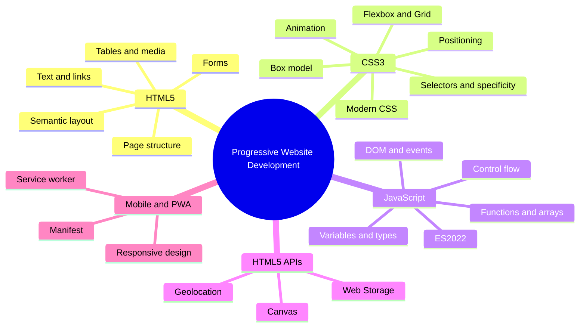

# Module 02 · Progressive Website Development

> [Prime AI – Software Engineering with AI](../../README.md) › [Term 1](../README.md) › **Progressive Website Development**

This module takes you from **zero to a working front-end developer**. You will hand-write web pages in **HTML5**, style
them with **CSS3** (selectors, the box model, Flexbox, Grid, animation and modern features such as subgrid and container
queries), and bring them to life with **JavaScript** – from variables and loops to functions, the DOM, modern ECMAScript,
Canvas, Web Storage and the Geolocation API. We finish by making sites **mobile-first** and turning one into an
installable **Progressive Web App (PWA)**.

Everything is done in **Visual Studio Code** with the **Live Server** extension and your browser's **Developer Tools**.
No frameworks yet – Bootstrap and jQuery come in the next module, once you understand what they do for you.

## 🎯 Module objectives

- Describe how the web works and write valid, semantic, accessible HTML5 pages.
- Format text, build lists, links, tables, forms and embed images, audio and video.
- Style pages with CSS3 selectors, specificity, the box model, positioning, transitions and animations.
- Build responsive layouts with Flexbox, Grid, subgrid, viewport units and media/container queries.
- Write JavaScript with variables, operators, conditions, loops, functions, arrays, objects and modern ES2022 features.
- Manipulate the DOM, handle events, draw on Canvas, store data with Web Storage and use the Geolocation API.
- Deliver a mobile-first website and convert it into an installable, offline-capable Progressive Web App.

## 🗂️ Sessions

| # | Session | Time | What you will cover |
|---|---|---|---|
| 1 | [Introduction to the Web and HTML5](session-01-introduction-to-the-web-and-html5.md) | 2 hours | Explain how a browser, a web server, URLs and HTTP work together to show a web page; Trace the evolution of HTML up to the HTML5 living standard and name the roles of HTML, CSS and JavaScript; Set up Visual Studio Code with Live Server and Prettier, and open the browser Developer Tools |
| 2 | [Formatting Text, Hyperlinks and Anchors](session-02-formatting-text-hyperlinks-and-anchors.md) | 2 hours | Use headings, paragraphs and text-formatting tags with the correct meaning; Display monospaced code, preformatted text and block quotations; Build ordered, unordered, nested and description lists |
| 3 | [Introduction to CSS3](session-03-introduction-to-css3.md) | 2 hours | Explain what CSS does, the cascade, and the new capabilities CSS3 added; Apply styles inline, in an internal style sheet and in an external style sheet; Use element, class, ID, grouping, descendant, child, sibling, attribute and universal selectors |
| 4 | [Formatting Using Style Sheets](session-04-formatting-using-style-sheets.md) | 2.5 hours | Style text and fonts: families, web fonts, size units, weight, line-height, spacing, alignment and decoration; Use inline spans, paragraph indentation, borders and vertical spacing; Calculate selector specificity and use pseudo-classes such as :hover and :focus |
| 5 | [Displaying Graphics and CSS3 Animation](session-05-displaying-graphics-and-css3-animation.md) | 2.5 hours | Choose the right image format (JPEG, PNG, GIF, SVG, WebP, AVIF) and insert images with alt text, size and lazy loading; Serve responsive images with srcset, sizes and the picture element, and add captions with figure; Style images and boxes with borders, radius, shadows, gradients, filters and object-fit |
| 6 | [Layouts in CSS3: Flexbox and Grid](session-06-layouts-with-flexbox-and-grid.md) | 3 hours | Explain the difference between one-dimensional (Flexbox) and two-dimensional (Grid) layout; Use flex container properties: direction, wrap, justify-content, align-items, align-content and gap; Control flex items with flex-grow, flex-shrink, flex-basis, order and align-self |
| 7 | [New Features of CSS3](session-07-new-features-of-css3.md) | 2 hours | Align nested content across cards with subgrid; Use viewport units (vw, vh, vmin, vmax) and the new dynamic units (dvh, svh, lvh); Write fluid sizes with clamp(), min(), max() and CSS custom properties (variables) |
| 8 | [HTML5 Semantic Layout and Forms](session-08-html5-semantic-layout-and-forms.md) | 2.5 hours | Lay out pages with HTML5 semantic elements and explain their benefits for accessibility and SEO; Use ARIA attributes and landmark roles only where native HTML is not enough; Build forms with labels, fieldsets and the HTML5 input types |
| 9 | [HTML5 Tables, Audio and Video](session-09-html5-tables-audio-and-video.md) | 2 hours | Create accessible tables with caption, thead, tbody, tfoot, th and scope; Merge cells with colspan and rowspan and control column widths with colgroup and CSS; Style tables: borders, zebra stripes, hover rows, and horizontal scrolling on small screens |
| 10 | [JavaScript – Part I](session-10-javascript-part-1.md) | 3 hours | Explain what JavaScript is, where it runs and how to add it to a page; Declare variables with let and const and identify JavaScript data types; Produce output with console.log, alert and the DOM, and read input with prompt and form fields |
| 11 | [JavaScript – Part II: Functions, Arrays, Objects and the DOM](session-11-javascript-part-2.md) | 3 hours | Write function declarations, expressions and arrow functions with parameters, defaults and return values; Explain scope and use callbacks; Work with 1D and 2D arrays and the core array methods (push, map, filter, reduce, find, sort…) |
| 12 | [Modern JavaScript: ECMAScript 2022 and Beyond](session-12-modern-javascript-es2022.md) | 2.5 hours | Explain how ECMAScript evolves and check which features a browser supports; Use ES6+ essentials: template literals, destructuring, spread/rest, optional chaining and nullish coalescing; Write classes with public, private (#) and static fields and methods (ES2022) |
| 13 | [Canvas and Web Storage in HTML5](session-13-canvas-and-web-storage.md) | 2.5 hours | Draw shapes, paths, text, gradients and images on an HTML5 canvas with the 2D context; Animate canvas drawings with requestAnimationFrame and react to mouse input; Compare canvas with SVG and choose the right one |
| 14 | [HTML5 Geolocation and Web APIs](session-14-geolocation-and-html5-apis.md) | 2 hours | Explain how the Geolocation API finds a position and why it needs HTTPS and permission; Use getCurrentPosition and watchPosition with success, error and options; Show a position on a map (OpenStreetMap/Leaflet or a Google Maps link/API) |
| 15 | [Building Mobile Websites](session-15-building-mobile-websites.md) | 2.5 hours | Explain why mobile-first, responsive websites are essential; Configure the viewport and write mobile-first media queries with sensible breakpoints; Design for touch: tap-target sizes, mobile-friendly forms and navigation patterns such as the hamburger menu |
| 16 | [Progressive Web Apps and Final Project](session-16-progressive-web-apps-and-final-project.md) | 3 hours | Explain what makes a website a Progressive Web App (PWA) and its benefits; Write a web app manifest with name, icons, colours, start URL and display mode; Register a service worker and use the Cache API for offline support (install, activate, fetch) |
| 📝 | [Module practice test](practice-test.md) | 1 hour | 20 MCQs + 3 practical questions |

## 🧭 Concept map

## 📄 One-page cheat-sheet

| Area | Must-know facts & syntax |
|---|---|
| **Page skeleton** | `<!DOCTYPE html>` › `<html lang="en">` › `<head>` (`<meta charset="UTF-8">`, `<meta name="viewport" content="width=device-width, initial-scale=1.0">`, `<title>`) › `<body>` |
| **Semantic tags** | `header nav main section article aside footer figure figcaption time mark details summary` |
| **Text & links** | `h1`–`h6` (one `h1` per page) · `p strong em blockquote pre code` · `ul ol li dl dt dd` · `<a href="page.html">` relative · `https://…` absolute · `#id` anchor · `mailto:` · `target="_blank" rel="noopener"` |
| **Media** | `` · `<picture>` + `srcset` · `<audio controls>` / `<video controls poster>` with several `<source>` + fallback text + `<track kind="captions">` |
| **Tables** | `table caption thead tbody tfoot tr th td` · `colspan` / `rowspan` · `scope="col"` · `border-collapse: collapse` |
| **Forms** | `form action method` · `label for` = `input id` · types `text email password number range date tel url color file checkbox radio search hidden` · `required min max minlength pattern placeholder` |
| **CSS basics** | `selector { property: value; }` · inline < internal `<style>` < external `<link rel="stylesheet">` (prefer external) |
| **Selectors** | `p` · `.class` · `#id` · `a b` descendant · `a > b` child · `a + b` · `a ~ b` · `[type="email"]` · `:hover :focus :nth-child(2n) :not() :has()` · `::before ::after` |
| **Specificity** | inline (1,0,0,0) > id (0,1,0,0) > class/attr/pseudo-class (0,0,1,0) > element (0,0,0,1); later rule wins a tie; avoid `!important` |
| **Box model** | content + padding + border + margin · `box-sizing: border-box` everywhere · `margin: 0 auto` centres a block |
| **Position** | `static relative absolute fixed sticky` · absolute is placed against the nearest positioned ancestor · `z-index` works on positioned elements |
| **Flexbox** | `display:flex` · `flex-direction justify-content align-items flex-wrap gap` · item: `flex: 1 1 200px`, `order`, `align-self` |
| **Grid** | `display:grid` · `grid-template-columns: repeat(auto-fit, minmax(220px, 1fr))` · `grid-template-areas` · `grid-column: 1 / 3` · `subgrid` |
| **Responsive** | mobile-first `@media (min-width: 768px)` · `@container (min-width: 400px)` · units `rem % vw vh dvh svh vmin clamp()` |
| **Animation** | `transition: transform .3s ease` · `@keyframes name { from{} to{} }` + `animation: name 2s infinite` · `transform: translate() rotate() scale()` · respect `prefers-reduced-motion` |
| **JS basics** | `let` / `const` (avoid `var`) · types: string number bigint boolean undefined null symbol object · `===` strict equality · template literals `` `Hi ${name}` `` |
| **JS control** | `if / else if / else` · `switch` · `for` · `while` · `do…while` · `for…of` (values) · `for…in` (keys) · `break` / `continue` |
| **Functions & arrays** | declaration, expression, arrow `(a,b) => a+b` · default & rest params · `map filter reduce find some every sort includes` · spread `[...a]` · destructuring |
| **DOM** | `document.querySelector()` · `.textContent` · `.classList.toggle()` · `addEventListener('click', fn)` · `createElement` + `append` · `event.preventDefault()` |
| **ES2022+** | class fields `#private` & `static` · top-level `await` · `.at(-1)` · `Object.hasOwn()` · `error.cause` · `?.` and `??` |
| **APIs** | Canvas `getContext('2d')` `fillRect arc fillText` · `localStorage.setItem(k, JSON.stringify(v))` / `sessionStorage` · `navigator.geolocation.getCurrentPosition(ok, err)` (HTTPS only) |
| **PWA** | HTTPS + `manifest.webmanifest` (name, icons, start_url, display) + **service worker** (install › activate › fetch, Cache API) |

## 🚀 How to study this module

1. Read each session in order; type every example yourself instead of copy-pasting.
2. Run the files in [`code/`](code/) and compare your output with the **Output** blocks.
3. Finish the 🟢 and 🟡 labs before class; attempt 🔴/🏆 labs with a partner.
4. Close the module with the [practice test](practice-test.md) and revise the cheat-sheet above.

---

Prepared by **Hamna Zahid Khan**, Junior Lecturer · Prime AI – Software Engineering with AI
