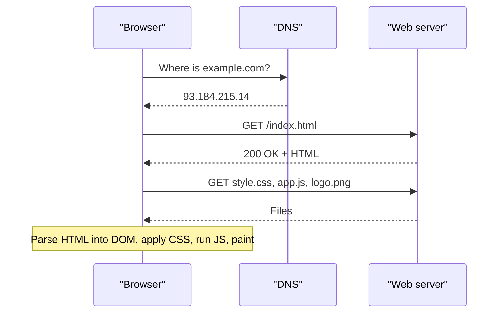
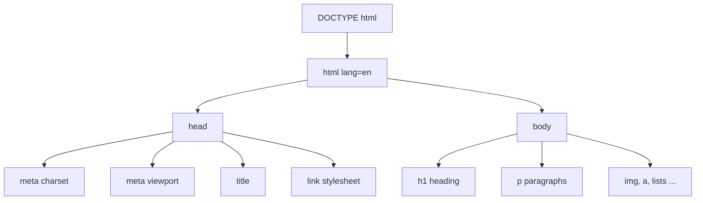
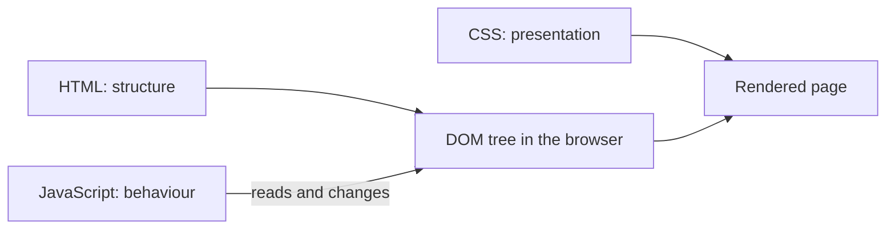

# Session 1 · Introduction to the Web and HTML5

> [Prime AI – Software Engineering with AI](../../README.md) › [Term 1](../README.md) › [Progressive Website Development](README.md) › **Session 1**

| ⏱ Estimated time | 🧩 Prerequisites |
|---|---|
| 2 hours | Module 1 (comfortable with Windows and files) |

[⬅ Module overview](README.md) &nbsp;|&nbsp; [Next: Formatting Text, Hyperlinks and Anchors ➡](session-02-formatting-text-hyperlinks-and-anchors.md)

---

## 🎯 Learning objectives

By the end of this session you will be able to:

- Explain how a browser, a web server, URLs and HTTP work together to show a web page.
- Trace the evolution of HTML up to the HTML5 living standard and name the roles of HTML, CSS and JavaScript.
- Set up Visual Studio Code with Live Server and Prettier, and open the browser Developer Tools.
- Write a valid HTML5 page with DOCTYPE, head, body and the basic tags.
- Distinguish elements, tags, attributes, entities, container tags and standalone tags.

## 📖 Concepts

### How the web works in one minute
When you type `https://example.com/about.html`:

1. The browser asks **DNS** to turn the domain name into an **IP address**.
2. It opens a secure connection and sends an **HTTP request** (`GET /about.html`).
3. The **web server** replies with a status code (`200 OK`, `404 Not Found`) and the HTML file.
4. The browser **parses** the HTML into the **DOM** (Document Object Model), downloads linked CSS, images and JavaScript,
   then **renders** (paints) the page.

| Part of a URL | Example | Meaning |
|---|---|---|
| Protocol / scheme | `https://` | Secure HTTP |
| Domain | `www.example.com` | The server's name |
| Path | `/courses/web.html` | The file or route on that server |
| Query string | `?lang=en` | Extra data for the server |
| Fragment | `#fees` | A spot inside the page |

### The three languages of the front end
| Language | Job | Analogy |
|---|---|---|
| **HTML** – HyperText Markup Language | Structure and meaning of content | The skeleton of a house |
| **CSS** – Cascading Style Sheets | Presentation: colour, layout, fonts | Paint, furniture, decoration |
| **JavaScript** | Behaviour and interactivity | Electricity: lights and switches |

Libraries such as **jQuery** (next module) are JavaScript written by others to make common tasks shorter.

### A short history of HTML
| Year | Version | What changed |
|---|---|---|
| 1991 | HTML (Tim Berners-Lee, CERN) | ~18 tags, links between documents |
| 1995–1997 | HTML 2.0 / 3.2 | Tables, forms, presentational tags such as `<font>` |
| 1999 | HTML 4.01 | Separation of style into CSS |
| 2000 | XHTML 1.0 | Stricter XML syntax |
| 2014 | HTML5 (W3C) | Semantic tags, audio/video, canvas, forms, APIs |
| Today | **HTML Living Standard** (WHATWG) | Continuously updated; "HTML5" now simply means modern HTML |

**New in HTML5:** semantic elements (`header`, `nav`, `article`…), native `<audio>`/`<video>`, `<canvas>`, new input
types (`email`, `date`, `range`), built-in validation, Web Storage, Geolocation, offline support and a simple
`<!DOCTYPE html>`. All modern browsers (Chrome, Edge, Firefox, Safari) support HTML5; check unusual features on
**caniuse.com**. HTML5 was designed for **mobile devices** too: the viewport meta tag, touch-friendly inputs (a phone shows a
number pad for `type="tel"`) and media without plug-ins such as Flash.

### Anatomy of an element
```text
<a href="https://example.com" title="Example">Visit us</a>
 |  |____________________________________|      |          |
tag     attributes (name="value")          content   closing tag
|_______________________ element ________________________|
```
- **Container (paired) tags** wrap content: `<p>…</p>`, `<h1>…</h1>`, `<ul>…</ul>`.
- **Standalone (void / empty) tags** have no content and no closing tag: `<br>`, `<hr>`, ``, `<input>`, `<meta>`, `<link>`.
- **Attributes** add information: global ones (`id`, `class`, `style`, `title`, `lang`, `hidden`, `data-*`) work on any element.
- **Entities** display reserved or special characters: `&lt;` <, `&gt;` >, `&amp;` &, `&nbsp;` non-breaking space, `&copy;` ©, `&quot;` ".
- HTML attribute values are text, but they follow **data types** such as URL (`href`), number (`width="300"`), colour, date (`datetime="2026-10-24"`) and boolean attributes that are on simply by being present (`required`, `disabled`, `checked`).

HTML is **not case-sensitive**, but the convention is lowercase. Indent nested elements by 2 spaces so the structure is obvious.

### Your toolkit
| Tool | Why |
|---|---|
| **Visual Studio Code** | Free editor with Emmet (`!` + Tab writes a whole skeleton) |
| **Live Server** extension | Opens the page at `http://127.0.0.1:5500` and reloads on every save |
| **Prettier** extension | Formats code consistently on save |
| **Browser DevTools** (`F12` / `Ctrl+Shift+I`) | Elements, Console, Network, Lighthouse and device toolbar (`Ctrl+Shift+M`) |
| **validator.w3.org** | Checks your HTML for errors |

## 🧭 Diagrams

### What happens when you open a web page



### Structure of an HTML5 document



### HTML, CSS and JavaScript working together



## 💻 Worked examples

### Example 1 — Set up VS Code for web work

```text
1. Install Visual Studio Code from code.visualstudio.com (tick "Add to PATH").
2. Extensions (Ctrl+Shift+X): install "Live Server" and "Prettier - Code formatter".
3. Settings (Ctrl+,): search "format on save" and tick it; set Default Formatter to Prettier.
4. File > Open Folder > create "pwd-practice".
5. New file index.html, type ! and press Tab -> Emmet writes the HTML5 skeleton.
6. Right-click the file > "Open with Live Server".
```

**Result**

```text
Your browser opens http://127.0.0.1:5500/index.html and refreshes automatically
every time you press Ctrl+S in VS Code.
```

### Example 2 — Your first HTML5 page

Save as `index.html` and open it with Live Server.

```html
<!DOCTYPE html>
<html lang="en">
<head>
  <meta charset="UTF-8">
  <meta name="viewport" content="width=device-width, initial-scale=1.0">
  <title>My First Page</title>
</head>
<body>
  <h1>Hello, Web!</h1>
  <p>My name is <strong>Ayesha</strong> and I am learning <em>HTML5</em>.</p>
  <hr>
  <p>Today I learned that <code>&lt;br&gt;</code> is a standalone tag.<br>
     This line starts after a line break.</p>
  
  <p>&copy; 2026 Ayesha &amp; friends</p>
</body>
</html>
```

📄 Saved as [`code/session-01_example-2.html`](code/session-01_example-2.html)

**🖥️ What you see in the browser**

```text
Hello, Web!                      (large bold heading)
My name is Ayesha and I am learning HTML5.   ("Ayesha" bold, "HTML5" italic)
──────────────────────────────── (horizontal rule)
Today I learned that <br> is a standalone tag.
This line starts after a line break.
[300 x 150 landscape photo]
© 2026 Ayesha & friends
Browser tab title: My First Page
```

### Example 3 — Inspecting the page with DevTools

```text
1. Press F12 (or right-click the heading > Inspect).
2. Elements panel: hover over <h1> - the heading is highlighted on the page.
3. Double-click the text "Hello, Web!" in the Elements panel and change it to "Hello, Karachi!".
4. Console panel: type  document.title  and press Enter.
5. Toggle the device toolbar (Ctrl+Shift+M) and pick "iPhone 12 Pro".
```

**Result**

```text
> document.title
'My First Page'
The heading now reads "Hello, Karachi!" (only in your browser - refresh to undo),
and the page is shown at phone width.
```

### Example 4 — How many elements did we write? (counting tags with JavaScript)

A taste of JavaScript: this Node.js script counts the opening tags in a small HTML string. You will learn every line of it later in the module.

```js
const html = `<!DOCTYPE html><html><head><title>Hi</title></head>
<body><h1>Hello</h1><p>One <br> two</p></body></html>`;

const tags = html.match(/<([a-z][a-z0-9]*)/g).map(t => t.slice(1));
const voidTags = ['br', 'img', 'hr', 'input', 'meta', 'link'];

console.log('Opening tags :', tags.join(', '));
console.log('Total        :', tags.length);
console.log('Standalone   :', tags.filter(t => voidTags.includes(t)).join(', '));
```

📄 Saved as [`code/session-01_example-4.js`](code/session-01_example-4.js)

**Output** (real run)

```text
Opening tags : html, head, title, body, h1, p, br, img
Total        : 8
Standalone   : br, img
```

## 🧪 Lab / practice tasks

**🟢 Easy** — Create `about-me.html` with a title, an `h1` with your name, two paragraphs about yourself, a horizontal rule and a footer line using `&copy;`.

<details><summary>💡 Hint</summary>

Type `!` + Tab in VS Code for the skeleton.

</details>

**🟡 Medium** — Run your page through validator.w3.org (Validate by Direct Input). Deliberately remove the closing `</p>` from one paragraph and the `alt` from an image; note what the validator reports, then fix both.

<details><summary>💡 Hint</summary>

The validator lists errors and warnings with line numbers.

</details>

**🔴 Hard** — Write a page that shows this text exactly: `Use <b> for bold & <i> for italic – price < 5 > 3`. The angle brackets and ampersand must appear on screen, not be treated as tags.

<details><summary>💡 Hint</summary>

Use `&lt;`, `&gt;` and `&amp;`.

</details>

**🏆 Challenge** — Open any news website, use DevTools to find its `<head>` and list five `meta` or `link` tags you find, explaining what each does.

<details><summary>💡 Hint</summary>

Look for charset, viewport, description, og: tags, icon, stylesheet.

</details>

## ✅ Quick quiz

**Q1. Which language controls the layout and colours of a page?**

- A) HTML
- B) CSS
- C) JavaScript
- D) HTTP

<details><summary>Show answer</summary>

**B** — CSS handles presentation.

</details>

**Q2. Which is a standalone (void) tag?**

- A) `<p>`
- B) `<hr>`
- C) `<h1>`
- D) `<title>`

<details><summary>Show answer</summary>

**B** — hr has no closing tag.

</details>

**Q3. `&lt;` displays:**

- A) &
- B) <
- C) >
- D) a space

<details><summary>Show answer</summary>

**B** — lt = less than.

</details>

**Q4. The viewport meta tag is important for:**

- A) SEO keywords
- B) Correct scaling on mobile devices
- C) Loading JavaScript
- D) Character encoding

<details><summary>Show answer</summary>

**B** — It makes the page width equal the device width.

</details>

**Q5. Which organisation maintains the HTML Living Standard?**

- A) ISO
- B) WHATWG
- C) IEEE
- D) ECMA

<details><summary>Show answer</summary>

**B** — WHATWG publishes the living standard; ECMA handles JavaScript.

</details>

## 📝 Summary / cheat-sheet

- Browser → DNS → HTTP request → server response → parse to DOM → render.
- HTML = structure, CSS = presentation, JavaScript = behaviour.
- HTML5 brought semantic tags, native media, canvas, new inputs and APIs; today it is a living standard.
- Skeleton: `<!DOCTYPE html>`, `html lang`, `head` (charset, viewport, title), `body`.
- Elements = tags + attributes + content; container vs standalone tags; entities for reserved characters.
- Tools: VS Code + Emmet, Live Server, Prettier, DevTools (F12), the W3C validator.

## 🎤 Interview / viva questions

1. **What is the purpose of `<!DOCTYPE html>`?**
   <details><summary>Model answer</summary>

   It tells the browser to render the page in standards mode using modern HTML rules instead of old quirks mode.

   </details>

2. **Differentiate a tag from an element.**
   <details><summary>Model answer</summary>

   A tag is the marker such as `<p>` or `</p>`; an element is the whole thing – opening tag, attributes, content and closing tag.

   </details>

3. **Why do we write `lang="en"` on the html element?**
   <details><summary>Model answer</summary>

   It tells screen readers, translators and search engines the page language, improving accessibility and SEO.

   </details>

4. **Name three features introduced by HTML5.**
   <details><summary>Model answer</summary>

   Semantic elements (header, nav, article), native audio and video, canvas, new form input types, Web Storage and Geolocation.

   </details>

---

[⬅ Module overview](README.md) &nbsp;|&nbsp; [Next: Formatting Text, Hyperlinks and Anchors ➡](session-02-formatting-text-hyperlinks-and-anchors.md)

<sub>Prepared by **Hamna Zahid Khan**, Junior Lecturer · Prime AI – Software Engineering with AI</sub>
