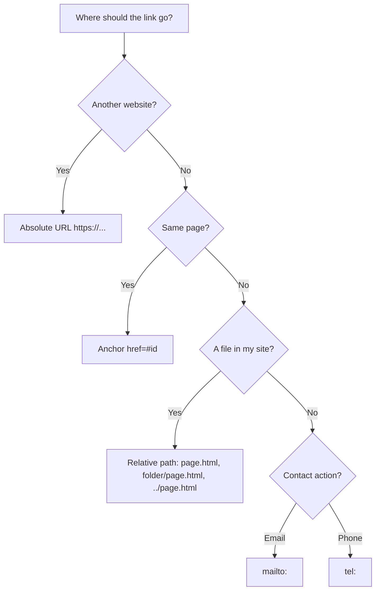
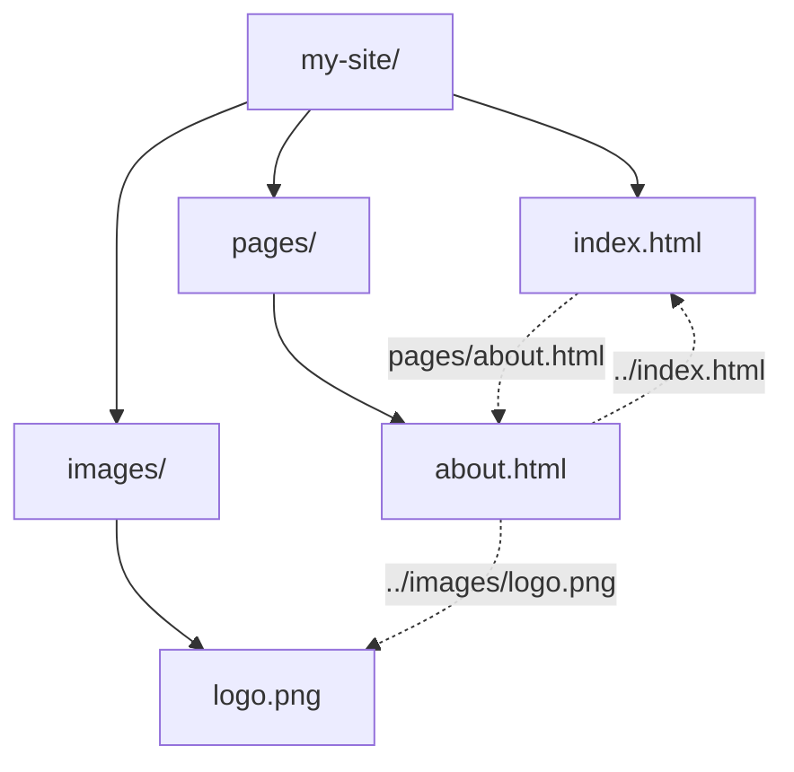
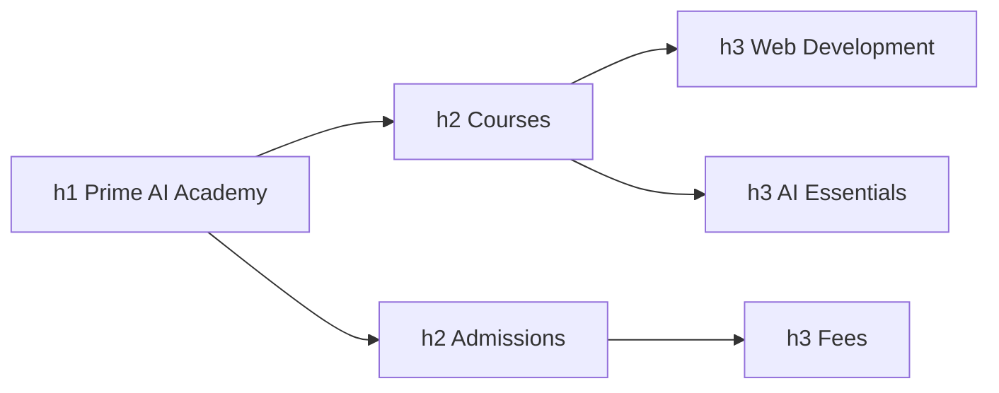

# Session 2 · Formatting Text, Hyperlinks and Anchors

> [Prime AI – Software Engineering with AI](../../README.md) › [Term 1](../README.md) › [Progressive Website Development](README.md) › **Session 2**

| ⏱ Estimated time | 🧩 Prerequisites |
|---|---|
| 2 hours | Session 1 |

[⬅ Previous: Introduction to the Web and HTML5](session-01-introduction-to-the-web-and-html5.md) &nbsp;|&nbsp; [Next: Introduction to CSS3 ➡](session-03-introduction-to-css3.md)

---

## 🎯 Learning objectives

By the end of this session you will be able to:

- Use headings, paragraphs and text-formatting tags with the correct meaning.
- Display monospaced code, preformatted text and block quotations.
- Build ordered, unordered, nested and description lists.
- Change background colour and image (inline CSS) and explain why CSS files are better.
- Create absolute, relative, anchor, email and telephone links.

## 📖 Concepts

### Headings and paragraphs
`<h1>` to `<h6>` form an **outline**, like chapter and section numbers in a book. Use **one `<h1>` per page**, never skip
levels just to get a smaller font (that is CSS's job) – screen readers and search engines use the outline.
`<p>` makes a paragraph; browsers collapse extra spaces and line breaks in your source into one space.

### Formatting tags: meaning vs. looks
| Tag | Meaning | Default look |
|---|---|---|
| `<strong>` | Strong importance | **bold** |
| `<b>` | Draw attention, no extra importance | **bold** |
| `<em>` | Stress emphasis (changes meaning when read aloud) | *italic* |
| `<i>` | Alternate voice: technical terms, foreign words | *italic* |
| `<u>` | Unarticulated annotation (e.g. spelling error) – avoid, looks like a link | underline |
| `<mark>` | Highlighted / relevant text | yellow background |
| `<small>` | Side comments, fine print | smaller |
| `<del>` / `<ins>` | Removed / inserted text | ~~strike~~ / underline |
| `<sub>` / `<sup>` | Subscript / superscript | H₂O, x² |
| `<abbr title="…">` | Abbreviation | dotted underline + tooltip |

### Code, preformatted text and quotations
- `<code>` – inline code in a **monospaced** font; `<kbd>` – keyboard input (`Ctrl+S`); `<samp>` – program output.
- `<pre>` – **preformatted**: keeps every space and line break, monospaced. Wrap code blocks as `<pre><code>…</code></pre>`.
- `<blockquote cite="url">` – a long, block-level quotation (indented); `<q>` – a short inline quote (adds quote marks); `<cite>` – the title of a work.

### Lists
| List | Tag | Use |
|---|---|---|
| Unordered | `<ul><li>` | Order does not matter (ingredients) |
| Ordered | `<ol><li>` | Steps, rankings; attributes `type="A|a|I|i|1"`, `start="5"`, `reversed` |
| Description | `<dl><dt><dd>` | Term and definition pairs (glossary, FAQ) |

Lists can be **nested**: put a whole `<ul>` *inside* an `<li>`. Navigation menus are usually a `<ul>` styled with CSS.

### Background colour and image
HTML4 used the `bgcolor` and `background` attributes – these are **obsolete**. Today use CSS, for now inline:
```html
<body style="background-color: #f0f9ff;">
<div style="background-image: url('stars.jpg'); background-size: cover; color: white;">…</div>
```
Colours can be names (`teal`), hex (`#0e7490`), `rgb(14 116 144)` or `hsl(192 82% 31%)`. Always keep enough **contrast**
between text and background (at least 4.5 : 1 for body text).

### Hyperlinks
`<a href="destination">clickable text</a>` – the **anchor** element.

| Link type | Example | Notes |
|---|---|---|
| **Absolute URL** | `href="https://developer.mozilla.org"` | Full address; use for other websites |
| **Relative URL** – same folder | `href="contact.html"` | Resolved from the current file's location |
| Relative – sub-folder | `href="pages/fees.html"` | Go down into `pages` |
| Relative – parent folder | `href="../index.html"` | `..` means "one folder up" |
| Root-relative | `href="/images/logo.png"` | From the site root (works on a server, not from a local file) |
| **Anchor (fragment)** | `href="#faq"` → `<h2 id="faq">` | Jumps within a page; `page.html#faq` jumps into another page |
| **Email** | `href="mailto:info@example.com?subject=Admission"` | Opens the mail app |
| Telephone | `href="tel:+922112345678"` | Dials on phones |
| Download | `href="syllabus.pdf" download` | Downloads instead of opening |

`target="_blank"` opens a new tab – add `rel="noopener noreferrer"` for security. Link text should describe the
destination ("Download the fee schedule"), never "click here". Images can be links: put `` inside `<a>`.

## 🧭 Diagrams

### Choosing the right link type



### Relative paths in a site folder



### Outline formed by headings



## 💻 Worked examples

### Example 1 — A recipe page with formatting and lists

```html
<!DOCTYPE html>
<html lang="en">
<head>
  <meta charset="UTF-8">
  <meta name="viewport" content="width=device-width, initial-scale=1.0">
  <title>Chai Recipe</title>
</head>
<body style="background-color: #fff7ed;">
  <h1>Karak Chai</h1>
  <p>A <strong>strong</strong>, <em>creamy</em> tea. Prep time: <mark>10 minutes</mark>.</p>

  <h2>Ingredients</h2>
  <ul>
    <li>2 cups water</li>
    <li>1 cup milk</li>
    <li>Spices
      <ul>
        <li>2 cardamom pods</li>
        <li>1 small piece of ginger</li>
      </ul>
    </li>
  </ul>

  <h2>Method</h2>
  <ol>
    <li>Boil water with the spices.</li>
    <li>Add 2 tsp tea leaves and boil for 3 minutes.</li>
    <li>Add milk and sugar; simmer until <q>karak</q> (deep brown).</li>
  </ol>

  <h2>Glossary</h2>
  <dl>
    <dt>Karak</dt><dd>Urdu/Hindi for "strong".</dd>
  </dl>

  <blockquote>Tea is not a drink, it is a mood. <cite>– Every Karachiite</cite></blockquote>
  <p>Water boils at 100&deg;C. H<sub>2</sub>O. E = mc<sup>2</sup>. Press <kbd>Ctrl</kbd> + <kbd>P</kbd> to print.</p>
</body>
</html>
```

📄 Saved as [`code/session-02_example-1.html`](code/session-02_example-1.html)

**🖥️ What you see in the browser**

```text
Karak Chai                                   (cream background)
A strong, creamy tea. Prep time: [10 minutes] (highlighted yellow)
Ingredients
 • 2 cups water
 • 1 cup milk
 • Spices
    ◦ 2 cardamom pods
    ◦ 1 small piece of ginger
Method
 1. Boil water with the spices.
 2. Add 2 tsp tea leaves and boil for 3 minutes.
 3. Add milk and sugar; simmer until "karak" (deep brown).
Glossary
 Karak
     Urdu/Hindi for "strong".
     Tea is not a drink, it is a mood. – Every Karachiite   (indented block)
Water boils at 100°C. H₂O. E = mc². Press Ctrl + P to print.
```

### Example 2 — Preformatted text vs. a normal paragraph

```html
<p>Name     Marks
Ali      78
Sara     91</p>

<pre>Name     Marks
Ali      78
Sara     91</pre>

<pre><code>for (let i = 1; i &lt;= 3; i++) {
  console.log(i);
}</code></pre>
```

📄 Saved as [`code/session-02_example-2.html`](code/session-02_example-2.html)

**🖥️ What you see in the browser**

```text
Name Marks Ali 78 Sara 91          <- paragraph: spaces and newlines collapsed

Name     Marks                     <- pre: alignment kept, monospaced font
Ali      78
Sara     91

for (let i = 1; i <= 3; i++) {
  console.log(i);
}
```

### Example 3 — A mini-site with every type of link

Folder: `index.html` at the root and `pages/contact.html` inside a `pages` folder. This is `index.html`.

```html
<!DOCTYPE html>
<html lang="en">
<head>
  <meta charset="UTF-8">
  <meta name="viewport" content="width=device-width, initial-scale=1.0">
  <title>Prime Academy</title>
</head>
<body>
  <nav>
    <a href="#courses">Courses</a> |
    <a href="#faq">FAQ</a> |
    <a href="pages/contact.html">Contact</a> |
    <a href="https://developer.mozilla.org/en-US/docs/Web/HTML" target="_blank" rel="noopener noreferrer">HTML reference (opens new tab)</a>
  </nav>

  <h1 id="top">Prime Academy</h1>
  <h2 id="courses">Courses</h2>
  <p>Web, AI and mobile development.</p>
  <h2 id="faq">FAQ</h2>
  <p>Email <a href="mailto:admissions@example.com?subject=Admission%20query">admissions@example.com</a>
     or call <a href="tel:+922112345678">021-1234-5678</a>.</p>
  <p><a href="syllabus.pdf" download>Download the syllabus (PDF)</a></p>
  <p><a href="#top">Back to top &uarr;</a></p>
</body>
</html>
```

📄 Saved as [`code/session-02_example-3.html`](code/session-02_example-3.html)

**🖥️ What you see in the browser**

```text
Courses | FAQ | Contact | HTML reference (opens new tab)   (blue underlined links)
Prime Academy
Courses ...
FAQ ...
Clicking "FAQ" scrolls to the FAQ heading; the URL ends with #faq.
The email link opens the mail app with subject "Admission query".
"Back to top ↑" jumps to the h1.
```

### Example 4 — Resolving relative paths like a browser

The `URL` class in JavaScript resolves a relative link exactly as the browser does – useful for checking your paths.

```js
const page = 'https://prime.example.com/pages/about.html';
const links = ['contact.html', '../index.html', '../images/logo.png', '/css/site.css', '#team', 'https://mdn.dev'];

for (const href of links) {
  console.log(href.padEnd(20), '->', new URL(href, page).href);
}
```

📄 Saved as [`code/session-02_example-4.js`](code/session-02_example-4.js)

**Output** (real run)

```text
contact.html         -> https://prime.example.com/pages/contact.html
../index.html        -> https://prime.example.com/index.html
../images/logo.png   -> https://prime.example.com/images/logo.png
/css/site.css        -> https://prime.example.com/css/site.css
#team                -> https://prime.example.com/pages/about.html#team
https://mdn.dev      -> https://mdn.dev/
```

## 🧪 Lab / practice tasks

**🟢 Easy** — Write a "My favourite books" page with an `h1`, an ordered list of five books, and for each one an `em` author name. Add a description list explaining two genres.

<details><summary>💡 Hint</summary>

Use `<ol>`, `<li>`, `<dl>`, `<dt>`, `<dd>`.

</details>

**🟡 Medium** — Build a two-page site: `index.html` and `pages/gallery.html`. Each links to the other with relative paths, and the gallery links to an image in `images/`.

<details><summary>💡 Hint</summary>

From inside pages/ you need `../` to go up.

</details>

**🔴 Hard** — Create a long FAQ page (at least 6 questions) with a table of contents at the top that jumps to each answer, and a "Back to top" link after each answer.

<details><summary>💡 Hint</summary>

Give each question heading a unique `id` and link with `#id`.

</details>

**🏆 Challenge** — Create a "Contact us" section with an email link that pre-fills the subject **and** body, a telephone link, and an external map link that opens safely in a new tab. Explain what `rel="noopener"` protects against.

<details><summary>💡 Hint</summary>

mailto:x@y.com?subject=Hi&body=Hello – spaces become %20.

</details>

## ✅ Quick quiz

**Q1. Which tag keeps spaces and line breaks exactly as typed?**

- A) `<p>`
- B) `<pre>`
- C) `<code>`
- D) `<blockquote>`

<details><summary>Show answer</summary>

**B** — pre = preformatted.

</details>

**Q2. `href="../index.html"` means:**

- A) index.html in a sub-folder
- B) index.html one folder up
- C) An external site
- D) An anchor

<details><summary>Show answer</summary>

**B** — .. is the parent folder.

</details>

**Q3. Which list is right for a glossary?**

- A) `ul`
- B) `ol`
- C) `dl`
- D) `li`

<details><summary>Show answer</summary>

**C** — Description list: dt term, dd description.

</details>

**Q4. To link to `<h2 id="fees">` on the same page use:**

- A) `href="fees"`
- B) `href="#fees"`
- C) `href=".fees"`
- D) `href="/fees"`

<details><summary>Show answer</summary>

**B** — # introduces a fragment identifier.

</details>

**Q5. Which tag adds importance, not just bold looks?**

- A) `<b>`
- B) `<strong>`
- C) `<big>`
- D) `<mark>`

<details><summary>Show answer</summary>

**B** — strong carries semantic importance.

</details>

## 📝 Summary / cheat-sheet

- One `h1` per page; headings form an outline – do not pick them by size.
- Semantic formatting: `strong`/`em` for meaning, `b`/`i` for style-only cases, `mark`, `sub`, `sup`, `abbr`.
- `pre` keeps whitespace; `code`, `kbd`, `samp` are monospaced; `blockquote` for long quotes, `q` for short ones.
- Lists: `ul`, `ol` (type, start, reversed), `dl`; nest a list inside an `li`.
- Backgrounds via CSS (`background-color`, `background-image`); keep contrast ≥ 4.5 : 1.
- Links: absolute, relative (`folder/`, `../`), root-relative, `#anchor`, `mailto:`, `tel:`, `download`; `target="_blank"` + `rel="noopener"`.

## 🎤 Interview / viva questions

1. **Difference between `<strong>` and `<b>`?**
   <details><summary>Model answer</summary>

   Both look bold, but strong marks content as important (screen readers can stress it) while b only draws attention without extra meaning.

   </details>

2. **Absolute vs relative URL?**
   <details><summary>Model answer</summary>

   An absolute URL includes protocol and domain and works from anywhere; a relative URL is resolved from the current page location and keeps working when the whole site is moved.

   </details>

3. **Why avoid "click here" as link text?**
   <details><summary>Model answer</summary>

   Screen-reader users often browse a list of links out of context, and search engines use link text to understand the target, so the text should describe the destination.

   </details>

4. **How do you create a link that jumps to a section on another page?**
   <details><summary>Model answer</summary>

   Give the target an id and link with the file name plus fragment, e.g. `href="courses.html#fees"`.

   </details>

---

[⬅ Previous: Introduction to the Web and HTML5](session-01-introduction-to-the-web-and-html5.md) &nbsp;|&nbsp; [Next: Introduction to CSS3 ➡](session-03-introduction-to-css3.md)

<sub>Prepared by **Hamna Zahid Khan**, Junior Lecturer · Prime AI – Software Engineering with AI</sub>
