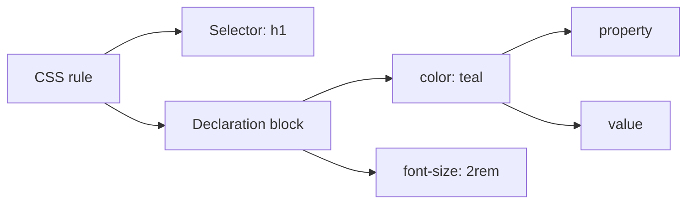
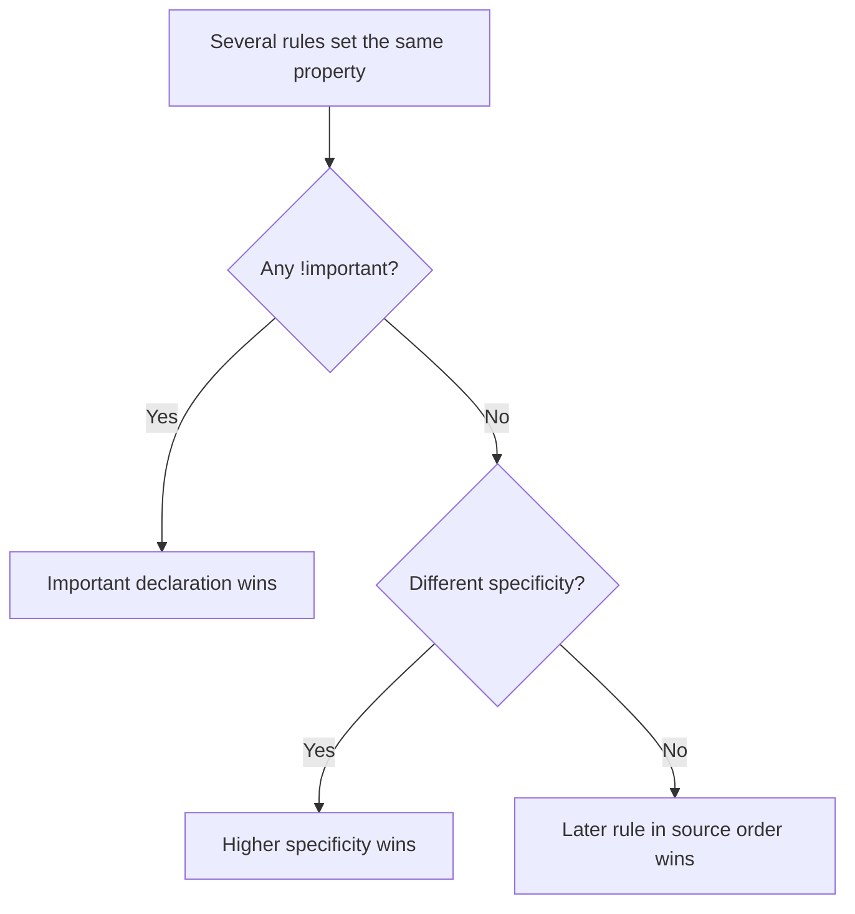
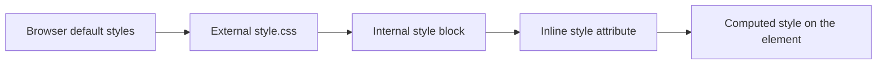

# Session 3 · Introduction to CSS3

> [Prime AI – Software Engineering with AI](../../README.md) › [Term 1](../README.md) › [Progressive Website Development](README.md) › **Session 3**

| ⏱ Estimated time | 🧩 Prerequisites |
|---|---|
| 2 hours | Session 2 |

[⬅ Previous: Formatting Text, Hyperlinks and Anchors](session-02-formatting-text-hyperlinks-and-anchors.md) &nbsp;|&nbsp; [Next: Formatting Using Style Sheets ➡](session-04-formatting-using-style-sheets.md)

---

## 🎯 Learning objectives

By the end of this session you will be able to:

- Explain what CSS does, the cascade, and the new capabilities CSS3 added.
- Apply styles inline, in an internal style sheet and in an external style sheet.
- Use element, class, ID, grouping, descendant, child, sibling, attribute and universal selectors.
- Style nested tags and hyperlinks in all their states (link, visited, hover, focus, active).
- Inspect and live-edit CSS rules in the browser Developer Tools.

## 📖 Concepts

### What CSS is
**Cascading Style Sheets** describe *how* HTML looks. One style sheet can restyle an entire website, so content
(HTML) and presentation (CSS) stay separate. A **rule** is a selector plus a declaration block:

```text
  h1        {  color: teal;  font-size: 2rem;  }
selector    |_ property: value; _| <- declarations
```

**CSS3** split CSS into modules and added rounded corners (`border-radius`), shadows (`box-shadow`, `text-shadow`),
gradients, web fonts (`@font-face`), RGBA/HSLA colours and opacity, transitions, transforms, animations, media queries,
Flexbox and Grid, and many new selectors (`:nth-child()`, `:not()`, attribute selectors). Today CSS keeps evolving module by
module (nesting, `:has()`, container queries).

### Three ways to add CSS
| Method | How | When |
|---|---|---|
| **Inline** | `<p style="color:red">` | Quick tests only; hard to maintain, highest priority |
| **Internal** | `<style>` inside `<head>` | A single, one-off page |
| **External** | `<link rel="stylesheet" href="css/style.css">` | **Default choice** – one file styles every page and is cached by the browser |

### Selectors
| Selector | Example | Matches |
|---|---|---|
| Universal | `* { }` | Every element |
| Element / type | `p { }` | Every `<p>` |
| Class | `.note { }` | Every element with `class="note"` (reusable, many per page) |
| ID | `#hero { }` | The one element with `id="hero"` (unique per page) |
| Grouping | `h1, h2, h3 { }` | All listed selectors |
| Descendant | `nav a { }` | `a` anywhere inside `nav` |
| Child | `ul > li { }` | `li` that are direct children of `ul` |
| Adjacent sibling | `h2 + p { }` | The first `p` right after an `h2` |
| General sibling | `h2 ~ p { }` | All `p` siblings after an `h2` |
| Attribute | `input[type="email"]`, `a[href^="https"]`, `a[href$=".pdf"]` | By attribute value (`^=` starts, `$=` ends, `*=` contains) |
| Pseudo-class | `li:first-child`, `tr:nth-child(even)`, `a:hover`, `input:focus` | Elements in a state or position |
| Pseudo-element | `p::first-line`, `.req::after { content: " *"; }` | Part of an element / generated content |

An element can have **several classes**: `class="card featured dark"`. Use classes for styling, IDs for unique anchors and
JavaScript hooks. Class names: lowercase, hyphenated, describe purpose (`.btn-primary`, not `.red-text`).

### The cascade and inheritance
When two rules set the same property on the same element, the browser decides by **importance** (`!important`), then
**specificity** (next session), then **source order** (the later rule wins). Some properties, such as `color`,
`font-family` and `line-height`, are **inherited** by children; others, such as `border`, `margin` and `background`, are not.

### Nested tags
You can target an element only when it is nested inside another: `article p strong { color: crimson; }` styles `strong`
inside `p` inside `article`. Modern CSS also supports **native nesting**:
```css
.card {
  padding: 1rem;
  & h2 { margin-top: 0; }
  &:hover { box-shadow: 0 4px 12px rgb(0 0 0 / .15); }
}
```

### Styling links – remember **LoVe HAte**
Order the states `:link`, `:visited`, `:hover`, `:active` (L-V-H-A) so later states can override earlier ones. Add
`:focus-visible` so keyboard users see where they are. Remove the underline with `text-decoration: none` only if links are
still obvious (colour plus weight or an icon).

## 🧭 Diagrams

### Anatomy of a CSS rule



### How the browser picks a winning declaration



### Where styles can come from



## 💻 Worked examples

### Example 1 — One external style sheet for the whole site

Save as `session-03_example-1.html`; it links to `session-03_style.css` (next example) in the same folder. In a real site you would keep it in `css/style.css`.

```html
<!DOCTYPE html>
<html lang="en">
<head>
  <meta charset="UTF-8">
  <meta name="viewport" content="width=device-width, initial-scale=1.0">
  <title>Selectors demo</title>
  <link rel="stylesheet" href="session-03_style.css">
</head>
<body>
  <header id="hero">
    <h1>Prime Coffee</h1>
    <nav><a href="#">Home</a> <a href="#menu">Menu</a> <a href="menu.pdf">Menu PDF</a></nav>
  </header>
  <main>
    <h2 id="menu">Menu</h2>
    <p>Freshly roasted beans every morning.</p>
    <p class="note">Prices include tax.</p>
    <ul class="menu">
      <li>Espresso – Rs 450</li>
      <li class="featured">Latte – Rs 650</li>
      <li>Karak chai – Rs 250</li>
    </ul>
  </main>
</body>
</html>
```

📄 Saved as [`code/session-03_example-1.html`](code/session-03_example-1.html)

### Example 2 — The style sheet: every major selector type

```css
* { box-sizing: border-box; }                    /* universal */
body { font-family: system-ui, sans-serif; margin: 0; color: #1f2937; }   /* element */
h1, h2 { font-family: Georgia, serif; }           /* grouping */
#hero { background: #3f2a1d; color: #fff; padding: 1.5rem; }   /* id */
#hero nav a { color: #fde68a; margin-right: 1rem; }            /* descendant */
h2 + p { font-size: 1.15rem; }                    /* adjacent sibling */
.note { font-style: italic; color: #6b7280; }     /* class */
.menu > li { padding: .4rem 0; }                  /* child */
.menu li:nth-child(odd) { background: #fef3c7; }  /* pseudo-class */
.featured::after { content: " ★ bestseller"; color: #b45309; }   /* pseudo-element */
a[href$=".pdf"]::before { content: "📄 "; }      /* attribute */

/* links: LoVe HAte order */
a:link    { color: #fde68a; }
a:visited { color: #fcd34d; }
a:hover   { text-decoration: underline wavy; }
a:active  { color: #fff; }
a:focus-visible { outline: 3px solid #fbbf24; outline-offset: 2px; }
```

📄 Saved as [`code/session-03_style.css`](code/session-03_style.css)

**🖥️ What you see in the browser**

```text
A dark-brown header with "Prime Coffee" in a serif font and pale-yellow links;
"Menu PDF" has a 📄 icon in front. The paragraph right after "Menu" is slightly larger,
"Prices include tax." is grey italic, menu rows 1 and 3 have a cream stripe,
and "Latte – Rs 650 ★ bestseller" shows the generated star text.
```

### Example 3 — Inline vs internal vs external – who wins?

```html
<head>
  <link rel="stylesheet" href="css/style.css">  <!-- says: p { color: navy; } -->
  <style>
    p { color: green; }                           /* internal, comes later -> wins over external */
  </style>
</head>
<body>
  <p>I am green.</p>
  <p style="color: crimson;">I am crimson (inline beats both).</p>
</body>
```

📄 Saved as [`code/session-03_example-3.html`](code/session-03_example-3.html)

**🖥️ What you see in the browser**

```text
I am green.
I am crimson (inline beats both).    (in red)
```

### Example 4 — Testing selectors from JavaScript

`document.querySelectorAll()` takes the same selectors as CSS. Here we simulate a tiny list of elements in Node to see which ones a selector rule would match.

```js
const elements = [
  { tag: 'li', classes: ['featured'], index: 2 },
  { tag: 'li', classes: [], index: 1 },
  { tag: 'li', classes: [], index: 3 },
  { tag: 'p', classes: ['note'], index: 2 },
];
const isOdd = el => el.index % 2 === 1;

console.log('li            ->', elements.filter(e => e.tag === 'li').length, 'matches');
console.log('.featured     ->', elements.filter(e => e.classes.includes('featured')).length, 'match');
console.log('li:nth-child(odd) ->', elements.filter(e => e.tag === 'li' && isOdd(e)).map(e => e.index));
```

📄 Saved as [`code/session-03_example-4.js`](code/session-03_example-4.js)

**Output** (real run)

```text
li            -> 3 matches
.featured     -> 1 match
li:nth-child(odd) -> [ 1, 3 ]
```

## 🧪 Lab / practice tasks

**🟢 Easy** — Move all inline styles from your Session 2 recipe page into an external `css/style.css` and link it.

<details><summary>💡 Hint</summary>

Use `<link rel="stylesheet" href="css/style.css">` inside head.

</details>

**🟡 Medium** — Style a navigation bar: links white on a dark background, no underline, a different colour on hover, and a visible outline on keyboard focus. Test with the Tab key.

<details><summary>💡 Hint</summary>

Use `nav a`, `:hover` and `:focus-visible`.

</details>

**🔴 Hard** — Zebra-stripe a list of 10 items, colour the first and last items differently, and add an arrow before external links only (`href` starting with http).

<details><summary>💡 Hint</summary>

`:nth-child(even)`, `:first-child`, `:last-child`, `a[href^="http"]::before`.

</details>

**🏆 Challenge** — In DevTools, open any website, find the rule that sets the body font, change it live to `Comic Sans MS`, then use the *Computed* tab to explain where the final `color` of a paragraph came from.

<details><summary>💡 Hint</summary>

Elements › Styles shows crossed-out (overridden) declarations.

</details>

## ✅ Quick quiz

**Q1. Which method is best for styling a multi-page site?**

- A) Inline
- B) Internal
- C) External
- D) Using b and i tags

<details><summary>Show answer</summary>

**C** — One cached file for every page.

</details>

**Q2. `.btn` selects:**

- A) The element with id btn
- B) Elements with class btn
- C) All button elements
- D) The first button

<details><summary>Show answer</summary>

**B** — A dot means class.

</details>

**Q3. `ul > li` selects:**

- A) All li anywhere in ul
- B) Only li that are direct children of ul
- C) The li after ul
- D) ul inside li

<details><summary>Show answer</summary>

**B** — > is the child combinator.

</details>

**Q4. The correct order for link states is:**

- A) hover, link, active, visited
- B) link, visited, hover, active
- C) active, hover, visited, link
- D) Any order

<details><summary>Show answer</summary>

**B** — LoVe HAte.

</details>

**Q5. Which property is inherited by child elements?**

- A) border
- B) margin
- C) color
- D) padding

<details><summary>Show answer</summary>

**C** — Text properties are generally inherited.

</details>

## 📝 Summary / cheat-sheet

- Rule = selector + `{ property: value; }`.
- Prefer external style sheets; internal for one page; inline only for tests.
- Selectors: `*`, element, `.class`, `#id`, grouping, descendant, `>`, `+`, `~`, `[attr]`, `:pseudo-class`, `::pseudo-element`.
- Cascade: importance → specificity → source order; some properties inherit.
- Links in LVHA order plus `:focus-visible`; native nesting with `&`.

## 🎤 Interview / viva questions

1. **Class vs ID?**
   <details><summary>Model answer</summary>

   A class can be used on many elements and an element can have several classes; an ID must be unique on the page and has higher specificity.

   </details>

2. **What does "cascading" mean in CSS?**
   <details><summary>Model answer</summary>

   Several style sources can apply to one element; the cascade resolves conflicts using importance, specificity and source order.

   </details>

3. **What is a pseudo-element?**
   <details><summary>Model answer</summary>

   A selector for part of an element or generated content, such as ::before, ::after, ::first-letter or ::placeholder.

   </details>

4. **Why prefer external CSS?**
   <details><summary>Model answer</summary>

   Separation of content and design, one change updates every page, and the browser caches the file so pages load faster.

   </details>

---

[⬅ Previous: Formatting Text, Hyperlinks and Anchors](session-02-formatting-text-hyperlinks-and-anchors.md) &nbsp;|&nbsp; [Next: Formatting Using Style Sheets ➡](session-04-formatting-using-style-sheets.md)

<sub>Prepared by **Hamna Zahid Khan**, Junior Lecturer · Prime AI – Software Engineering with AI</sub>
