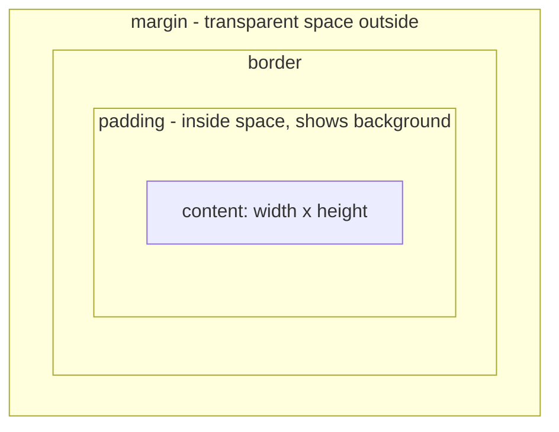
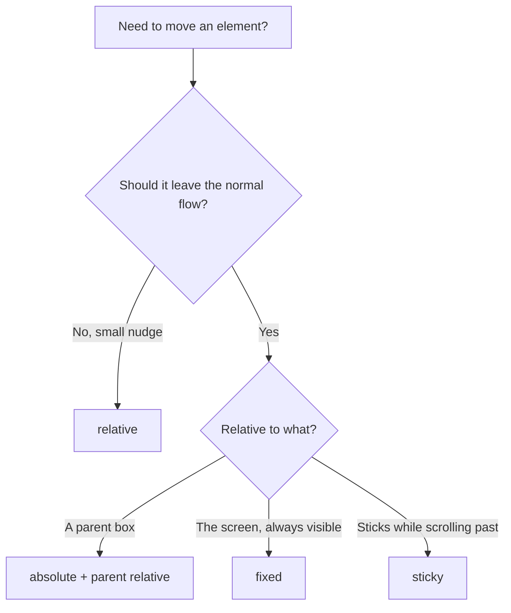
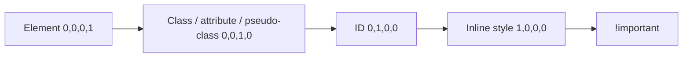

# Session 4 · Formatting Using Style Sheets

> [Prime AI – Software Engineering with AI](../../README.md) › [Term 1](../README.md) › [Progressive Website Development](README.md) › **Session 4**

| ⏱ Estimated time | 🧩 Prerequisites |
|---|---|
| 2.5 hours | Session 3 |

[⬅ Previous: Introduction to CSS3](session-03-introduction-to-css3.md) &nbsp;|&nbsp; [Next: Displaying Graphics and CSS3 Animation ➡](session-05-displaying-graphics-and-css3-animation.md)

---

## 🎯 Learning objectives

By the end of this session you will be able to:

- Style text and fonts: families, web fonts, size units, weight, line-height, spacing, alignment and decoration.
- Use inline spans, paragraph indentation, borders and vertical spacing.
- Calculate selector specificity and use pseudo-classes such as :hover and :focus.
- Explain and apply the CSS box model with box-sizing.
- Position elements with static, relative, absolute, fixed and sticky, and use float and clear.

## 📖 Concepts

### Text and font styles
| Property | Example | Notes |
|---|---|---|
| `font-family` | `"Poppins", Arial, sans-serif` | A **font stack**: fallbacks, ending with a generic family |
| `font-size` | `1rem`, `1.25em`, `18px`, `clamp(1rem, 2.5vw, 2rem)` | `rem` = relative to root (16 px default) – preferred; `em` = relative to parent |
| `font-weight` | `400` normal, `700` bold | 100–900 |
| `font-style` | `italic` | |
| `line-height` | `1.6` | Unitless is best; 1.5–1.7 for body text |
| `letter-spacing` / `word-spacing` | `0.05em` / `0.2em` | Small values only |
| `text-align` | `left center right justify` | **Horizontal** alignment |
| `text-indent` | `2em` | Indents the first line of a paragraph |
| `text-transform` | `uppercase capitalize` | |
| `text-decoration` | `none`, `underline dotted` | |
| `text-shadow` | `1px 1px 2px #0005` | x, y, blur, colour |

Web fonts: `<link href="https://fonts.googleapis.com/css2?family=Poppins:wght@400;700&display=swap" rel="stylesheet">` or
`@font-face { font-family: "Brand"; src: url(fonts/brand.woff2) format("woff2"); }`.

`<span>` is an **inline** container with no meaning – use it to style part of a sentence. `<div>` is the **block** equivalent.

### Specificity – who wins a conflict
Count the selector's parts as **(inline, IDs, classes/attributes/pseudo-classes, elements/pseudo-elements)**:

| Selector | Score |
|---|---|
| `p` | (0,0,0,1) |
| `.intro p` | (0,0,1,1) |
| `#main .intro p` | (0,1,1,1) |
| `nav a:hover` | (0,0,1,2) |
| `style="…"` | (1,0,0,0) |

Compare left to right; the higher score wins regardless of order. `!important` overrides everything – treat it as a last
resort. `:where()` has zero specificity, handy for resets.

**Useful pseudo-classes:** `:hover` (mouse over), `:focus` / `:focus-visible` (keyboard focus), `:active`, `:checked`,
`:disabled`, `:first-child`, `:nth-child(3n+1)`, `:not(.done)`, `:has(img)` (parent selector).

### The box model
Every element is a rectangular box made of four layers:
**content → padding → border → margin**.

With the default `box-sizing: content-box`, `width: 300px; padding: 20px; border: 5px` gives a box **350 px** wide.
With **`box-sizing: border-box`** the box stays **300 px** (padding and border are taken from inside). Most developers set
`*, *::before, *::after { box-sizing: border-box; }` at the top of every style sheet.

- Shorthand order is **clockwise**: `margin: top right bottom left` (`margin: 10px 20px` = vertical, horizontal).
- `margin: 0 auto` centres a block that has a width.
- Vertical margins between blocks **collapse** (the larger one wins).
- `outline` is drawn outside the border and takes **no space** – used for focus rings.
- `display`: `block` (full width, new line), `inline` (flows in text, ignores width/height), `inline-block` (flows but accepts width/height), `none`.

### Positioning
| `position` | Behaviour |
|---|---|
| `static` | Default normal flow; `top/left` ignored |
| `relative` | Shifted from its normal spot; original space kept; becomes an anchor for absolute children |
| `absolute` | Removed from flow; placed against the nearest **positioned** ancestor |
| `fixed` | Placed against the viewport; stays put when scrolling (chat buttons, cookie bars) |
| `sticky` | Normal until a scroll threshold (`top: 0`), then sticks (table headers, navbars) |

`z-index` sets the stacking order of positioned elements (higher is on top).

### Float and clear
`float: left | right` pushes an element to one side and lets text wrap around it – still the right tool for an image inside
an article. `clear: both` makes the next element start below floats. For page layout, use Flexbox and Grid (Session 6).

## 🧭 Diagrams

### The CSS box model



### Choosing a position value



### Specificity ladder



## 💻 Worked examples

### Example 1 — A styled blog article (typography, spans, box model)

```html
<!DOCTYPE html>
<html lang="en">
<head>
  <meta charset="UTF-8">
  <meta name="viewport" content="width=device-width, initial-scale=1.0">
  <title>Blog</title>
  <link href="https://fonts.googleapis.com/css2?family=Merriweather:wght@400;700&display=swap" rel="stylesheet">
  <style>
    *, *::before, *::after { box-sizing: border-box; }
    body { font-family: system-ui, sans-serif; line-height: 1.6; margin: 0; background: #f8fafc; }
    article {
      max-width: 680px; margin: 2rem auto;           /* centred */
      padding: 2rem; background: #fff;
      border: 1px solid #e2e8f0; border-radius: 12px;
      box-shadow: 0 4px 14px rgb(0 0 0 / .06);
    }
    h1 { font-family: "Merriweather", Georgia, serif; font-size: clamp(1.6rem, 4vw, 2.4rem); line-height: 1.2; }
    .meta { text-transform: uppercase; letter-spacing: .08em; font-size: .8rem; color: #64748b; }
    p + p { text-indent: 2em; }                       /* indent following paragraphs */
    .highlight { background: #fef08a; padding: 0 .2em; border-radius: 3px; }
    blockquote { margin: 1.5rem 0; padding: .5rem 1rem; border-left: 4px solid #0e7490; color: #334155; }
    a { color: #0e7490; }
    a:hover, a:focus-visible { color: #155e75; text-decoration-thickness: 3px; }
  </style>
</head>
<body>
  <article>
    <p class="meta">24 Oct 2026 · 4 min read</p>
    <h1>Why every developer should learn CSS properly</h1>
    <p>Frameworks come and go, but <span class="highlight">the box model is forever</span>.</p>
    <p>Once you understand padding, borders and margins, layouts stop feeling like magic.</p>
    <blockquote>Good design is as little design as possible.</blockquote>
    <p>Read more on <a href="https://developer.mozilla.org/en-US/docs/Learn/CSS">MDN Learn CSS</a>.</p>
  </article>
</body>
</html>
```

📄 Saved as [`code/session-04_example-1.html`](code/session-04_example-1.html)

**🖥️ What you see in the browser**

```text
A white card, max 680 px wide, centred on a light-grey page with soft shadow and rounded corners.
Small grey uppercase date line, a large serif headline that shrinks on phones,
"the box model is forever" highlighted in yellow, the second paragraph's first line indented,
a quotation with a teal bar on the left, and a link that gets a thick underline on hover/focus.
```

### Example 2 — content-box vs border-box – the numbers

```js
function renderedWidth({ width, padding, border, boxSizing }) {
  return boxSizing === 'border-box' ? width : width + 2 * padding + 2 * border;
}
const box = { width: 300, padding: 20, border: 5 };
console.log('content-box :', renderedWidth({ ...box, boxSizing: 'content-box' }), 'px');
console.log('border-box  :', renderedWidth({ ...box, boxSizing: 'border-box' }), 'px');
console.log('content area with border-box:', box.width - 2 * box.padding - 2 * box.border, 'px');
```

📄 Saved as [`code/session-04_example-2.js`](code/session-04_example-2.js)

**Output** (real run)

```text
content-box : 350 px
border-box  : 300 px
content area with border-box: 250 px
```

### Example 3 — Specificity calculator

A simplified calculator for the selectors in this session (ignores `:is()`/`:where()` edge cases).

```js
function specificity(sel) {
  const ids = (sel.match(/#[\w-]+/g) || []).length;
  const classes = (sel.match(/\.[\w-]+|\[[^\]]+\]|(?<!:):(?!:)[\w-]+/g) || []).length;
  const elements = (sel.replace(/#[\w-]+|\.[\w-]+|\[[^\]]+\]|(?<!:):(?!:)[\w-]+/g, ' ')
                       .match(/(^|[\s>+~])[a-z][\w-]*|::[\w-]+/g) || []).length;
  return [0, ids, classes, elements];
}
for (const s of ['p', '.intro p', '#main .intro p', 'nav a:hover', 'ul li::before', 'input[type="email"]:focus']) {
  console.log(s.padEnd(26), specificity(s).join(','));
}
```

📄 Saved as [`code/session-04_example-3.js`](code/session-04_example-3.js)

**Output** (real run)

```text
p                          0,0,0,1
.intro p                   0,0,1,1
#main .intro p             0,1,1,1
nav a:hover                0,0,1,2
ul li::before              0,0,0,3
input[type="email"]:focus  0,0,2,1
```

### Example 4 — Positioning: badge, sticky header, floating button and a floated image

```html
<style>
  header { position: sticky; top: 0; background: #1e1b4b; color: #fff; padding: .75rem; z-index: 10; }
  .card { position: relative; width: 220px; padding: 1rem; border: 1px solid #ccc; margin: 1rem; }
  .badge { position: absolute; top: -10px; right: -10px; background: crimson; color: #fff;
           border-radius: 999px; padding: .2rem .6rem; font-size: .8rem; }
  .help { position: fixed; bottom: 20px; right: 20px; background: #0e7490; color: #fff;
          padding: .8rem 1rem; border-radius: 999px; }
  .story img { float: left; width: 120px; margin: 0 1rem .5rem 0; }
  .story::after { content: ""; display: block; clear: both; }   /* clearfix */
  .nudge { position: relative; left: 20px; }
</style>
<header>Sticky header – scroll me</header>
<div class="card">New course <span class="badge">NEW</span></div>
<p class="nudge">This paragraph is nudged 20px right but keeps its original space.</p>
<div class="story">
  <p>Text wraps around the floated image on its right side ...</p></div>
<a class="help" href="#">Need help?</a>
```

📄 Saved as [`code/session-04_example-4.html`](code/session-04_example-4.html)

**🖥️ What you see in the browser**

```text
The dark header stays stuck to the top while you scroll.
A bordered card with a red "NEW" pill hanging over its top-right corner.
A paragraph shifted 20px to the right.
A small image on the left with text flowing around it.
A teal "Need help?" pill fixed to the bottom-right corner of the screen at all times.
```

## 🧪 Lab / practice tasks

**🟢 Easy** — Give your About page a Google Font for headings, `line-height: 1.6` for body text, and centre the content in a 700 px column.

<details><summary>💡 Hint</summary>

`max-width: 700px; margin: 0 auto;`

</details>

**🟡 Medium** — Make three boxes with `width: 200px; padding: 20px; border: 4px solid`. Give one `content-box` and two `border-box`; measure them in DevTools (hover in Elements panel) and explain the difference.

<details><summary>💡 Hint</summary>

DevTools shows the box-model diagram in the Computed tab.

</details>

**🔴 Hard** — Build a product card with a "SALE" badge in the top-right corner using relative/absolute positioning, and a sticky "Add to cart" bar at the bottom of the screen on narrow screens.

<details><summary>💡 Hint</summary>

Card `position: relative`; badge `position: absolute`; bar `position: sticky; bottom: 0`.

</details>

**🏆 Challenge** — Write five conflicting rules that all set the colour of one link (element, class, id, attribute and inline). Predict the winner using specificity, then verify in DevTools. Finally make the element-selector rule win without changing selectors.

<details><summary>💡 Hint</summary>

Only `!important` (or moving to inline) can beat a higher specificity – explain why that is a bad habit.

</details>

## ✅ Quick quiz

**Q1. With content-box, width 200, padding 10, border 2, the rendered width is:**

- A) 200
- B) 212
- C) 224
- D) 220

<details><summary>Show answer</summary>

**C** — 200 + 2×10 + 2×2 = 224.

</details>

**Q2. Which value removes an element from the flow and places it against its positioned ancestor?**

- A) relative
- B) absolute
- C) static
- D) sticky

<details><summary>Show answer</summary>

**B** — absolute is out of flow.

</details>

**Q3. Specificity of `#nav li.active`:**

- A) (0,1,1,1)
- B) (0,1,0,2)
- C) (0,0,2,1)
- D) (1,1,1,0)

<details><summary>Show answer</summary>

**A** — 1 id, 1 class, 1 element.

</details>

**Q4. `text-indent` affects:**

- A) Every line
- B) The first line of a block
- C) Only headings
- D) Margins

<details><summary>Show answer</summary>

**B** — It indents the first line.

</details>

**Q5. `margin: 10px 20px` sets:**

- A) 10 top/bottom, 20 left/right
- B) 10 left, 20 right
- C) All sides 15px
- D) 10 top only

<details><summary>Show answer</summary>

**A** — Two values = vertical then horizontal.

</details>

## 📝 Summary / cheat-sheet

- Typography: font stacks, `rem`, `line-height` 1.5–1.7, `letter-spacing`, `text-align`, `text-indent`, web fonts.
- `span` = inline wrapper, `div` = block wrapper; `display` block / inline / inline-block / none.
- Specificity (inline, id, class, element); higher wins, then source order; avoid `!important`.
- Box model: content + padding + border + margin; use `box-sizing: border-box`; margins collapse vertically.
- Position: static, relative, absolute (needs positioned ancestor), fixed, sticky; `z-index` for stacking.
- Float for wrapping text around images; `clear: both` / clearfix.

## 🎤 Interview / viva questions

1. **Explain the box model.**
   <details><summary>Model answer</summary>

   Every element is a box: the content area, surrounded by padding, then border, then margin. Width and height apply to the content box unless box-sizing is border-box.

   </details>

2. **rem vs em?**
   <details><summary>Model answer</summary>

   rem is relative to the root html font size and is predictable; em is relative to the parent font size, so it compounds when nested.

   </details>

3. **Difference between relative and absolute positioning?**
   <details><summary>Model answer</summary>

   Relative moves an element from its normal position while keeping its space; absolute removes it from the flow and positions it inside the nearest positioned ancestor.

   </details>

4. **Margin vs padding?**
   <details><summary>Model answer</summary>

   Padding is space inside the border and shows the background; margin is transparent space outside the border that separates elements.

   </details>

---

[⬅ Previous: Introduction to CSS3](session-03-introduction-to-css3.md) &nbsp;|&nbsp; [Next: Displaying Graphics and CSS3 Animation ➡](session-05-displaying-graphics-and-css3-animation.md)

<sub>Prepared by **Hamna Zahid Khan**, Junior Lecturer · Prime AI – Software Engineering with AI</sub>
