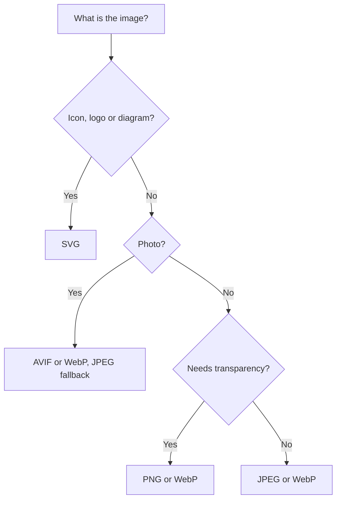
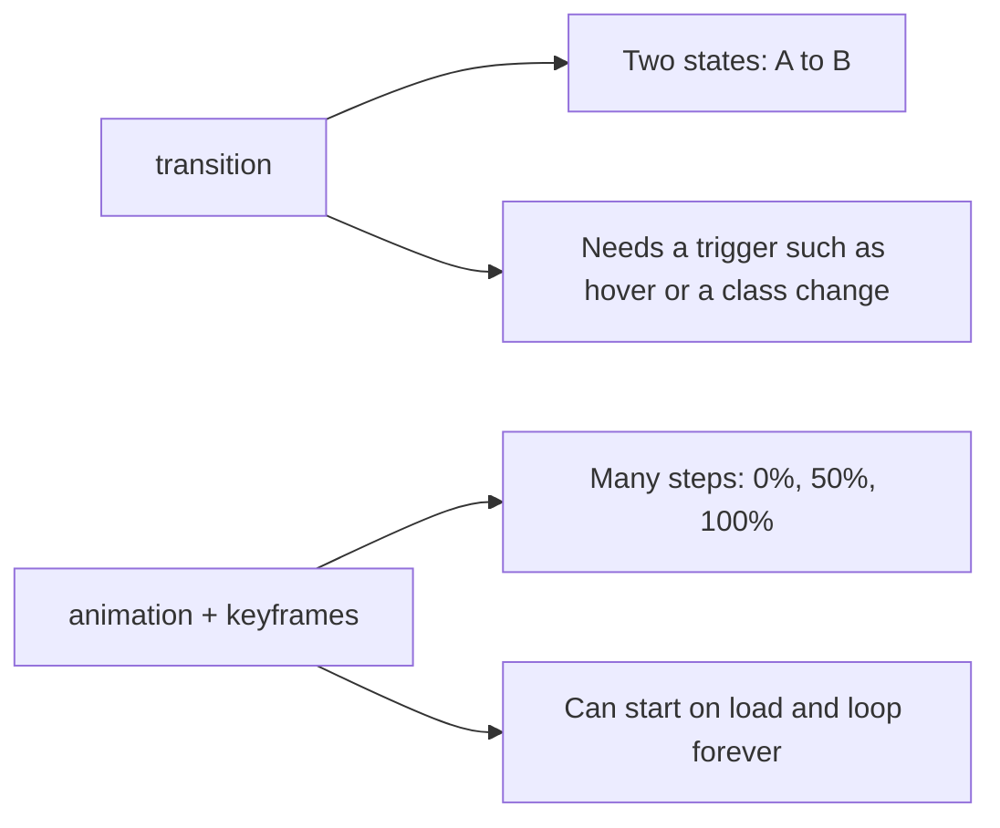
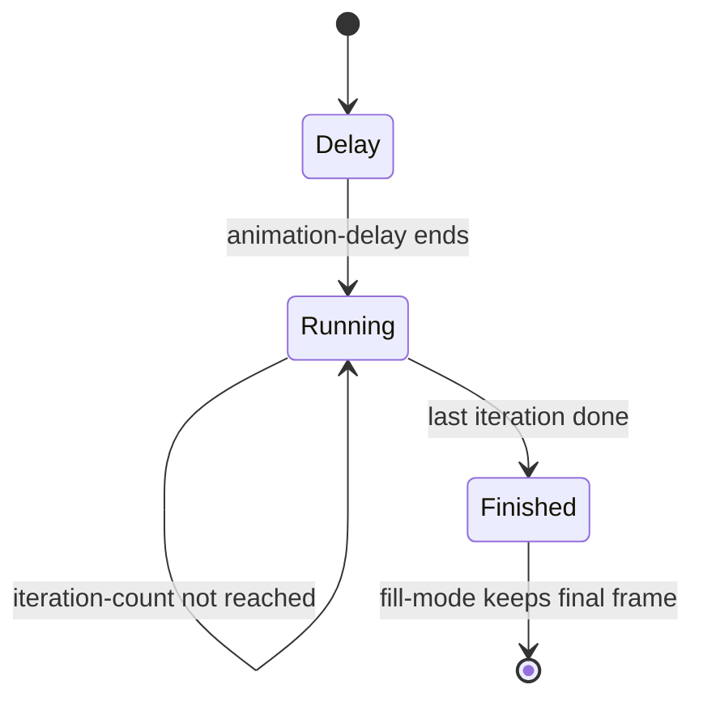

# Session 5 · Displaying Graphics and CSS3 Animation

> [Prime AI – Software Engineering with AI](../../README.md) › [Term 1](../README.md) › [Progressive Website Development](README.md) › **Session 5**

| ⏱ Estimated time | 🧩 Prerequisites |
|---|---|
| 2.5 hours | Session 4 |

[⬅ Previous: Formatting Using Style Sheets](session-04-formatting-using-style-sheets.md) &nbsp;|&nbsp; [Next: Layouts in CSS3: Flexbox and Grid ➡](session-06-layouts-with-flexbox-and-grid.md)

---

## 🎯 Learning objectives

By the end of this session you will be able to:

- Choose the right image format (JPEG, PNG, GIF, SVG, WebP, AVIF) and insert images with alt text, size and lazy loading.
- Serve responsive images with srcset, sizes and the picture element, and add captions with figure.
- Style images and boxes with borders, radius, shadows, gradients, filters and object-fit.
- Apply 2D/3D transforms and smooth transitions.
- Create keyframe animations and respect users who prefer reduced motion.

## 📖 Concepts

### Image formats
| Format | Best for | Transparency | Animation |
|---|---|---|---|
| **JPEG** | Photographs | No | No |
| **PNG** | Screenshots, logos with sharp edges | Yes | No |
| **GIF** | Tiny simple animations (old) | 1-bit | Yes |
| **SVG** | Icons, logos, diagrams – vector, scales without blur | Yes | Yes (CSS/SMIL) |
| **WebP / AVIF** | Modern photos and graphics – much smaller files | Yes | Yes |

### Inserting graphics
```html

```
- `alt` describes the image for screen readers and when it fails to load; decorative images get `alt=""`.
- `width` and `height` reserve space and prevent layout shift; CSS `max-width: 100%; height: auto;` keeps it responsive.
- `loading="lazy"` delays off-screen images; never lazy-load the main hero image.
- Spacing around an image comes from CSS `margin` and `padding` (the old `hspace`, `vspace`, `border` attributes are obsolete).

**Captions:** wrap an image in `<figure>` with `<figcaption>`.

**Responsive images:**
```html

<picture>
  <source srcset="hero.avif" type="image/avif">
  <source srcset="hero.webp" type="image/webp">
          <!-- fallback -->
</picture>
```

### Decorating with CSS3
| Feature | Example |
|---|---|
| Rounded corners | `border-radius: 12px;` (`50%` = circle) |
| Shadows | `box-shadow: 0 10px 25px rgb(0 0 0 / .2);` |
| Gradients | `background: linear-gradient(135deg, #1e1b4b, #0e7490);` · `radial-gradient(circle, …)` |
| Opacity / transparency | `opacity: .8;` or colour alpha `rgb(0 0 0 / 50%)` |
| Filters | `filter: grayscale(1) blur(2px) brightness(1.2);` |
| Cropping | `object-fit: cover; aspect-ratio: 16 / 9;` |
| Background images | `background: url(bg.jpg) center / cover no-repeat;` |

### Transforms
`transform` moves or reshapes an element **without affecting layout**: `translate(20px, 0)`, `rotate(15deg)`,
`scale(1.1)`, `skew(10deg)`; 3D: `rotateY(180deg)` with `perspective` on the parent. `transform-origin` sets the pivot point.

### Transitions
Animate from one state to another when a property changes (for example on `:hover`):
`transition: property duration timing-function delay;` → `transition: transform .3s ease-out, box-shadow .3s;`
Timing functions: `linear`, `ease`, `ease-in`, `ease-out`, `ease-in-out`, `cubic-bezier()`, `steps()`.
Animate **`transform` and `opacity`** for smooth, GPU-friendly motion; avoid animating `width`, `top` or `left`.

### Keyframe animations
```css
@keyframes pulse { 0% { transform: scale(1); } 50% { transform: scale(1.08); } 100% { transform: scale(1); } }
.cta { animation: pulse 2s ease-in-out infinite; }
```
`animation` sub-properties: `name duration timing-function delay iteration-count direction fill-mode play-state`.

### Motion and accessibility
Some users get dizzy from motion. Wrap non-essential animation in
`@media (prefers-reduced-motion: reduce) { … animation: none; transition: none; }`. Never flash content more than three
times per second.

## 🧭 Diagrams

### Picking an image format



### Transition vs keyframe animation



### Animation timeline



## 💻 Worked examples

### Example 1 — A responsive gallery with figure, object-fit and filters

```html
<style>
  .gallery { display: flex; flex-wrap: wrap; gap: 1rem; }
  figure { margin: 0; width: 240px; background: #fff; border-radius: 12px; overflow: hidden;
           box-shadow: 0 6px 18px rgb(0 0 0 / .12); }
  figure img { display: block; width: 100%; aspect-ratio: 4 / 3; object-fit: cover;
               filter: grayscale(1); transition: filter .4s, transform .4s; }
  figure:hover img { filter: grayscale(0); transform: scale(1.05); }
  figcaption { padding: .6rem .8rem; font: 600 .9rem system-ui; }
  .hero { height: 200px; display: grid; place-items: center; color: #fff;
          background: linear-gradient(135deg, rgb(30 27 75 / .85), rgb(14 116 144 / .85)),
                      url(https://picsum.photos/1200/400) center / cover; }
</style>
<section class="hero"><h1>Gallery</h1></section>
<div class="gallery">
  <figure>
    <figcaption>Hunza valley</figcaption></figure>
  <figure>
    <figcaption>Forest walk</figcaption></figure>
  <figure>
    <figcaption>City lights</figcaption></figure>
</div>
```

📄 Saved as [`code/session-05_example-1.html`](code/session-05_example-1.html)

**🖥️ What you see in the browser**

```text
A banner with a photo behind a navy-to-teal gradient overlay and the word "Gallery" centred in white.
Below, three rounded white cards with grey-scale photos cropped to 4:3 and captions.
Hovering a card fades its photo into full colour and zooms it slightly inside the card.
```

### Example 2 — Hover transitions and a 3D flip card

```css
.btn {
  background: #0e7490; color: #fff; padding: .8rem 1.4rem; border-radius: 8px;
  transition: transform .2s ease-out, box-shadow .2s ease-out;
}
.btn:hover, .btn:focus-visible { transform: translateY(-3px); box-shadow: 0 8px 16px rgb(0 0 0 / .2); }

.flip { perspective: 800px; width: 200px; height: 260px; }
.flip-inner { position: relative; width: 100%; height: 100%;
              transform-style: preserve-3d; transition: transform .6s; }
.flip:hover .flip-inner { transform: rotateY(180deg); }
.face { position: absolute; inset: 0; backface-visibility: hidden; border-radius: 12px;
        display: grid; place-items: center; }
.front { background: #1e1b4b; color: #fff; }
.back  { background: #fbbf24; transform: rotateY(180deg); }
```

📄 Saved as [`code/session-05_example-2.css`](code/session-05_example-2.css)

**🖥️ What you see in the browser**

```text
The button lifts 3px and gains a shadow on hover or keyboard focus.
The navy card turns over in 3D on hover to reveal its yellow back side.
```

### Example 3 — Keyframe animations: loader, typing text and a bouncing arrow

```css
.loader { width: 48px; height: 48px; border: 5px solid #e5e7eb; border-top-color: #0e7490;
          border-radius: 50%; animation: spin 1s linear infinite; }
@keyframes spin { to { transform: rotate(360deg); } }

.typing { width: 22ch; white-space: nowrap; overflow: hidden; border-right: 3px solid;
          font-family: monospace; animation: type 3s steps(22) 1 forwards, caret .7s step-end infinite; }
@keyframes type  { from { width: 0; } }
@keyframes caret { 50% { border-color: transparent; } }

.arrow { display: inline-block; animation: bounce 1.2s ease-in-out infinite alternate; }
@keyframes bounce { from { transform: translateY(0); } to { transform: translateY(12px); } }

@media (prefers-reduced-motion: reduce) {
  .loader, .typing, .arrow { animation: none; }
}
```

📄 Saved as [`code/session-05_example-3.css`](code/session-05_example-3.css)

**🖥️ What you see in the browser**

```text
A teal-and-grey ring spinning forever,
the text "Welcome to Prime AI" appearing letter by letter with a blinking caret,
and a ↓ arrow gently bouncing up and down.
With "reduce motion" turned on in the OS, all three stay still.
```

### Example 4 — How big is that image? (bytes and srcset choice)

Picking the srcset candidate the browser would choose for a given screen width and pixel density.

```js
const candidates = [400, 800, 1600];
function pick(cssWidth, dpr) {
  const needed = cssWidth * dpr;
  return candidates.find(w => w >= needed) ?? candidates.at(-1);
}
for (const [w, dpr] of [[360, 2], [768, 1], [1280, 1], [1440, 2]]) {
  console.log(`screen ${w}px @${dpr}x -> needs ${w * dpr}px -> downloads hero-${pick(w, dpr)}.jpg`);
}
```

📄 Saved as [`code/session-05_example-4.js`](code/session-05_example-4.js)

**Output** (real run)

```text
screen 360px @2x -> needs 720px -> downloads hero-800.jpg
screen 768px @1x -> needs 768px -> downloads hero-800.jpg
screen 1280px @1x -> needs 1280px -> downloads hero-1600.jpg
screen 1440px @2x -> needs 2880px -> downloads hero-1600.jpg
```

## 🧪 Lab / practice tasks

**🟢 Easy** — Add three images to a page inside `figure` elements with captions, meaningful `alt` text, width/height and `loading="lazy"`.

<details><summary>💡 Hint</summary>

Decorative images use `alt=""`.

</details>

**🟡 Medium** — Build a hero banner with a background photo, a gradient overlay and a centred heading. It must fill the width and stay 60vh tall.

<details><summary>💡 Hint</summary>

`background: linear-gradient(...), url(...) center / cover;`

</details>

**🔴 Hard** — Create a card that lifts and shows a shadow on hover using only `transform` and `box-shadow` transitions, and a flip card that reveals contact details.

<details><summary>💡 Hint</summary>

See Example 2; add `:focus-within` for keyboard users.

</details>

**🏆 Challenge** — Animate a "loading…" screen: a spinner, three dots that fade in sequence (use `animation-delay`), then fade the whole overlay out after 3 seconds with `animation-fill-mode: forwards`. Respect reduced motion.

<details><summary>💡 Hint</summary>

Three dots share one keyframes rule with delays 0s, .2s, .4s.

</details>

## ✅ Quick quiz

**Q1. Best format for a company logo that must stay sharp at any size:**

- A) JPEG
- B) GIF
- C) SVG
- D) BMP

<details><summary>Show answer</summary>

**C** — Vector graphics scale without blur.

</details>

**Q2. `object-fit: cover` makes an image:**

- A) Stretch and distort
- B) Fill the box and crop the overflow
- C) Shrink to fit with empty bars
- D) Disappear

<details><summary>Show answer</summary>

**B** — It keeps aspect ratio and crops.

</details>

**Q3. Which properties are cheapest to animate smoothly?**

- A) width and height
- B) top and left
- C) transform and opacity
- D) margin and padding

<details><summary>Show answer</summary>

**C** — They avoid layout recalculation.

</details>

**Q4. `animation-iteration-count: infinite` means:**

- A) Play once
- B) Loop forever
- C) Play backwards
- D) Pause

<details><summary>Show answer</summary>

**B** — The animation repeats until removed or paused.

</details>

**Q5. The `alt` attribute is mainly for:**

- A) SEO tricks only
- B) Screen readers and broken images
- C) Tooltips
- D) Styling

<details><summary>Show answer</summary>

**B** — It is the text alternative.

</details>

## 📝 Summary / cheat-sheet

- Formats: JPEG photos, PNG sharp/transparent, SVG vectors, WebP/AVIF modern and small.
- `img` needs `alt`, width/height; `loading="lazy"` off-screen; `figure` + `figcaption` for captions.
- Responsive images: `srcset` + `sizes`, `picture` with `source type` fallbacks.
- CSS3 decoration: `border-radius`, `box-shadow`, gradients, `opacity`, `filter`, `object-fit`, `aspect-ratio`.
- Transforms move without affecting layout; transitions animate between two states.
- `@keyframes` + `animation` for multi-step loops; honour `prefers-reduced-motion`.

## 🎤 Interview / viva questions

1. **Transition vs animation?**
   <details><summary>Model answer</summary>

   A transition interpolates between two states when a property changes (needs a trigger); a keyframe animation defines many steps and can run automatically and repeat.

   </details>

2. **Why set width and height on images?**
   <details><summary>Model answer</summary>

   The browser reserves the right space before the image loads, preventing Cumulative Layout Shift.

   </details>

3. **What is srcset for?**
   <details><summary>Model answer</summary>

   It offers several image widths so the browser downloads the smallest file that still looks sharp on that screen.

   </details>

4. **How do you make animations accessible?**
   <details><summary>Model answer</summary>

   Keep them subtle, avoid flashing, and disable or reduce them inside a prefers-reduced-motion media query.

   </details>

---

[⬅ Previous: Formatting Using Style Sheets](session-04-formatting-using-style-sheets.md) &nbsp;|&nbsp; [Next: Layouts in CSS3: Flexbox and Grid ➡](session-06-layouts-with-flexbox-and-grid.md)

<sub>Prepared by **Hamna Zahid Khan**, Junior Lecturer · Prime AI – Software Engineering with AI</sub>
