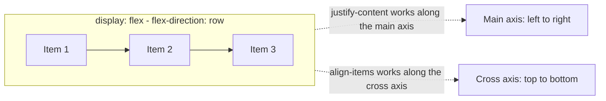
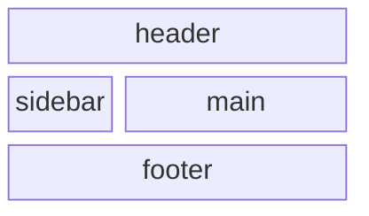
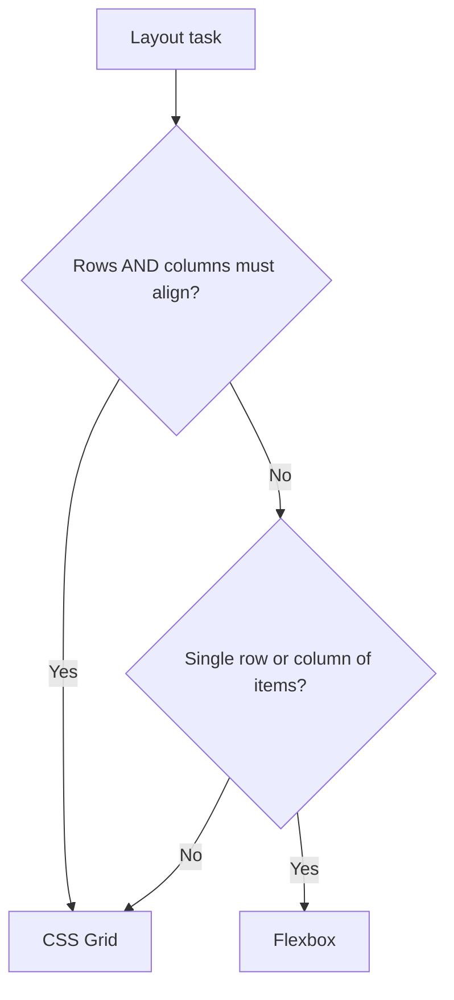

# Session 6 · Layouts in CSS3: Flexbox and Grid

> [Prime AI – Software Engineering with AI](../../README.md) › [Term 1](../README.md) › [Progressive Website Development](README.md) › **Session 6**

| ⏱ Estimated time | 🧩 Prerequisites |
|---|---|
| 3 hours | Session 4 |

[⬅ Previous: Displaying Graphics and CSS3 Animation](session-05-displaying-graphics-and-css3-animation.md) &nbsp;|&nbsp; [Next: New Features of CSS3 ➡](session-07-new-features-of-css3.md)

---

## 🎯 Learning objectives

By the end of this session you will be able to:

- Explain the difference between one-dimensional (Flexbox) and two-dimensional (Grid) layout.
- Use flex container properties: direction, wrap, justify-content, align-items, align-content and gap.
- Control flex items with flex-grow, flex-shrink, flex-basis, order and align-self.
- Define grids with grid-template-columns/rows, fr units, repeat, minmax, auto-fit and named areas.
- Place items by line numbers and spans, and build complete page layouts.

## 📖 Concepts

### Why Flexbox and Grid?
Before them, layouts were built with floats and tables – fragile hacks. Now:
- **Flexbox** lays items out in **one direction** at a time (a row *or* a column): navbars, toolbars, centring, card rows.
- **Grid** lays items out in **rows and columns at the same time**: whole page layouts, galleries, dashboards.
They work together: a Grid page whose header uses Flexbox.

### Flexbox vocabulary
Set `display: flex` on the **container**; its direct children become **flex items**. The **main axis** follows
`flex-direction` (row = horizontal); the **cross axis** is perpendicular.

| Container property | Values | Effect |
|---|---|---|
| `flex-direction` | `row` · `row-reverse` · `column` · `column-reverse` | Main-axis direction |
| `flex-wrap` | `nowrap` · `wrap` | Allow items onto new lines |
| `justify-content` | `flex-start` `center` `flex-end` `space-between` `space-around` `space-evenly` | Spacing on the **main** axis |
| `align-items` | `stretch` `flex-start` `center` `flex-end` `baseline` | Alignment on the **cross** axis |
| `align-content` | same as justify | Spacing between wrapped **lines** |
| `gap` | `1rem` / `1rem 2rem` | Space between items |

| Item property | Example | Effect |
|---|---|---|
| `flex-grow` | `1` | Share of extra space |
| `flex-shrink` | `0` | Refuse to shrink |
| `flex-basis` | `250px` | Starting size before grow/shrink |
| `flex` (shorthand) | `flex: 1 1 250px` | grow shrink basis |
| `order` | `-1` | Visual order (does not change reading order – use with care) |
| `align-self` | `flex-end` | Override align-items for one item |

**Perfect centring:** `display: flex; justify-content: center; align-items: center;`

### Grid vocabulary
| Property | Example | Effect |
|---|---|---|
| `grid-template-columns` | `200px 1fr 1fr` · `repeat(3, 1fr)` | Column tracks |
| `grid-template-rows` | `auto 1fr auto` | Row tracks |
| `fr` unit | `2fr 1fr` | Fraction of free space |
| `minmax()` | `minmax(220px, 1fr)` | Track that never goes below 220 px |
| `auto-fit` / `auto-fill` | `repeat(auto-fit, minmax(220px, 1fr))` | As many columns as fit – responsive without media queries |
| `gap` | `1.5rem` | Gutters |
| `grid-template-areas` | `"header header" "sidebar main" "footer footer"` | Name regions, then `grid-area: main;` |
| Line placement | `grid-column: 1 / 3;` `grid-column: span 2;` `grid-row: 2 / -1;` | Place by line numbers (lines start at 1; -1 is the last) |
| Alignment | `justify-items`, `align-items`, `place-items: center` | Inside cells |

### Grid or Flexbox?
| Use Flexbox when… | Use Grid when… |
|---|---|
| Content decides the size (buttons in a toolbar) | The layout decides the size (columns of a page) |
| One row or one column | Rows **and** columns must line up |
| Distributing space between a few items | Overlapping items or named regions |

## 🧭 Diagrams

### Flexbox axes



### A grid page with named areas



### Flexbox or Grid?



## 💻 Worked examples

### Example 1 — A responsive navbar with Flexbox

```html
<style>
  .navbar { display: flex; align-items: center; justify-content: space-between;
            flex-wrap: wrap; gap: 1rem; padding: 1rem 1.5rem; background: #1e1b4b; }
  .logo { color: #fff; font: 700 1.3rem system-ui; text-decoration: none; }
  .links { display: flex; gap: 1.25rem; list-style: none; margin: 0; padding: 0; }
  .links a { color: #c7d2fe; text-decoration: none; }
  .links a:hover { color: #fff; }
  .cta { margin-left: auto; background: #fbbf24; padding: .5rem 1rem; border-radius: 6px; }
</style>
<nav class="navbar">
  <a class="logo" href="#">Prime</a>
  <ul class="links">
    <li><a href="#">Courses</a></li><li><a href="#">Faculty</a></li><li><a href="#">Contact</a></li>
  </ul>
  <a class="cta" href="#">Apply now</a>
</nav>
```

📄 Saved as [`code/session-06_example-1.html`](code/session-06_example-1.html)

**🖥️ What you see in the browser**

```text
A navy bar: "Prime" on the left, three pale links in the middle, a yellow "Apply now" button pushed to the right.
On a narrow phone the items wrap onto a second line instead of overflowing.
```

### Example 2 — Equal-height cards that wrap – flex: 1 1 250px

```css
.cards { display: flex; flex-wrap: wrap; gap: 1.5rem; }
.card  { flex: 1 1 250px;          /* grow, shrink, start at 250px */
         display: flex; flex-direction: column;
         padding: 1.25rem; border: 1px solid #e5e7eb; border-radius: 12px; }
.card p { flex-grow: 1; }          /* pushes the button to the bottom */
.card .btn { align-self: flex-start; }
.card.featured { order: -1; }      /* shown first visually */
.center-box { display: flex; justify-content: center; align-items: center; min-height: 50vh; }
```

📄 Saved as [`code/session-06_example-2.css`](code/session-06_example-2.css)

**🖥️ What you see in the browser**

```text
On a wide screen four cards sit in one row, all the same height, with their buttons lined up
along the bottom edge; the featured card appears first. On a tablet they become two rows of two,
and on a phone one card per row – no media queries needed.
```

### Example 3 — A full page layout with grid-template-areas

```html
<style>
  body { margin: 0; font-family: system-ui; }
  .page { display: grid; min-height: 100vh; gap: 1rem;
          grid-template-columns: 1fr;
          grid-template-areas: "header" "main" "sidebar" "footer"; }
  @media (min-width: 800px) {
    .page { grid-template-columns: 240px 1fr;
            grid-template-rows: auto 1fr auto;
            grid-template-areas: "header header" "sidebar main" "footer footer"; }
  }
  header  { grid-area: header;  background: #1e1b4b; color: #fff; padding: 1rem; }
  aside   { grid-area: sidebar; background: #e0e7ff; padding: 1rem; }
  main    { grid-area: main;    padding: 1rem; }
  footer  { grid-area: footer;  background: #f1f5f9; padding: 1rem; }
  .gallery { display: grid; gap: .75rem; grid-template-columns: repeat(auto-fit, minmax(160px, 1fr)); }
  .gallery .wide { grid-column: span 2; }
  .gallery div { background: #c7d2fe; padding: 2rem; border-radius: 8px; }
</style>
<div class="page">
  <header>Header</header>
  <aside>Sidebar links</aside>
  <main><h1>Main content</h1>
    <div class="gallery"><div class="wide">1 (span 2)</div><div>2</div><div>3</div><div>4</div><div>5</div></div>
  </main>
  <footer>Footer</footer>
</div>
```

📄 Saved as [`code/session-06_example-3.html`](code/session-06_example-3.html)

**🖥️ What you see in the browser**

```text
Desktop (≥ 800px): header across the top, a 240px lavender sidebar on the left, main content on the
right, footer across the bottom; the page always fills the screen height.
Inside main, a gallery whose number of columns adapts to the width; tile 1 is two columns wide.
Phone: header, main, sidebar, footer stacked in one column.
```

### Example 4 — How fr units share space

Compute what `grid-template-columns: 200px 2fr 1fr` gives in a 1000 px container with a 20 px gap – the same arithmetic the browser does.

```js
function resolve(tracks, container, gap) {
  const fixed = tracks.filter(t => t.endsWith('px')).reduce((s, t) => s + parseFloat(t), 0);
  const totalFr = tracks.filter(t => t.endsWith('fr')).reduce((s, t) => s + parseFloat(t), 0);
  const free = container - fixed - gap * (tracks.length - 1);
  return tracks.map(t => t.endsWith('px') ? parseFloat(t) : (parseFloat(t) / totalFr) * free);
}
const cols = resolve(['200px', '2fr', '1fr'], 1000, 20);
console.log('column widths:', cols.map(w => Math.round(w) + 'px').join(' | '));
console.log('check total  :', Math.round(cols.reduce((a, b) => a + b) + 40), 'px');
```

📄 Saved as [`code/session-06_example-4.js`](code/session-06_example-4.js)

**Output** (real run)

```text
column widths: 200px | 507px | 253px
check total  : 1000 px
```

## 🧪 Lab / practice tasks

**🟢 Easy** — Centre a login box horizontally and vertically on the screen using Flexbox.

<details><summary>💡 Hint</summary>

`min-height: 100vh` on the container.

</details>

**🟡 Medium** — Build a footer with three columns (About, Links, Contact) using Flexbox that stacks into one column below 600px.

<details><summary>💡 Hint</summary>

`flex: 1 1 200px` plus `flex-wrap: wrap` often removes the need for a media query.

</details>

**🔴 Hard** — Recreate a news homepage: a large lead story spanning two columns and two rows, and six smaller stories, using Grid line placement.

<details><summary>💡 Hint</summary>

`grid-column: span 2; grid-row: span 2;`

</details>

**🏆 Challenge** — Build a dashboard: header, collapsible sidebar, a 4-tile statistics row (Flexbox) and a responsive card grid (`auto-fit` + `minmax`). Play Flexbox Froggy and Grid Garden to warm up.

<details><summary>💡 Hint</summary>

Use grid-template-areas for the page and Flexbox inside the tiles.

</details>

## ✅ Quick quiz

**Q1. Flexbox is primarily:**

- A) Two-dimensional
- B) One-dimensional
- C) For tables only
- D) Deprecated

<details><summary>Show answer</summary>

**B** — Rows or columns, one at a time.

</details>

**Q2. Which property spaces flex items along the main axis?**

- A) align-items
- B) justify-content
- C) grid-gap
- D) order

<details><summary>Show answer</summary>

**B** — justify-content distributes space on the main axis.

</details>

**Q3. `flex: 1 1 250px` means:**

- A) grow 1, shrink 1, basis 250px
- B) width 1px
- C) order 1
- D) margin 250px

<details><summary>Show answer</summary>

**A** — grow shrink basis.

</details>

**Q4. `repeat(auto-fit, minmax(200px, 1fr))` produces:**

- A) Exactly 200px columns
- B) As many columns of at least 200px as fit
- C) One column
- D) An error

<details><summary>Show answer</summary>

**B** — Responsive columns without media queries.

</details>

**Q5. `grid-column: 1 / -1` makes an item:**

- A) Hidden
- B) Span all columns
- C) Span one column
- D) Move to the last row

<details><summary>Show answer</summary>

**B** — -1 is the last line.

</details>

## 📝 Summary / cheat-sheet

- Flexbox = 1D (row or column); Grid = 2D (rows and columns).
- Flex container: `flex-direction`, `flex-wrap`, `justify-content` (main), `align-items` (cross), `gap`.
- Flex items: `flex: grow shrink basis`, `order`, `align-self`; centring = justify + align center.
- Grid: `grid-template-columns/rows`, `fr`, `repeat()`, `minmax()`, `auto-fit`, `gap`.
- Place with lines (`grid-column: 1 / 3`, `span 2`, `-1`) or named `grid-template-areas`.
- Combine them: Grid for the page, Flexbox for components.

## 🎤 Interview / viva questions

1. **Flexbox vs Grid?**
   <details><summary>Model answer</summary>

   Flexbox distributes items along one axis and is content-driven; Grid defines rows and columns together and is layout-driven. Use Grid for page structure and Flexbox for components inside it.

   </details>

2. **What is the fr unit?**
   <details><summary>Model answer</summary>

   A fraction of the free space left in the grid container after fixed tracks and gaps are subtracted.

   </details>

3. **auto-fit vs auto-fill?**
   <details><summary>Model answer</summary>

   Both create as many tracks as fit; auto-fit collapses empty tracks so items stretch to fill the row, while auto-fill keeps empty tracks.

   </details>

4. **How do you centre a div both ways?**
   <details><summary>Model answer</summary>

   On the parent: display:flex; justify-content:center; align-items:center – or display:grid; place-items:center.

   </details>

---

[⬅ Previous: Displaying Graphics and CSS3 Animation](session-05-displaying-graphics-and-css3-animation.md) &nbsp;|&nbsp; [Next: New Features of CSS3 ➡](session-07-new-features-of-css3.md)

<sub>Prepared by **Hamna Zahid Khan**, Junior Lecturer · Prime AI – Software Engineering with AI</sub>
