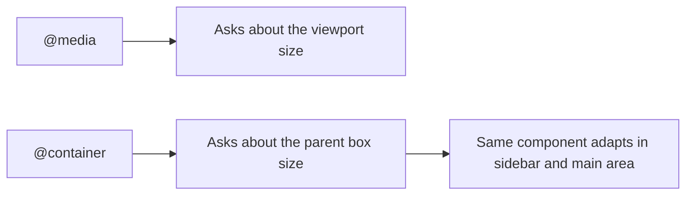
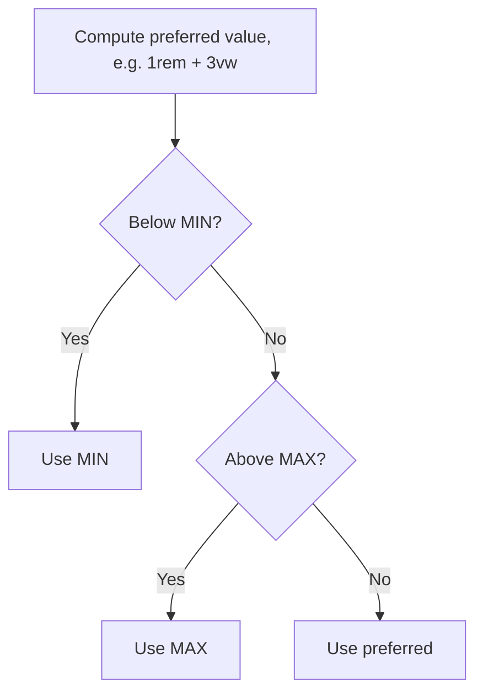
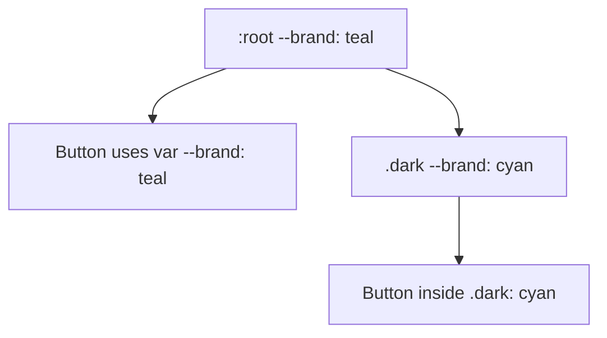

# Session 7 · New Features of CSS3

> [Prime AI – Software Engineering with AI](../../README.md) › [Term 1](../README.md) › [Progressive Website Development](README.md) › **Session 7**

| ⏱ Estimated time | 🧩 Prerequisites |
|---|---|
| 2 hours | Session 6 |

[⬅ Previous: Layouts in CSS3: Flexbox and Grid](session-06-layouts-with-flexbox-and-grid.md) &nbsp;|&nbsp; [Next: HTML5 Semantic Layout and Forms ➡](session-08-html5-semantic-layout-and-forms.md)

---

## 🎯 Learning objectives

By the end of this session you will be able to:

- Align nested content across cards with subgrid.
- Use viewport units (vw, vh, vmin, vmax) and the new dynamic units (dvh, svh, lvh).
- Write fluid sizes with clamp(), min(), max() and CSS custom properties (variables).
- Use native CSS nesting, :has(), :is() and :where().
- Make components respond to their container with container queries, and build a full-screen hero.

## 📖 Concepts

### Subgrid
A nested grid normally has its own tracks, so the titles and buttons in a row of cards do not line up. With
`grid-template-rows: subgrid` (or columns), a child grid **borrows its parent's tracks**:
```css
.cards { display: grid; grid-template-columns: repeat(3, 1fr); grid-template-rows: auto auto 1fr auto; }
.card  { display: grid; grid-row: span 4; grid-template-rows: subgrid; }   /* image, title, text, button align */
```

### Viewport units
| Unit | Means | Typical use |
|---|---|---|
| `vw` / `vh` | 1% of viewport width / height | Full-screen sections, fluid type |
| `vmin` / `vmax` | 1% of the smaller / larger side | Squares that fit any orientation |
| `svh` / `lvh` | Small / large viewport height (mobile browser bars shown / hidden) | Stable layouts on phones |
| `dvh` | **Dynamic** viewport height – updates as the address bar moves | `min-height: 100dvh` heroes |

On phones `100vh` can be taller than the visible area because of the browser toolbar – prefer `100dvh` (with `100vh`
before it as a fallback).

### Fluid values
- `clamp(MIN, PREFERRED, MAX)` – e.g. `font-size: clamp(1.75rem, 1rem + 3vw, 3.5rem);` never smaller or larger than the limits.
- `min(90%, 1100px)` – the smaller of two values (a container that is 90% wide but never more than 1100 px).
- `max()` – the larger of two values.

### Custom properties (CSS variables)
```css
:root { --brand: #0e7490; --radius: 12px; --space: 1rem; }
.btn  { background: var(--brand); border-radius: var(--radius); padding: var(--space) calc(var(--space) * 2); }
.dark { --brand: #67e8f9; }      /* re-define inside a scope: everything using it updates */
```
Variables cascade and can be changed by JavaScript (`el.style.setProperty('--brand', 'red')`), which makes themes easy.

### Native nesting and modern selectors
```css
.nav {
  display: flex;
  & a { color: white; }
  & a:hover { text-decoration: underline; }
  @media (width < 600px) { flex-direction: column; }
}
```
- `:is(h1, h2, h3) a` – matches any of the list, takes the highest specificity in the list.
- `:where(…)` – same but **zero** specificity (great for resets).
- `:has()` – the "parent selector": `.card:has(img)` styles cards that contain an image; `form:has(:invalid) button` dims the button while the form is invalid.

### Container queries
Media queries ask "how wide is the **screen**?". Container queries ask "how wide is **my box**?" – so the same card can be
compact in a sidebar and spacious in the main area:
```css
.card-wrap { container-type: inline-size; }
@container (min-width: 420px) { .card { display: grid; grid-template-columns: 150px 1fr; } }
```
Units `cqw` / `cqi` are 1% of the container's width.

### Other modern additions worth knowing
`aspect-ratio`, `gap` for Flexbox, `accent-color` for checkboxes, `scroll-behavior: smooth`, `scroll-snap-type`,
`inset: 0`, logical properties (`margin-inline`, `padding-block`), `color-mix()`, `backdrop-filter: blur()`, and the
media-query range syntax `@media (400px <= width <= 900px)`.

## 🧭 Diagrams

### Media query vs container query



### How clamp() decides a value



### Custom properties cascade



## 💻 Worked examples

### Example 1 — A responsive full-screen hero

```html
<style>
  :root { --brand: #0e7490; --ink: #0f172a; }
  * { box-sizing: border-box; }
  body { margin: 0; font-family: system-ui, sans-serif; }
  .hero {
    min-height: 100vh; min-height: 100dvh;          /* fallback, then dynamic unit */
    display: grid; place-items: center; text-align: center; padding: 2rem;
    color: #fff;
    background: linear-gradient(rgb(15 23 42 / .65), rgb(15 23 42 / .65)),
                url(https://picsum.photos/id/1018/1600/900) center / cover;
  }
  .hero h1 { font-size: clamp(2rem, 1rem + 5vw, 4.5rem); margin: 0 0 .5rem; }
  .hero p  { font-size: clamp(1rem, .9rem + .6vw, 1.35rem); max-width: min(60ch, 90vw); margin-inline: auto; }
  .btn { display: inline-block; margin-top: 1.5rem; padding: .9rem 1.8rem; border-radius: 999px;
         background: var(--brand); color: #fff; text-decoration: none; }
  .scroll { position: absolute; bottom: 2vh; left: 50%; translate: -50% 0; }
</style>
<section class="hero">
  <div>
    <h1>Build the web of tomorrow</h1>
    <p>Hands-on HTML5, CSS3 and JavaScript – from your first tag to an installable web app.</p>
    <a class="btn" href="#start">Start learning</a>
  </div>
  <span class="scroll">↓</span>
</section>
```

📄 Saved as [`code/session-07_example-1.html`](code/session-07_example-1.html)

**🖥️ What you see in the browser**

```text
A photo filling exactly the visible screen (also on phones with a moving address bar),
darkened by an overlay, with a centred headline that grows from 2rem on phones to 4.5rem on large screens,
a readable paragraph no wider than 60 characters, a teal pill button and a ↓ at the bottom.
```

### Example 2 — Subgrid cards whose parts line up

```css
.cards {
  display: grid; gap: 1.5rem;
  grid-template-columns: repeat(auto-fit, minmax(240px, 1fr));
}
.card {
  display: grid;
  grid-row: span 4;                 /* image, title, text, button */
  grid-template-rows: subgrid;      /* share the parent's row tracks */
  gap: .75rem; padding: 1rem; border: 1px solid #e2e8f0; border-radius: 12px;
}
.card img { width: 100%; aspect-ratio: 16 / 9; object-fit: cover; border-radius: 8px; }
.card .btn { align-self: end; }
```

📄 Saved as [`code/session-07_example-2.css`](code/session-07_example-2.css)

**🖥️ What you see in the browser**

```text
Three cards side by side whose titles start on the same line, whose texts start on the same line
and whose buttons sit on one baseline – even though one title wraps to two lines.
```

### Example 3 — Container queries, :has() and a variable-driven theme

```css
.panel { container-type: inline-size; }
.profile { display: grid; gap: 1rem; }
@container (min-width: 420px) {
  .profile { grid-template-columns: 120px 1fr; align-items: center; }
}
.profile:has(.badge) { border: 2px solid gold; }          /* only cards that contain a badge */
form:has(:invalid) button[type="submit"] { opacity: .5; pointer-events: none; }

:root { --bg: #ffffff; --text: #0f172a; }
@media (prefers-color-scheme: dark) { :root { --bg: #0f172a; --text: #e2e8f0; } }
body { background: var(--bg); color: var(--text); }

.menu {
  display: flex; gap: 1rem;
  & a { color: var(--text); }
  @media (width < 600px) { flex-direction: column; }
}
```

📄 Saved as [`code/session-07_example-3.css`](code/session-07_example-3.css)

**🖥️ What you see in the browser**

```text
The profile card stacks vertically in the narrow sidebar but shows photo-left/text-right in the wide main column.
Cards containing a .badge get a gold border. The submit button stays faded until every field is valid.
The page switches to dark colours automatically when the OS uses dark mode.
```

### Example 4 — clamp() calculator

What does `font-size: clamp(2rem, 1rem + 5vw, 4.5rem)` give at different screen widths? (1rem = 16px)

```js
const clamp = (min, val, max) => Math.min(Math.max(val, min), max);
for (const vw of [320, 480, 768, 1024, 1440, 1920]) {
  const preferred = 16 + 0.05 * vw;              // 1rem + 5vw
  const size = clamp(32, preferred, 72);         // 2rem .. 4.5rem
  console.log(`${String(vw).padStart(4)}px wide -> ${size.toFixed(1)}px`);
}
```

📄 Saved as [`code/session-07_example-4.js`](code/session-07_example-4.js)

**Output** (real run)

```text
 320px wide -> 32.0px
 480px wide -> 40.0px
 768px wide -> 54.4px
1024px wide -> 67.2px
1440px wide -> 72.0px
1920px wide -> 72.0px
```

## 🧪 Lab / practice tasks

**🟢 Easy** — Define five CSS variables (two colours, a radius, a spacing and a font) on `:root` and use them across your site. Change one value and watch the whole site update.

<details><summary>💡 Hint</summary>

`var(--name)`; define on `:root`.

</details>

**🟡 Medium** — Build a full-screen hero with `100dvh`, fluid `clamp()` headline and a container that is `min(90%, 1100px)` wide.

<details><summary>💡 Hint</summary>

See Example 1.

</details>

**🔴 Hard** — Make a row of three pricing cards with subgrid so the plan names, prices, feature lists and buttons all align.

<details><summary>💡 Hint</summary>

`grid-row: span 4; grid-template-rows: subgrid;`

</details>

**🏆 Challenge** — Create one "product" component that shows a compact layout under 400 px of container width and a two-column layout above it, then place it in both a sidebar and the main area. Add a dark theme via `prefers-color-scheme` and variables.

<details><summary>💡 Hint</summary>

Use `container-type: inline-size` on the wrappers.

</details>

## ✅ Quick quiz

**Q1. `100dvh` adapts to:**

- A) Desktop zoom
- B) The visible viewport as mobile browser bars appear/disappear
- C) Font size
- D) Container width

<details><summary>Show answer</summary>

**B** — d = dynamic.

</details>

**Q2. `clamp(1rem, 4vw, 2rem)` never returns:**

- A) 1rem
- B) 2rem
- C) 3rem
- D) 1.5rem

<details><summary>Show answer</summary>

**C** — It is capped at 2rem.

</details>

**Q3. A container query responds to:**

- A) The screen width
- B) The width of a containing element
- C) The device type
- D) The URL

<details><summary>Show answer</summary>

**B** — It measures the nearest ancestor with container-type set, not the viewport.

</details>

**Q4. `.card:has(img)` selects:**

- A) Images in cards
- B) Cards that contain an image
- C) Cards without images
- D) The first image

<details><summary>Show answer</summary>

**B** — :has is a parent/relational selector.

</details>

**Q5. Custom properties are read with:**

- A) `$name`
- B) `@name`
- C) `var(--name)`
- D) `--name()`

<details><summary>Show answer</summary>

**C** — Declare --name: value; and read it with var(--name).

</details>

## 📝 Summary / cheat-sheet

- Subgrid lets nested grids share parent tracks so card parts align.
- Viewport units `vw vh vmin vmax`; mobile-safe `dvh svh lvh`.
- `clamp()`, `min()`, `max()` for fluid sizes; custom properties `--x` + `var()` for themes.
- Native nesting with `&`; `:is()`, `:where()` (0 specificity), `:has()` parent selector.
- Container queries: `container-type: inline-size` + `@container (min-width: …)`.

## 🎤 Interview / viva questions

1. **Why might 100vh cause problems on mobile?**
   <details><summary>Model answer</summary>

   Mobile browsers calculate vh using the largest viewport, so content can hide behind the address bar; dvh or svh measure the actually visible area.

   </details>

2. **What problem does subgrid solve?**
   <details><summary>Model answer</summary>

   Items inside separate child grids could not align with each other; subgrid makes children use the parent grid tracks so they line up.

   </details>

3. **Media query vs container query?**
   <details><summary>Model answer</summary>

   A media query reacts to the viewport or device; a container query reacts to the size of a specific ancestor, making components reusable anywhere.

   </details>

4. **Benefit of CSS variables over Sass variables?**
   <details><summary>Model answer</summary>

   CSS custom properties live in the browser, cascade, can be scoped and changed at run time by media queries or JavaScript.

   </details>

---

[⬅ Previous: Layouts in CSS3: Flexbox and Grid](session-06-layouts-with-flexbox-and-grid.md) &nbsp;|&nbsp; [Next: HTML5 Semantic Layout and Forms ➡](session-08-html5-semantic-layout-and-forms.md)

<sub>Prepared by **Hamna Zahid Khan**, Junior Lecturer · Prime AI – Software Engineering with AI</sub>
