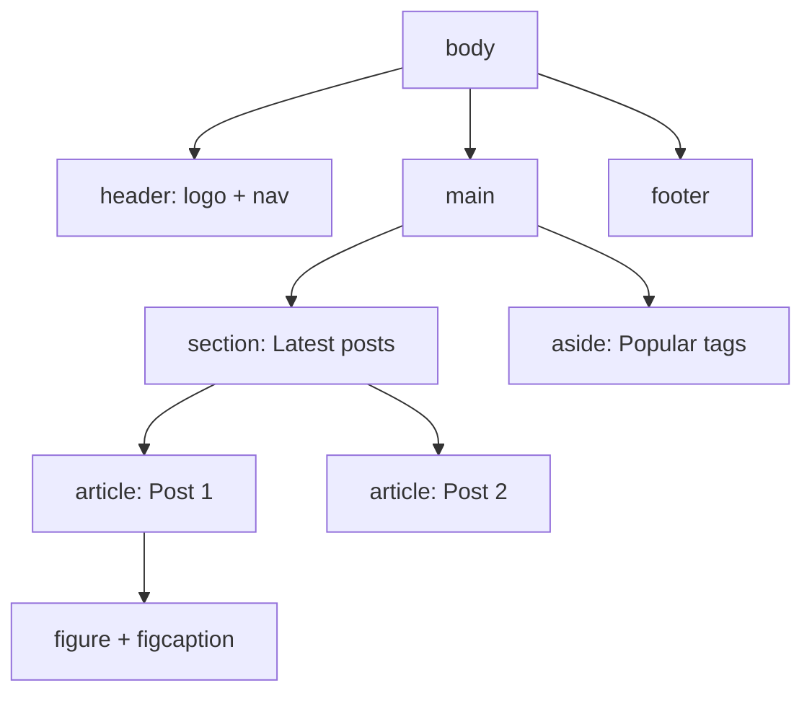
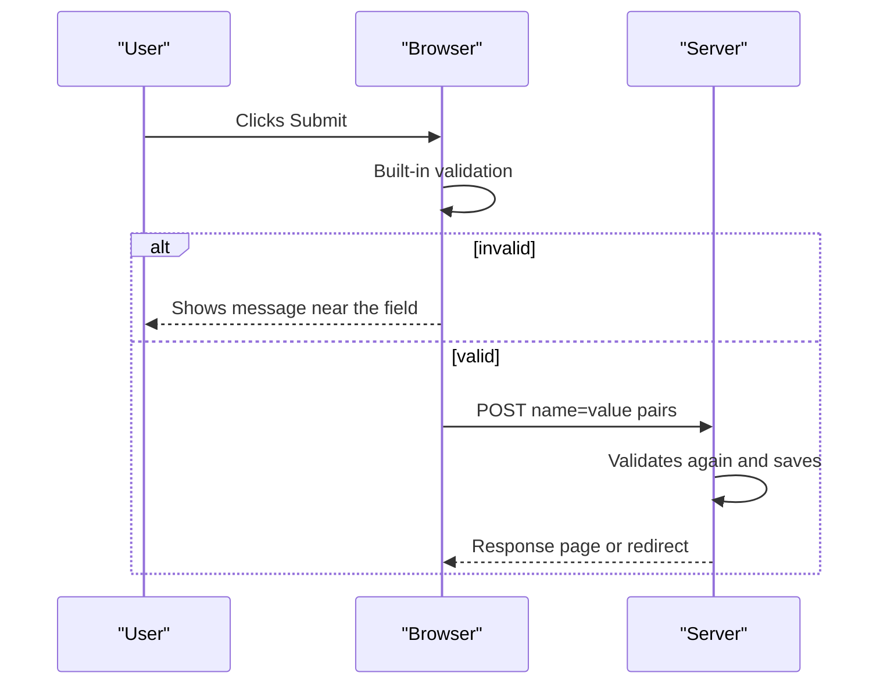
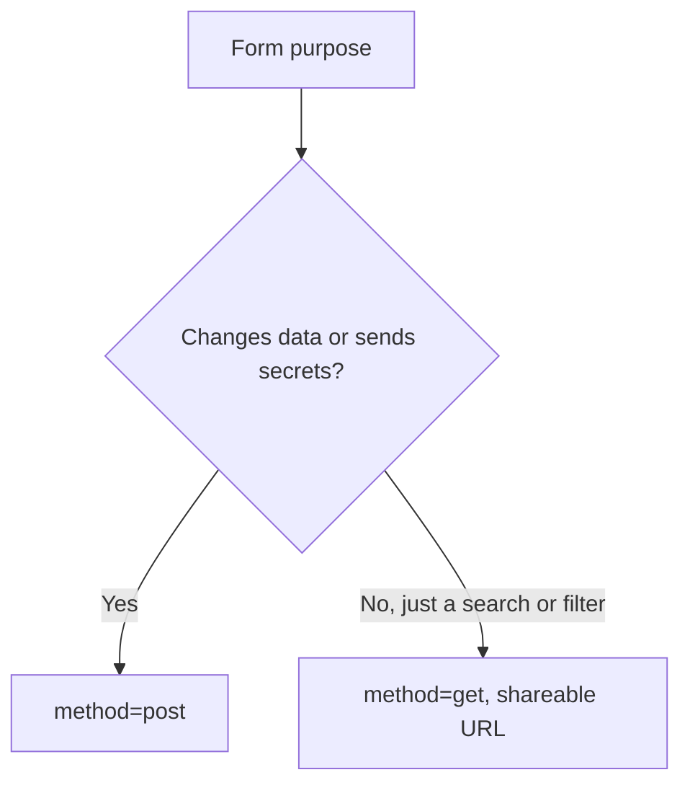

# Session 8 · HTML5 Semantic Layout and Forms

> [Prime AI – Software Engineering with AI](../../README.md) › [Term 1](../README.md) › [Progressive Website Development](README.md) › **Session 8**

| ⏱ Estimated time | 🧩 Prerequisites |
|---|---|
| 2.5 hours | Session 6 |

[⬅ Previous: New Features of CSS3](session-07-new-features-of-css3.md) &nbsp;|&nbsp; [Next: HTML5 Tables, Audio and Video ➡](session-09-html5-tables-audio-and-video.md)

---

## 🎯 Learning objectives

By the end of this session you will be able to:

- Lay out pages with HTML5 semantic elements and explain their benefits for accessibility and SEO.
- Use ARIA attributes and landmark roles only where native HTML is not enough.
- Build forms with labels, fieldsets and the HTML5 input types.
- Validate input with required, min, max, minlength, pattern and type, and style valid/invalid states.
- Create login, contact and survey forms, including hidden fields, select, datalist and textarea.

## 📖 Concepts

### Semantic layout elements
"Semantic" means the tag describes its **meaning**, not its look. Compare a page of `<div class="header">` with:

| Element | Meaning |
|---|---|
| `<header>` | Intro of the page or of a section (logo, title, nav) |
| `<nav>` | Major navigation links |
| `<main>` | The unique main content – **one per page** |
| `<section>` | A thematic group with a heading |
| `<article>` | Self-contained content that makes sense alone (post, product, comment) |
| `<aside>` | Related but secondary content (sidebar, tips) |
| `<footer>` | Closing info for the page or section |
| `<figure>` / `<figcaption>` | Self-contained media with a caption |
| `<time datetime="2026-10-24">` | A machine-readable date |
| `<details>` / `<summary>` | A native collapsible box (FAQ) |
| `<dialog>` | A native modal / pop-up |
| `<address>` | Contact information |

**Benefits:** screen readers can jump between **landmarks**, search engines understand structure, code is easier to read,
and styles hook onto meaningful elements. Use `<div>` only when no semantic element fits.

### Accessibility and ARIA
**ARIA** (Accessible Rich Internet Applications) adds meaning for assistive technology:
`aria-label="Close"`, `aria-expanded="false"`, `aria-current="page"`, `aria-hidden="true"`, `aria-describedby`,
`role="alert"`. The **first rule of ARIA**: use native HTML (`<button>`, `<nav>`) instead of ARIA whenever possible.
Other habits: every input has a `<label>`, every image has `alt`, the page is usable with the keyboard alone, and colour is
never the only signal.

### Forms
```html
<form action="/register" method="post">
  <label for="email">Email</label>
  <input type="email" id="email" name="email" required>
  <button type="submit">Register</button>
</form>
```
- `action` = where data goes; `method="get"` puts data in the URL (searches), `method="post"` sends it in the request body (logins, sign-ups).
- `name` is the key the server receives; `id` connects to `<label for>` (clicking the label focuses the input).
- Group related controls with `<fieldset>` and a `<legend>`.

| Input type | Gives you |
|---|---|
| `text` `password` `search` | Plain, masked, search field |
| `email` `url` `tel` | Format checks / mobile keyboards with @ or numbers |
| `number` `range` | Numeric spinner / slider (`min max step`) |
| `date` `time` `datetime-local` `month` `week` | Native pickers |
| `color` `file` | Colour picker, file upload (`accept="image/*"`, `multiple`) |
| `checkbox` `radio` | Many-of / one-of (radios share the same `name`) |
| `hidden` | Value sent but not shown (e.g. a form id) |
| `submit` `reset` `button` | Buttons (prefer `<button>`) |

Other controls: `<select>` + `<option>` (and `<optgroup>`), `<textarea rows>`, `<datalist>` (suggestions), `<output>`,
`<progress>`, `<meter>`.

### Built-in validation
| Attribute | Example |
|---|---|
| `required` | Field cannot be empty |
| `min` / `max` / `step` | `<input type="number" min="18" max="60">` |
| `minlength` / `maxlength` | Passwords at least 8 characters |
| `pattern` | `pattern="03[0-9]{9}"` – a Pakistani mobile number such as 03001234567 |
| `type` | `email`, `url` checked automatically |
| `autocomplete` | `email`, `current-password`, `new-password`, `tel` |
| `novalidate` on form | Turn browser checks off (when JavaScript validates) |

Style states with `:valid`, `:invalid`, `:user-invalid` (only after the user interacts), `:required`, `:placeholder-shown`.
Client-side validation helps users; the **server must still validate** everything.

## 🧭 Diagrams

### Semantic page skeleton



### What happens when a form is submitted



### GET or POST?



## 💻 Worked examples

### Example 1 — A semantic blog layout

```html
<!DOCTYPE html>
<html lang="en">
<head>
  <meta charset="UTF-8">
  <meta name="viewport" content="width=device-width, initial-scale=1.0">
  <title>Dev Diary</title>
</head>
<body>
  <a class="skip" href="#content">Skip to content</a>
  <header>
    <h1>Dev Diary</h1>
    <nav aria-label="Main">
      <ul><li><a href="/" aria-current="page">Home</a></li><li><a href="/archive">Archive</a></li></ul>
    </nav>
  </header>
  <main id="content">
    <article>
      <header>
        <h2>Learning Flexbox in a weekend</h2>
        <p>By Sara · <time datetime="2026-10-20">20 October 2026</time></p>
      </header>
      <figure>
        
        <figcaption>The two axes of Flexbox.</figcaption>
      </figure>
      <p>Flexbox finally clicked when I drew the axes on paper...</p>
      <footer>Tags: <a href="/tag/css">CSS</a></footer>
    </article>
    <section aria-labelledby="faq-title">
      <h2 id="faq-title">FAQ</h2>
      <details><summary>Is Flexbox better than Grid?</summary><p>They solve different problems – use both.</p></details>
    </section>
  </main>
  <aside><h2>Popular</h2><ul><li><a href="#">CSS Grid basics</a></li></ul></aside>
  <footer><address>Contact: <a href="mailto:hello@devdiary.example">hello@devdiary.example</a></address></footer>
</body>
</html>
```

📄 Saved as [`code/session-08_example-1.html`](code/session-08_example-1.html)

**🖥️ What you see in the browser**

```text
Visually similar to a div page, but a screen reader announces "banner", "navigation Main",
"main", "article", "complementary" and "content info" landmarks; the FAQ question expands when clicked,
and keyboard users can press Tab once and choose "Skip to content".
```

### Example 2 — A contact form with validation

```html
<style>
  form { max-width: 480px; display: grid; gap: .9rem; font-family: system-ui; }
  label { font-weight: 600; }
  input, select, textarea { width: 100%; padding: .6rem; border: 1px solid #cbd5e1; border-radius: 6px; font: inherit; }
  input:user-invalid, textarea:user-invalid { border-color: crimson; background: #fff1f2; }
  input:valid:not(:placeholder-shown) { border-color: #16a34a; }
  fieldset { border: 1px solid #e2e8f0; border-radius: 8px; }
  button { padding: .8rem; background: #0e7490; color: #fff; border: 0; border-radius: 6px; }
</style>
<form action="https://httpbin.org/post" method="post">
  <input type="hidden" name="form_id" value="contact-2026">
  <div><label for="name">Full name</label>
       <input id="name" name="name" required minlength="3" autocomplete="name" placeholder="Ayesha Khan"></div>
  <div><label for="email">Email</label>
       <input id="email" name="email" type="email" required autocomplete="email" placeholder="you@example.com"></div>
  <div><label for="phone">Mobile (03xxxxxxxxx)</label>
       <input id="phone" name="phone" type="tel" pattern="03[0-9]{9}" title="11 digits starting with 03" placeholder="03001234567"></div>
  <div><label for="course">Course</label>
       <select id="course" name="course" required>
         <option value="">Choose…</option>
         <optgroup label="Web"><option>Front-end</option><option>Full-stack</option></optgroup>
         <optgroup label="AI"><option>AI Essentials</option></optgroup>
       </select></div>
  <fieldset><legend>Preferred time</legend>
    <label><input type="radio" name="time" value="morning" checked> Morning</label>
    <label><input type="radio" name="time" value="evening"> Evening</label>
  </fieldset>
  <div><label for="msg">Message</label>
       <textarea id="msg" name="message" rows="4" maxlength="500"></textarea></div>
  <label><input type="checkbox" name="terms" required> I agree to be contacted</label>
  <button type="submit">Send</button>
</form>
```

📄 Saved as [`code/session-08_example-2.html`](code/session-08_example-2.html)

**🖥️ What you see in the browser**

```text
A tidy single-column form. Typing "ab" in Full name and moving on turns the box red;
a valid email turns green. Submitting with an empty Course or unchecked agreement shows a browser
bubble such as "Please select an item in the list." A valid submit posts the data to httpbin, which echoes it back as JSON.
```

### Example 3 — What does the browser send? (URL-encoding a form)

`URLSearchParams` produces exactly what a GET form puts after the `?` in the URL.

```js
const fields = { form_id: 'contact-2026', name: 'Ayesha Khan', email: 'ayesha@example.com', course: 'Front-end', time: 'evening' };
const query = new URLSearchParams(fields).toString();
console.log('GET  ->', 'https://example.com/contact?' + query);
console.log('POST body ->', query);
console.log('Decoded name:', new URLSearchParams(query).get('name'));
```

📄 Saved as [`code/session-08_example-3.js`](code/session-08_example-3.js)

**Output** (real run)

```text
GET  -> https://example.com/contact?form_id=contact-2026&name=Ayesha+Khan&email=ayesha%40example.com&course=Front-end&time=evening
POST body -> form_id=contact-2026&name=Ayesha+Khan&email=ayesha%40example.com&course=Front-end&time=evening
Decoded name: Ayesha Khan
```

### Example 4 — Testing a pattern before you use it

The `pattern` attribute uses JavaScript regular-expression syntax and must match the **whole** value.

```js
const pattern = new RegExp('^(?:03[0-9]{9})$');   // what pattern="03[0-9]{9}" means
for (const v of ['03001234567', '3001234567', '0300-1234567', '030012345678']) {
  console.log(v.padEnd(14), pattern.test(v) ? 'valid' : 'invalid');
}
```

📄 Saved as [`code/session-08_example-4.js`](code/session-08_example-4.js)

**Output** (real run)

```text
03001234567    valid
3001234567     invalid
0300-1234567   invalid
030012345678   invalid
```

## 🧪 Lab / practice tasks

**🟢 Easy** — Convert a page built only with `div`s into semantic HTML (header, nav, main, article, aside, footer). Check the landmarks with the Lighthouse accessibility audit.

<details><summary>💡 Hint</summary>

DevTools › Lighthouse › Accessibility.

</details>

**🟡 Medium** — Build a login form: email, password (min 8 characters), "Remember me" checkbox, and links to "Forgot password". Use correct `autocomplete` values.

<details><summary>💡 Hint</summary>

`autocomplete="current-password"`.

</details>

**🔴 Hard** — Build a student survey with fieldsets: personal details, a 1–10 satisfaction `range` with live `<output>`, radio buttons, multiple checkboxes, a `datalist` of cities and a date picker.

<details><summary>💡 Hint</summary>

Update output with `oninput="o.value=r.value"`.

</details>

**🏆 Challenge** — Create an FAQ with `details/summary` and a newsletter pop-up with `<dialog>`; make every control reachable and usable with the keyboard only, and explain each ARIA attribute you add.

<details><summary>💡 Hint</summary>

`dialog.showModal()` traps focus; Esc closes it.

</details>

## ✅ Quick quiz

**Q1. How many `<main>` elements should a page have?**

- A) 0
- B) 1
- C) One per section
- D) Unlimited

<details><summary>Show answer</summary>

**B** — main holds the unique content.

</details>

**Q2. Which input shows a numeric keypad on phones?**

- A) `type="text"`
- B) `type="tel"`
- C) `type="hidden"`
- D) `type="color"`

<details><summary>Show answer</summary>

**B** — type="tel" brings up the phone dial pad.

</details>

**Q3. Clicking a label focuses its input when:**

- A) label for = input id
- B) label name = input name
- C) They are siblings
- D) Always

<details><summary>Show answer</summary>

**A** — The label for value must equal the input id (or the input is nested inside the label).

</details>

**Q4. Which method should a login form use?**

- A) GET
- B) POST
- C) PUT
- D) HEAD

<details><summary>Show answer</summary>

**B** — Passwords must not appear in the URL.

</details>

**Q5. Radio buttons in one group must share the same:**

- A) id
- B) class
- C) name
- D) value

<details><summary>Show answer</summary>

**C** — A shared name makes them mutually exclusive.

</details>

## 📝 Summary / cheat-sheet

- Semantic elements: header, nav, main, section, article, aside, footer, figure, time, details, dialog.
- Benefits: accessibility landmarks, SEO, readability; ARIA only when native HTML is not enough.
- Forms: `action`, `method`, `name`, `label for`, fieldset/legend, many input types, select, textarea, datalist, hidden.
- Validation: `required`, `min/max/step`, `minlength/maxlength`, `pattern`, types; style with `:user-invalid`.
- Always validate again on the server.

## 🎤 Interview / viva questions

1. **Why use semantic HTML?**
   <details><summary>Model answer</summary>

   It conveys meaning to browsers, screen readers and search engines, improving accessibility, SEO and code readability.

   </details>

2. **section vs article?**
   <details><summary>Model answer</summary>

   An article is self-contained and could be syndicated on its own; a section is a thematic grouping of content inside a page, normally with a heading.

   </details>

3. **Is client-side validation enough?**
   <details><summary>Model answer</summary>

   No. It improves user experience but can be bypassed, so the server must validate all data again.

   </details>

4. **What is the first rule of ARIA?**
   <details><summary>Model answer</summary>

   Do not use ARIA if a native HTML element or attribute already provides the semantics and behaviour you need.

   </details>

---

[⬅ Previous: New Features of CSS3](session-07-new-features-of-css3.md) &nbsp;|&nbsp; [Next: HTML5 Tables, Audio and Video ➡](session-09-html5-tables-audio-and-video.md)

<sub>Prepared by **Hamna Zahid Khan**, Junior Lecturer · Prime AI – Software Engineering with AI</sub>
