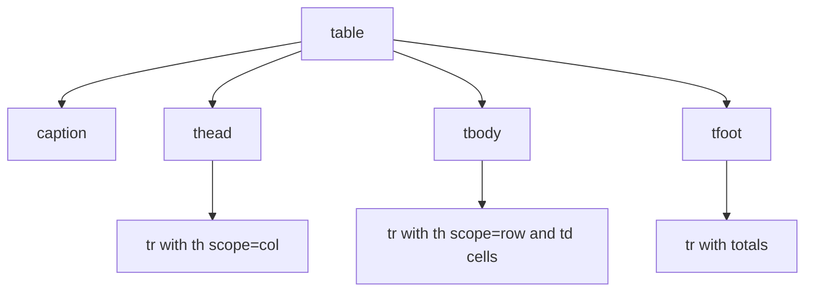
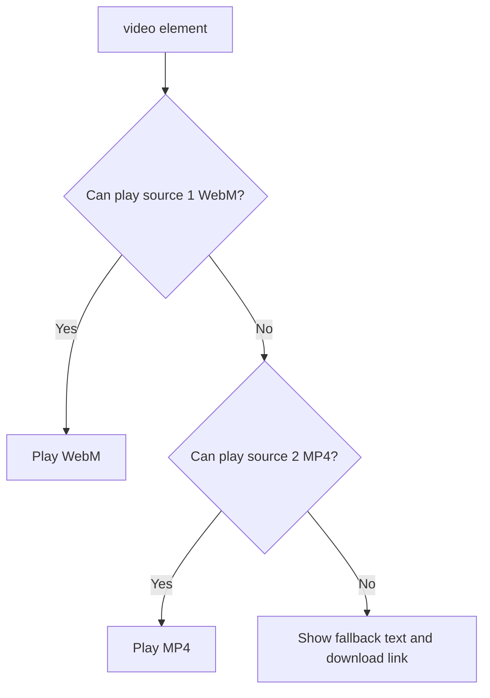
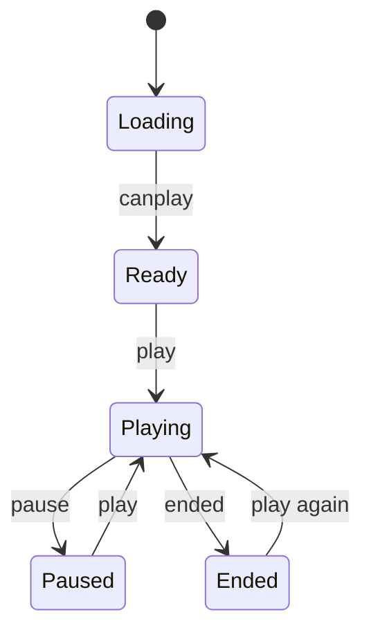

# Session 9 · HTML5 Tables, Audio and Video

> [Prime AI – Software Engineering with AI](../../README.md) › [Term 1](../README.md) › [Progressive Website Development](README.md) › **Session 9**

| ⏱ Estimated time | 🧩 Prerequisites |
|---|---|
| 2 hours | Session 8 |

[⬅ Previous: HTML5 Semantic Layout and Forms](session-08-html5-semantic-layout-and-forms.md) &nbsp;|&nbsp; [Next: JavaScript – Part I ➡](session-10-javascript-part-1.md)

---

## 🎯 Learning objectives

By the end of this session you will be able to:

- Create accessible tables with caption, thead, tbody, tfoot, th and scope.
- Merge cells with colspan and rowspan and control column widths with colgroup and CSS.
- Style tables: borders, zebra stripes, hover rows, and horizontal scrolling on small screens.
- Embed audio and video with controls, multiple sources, posters and fallbacks.
- Add captions/subtitles with track (WebVTT) and embed external video with iframe.

## 📖 Concepts

### Tables are for tabular data
Use tables for **data with rows and columns** (timetables, price lists, results) – **never for page layout**.

| Element | Role |
|---|---|
| `<table>` | The table |
| `<caption>` | Title of the table (read first by screen readers) |
| `<thead>` / `<tbody>` / `<tfoot>` | Header rows, body rows, summary rows |
| `<tr>` | A row |
| `<th scope="col">` / `<th scope="row">` | Header cell for a column / row |
| `<td>` | Data cell |
| `colspan="3"` / `rowspan="2"` | Merge cells across columns / down rows |
| `<colgroup><col span="2" style="width:30%">` | Style whole columns |

**Styling:** `border-collapse: collapse` (single borders), `padding` on cells, `text-align` (numbers right-aligned),
`tr:nth-child(even)` stripes, `tr:hover` highlight, `table-layout: fixed` + widths for predictable columns, and
`position: sticky; top: 0` on `th` for a sticky header. On phones, wrap the table in a
`<div style="overflow-x:auto">` so it scrolls sideways instead of breaking the page.

### Native audio and video
Before HTML5, media needed plug-ins such as Flash. Now:
```html
<video controls width="640" poster="poster.jpg" preload="metadata">
  <source src="intro.webm" type="video/webm">
  <source src="intro.mp4"  type="video/mp4">
  <track kind="captions" src="intro.en.vtt" srclang="en" label="English" default>
  Your browser does not support video. <a href="intro.mp4">Download it</a>.
</video>
```
| Attribute | Effect |
|---|---|
| `controls` | Show play/pause, volume, seek bar |
| `autoplay` | Start automatically – browsers allow it only when `muted` |
| `muted` `loop` `playsinline` | Silent, repeat, play inline on iPhone |
| `poster` | Image shown before playing (video) |
| `preload` | `none` / `metadata` / `auto` |
| `<source type>` | The browser picks the first format it can play |

Formats: video **MP4 (H.264)** works everywhere, **WebM** is open and smaller; audio **MP3**, **AAC/M4A**, **Ogg/Opus**.

**Accessibility:** provide **captions** (`<track kind="captions">`, a **WebVTT** `.vtt` file), a transcript for audio, never
autoplay sound, and keep controls visible.

### Embedding external media
YouTube/Vimeo give an `<iframe>`:
`<iframe src="https://www.youtube-nocookie.com/embed/VIDEO_ID" title="Course intro" loading="lazy" allowfullscreen></iframe>`.
Make it responsive with `aspect-ratio: 16 / 9; width: 100%; height: auto;`. Always give iframes a `title`.

JavaScript can control media too: `video.play()`, `video.pause()`, `video.currentTime`, `video.volume`, and events such as
`ended` and `timeupdate`.

## 🧭 Diagrams

### Table structure



### How the browser picks a media source



### Media element states



## 💻 Worked examples

### Example 1 — A class timetable with merged cells

```html
<style>
  .wrap { overflow-x: auto; }
  table { border-collapse: collapse; min-width: 560px; font-family: system-ui; }
  caption { font-weight: 700; margin-bottom: .5rem; text-align: left; }
  th, td { border: 1px solid #cbd5e1; padding: .5rem .75rem; text-align: center; }
  thead th { background: #1e1b4b; color: #fff; position: sticky; top: 0; }
  tbody tr:nth-child(even) { background: #f1f5f9; }
  tbody tr:hover { background: #e0f2fe; }
  .break { background: #fef3c7; font-style: italic; }
</style>
<div class="wrap">
<table>
  <caption>Term 1 – Weekly timetable</caption>
  <colgroup><col style="width: 120px"><col span="3"></colgroup>
  <thead>
    <tr><th scope="col">Time</th><th scope="col">Monday</th><th scope="col">Wednesday</th><th scope="col">Friday</th></tr>
  </thead>
  <tbody>
    <tr><th scope="row">09:00</th><td rowspan="2">HTML5 lab</td><td>CSS3</td><td>JavaScript</td></tr>
    <tr><th scope="row">10:00</th><td>Flexbox</td><td>Project</td></tr>
    <tr><th scope="row">11:00</th><td colspan="3" class="break">Break</td></tr>
  </tbody>
  <tfoot><tr><td colspan="4">Total: 6 contact hours</td></tr></tfoot>
</table>
</div>
```

📄 Saved as [`code/session-09_example-1.html`](code/session-09_example-1.html)

**🖥️ What you see in the browser**

```text
Term 1 – Weekly timetable
┌───────┬───────────┬───────────┬────────────┐
│ Time  │ Monday    │ Wednesday │ Friday     │   (navy header row)
├───────┼───────────┼───────────┼────────────┤
│ 09:00 │ HTML5 lab │ CSS3      │ JavaScript │
│ 10:00 │ (merged)  │ Flexbox   │ Project    │
│ 11:00 │          Break (yellow, spans 3)    │
├───────┴───────────┴───────────┴────────────┤
│ Total: 6 contact hours                     │
└────────────────────────────────────────────┘
On a phone the table scrolls sideways inside its wrapper.
```

### Example 2 — Video with poster, two sources, captions and a fallback

```html
<style>
  video, .yt { width: 100%; max-width: 720px; height: auto; aspect-ratio: 16 / 9; border-radius: 12px; }
</style>
<video controls preload="metadata" poster="https://picsum.photos/id/1060/1280/720">
  <source src="media/intro.webm" type="video/webm">
  <source src="media/intro.mp4" type="video/mp4">
  <track kind="captions" src="media/intro.en.vtt" srclang="en" label="English" default>
  <track kind="subtitles" src="media/intro.ur.vtt" srclang="ur" label="اردو">
  <p>Your browser cannot play this video. <a href="media/intro.mp4">Download the MP4</a>.</p>
</video>

<audio controls preload="none">
  <source src="media/podcast.opus" type="audio/ogg; codecs=opus">
  <source src="media/podcast.mp3" type="audio/mpeg">
  <a href="media/podcast.mp3">Download the episode</a>
</audio>

<iframe class="yt" src="https://www.youtube-nocookie.com/embed/UB1O30fR-EE"
        title="HTML crash course" loading="lazy" allowfullscreen></iframe>
```

📄 Saved as [`code/session-09_example-2.html`](code/session-09_example-2.html)

**🖥️ What you see in the browser**

```text
A 16:9 video player showing the poster image with play, seek, volume, CC (English / اردو) and
full-screen buttons; below it a compact audio player and a responsive embedded YouTube video.
```

### Example 3 — A WebVTT caption file

```text
WEBVTT

00:00:00.000 --> 00:00:03.500
Welcome to Progressive Website Development.

00:00:03.500 --> 00:00:07.000
In this lesson we embed video with captions.
```

📄 Saved as [`code/session-09_intro.en.vtt`](code/session-09_intro.en.vtt)

**Result**

```text
While the video plays, each line appears at the bottom of the player during its time range
once the viewer turns on CC.
```

### Example 4 — Generating table HTML from data

Real sites often build tables from data. This script turns an array of objects into table rows.

```js
const results = [
  { name: 'Ali', html: 18, css: 15 },
  { name: 'Sara', html: 20, css: 19 },
  { name: 'Hamza', html: 14, css: 17 },
];
const rows = results.map(r =>
  `  <tr><th scope="row">${r.name}</th><td>${r.html}</td><td>${r.css}</td><td>${r.html + r.css}</td></tr>`);
const avg = (results.reduce((s, r) => s + r.html + r.css, 0) / results.length).toFixed(1);
console.log('<tbody>\n' + rows.join('\n') + '\n</tbody>');
console.log(`<tfoot><tr><td colspan="3">Class average</td><td>${avg}</td></tr></tfoot>`);
```

📄 Saved as [`code/session-09_example-4.js`](code/session-09_example-4.js)

**Output** (real run)

```text
<tbody>
  <tr><th scope="row">Ali</th><td>18</td><td>15</td><td>33</td></tr>
  <tr><th scope="row">Sara</th><td>20</td><td>19</td><td>39</td></tr>
  <tr><th scope="row">Hamza</th><td>14</td><td>17</td><td>31</td></tr>
</tbody>
<tfoot><tr><td colspan="3">Class average</td><td>34.3</td></tr></tfoot>
```

## 🧪 Lab / practice tasks

**🟢 Easy** — Create a price list table with caption, header row, 5 products and a footer row showing the total.

<details><summary>💡 Hint</summary>

Use thead / tbody / tfoot.

</details>

**🟡 Medium** — Build your own weekly timetable with at least one `rowspan` and one `colspan`, zebra stripes, a hover effect and a sticky header.

<details><summary>💡 Hint</summary>

`th { position: sticky; top: 0; }`

</details>

**🔴 Hard** — Add a video with a poster, MP4 and WebM sources, an English captions track you write yourself (WebVTT) and a fallback link.

<details><summary>💡 Hint</summary>

Serve via Live Server – tracks do not load from file:// URLs.

</details>

**🏆 Challenge** — Build a custom audio player: hide the native controls and create Play/Pause, a progress bar and a time display with JavaScript (`play()`, `pause()`, `timeupdate`).

<details><summary>💡 Hint</summary>

Progress = currentTime / duration × 100.

</details>

## ✅ Quick quiz

**Q1. Which element gives a table its title?**

- A) `<th>`
- B) `<caption>`
- C) `<title>`
- D) `<thead>`

<details><summary>Show answer</summary>

**B** — caption is the first child of table and is announced by screen readers.

</details>

**Q2. To merge two cells vertically use:**

- A) colspan
- B) rowspan
- C) span
- D) merge

<details><summary>Show answer</summary>

**B** — rowspan stretches a cell down across rows.

</details>

**Q3. Why add several `<source>` elements to a video?**

- A) To play them in sequence
- B) So each browser can choose a format it supports
- C) For captions
- D) To preload

<details><summary>Show answer</summary>

**B** — The browser plays the first source whose type it supports.

</details>

**Q4. Browsers allow autoplay video only when it is:**

- A) Short
- B) Muted
- C) MP4
- D) Looped

<details><summary>Show answer</summary>

**B** — Autoplay with sound is blocked; muted autoplay is allowed.

</details>

**Q5. Captions for HTML5 video use which file format?**

- A) SRT only
- B) WebVTT (.vtt)
- C) PDF
- D) JSON

<details><summary>Show answer</summary>

**B** — The track element expects WebVTT files.

</details>

## 📝 Summary / cheat-sheet

- Tables only for data: caption, thead/tbody/tfoot, th with scope, td.
- colspan / rowspan merge cells; colgroup/col for column widths; border-collapse, stripes, sticky headers, overflow-x wrapper.
- `<video>` / `<audio>` with controls, poster, preload, multiple `<source>`s and fallback content.
- Autoplay only when muted; captions with `<track kind="captions">` (WebVTT); transcripts for audio.
- External video via iframe with title, lazy loading and aspect-ratio.

## 🎤 Interview / viva questions

1. **Why should tables not be used for layout?**
   <details><summary>Model answer</summary>

   They add wrong semantics for screen readers, are rigid on small screens and mix content with presentation; CSS Grid and Flexbox are the layout tools.

   </details>

2. **What does scope do on th?**
   <details><summary>Model answer</summary>

   It tells assistive technology whether the header applies to a column or a row, so cells are read with the right headers.

   </details>

3. **Captions vs subtitles?**
   <details><summary>Model answer</summary>

   Captions transcribe dialogue plus important sounds for deaf or hard-of-hearing viewers; subtitles translate dialogue into another language.

   </details>

4. **How do you provide a fallback for old browsers?**
   <details><summary>Model answer</summary>

   Put text or a download link inside the video or audio element; it is shown only when the browser cannot play the media.

   </details>

---

[⬅ Previous: HTML5 Semantic Layout and Forms](session-08-html5-semantic-layout-and-forms.md) &nbsp;|&nbsp; [Next: JavaScript – Part I ➡](session-10-javascript-part-1.md)

<sub>Prepared by **Hamna Zahid Khan**, Junior Lecturer · Prime AI – Software Engineering with AI</sub>
