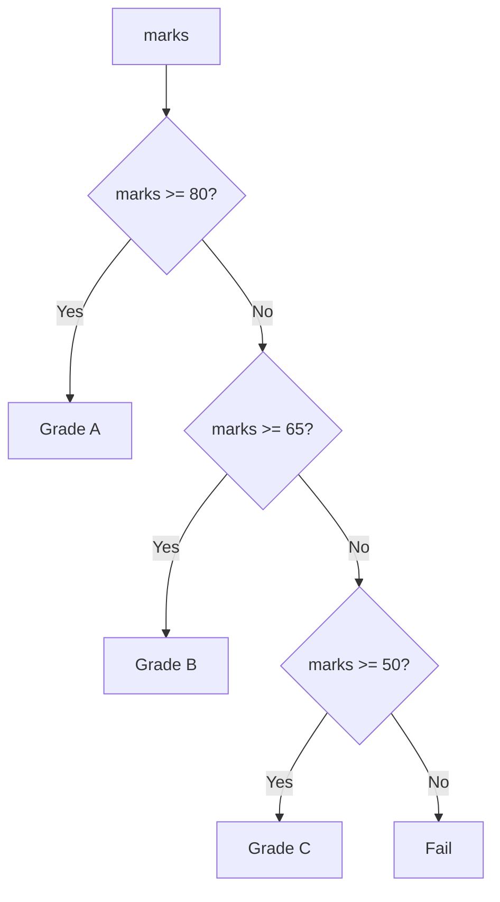
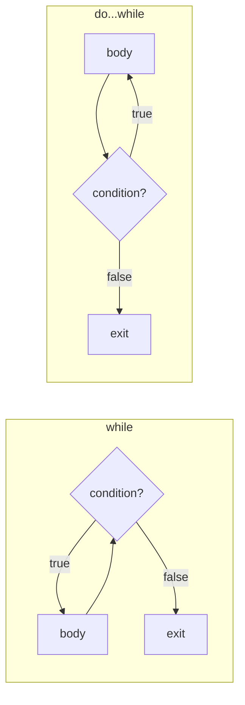
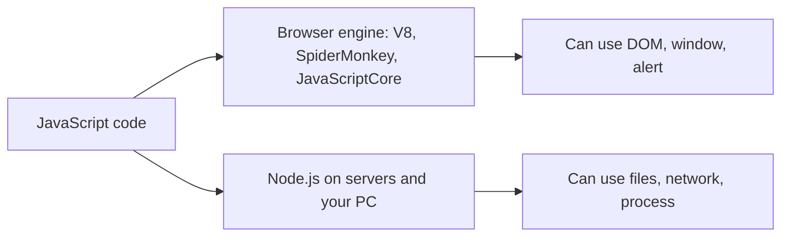

# Session 10 · JavaScript – Part I

> [Prime AI – Software Engineering with AI](../../README.md) › [Term 1](../README.md) › [Progressive Website Development](README.md) › **Session 10**

| ⏱ Estimated time | 🧩 Prerequisites |
|---|---|
| 3 hours | Session 8 |

[⬅ Previous: HTML5 Tables, Audio and Video](session-09-html5-tables-audio-and-video.md) &nbsp;|&nbsp; [Next: JavaScript – Part II: Functions, Arrays, Objects and the DOM ➡](session-11-javascript-part-2.md)

---

## 🎯 Learning objectives

By the end of this session you will be able to:

- Explain what JavaScript is, where it runs and how to add it to a page.
- Declare variables with let and const and identify JavaScript data types.
- Produce output with console.log, alert and the DOM, and read input with prompt and form fields.
- Use arithmetic, assignment, comparison, logical and ternary operators.
- Control flow with if/else, switch, for, while and do…while loops, break and continue.

## 📖 Concepts

### What is JavaScript?
JavaScript (JS) is the programming language of the web. It runs in **every browser** (and on servers with **Node.js**). It
makes pages interactive: validating forms, showing menus, fetching data, animations and games. Its official standard is
**ECMAScript** (ES); ES6 (2015) modernised the language and new features arrive every year.

### Adding JavaScript to a page
```html
<script src="js/app.js" defer></script>        <!-- external file, in <head>, runs after HTML is parsed -->
<script> console.log('inline script'); </script>
```
Prefer **external files with `defer`** (or place scripts just before `</body>`). Avoid inline `onclick="…"` attributes –
use `addEventListener` (Session 11).

### Variables and data types
| Keyword | Re-assign? | Scope | Use |
|---|---|---|---|
| `const` | No | Block `{ }` | **Default choice** |
| `let` | Yes | Block | Values that change (counters) |
| `var` | Yes | Function (old, hoisted) | Avoid in new code |

Names: start with a letter, `_` or `$`; case-sensitive; use **camelCase** (`totalMarks`).

| Type | Example | `typeof` |
|---|---|---|
| String | `'Ali'`, `"Hi"`, `` `Hi ${name}` `` | `"string"` |
| Number | `42`, `3.14`, `NaN`, `Infinity` | `"number"` |
| BigInt | `9007199254740993n` | `"bigint"` |
| Boolean | `true`, `false` | `"boolean"` |
| Undefined | declared, no value | `"undefined"` |
| Null | intentionally empty | `"object"` (a famous quirk) |
| Symbol | `Symbol('id')` | `"symbol"` |
| Object | `{ name: 'Ali' }`, `[1, 2]`, functions | `"object"` / `"function"` |

JS is **dynamically typed** – a variable can hold any type. Conversion: `Number('42')`, `parseInt('42px')`,
`String(5)`, `Boolean(0)`. **Falsy** values: `false 0 '' null undefined NaN` – everything else is truthy.

### Output and input
| Method | Where it appears |
|---|---|
| `console.log()` | DevTools Console – for developers |
| `alert('Hi')` | A blocking pop-up – avoid in real apps |
| `document.querySelector('#out').textContent = …` | **On the page** – the right way |
| `prompt('Name?')` / `confirm('Sure?')` | Simple input / yes-no (blocking, for practice only) |
| `input.value` | Read a form field (always a string!) |

### Operators
| Kind | Operators |
|---|---|
| Arithmetic | `+ - * / % **` `++ --` |
| Assignment | `= += -= *= /= %= ??=` |
| Comparison | `=== !==` (strict – **always use these**), `== !=` (loose, converts types), `< > <= >=` |
| Logical | `&&` and, `||` or, `!` not, `??` nullish (default only for null/undefined) |
| Ternary | `condition ? valueIfTrue : valueIfFalse` |
| String | `+` concatenation (careful: `'5' + 3` is `'53'`) |

### Conditionals and loops
- `if (…) { } else if (…) { } else { }` · `switch (value) { case 'a': …; break; default: … }`
- `for (let i = 0; i < 5; i++) { }` – count-controlled
- `while (condition) { }` – checks first; may run 0 times
- `do { } while (condition);` – runs at least once
- `break` leaves the loop; `continue` skips to the next iteration. Beware **infinite loops** – make sure the condition changes.

## 🧭 Diagrams

### if / else if / else



### while vs do...while



### Where JavaScript runs



## 💻 Worked examples

### Example 1 — Variables, types and conversions

```js
const course = 'Progressive Website Development';
let sessions = 16;
const isOnline = false;
let mentor;                        // undefined
const room = null;

console.log(typeof course, typeof sessions, typeof isOnline, typeof mentor, typeof room);
console.log(`${course} has ${sessions} sessions.`);

console.log('5' + 3, '5' - 3, Number('5') + 3);   // concatenation vs conversion
console.log(parseInt('42px'), Number('42px'), 0.1 + 0.2);
console.log('5' == 5, '5' === 5);                  // loose vs strict
console.log(Boolean(''), Boolean('0'), Boolean([]));
sessions += 1;
console.log('After += 1:', sessions);
```

📄 Saved as [`code/session-10_example-1.js`](code/session-10_example-1.js)

**Output** (real run)

```text
string number boolean undefined object
Progressive Website Development has 16 sessions.
53 2 8
42 NaN 0.30000000000000004
true false
false true true
After += 1: 17
```

### Example 2 — Grade calculator with if / else and the ternary operator

```js
function grade(marks) {
  if (marks < 0 || marks > 100) return 'Invalid';
  if (marks >= 80) return 'A';
  else if (marks >= 65) return 'B';
  else if (marks >= 50) return 'C';
  else return 'F';
}
for (const m of [92, 71, 50, 34, 105]) {
  const g = grade(m);
  console.log(`${m} -> ${g} (${g === 'F' || g === 'Invalid' ? 'see your mentor' : 'well done'})`);
}
```

📄 Saved as [`code/session-10_example-2.js`](code/session-10_example-2.js)

**Output** (real run)

```text
92 -> A (well done)
71 -> B (well done)
50 -> C (well done)
34 -> F (see your mentor)
105 -> Invalid (see your mentor)
```

### Example 3 — switch and all three loops

```js
const day = 'Wed';
switch (day) {
  case 'Mon':
  case 'Wed':
    console.log(day, '-> HTML/CSS lab');
    break;
  case 'Fri':
    console.log(day, '-> JavaScript lab');
    break;
  default:
    console.log(day, '-> self-study');
}

let table = '';
for (let i = 1; i <= 5; i++) table += `7 x ${i} = ${7 * i}   `;
console.log(table);

let balance = 1000, months = 0;
while (balance < 2000) { balance *= 1.1; months++; }
console.log(`Savings double after ${months} months at 10%/month: Rs ${balance.toFixed(0)}`);

let tries = 0, roll;
do { roll = (tries * 7 + 3) % 6 + 1; tries++; } while (roll !== 6);   // deterministic "dice"
console.log(`Rolled a 6 after ${tries} tries`);

for (let n = 1; n <= 10; n++) {
  if (n % 2 === 0) continue;   // skip evens
  if (n > 7) break;            // stop after 7
  process.stdout.write(n + ' ');
}
console.log();
```

📄 Saved as [`code/session-10_example-3.js`](code/session-10_example-3.js)

**Output** (real run)

```text
Wed -> HTML/CSS lab
7 x 1 = 7   7 x 2 = 14   7 x 3 = 21   7 x 4 = 28   7 x 5 = 35   
Savings double after 8 months at 10%/month: Rs 2144
Rolled a 6 after 3 tries
1 3 5 7
```

### Example 4 — A calculator on a web page (output to the DOM)

```html
<label>First number <input id="a" type="number" value="12"></label>
<label>Operator
  <select id="op"><option>+</option><option>-</option><option>*</option><option>/</option><option>%</option></select>
</label>
<label>Second number <input id="b" type="number" value="5"></label>
<button id="calc">=</button>
<p>Result: <output id="out">?</output></p>

<script>
  document.querySelector('#calc').addEventListener('click', () => {
    const a = Number(document.querySelector('#a').value);   // input values are strings
    const b = Number(document.querySelector('#b').value);
    const op = document.querySelector('#op').value;
    let result;
    switch (op) {
      case '+': result = a + b; break;
      case '-': result = a - b; break;
      case '*': result = a * b; break;
      case '/': result = b === 0 ? 'Cannot divide by zero' : a / b; break;
      case '%': result = a % b; break;
    }
    document.querySelector('#out').textContent = result;
    console.log(`${a} ${op} ${b} =`, result);
  });
</script>
```

📄 Saved as [`code/session-10_example-4.html`](code/session-10_example-4.html)

**🖥️ What you see in the browser**

```text
Two number boxes (12 and 5), an operator menu and an "=" button.
Choosing * and clicking "=" shows "Result: 60" on the page and logs "12 * 5 = 60" in the Console.
Dividing by 0 shows "Cannot divide by zero".
```

## 🧪 Lab / practice tasks

**🟢 Easy** — Declare variables for your name, age and city and print one sentence with a template literal. Print the `typeof` each.

<details><summary>💡 Hint</summary>

`` `I am ${name}` ``

</details>

**🟡 Medium** — Write a program that prints the numbers 1–30, but "Fizz" for multiples of 3, "Buzz" for multiples of 5 and "FizzBuzz" for both.

<details><summary>💡 Hint</summary>

Check the both-case first with `%`.

</details>

**🔴 Hard** — Build an electricity-bill page: units input → bill using slabs (first 100 units Rs 10, next 100 Rs 15, above 200 Rs 20) shown on the page.

<details><summary>💡 Hint</summary>

Use if/else if and subtract slab by slab.

</details>

**🏆 Challenge** — Number-guessing game: the page picks a random number 1–100; the user guesses in an input; show "higher/lower" and count attempts. Use `Math.random()` and `Math.floor()`.

<details><summary>💡 Hint</summary>

`Math.floor(Math.random() * 100) + 1`

</details>

## ✅ Quick quiz

**Q1. Which keyword should be your default for variables?**

- A) var
- B) let
- C) const
- D) static

<details><summary>Show answer</summary>

**C** — Use let only when you will reassign.

</details>

**Q2. `"5" + 3` gives:**

- A) 8
- B) "53"
- C) NaN
- D) Error

<details><summary>Show answer</summary>

**B** — + with a string concatenates.

</details>

**Q3. `typeof undefined` is:**

- A) "null"
- B) "undefined"
- C) "object"
- D) "void"

<details><summary>Show answer</summary>

**B** — undefined is its own type.

</details>

**Q4. Which loop always runs at least once?**

- A) for
- B) while
- C) do...while
- D) for...of

<details><summary>Show answer</summary>

**C** — do…while checks its condition after the body.

</details>

**Q5. `0 ?? 10` evaluates to:**

- A) 10
- B) 0
- C) null
- D) false

<details><summary>Show answer</summary>

**B** — ?? only replaces null or undefined; 0 is kept.

</details>

## 📝 Summary / cheat-sheet

- JS runs in browsers and Node.js; standard = ECMAScript. Add with `<script src defer>`.
- `const` by default, `let` when reassigning, avoid `var`; camelCase names.
- Types: string, number, bigint, boolean, undefined, null, symbol, object; falsy values.
- Output: console.log (dev), DOM textContent (users); input values are strings → convert with Number().
- Operators: arithmetic, assignment, `===`/`!==`, `&& || ! ??`, ternary.
- Flow: if/else, switch (+break), for, while, do…while, break, continue.

## 🎤 Interview / viva questions

1. **Difference between == and ===?**
   <details><summary>Model answer</summary>

   == converts types before comparing (so "5" == 5 is true); === compares value and type without conversion and is the safe choice.

   </details>

2. **let vs const vs var?**
   <details><summary>Model answer</summary>

   const and let are block-scoped; const cannot be reassigned; var is function-scoped and hoisted, which causes bugs, so it is avoided.

   </details>

3. **What are falsy values?**
   <details><summary>Model answer</summary>

   false, 0, -0, 0n, empty string, null, undefined and NaN – they behave as false in conditions.

   </details>

4. **Why use defer on a script tag?**
   <details><summary>Model answer</summary>

   The script downloads in parallel and runs only after the HTML is parsed, so the page is not blocked and elements exist when the script runs.

   </details>

---

[⬅ Previous: HTML5 Tables, Audio and Video](session-09-html5-tables-audio-and-video.md) &nbsp;|&nbsp; [Next: JavaScript – Part II: Functions, Arrays, Objects and the DOM ➡](session-11-javascript-part-2.md)

<sub>Prepared by **Hamna Zahid Khan**, Junior Lecturer · Prime AI – Software Engineering with AI</sub>
