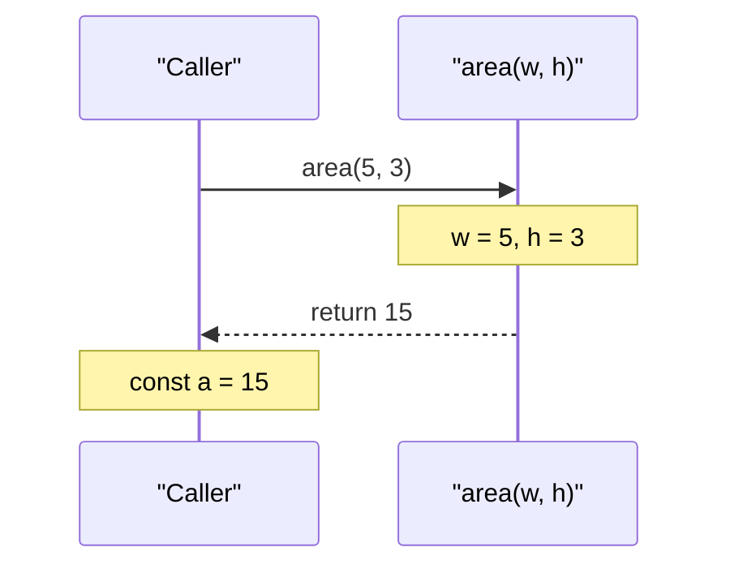
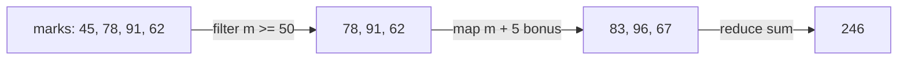
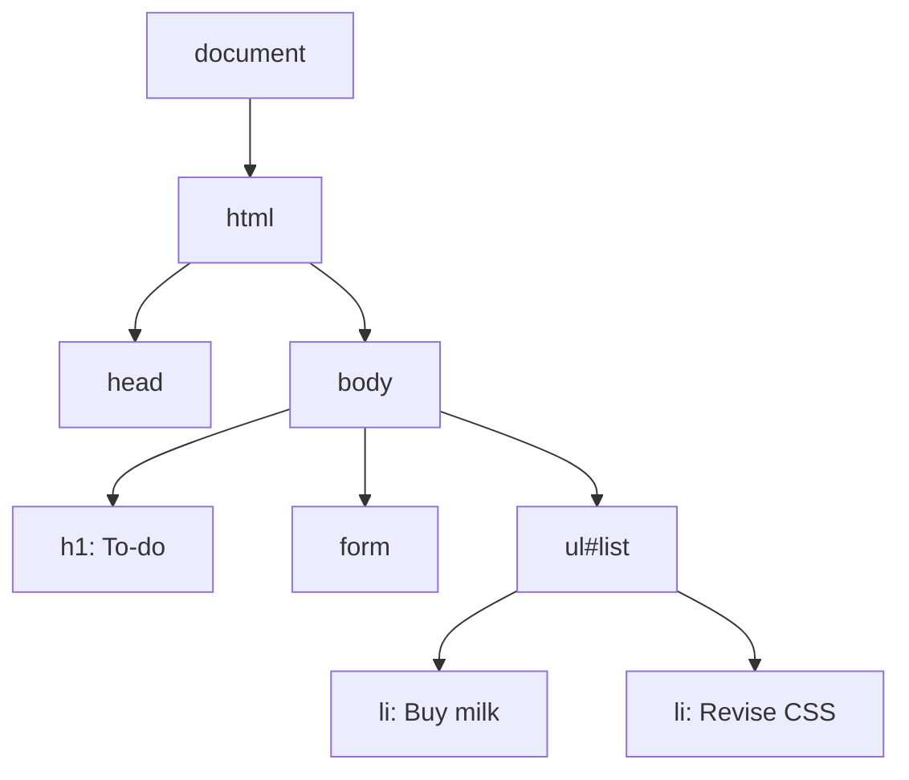

# Session 11 · JavaScript – Part II: Functions, Arrays, Objects and the DOM

> [Prime AI – Software Engineering with AI](../../README.md) › [Term 1](../README.md) › [Progressive Website Development](README.md) › **Session 11**

| ⏱ Estimated time | 🧩 Prerequisites |
|---|---|
| 3 hours | Session 10 |

[⬅ Previous: JavaScript – Part I](session-10-javascript-part-1.md) &nbsp;|&nbsp; [Next: Modern JavaScript: ECMAScript 2022 and Beyond ➡](session-12-modern-javascript-es2022.md)

---

## 🎯 Learning objectives

By the end of this session you will be able to:

- Write function declarations, expressions and arrow functions with parameters, defaults and return values.
- Explain scope and use callbacks.
- Work with 1D and 2D arrays and the core array methods (push, map, filter, reduce, find, sort…).
- Create objects with properties and methods, and use destructuring and spread.
- Select and change DOM elements, create elements and respond to events.

## 📖 Concepts

### Functions
A function is a reusable, named block of code.
```js
function area(w, h = w) { return w * h; }        // declaration, default parameter (hoisted)
const perimeter = function (w, h) { return 2 * (w + h); };   // expression
const square = n => n * n;                       // arrow function, implicit return
const sum = (...nums) => nums.reduce((a, b) => a + b, 0);    // rest parameter
```
- **Parameters** are the names in the definition; **arguments** are the values you pass.
- `return` sends a value back and ends the function; without it the result is `undefined`.
- **Scope**: variables declared inside a function (or block) are not visible outside. Inner functions can read outer
  variables – a **closure**.
- A **callback** is a function passed to another function to be called later: `setTimeout(() => …, 1000)`,
  `button.addEventListener('click', handler)`, `array.map(fn)`.

### Arrays
Ordered lists, zero-indexed: `const marks = [78, 91, 65];` → `marks[0]` is 78, `marks.length` is 3.

| Method | Does | Mutates? |
|---|---|---|
| `push` / `pop` | Add / remove at the end | Yes |
| `unshift` / `shift` | Add / remove at the start | Yes |
| `splice(i, n, …)` | Remove/insert in the middle | Yes |
| `slice(a, b)` | Copy a part | No |
| `includes` / `indexOf` | Search | No |
| `forEach(fn)` | Run fn for each item | No |
| `map(fn)` | New array of transformed items | No |
| `filter(fn)` | New array of items that pass a test | No |
| `reduce(fn, start)` | Boil down to one value (sum, max) | No |
| `find` / `findIndex` | First match | No |
| `some` / `every` | Any / all pass a test | No |
| `sort((a,b) => a-b)` | Sort (numbers need a compare function!) | Yes |
| `join(', ')` | Array → string | No |

**2D arrays** are arrays of arrays: `grid[row][col]`; loop with nested `for` loops. `for…of` loops over values.

### Objects
```js
const student = {
  name: 'Sara', marks: [88, 92],
  average() { return this.marks.reduce((a, b) => a + b) / this.marks.length; }
};
student.city = 'Karachi';        // add a property
const { name, city } = student;  // destructuring
const copy = { ...student, city: 'Lahore' };   // spread copy
```
`Object.keys()`, `Object.values()`, `Object.entries()`; `JSON.stringify()` / `JSON.parse()` convert to/from text.

### The DOM – JavaScript meets HTML
The browser turns HTML into a tree of objects, the **Document Object Model**.

| Task | Code |
|---|---|
| Select one / many | `document.querySelector('.card')`, `document.querySelectorAll('li')` |
| Change text | `el.textContent = 'Hi'` (safe) – `innerHTML` parses HTML (only with trusted content) |
| Change style / classes | `el.style.color = 'red'`, `el.classList.add('active')` / `.toggle()` / `.remove()` |
| Attributes | `img.src = 'a.png'`, `el.setAttribute('aria-expanded', 'true')`, `el.dataset.id` |
| Create and insert | `const li = document.createElement('li'); list.append(li);` |
| Remove | `el.remove()` |
| Events | `btn.addEventListener('click', e => { … })` – also `input`, `change`, `submit`, `keydown`, `mouseover` |
| Stop default | `e.preventDefault()` (e.g. on form submit) |

**Event delegation:** attach one listener to a parent and check `e.target` – works for items added later.

## 🧭 Diagrams

### Function call flow



### map, filter and reduce



### The DOM tree



## 💻 Worked examples

### Example 1 — Functions: declarations, arrows, defaults, rest, closures and callbacks

```js
function area(w, h = w) { return w * h; }
const perimeter = (w, h) => 2 * (w + h);
const sum = (...nums) => nums.reduce((a, b) => a + b, 0);

console.log('area(5, 3) =', area(5, 3), '| square area(4) =', area(4));
console.log('perimeter(5, 3) =', perimeter(5, 3));
console.log('sum(1..5) =', sum(1, 2, 3, 4, 5));

function makeCounter() {          // closure: count lives on between calls
  let count = 0;
  return () => ++count;
}
const next = makeCounter();
next(); next();
console.log('counter is now', next());

function applyTwice(fn, value) { return fn(fn(value)); }   // fn is a callback
console.log('applyTwice(double, 3) =', applyTwice(n => n * 2, 3));
```

📄 Saved as [`code/session-11_example-1.js`](code/session-11_example-1.js)

**Output** (real run)

```text
area(5, 3) = 15 | square area(4) = 16
perimeter(5, 3) = 16
sum(1..5) = 15
counter is now 3
applyTwice(double, 3) = 12
```

### Example 2 — Arrays: results processing

```js
const students = [
  { name: 'Ali', marks: 45 }, { name: 'Sara', marks: 91 },
  { name: 'Hamza', marks: 78 }, { name: 'Zoya', marks: 62 },
];
const passed = students.filter(s => s.marks >= 50);
const names = passed.map(s => s.name);
const total = students.reduce((sum, s) => sum + s.marks, 0);
const topper = [...students].sort((a, b) => b.marks - a.marks)[0];

console.log('Passed:', names.join(', '));
console.log('Average:', (total / students.length).toFixed(1));
console.log('Topper:', topper.name, topper.marks);
console.log('Anyone above 90?', students.some(s => s.marks > 90));
console.log('Find Zoya:', students.find(s => s.name === 'Zoya'));

const seats = [['A1', 'A2', 'A3'], ['B1', 'B2', 'B3']];   // 2D array
for (let r = 0; r < seats.length; r++) {
  console.log(`Row ${r + 1}:`, seats[r].join(' '));
}
console.log('Seat at row 2, col 3:', seats[1][2]);
```

📄 Saved as [`code/session-11_example-2.js`](code/session-11_example-2.js)

**Output** (real run)

```text
Passed: Sara, Hamza, Zoya
Average: 69.0
Topper: Sara 91
Anyone above 90? true
Find Zoya: { name: 'Zoya', marks: 62 }
Row 1: A1 A2 A3
Row 2: B1 B2 B3
Seat at row 2, col 3: B3
```

### Example 3 — Objects, methods, destructuring, spread and JSON

```js
const student = {
  name: 'Sara', city: 'Karachi', marks: [88, 92, 79],
  average() { return this.marks.reduce((a, b) => a + b) / this.marks.length; },
};
console.log(`${student.name} average: ${student.average().toFixed(2)}`);

const { name, city, phone = 'not given' } = student;
console.log(name, city, phone);

const moved = { ...student, city: 'Lahore' };
console.log('original city:', student.city, '| copy city:', moved.city);

for (const [key, value] of Object.entries({ html: 18, css: 19 })) console.log(key, '=>', value);

const json = JSON.stringify({ name, marks: student.marks });
console.log('JSON text:', json);
console.log('Parsed back:', JSON.parse(json).marks.length, 'marks');
```

📄 Saved as [`code/session-11_example-3.js`](code/session-11_example-3.js)

**Output** (real run)

```text
Sara average: 86.33
Sara Karachi not given
original city: Karachi | copy city: Lahore
html => 18
css => 19
JSON text: {"name":"Sara","marks":[88,92,79]}
Parsed back: 3 marks
```

### Example 4 — DOM: an interactive to-do list with event delegation

```html
<style>
  .done { text-decoration: line-through; color: #94a3b8; }
  li { cursor: pointer; padding: .3rem 0; }
  .del { margin-left: .5rem; }
</style>
<h1>To-do</h1>
<form id="todo-form">
  <input id="task" placeholder="New task" required>
  <button>Add</button>
</form>
<p id="count"></p>
<ul id="list"></ul>

<script>
  const form = document.querySelector('#todo-form');
  const input = document.querySelector('#task');
  const list = document.querySelector('#list');
  const count = document.querySelector('#count');

  function updateCount() {
    const left = list.querySelectorAll('li:not(.done)').length;
    count.textContent = `${left} task${left === 1 ? '' : 's'} left`;
  }

  form.addEventListener('submit', e => {
    e.preventDefault();                    // stop the page reloading
    const li = document.createElement('li');
    li.textContent = input.value.trim();
    const del = document.createElement('button');
    del.textContent = '✕'; del.className = 'del'; del.setAttribute('aria-label', 'Delete task');
    li.append(del);
    list.append(li);
    input.value = ''; input.focus();
    updateCount();
  });

  list.addEventListener('click', e => {    // one listener for all items (delegation)
    if (e.target.matches('.del')) e.target.parentElement.remove();
    else if (e.target.matches('li')) e.target.classList.toggle('done');
    updateCount();
  });
  updateCount();
</script>
```

📄 Saved as [`code/session-11_example-4.html`](code/session-11_example-4.html)

**🖥️ What you see in the browser**

```text
Typing "Revise Flexbox" and pressing Add appends it to the list with a ✕ button and updates
"1 task left". Clicking a task strikes it through (and the counter drops); clicking ✕ removes it.
The page never reloads.
```

## 🧪 Lab / practice tasks

**🟢 Easy** — Write `isEven(n)`, `max(a, b)` and `celsiusToF(c)` as arrow functions and test each with three values.

<details><summary>💡 Hint</summary>

F = C × 9/5 + 32.

</details>

**🟡 Medium** — Given an array of 10 product prices, use `filter`, `map` and `reduce` to find items under Rs 1000, apply 10% tax and compute the total.

<details><summary>💡 Hint</summary>

Chain the methods.

</details>

**🔴 Hard** — Build a "student card" page: an array of student objects rendered into cards with `createElement`; add a search box that filters cards as you type (`input` event).

<details><summary>💡 Hint</summary>

`card.hidden = !name.includes(query)`.

</details>

**🏆 Challenge** — Build tic-tac-toe on a 3×3 grid using a 2D array for state, event delegation for clicks, and a function that checks all 8 winning lines.

<details><summary>💡 Hint</summary>

Store lines as index triples and use `some()`.

</details>

## ✅ Quick quiz

**Q1. An arrow function `x => x * 2` called with 4 returns:**

- A) 4
- B) 8
- C) undefined
- D) "x*2"

<details><summary>Show answer</summary>

**B** — Single-expression arrows return implicitly.

</details>

**Q2. Which array method returns a new array with only matching items?**

- A) map
- B) filter
- C) forEach
- D) push

<details><summary>Show answer</summary>

**B** — filter keeps the items for which the callback returns true.

</details>

**Q3. `[10, 9, 1].sort()` returns:**

- A) [1, 9, 10]
- B) [1, 10, 9]
- C) [10, 9, 1]
- D) Error

<details><summary>Show answer</summary>

**B** — Default sort compares strings; use (a, b) => a - b.

</details>

**Q4. Which property safely sets text without parsing HTML?**

- A) innerHTML
- B) textContent
- C) outerHTML
- D) value

<details><summary>Show answer</summary>

**B** — textContent inserts plain text, preventing HTML injection.

</details>

**Q5. `e.preventDefault()` on a form submit:**

- A) Deletes the form
- B) Stops the browser reloading/navigating
- C) Validates fields
- D) Clears inputs

<details><summary>Show answer</summary>

**B** — It cancels the default navigation so JavaScript can handle the data.

</details>

## 📝 Summary / cheat-sheet

- Functions: declaration (hoisted), expression, arrow; defaults, rest, return; scope and closures; callbacks.
- Arrays: index from 0; push/pop/shift/unshift/splice; map, filter, reduce, find, some, every, sort(compare), join.
- 2D arrays `grid[r][c]` with nested loops; `for…of` for values.
- Objects: properties, methods with `this`, destructuring, spread, Object.entries, JSON.stringify/parse.
- DOM: querySelector(All), textContent, classList, createElement + append, remove, addEventListener, preventDefault, delegation.

## 🎤 Interview / viva questions

1. **What is a closure?**
   <details><summary>Model answer</summary>

   A function that remembers variables from the scope where it was created, even after that outer function has finished.

   </details>

2. **map vs forEach?**
   <details><summary>Model answer</summary>

   map returns a new array of the callback results; forEach just runs the callback and returns undefined.

   </details>

3. **Why prefer textContent over innerHTML for user input?**
   <details><summary>Model answer</summary>

   innerHTML parses the string as HTML, so malicious input could inject scripts (XSS); textContent inserts plain text.

   </details>

4. **What is event delegation?**
   <details><summary>Model answer</summary>

   Handling events for many child elements with a single listener on a common parent, using event.target – efficient and works for elements added later.

   </details>

---

[⬅ Previous: JavaScript – Part I](session-10-javascript-part-1.md) &nbsp;|&nbsp; [Next: Modern JavaScript: ECMAScript 2022 and Beyond ➡](session-12-modern-javascript-es2022.md)

<sub>Prepared by **Hamna Zahid Khan**, Junior Lecturer · Prime AI – Software Engineering with AI</sub>
