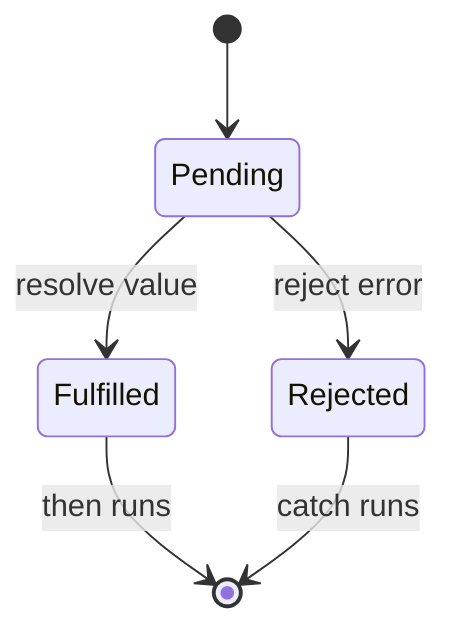
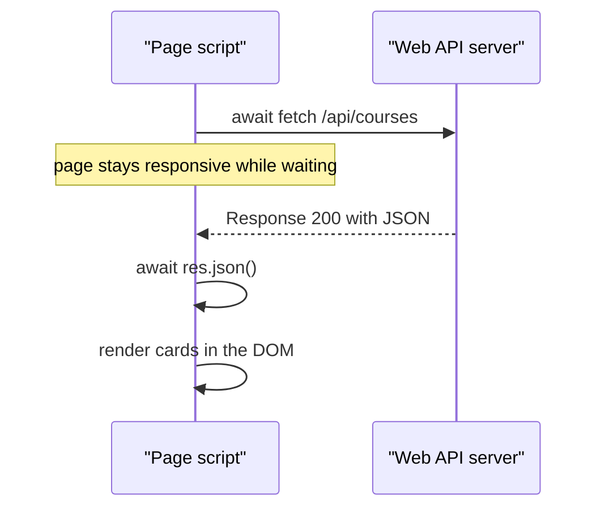
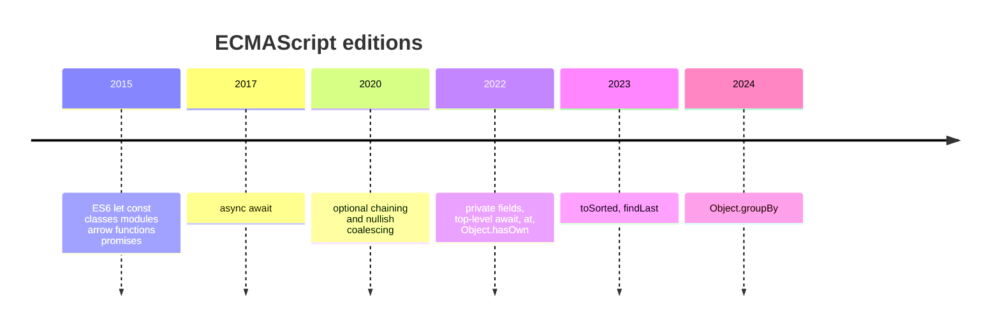

# Session 12 · Modern JavaScript: ECMAScript 2022 and Beyond

> [Prime AI – Software Engineering with AI](../../README.md) › [Term 1](../README.md) › [Progressive Website Development](README.md) › **Session 12**

| ⏱ Estimated time | 🧩 Prerequisites |
|---|---|
| 2.5 hours | Session 11 |

[⬅ Previous: JavaScript – Part II: Functions, Arrays, Objects and the DOM](session-11-javascript-part-2.md) &nbsp;|&nbsp; [Next: Canvas and Web Storage in HTML5 ➡](session-13-canvas-and-web-storage.md)

---

## 🎯 Learning objectives

By the end of this session you will be able to:

- Explain how ECMAScript evolves and check which features a browser supports.
- Use ES6+ essentials: template literals, destructuring, spread/rest, optional chaining and nullish coalescing.
- Write classes with public, private (#) and static fields and methods (ES2022).
- Use ES2022 additions: top-level await, .at(), Object.hasOwn(), error cause and RegExp /d indices.
- Write asynchronous code with Promises, async/await and fetch, and organise code with ES modules.

## 📖 Concepts

### How JavaScript evolves
**TC39**, the committee behind ECMAScript, ships a new edition **every June** (ES2015 = ES6, ES2016 … ES2025). Proposals go
through stages 0–4; stage 4 features enter the next edition. Check support on caniuse.com or MDN's compatibility tables.

### ES6+ essentials you will use daily
| Feature | Example |
|---|---|
| Template literals | `` `Total: ${qty * price}` `` (multi-line too) |
| Destructuring | `const { name, age = 18 } = user;` `const [first, ...rest] = list;` |
| Spread | `const all = [...a, ...b];` `const copy = { ...obj, done: true };` |
| Optional chaining | `user?.address?.city` – `undefined` instead of an error |
| Nullish coalescing | `settings.volume ?? 50` – default only for `null`/`undefined` (keeps `0`) |
| Logical assignment (ES2021) | `opts.theme ??= 'light'`, `count ||= 1` |
| Shorthand properties | `const p = { name, price };` |
| Modules | `export function …` / `import { fn } from './utils.js'` with `<script type="module">` |

### What ES2022 added
| Feature | Example | Why it matters |
|---|---|---|
| **Public class fields** | `class Cart { items = []; }` | No constructor boilerplate |
| **Private fields & methods** | `#balance = 0; #log() {}` | True encapsulation – inaccessible outside the class |
| **Static fields / blocks** | `static count = 0; static { … }` | Class-level data and setup |
| **`#x in obj`** | `#balance in acc` | Brand check for private fields |
| **Top-level `await`** | `const data = await fetch(url);` in a module | No wrapper async function needed |
| **`.at()`** | `arr.at(-1)` | Negative indexing for arrays and strings |
| **`Object.hasOwn()`** | `Object.hasOwn(obj, 'id')` | Safer `hasOwnProperty` |
| **Error `cause`** | `new Error('Save failed', { cause: err })` | Chain errors for debugging |
| **RegExp `/d` flag** | `/(\d+)/d.exec(s).indices` | Start/end positions of matches |

Later editions added `findLast()` / `findLastIndex()`, `toSorted()`, `toReversed()`, `with()` (non-mutating copies,
ES2023), `Object.groupBy()` and `Promise.withResolvers()` (ES2024), and new `Set` methods such as `union()` (ES2025).

### Asynchronous JavaScript
JS is **single-threaded**: slow work (network, timers) is handled **asynchronously** so the page stays responsive.
- A **Promise** represents a future value: *pending → fulfilled* or *rejected*. Consume with `.then().catch()`.
- **`async`/`await`** makes promise code read like normal code; wrap in `try { … } catch (e) { … }`.
- **`fetch(url)`** returns a Promise of a `Response`; call `await res.json()` to read JSON. Check `res.ok`!
- `Promise.all([...])` runs tasks in parallel; `Promise.allSettled`, `Promise.any`, `Promise.race` cover other cases.

### Classes in a nutshell
```js
class Account {
  #balance = 0;                  // private
  static bank = 'Prime Bank';    // shared by the class
  constructor(owner) { this.owner = owner; }
  deposit(amount) { if (amount <= 0) throw new RangeError('Positive only'); this.#balance += amount; return this; }
  get balance() { return this.#balance; }
}
class Savings extends Account { /* inherits; call super(owner) in its constructor */ }
```

## 🧭 Diagrams

### Promise states



### fetch with async/await



### ECMAScript release train



## 💻 Worked examples

### Example 1 — ES2022 classes: public, private and static members

```js
class Account {
  static bank = 'Prime Bank';
  static #count = 0;
  #balance = 0;
  history = [];

  constructor(owner) { this.owner = owner; Account.#count++; }
  deposit(amount) {
    if (amount <= 0) throw new RangeError('Deposit must be positive');
    this.#balance += amount; this.#log('deposit', amount); return this;
  }
  withdraw(amount) {
    if (amount > this.#balance) throw new Error('Insufficient funds', { cause: { balance: this.#balance, amount } });
    this.#balance -= amount; this.#log('withdraw', amount); return this;
  }
  #log(type, amount) { this.history.push(`${type}:${amount}`); }
  get balance() { return this.#balance; }
  static get count() { return Account.#count; }
  static isAccount(obj) { return #balance in obj; }
}

const a = new Account('Sara').deposit(5000).withdraw(1200);
console.log(Account.bank, '|', a.owner, 'balance', a.balance, '|', a.history.join(', '));
try { a.withdraw(99999); } catch (e) { console.log(e.message, e.cause); }
console.log('accounts created:', Account.count, '| isAccount:', Account.isAccount(a), Account.isAccount({}));
console.log('a.balance is read-only via getter; a["#balance"] =', a['#balance']);
```

📄 Saved as [`code/session-12_example-1.js`](code/session-12_example-1.js)

**Output** (real run)

```text
Prime Bank | Sara balance 3800 | deposit:5000, withdraw:1200
Insufficient funds { balance: 3800, amount: 99999 }
accounts created: 1 | isAccount: true false
a.balance is read-only via getter; a["#balance"] = undefined
```

### Example 2 — .at(), Object.hasOwn(), ?. , ?? and newer array helpers

```js
const marks = [55, 72, 91, 68];
console.log('last:', marks.at(-1), '| second last:', marks.at(-2), '| last char:', 'Karachi'.at(-1));

const user = { name: 'Ali', settings: { volume: 0 } };
console.log('hasOwn name?', Object.hasOwn(user, 'name'), '| hasOwn toString?', Object.hasOwn(user, 'toString'));
console.log('city:', user.address?.city ?? 'unknown');
console.log('volume with ||:', user.settings.volume || 50, '| with ??:', user.settings.volume ?? 50);

const sorted = marks.toSorted((a, b) => a - b);       // ES2023: original untouched
console.log('sorted copy:', sorted, '| original:', marks);
console.log('last above 60:', marks.findLast(m => m > 60));

const students = [{ n: 'Ali', g: 'B' }, { n: 'Sara', g: 'A' }, { n: 'Zoya', g: 'A' }];
const byGrade = Object.groupBy(students, s => s.g);   // ES2024
console.log('grouped:', JSON.stringify(byGrade));

const m = /(\d{4})-(\d{2})/d.exec('Due: 2026-10');
console.log('match', m[0], 'at indices', m.indices[0]);
```

📄 Saved as [`code/session-12_example-2.js`](code/session-12_example-2.js)

**Output** (real run)

```text
last: 68 | second last: 91 | last char: i
hasOwn name? true | hasOwn toString? false
city: unknown
volume with ||: 50 | with ??: 0
sorted copy: [ 55, 68, 72, 91 ] | original: [ 55, 72, 91, 68 ]
last above 60: 68
grouped: {"B":[{"n":"Ali","g":"B"}],"A":[{"n":"Sara","g":"A"},{"n":"Zoya","g":"A"}]}
match 2026-10 at indices [ 5, 12 ]
```

### Example 3 — Promises, async/await and top-level await

Saved as an **.mjs** module so top-level `await` works in Node (in the browser use `<script type="module">`). The "server" is simulated with a timer so the example runs offline.

```js
const wait = ms => new Promise(resolve => setTimeout(resolve, ms));

async function fakeFetch(path) {               // pretend network call
  await wait(100);
  if (path === '/api/courses') return { ok: true, json: async () => [{ id: 1, title: 'HTML5' }, { id: 2, title: 'CSS3' }] };
  return { ok: false, status: 404 };
}

async function getJSON(path) {
  const res = await fakeFetch(path);
  if (!res.ok) throw new Error(`Request failed: ${res.status}`, { cause: path });
  return res.json();
}

console.log('1. request sent');
const courses = await getJSON('/api/courses');            // top-level await (ES2022)
console.log('2. received:', courses.map(c => c.title).join(', '));

try {
  await getJSON('/api/missing');
} catch (e) {
  console.log('3. error:', e.message, '| cause:', e.cause);
}

const t0 = Date.now();
await Promise.all([wait(200), wait(200), wait(200)]);
console.log(`4. three 200 ms tasks in parallel took ~${Math.round((Date.now() - t0) / 100) * 100} ms`);
```

📄 Saved as [`code/session-12_async-demo.mjs`](code/session-12_async-demo.mjs)

**Output** (real run)

```text
1. request sent
2. received: HTML5, CSS3
3. error: Request failed: 404 | cause: /api/missing
4. three 200 ms tasks in parallel took ~200 ms
```

### Example 4 — fetch() in the browser with ES modules

```html
<ul id="posts"><li>Loading…</li></ul>
<script type="module">
  import { renderList } from './session-12_render.js';      // export function renderList(el, items) {...}

  const list = document.querySelector('#posts');
  try {
    const res = await fetch('https://jsonplaceholder.typicode.com/posts?_limit=3');
    if (!res.ok) throw new Error(`HTTP ${res.status}`);
    const posts = await res.json();
    renderList(list, posts.map(p => p.title));
  } catch (err) {
    list.innerHTML = '<li>Could not load posts. Check your connection.</li>';
    console.error(err);
  }
</script>
```

📄 Saved as [`code/session-12_example-4.html`](code/session-12_example-4.html)

**🖥️ What you see in the browser**

```text
"Loading…" is replaced within a second by three post titles fetched from the JSONPlaceholder test API
(e.g. "sunt aut facere repellat provident occaecati…"). With Wi-Fi off, the friendly error message appears instead.
```

### Example 5 — The module used above

```js
export function renderList(el, items) {
  el.replaceChildren(...items.map(text => {
    const li = document.createElement('li');
    li.textContent = text;
    return li;
  }));
}
```

📄 Saved as [`code/session-12_render.js`](code/session-12_render.js)

## 🧪 Lab / practice tasks

**🟢 Easy** — Rewrite three old-style snippets using template literals, destructuring and spread (e.g. merging two arrays, copying an object with one property changed).

<details><summary>💡 Hint</summary>

Compare line counts before and after.

</details>

**🟡 Medium** — Create a `Product` class with public `name`, private `#price`, a getter, a `discount(percent)` method that validates input, and a static `count`.

<details><summary>💡 Hint</summary>

Throw a RangeError for invalid percentages.

</details>

**🔴 Hard** — Fetch users from `https://jsonplaceholder.typicode.com/users` with async/await and render a card for each (name, email, city). Show a loading message and handle errors.

<details><summary>💡 Hint</summary>

Check `res.ok` before `res.json()`.

</details>

**🏆 Challenge** — Split your code into ES modules: `api.js` (fetch helpers), `ui.js` (render functions) and `main.js`. Use top-level await in `main.js` and `Promise.all` to load users and posts in parallel.

<details><summary>💡 Hint</summary>

Serve with Live Server – modules do not load from file://.

</details>

## ✅ Quick quiz

**Q1. A private class field is written as:**

- A) `_price`
- B) `#price`
- C) `private price`
- D) `$price`

<details><summary>Show answer</summary>

**B** — ES2022 syntax.

</details>

**Q2. `[1, 2, 3].at(-1)` returns:**

- A) 1
- B) 3
- C) undefined
- D) -1

<details><summary>Show answer</summary>

**B** — Negative indexes count from the end.

</details>

**Q3. `await` can be used outside a function only:**

- A) Never
- B) In ES modules
- C) In loops
- D) With var

<details><summary>Show answer</summary>

**B** — Top-level await is a module feature.

</details>

**Q4. `0 ?? 5` and `0 || 5` give:**

- A) 0 and 5
- B) 5 and 0
- C) 5 and 5
- D) 0 and 0

<details><summary>Show answer</summary>

**A** — ?? only replaces null/undefined.

</details>

**Q5. A Promise that failed is:**

- A) Pending
- B) Fulfilled
- C) Rejected
- D) Resolved

<details><summary>Show answer</summary>

**C** — Failure moves a Promise from pending to rejected, which triggers catch.

</details>

## 📝 Summary / cheat-sheet

- TC39 releases a new ECMAScript edition every year; check support on caniuse/MDN.
- Daily ES6+: template literals, destructuring, spread/rest, `?.`, `??`, `??=`, shorthand properties, modules.
- ES2022: public/private/static class fields, `#x in obj`, top-level await, `.at()`, `Object.hasOwn()`, error `cause`, RegExp `/d`.
- Newer: toSorted, findLast, Object.groupBy.
- Async: Promises (pending/fulfilled/rejected), async/await with try/catch, fetch + res.ok + res.json(), Promise.all.

## 🎤 Interview / viva questions

1. **What does private (#) give you over the underscore convention?**
   <details><summary>Model answer</summary>

   Real encapsulation enforced by the language: #fields cannot be read or changed from outside the class, whereas _name is only a naming convention.

   </details>

2. **Explain async/await.**
   <details><summary>Model answer</summary>

   An async function always returns a Promise; await pauses that function until a Promise settles, letting asynchronous code be written top-to-bottom with try/catch for errors.

   </details>

3. **Why check res.ok after fetch?**
   <details><summary>Model answer</summary>

   fetch only rejects on network failure; HTTP errors such as 404 or 500 still resolve, so you must check ok or status yourself.

   </details>

4. **What is optional chaining?**
   <details><summary>Model answer</summary>

   The ?. operator stops evaluation and returns undefined if the value on its left is null or undefined, instead of throwing a TypeError.

   </details>

---

[⬅ Previous: JavaScript – Part II: Functions, Arrays, Objects and the DOM](session-11-javascript-part-2.md) &nbsp;|&nbsp; [Next: Canvas and Web Storage in HTML5 ➡](session-13-canvas-and-web-storage.md)

<sub>Prepared by **Hamna Zahid Khan**, Junior Lecturer · Prime AI – Software Engineering with AI</sub>
