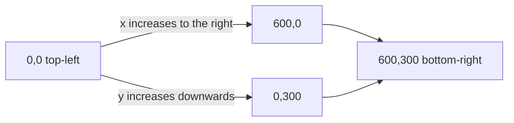
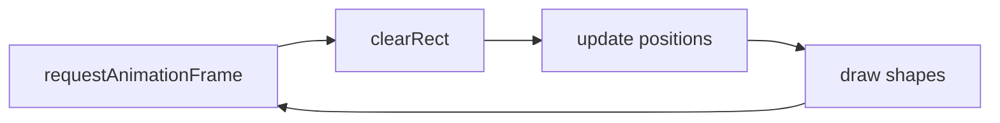
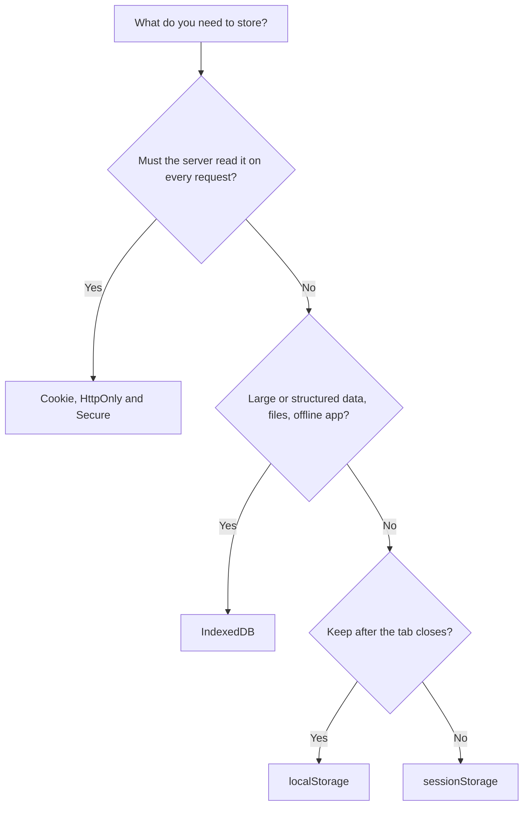

# Session 13 · Canvas and Web Storage in HTML5

> [Prime AI – Software Engineering with AI](../../README.md) › [Term 1](../README.md) › [Progressive Website Development](README.md) › **Session 13**

| ⏱ Estimated time | 🧩 Prerequisites |
|---|---|
| 2.5 hours | Session 11 |

[⬅ Previous: Modern JavaScript: ECMAScript 2022 and Beyond](session-12-modern-javascript-es2022.md) &nbsp;|&nbsp; [Next: HTML5 Geolocation and Web APIs ➡](session-14-geolocation-and-html5-apis.md)

---

## 🎯 Learning objectives

By the end of this session you will be able to:

- Draw shapes, paths, text, gradients and images on an HTML5 canvas with the 2D context.
- Animate canvas drawings with requestAnimationFrame and react to mouse input.
- Compare canvas with SVG and choose the right one.
- Store and read data with localStorage and sessionStorage, including objects via JSON.
- Compare cookies, Web Storage and IndexedDB and apply storage safely.

## 📖 Concepts

### The canvas element
`<canvas id="c" width="600" height="300">Fallback text</canvas>` is a blank bitmap you draw on with JavaScript.
```js
const ctx = document.querySelector('#c').getContext('2d');
```
The **coordinate system** starts at the **top-left (0, 0)**; x grows right, y grows **down**. Set the size with the
`width`/`height` attributes (CSS sizing alone stretches the pixels).

| Task | Methods / properties |
|---|---|
| Rectangles | `fillRect(x, y, w, h)` `strokeRect()` `clearRect()` |
| Colours & lines | `fillStyle` `strokeStyle` `lineWidth` `lineCap` `globalAlpha` |
| Paths | `beginPath()` `moveTo()` `lineTo()` `arc(x, y, r, start, end)` `quadraticCurveTo()` `closePath()` `fill()` `stroke()` |
| Text | `font = 'bold 24px system-ui'` `fillText(text, x, y)` `textAlign` `measureText()` |
| Gradients | `createLinearGradient(x0,y0,x1,y1)` + `addColorStop(0, '#1e1b4b')` |
| Images | `drawImage(img, x, y, w, h)` (after `img.onload`) |
| Transform & state | `translate()` `rotate()` `scale()` `save()` `restore()` |
| Shadows | `shadowColor` `shadowBlur` `shadowOffsetX/Y` |
| Export | `canvas.toDataURL('image/png')` |

Angles are in **radians**: a full circle is `2 * Math.PI`.

**Animation:** clear, update, draw, repeat with `requestAnimationFrame(loop)` (~60 fps, pauses in background tabs).

### Canvas vs SVG
| Canvas | SVG |
|---|---|
| Pixels (raster), drawn by script | Shapes (vector) in the DOM |
| Fast for thousands of objects, games, image filters, charts libraries | Crisp at any zoom; each shape can be styled with CSS and receive events |
| Content invisible to screen readers – add a text alternative | Accessible text and titles |

### Web Storage
Key/value strings stored **in the browser, per origin** (protocol + domain + port).

| | `localStorage` | `sessionStorage` | Cookies | IndexedDB |
|---|---|---|---|---|
| Lifetime | Until deleted | Until the tab closes | Expiry date | Until deleted |
| Size | ~5–10 MB | ~5 MB | ~4 KB each | Hundreds of MB+ |
| Sent to server? | No | No | **Yes, with every request** | No |
| API | Simple, synchronous | Simple, synchronous | `document.cookie` string | Asynchronous, databases |

API: `setItem(key, value)`, `getItem(key)` (returns `null` if missing), `removeItem(key)`, `clear()`, `key(i)`, `length`.
Values are **strings** – store objects with `JSON.stringify()` and read them with `JSON.parse()`.
The `storage` event fires in *other* tabs when data changes, so tabs can stay in sync.

**Safety:** never store passwords, tokens of real value or personal data in Web Storage – any script on the page (including
an injected one) can read it. Use it for preferences, drafts, carts and caches. View it in **DevTools › Application › Storage**.

## 🧭 Diagrams

### Canvas coordinate system



### Animation loop



### Choosing browser storage



## 💻 Worked examples

### Example 1 — Drawing shapes, text and a gradient

```html
<canvas id="c" width="600" height="300" style="border:1px solid #cbd5e1">
  A drawing of a house under a gradient sky with the text "Home sweet home".
</canvas>
<script>
  const ctx = document.querySelector('#c').getContext('2d');

  const sky = ctx.createLinearGradient(0, 0, 0, 300);
  sky.addColorStop(0, '#1e1b4b'); sky.addColorStop(1, '#0e7490');
  ctx.fillStyle = sky; ctx.fillRect(0, 0, 600, 300);

  ctx.fillStyle = '#fde68a';                         // sun
  ctx.beginPath(); ctx.arc(520, 60, 30, 0, 2 * Math.PI); ctx.fill();

  ctx.fillStyle = '#f8fafc'; ctx.fillRect(200, 150, 200, 120);   // walls
  ctx.fillStyle = '#b91c1c';                         // roof (triangle path)
  ctx.beginPath(); ctx.moveTo(180, 150); ctx.lineTo(300, 70); ctx.lineTo(420, 150); ctx.closePath(); ctx.fill();
  ctx.fillStyle = '#78350f'; ctx.fillRect(280, 200, 40, 70);       // door

  ctx.strokeStyle = '#0f172a'; ctx.lineWidth = 4; ctx.strokeRect(200, 150, 200, 120);
  ctx.font = 'bold 28px system-ui'; ctx.fillStyle = '#fff'; ctx.textAlign = 'center';
  ctx.fillText('Home sweet home', 300, 40);
</script>
```

📄 Saved as [`code/session-13_example-1.html`](code/session-13_example-1.html)

**🖥️ What you see in the browser**

```text
A 600×300 picture: a navy-to-teal sky, a yellow sun top-right, a white house with a red triangular roof,
a brown door and a dark outline, and the white caption "Home sweet home" at the top centre.
```

### Example 2 — A bouncing ball animation with mouse interaction

```html
<canvas id="game" width="500" height="260" style="background:#0f172a"></canvas>
<p>Click the ball to change its colour. Score: <span id="score">0</span></p>
<script>
  const cv = document.querySelector('#game'), ctx = cv.getContext('2d');
  const ball = { x: 80, y: 60, r: 18, dx: 3, dy: 2.4, color: '#67e8f9' };
  let score = 0;

  function loop() {
    ctx.clearRect(0, 0, cv.width, cv.height);
    ball.x += ball.dx; ball.y += ball.dy;
    if (ball.x < ball.r || ball.x > cv.width - ball.r) ball.dx *= -1;   // bounce off walls
    if (ball.y < ball.r || ball.y > cv.height - ball.r) ball.dy *= -1;
    ctx.fillStyle = ball.color;
    ctx.beginPath(); ctx.arc(ball.x, ball.y, ball.r, 0, Math.PI * 2); ctx.fill();
    requestAnimationFrame(loop);
  }
  cv.addEventListener('click', e => {
    const rect = cv.getBoundingClientRect();
    const mx = e.clientX - rect.left, my = e.clientY - rect.top;
    if (Math.hypot(mx - ball.x, my - ball.y) <= ball.r) {
      ball.color = `hsl(${Math.random() * 360} 80% 60%)`;
      document.querySelector('#score').textContent = ++score;
    }
  });
  loop();
</script>
```

📄 Saved as [`code/session-13_example-2.html`](code/session-13_example-2.html)

**🖥️ What you see in the browser**

```text
A cyan ball glides and bounces off the edges of a dark rectangle at ~60 frames per second.
Clicking exactly on the ball gives it a random colour and increases the score.
```

### Example 3 — Theme preference and a saved draft with Web Storage

```html
<label><input type="checkbox" id="dark"> Dark mode</label>
<textarea id="draft" rows="4" cols="40" placeholder="Start typing – it saves automatically"></textarea>
<p id="status"></p>
<script>
  const dark = document.querySelector('#dark'), draft = document.querySelector('#draft');

  // restore on load
  const prefs = JSON.parse(localStorage.getItem('prefs') ?? '{"dark":false}');
  dark.checked = prefs.dark; document.body.classList.toggle('dark', prefs.dark);
  draft.value = sessionStorage.getItem('draft') ?? '';

  dark.addEventListener('change', () => {
    localStorage.setItem('prefs', JSON.stringify({ dark: dark.checked }));
    document.body.classList.toggle('dark', dark.checked);
  });
  draft.addEventListener('input', () => {
    sessionStorage.setItem('draft', draft.value);
    document.querySelector('#status').textContent = `Draft saved (${draft.value.length} chars)`;
  });
  window.addEventListener('storage', e => {          // fires in OTHER tabs
    if (e.key === 'prefs') location.reload();
  });
</script>
<style> body.dark { background: #0f172a; color: #e2e8f0; } </style>
```

📄 Saved as [`code/session-13_example-3.html`](code/session-13_example-3.html)

**🖥️ What you see in the browser**

```text
Ticking "Dark mode" darkens the page; after a refresh – or even after closing and reopening the browser –
it is still dark (localStorage). Text typed in the box survives a refresh but disappears when the tab is closed
(sessionStorage). DevTools › Application › Local Storage shows prefs = {"dark":true}.
```

### Example 4 — How Web Storage behaves (a tiny in-memory model)

Node has no localStorage, so this class mimics its rules – everything becomes a string – to show why JSON is needed.

```js
class MemoryStorage {
  #data = new Map();
  setItem(k, v) { this.#data.set(String(k), String(v)); }
  getItem(k) { return this.#data.has(k) ? this.#data.get(k) : null; }
  removeItem(k) { this.#data.delete(k); }
  get length() { return this.#data.size; }
}
const store = new MemoryStorage();

store.setItem('visits', 3);
console.log('visits + 1 =', store.getItem('visits') + 1, '(string!) ->', Number(store.getItem('visits')) + 1);

store.setItem('cart', { id: 7, qty: 2 });
console.log('object without JSON ->', store.getItem('cart'));

store.setItem('cart', JSON.stringify([{ id: 7, qty: 2 }]));
const cart = JSON.parse(store.getItem('cart'));
console.log('object with JSON    ->', cart[0].qty, 'items of product', cart[0].id);
console.log('missing key ->', store.getItem('nope'), '| keys stored:', store.length);
```

📄 Saved as [`code/session-13_example-4.js`](code/session-13_example-4.js)

**Output** (real run)

```text
visits + 1 = 31 (string!) -> 4
object without JSON -> [object Object]
object with JSON    -> 2 items of product 7
missing key -> null | keys stored: 2
```

## 🧪 Lab / practice tasks

**🟢 Easy** — Draw the flag of Pakistan on a canvas (green field, white band, crescent and star) using rectangles and arcs.

<details><summary>💡 Hint</summary>

Draw the crescent as a white circle with a green circle offset on top.

</details>

**🟡 Medium** — Make a simple drawing app: draw lines while the mouse button is held down; add a colour picker and a "Clear" button.

<details><summary>💡 Hint</summary>

mousedown → beginPath/moveTo; mousemove → lineTo/stroke; mouseup stops.

</details>

**🔴 Hard** — Save the to-do list from Session 11 in localStorage so tasks and their done state survive a browser restart.

<details><summary>💡 Hint</summary>

Store an array of `{ text, done }` with JSON.

</details>

**🏆 Challenge** — Build a bar chart on canvas from an array of monthly sales, with axes, labels and an animated "grow" effect; add a button that downloads the chart as PNG (`toDataURL`).

<details><summary>💡 Hint</summary>

Scale each bar height = value / max × chartHeight.

</details>

## ✅ Quick quiz

**Q1. Canvas coordinates (0, 0) are at the:**

- A) Centre
- B) Bottom-left
- C) Top-left
- D) Bottom-right

<details><summary>Show answer</summary>

**C** — x grows to the right and y grows downwards from the top-left corner.

</details>

**Q2. A full circle with `arc()` ends at:**

- A) 360
- B) Math.PI
- C) 2 * Math.PI
- D) 100

<details><summary>Show answer</summary>

**C** — Angles are in radians.

</details>

**Q3. sessionStorage data is cleared when:**

- A) The browser updates
- B) The tab is closed
- C) The page is refreshed
- D) Never

<details><summary>Show answer</summary>

**B** — It lives only as long as the browser tab; refreshes keep it.

</details>

**Q4. `localStorage.getItem("missing")` returns:**

- A) undefined
- B) ""
- C) null
- D) false

<details><summary>Show answer</summary>

**C** — getItem returns null for keys that do not exist.

</details>

**Q5. Which storage is sent to the server with every request?**

- A) localStorage
- B) sessionStorage
- C) Cookies
- D) IndexedDB

<details><summary>Show answer</summary>

**C** — Cookies travel in the Cookie request header; Web Storage stays in the browser.

</details>

## 📝 Summary / cheat-sheet

- Canvas: `getContext("2d")`; origin top-left; rects, paths, arcs (radians), text, gradients, images, transforms.
- Animate with clear → update → draw inside `requestAnimationFrame`.
- Canvas = fast pixels, not accessible; SVG = scalable DOM shapes with CSS and events.
- Web Storage: `setItem/getItem/removeItem/clear`; strings only → JSON; per origin.
- localStorage persists, sessionStorage per tab; cookies go to the server; IndexedDB for large data.
- Never store secrets in Web Storage.

## 🎤 Interview / viva questions

1. **Canvas vs SVG?**
   <details><summary>Model answer</summary>

   Canvas is an immediate-mode bitmap drawn with JavaScript, good for games and many objects; SVG is retained vector shapes in the DOM, scalable, stylable and accessible.

   </details>

2. **localStorage vs sessionStorage?**
   <details><summary>Model answer</summary>

   Both store strings per origin; localStorage persists until deleted, sessionStorage lasts only for that browser tab session.

   </details>

3. **Why is requestAnimationFrame better than setInterval for animation?**
   <details><summary>Model answer</summary>

   It syncs with the screen refresh rate, gives smoother motion and pauses in hidden tabs to save battery.

   </details>

4. **How do you store an array in localStorage?**
   <details><summary>Model answer</summary>

   Convert it with JSON.stringify before setItem and convert back with JSON.parse after getItem.

   </details>

---

[⬅ Previous: Modern JavaScript: ECMAScript 2022 and Beyond](session-12-modern-javascript-es2022.md) &nbsp;|&nbsp; [Next: HTML5 Geolocation and Web APIs ➡](session-14-geolocation-and-html5-apis.md)

<sub>Prepared by **Hamna Zahid Khan**, Junior Lecturer · Prime AI – Software Engineering with AI</sub>
