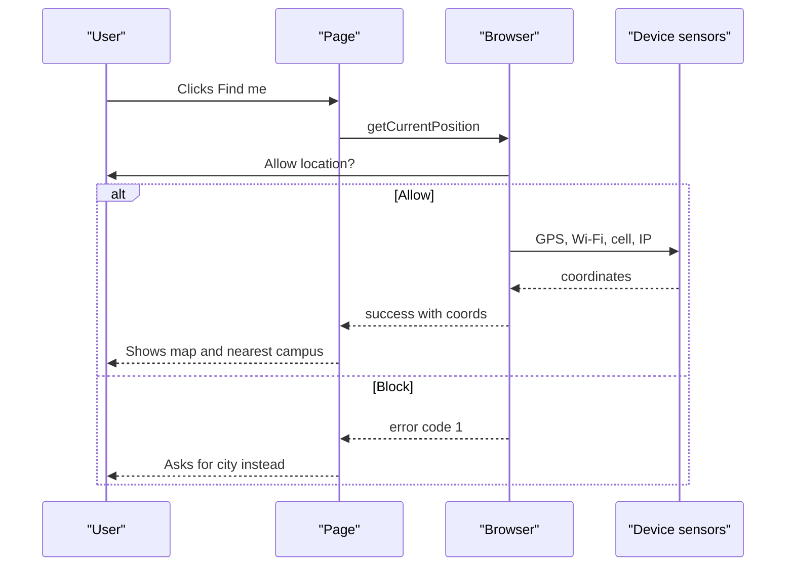
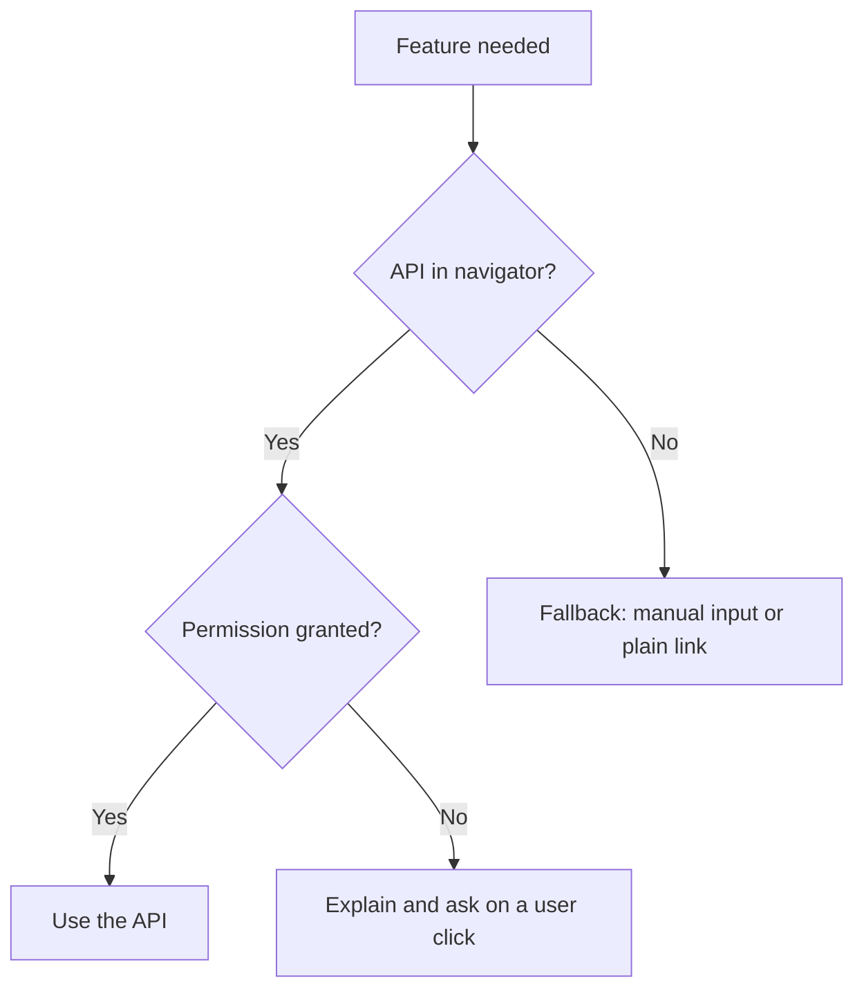
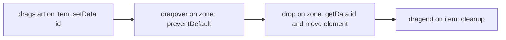

# Session 14 · HTML5 Geolocation and Web APIs

> [Prime AI – Software Engineering with AI](../../README.md) › [Term 1](../README.md) › [Progressive Website Development](README.md) › **Session 14**

| ⏱ Estimated time | 🧩 Prerequisites |
|---|---|
| 2 hours | Session 12 |

[⬅ Previous: Canvas and Web Storage in HTML5](session-13-canvas-and-web-storage.md) &nbsp;|&nbsp; [Next: Building Mobile Websites ➡](session-15-building-mobile-websites.md)

---

## 🎯 Learning objectives

By the end of this session you will be able to:

- Explain how the Geolocation API finds a position and why it needs HTTPS and permission.
- Use getCurrentPosition and watchPosition with success, error and options.
- Show a position on a map (OpenStreetMap/Leaflet or a Google Maps link/API).
- Use other browser APIs: Drag and Drop, Clipboard, Notifications, Intersection Observer and Web Share.
- Handle permissions and errors gracefully and respect user privacy.

## 📖 Concepts

### The Geolocation API
`navigator.geolocation` asks the device where it is. The browser decides **how**: GPS (accurate outdoors), Wi-Fi networks,
cell towers or the IP address (city-level). It is a **powerful feature**, so it works only in a **secure context**
(HTTPS or `localhost`) and only after the user clicks **Allow**.

```js
navigator.geolocation.getCurrentPosition(success, error, { enableHighAccuracy: true, timeout: 10000, maximumAge: 60000 });
const id = navigator.geolocation.watchPosition(success, error);   // keeps reporting as the user moves
navigator.geolocation.clearWatch(id);
```
| `position.coords` | Meaning |
|---|---|
| `latitude`, `longitude` | Degrees (Karachi ≈ 24.86, 67.01) |
| `accuracy` | Radius in metres (smaller is better) |
| `altitude`, `heading`, `speed` | May be `null` on laptops |
| `position.timestamp` | When it was measured |

| Error `code` | Constant | Typical cause |
|---|---|---|
| 1 | `PERMISSION_DENIED` | User clicked Block |
| 2 | `POSITION_UNAVAILABLE` | No signal / location services off |
| 3 | `TIMEOUT` | Took longer than `timeout` |

Check support first: `if ('geolocation' in navigator)`. Ask **only when the user clicks a button** ("Find stores near me"),
explain why, and offer a manual alternative (type a city).

### Showing the position on a map
- **Simplest:** a link `https://www.openstreetmap.org/?mlat=24.86&mlon=67.01#map=15/24.86/67.01` or `https://www.google.com/maps?q=24.86,67.01`.
- **Leaflet + OpenStreetMap** (free, no key): include Leaflet's CSS/JS, then `L.map('map').setView([lat, lng], 15)` and `L.marker([lat, lng]).addTo(map)`.
- **Google Maps JavaScript API:** needs an API key from Google Cloud with billing enabled; offers markers, directions, places search and Street View. Restrict your key to your domain.

**Distance between two points** uses the **haversine formula** (Earth radius ≈ 6371 km).

### More HTML5 / Web APIs
| API | What it does | Key code |
|---|---|---|
| **Drag and Drop** | Drag elements or files | `draggable="true"`, `dragstart`, `dragover` (preventDefault), `drop`, `dataTransfer` |
| **Clipboard** | Copy/paste text | `await navigator.clipboard.writeText(text)` |
| **Notifications** | System notifications | `await Notification.requestPermission()`; `new Notification('Hi')` |
| **Intersection Observer** | Know when an element enters the viewport (lazy load, reveal animations) | `new IntersectionObserver(cb).observe(el)` |
| **Web Share** | Open the phone's share sheet | `navigator.share({ title, url })` |
| **Fullscreen** | Make an element full screen | `el.requestFullscreen()` |
| **Page Visibility** | Pause work in hidden tabs | `document.visibilityState`, `visibilitychange` |
| **Web Workers** | Run heavy JS off the main thread | `new Worker('worker.js')`, `postMessage` |
| **Vibration / Battery / Media devices** | Device features (support varies) | `navigator.vibrate(200)`, `getUserMedia()` |

Use **feature detection** (`if ('share' in navigator)`) and progressive enhancement: the page works without the API and gets
better when it is available. The **Permissions API** (`navigator.permissions.query({ name: 'geolocation' })`) tells you
whether permission is already granted.

## 🧭 Diagrams

### Geolocation request flow



### Progressive enhancement with APIs



### Drag and drop events



## 💻 Worked examples

### Example 1 — Find me: geolocation with errors, accuracy and a map link

```html
<button id="find">📍 Find my location</button>
<p id="msg">We only use your location to show the nearest campus.</p>
<script>
  const msg = document.querySelector('#msg');
  document.querySelector('#find').addEventListener('click', () => {
    if (!('geolocation' in navigator)) { msg.textContent = 'Geolocation is not supported – please type your city.'; return; }
    msg.textContent = 'Locating…';
    navigator.geolocation.getCurrentPosition(
      pos => {
        const { latitude: lat, longitude: lng, accuracy } = pos.coords;
        msg.innerHTML = `You are at ${lat.toFixed(4)}, ${lng.toFixed(4)} (±${Math.round(accuracy)} m).
          <a href="https://www.openstreetmap.org/?mlat=${lat}&mlon=${lng}#map=16/${lat}/${lng}" target="_blank" rel="noopener">Open map</a>`;
      },
      err => {
        const reasons = { 1: 'Permission denied', 2: 'Position unavailable', 3: 'Timed out' };
        msg.textContent = `${reasons[err.code]} – please type your city instead.`;
      },
      { enableHighAccuracy: true, timeout: 10000, maximumAge: 60000 }
    );
  });
</script>
```

📄 Saved as [`code/session-14_example-1.html`](code/session-14_example-1.html)

**🖥️ What you see in the browser**

```text
Clicking the button shows the browser's "Allow location?" prompt.
Allow  -> "You are at 24.8607, 67.0011 (±35 m). Open map" (link opens OpenStreetMap at that spot)
Block  -> "Permission denied – please type your city instead."
Opened from file:// on some browsers -> error, because Geolocation needs HTTPS or localhost (use Live Server).
```

### Example 2 — A Leaflet + OpenStreetMap map with a marker (no API key)

```html
<link rel="stylesheet" href="https://unpkg.com/leaflet@1.9.4/dist/leaflet.css">
<script src="https://unpkg.com/leaflet@1.9.4/dist/leaflet.js"></script>
<div id="map" style="height: 320px; border-radius: 12px;"></div>
<script>
  const campus = [24.8607, 67.0011];                       // Karachi (example)
  const map = L.map('map').setView(campus, 13);
  L.tileLayer('https://tile.openstreetmap.org/{z}/{x}/{y}.png', {
    attribution: '&copy; OpenStreetMap contributors', maxZoom: 19
  }).addTo(map);
  L.marker(campus).addTo(map).bindPopup('Prime AI campus').openPopup();

  navigator.geolocation?.getCurrentPosition(p => {
    const me = [p.coords.latitude, p.coords.longitude];
    L.circleMarker(me, { radius: 8, color: '#0e7490' }).addTo(map).bindPopup('You are here');
    map.fitBounds([campus, me], { padding: [40, 40] });
  });
</script>
```

📄 Saved as [`code/session-14_example-2.html`](code/session-14_example-2.html)

**🖥️ What you see in the browser**

```text
An interactive street map of Karachi with a marker and a "Prime AI campus" pop-up.
After allowing location, a teal dot marks "You are here" and the map zooms to show both points.
```

### Example 3 — Which campus is nearest? (haversine distance)

```js
function haversineKm([lat1, lon1], [lat2, lon2]) {
  const R = 6371, rad = d => d * Math.PI / 180;
  const dLat = rad(lat2 - lat1), dLon = rad(lon2 - lon1);
  const a = Math.sin(dLat / 2) ** 2 + Math.cos(rad(lat1)) * Math.cos(rad(lat2)) * Math.sin(dLon / 2) ** 2;
  return 2 * R * Math.asin(Math.sqrt(a));
}
const me = [24.8615, 67.0099];                 // a user in Saddar, Karachi
const campuses = { Clifton: [24.8138, 67.0300], 'Gulshan-e-Iqbal': [24.9204, 67.0932], 'North Nazimabad': [24.9426, 67.0381] };

const ranked = Object.entries(campuses)
  .map(([name, pos]) => ({ name, km: haversineKm(me, pos) }))
  .sort((a, b) => a.km - b.km);
for (const c of ranked) console.log(c.name.padEnd(16), c.km.toFixed(1), 'km');
console.log('Nearest:', ranked[0].name);
```

📄 Saved as [`code/session-14_example-3.js`](code/session-14_example-3.js)

**Output** (real run)

```text
Clifton          5.7 km
North Nazimabad  9.5 km
Gulshan-e-Iqbal  10.7 km
Nearest: Clifton
```

### Example 4 — Drag-and-drop Kanban, copy to clipboard and reveal on scroll

```html
<style>
  .board { display: flex; gap: 1rem; } .col { flex: 1; min-height: 140px; padding: .5rem; background: #f1f5f9; border-radius: 8px; }
  .task { padding: .5rem; margin: .4rem 0; background: #fff; border-radius: 6px; cursor: grab; }
  .reveal { opacity: 0; transform: translateY(20px); transition: .6s; } .reveal.show { opacity: 1; transform: none; }
</style>
<div class="board">
  <div class="col" data-col="todo"><h3>To do</h3><div class="task" draggable="true" id="t1">Design hero</div></div>
  <div class="col" data-col="done"><h3>Done</h3></div>
</div>
<button id="copy">Copy invite link</button>
<p class="reveal">I fade in when scrolled into view.</p>
<script>
  document.querySelectorAll('.task').forEach(t =>
    t.addEventListener('dragstart', e => e.dataTransfer.setData('text/plain', t.id)));
  document.querySelectorAll('.col').forEach(col => {
    col.addEventListener('dragover', e => e.preventDefault());      // allow dropping
    col.addEventListener('drop', e => col.append(document.getElementById(e.dataTransfer.getData('text/plain'))));
  });

  document.querySelector('#copy').addEventListener('click', async e => {
    await navigator.clipboard.writeText('https://prime.example.com/invite/ABC123');
    e.target.textContent = 'Copied ✓';
  });

  const io = new IntersectionObserver(entries =>
    entries.forEach(en => en.isIntersecting && en.target.classList.add('show')), { threshold: .3 });
  document.querySelectorAll('.reveal').forEach(el => io.observe(el));
</script>
```

📄 Saved as [`code/session-14_example-4.html`](code/session-14_example-4.html)

**🖥️ What you see in the browser**

```text
Two columns; dragging "Design hero" into "Done" moves the card there.
"Copy invite link" puts the URL on the clipboard and changes its label to "Copied ✓".
The paragraph slides up and fades in when it scrolls into view.
```

## 🧪 Lab / practice tasks

**🟢 Easy** — Show the user's latitude, longitude and accuracy on a page, with friendly messages for all three error codes.

<details><summary>💡 Hint</summary>

Test "Block" by resetting the site permission (padlock icon in the address bar).

</details>

**🟡 Medium** — Display the user's position on a Leaflet map with a marker and a circle whose radius equals the reported accuracy.

<details><summary>💡 Hint</summary>

`L.circle([lat, lng], { radius: accuracy })`.

</details>

**🔴 Hard** — Given a JSON list of 5 coffee shops with coordinates, list them sorted by distance from the user using the haversine formula and link each to a map.

<details><summary>💡 Hint</summary>

Reuse Example 3.

</details>

**🏆 Challenge** — Build a "run tracker": `watchPosition` records points, draws the route as a Leaflet polyline, shows total distance and pace, and stops with `clearWatch`. Test it on your phone over Live Server with a tunnel or a deployed HTTPS site.

<details><summary>💡 Hint</summary>

Add each new point to an array and to `L.polyline(points)`.

</details>

## ✅ Quick quiz

**Q1. Geolocation works only on:**

- A) Any HTTP page
- B) Secure contexts (HTTPS or localhost) with permission
- C) Pages with Canvas
- D) Mobile browsers only

<details><summary>Show answer</summary>

**B** — It is a powerful feature limited to secure contexts and needs the user to allow it.

</details>

**Q2. Error code 1 means:**

- A) Timeout
- B) Permission denied
- C) Position unavailable
- D) Unsupported

<details><summary>Show answer</summary>

**B** — 1 = PERMISSION_DENIED, 2 = POSITION_UNAVAILABLE, 3 = TIMEOUT.

</details>

**Q3. Which method keeps reporting the position as the user moves?**

- A) getCurrentPosition
- B) watchPosition
- C) trackPosition
- D) setInterval

<details><summary>Show answer</summary>

**B** — watchPosition calls the success callback on every change until clearWatch.

</details>

**Q4. For a drop target to accept items, the dragover handler must call:**

- A) stopPropagation()
- B) preventDefault()
- C) setData()
- D) focus()

<details><summary>Show answer</summary>

**B** — By default elements refuse drops; preventDefault in dragover allows it.

</details>

**Q5. Which API is best for lazy-loading content as it scrolls into view?**

- A) Geolocation
- B) Intersection Observer
- C) Clipboard
- D) Vibration

<details><summary>Show answer</summary>

**B** — Intersection Observer reports when elements enter the viewport without scroll listeners.

</details>

## 📝 Summary / cheat-sheet

- `navigator.geolocation.getCurrentPosition(ok, err, options)` / `watchPosition` / `clearWatch`.
- Secure context + user permission; ask on a click and explain why; handle codes 1, 2, 3.
- coords: latitude, longitude, accuracy (+ altitude, speed, heading).
- Maps: plain OSM/Google link, Leaflet + OpenStreetMap (no key) or Google Maps JS API (key + billing).
- Other APIs: Drag and Drop, Clipboard, Notifications, Intersection Observer, Web Share, Fullscreen, Workers.
- Feature detection + progressive enhancement.

## 🎤 Interview / viva questions

1. **How does the browser determine location?**
   <details><summary>Model answer</summary>

   It combines whatever is available – GPS, nearby Wi-Fi networks, cell towers or the IP address – and reports an accuracy radius.

   </details>

2. **Why does geolocation need HTTPS?**
   <details><summary>Model answer</summary>

   Location is sensitive personal data; a secure context prevents attackers on the network from injecting scripts that silently track users.

   </details>

3. **What is feature detection?**
   <details><summary>Model answer</summary>

   Checking whether an API exists before using it (for example "geolocation" in navigator) so the page can fall back gracefully on unsupported browsers.

   </details>

4. **getCurrentPosition vs watchPosition?**
   <details><summary>Model answer</summary>

   getCurrentPosition returns one reading; watchPosition calls the success callback repeatedly whenever the position changes until clearWatch is called.

   </details>

---

[⬅ Previous: Canvas and Web Storage in HTML5](session-13-canvas-and-web-storage.md) &nbsp;|&nbsp; [Next: Building Mobile Websites ➡](session-15-building-mobile-websites.md)

<sub>Prepared by **Hamna Zahid Khan**, Junior Lecturer · Prime AI – Software Engineering with AI</sub>
