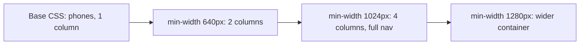
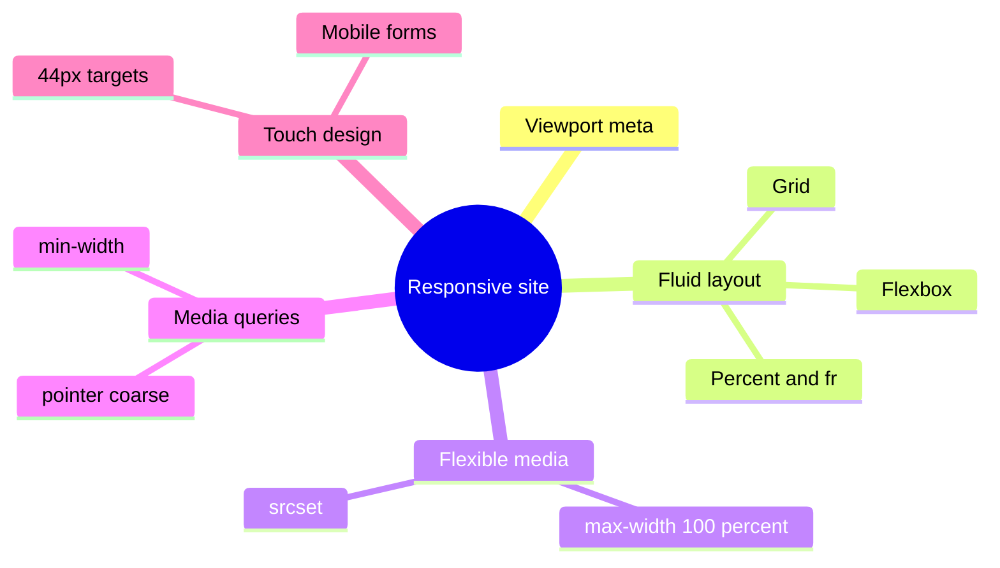
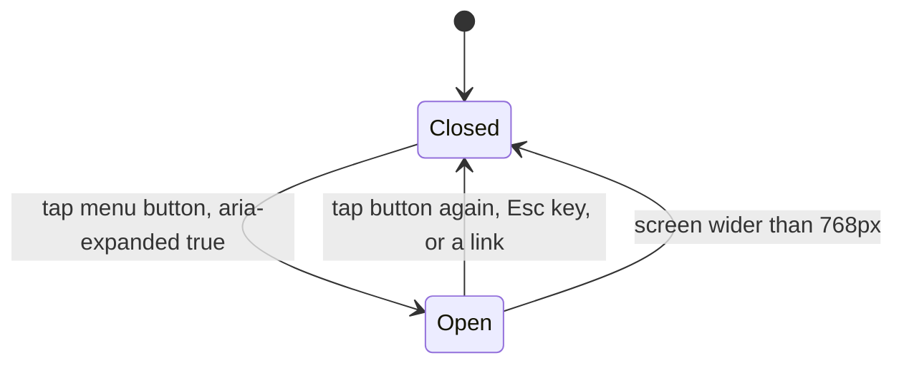

# Session 15 · Building Mobile Websites

> [Prime AI – Software Engineering with AI](../../README.md) › [Term 1](../README.md) › [Progressive Website Development](README.md) › **Session 15**

| ⏱ Estimated time | 🧩 Prerequisites |
|---|---|
| 2.5 hours | Sessions 6 and 7 |

[⬅ Previous: HTML5 Geolocation and Web APIs](session-14-geolocation-and-html5-apis.md) &nbsp;|&nbsp; [Next: Progressive Web Apps and Final Project ➡](session-16-progressive-web-apps-and-final-project.md)

---

## 🎯 Learning objectives

By the end of this session you will be able to:

- Explain why mobile-first, responsive websites are essential.
- Configure the viewport and write mobile-first media queries with sensible breakpoints.
- Design for touch: tap-target sizes, mobile-friendly forms and navigation patterns such as the hamburger menu.
- Describe HTML5/CSS frameworks for mobile (Bootstrap, Tailwind, Ionic, Framework7) and when to use them.
- Test and optimise mobile sites with DevTools device mode and Lighthouse.

## 📖 Concepts

### Why mobile matters
Most web traffic worldwide – and far more in Pakistan – comes from **phones**. Google uses **mobile-first indexing**: it
ranks your site based on its mobile version. A mobile visitor often has a small screen, a touch screen, a slower or costly
connection and one hand free.

| Approach | Idea | Verdict |
|---|---|---|
| Separate m. site (`m.example.com`) | Different HTML for phones | Old; two sites to maintain |
| **Responsive web design** | One HTML; CSS adapts with fluid grids, flexible images and media queries | **Standard today** |
| Adaptive | Server sends different layouts by device | Niche |
| Native app | Built per platform (Swift, Kotlin, Flutter) | Different product; Term 5 |
| PWA | Responsive site + install + offline | Next session |

### The viewport and mobile-first CSS
Without `<meta name="viewport" content="width=device-width, initial-scale=1">` phones render a 980 px desktop page and shrink it.
**Mobile-first** means: write base styles for small screens, then **add** complexity with `min-width` queries:
```css
.grid { display: grid; gap: 1rem; }                                   /* phones: 1 column */
@media (min-width: 640px)  { .grid { grid-template-columns: 1fr 1fr; } }
@media (min-width: 1024px) { .grid { grid-template-columns: repeat(4, 1fr); } }
```
Choose **breakpoints where the content breaks**, not for specific devices. Common starting points: 640, 768, 1024, 1280 px.
Other useful media features: `orientation`, `hover: hover` / `pointer: coarse` (touch), `prefers-color-scheme`,
`prefers-reduced-motion`.

### Designing for touch and small screens
- **Tap targets ≥ 44–48 px** with space between them; no hover-only actions.
- Body text ≥ 16 px (also stops iPhone zooming into inputs); line length 45–75 characters.
- Mobile forms: correct `type` (`email`, `tel`, `number`), `inputmode`, `autocomplete`, labels above fields, big buttons.
- Navigation: hamburger/off-canvas menu, bottom tab bar or a short visible nav; make the menu button a real `<button>` with `aria-expanded`.
- Images: `max-width: 100%`, `srcset`, modern formats, lazy loading.
- Performance budget: keep pages light (aim < 1 MB, few requests); test on throttled "Fast 4G".
- Avoid horizontal scrolling (`overflow-x` is a bug signal), fixed widths and tiny fonts.

### HTML5 mobile frameworks
| Framework | What it gives | Use when |
|---|---|---|
| **Bootstrap 5** | Responsive 12-column grid, components (navbar, cards, modals), utilities | Fast, consistent responsive sites (next module) |
| **Tailwind CSS** | Utility classes (`md:flex`, `p-4`) | Custom designs without writing much CSS |
| **Ionic** | Mobile UI components that look native; packaged with Capacitor as apps | Hybrid apps from web code |
| **Framework7** | iOS/Android-style UI for web apps | App-like mobile web |
| **Onsen UI**, **jQuery Mobile** (legacy) | Mobile widgets | Older projects – jQuery Mobile is no longer maintained |

Frameworks speed you up, but you still need to understand Flexbox, Grid and media queries to customise and debug them.

### Testing
- DevTools **device toolbar** (`Ctrl+Shift+M`): device presets, rotate, throttle network/CPU, touch simulation.
- **Lighthouse** (DevTools): Performance, Accessibility, Best Practices, SEO scores with fixes.
- Real devices: open `http://<your-computer-IP>:5500` on your phone on the same Wi-Fi.
- Core Web Vitals: **LCP** (largest paint < 2.5 s), **INP** (interaction delay < 200 ms), **CLS** (layout shift < 0.1).

## 🧭 Diagrams

### Mobile-first breakpoints



### Responsive design ingredients



### Hamburger menu behaviour



## 💻 Worked examples

### Example 1 — A mobile-first page with a hamburger menu

```html
<!DOCTYPE html>
<html lang="en">
<head>
  <meta charset="UTF-8">
  <meta name="viewport" content="width=device-width, initial-scale=1">
  <title>Prime Café – mobile first</title>
  <style>
    * { box-sizing: border-box; } body { margin: 0; font: 16px/1.6 system-ui, sans-serif; }
    .bar { display: flex; justify-content: space-between; align-items: center; padding: .75rem 1rem; background: #3f2a1d; color: #fff; }
    .menu-btn { font-size: 1.5rem; min-width: 48px; min-height: 48px; background: none; border: 0; color: inherit; }
    nav ul { list-style: none; margin: 0; padding: 0; display: none; }
    nav.open ul { display: block; }
    nav a { display: block; padding: .9rem 1rem; color: #fff; text-decoration: none; border-top: 1px solid #5b4030; }
    .menu-grid { display: grid; gap: 1rem; padding: 1rem; }
    .item { border: 1px solid #e5e7eb; border-radius: 12px; overflow: hidden; }
    .item img { width: 100%; height: auto; aspect-ratio: 4 / 3; object-fit: cover; display: block; }
    .item div { padding: .75rem; }
    @media (min-width: 640px)  { .menu-grid { grid-template-columns: 1fr 1fr; } }
    @media (min-width: 1024px) {
      .menu-btn { display: none; }
      nav ul { display: flex; } nav a { border: 0; }
      .menu-grid { grid-template-columns: repeat(4, 1fr); max-width: 1200px; margin: 0 auto; }
    }
  </style>
</head>
<body>
  <header class="bar">
    <strong>Prime Café</strong>
    <nav id="nav">
      <button class="menu-btn" aria-expanded="false" aria-controls="links" aria-label="Menu">☰</button>
      <ul id="links"><li><a href="#">Menu</a></li><li><a href="#">Order</a></li><li><a href="#">Visit</a></li></ul>
    </nav>
  </header>
  <main class="menu-grid">
    <article class="item"><div>Cappuccino – Rs 550</div></article>
    <article class="item"><div>Espresso – Rs 450</div></article>
    <article class="item"><div>Iced latte – Rs 650</div></article>
    <article class="item"><div>Croissant – Rs 400</div></article>
  </main>
  <script>
    const nav = document.querySelector('#nav'), btn = nav.querySelector('.menu-btn');
    btn.addEventListener('click', () => {
      const open = nav.classList.toggle('open');
      btn.setAttribute('aria-expanded', open);
    });
  </script>
</body>
</html>
```

📄 Saved as [`code/session-15_example-1.html`](code/session-15_example-1.html)

**🖥️ What you see in the browser**

```text
Phone (360px): brown bar with "Prime Café" and a large ☰ button; tapping it slides the three links open
below the bar (one per line, easy to tap). Menu items stack in one column.
Tablet (≥640px): two columns of items.  Desktop (≥1024px): ☰ disappears, links show inline, four columns.
```

### Example 2 — Mobile-friendly form inputs

```html
<form>
  <label for="ph">Mobile number</label>
  <input id="ph" type="tel" inputmode="numeric" autocomplete="tel" placeholder="03001234567">
  <label for="em">Email</label>
  <input id="em" type="email" autocomplete="email" autocapitalize="off">
  <label for="otp">One-time code</label>
  <input id="otp" inputmode="numeric" autocomplete="one-time-code" maxlength="6">
  <label for="amt">Amount (Rs)</label>
  <input id="amt" type="number" inputmode="decimal" min="0" step="0.01">
  <button style="min-height:48px;width:100%">Pay</button>
</form>
```

📄 Saved as [`code/session-15_example-2.html`](code/session-15_example-2.html)

**🖥️ What you see in the browser**

```text
On a phone: the mobile field opens a number pad, the email field shows a keyboard with "@" and ".com",
the code field can auto-fill an SMS code, the amount field shows a decimal pad,
and the full-width 48px "Pay" button is easy to hit with a thumb.
```

### Example 3 — Which media queries match? (simulating devices)

The browser evaluates `matchMedia()` like this for every query; here we evaluate our breakpoints for some common screen widths.

```js
const queries = { 'base (always)': () => true, 'min-width: 640px': w => w >= 640, 'min-width: 1024px': w => w >= 1024 };
const devices = { 'Galaxy A14 (384)': 384, 'iPhone 15 (393)': 393, 'iPad mini (768)': 768, 'Laptop (1366)': 1366 };
const columns = w => (w >= 1024 ? 4 : w >= 640 ? 2 : 1);

for (const [name, w] of Object.entries(devices)) {
  const matched = Object.keys(queries).filter(q => queries[q](w));
  console.log(`${name.padEnd(18)} -> ${columns(w)} col | matches: ${matched.join(', ')}`);
}
```

📄 Saved as [`code/session-15_example-3.js`](code/session-15_example-3.js)

**Output** (real run)

```text
Galaxy A14 (384)   -> 1 col | matches: base (always)
iPhone 15 (393)    -> 1 col | matches: base (always)
iPad mini (768)    -> 2 col | matches: base (always), min-width: 640px
Laptop (1366)      -> 4 col | matches: base (always), min-width: 640px, min-width: 1024px
```

### Example 4 — Testing checklist in DevTools

```text
1. Ctrl+Shift+M  -> choose "Galaxy S20" and "iPad Air"; rotate both.
2. Network throttling -> "Fast 4G"; reload and watch the waterfall.
3. Look for horizontal scroll: run  document.documentElement.scrollWidth > innerWidth  in the Console.
4. Lighthouse -> Mode: Navigation, Device: Mobile -> Analyze page load.
5. Fix the top 3 opportunities (e.g. image sizes, tap targets, contrast) and re-run.
```

**Result**

```text
A Lighthouse report with Performance, Accessibility, Best Practices and SEO scores (0–100),
plus a list of concrete fixes such as "Properly size images" or "Tap targets are not sized appropriately".
```

## 🧪 Lab / practice tasks

**🟢 Easy** — Remove the viewport meta tag from one of your pages and view it in device mode; put it back and describe the difference.

<details><summary>💡 Hint</summary>

Without it the phone renders at ~980px and zooms out.

</details>

**🟡 Medium** — Convert a desktop-first page (max-width queries) into mobile-first (min-width queries) with at least two breakpoints.

<details><summary>💡 Hint</summary>

Move the phone styles into the base CSS.

</details>

**🔴 Hard** — Build an accessible hamburger menu: real button, `aria-expanded`, closes with Esc and when a link is tapped, and becomes a horizontal nav on desktop.

<details><summary>💡 Hint</summary>

`keydown` listener checking `e.key === "Escape"`.

</details>

**🏆 Challenge** — Take your portfolio page, run Lighthouse in mobile mode, and raise every category to 90+. Document before/after scores and the changes you made.

<details><summary>💡 Hint</summary>

Common wins: image sizes/formats, lazy loading, contrast, labels, meta description.

</details>

## ✅ Quick quiz

**Q1. Mobile-first CSS mainly uses:**

- A) max-width queries
- B) min-width queries
- C) No queries
- D) Separate m. sites

<details><summary>Show answer</summary>

**B** — Base styles target phones; min-width adds layout for larger screens.

</details>

**Q2. A comfortable minimum tap-target size is about:**

- A) 16px
- B) 24px
- C) 44–48px
- D) 100px

<details><summary>Show answer</summary>

**C** — Apple suggests 44 pt and Google 48 dp for fingers.

</details>

**Q3. Which attribute shows a numeric keypad without number spinners?**

- A) type="text"
- B) inputmode="numeric"
- C) pattern
- D) step

<details><summary>Show answer</summary>

**B** — inputmode changes the virtual keyboard while keeping a text field.

</details>

**Q4. Google ranks pages primarily using:**

- A) The desktop version
- B) The mobile version
- C) The AMP version only
- D) Meta keywords

<details><summary>Show answer</summary>

**B** — Mobile-first indexing.

</details>

**Q5. Which tool audits performance, accessibility and SEO in Chrome?**

- A) Elements panel
- B) Lighthouse
- C) Sources
- D) Memory

<details><summary>Show answer</summary>

**B** — Lighthouse scores the page and lists concrete fixes.

</details>

## 📝 Summary / cheat-sheet

- Most traffic is mobile; Google indexes mobile-first.
- Responsive = fluid layout + flexible media + media queries; viewport meta is mandatory.
- Mobile-first: base styles for phones, `min-width` breakpoints where content breaks.
- Touch: ≥ 44–48 px targets, 16 px text, correct input types/inputmode/autocomplete, accessible hamburger menu.
- Frameworks: Bootstrap, Tailwind, Ionic, Framework7 – speed, not a substitute for CSS knowledge.
- Test with device mode, throttling, real phones and Lighthouse; watch LCP, INP, CLS.

## 🎤 Interview / viva questions

1. **What is responsive web design?**
   <details><summary>Model answer</summary>

   One codebase whose layout adapts to any screen using fluid grids, flexible images and media queries.

   </details>

2. **Why mobile-first?**
   <details><summary>Model answer</summary>

   Phones get the lightest CSS and essential content first, larger screens are progressive enhancements, and the approach matches mobile-first indexing.

   </details>

3. **How do you choose breakpoints?**
   <details><summary>Model answer</summary>

   Resize the page and add a breakpoint where the content starts to look broken, instead of targeting particular devices.

   </details>

4. **Name the Core Web Vitals.**
   <details><summary>Model answer</summary>

   Largest Contentful Paint (loading), Interaction to Next Paint (responsiveness) and Cumulative Layout Shift (visual stability).

   </details>

---

[⬅ Previous: HTML5 Geolocation and Web APIs](session-14-geolocation-and-html5-apis.md) &nbsp;|&nbsp; [Next: Progressive Web Apps and Final Project ➡](session-16-progressive-web-apps-and-final-project.md)

<sub>Prepared by **Hamna Zahid Khan**, Junior Lecturer · Prime AI – Software Engineering with AI</sub>
