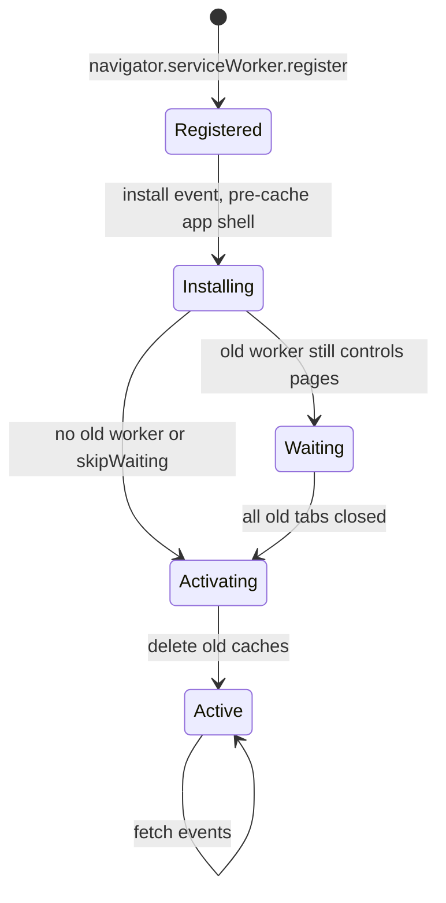
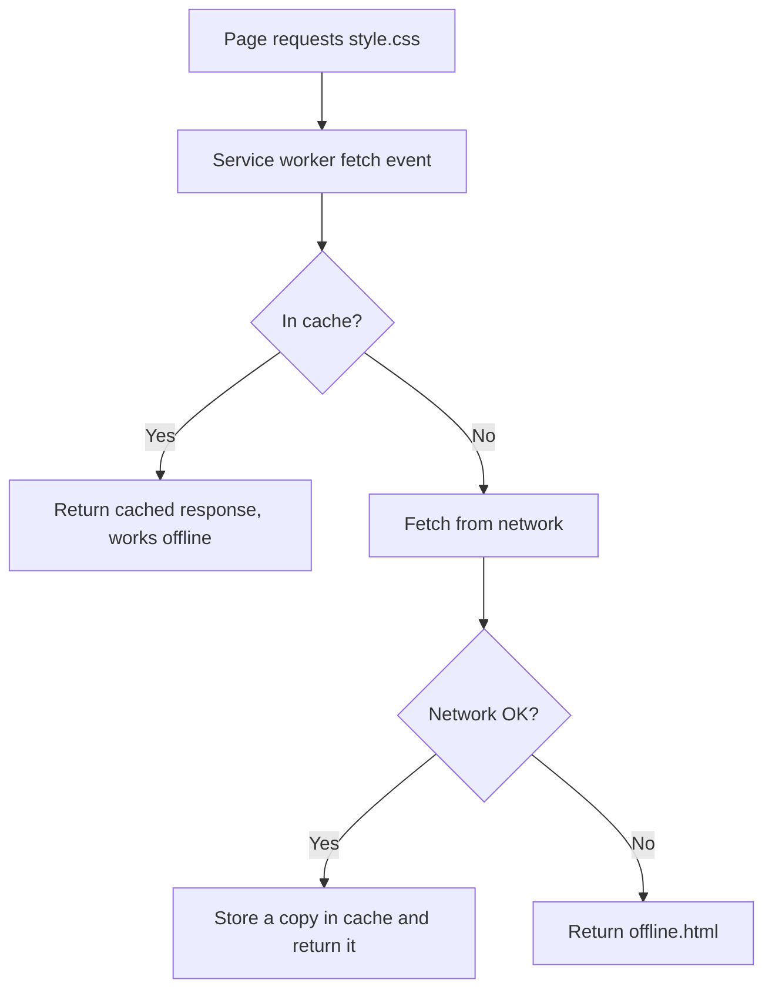
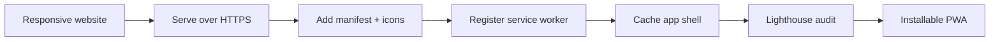

# Session 16 · Progressive Web Apps and Final Project

> [Prime AI – Software Engineering with AI](../../README.md) › [Term 1](../README.md) › [Progressive Website Development](README.md) › **Session 16**

| ⏱ Estimated time | 🧩 Prerequisites |
|---|---|
| 3 hours | Sessions 12–15 |

[⬅ Previous: Building Mobile Websites](session-15-building-mobile-websites.md) &nbsp;|&nbsp; [Practice test ➡](practice-test.md)

---

## 🎯 Learning objectives

By the end of this session you will be able to:

- Explain what makes a website a Progressive Web App (PWA) and its benefits.
- Write a web app manifest with name, icons, colours, start URL and display mode.
- Register a service worker and use the Cache API for offline support (install, activate, fetch).
- Deploy a static site over HTTPS (GitHub Pages or Netlify) and audit it with Lighthouse.
- Plan and build the module project: a responsive, accessible, installable multi-page website.

## 📖 Concepts

### What is a PWA?
A **Progressive Web App** is a normal website that uses modern APIs to feel like an installed app:

| Property | Means |
|---|---|
| **Progressive** | Works for everyone; extra features where supported |
| **Responsive** | Fits any screen (Session 15) |
| **Installable** | "Add to Home screen" / "Install app" – own icon, opens without browser UI |
| **Offline-capable** | A **service worker** serves cached files when there is no network |
| **Secure** | Served over **HTTPS** (required for service workers) |
| **Linkable & discoverable** | Still a URL that search engines index – no app store needed |

Famous examples: Twitter/X Lite, Starbucks, Pinterest, Spotify web. Benefits: one codebase, tiny download, instant updates,
works on slow networks.

### 1. The web app manifest
A JSON file linked from every page: `<link rel="manifest" href="manifest.webmanifest">` plus
`<meta name="theme-color" content="#0e7490">`.
Key members: `name`, `short_name`, `start_url`, `scope`, `display` (`standalone`, `fullscreen`, `minimal-ui`, `browser`),
`background_color`, `theme_color`, `icons` (at least **192×192** and **512×512** PNG, plus a `maskable` one), `description`,
`screenshots`.

### 2. The service worker
A JavaScript file the browser runs **in the background, separate from the page**, acting as a **programmable network
proxy**. It has no DOM access. Lifecycle:

1. **Register** from the page: `navigator.serviceWorker.register('/sw.js')`.
2. **install** – pre-cache the "app shell" (HTML, CSS, JS, icons) with the **Cache API**.
3. **activate** – delete old caches when you release a new version.
4. **fetch** – intercept every request and decide where the response comes from.

| Caching strategy | How | Good for |
|---|---|---|
| **Cache first** | Cache, fall back to network | App shell, fonts, icons |
| **Network first** | Network, fall back to cache | HTML pages, API data that should be fresh |
| **Stale-while-revalidate** | Serve cache now, update it in the background | Avatars, news lists |
| Network only / cache only | One source | Payments / pre-cached assets |

Tools such as **Workbox** generate service workers for you. Debug in **DevTools › Application** (Manifest, Service
workers, Cache storage, "Offline" checkbox, "Update on reload").

### 3. HTTPS and deployment
`localhost` counts as secure for development. To publish free over HTTPS: **GitHub Pages** (push the folder to a repo ›
Settings › Pages), **Netlify** or **Vercel** (drag-and-drop or connect the repo). Then run **Lighthouse** – it checks
installability and PWA best practices.

### The module project
Build a **multi-page, responsive website** for a real or imagined client (café, clinic, NGO, portfolio, event):
- 4+ pages with semantic HTML5, a consistent navbar/footer, and valid markup.
- External CSS with variables, Flexbox **and** Grid, at least one animation/transition and dark-mode support.
- A validated form, a table or media section, and JavaScript features (DOM interaction, localStorage, one HTML5 API such as Canvas or Geolocation).
- Mobile-first with at least two breakpoints; Lighthouse ≥ 90 in Accessibility and Best Practices.
- Manifest + service worker so it installs and the home page opens offline; deployed on HTTPS.

## 🧭 Diagrams

### Service worker lifecycle



### Cache-first fetch handling



### From website to installable PWA



## 💻 Worked examples

### Example 1 — manifest.webmanifest

```json
{
  "name": "Prime Café – Order Ahead",
  "short_name": "Prime Café",
  "description": "Browse the menu and order coffee ahead of time.",
  "start_url": "./index.html",
  "scope": "./",
  "display": "standalone",
  "background_color": "#ffffff",
  "theme_color": "#3f2a1d",
  "icons": [
    { "src": "icons/icon-192.png", "sizes": "192x192", "type": "image/png" },
    { "src": "icons/icon-512.png", "sizes": "512x512", "type": "image/png" },
    { "src": "icons/maskable-512.png", "sizes": "512x512", "type": "image/png", "purpose": "maskable" }
  ]
}
```

📄 Saved as [`code/session-16_manifest.webmanifest`](code/session-16_manifest.webmanifest)

### Example 2 — Linking the manifest and registering the service worker (index.html)

```html
<head>
  <meta charset="UTF-8">
  <meta name="viewport" content="width=device-width, initial-scale=1">
  <title>Prime Café</title>
  <link rel="manifest" href="manifest.webmanifest">
  <meta name="theme-color" content="#3f2a1d">
  <link rel="apple-touch-icon" href="icons/icon-192.png">
  <link rel="stylesheet" href="css/style.css">
</head>
<body>
  <!-- page content -->
  <p id="net"></p>
  <script>
    if ('serviceWorker' in navigator) {
      window.addEventListener('load', async () => {
        try {
          const reg = await navigator.serviceWorker.register('./sw.js');
          console.log('Service worker registered for scope', reg.scope);
        } catch (err) { console.error('SW registration failed', err); }
      });
    }
    const net = document.querySelector('#net');
    const show = () => net.textContent = navigator.onLine ? '🟢 Online' : '🔴 Offline – showing saved pages';
    addEventListener('online', show); addEventListener('offline', show); show();
  </script>
</body>
```

📄 Saved as [`code/session-16_example-2.html`](code/session-16_example-2.html)

**🖥️ What you see in the browser**

```text
Console: "Service worker registered for scope http://127.0.0.1:5500/"
Chrome shows an install icon in the address bar; on Android, "Add Prime Café to Home screen".
DevTools › Application › Manifest shows the name, colours and icons with no errors.
Ticking "Offline" in DevTools changes the status line to "🔴 Offline – showing saved pages".
```

### Example 3 — sw.js – pre-cache, clean up, cache-first with offline fallback

```js
const CACHE = 'prime-cafe-v1';
const APP_SHELL = ['./', './index.html', './offline.html', './css/style.css', './js/app.js',
                   './icons/icon-192.png', './icons/icon-512.png'];

self.addEventListener('install', event => {
  event.waitUntil(caches.open(CACHE).then(cache => cache.addAll(APP_SHELL)));
  self.skipWaiting();                              // activate the new version immediately
});

self.addEventListener('activate', event => {
  event.waitUntil(
    caches.keys().then(keys => Promise.all(keys.filter(k => k !== CACHE).map(k => caches.delete(k))))
  );
  self.clients.claim();
});

self.addEventListener('fetch', event => {
  if (event.request.method !== 'GET') return;     // never cache form posts
  if (event.request.mode === 'navigate') {        // HTML pages: network first
    event.respondWith(
      fetch(event.request).catch(() => caches.match(event.request).then(r => r || caches.match('./offline.html')))
    );
    return;
  }
  event.respondWith(                              // assets: cache first
    caches.match(event.request).then(cached => cached || fetch(event.request).then(res => {
      const copy = res.clone();
      caches.open(CACHE).then(cache => cache.put(event.request, copy));
      return res;
    }))
  );
});
```

📄 Saved as [`code/session-16_sw.js`](code/session-16_sw.js)

**Result**

```text
First visit: the seven app-shell files are stored in Cache Storage "prime-cafe-v1".
Next visits: CSS, JS and icons load instantly from the cache; pages come from the network when online.
Offline: visited pages still open, and any other page shows offline.html.
Changing CACHE to "prime-cafe-v2" deploys a new version and deletes the old cache on activate.
```

### Example 4 — Checking a manifest for installability (Node)

A mini version of the checks Lighthouse performs, run on the manifest from Example 1.

```js
const fs = require('fs');
const m = JSON.parse(fs.readFileSync('session-16_manifest.webmanifest', 'utf8'));

const checks = [
  ['has name or short_name', Boolean(m.name || m.short_name)],
  ['short_name <= 12 chars', (m.short_name ?? '').length <= 12],
  ['start_url set', Boolean(m.start_url)],
  ['display is standalone/fullscreen/minimal-ui', ['standalone', 'fullscreen', 'minimal-ui'].includes(m.display)],
  ['icon 192x192', m.icons.some(i => i.sizes === '192x192')],
  ['icon 512x512', m.icons.some(i => i.sizes === '512x512')],
  ['maskable icon', m.icons.some(i => (i.purpose ?? '').includes('maskable'))],
  ['theme_color set', /^#[0-9a-f]{6}$/i.test(m.theme_color)],
];
for (const [label, ok] of checks) console.log(ok ? '✔' : '✘', label);
console.log(checks.every(([, ok]) => ok) ? 'Manifest looks installable.' : 'Fix the ✘ items.');
```

📄 Saved as [`code/session-16_example-4.js`](code/session-16_example-4.js)

**Output** (real run)

```text
✔ has name or short_name
✔ short_name <= 12 chars
✔ start_url set
✔ display is standalone/fullscreen/minimal-ui
✔ icon 192x192
✔ icon 512x512
✔ maskable icon
✔ theme_color set
Manifest looks installable.
```

### Example 5 — Deploying to GitHub Pages

```text
1. Put the site in a folder: index.html, manifest.webmanifest, sw.js, offline.html, css/, js/, icons/.
2. Create a public GitHub repository, e.g. prime-cafe, and upload/push the files.
3. Repository > Settings > Pages > Source: "Deploy from a branch" > main / (root) > Save.
4. After about a minute the site is live at https://<username>.github.io/prime-cafe/ (HTTPS automatically).
5. Open it on your phone > browser menu > "Install app" / "Add to Home screen".
6. DevTools > Lighthouse > Mobile > tick all categories > Analyze.
```

**Result**

```text
A public HTTPS URL, an app icon on your phone's home screen that opens full-screen without the browser bar,
and a Lighthouse report confirming the site is installable.
```

## 🧪 Lab / practice tasks

**🟢 Easy** — Write a manifest for your portfolio with name, short name, colours, start URL, `display: standalone` and two icons; check it in DevTools › Application › Manifest.

<details><summary>💡 Hint</summary>

Generate icons with any free PWA icon generator or resize one square logo.

</details>

**🟡 Medium** — Register a service worker that pre-caches your home page, CSS and logo; prove it works by ticking "Offline" in DevTools and reloading.

<details><summary>💡 Hint</summary>

Use "Update on reload" while developing.

</details>

**🔴 Hard** — Add an `offline.html` page and the network-first/cache-first logic from Example 3; release a v2 by changing the cache name and confirm the old cache is deleted.

<details><summary>💡 Hint</summary>

Application › Cache storage lists caches.

</details>

**🏆 Challenge** — **Module project:** build and deploy the multi-page website described in Concepts, then present it in class: show it on a phone, install it, go offline, and walk through your Lighthouse scores and one technical decision you made.

<details><summary>💡 Hint</summary>

Plan pages and components on paper first; commit work daily.

</details>

## ✅ Quick quiz

**Q1. Which two things (besides HTTPS) make a site installable as a PWA?**

- A) A CDN and a database
- B) A web app manifest and a service worker
- C) jQuery and Bootstrap
- D) Cookies and sessions

<details><summary>Show answer</summary>

**B** — The manifest describes the app; the service worker enables offline behaviour.

</details>

**Q2. A service worker can access the DOM directly:**

- A) True
- B) False
- C) Only on install
- D) Only in Chrome

<details><summary>Show answer</summary>

**B** — It runs separately and talks to pages via postMessage.

</details>

**Q3. In which event do you usually pre-cache the app shell?**

- A) fetch
- B) install
- C) activate
- D) load

<details><summary>Show answer</summary>

**B** — install runs once per new worker version – the right moment to fill the cache.

</details>

**Q4. "Cache first" is best for:**

- A) Bank balances
- B) Static assets like CSS and icons
- C) Form submissions
- D) Live scores

<details><summary>Show answer</summary>

**B** — Static, versioned files rarely change, so the cache can answer instantly.

</details>

**Q5. `display: "standalone"` in the manifest means:**

- A) Opens in a normal tab
- B) Opens like an app without browser UI
- C) Prints the page
- D) Disables JS

<details><summary>Show answer</summary>

**B** — The installed app opens in its own window without the address bar.

</details>

## 📝 Summary / cheat-sheet

- PWA = progressive, responsive, installable, offline-capable, secure website.
- Manifest: name, short_name, start_url, scope, display, colours, 192 + 512 (+ maskable) icons; link it and set theme-color.
- Service worker: register → install (pre-cache) → activate (clean old caches) → fetch (strategies).
- Strategies: cache first, network first, stale-while-revalidate; never cache POSTs.
- Deploy over HTTPS (GitHub Pages/Netlify/Vercel); audit with Lighthouse; debug in Application panel.
- Project: multi-page, semantic, responsive, accessible, interactive, installable and deployed.

## 🎤 Interview / viva questions

1. **What is a service worker?**
   <details><summary>Model answer</summary>

   A background script, separate from the page, that intercepts network requests and can serve responses from a cache, enabling offline use, background sync and push notifications.

   </details>

2. **Why do PWAs require HTTPS?**
   <details><summary>Model answer</summary>

   A service worker can intercept every request for its scope; HTTPS prevents an attacker from installing a malicious one through a tampered connection.

   </details>

3. **PWA vs native app?**
   <details><summary>Model answer</summary>

   A PWA is one web codebase delivered by URL, installable without an app store and updated instantly; a native app has deeper device access and store distribution but must be built per platform.

   </details>

4. **How do you release a new version of cached files?**
   <details><summary>Model answer</summary>

   Change the cache name/version in the service worker; the new worker installs, and in activate it deletes caches that do not match the new name.

   </details>

---

[⬅ Previous: Building Mobile Websites](session-15-building-mobile-websites.md) &nbsp;|&nbsp; [Practice test ➡](practice-test.md)

<sub>Prepared by **Hamna Zahid Khan**, Junior Lecturer · Prime AI – Software Engineering with AI</sub>
