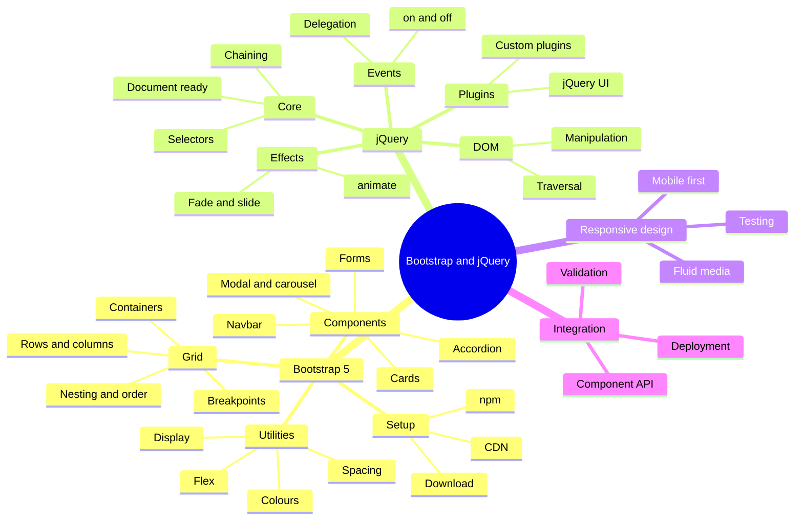

# Module 03 · Bootstrap & jQuery for Responsive Web Pages

> [Prime AI – Software Engineering with AI](../../README.md) › [Term 1](../README.md) › **Bootstrap & jQuery for Responsive Web Pages**

In Module 2 you wrote every line of HTML, CSS and JavaScript by hand. That was on purpose: now that you know **what** a
grid, a navbar or a click handler really is, you are ready to let two famous tools do the repetitive work for you.

- **Bootstrap 5** is a front-end toolkit: a ready-made 12-column responsive grid, dozens of styled components (navbars,
  cards, modals, carousels, forms) and hundreds of utility classes – all driven by class names you add to your HTML.
- **jQuery** is a small JavaScript library that makes selecting elements, handling events, animating and changing the
  page shorter to write. Bootstrap 5 itself no longer needs it, but millions of existing websites (and many plugins)
  still do, so a professional developer must be able to read and write it.

By the end of the module you will design responsive pages with Bootstrap, add interactivity, effects and form
validation with jQuery, plug in third-party widgets and **deploy a complete business website** to the internet.

**Tools:** Visual Studio Code + Live Server, a modern browser with DevTools, and (for the automated tests in `code/`)
Node.js 18+.

## 🎯 Module objectives

- Explain the history, benefits and limits of Bootstrap and set it up from a CDN, a download or npm.
- Build responsive layouts with containers, rows, columns, breakpoints, nesting, offsets and order classes.
- Use Bootstrap components – buttons, cards, navbars, modals, carousels, accordions, forms – and its utility classes.
- Write jQuery code with selectors, chaining and events, including event delegation.
- Apply jQuery effects, animations, DOM manipulation, traversal, plugins and jQuery UI widgets.
- Apply responsive-design principles: mobile-first, fluid media, responsive utilities and typography.
- Control Bootstrap components from JavaScript, validate forms with jQuery, integrate plugins and deploy a site.

## 🗂️ Sessions

| # | Session | Time | What you will cover |
|---|---|---|---|
| 1 | [Fundamentals of Bootstrap](session-01-fundamentals-of-bootstrap.md) | 2.5 hours | Explain what a front-end framework is and trace the history and benefits of Bootstrap; Set up Bootstrap 5 from a CDN, a downloaded copy or npm, and write the official starter template; Describe containers, rows, columns, gutters and the six responsive breakpoints |
| 2 | [Building Blocks with Bootstrap Components](session-02-building-blocks-with-bootstrap-components.md) | 3 hours | Use basic components: buttons, button groups, alerts, badges, cards, list groups, progress bars and spinners; Build navigation with navs, tabs, pills, breadcrumbs, pagination and a responsive collapsing navbar; Add interactive components – dropdowns, modals, carousels, collapse and accordions – using data-bs attributes |
| 3 | [Getting Started with jQuery](session-03-getting-started-with-jquery.md) | 3 hours | Explain what jQuery is, why it became popular and where it is still used today; Add jQuery to a page from a CDN, a local file or npm, and run code when the DOM is ready; Write jQuery statements using the `$(selector).action()` pattern and method chaining |
| 4 | [Mastering jQuery Techniques](session-04-mastering-jquery-techniques.md) | 3 hours | Apply jQuery effects – show/hide, fade, slide – and custom animations with `.animate()`, queues, `.stop()` and callbacks; Read and change content, attributes, properties, CSS and data with jQuery getters/setters; Insert, move, clone and remove elements, and traverse the DOM tree up, down and sideways |
| 5 | [Designing Responsive Web Pages](session-05-designing-responsive-web-pages.md) | 3 hours | List and apply the core principles of responsive web design, including mobile-first and content priority; Use Bootstrap responsive utilities for display, spacing, flexbox, sizing, text and visibility; Combine the Bootstrap grid, row-cols and the optional CSS Grid utilities to build multi-device layouts |
| 6 | [Integrating and Enhancing with Bootstrap and jQuery](session-06-integrating-and-enhancing-with-bootstrap-and-jquery.md) | 3.5 hours | Control Bootstrap components from JavaScript and jQuery, and respond to their events; Validate forms in real time with jQuery and Bootstrap feedback styles; Integrate a third-party jQuery plugin (jQuery Validation) and add scroll-based enhancements |
| 📝 | [Module practice test](practice-test.md) | 1 hour | 20 MCQs + 3 practical questions |

## 🧭 Concept map

## 📄 One-page cheat-sheet

| Area | Must-know facts & syntax |
|---|---|
| **Include Bootstrap** | `<link href="https://cdn.jsdelivr.net/npm/bootstrap@5.3.3/dist/css/bootstrap.min.css" rel="stylesheet">` in `<head>` · `` before `</body>` (bundle = includes Popper) |
| **Include jQuery** | `` **before** any script that uses `$` |
| **Breakpoints** | xs <576 · `sm` ≥576 · `md` ≥768 · `lg` ≥992 · `xl` ≥1200 · `xxl` ≥1400 px (mobile-first: a class applies from its breakpoint **up**) |
| **Containers** | `.container` (fixed max-width per breakpoint: 540/720/960/1140/1320) · `.container-fluid` (100%) · `.container-md` (100% until md) |
| **Grid** | `.row` › `.col-*` · 12 columns · `.col` (equal) · `.col-md-6` · `.col-auto` · `.row-cols-2` · `.g-3` gutters · `.offset-md-2` · `.order-first` / `.order-md-2` · nest a new `.row` inside a column |
| **Components** | `.btn .btn-primary .btn-outline-*` · `.alert .alert-*` · `.badge` · `.card > .card-body > .card-title` · `.list-group` · `.progress` · `.spinner-border` · `.navbar .navbar-expand-lg` · `.breadcrumb` · `.pagination` |
| **JS components** | `data-bs-toggle="modal|collapse|tab|dropdown|tooltip"` + `data-bs-target="#id"` · `.modal` `.carousel` `.accordion` `.toast` · JS API `bootstrap.Modal.getOrCreateInstance(el).show()` · events `show.bs.modal` `shown.bs.modal` `hidden.bs.modal` |
| **Forms** | `.form-control` `.form-select` `.form-check` `.form-floating` `.input-group` · validation `.needs-validation` + `.was-validated`, `.is-valid` `.is-invalid` + `.invalid-feedback` |
| **Utilities** | spacing `m|p` + `t b s e x y` + `0–5|auto` (`mt-3`, `px-md-5`) · `d-none d-md-block` · `d-flex justify-content-between align-items-center gap-2` · `text-center text-md-start` · `bg-primary text-white` · `w-50 h-100` · `rounded shadow` · `img-fluid` · `ratio ratio-16x9` · `table-responsive` |
| **jQuery core** | `$(function(){ … })` = DOM ready · `$('css selector')` · chaining `$('p').addClass('x').fadeIn()` · `$('#id')` `.class` `[name=email]` `:first :even :checked :visible` |
| **Events** | `.on('click', fn)` · `.off()` · `.one()` · delegation `$('#list').on('click', 'li', fn)` · `e.preventDefault()` · `e.stopPropagation()` · `$(this)` = element that fired · `.trigger('click')` |
| **Effects** | `.hide() .show() .toggle()` · `.fadeIn() .fadeOut() .fadeToggle() .fadeTo(400, .5)` · `.slideUp() .slideDown() .slideToggle()` · `.animate({left:'200px'}, 600)` · `.stop()` · `.delay(500)` |
| **DOM** | get/set `.text() .html() .val() .attr() .prop() .css() .data()` · insert `.append() .prepend() .after() .before()` · `.remove() .empty() .clone()` · classes `.addClass() .removeClass() .toggleClass() .hasClass()` |
| **Traversal** | `.parent() .closest() .children() .find() .siblings() .next() .prev() .eq(0) .first() .filter() .each()` |
| **Plugins** | `$.fn.myPlugin = function(opts){ return this.each(function(){ … }); }` · jQuery UI: `.datepicker() .dialog() .accordion() .tabs() .sortable() .draggable()` |
| **Responsive rules** | `<meta name="viewport" content="width=device-width, initial-scale=1">` · mobile-first · touch targets ≥ 44 px · `img-fluid` / `srcset` · test at 360, 768, 1024, 1440 px |
| **Deploy** | relative paths · minified CDN files with SRI `integrity` · compress images · run Lighthouse · push to GitHub Pages or Netlify |

## 🚀 How to study this module

1. Read each session in order; type every example yourself instead of copy-pasting.
2. Run the files in [`code/`](code/) and compare your output with the **Output** blocks.
3. Finish the 🟢 and 🟡 labs before class; attempt 🔴/🏆 labs with a partner.
4. Close the module with the [practice test](practice-test.md) and revise the cheat-sheet above.

---

Prepared by **Hamna Zahid Khan**, Junior Lecturer · Prime AI – Software Engineering with AI
