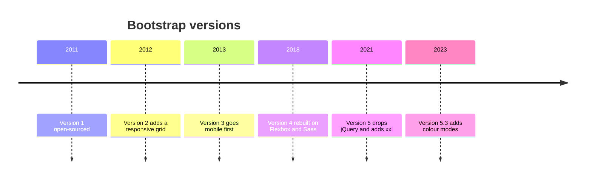
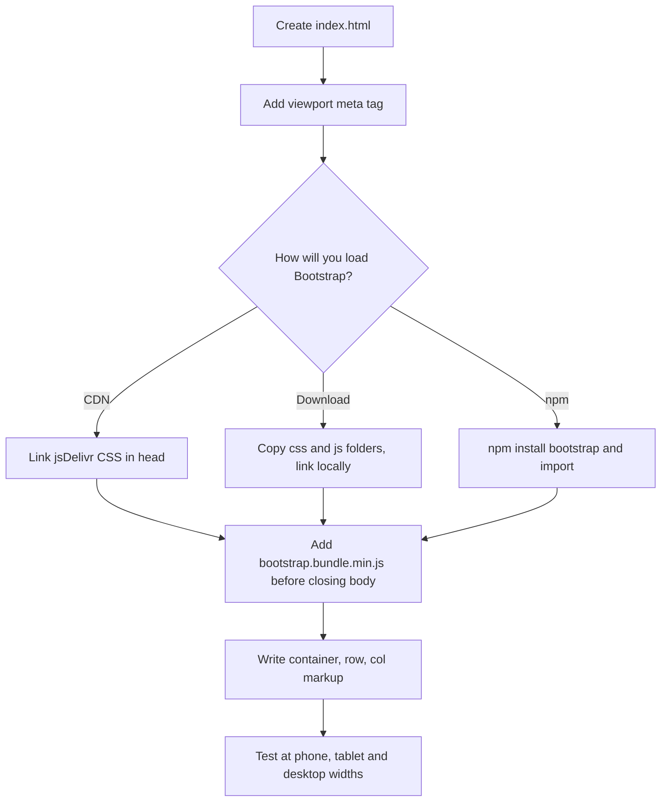
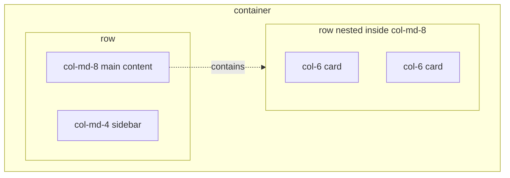
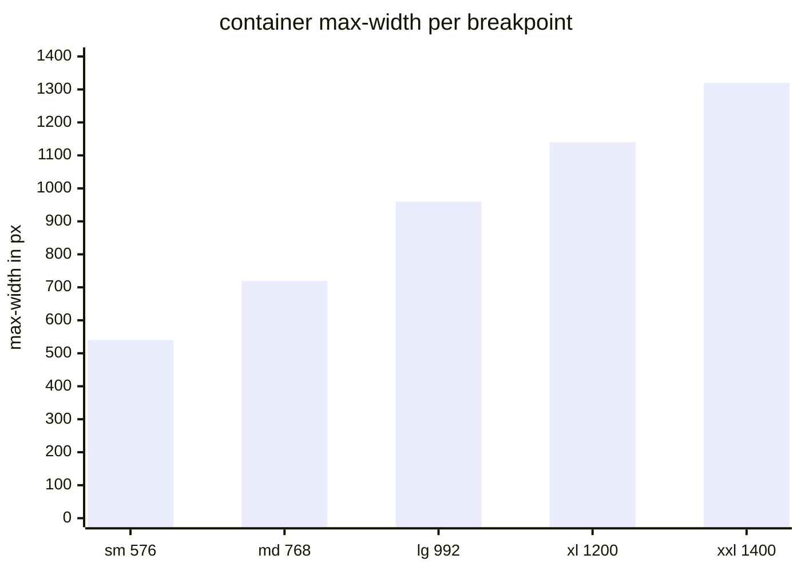
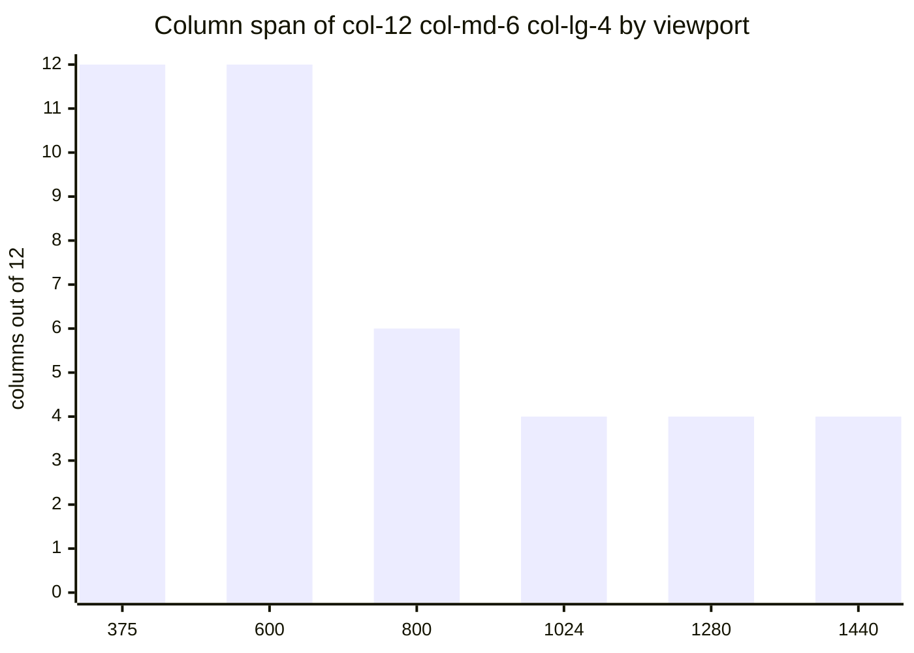

# Session 1 · Fundamentals of Bootstrap

> [Prime AI – Software Engineering with AI](../../README.md) › [Term 1](../README.md) › [Bootstrap & jQuery for Responsive Web Pages](README.md) › **Session 1**

| ⏱ Estimated time | 🧩 Prerequisites |
|---|---|
| 2.5 hours | Module 2 – HTML5, CSS3 (Flexbox, media queries) and basic JavaScript |

[⬅ Module overview](README.md) &nbsp;|&nbsp; [Next: Building Blocks with Bootstrap Components ➡](session-02-building-blocks-with-bootstrap-components.md)

---

## 🎯 Learning objectives

By the end of this session you will be able to:

- Explain what a front-end framework is and trace the history and benefits of Bootstrap.
- Set up Bootstrap 5 from a CDN, a downloaded copy or npm, and write the official starter template.
- Describe containers, rows, columns, gutters and the six responsive breakpoints.
- Build responsive layouts with breakpoint classes, auto-layout columns and row-cols.
- Use nesting, offsets, alignment and order classes to control complex layouts.

## 📖 Concepts

### 1. What is a front-end framework?

In Module 2 you built a responsive layout with Flexbox, Grid and media queries. It worked – but it took dozens of lines
of CSS, and on your next project you would write almost the same lines again. A **front-end framework** is a
pre-written, well-tested collection of CSS (and usually JavaScript) that solves these common problems once, so every
project can reuse the solution by adding **class names** to HTML.

> 🏗️ **Analogy – flat-pack furniture.** You *could* cut, sand and drill every plank yourself (hand-written CSS). Or you
> can buy a flat-pack kit whose parts are pre-cut to standard sizes and simply assemble them (Bootstrap). You still
> decide the room layout and the paint colour – you just skip the sawing.

| Hand-written CSS | Bootstrap |
|---|---|
| Write `display:flex`, widths and media queries yourself | Add `class="row"` and `class="col-md-6"` |
| Every developer names things differently | Everyone on the team uses the same class names |
| Cross-browser bugs are yours to find | Tested on all modern browsers by a large community |
| Total control, smallest file size | Faster to build; you ship some CSS you may not use |

### 2. A short history of Bootstrap

**Bootstrap** was created at Twitter in **2010** by designer **Mark Otto** and developer **Jacob Thornton** to make
Twitter's internal tools look consistent. It was released as open source in **August 2011** and quickly became one of
the most popular projects on GitHub.

| Version | Year | What changed (in plain words) |
|---|---|---|
| 1 | 2011 | A consistent set of styles for buttons, forms and typography |
| 2 | 2012 | First responsive grid, more components, jQuery plugins |
| 3 | 2013 | **Mobile-first** design: styles start small and grow |
| 4 | 2018 | Grid rebuilt on **Flexbox**, Sass source, cards replace panels |
| 5 | 2021 | **No more jQuery dependency**, CSS custom properties, RTL support, `xxl` breakpoint, utilities API |
| 5.3 | 2023 | **Colour modes** (dark mode with `data-bs-theme="dark"`), more CSS variables |

This module uses **Bootstrap 5.3.3** (the latest stable 5.x release when it was written).

### 3. Benefits and limitations

**Benefits**
- **Speed** – a professional-looking, responsive page in minutes.
- **Responsive by default** – the grid and components adapt to phones, tablets and desktops.
- **Consistency** – spacing, colours and typography follow one design system.
- **Accessibility helpers** – components ship with sensible ARIA patterns and keyboard support.
- **Documentation and community** – excellent docs at `getbootstrap.com`, thousands of tutorials and themes.

**Limitations**
- Sites can look "Bootstrap-y" if you never customise the theme.
- You download CSS you may not use (≈ 230 KB unminified CSS, ≈ 30 KB when minified and compressed).
- Class-heavy HTML (`class="col-12 col-md-6 col-lg-4 mb-3"`) can be harder to read.
- You still need to understand CSS to fix anything the framework does not cover.

### 4. Three ways to add Bootstrap to a project

| Method | How | Best for |
|---|---|---|
| **CDN** (Content Delivery Network) | Paste a `<link>` and a `<script>` tag pointing at jsDelivr | Learning, prototypes, small sites |
| **Download** | Get the compiled ZIP from getbootstrap.com, copy `css/` and `js/` into your project | Working offline, intranets |
| **Package manager** | `npm install bootstrap@5.3.3`, then import into your build tool (Vite, Webpack) | Professional projects that customise Sass |

A CDN serves files from a server close to the visitor and may already be cached by their browser. The
`integrity="sha384-…"` attribute (**Subresource Integrity**, SRI) lets the browser check that the downloaded file is
exactly the one you expected; `crossorigin="anonymous"` is required for that check.

**What the files are**
- `bootstrap.min.css` – all styles (grid, components, utilities), minified.
- `bootstrap.bundle.min.js` – all interactive components **plus Popper** (the library that positions dropdowns,
  tooltips and popovers). Use the *bundle* unless you load Popper yourself.

### 5. Step-by-step: the starter template

1. Create a folder `bootstrap-start/` and open it in VS Code.
2. Create `index.html` and type `!` + Tab to get an HTML5 skeleton.
3. Make sure the **viewport meta tag** is present – without it, phones pretend to be 980 px wide and the responsive grid
   never kicks in.
4. Add the Bootstrap CSS `<link>` **inside `<head>`**, after the meta tags.
5. Add the Bootstrap JS `<script>` **just before `</body>`** so the page content loads first.
6. Add a heading with a Bootstrap class (`class="display-4 text-primary"`) and open it with Live Server. If the font
   changes to the system font stack and the heading turns blue, Bootstrap is working.

### 6. Containers – the outer box

Every Bootstrap layout starts with a **container**, which centres your content and adds horizontal padding.

| Class | Behaviour |
|---|---|
| `.container` | Fixed max-width that jumps at each breakpoint (540 → 720 → 960 → 1140 → 1320 px) |
| `.container-fluid` | Always 100% wide |
| `.container-{sm|md|lg|xl|xxl}` | 100% wide **until** that breakpoint, then behaves like `.container` |

### 7. Breakpoints – where the layout changes

A **breakpoint** is a screen width at which the layout is allowed to change. Bootstrap has six:

| Name | Class infix | Min width | Typical device | `.container` max-width |
|---|---|---|---|---|
| Extra small | *(none)* | 0 | Phones in portrait | 100% |
| Small | `sm` | 576 px | Large phones, landscape | 540 px |
| Medium | `md` | 768 px | Tablets | 720 px |
| Large | `lg` | 992 px | Laptops | 960 px |
| Extra large | `xl` | 1200 px | Desktops | 1140 px |
| Extra extra large | `xxl` | 1400 px | Large monitors | 1320 px |

Bootstrap is **mobile-first**: a class such as `.col-md-6` means "from **md (768 px) and up**, take 6 columns".
Below 768 px, that rule simply does not apply and the column falls back to full width. Internally this is a
`@media (min-width: 768px)` query – exactly what you wrote by hand in Module 2.

### 8. The 12-column grid

The grid has three parts that must always be nested in this order: **container › row › column**.

- `.row` is a flex container with negative side margins that cancel the columns' padding.
- Columns divide the row into **12 equal tracks**. Why 12? Because 12 divides evenly by 1, 2, 3, 4, 6 and 12, so you
  can make halves, thirds, quarters and sixths.
- Only columns may be direct children of a row, and content goes **inside** columns.

| Class | Meaning |
|---|---|
| `.col` | Equal-width column – all `.col` siblings share the row equally |
| `.col-4` | 4 / 12 = 33.3% at **all** sizes |
| `.col-md-4` | 100% below md, 33.3% from md up |
| `.col-12 .col-md-6 .col-lg-3` | Full width on phones, half on tablets, quarter on laptops |
| `.col-auto` | As wide as its content |
| `.row-cols-1 .row-cols-md-3` | Set the number of columns on the **row** instead of every child |

If the columns in a row add up to more than 12, the extra columns **wrap** onto a new line – this is how stacking works.

**Gutters** are the gaps between columns: `.g-0` to `.g-5` (both directions), `.gx-*` (horizontal) and `.gy-*`
(vertical).

### 9. Nesting, offsets, order and alignment

- **Nesting:** place a new `.row` *inside* a column. The nested row again has 12 columns – of its parent column's width.
- **Offsets:** `.offset-md-3` pushes a column 3 columns to the right (useful to centre a narrow form: `.col-md-6
  .offset-md-3`).
- **Order:** `.order-first`, `.order-last` and `.order-{0-5}` change the **visual** order without changing the HTML.
  Combine with breakpoints (`.order-md-2`) to show a sidebar first on phones but second on laptops.
- **Alignment:** because rows are flex containers, use `.justify-content-center`, `.align-items-center` on the row, or
  `.align-self-end` on a column.

> ⚠️ Order classes change only the *visual* order. Screen readers and the Tab key still follow the HTML source order,
> so put the most important content first in your HTML.

## 🧭 Diagrams

### The evolution of Bootstrap



### Setting up a Bootstrap page



### Container › row › column nesting



### Container max-width at each breakpoint (px)



## 💻 Worked examples

### Example 1 — The Bootstrap 5 starter template

The smallest correct Bootstrap page. Every later page in this module starts from this skeleton.

```html
<!DOCTYPE html>
<html lang="en">
<head>
  <!-- 1. Character set and viewport: the viewport line is what makes the grid responsive on phones -->
  <meta charset="UTF-8">
  <meta name="viewport" content="width=device-width, initial-scale=1">
  <title>Bootstrap starter</title>
  <!-- 2. Bootstrap CSS from the jsDelivr CDN, with Subresource Integrity -->
  <link href="https://cdn.jsdelivr.net/npm/bootstrap@5.3.3/dist/css/bootstrap.min.css" rel="stylesheet"
        integrity="sha384-QWTKZyjpPEjISv5WaRU9OFeRpok6YctnYmDr5pNlyT2bRjXh0JMhjY6hW+ALEwIH" crossorigin="anonymous">
</head>
<body>
  <!-- 3. A container centres the content and adds side padding -->
  <main class="container py-5">
    <h1 class="display-4 text-primary">Hello, Bootstrap!</h1>
    <p class="lead">If this text uses a clean system font and the heading is blue, Bootstrap loaded correctly.</p>
    <button type="button" class="btn btn-success">A Bootstrap button</button>
  </main>

  <!-- 4. Bootstrap JavaScript bundle (includes Popper) goes just before </body> -->
  <script src="https://cdn.jsdelivr.net/npm/bootstrap@5.3.3/dist/js/bootstrap.bundle.min.js"
          integrity="sha384-YvpcrYf0tY3lHB60NNkmXc5s9fDVZLESaAA55NDzOxhy9GkcIdslK1eN7N6jIeHz" crossorigin="anonymous"></script>
</body>
</html>
```

📄 Saved as [`code/session-01_starter.html`](code/session-01_starter.html)

**🖥️ What you see in the browser**

```text
A large blue heading "Hello, Bootstrap!", a slightly larger grey lead paragraph and a green rounded button,
all centred in a column with comfortable padding. Resize the window: the content box narrows in steps
(1320 → 1140 → 960 → 720 → 540 px) and becomes full width below 576 px.
```

### Example 2 — A responsive three-zone layout (header, content, sidebar, footer)

Read the class names on each column from left to right: they describe the column on phones first, then on larger
screens. Coloured borders make the columns visible while you learn.

```html
<!DOCTYPE html>
<html lang="en">
<head>
  <meta charset="UTF-8">
  <meta name="viewport" content="width=device-width, initial-scale=1">
  <title>Responsive grid layout</title>
  <link href="https://cdn.jsdelivr.net/npm/bootstrap@5.3.3/dist/css/bootstrap.min.css" rel="stylesheet"
        integrity="sha384-QWTKZyjpPEjISv5WaRU9OFeRpok6YctnYmDr5pNlyT2bRjXh0JMhjY6hW+ALEwIH" crossorigin="anonymous">
  <style>
    /* Teaching aid only: outline every column so you can see the grid */
    .demo [class*="col"] { border: 2px dashed #a78bfa; padding: 1rem; background: #f5f3ff; }
  </style>
</head>
<body>
  <div class="container demo my-4">
    <!-- Header: one full-width column at every size -->
    <div class="row mb-3">
      <div class="col-12"><h1 class="h3 m-0">My Blog</h1></div>
    </div>

    <!-- Main area: stacks on phones, 8 + 4 from md, 9 + 3 from xl -->
    <div class="row g-3">
      <article class="col-12 col-md-8 col-xl-9">
        <h2 class="h5">Latest post</h2>
        <p>On phones this article is 12/12 wide. From 768 px it takes 8 of 12 columns, and from 1200 px it takes 9.</p>
      </article>
      <aside class="col-12 col-md-4 col-xl-3">
        <h2 class="h5">Sidebar</h2>
        <p>Below the article on phones; beside it from 768 px.</p>
      </aside>
    </div>

    <!-- Three feature boxes: 1 per row on phones, 3 per row from sm -->
    <div class="row row-cols-1 row-cols-sm-3 g-3 mt-1">
      <div class="col">Feature A</div>
      <div class="col">Feature B</div>
      <div class="col">Feature C</div>
    </div>

    <!-- Equal-width auto columns: add a fourth .col and they all shrink to 25% -->
    <div class="row mt-3">
      <div class="col">Auto</div>
      <div class="col">Auto</div>
      <div class="col-auto">col-auto: as wide as its text</div>
    </div>

    <footer class="row mt-3">
      <div class="col text-center">&copy; 2026 My Blog</div>
    </footer>
  </div>
  <script src="https://cdn.jsdelivr.net/npm/bootstrap@5.3.3/dist/js/bootstrap.bundle.min.js"
          integrity="sha384-YvpcrYf0tY3lHB60NNkmXc5s9fDVZLESaAA55NDzOxhy9GkcIdslK1eN7N6jIeHz" crossorigin="anonymous"></script>
</body>
</html>
```

📄 Saved as [`code/session-01_grid-layout.html`](code/session-01_grid-layout.html)

**🖥️ What you see in the browser**

```text
Phone (375 px):  header / article / sidebar / A / B / C / Auto Auto col-auto / footer – almost everything stacked.
Tablet (800 px): article (8 cols) and sidebar (4 cols) side by side; features A B C in one row.
Desktop (1280 px): article 9 cols, sidebar 3 cols; the container is 1140 px wide and centred.
```

### Example 3 — Nesting, offsets and order classes

A product page: on phones the **price box** must appear *above* the long description (people want the price
first), but on laptops it sits on the right. We also centre a narrow newsletter form using an offset.

```html
<!DOCTYPE html>
<html lang="en">
<head>
  <meta charset="UTF-8">
  <meta name="viewport" content="width=device-width, initial-scale=1">
  <title>Nesting, offset and order</title>
  <link href="https://cdn.jsdelivr.net/npm/bootstrap@5.3.3/dist/css/bootstrap.min.css" rel="stylesheet"
        integrity="sha384-QWTKZyjpPEjISv5WaRU9OFeRpok6YctnYmDr5pNlyT2bRjXh0JMhjY6hW+ALEwIH" crossorigin="anonymous">
</head>
<body>
  <div class="container my-4">
    <div class="row g-4">
      <!-- Description: second on phones (order-2), first from lg (order-lg-1) -->
      <section class="col-12 col-lg-8 order-2 order-lg-1">
        <h1 class="h3">Handmade Ajrak Shawl</h1>
        <p>Block-printed cotton shawl. Long description, care instructions and reviews go here...</p>

        <!-- NESTED ROW: a new 12-column grid inside this 8-column section -->
        <div class="row g-2">
          <div class="col-6 col-md-3"><div class="border rounded p-2 text-center">Cotton</div></div>
          <div class="col-6 col-md-3"><div class="border rounded p-2 text-center">2 m long</div></div>
          <div class="col-6 col-md-3"><div class="border rounded p-2 text-center">Hand wash</div></div>
          <div class="col-6 col-md-3"><div class="border rounded p-2 text-center">Sindh</div></div>
        </div>
      </section>

      <!-- Price box: first on phones (order-1), second from lg (order-lg-2) -->
      <aside class="col-12 col-lg-4 order-1 order-lg-2">
        <div class="card shadow-sm">
          <div class="card-body">
            <p class="fs-3 fw-bold mb-1">Rs 3,200</p>
            <p class="text-success mb-3">In stock</p>
            <button class="btn btn-primary w-100">Add to cart</button>
          </div>
        </div>
      </aside>
    </div>

    <!-- OFFSET: a 6-column form centred by skipping 3 columns (3 + 6 + 3 = 12) -->
    <div class="row mt-5">
      <form class="col-md-6 offset-md-3">
        <label for="email" class="form-label">Get new arrivals by email</label>
        <div class="input-group">
          <input id="email" type="email" class="form-control" placeholder="you@example.com">
          <button class="btn btn-outline-secondary" type="submit">Subscribe</button>
        </div>
      </form>
    </div>

    <!-- ALIGNMENT: the row is a flex container, so we can centre columns vertically -->
    <div class="row align-items-center mt-5 bg-light" style="min-height: 150px">
      <div class="col">Vertically centred</div>
      <div class="col align-self-start">Pinned to the top</div>
      <div class="col align-self-end">Pinned to the bottom</div>
    </div>
  </div>
  <script src="https://cdn.jsdelivr.net/npm/bootstrap@5.3.3/dist/js/bootstrap.bundle.min.js"
          integrity="sha384-YvpcrYf0tY3lHB60NNkmXc5s9fDVZLESaAA55NDzOxhy9GkcIdslK1eN7N6jIeHz" crossorigin="anonymous"></script>
</body>
</html>
```

📄 Saved as [`code/session-01_nested-order.html`](code/session-01_nested-order.html)

**🖥️ What you see in the browser**

```text
Phone: price card first, then title, description and a 2 x 2 grid of feature chips; the form fills the width.
Laptop (≥ 992 px): description on the left (8 cols) with the 4 chips in one row, price card on the right (4 cols);
the subscribe form is centred at half width; the last row shows three cells at middle, top and bottom.
```

### Example 4 — A grid calculator – how wide is each column at each breakpoint?

Bootstrap's grid is just arithmetic. This Node script re-implements the mobile-first rule ("use the class for the
largest breakpoint that is ≤ the screen width") and prints the real pixel width of columns for any class list.
It is a great way to check your understanding before you open a browser.

```js
// session-01_grid-calculator.js
// Re-implements Bootstrap 5's mobile-first column rule in plain JavaScript.
// Run: node session-01_grid-calculator.js

const BREAKPOINTS = [            // [name, min-width in px, .container max-width]
  ['xs', 0, null],
  ['sm', 576, 540],
  ['md', 768, 720],
  ['lg', 992, 960],
  ['xl', 1200, 1140],
  ['xxl', 1400, 1320],
];
const GUTTER = 24;               // default horizontal gutter is 1.5rem = 24px

// Which breakpoint is active for a given viewport width?
function activeBreakpoint(width) {
  return BREAKPOINTS.filter(([, min]) => width >= min).at(-1);
}

// Width of the .container content box at this viewport width
function containerWidth(width) {
  const [, , max] = activeBreakpoint(width);
  return max ?? width;           // xs: 100% of the screen
}

// Parse "col-12 col-md-6 col-lg-4" into {xs:12, md:6, lg:4}
function parseCols(classList) {
  const spans = {};
  for (const cls of classList.split(/\s+/)) {
    const m = cls.match(/^col(?:-(sm|md|lg|xl|xxl))?(?:-(\d+))?$/);
    if (m) spans[m[1] ?? 'xs'] = m[2] ? Number(m[2]) : 'auto-equal';
  }
  return spans;
}

// Mobile-first: walk up the breakpoints and keep the last span that applies
function spanAt(spans, width) {
  let span = 12;                 // no class at all = full width (stacked)
  for (const [name, min] of BREAKPOINTS) {
    if (width >= min && spans[name] !== undefined) span = spans[name];
  }
  return span;
}

function report(classList, widths) {
  const spans = parseCols(classList);
  console.log(`\nclass="${classList}"`);
  for (const w of widths) {
    const [bp] = activeBreakpoint(w);
    const span = spanAt(spans, w);
    const inner = containerWidth(w) - GUTTER;   // row content width after container padding
    const px = span === 'auto-equal' ? 'shares space' : `${Math.round((inner * span) / 12)}px`;
    console.log(`  viewport ${String(w).padStart(4)}px  bp=${bp.padEnd(3)}  span=${String(span).padStart(2)}/12  ≈ ${px}`);
  }
}

const widths = [375, 600, 800, 1024, 1280, 1440];
report('col-12 col-md-6 col-lg-4', widths);
report('col-6 col-xl-3', widths);
report('col-md-8', [375, 800, 1440]);
```

📄 Saved as [`code/session-01_grid-calculator.js`](code/session-01_grid-calculator.js)

**Output** (real run)

```text
class="col-12 col-md-6 col-lg-4"
  viewport  375px  bp=xs   span=12/12  ≈ 351px
  viewport  600px  bp=sm   span=12/12  ≈ 516px
  viewport  800px  bp=md   span= 6/12  ≈ 348px
  viewport 1024px  bp=lg   span= 4/12  ≈ 312px
  viewport 1280px  bp=xl   span= 4/12  ≈ 372px
  viewport 1440px  bp=xxl  span= 4/12  ≈ 432px

class="col-6 col-xl-3"
  viewport  375px  bp=xs   span= 6/12  ≈ 176px
  viewport  600px  bp=sm   span= 6/12  ≈ 258px
  viewport  800px  bp=md   span= 6/12  ≈ 348px
  viewport 1024px  bp=lg   span= 6/12  ≈ 468px
  viewport 1280px  bp=xl   span= 3/12  ≈ 279px
  viewport 1440px  bp=xxl  span= 3/12  ≈ 324px

class="col-md-8"
  viewport  375px  bp=xs   span=12/12  ≈ 351px
  viewport  800px  bp=md   span= 8/12  ≈ 464px
  viewport 1440px  bp=xxl  span= 8/12  ≈ 864px
```

## 🧩 Real-life coding problem

**Scenario – "Chai Corner" menu page.** A small café in Karachi wants a menu page that customers open on their phones
while standing in the queue, but the owner also shows it on a laptop at the counter.

**Requirements**
1. Menu items show **1 per row on phones, 2 per row on tablets (md), 3 per row on laptops (lg)**.
2. The **"Today's special"** card must be the **first** thing on a phone, but on laptops it sits in a right-hand
   sidebar (4 columns) next to the menu (8 columns).
3. A centred, half-width "Opening hours" box at the bottom from md upward.

**Plan before coding**
- Outer split: `row` → menu `col-lg-8 order-2 order-lg-1` + special `col-lg-4 order-1 order-lg-2`.
- Inside the menu column, a **nested** `row row-cols-1 row-cols-md-2 row-cols-lg-3 g-3`.
  (Note: in the 8-column parent, 3 nested columns on laptops are each 8/3 ≈ 2.7 page-columns wide – still readable.)
- Opening hours: `col-md-6 offset-md-3`.

**Full solution** – [`code/session-01_cafe-menu.html`](code/session-01_cafe-menu.html):

```html
<div class="container my-4">
  <h1 class="text-center mb-4">☕ Chai Corner</h1>
  <div class="row g-4">
    <section class="col-lg-8 order-2 order-lg-1">
      <div class="row row-cols-1 row-cols-md-2 row-cols-lg-3 g-3">
        <div class="col"><div class="card h-100"><div class="card-body">
          <h2 class="h5 card-title">Doodh Patti</h2><p class="card-text">Strong milky tea.</p>
          <span class="badge text-bg-warning">Rs 120</span></div></div></div>
        <!-- … five more menu cards … -->
      </div>
    </section>
    <aside class="col-lg-4 order-1 order-lg-2">
      <div class="card border-danger"><div class="card-body">
        <h2 class="h5 text-danger">Today's special</h2><p>Bun kebab + chai combo</p>
        <p class="fs-4 fw-bold">Rs 350</p></div></div>
    </aside>
  </div>
  <div class="row mt-4">
    <div class="col-md-6 offset-md-3 text-center border rounded p-3">Open daily 8 am – 11 pm</div>
  </div>
</div>
```

**Test it:** open DevTools (F12) › device toolbar (Ctrl + Shift + M) and switch between *iPhone SE*, *iPad* and
*Responsive 1280 px*. The special should jump from top to right.

## ⚠️ Common mistakes

| Mistake | What happens | Fix |
|---|---|---|
| Forgetting `<meta name="viewport">` | The phone renders a 980 px desktop page zoomed out; no breakpoint ever changes | Always include `width=device-width, initial-scale=1` |
| Putting content directly in `.row` | Content touches the edges and alignment breaks (the row has negative margins) | Content always goes inside a `.col-*` |
| Columns outside a `.row` | Columns have padding but are not flex items, so they do not sit side by side | Container › row › col, always |
| Thinking `col-md-6` means "only on tablets" | It applies from 768 px **up**, on laptops too | Add `col-lg-4` etc. to change it again at larger sizes |
| Spans adding up to more than 12 by accident | The last column unexpectedly wraps to a new line | Add the spans per breakpoint: 8 + 4 = 12 ✔ |
| Loading `bootstrap.min.js` instead of the bundle | Dropdowns and tooltips throw "Popper is not defined" | Use `bootstrap.bundle.min.js` |
| Using `order-*` to fix bad HTML order | Keyboard and screen-reader order no longer matches what is seen | Put the most important content first in the HTML |

## 🌟 Best practices

- Start every page from the starter template; keep the CSS link in `<head>` and the JS bundle just before `</body>`.
- Design **mobile-first**: write `col-12` (or nothing) first, then add `md`/`lg` classes only where the layout must change.
- Prefer `row-cols-*` on the row when all children are the same width – less repetition than a class on every column.
- Keep your own styles in a separate `style.css` linked **after** Bootstrap so your rules win the cascade.
- Use SRI hashes on CDN links in production, and pin the exact version (`bootstrap@5.3.3`, not `@latest`).
- Use the grid for page layout, and Flexbox utilities (next sessions) for aligning small things inside a column.

## 🏗️ Mini project

**Mini project – a personal portfolio landing grid.** Build a one-page portfolio with:
a full-width header (name + tagline), an "About" section split **image 4 / text 8** on md+, a "Skills" grid of 6 tiles
(**2 per row on phones, 3 on md, 6 on xl**) and a "Contact" box centred with an offset.

The complete, commented solution is in [`code/session-01_mini-project-portfolio.html`](code/session-01_mini-project-portfolio.html).
Open it, then try changing `row-cols-xl-6` to `row-cols-xl-3` and watch the skill tiles reflow.

## 📦 Project files for this session

| File | What it is |
|---|---|
| 📄 [`code/session-01_cafe-menu.html`](code/session-01_cafe-menu.html) | Real-life problem solution – responsive café menu with order classes and a nested grid |
| 📄 [`code/session-01_mini-project-portfolio.html`](code/session-01_mini-project-portfolio.html) | Mini project solution – one-page portfolio built only with the grid |

## 📊 At a glance

**How many columns does a `.col-12 .col-md-6 .col-lg-4` element take?** (output of the grid calculator above)



| Spans you can make with 12 columns | Fraction | Typical use |
|---|---|---|
| 12 | 1 | Phone layouts, headers |
| 6 + 6 | ½ + ½ | Image + text |
| 4 + 4 + 4 | ⅓ each | Feature boxes, pricing |
| 3 × 4 | ¼ each | Product grids |
| 8 + 4 | ⅔ + ⅓ | Content + sidebar |
| 2 × 6 | ⅙ each | Logos, icons |

## 🧪 Lab / practice tasks

**🟢 Easy** — Create `index.html` from the starter template and add a `.container` with three equal `.col` boxes (different background colours using `bg-primary`, `bg-success`, `bg-warning`). Confirm they stay side by side even on a phone.

<details><summary>💡 Hint</summary>

Equal `.col` columns never stack on their own – they just shrink. That is why we normally add `col-12 col-md-4`.

</details>

<details><summary>✅ Solution</summary>

```html
<div class="container my-4">
  <div class="row text-white text-center">
    <div class="col bg-primary p-3">One</div>
    <div class="col bg-success p-3">Two</div>
    <div class="col bg-warning p-3 text-dark">Three</div>
  </div>
</div>
```

</details>

**🟡 Medium** — Change the layout so the three boxes **stack on phones**, sit **two per row on tablets** (the third wrapping below) and **three per row on laptops**. Do it twice: once with classes on every column, once with `row-cols-*` on the row.

<details><summary>💡 Hint</summary>

Phones: 12 columns each. Tablets: 6 + 6 then 6. Laptops: 4 + 4 + 4.

</details>

<details><summary>✅ Solution</summary>

```html
<!-- Version 1: classes on each column -->
<div class="row g-3">
  <div class="col-12 col-md-6 col-lg-4">One</div>
  <div class="col-12 col-md-6 col-lg-4">Two</div>
  <div class="col-12 col-md-6 col-lg-4">Three</div>
</div>
<!-- Version 2: one rule on the row -->
<div class="row row-cols-1 row-cols-md-2 row-cols-lg-3 g-3">
  <div class="col">One</div><div class="col">Two</div><div class="col">Three</div>
</div>
```

</details>

**🔴 Hard** — Build a newspaper layout: a lead story (8 cols) with a **nested** row of two smaller stories beneath its text, and a "Most read" sidebar (4 cols). On phones, the sidebar must appear **after** the lead story but **before** the two smaller stories.

<details><summary>💡 Hint</summary>

You cannot move part of a nested row out of its parent with order classes. Instead, make the two small stories a separate top-level column and use order on all three.

</details>

<details><summary>✅ Solution</summary>

```html
<div class="row g-3">
  <article class="col-lg-8 order-1">Lead story text…</article>
  <aside class="col-lg-4 order-2 order-lg-2">Most read…</aside>
  <div class="col-lg-8 order-3 order-lg-3">
    <div class="row g-3"><div class="col-md-6">Story B</div><div class="col-md-6">Story C</div></div>
  </div>
</div>
```
On large screens the sidebar sits beside the lead story (8 + 4) and the small stories wrap to the next line under it.

</details>

**🏆 Challenge** — Extend `session-01_grid-calculator.js` so it also prints how many columns **fit in one visual line** at each viewport for a list of N identical elements (e.g. 7 cards with `col-6 col-md-4 col-xl-3`), and how many lines they need.

<details><summary>💡 Hint</summary>

Per line = floor(12 / span). Lines = ceil(N / perLine).

</details>

<details><summary>✅ Solution</summary>

```js
function lines(classList, n, widths) {
  const spans = parseCols(classList);
  for (const w of widths) {
    const span = spanAt(spans, w);
    const perLine = Math.floor(12 / span);
    console.log(`${w}px: ${perLine} per line, ${Math.ceil(n / perLine)} line(s)`);
  }
}
lines('col-6 col-md-4 col-xl-3', 7, [375, 800, 1280]);
// 375px: 2 per line, 4 line(s) · 800px: 3 per line, 3 line(s) · 1280px: 4 per line, 2 line(s)
```

</details>

## ✅ Quick quiz

**Q1. Who created Bootstrap and where?**

- A) Google engineers for Gmail
- B) Mark Otto and Jacob Thornton at Twitter
- C) Microsoft for Office Online
- D) John Resig at Mozilla

<details><summary>Show answer</summary>

**B** — It began as an internal Twitter style guide.

</details>

**Q2. Which file adds both Bootstrap components and Popper?**

- A) bootstrap.css
- B) bootstrap.bundle.min.js
- C) popper.min.css
- D) bootstrap.grid.css

<details><summary>Show answer</summary>

**B** — The bundle includes Popper.

</details>

**Q3. A column with `class="col-sm-6 col-lg-3"` on an 800 px screen spans:**

- A) 3 columns
- B) 6 columns
- C) 12 columns
- D) 8 columns

<details><summary>Show answer</summary>

**B** — 800 px is ≥ sm and < lg, so the sm rule (6) applies.

</details>

**Q4. What does `.offset-md-2` do?**

- A) Adds 2px margin
- B) Moves the column right by 2 grid columns from md up
- C) Hides 2 columns
- D) Reorders the column to position 2

<details><summary>Show answer</summary>

**B** — Offsets add a left margin equal to N columns.

</details>

**Q5. Why should important content come first in the HTML even if order classes are used?**

- A) Order classes do not work in Chrome
- B) Screen readers and keyboard focus follow source order
- C) Bootstrap requires it
- D) It makes the CSS smaller

<details><summary>Show answer</summary>

**B** — Order changes visuals only.

</details>

## 📝 Summary / cheat-sheet

- Bootstrap is a free, open-source front-end toolkit (CSS + JS) created at Twitter in 2011; version 5 needs no jQuery.
- Load it via CDN (with SRI), a downloaded copy, or npm. CSS in `<head>`, `bootstrap.bundle.min.js` before `</body>`.
- The viewport meta tag is mandatory for responsive behaviour on phones.
- Layout = container › row › columns; 12 columns per row; extra columns wrap.
- Breakpoints: sm 576, md 768, lg 992, xl 1200, xxl 1400 px – classes apply from their breakpoint up (mobile-first).
- `.col`, `.col-6`, `.col-md-4`, `.col-auto`, `.row-cols-*`, gutters `.g-*`.
- Nest a `.row` inside a column for sub-grids; `.offset-*` to push, `.order-*` to reorder visually, flex alignment classes to align.

## 🎤 Interview / viva questions

1. **What problem does a CSS framework solve?**
   <details><summary>Model answer</summary>

   It packages tested, reusable solutions for layout, components and responsiveness so developers add class names instead of rewriting the same CSS on every project, giving speed and consistency.

   </details>

2. **Explain "mobile-first" in Bootstrap.**
   <details><summary>Model answer</summary>

   Base styles target the smallest screen; breakpoint classes use min-width media queries, so a class like col-md-6 applies from 768 px upward and smaller screens keep the default (full width).

   </details>

3. **Why is the grid 12 columns?**
   <details><summary>Model answer</summary>

   Twelve is divisible by 1, 2, 3, 4, 6 and 12, so halves, thirds, quarters and sixths are all whole numbers of columns.

   </details>

4. **Difference between `.container` and `.container-fluid`?**
   <details><summary>Model answer</summary>

   .container has a fixed max-width that changes at each breakpoint and is centred; .container-fluid is always 100% of the viewport width.

   </details>

5. **What is Subresource Integrity?**
   <details><summary>Model answer</summary>

   An integrity attribute holding a cryptographic hash of the expected file; the browser refuses to run a CDN file whose hash does not match, protecting against tampered files.

   </details>

6. **When would you use `.col-auto`?**
   <details><summary>Model answer</summary>

   When a column should be exactly as wide as its content, e.g. a button or label next to a flexible input column.

   </details>

---

[⬅ Module overview](README.md) &nbsp;|&nbsp; [Next: Building Blocks with Bootstrap Components ➡](session-02-building-blocks-with-bootstrap-components.md)

<sub>Prepared by **Hamna Zahid Khan**, Junior Lecturer · Prime AI – Software Engineering with AI</sub>
