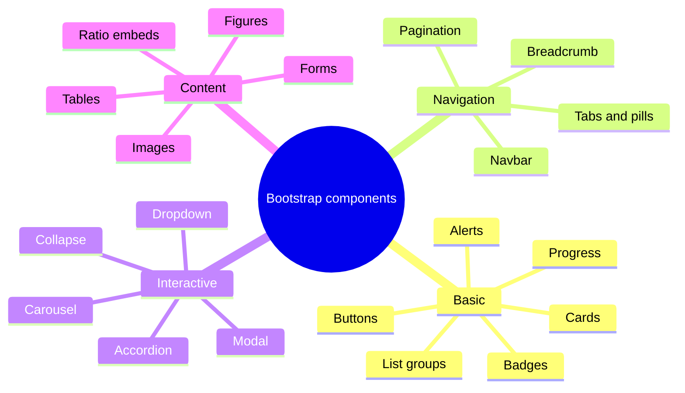
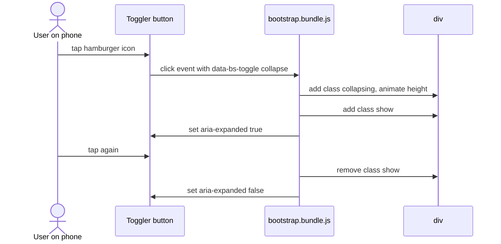
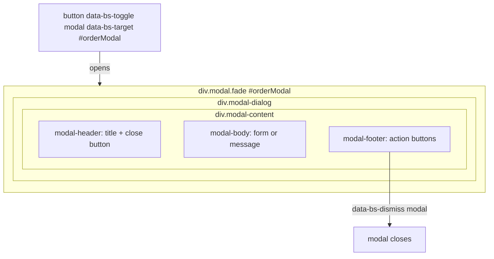
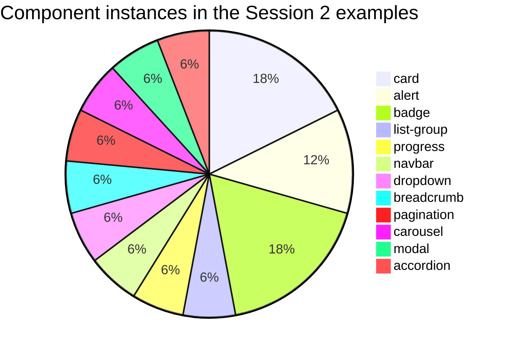

# Session 2 · Building Blocks with Bootstrap Components

> [Prime AI – Software Engineering with AI](../../README.md) › [Term 1](../README.md) › [Bootstrap & jQuery for Responsive Web Pages](README.md) › **Session 2**

| ⏱ Estimated time | 🧩 Prerequisites |
|---|---|
| 3 hours | Session 1 (starter template and grid) |

[⬅ Previous: Fundamentals of Bootstrap](session-01-fundamentals-of-bootstrap.md) &nbsp;|&nbsp; [Next: Getting Started with jQuery ➡](session-03-getting-started-with-jquery.md)

---

## 🎯 Learning objectives

By the end of this session you will be able to:

- Use basic components: buttons, button groups, alerts, badges, cards, list groups, progress bars and spinners.
- Build navigation with navs, tabs, pills, breadcrumbs, pagination and a responsive collapsing navbar.
- Add interactive components – dropdowns, modals, carousels, collapse and accordions – using data-bs attributes.
- Integrate content and media: responsive images, figures, embeds with ratio, tables and styled forms.
- Combine components into a complete, accessible landing page.

## 📖 Concepts

### 1. Components vs utilities

Bootstrap gives you two kinds of classes:

| Type | What it is | Example |
|---|---|---|
| **Component** | A complete, reusable UI piece made of several elements and classes | `.card`, `.navbar`, `.modal` |
| **Utility** | One small job, usually one CSS property | `.mt-3` (margin-top), `.text-center`, `.d-flex` |

> 🧱 **Analogy – LEGO.** Components are the pre-built LEGO sets (a car, a house). Utilities are single bricks you use to
> adjust a set – make it a bit wider, change its colour, move it over.

Most components need **no JavaScript** – they are pure CSS. A handful (dropdown, modal, carousel, collapse, tab,
toast, tooltip, popover, offcanvas) are **interactive** and need `bootstrap.bundle.min.js`. You switch them on with
**data attributes**: `data-bs-toggle` says *what* to do and `data-bs-target` says *to which element*.

### 2. Colour system – the theme names

Almost every component accepts the same eight **theme colour** names:
`primary` (blue), `secondary` (grey), `success` (green), `danger` (red), `warning` (yellow), `info` (cyan),
`light` and `dark`. So once you know `btn-danger`, you can guess `alert-danger`, `text-bg-danger` and `border-danger`.

Use colour to support meaning (green = success, red = danger), never as the *only* signal – add text or an icon too.

### 3. Basic components

**Buttons** – `.btn` + a variant: `.btn-primary`, `.btn-outline-primary`, `.btn-link`. Sizes `.btn-lg` / `.btn-sm`,
full width with `.w-100`, disabled with the `disabled` attribute. Group related buttons with `.btn-group`. Use
`<button>` for actions and `<a class="btn">` only for navigation.

**Alerts** – `.alert .alert-success` with `role="alert"`. Add `.alert-dismissible`, a close button with
`data-bs-dismiss="alert"`, and the classes `.fade .show` for a smooth dismiss.

**Badges** – small counters/labels: `<span class="badge text-bg-danger">4</span>`; `.rounded-pill` for a pill shape.

**Cards** – the most-used component. A flexible box with optional header, image, body and footer:
`.card` › `.card-img-top` + `.card-body` (› `.card-title`, `.card-text`) + `.card-footer`. Put cards inside grid
columns and add `.h-100` so all cards in a row have equal height.

**List groups** – `.list-group` › `.list-group-item`, with `.active`, `.disabled` and `.list-group-item-action` for
clickable items.

**Progress & spinners** – `.progress` › `.progress-bar` with `style="width: 70%"` and the ARIA values;
`.spinner-border` / `.spinner-grow` for loading states.

### 4. Navigation components

| Component | Markup idea | Use |
|---|---|---|
| **Nav** | `ul.nav` › `li.nav-item` › `a.nav-link` | Simple link bars |
| **Tabs / pills** | `.nav-tabs` / `.nav-pills` + `data-bs-toggle="tab"` and `.tab-content` › `.tab-pane` | Switch between panels in place |
| **Breadcrumb** | `nav[aria-label=breadcrumb]` › `ol.breadcrumb` › `li.breadcrumb-item` | Show where the page sits in the site |
| **Pagination** | `ul.pagination` › `li.page-item` › `a.page-link` | Next/previous pages of results |
| **Navbar** | `nav.navbar.navbar-expand-lg` › brand + toggler + `.collapse.navbar-collapse` | The main site header |

**How the responsive navbar works – step by step**
1. `.navbar-expand-lg` means: "show the full menu from **lg (992 px)** up; below that, collapse it".
2. The **toggler** button (`.navbar-toggler`, the ☰ "hamburger") is shown only when collapsed. It has
   `data-bs-toggle="collapse"` and `data-bs-target="#mainNav"`.
3. The links live in `<div class="collapse navbar-collapse" id="mainNav">`. The ids must match.
4. Clicking the toggler adds/removes the `.show` class on `#mainNav` and updates `aria-expanded` for screen readers.
5. `ms-auto` on the `<ul class="navbar-nav">` pushes the links to the right (margin-start: auto).
6. In 5.3, colour the navbar with `bg-dark` + `data-bs-theme="dark"` so the text and icon become light.

### 5. Interactive (JavaScript) components

| Component | Trigger | Key classes |
|---|---|---|
| **Dropdown** | `data-bs-toggle="dropdown"` on a button | `.dropdown` › `.dropdown-menu` › `.dropdown-item` |
| **Modal** (dialog box) | `data-bs-toggle="modal" data-bs-target="#m"` | `.modal.fade` › `.modal-dialog` › `.modal-content` › header/body/footer |
| **Carousel** (slideshow) | Automatic with `data-bs-ride="carousel"`; arrows use `data-bs-slide="prev|next"` | `.carousel.slide` › `.carousel-inner` › `.carousel-item.active` |
| **Collapse** | `data-bs-toggle="collapse" data-bs-target="#c"` | `.collapse` (hidden) / `.collapse.show` (open) |
| **Accordion** | Collapses linked with `data-bs-parent="#acc"` so only one is open | `.accordion` › `.accordion-item` › `.accordion-header` + `.accordion-collapse` |

> 🪟 **Analogy – a modal is a pop-up window inside your page.** Like a shop assistant stepping in front of you with a
> form to sign: you must deal with it (or dismiss it) before continuing to browse. Use it for short, focused tasks –
> never for long content.

Accessibility comes built in when you keep Bootstrap's attributes: `aria-labelledby` on the modal pointing to its title,
`aria-expanded` on toggles, `aria-label="Close"` on close buttons, `visually-hidden` text for icon-only controls.

### 6. Content and media

- **Images** – `.img-fluid` (= `max-width:100%; height:auto`) so images never overflow; `.rounded`, `.rounded-circle`,
  `.img-thumbnail`. Always give `alt` text and `width`/`height` to avoid layout jumps.
- **Figures** – `figure.figure` › `img.figure-img` + `figcaption.figure-caption`.
- **Embeds** – wrap an `<iframe>` (YouTube, Google Maps) in `<div class="ratio ratio-16x9">` and it scales perfectly.
- **Tables** – `.table` plus `.table-striped`, `.table-hover`, `.table-bordered`, `.table-dark`; wrap in
  `.table-responsive` so wide tables scroll sideways on phones instead of breaking the layout.
- **Typography** – `.display-1`…`.display-6` for hero headings, `.lead` for intro text, `.text-body-secondary` for
  muted text, `.fw-bold`, `.fs-4`.

### 7. Forms

| Class | Element |
|---|---|
| `.form-label` | `<label>` above a field |
| `.form-control` | text, email, password, textarea, file |
| `.form-select` | `<select>` |
| `.form-check` + `.form-check-input` + `.form-check-label` | checkbox / radio (`.form-switch` for a toggle switch) |
| `.form-range` | range slider |
| `.input-group` + `.input-group-text` | Add "Rs", "@" or a button to the side of an input |
| `.form-floating` | Label that floats above the input (input must come **before** the label and have a `placeholder`) |
| `.form-text` | Small help text under a field |

Validation styles (`.is-valid`, `.is-invalid`, `.invalid-feedback`) are covered with jQuery in Sessions 4 and 6.

## 🧭 Diagrams

### Bootstrap building blocks



### What happens when you tap the navbar toggler



### Anatomy of a modal



## 💻 Worked examples

### Example 1 — A gallery of basic components

One page that shows every basic component with the classes labelled. Keep it open as a reference.

```html
<!DOCTYPE html>
<html lang="en">
<head>
  <meta charset="UTF-8">
  <meta name="viewport" content="width=device-width, initial-scale=1">
  <title>Bootstrap components gallery</title>
  <link href="https://cdn.jsdelivr.net/npm/bootstrap@5.3.3/dist/css/bootstrap.min.css" rel="stylesheet"
        integrity="sha384-QWTKZyjpPEjISv5WaRU9OFeRpok6YctnYmDr5pNlyT2bRjXh0JMhjY6hW+ALEwIH" crossorigin="anonymous">
</head>
<body>
  <main class="container my-4">
    <h1 class="mb-4">Components gallery</h1>

    <!-- BUTTONS -->
    <h2 class="h5">Buttons</h2>
    <div class="d-flex flex-wrap gap-2 mb-4">
      <button type="button" class="btn btn-primary">Primary</button>
      <button type="button" class="btn btn-outline-success">Outline success</button>
      <button type="button" class="btn btn-danger btn-sm">Small danger</button>
      <button type="button" class="btn btn-secondary" disabled>Disabled</button>
      <div class="btn-group" role="group" aria-label="Text alignment">
        <button type="button" class="btn btn-outline-dark">Left</button>
        <button type="button" class="btn btn-outline-dark">Centre</button>
        <button type="button" class="btn btn-outline-dark">Right</button>
      </div>
    </div>

    <!-- ALERTS (the second one can be dismissed) -->
    <h2 class="h5">Alerts</h2>
    <div class="alert alert-success" role="alert">Your fee has been received. ✅</div>
    <div class="alert alert-warning alert-dismissible fade show" role="alert">
      Assignment due tomorrow!
      <button type="button" class="btn-close" data-bs-dismiss="alert" aria-label="Close"></button>
    </div>

    <!-- BADGES -->
    <h2 class="h5">Badges</h2>
    <p>Inbox <span class="badge text-bg-danger rounded-pill">4</span>
       &nbsp; <span class="badge text-bg-info">New</span></p>

    <!-- CARDS in a grid, equal height with h-100 -->
    <h2 class="h5">Cards</h2>
    <div class="row row-cols-1 row-cols-md-3 g-3 mb-4">
      <div class="col">
        <div class="card h-100">
          
          <div class="card-body">
            <h3 class="card-title h5">Web Basics</h3>
            <p class="card-text">HTML, CSS and JavaScript from scratch.</p>
          </div>
          <div class="card-footer text-body-secondary">8 weeks</div>
        </div>
      </div>
      <div class="col">
        <div class="card h-100 text-bg-dark">
          <div class="card-header">Popular</div>
          <div class="card-body">
            <h3 class="card-title h5">Bootstrap</h3>
            <p class="card-text">Responsive sites in record time.</p>
            <a href="#" class="btn btn-warning">Enrol</a>
          </div>
        </div>
      </div>
      <div class="col">
        <div class="card h-100 border-success">
          <div class="card-body">
            <h3 class="card-title h5 text-success">jQuery</h3>
            <p class="card-text">Events, effects and the DOM made short.</p>
          </div>
        </div>
      </div>
    </div>

    <!-- LIST GROUP -->
    <h2 class="h5">List group</h2>
    <div class="list-group mb-4" style="max-width: 400px">
      <a href="#" class="list-group-item list-group-item-action active" aria-current="true">Dashboard</a>
      <a href="#" class="list-group-item list-group-item-action">Courses</a>
      <a href="#" class="list-group-item list-group-item-action d-flex justify-content-between">
        Messages <span class="badge text-bg-primary rounded-pill">2</span></a>
    </div>

    <!-- PROGRESS + SPINNER -->
    <h2 class="h5">Progress and spinner</h2>
    <div class="progress mb-2" role="progressbar" aria-label="Course progress" aria-valuenow="70" aria-valuemin="0" aria-valuemax="100">
      <div class="progress-bar bg-success" style="width: 70%">70%</div>
    </div>
    <div class="spinner-border text-primary" role="status"><span class="visually-hidden">Loading...</span></div>
  </main>
  <script src="https://cdn.jsdelivr.net/npm/bootstrap@5.3.3/dist/js/bootstrap.bundle.min.js"
          integrity="sha384-YvpcrYf0tY3lHB60NNkmXc5s9fDVZLESaAA55NDzOxhy9GkcIdslK1eN7N6jIeHz" crossorigin="anonymous"></script>
</body>
</html>
```

📄 Saved as [`code/session-02_components-gallery.html`](code/session-02_components-gallery.html)

**🖥️ What you see in the browser**

```text
A tidy reference page: a row of coloured buttons and a three-button group; a green alert and a yellow alert
with an × that fades it away; a red "4" pill badge; three equal-height cards (one dark, one with a green border)
that sit side by side from 768 px; a clickable list with a blue active item; a 70% green progress bar and a spinning
blue loader.
```

### Example 2 — A responsive header: navbar with dropdown, hero and call-to-action buttons

The navbar is the component students get wrong most often, so every attribute is commented.

```html
<!DOCTYPE html>
<html lang="en">
<head>
  <meta charset="UTF-8">
  <meta name="viewport" content="width=device-width, initial-scale=1">
  <title>Responsive navbar</title>
  <link href="https://cdn.jsdelivr.net/npm/bootstrap@5.3.3/dist/css/bootstrap.min.css" rel="stylesheet"
        integrity="sha384-QWTKZyjpPEjISv5WaRU9OFeRpok6YctnYmDr5pNlyT2bRjXh0JMhjY6hW+ALEwIH" crossorigin="anonymous">
</head>
<body>
  <!-- navbar-expand-lg: full menu from 992px, hamburger below. data-bs-theme="dark": light text on dark bg -->
  <nav class="navbar navbar-expand-lg bg-dark sticky-top" data-bs-theme="dark">
    <div class="container">
      <a class="navbar-brand fw-bold" href="#">CodeKhi</a>

      <!-- data-bs-target must match the id of the collapsible div below -->
      <button class="navbar-toggler" type="button" data-bs-toggle="collapse" data-bs-target="#mainNav"
              aria-controls="mainNav" aria-expanded="false" aria-label="Toggle navigation">
        <span class="navbar-toggler-icon"></span>
      </button>

      <div class="collapse navbar-collapse" id="mainNav">
        <!-- ms-auto pushes the list to the right -->
        <ul class="navbar-nav ms-auto mb-2 mb-lg-0">
          <li class="nav-item"><a class="nav-link active" aria-current="page" href="#">Home</a></li>
          <li class="nav-item"><a class="nav-link" href="#courses">Courses</a></li>
          <!-- Dropdown: needs the bundle (Popper) -->
          <li class="nav-item dropdown">
            <a class="nav-link dropdown-toggle" href="#" role="button" data-bs-toggle="dropdown" aria-expanded="false">Resources</a>
            <ul class="dropdown-menu dropdown-menu-end">
              <li><a class="dropdown-item" href="#">Cheat-sheets</a></li>
              <li><a class="dropdown-item" href="#">Past papers</a></li>
              <li><hr class="dropdown-divider"></li>
              <li><a class="dropdown-item" href="#">Help centre</a></li>
            </ul>
          </li>
          <li class="nav-item"><a class="nav-link disabled" aria-disabled="true">Jobs (soon)</a></li>
        </ul>
        <a href="#signup" class="btn btn-warning ms-lg-3">Sign up</a>
      </div>
    </div>
  </nav>

  <!-- Hero section -->
  <header class="bg-primary-subtle py-5">
    <div class="container text-center">
      <h1 class="display-5 fw-bold">Learn to code in Karachi</h1>
      <p class="lead col-lg-8 mx-auto">Evening classes, real projects and mentors who answer your questions.</p>
      <div class="d-grid gap-2 d-sm-flex justify-content-sm-center">
        <a href="#courses" class="btn btn-primary btn-lg px-4">Browse courses</a>
        <a href="#contact" class="btn btn-outline-secondary btn-lg px-4">Talk to us</a>
      </div>
    </div>
  </header>

  <!-- Breadcrumb and pagination, shown for reference -->
  <div class="container my-4">
    <nav aria-label="breadcrumb">
      <ol class="breadcrumb">
        <li class="breadcrumb-item"><a href="#">Home</a></li>
        <li class="breadcrumb-item"><a href="#">Courses</a></li>
        <li class="breadcrumb-item active" aria-current="page">Bootstrap</li>
      </ol>
    </nav>
    <nav aria-label="Course pages">
      <ul class="pagination">
        <li class="page-item disabled"><a class="page-link">Previous</a></li>
        <li class="page-item active" aria-current="page"><a class="page-link" href="#">1</a></li>
        <li class="page-item"><a class="page-link" href="#">2</a></li>
        <li class="page-item"><a class="page-link" href="#">Next</a></li>
      </ul>
    </nav>
  </div>
  <script src="https://cdn.jsdelivr.net/npm/bootstrap@5.3.3/dist/js/bootstrap.bundle.min.js"
          integrity="sha384-YvpcrYf0tY3lHB60NNkmXc5s9fDVZLESaAA55NDzOxhy9GkcIdslK1eN7N6jIeHz" crossorigin="anonymous"></script>
</body>
</html>
```

📄 Saved as [`code/session-02_navbar-header.html`](code/session-02_navbar-header.html)

**🖥️ What you see in the browser**

```text
Laptop: dark bar with "CodeKhi" on the left, links Home · Courses · Resources ▾ · Jobs (soon) and a yellow Sign up
button on the right; Resources opens a dropdown. The bar stays at the top while scrolling (sticky-top).
Phone: only the brand and ☰ are visible; tapping ☰ slides the links down. The hero buttons stack full width on
phones and sit side by side from 576 px.
```

### Example 3 — Modal, carousel, tabs and an FAQ accordion

Four interactive components, zero lines of our own JavaScript – everything is wired with `data-bs-*` attributes.

```html
<!DOCTYPE html>
<html lang="en">
<head>
  <meta charset="UTF-8">
  <meta name="viewport" content="width=device-width, initial-scale=1">
  <title>Interactive components</title>
  <link href="https://cdn.jsdelivr.net/npm/bootstrap@5.3.3/dist/css/bootstrap.min.css" rel="stylesheet"
        integrity="sha384-QWTKZyjpPEjISv5WaRU9OFeRpok6YctnYmDr5pNlyT2bRjXh0JMhjY6hW+ALEwIH" crossorigin="anonymous">
</head>
<body>
  <main class="container my-4">
    <!-- CAROUSEL: data-bs-ride="carousel" starts it automatically -->
    <div id="heroCarousel" class="carousel slide mb-4" data-bs-ride="carousel">
      <div class="carousel-indicators">
        <button type="button" data-bs-target="#heroCarousel" data-bs-slide-to="0" class="active" aria-current="true" aria-label="Slide 1"></button>
        <button type="button" data-bs-target="#heroCarousel" data-bs-slide-to="1" aria-label="Slide 2"></button>
        <button type="button" data-bs-target="#heroCarousel" data-bs-slide-to="2" aria-label="Slide 3"></button>
      </div>
      <div class="carousel-inner rounded">
        <div class="carousel-item active">
          
          <div class="carousel-caption d-none d-md-block"><h2 class="h5">Hands-on labs</h2></div>
        </div>
        <div class="carousel-item">
          
          <div class="carousel-caption d-none d-md-block"><h2 class="h5">Team projects</h2></div>
        </div>
        <div class="carousel-item">
          
          <div class="carousel-caption d-none d-md-block"><h2 class="h5">Career support</h2></div>
        </div>
      </div>
      <button class="carousel-control-prev" type="button" data-bs-target="#heroCarousel" data-bs-slide="prev">
        <span class="carousel-control-prev-icon" aria-hidden="true"></span><span class="visually-hidden">Previous</span>
      </button>
      <button class="carousel-control-next" type="button" data-bs-target="#heroCarousel" data-bs-slide="next">
        <span class="carousel-control-next-icon" aria-hidden="true"></span><span class="visually-hidden">Next</span>
      </button>
    </div>

    <!-- MODAL trigger -->
    <button type="button" class="btn btn-success mb-4" data-bs-toggle="modal" data-bs-target="#enrolModal">Enrol now</button>

    <!-- MODAL -->
    <div class="modal fade" id="enrolModal" tabindex="-1" aria-labelledby="enrolTitle" aria-hidden="true">
      <div class="modal-dialog modal-dialog-centered">
        <div class="modal-content">
          <div class="modal-header">
            <h2 class="modal-title fs-5" id="enrolTitle">Enrol in Bootstrap 101</h2>
            <button type="button" class="btn-close" data-bs-dismiss="modal" aria-label="Close"></button>
          </div>
          <div class="modal-body">
            <label for="enrolName" class="form-label">Full name</label>
            <input id="enrolName" class="form-control" placeholder="e.g. Bilal Ahmed">
          </div>
          <div class="modal-footer">
            <button type="button" class="btn btn-secondary" data-bs-dismiss="modal">Cancel</button>
            <button type="button" class="btn btn-primary">Confirm</button>
          </div>
        </div>
      </div>
    </div>

    <!-- TABS -->
    <ul class="nav nav-tabs" role="tablist">
      <li class="nav-item" role="presentation">
        <button class="nav-link active" data-bs-toggle="tab" data-bs-target="#overview" type="button" role="tab">Overview</button></li>
      <li class="nav-item" role="presentation">
        <button class="nav-link" data-bs-toggle="tab" data-bs-target="#syllabus" type="button" role="tab">Syllabus</button></li>
    </ul>
    <div class="tab-content border border-top-0 p-3 mb-4">
      <div class="tab-pane fade show active" id="overview" role="tabpanel">Six sessions, one real website.</div>
      <div class="tab-pane fade" id="syllabus" role="tabpanel">Grid · Components · jQuery · Responsive · Deploy</div>
    </div>

    <!-- ACCORDION: data-bs-parent makes it "one open at a time" -->
    <h2 class="h4">FAQ</h2>
    <div class="accordion" id="faq">
      <div class="accordion-item">
        <h3 class="accordion-header">
          <button class="accordion-button" type="button" data-bs-toggle="collapse" data-bs-target="#q1" aria-expanded="true" aria-controls="q1">
            Do I need a laptop?</button>
        </h3>
        <div id="q1" class="accordion-collapse collapse show" data-bs-parent="#faq">
          <div class="accordion-body">Yes – any laptop that runs a modern browser and VS Code is enough.</div>
        </div>
      </div>
      <div class="accordion-item">
        <h3 class="accordion-header">
          <button class="accordion-button collapsed" type="button" data-bs-toggle="collapse" data-bs-target="#q2" aria-expanded="false" aria-controls="q2">
            Are classes recorded?</button>
        </h3>
        <div id="q2" class="accordion-collapse collapse" data-bs-parent="#faq">
          <div class="accordion-body">Yes, recordings are shared after every class.</div>
        </div>
      </div>
    </div>
  </main>
  <script src="https://cdn.jsdelivr.net/npm/bootstrap@5.3.3/dist/js/bootstrap.bundle.min.js"
          integrity="sha384-YvpcrYf0tY3lHB60NNkmXc5s9fDVZLESaAA55NDzOxhy9GkcIdslK1eN7N6jIeHz" crossorigin="anonymous"></script>
</body>
</html>
```

📄 Saved as [`code/session-02_interactive-components.html`](code/session-02_interactive-components.html)

**🖥️ What you see in the browser**

```text
A full-width image slideshow that changes every 5 seconds (arrows and dots work); a green "Enrol now" button that
dims the page and opens a centred dialog with a name field; two tabs that swap their panel with a fade; an FAQ where
opening one question closes the other.
```

### Example 4 — Auditing a page: which Bootstrap components does it use?

Professional developers often inherit pages written by someone else. This Node script loads the three HTML files
above into a simulated browser (jsdom), finds every interactive trigger (`data-bs-toggle`), checks that each one
points at an element that really exists, and counts components. It is a tiny "linter" for Bootstrap markup.

```js
// session-02_component-audit.js
// Loads HTML files with jsdom and reports Bootstrap components and broken data-bs-target links.
// Run: npm install   (once)   then   node session-02_component-audit.js
const fs = require('fs');
const path = require('path');
const { JSDOM } = require('jsdom');

const FILES = ['session-02_components-gallery.html', 'session-02_navbar-header.html', 'session-02_interactive-components.html'];
const COMPONENTS = ['navbar', 'card', 'alert', 'badge', 'modal', 'carousel', 'accordion', 'list-group', 'progress', 'breadcrumb', 'pagination', 'dropdown'];

for (const file of FILES) {
  const html = fs.readFileSync(path.join(__dirname, file), 'utf8');
  const doc = new JSDOM(html).window.document;          // scripts are NOT run – we only inspect markup

  // 1. Count each component by its root class
  const counts = COMPONENTS
    .map(c => [c, doc.querySelectorAll('.' + c).length])
    .filter(([, n]) => n > 0)
    .map(([c, n]) => `${c}×${n}`);

  // 2. Every data-bs-toggle should point at an existing element (except dropdown/tab-less cases)
  const triggers = [...doc.querySelectorAll('[data-bs-toggle]')];
  const broken = triggers.filter(t => {
    const target = t.getAttribute('data-bs-target');
    return target && !doc.querySelector(target);
  });

  // 3. Accessibility quick checks
  const imgsNoAlt = [...doc.querySelectorAll('img')].filter(i => !i.hasAttribute('alt')).length;
  const hasViewport = !!doc.querySelector('meta[name="viewport"]');

  console.log(`\n${file}`);
  console.log(`  components : ${counts.join(', ') || 'none'}`);
  console.log(`  triggers   : ${triggers.length} (${[...new Set(triggers.map(t => t.dataset.bsToggle))].join(', ')})`);
  console.log(`  broken     : ${broken.length}`);
  console.log(`  viewport   : ${hasViewport ? 'yes' : 'MISSING'} · images without alt: ${imgsNoAlt}`);
}
```

📄 Saved as [`code/session-02_component-audit.js`](code/session-02_component-audit.js)

**Output** (real run)

```text
session-02_components-gallery.html
  components : card×3, alert×2, badge×3, list-group×1, progress×1
  triggers   : 0 ()
  broken     : 0
  viewport   : yes · images without alt: 0

session-02_navbar-header.html
  components : navbar×1, breadcrumb×1, pagination×1, dropdown×1
  triggers   : 2 (collapse, dropdown)
  broken     : 0
  viewport   : yes · images without alt: 0

session-02_interactive-components.html
  components : modal×1, carousel×1, accordion×1
  triggers   : 5 (modal, tab, collapse)
  broken     : 0
  viewport   : yes · images without alt: 0
```

## 🧩 Real-life coding problem

**Scenario – "Karachi Bakes" landing page.** A home bakery takes orders on WhatsApp and wants a simple website:

1. A **navbar** (brand, Menu, FAQ, Order button) that collapses on phones.
2. A **hero** with a headline and two buttons.
3. A **menu** of 4 cakes as **cards** (image, name, price badge, "Order" button) – 1/2/4 per row.
4. Clicking any "Order" button opens **one shared modal** with a small form (name, phone, cake select, pickup date).
5. An **FAQ accordion** with three questions.
6. A footer.

**Approach**
- Re-use the navbar pattern from Example 2 and the card grid from the gallery.
- Every Order button gets the same `data-bs-toggle="modal" data-bs-target="#orderModal"` – one modal serves all cards.
- Use `.form-floating` fields in the modal for a modern look, and `.input-group` with a "+92" prefix for the phone.

The full, commented solution is in [`code/session-02_karachi-bakes.html`](code/session-02_karachi-bakes.html). The key
part – one modal triggered by many buttons – looks like this:

```html
<button class="btn btn-primary mt-auto" data-bs-toggle="modal" data-bs-target="#orderModal">Order</button>
...
<div class="modal fade" id="orderModal" tabindex="-1" aria-labelledby="orderTitle" aria-hidden="true">
  <div class="modal-dialog modal-dialog-centered"><form class="modal-content">
    <div class="modal-header"><h2 class="modal-title fs-5" id="orderTitle">Place an order</h2>
      <button type="button" class="btn-close" data-bs-dismiss="modal" aria-label="Close"></button></div>
    <div class="modal-body">
      <div class="form-floating mb-3"><input class="form-control" id="oName" placeholder="Name" required>
        <label for="oName">Your name</label></div>
      <div class="input-group mb-3"><span class="input-group-text">+92</span>
        <input class="form-control" type="tel" placeholder="3001234567" aria-label="Phone" required></div>
      ...
```
In Session 6 we will make the modal remember **which** cake was clicked using the Bootstrap JS API and jQuery.

## ⚠️ Common mistakes

| Mistake | Symptom | Fix |
|---|---|---|
| `data-toggle` / `data-target` (Bootstrap 4 syntax) | Nothing happens on click | Bootstrap 5 uses `data-bs-toggle` / `data-bs-target` |
| Only the CSS file is loaded | Modals, dropdowns, carousels do not open | Add `bootstrap.bundle.min.js` before `</body>` |
| Target id does not match (`#mainnav` vs `id="mainNav"`) | Toggler does nothing | Ids are case-sensitive – copy-paste them |
| Two elements with the same id | The wrong modal/collapse opens | Every id must be unique on the page |
| Modal placed inside a `position: fixed` or transformed parent | Modal appears behind the backdrop | Put modals near the end of `<body>` |
| Forgetting `.active` on the first carousel item | Carousel shows nothing | Exactly one `.carousel-item.active` |
| Floating label placed before the input | Label overlaps the text | In `.form-floating`, input first, then label, and include `placeholder` |

## 🌟 Best practices

- Use `<button type="button">` for actions and links (`<a>`) only to navigate.
- Keep Bootstrap's ARIA attributes (`aria-expanded`, `aria-controls`, `aria-labelledby`, `aria-label`) – they make the
  components usable with a keyboard and screen reader.
- Give carousels a **pause** option or keep them to 3–5 slides; never put essential information only in a slide.
- Put cards in grid columns and add `h-100`; push buttons to the bottom with `d-flex flex-column` + `mt-auto`.
- One modal can serve many buttons; don't copy the same modal ten times.
- Run the [component audit](code/session-02_component-audit.js) (or the browser console) to catch broken targets early.

## 🏗️ Mini project

**Mini project – a college event page.** Build "TechFest 2026": navbar, a carousel of 3 speakers, a schedule in
**tabs** (Day 1 / Day 2) using tables inside each tab, a "Register" **modal**, an embedded map in a `ratio-16x9` box
and an FAQ accordion.

Full solution: [`code/session-02_mini-project-event.html`](code/session-02_mini-project-event.html).

## 📦 Project files for this session

| File | What it is |
|---|---|
| 📄 [`code/package.json`](code/package.json) | Node dependencies for the automated tests in this folder (`npm install` once) |
| 📄 [`code/session-02_karachi-bakes.html`](code/session-02_karachi-bakes.html) | Real-life problem solution – bakery landing page with navbar, cards, shared order modal and FAQ |
| 📄 [`code/session-02_mini-project-event.html`](code/session-02_mini-project-event.html) | Mini project solution – TechFest event page (carousel, tabs with tables, modal, map embed, accordion) |

## 📊 At a glance

**Components used across this session's three example pages** (from the audit script's real output):



| Component | Needs JS bundle? | Trigger attribute |
|---|---|---|
| Button, card, alert (static), badge, list group, progress | ❌ | – |
| Alert dismiss | ✅ | `data-bs-dismiss="alert"` |
| Navbar collapse / Collapse / Accordion | ✅ | `data-bs-toggle="collapse"` |
| Dropdown | ✅ (Popper) | `data-bs-toggle="dropdown"` |
| Modal | ✅ | `data-bs-toggle="modal"` |
| Carousel | ✅ | `data-bs-ride`, `data-bs-slide` |
| Tabs / pills | ✅ | `data-bs-toggle="tab"` / `"pill"` |

## 🧪 Lab / practice tasks

**🟢 Easy** — Create a "Course cards" page with three cards in a responsive grid (1 per row on phones, 3 on md+). Each card has an image, title, short text, a duration badge and an "Enrol" button pinned to the bottom of the card.

<details><summary>💡 Hint</summary>

Use `h-100` on the card and `d-flex flex-column` on `.card-body`, then `mt-auto` on the button.

</details>

<details><summary>✅ Solution</summary>

```html
<div class="row row-cols-1 row-cols-md-3 g-4">
  <div class="col"><div class="card h-100">
    
    <div class="card-body d-flex flex-column">
      <h3 class="card-title h5">HTML & CSS <span class="badge text-bg-info">6 weeks</span></h3>
      <p class="card-text">Build your first websites.</p>
      <a href="#" class="btn btn-primary mt-auto">Enrol</a>
    </div></div></div>
  <!-- repeat for two more cards -->
</div>
```

</details>

**🟡 Medium** — Build a navbar that is expanded from **md**, has a brand, three links, a dropdown "More" with two items and a search form on the right. On phones everything must collapse behind the toggler.

<details><summary>💡 Hint</summary>

Change `navbar-expand-lg` to `navbar-expand-md`. Put `<form class="d-flex" role="search">` inside `.navbar-collapse` after the `ul`.

</details>

<details><summary>✅ Solution</summary>

```html
<nav class="navbar navbar-expand-md bg-body-tertiary">
  <div class="container-fluid">
    <a class="navbar-brand" href="#">Brand</a>
    <button class="navbar-toggler" type="button" data-bs-toggle="collapse" data-bs-target="#n" aria-controls="n" aria-expanded="false" aria-label="Toggle navigation"><span class="navbar-toggler-icon"></span></button>
    <div class="collapse navbar-collapse" id="n">
      <ul class="navbar-nav me-auto">
        <li class="nav-item"><a class="nav-link" href="#">Home</a></li>
        <li class="nav-item"><a class="nav-link" href="#">About</a></li>
        <li class="nav-item"><a class="nav-link" href="#">Blog</a></li>
        <li class="nav-item dropdown"><a class="nav-link dropdown-toggle" href="#" role="button" data-bs-toggle="dropdown" aria-expanded="false">More</a>
          <ul class="dropdown-menu"><li><a class="dropdown-item" href="#">Careers</a></li><li><a class="dropdown-item" href="#">Press</a></li></ul></li>
      </ul>
      <form class="d-flex" role="search"><input class="form-control me-2" type="search" placeholder="Search" aria-label="Search"><button class="btn btn-outline-success" type="submit">Go</button></form>
    </div>
  </div>
</nav>
```

</details>

**🔴 Hard** — Add to your page a "Terms & conditions" **modal** that is opened by a link in the footer, is **scrollable** (long text) and **cannot be closed by clicking the backdrop** – only by an "I agree" button.

<details><summary>💡 Hint</summary>

Look for `modal-dialog-scrollable` and the attributes `data-bs-backdrop="static"` and `data-bs-keyboard="false"`.

</details>

<details><summary>✅ Solution</summary>

```html
<a href="#" data-bs-toggle="modal" data-bs-target="#terms">Terms</a>
<div class="modal fade" id="terms" data-bs-backdrop="static" data-bs-keyboard="false" tabindex="-1" aria-labelledby="termsTitle" aria-hidden="true">
  <div class="modal-dialog modal-dialog-scrollable">
    <div class="modal-content">
      <div class="modal-header"><h2 class="modal-title fs-5" id="termsTitle">Terms & conditions</h2></div>
      <div class="modal-body"><p>…long text…</p></div>
      <div class="modal-footer"><button class="btn btn-primary" data-bs-dismiss="modal">I agree</button></div>
    </div>
  </div>
</div>
```

</details>

**🏆 Challenge** — Run `node session-02_component-audit.js`, then deliberately break one page (change a `data-bs-target` to a wrong id and delete one `alt`). Re-run the audit and confirm it catches both problems. Then extend the script to also report **duplicate ids**.

<details><summary>💡 Hint</summary>

Collect all `[id]` elements, count each `id`, and print those with a count > 1.

</details>

<details><summary>✅ Solution</summary>

```js
const ids = [...doc.querySelectorAll('[id]')].map(e => e.id);
const dupes = [...new Set(ids.filter((id, i) => ids.indexOf(id) !== i))];
console.log(`  duplicate ids: ${dupes.length ? dupes.join(', ') : 'none'}`);
```

</details>

## ✅ Quick quiz

**Q1. Which classes make a navbar collapse below 992 px?**

- A) `.navbar-collapse-lg`
- B) `.navbar-expand-lg` with a `.collapse.navbar-collapse` div
- C) `.navbar-lg`
- D) `.collapse-lg`

<details><summary>Show answer</summary>

**B** — expand-lg expands from lg; below it the collapse div is hidden behind the toggler.

</details>

**Q2. What links a modal trigger to its modal?**

- A) The modal class
- B) `data-bs-target="#id"` matching the modal id
- C) The button text
- D) An onclick attribute

<details><summary>Show answer</summary>

**B** — The target selector must match the modal id exactly.

</details>

**Q3. Which attribute makes accordion items close when another opens?**

- A) `data-bs-single`
- B) `data-bs-parent="#accordionId"`
- C) `data-bs-close`
- D) `aria-expanded`

<details><summary>Show answer</summary>

**B** — data-bs-parent groups the collapses.

</details>

**Q4. How do you make a YouTube iframe responsive?**

- A) `.img-fluid` on the iframe
- B) Wrap it in `.ratio.ratio-16x9`
- C) Set width=100%
- D) `.embed-fluid`

<details><summary>Show answer</summary>

**B** — The ratio helper keeps the aspect ratio at any width.

</details>

**Q5. Which class lets a wide table scroll horizontally on phones?**

- A) `.table-scroll`
- B) `.table-responsive` on a wrapper
- C) `.overflow-table`
- D) `.table-mobile`

<details><summary>Show answer</summary>

**B** — Wrap the table in div.table-responsive.

</details>

## 📝 Summary / cheat-sheet

- Components are complete UI pieces (`.card`, `.navbar`, `.modal`); utilities are single-purpose classes (`.mt-3`).
- Theme colours `primary secondary success danger warning info light dark` work across buttons, alerts, badges, text and backgrounds.
- Responsive navbar = `.navbar-expand-{bp}` + toggler (`data-bs-toggle="collapse"`) + `.collapse.navbar-collapse#id`.
- Interactive components need `bootstrap.bundle.min.js` and are wired with `data-bs-toggle` + `data-bs-target`.
- Modal: `.modal.fade › .modal-dialog › .modal-content`; accordion items share `data-bs-parent`; carousel needs one `.active` item.
- Media: `.img-fluid`, `.figure`, `.ratio-16x9` for iframes, `.table-responsive` for wide tables.
- Forms: `.form-control`, `.form-select`, `.form-check`, `.form-floating`, `.input-group`.

## 🎤 Interview / viva questions

1. **Difference between a component and a utility class?**
   <details><summary>Model answer</summary>

   A component styles a whole multi-element UI piece such as a card or navbar; a utility applies one small style such as margin or text alignment, and is used to tweak components or layouts.

   </details>

2. **How does Bootstrap know which element a toggler controls?**
   <details><summary>Model answer</summary>

   The trigger carries data-bs-target with a CSS selector (usually #id); Bootstrap's JavaScript finds that element and toggles it.

   </details>

3. **Why include Popper and how?**
   <details><summary>Model answer</summary>

   Popper calculates the position of dropdowns, tooltips and popovers so they stay on screen; bootstrap.bundle.min.js already includes it.

   </details>

4. **Give two accessibility features of Bootstrap modals.**
   <details><summary>Model answer</summary>

   aria-labelledby connects the dialog to its title for screen readers; focus is moved into the modal and trapped there, and Esc closes it.

   </details>

5. **When should you NOT use a carousel?**
   <details><summary>Model answer</summary>

   For important information users must see – most users never look past the first slide – and when motion could distract or harm users; static content is often better.

   </details>

6. **How do you keep cards in a row the same height?**
   <details><summary>Model answer</summary>

   Place them in grid columns and add h-100 to each card; optionally make the body a flex column and push the footer button down with mt-auto.

   </details>

---

[⬅ Previous: Fundamentals of Bootstrap](session-01-fundamentals-of-bootstrap.md) &nbsp;|&nbsp; [Next: Getting Started with jQuery ➡](session-03-getting-started-with-jquery.md)

<sub>Prepared by **Hamna Zahid Khan**, Junior Lecturer · Prime AI – Software Engineering with AI</sub>
