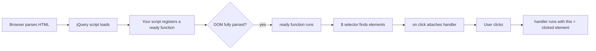
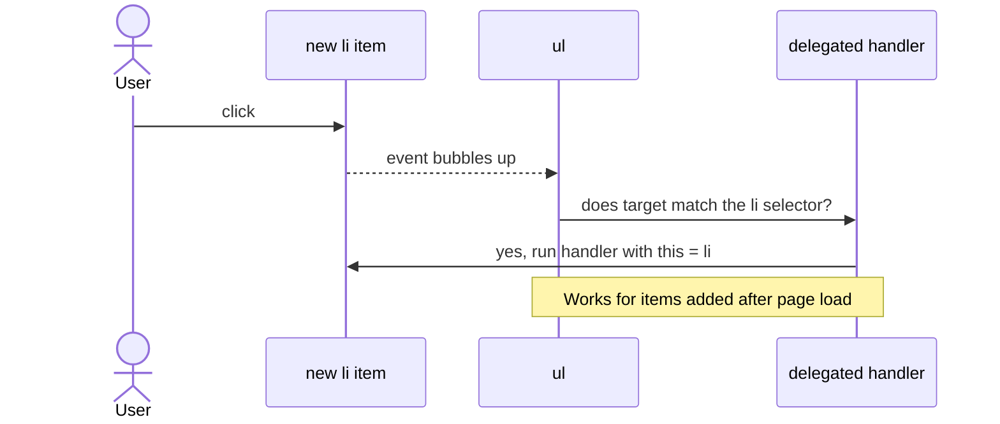
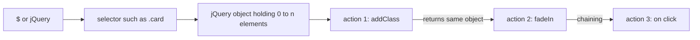
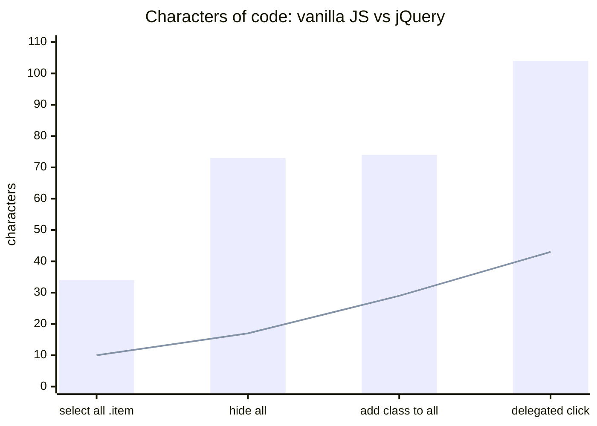

# Session 3 · Getting Started with jQuery

> [Prime AI – Software Engineering with AI](../../README.md) › [Term 1](../README.md) › [Bootstrap & jQuery for Responsive Web Pages](README.md) › **Session 3**

| ⏱ Estimated time | 🧩 Prerequisites |
|---|---|
| 3 hours | Module 2 Sessions 10–12 (JavaScript, the DOM and events) |

[⬅ Previous: Building Blocks with Bootstrap Components](session-02-building-blocks-with-bootstrap-components.md) &nbsp;|&nbsp; [Next: Mastering jQuery Techniques ➡](session-04-mastering-jquery-techniques.md)

---

## 🎯 Learning objectives

By the end of this session you will be able to:

- Explain what jQuery is, why it became popular and where it is still used today.
- Add jQuery to a page from a CDN, a local file or npm, and run code when the DOM is ready.
- Write jQuery statements using the `$(selector).action()` pattern and method chaining.
- Target elements with basic, hierarchy, attribute, filter and form selectors.
- Handle events with `.on()`, `.off()`, `.one()` and the event object, including event delegation.

## 📖 Concepts

### 1. What is jQuery?

**jQuery** is a free, open-source JavaScript **library** – a single `.js` file full of ready-made functions – created by
**John Resig** and released in **2006**. Its motto is **"write less, do more."** In 2006 every browser exposed the page
slightly differently; jQuery hid those differences behind one simple, consistent API, so it spread to most of the web.

> 🎛️ **Analogy – a universal TV remote.** Every TV brand once had its own remote with different buttons
> (browsers with different APIs). jQuery is the universal remote: you press the same "volume up" button and it sends
> the right signal to whatever TV is in front of you.

| Task | Plain (vanilla) JavaScript | jQuery |
|---|---|---|
| Select all `.card` elements | `document.querySelectorAll('.card')` | `$('.card')` |
| Hide them all | loop and set `el.style.display = 'none'` | `$('.card').hide()` |
| Add a class on click | `btn.addEventListener('click', () => box.classList.add('on'))` | `$('#btn').on('click', () => $('#box').addClass('on'))` |
| Fade out over 0.4 s | Write a CSS transition + JS, or the Web Animations API | `$('#box').fadeOut(400)` |

**jQuery today (honest view).** Modern browsers now agree on standards and vanilla JavaScript can do almost everything
jQuery does (you learnt it in Module 2). New projects often use plain JS or frameworks such as React. However:
- jQuery still runs on a very large share of existing websites, including many WordPress themes and plugins.
- Thousands of mature plugins (date pickers, sliders, validation) depend on it.
- Interviews and maintenance jobs expect you to read and modify jQuery code confidently.

So we learn it as a **professional skill**, and we compare it with vanilla JS as we go.

### 2. Adding jQuery to a page

| Method | Code | Notes |
|---|---|---|
| **CDN** | `<script src="https://code.jquery.com/jquery-3.7.1.min.js" integrity="…" crossorigin="anonymous"></script>` | Easiest; add the SRI hash from the official site |
| **Local file** | Download `jquery-3.7.1.min.js` into `js/` and use `<script src="js/jquery-3.7.1.min.js"></script>` | Works offline |
| **npm** | `npm install jquery` then `import $ from 'jquery'` | For build tools (Vite, Webpack) |

**Versions:** `.min.js` is minified (small, for production); the uncompressed file is readable (for learning and
debugging). The **slim** build leaves out AJAX and effects – do not use it if you need `.fadeIn()` or `$.ajax()`.

⚠️ **Order matters:** the jQuery `<script>` must come **before** any script that uses `$`, otherwise you get
`Uncaught ReferenceError: $ is not defined`.

### 3. `$`, `jQuery` and document ready

`$` is simply a short name for the `jQuery` function. Calling it with a CSS selector returns a **jQuery object** – a
list-like wrapper around zero or more DOM elements, with all of jQuery's methods attached.

Code that touches elements must wait until the HTML has been parsed. jQuery's **document ready** does that:

```js
// Long form
$(document).ready(function () { /* code */ });
// Short form – the one you will see most
$(function () { /* code */ });
```

Ready fires when the **DOM** is built (like `DOMContentLoaded`) – before images finish loading. To wait for images too,
use `$(window).on('load', fn)`. If another library also uses `$`, call `jQuery.noConflict()` and write `jQuery(...)`.

### 4. The jQuery syntax pattern

Every statement follows the same shape:

```
$( selector ).action( arguments )
   │            │
   │            └─ what to do: hide, addClass, text, on, fadeIn …
   └─ which elements: any CSS selector, a DOM element, or HTML to create
```

**Implicit iteration** – actions apply to **every** matched element, so no loop is needed.
**Chaining** – most methods return the same jQuery object, so you can call the next method on it:

```js
$('#msg').text('Saved!').addClass('alert alert-success').fadeIn(300);
```

**Getter vs setter** – many methods do both: `$('h1').text()` **gets** the text of the *first* match;
`$('h1').text('Hi')` **sets** it on *all* matches.

### 5. Selectors

jQuery accepts every CSS selector you know, plus some extras.

| Group | Examples | Selects |
|---|---|---|
| Basic | `$('p')`, `$('.price')`, `$('#cart')`, `$('*')`, `$('h1, h2')` | element, class, id, all, several |
| Hierarchy | `$('ul li')`, `$('ul > li')`, `$('h2 + p')`, `$('h2 ~ p')` | descendant, child, next sibling, all following siblings |
| Attribute | `$('[href]')`, `$('[type="email"]')`, `$('a[href^="https"]')`, `$('img[src$=".png"]')`, `$('[class*="col"]')` | has / equals / starts / ends / contains |
| Position filters (jQuery extras) | `:first`, `:last`, `:even`, `:odd`, `:eq(2)`, `:gt(1)`, `:lt(3)` | by **zero-based** index in the result |
| Content filters | `:contains("Karachi")`, `:has(img)`, `:empty`, `:parent` | by content |
| Visibility | `:visible`, `:hidden` | by layout visibility |
| Form | `:input`, `:text`, `:checkbox`, `:checked`, `:selected`, `:disabled`, `:enabled` | form controls and states |

Modern advice: prefer standard CSS selectors plus methods such as `.first()`, `.eq(2)` and `.filter(':even')` –
they are faster because the browser can run them natively.

### 6. Events

An **event** is something that happens – a click, a key press, a form submit. jQuery's universal method is `.on()`:

```js
$('#btn').on('click', function (event) {
  // `this` is the DOM element that fired; $(this) wraps it in jQuery
  $(this).text('Clicked!');
});
```

| Category | Events |
|---|---|
| Mouse | `click`, `dblclick`, `mouseenter`, `mouseleave`, `mousemove`, `contextmenu` |
| Keyboard | `keydown`, `keyup` (`event.key` tells which key) |
| Form | `submit`, `change`, `input`, `focus`, `blur` |
| Document/window | `ready`, `load`, `resize`, `scroll` |

Shortcuts such as `.click(fn)` and `.hover(inFn, outFn)` still exist, but `.on()` is preferred because it supports
**several events**, **namespaces** and **delegation**.

**The event object** (`event` or `e`): `e.type`, `e.target` (the element actually clicked), `e.currentTarget`,
`e.key`, `e.pageX/pageY`, `e.preventDefault()` (stop the browser's default action such as following a link or
submitting a form) and `e.stopPropagation()` (stop the event bubbling up to parents).

**Other event methods**
- `.off('click')` – remove handlers. `.one('click', fn)` – run only the first time.
- `.trigger('click')` – fire an event from code.
- Namespaces: `.on('click.menu', fn)` then `.off('click.menu')` removes only your handler.

### 7. Event delegation – handlers for elements that do not exist yet

If you write `$('li').on('click', fn)`, only the `<li>` elements that exist **right now** get the handler. Items you add
later are ignored. **Delegation** attaches one handler to a parent that never changes and lets the click **bubble up**:

```js
$('#todo-list').on('click', 'li', function () {   // 2nd argument = which children to react to
  $(this).toggleClass('done');
});
```

> 📬 **Analogy – the building reception.** Instead of giving every new tenant their own postman (one handler per
> element), all mail goes to the reception desk (the parent), which hands it to the right flat (the matching child).
> New tenants receive mail automatically.

Benefits: works for future elements and uses one handler instead of hundreds (less memory).

## 🧭 Diagrams

### From HTML to a working jQuery handler



### Event delegation: one handler on the parent



### Anatomy of a jQuery statement



## 💻 Worked examples

### Example 1 — Your first jQuery page

A heading, a paragraph and two buttons. Read the comments, open the page in a browser and click the buttons.
Then look at the companion test file [`code/session-03_hello-test.js`](code/session-03_hello-test.js): it loads this
exact page into a simulated browser, clicks the buttons from code and prints what changed. Its real output is below.

```html
<!DOCTYPE html>
<html lang="en">
<head>
  <meta charset="UTF-8">
  <meta name="viewport" content="width=device-width, initial-scale=1">
  <title>Hello jQuery</title>
  <link href="https://cdn.jsdelivr.net/npm/bootstrap@5.3.3/dist/css/bootstrap.min.css" rel="stylesheet"
        integrity="sha384-QWTKZyjpPEjISv5WaRU9OFeRpok6YctnYmDr5pNlyT2bRjXh0JMhjY6hW+ALEwIH" crossorigin="anonymous">
  <style>.highlight { background: #fcd34d; padding: .25rem .5rem; border-radius: .25rem; }</style>
</head>
<body class="container py-5">
  <h1 id="title">Hello, world</h1>
  <p class="intro">This paragraph will change when you click the buttons.</p>
  <button id="greet" class="btn btn-primary">Greet</button>
  <button id="reset" class="btn btn-outline-secondary">Reset</button>

  <!-- 1. jQuery must load BEFORE our script -->
  <script src="https://code.jquery.com/jquery-3.7.1.min.js"
          integrity="sha384-1H217gwSVyLSIfaLxHbE7dRb3v4mYCKbpQvzx0cegeju1MVsGrX5xXxAvs/HgeFs" crossorigin="anonymous"></script>
  <script>
    // 2. Wait for the DOM to be ready (short form of $(document).ready)
    $(function () {
      const original = $('#title').text();          // getter: read the current text

      // 3. Attach a click handler with .on()
      $('#greet').on('click', function () {
        $('#title').text('Assalam-o-Alaikum, jQuery!')   // setter
                   .addClass('highlight');               // chaining on the same object
        $('.intro').text('You clicked Greet – the heading changed and got a class.');
        $(this).prop('disabled', true);                  // `this` = the button that was clicked
      });

      $('#reset').on('click', function () {
        $('#title').text(original).removeClass('highlight');
        $('.intro').text('Back to the start.');
        $('#greet').prop('disabled', false);
      });
    });
  </script>
</body>
</html>
```

📄 Saved as [`code/session-03_hello-jquery.html`](code/session-03_hello-jquery.html)

**Output** (real run of `node session-03_hello-test.js`)

```text
On load:       h1="Hello, world" class="" greetDisabled=false
After Greet:   h1="Assalam-o-Alaikum, jQuery!" class="highlight" greetDisabled=true
               p="You clicked Greet – the heading changed and got a class."
After Reset:   h1="Hello, world" class="" greetDisabled=false
jQuery version: 3.7.1
```

### Example 2 — Selector playground – test any selector against a student table

The page holds a small table of students and a form. The test script runs **eighteen different selectors** on it
and prints how many elements each one matched and their text. Change the selectors in
[`code/session-03_selectors-test.js`](code/session-03_selectors-test.js) to explore.

```html
<!DOCTYPE html>
<html lang="en">
<head>
  <meta charset="UTF-8">
  <meta name="viewport" content="width=device-width, initial-scale=1">
  <title>Selector playground</title>
  <link href="https://cdn.jsdelivr.net/npm/bootstrap@5.3.3/dist/css/bootstrap.min.css" rel="stylesheet"
        integrity="sha384-QWTKZyjpPEjISv5WaRU9OFeRpok6YctnYmDr5pNlyT2bRjXh0JMhjY6hW+ALEwIH" crossorigin="anonymous">
</head>
<body class="container py-4">
  <h1>Students</h1>
  <table class="table" id="students">
    <thead><tr><th>Name</th><th>City</th><th>Marks</th></tr></thead>
    <tbody>
      <tr class="pass"><td>Ali</td><td>Karachi</td><td>82</td></tr>
      <tr class="fail"><td>Sara</td><td>Lahore</td><td>45</td></tr>
      <tr class="pass"><td>Bilal</td><td>Karachi</td><td>91</td></tr>
      <tr class="pass"><td>Hina</td><td>Hyderabad</td><td>67</td></tr>
      <tr class="fail"><td>Omar</td><td>Karachi</td><td>38</td></tr>
    </tbody>
  </table>

  <form id="signup" class="row g-2">
    <div class="col-md-4"><input type="text" name="name" class="form-control" placeholder="Name"></div>
    <div class="col-md-4"><input type="email" name="email" class="form-control" placeholder="Email" required></div>
    <div class="col-md-4">
      <select name="city" class="form-select"><option>Karachi</option><option selected>Lahore</option></select>
    </div>
    <div class="col-12">
      <label><input type="checkbox" name="news" checked> Newsletter</label>
      <label><input type="checkbox" name="sms"> SMS</label>
      <button type="submit" class="btn btn-primary" disabled>Send</button>
    </div>
  </form>
  <p><a href="https://example.com">External</a> · <a href="/about.html">Internal</a> · <a href="#top">Anchor</a></p>

  <script src="https://code.jquery.com/jquery-3.7.1.min.js"
          integrity="sha384-1H217gwSVyLSIfaLxHbE7dRb3v4mYCKbpQvzx0cegeju1MVsGrX5xXxAvs/HgeFs" crossorigin="anonymous"></script>
  <script>
    // Visual helper for the browser: stripe the passing rows and colour the failures
    $(function () {
      $('#students tbody tr.pass:even').addClass('table-success');
      $('#students tbody tr.fail').addClass('table-danger');
    });
  </script>
</body>
</html>
```

📄 Saved as [`code/session-03_selectors.html`](code/session-03_selectors.html)

**Output** (real run of `node session-03_selectors-test.js`)

```text
tbody tr                       ->  5  AliKarachi82 | SaraLahore45 | BilalKarachi91
tr.pass                        ->  3  AliKarachi82 | BilalKarachi91 | HinaHyderabad67
#students td:first-child       ->  5  Ali | Sara | Bilal
tbody tr:first                 ->  1  AliKarachi82
tbody tr:last                  ->  1  OmarKarachi38
tbody tr:even                  ->  3  AliKarachi82 | BilalKarachi91 | OmarKarachi38
tbody tr:odd                   ->  2  SaraLahore45 | HinaHyderabad67
tbody tr:eq(2)                 ->  1  BilalKarachi91
tbody tr:gt(2)                 ->  2  HinaHyderabad67 | OmarKarachi38
td:contains("Karachi")         ->  3  Karachi | Karachi | Karachi
tr:has(td:contains("Lahore"))  ->  1  SaraLahore45
[type="email"]                 ->  1  email
a[href^="https"]               ->  1  External
a[href^="#"]                   ->  1  Anchor
:checkbox:checked              ->  1  news
select option:selected         ->  1  Lahore
button:disabled                ->  1  Send
input[required]                ->  1  email
```

### Example 3 — Events and delegation – a to-do list

The page [`code/session-03_todo.html`](code/session-03_todo.html) holds an input, an Add button and an empty list.
All behaviour lives in this separate script. Notice that **every handler for list items is delegated** to the `<ul>`,
so tasks added later still respond. The test adds tasks (by click *and* by pressing Enter), ticks one, deletes one and
tries an empty task.

```js
// session-03_todo.js – behaviour for session-03_todo.html
$(function () {
  const $input = $('#task');
  const $list = $('#todo-list');

  // Update the "N left" counter and the empty-state message
  function refresh() {
    const left = $list.children('li').not('.done').length;
    $('#count').text(`${left} task(s) left`);
    $('#empty').toggle($list.children().length === 0);   // toggle(boolean): show if true, hide if false
  }

  // Create one <li> safely: .text() never interprets HTML, so "<b>" is shown literally
  function addTask(text) {
    const $li = $('<li class="list-group-item d-flex justify-content-between align-items-center"></li>');
    $('<span class="label"></span>').text(text).appendTo($li);
    $('<button class="btn btn-sm btn-outline-danger delete" aria-label="Delete task">✕</button>').appendTo($li);
    $list.append($li);
  }

  // 1. Click on the Add button
  $('#add').on('click', function () {
    const text = $input.val().trim();
    if (text === '') {                       // validation
      $input.addClass('is-invalid');
      return;
    }
    $input.removeClass('is-invalid').val('').trigger('focus');
    addTask(text);
    refresh();
  });

  // 2. Pressing Enter in the input does the same as clicking Add
  $input.on('keydown', function (e) {
    if (e.key === 'Enter') {
      e.preventDefault();
      $('#add').trigger('click');            // re-use the click handler
    }
  });

  // 3. DELEGATED: click a task's text to mark it done (works for future <li>s)
  $list.on('click', '.label', function () {
    $(this).closest('li').toggleClass('done text-decoration-line-through text-body-secondary');
    refresh();
  });

  // 4. DELEGATED: delete button. stopPropagation so the click doesn't also toggle "done"
  $list.on('click', '.delete', function (e) {
    e.stopPropagation();
    $(this).closest('li').remove();
    refresh();
  });

  refresh();
});
```

📄 Saved as [`code/session-03_todo.js`](code/session-03_todo.js)

**Output** (real run of `node session-03_todo-test.js`)

```text
Start                            items=[]  0 task(s) left  emptyMsg=true
Add by clicking                  items=[Buy printer paper]  1 task(s) left  emptyMsg=false
Add by pressing Enter            items=[Buy printer paper, Mark lab reports]  2 task(s) left  emptyMsg=false
Add text containing HTML         items=[Buy printer paper, Mark lab reports, <b>Email HOD</b>]  3 task(s) left  emptyMsg=false
Click first task (done)          items=[✔ Buy printer paper, Mark lab reports, <b>Email HOD</b>]  2 task(s) left  emptyMsg=false
Delete second task               items=[✔ Buy printer paper, <b>Email HOD</b>]  1 task(s) left  emptyMsg=false
Add empty task                   input has is-invalid: true
HTML inside the 2nd label is escaped: &lt;b&gt;Email HOD&lt;/b&gt;
```

### Example 4 — The same task in jQuery and in vanilla JavaScript

Seeing both versions side by side shows exactly what jQuery saves you – and that modern vanilla JS is not much
longer. The script builds a small page in jsdom, runs both versions and checks they produce the same result.

```js
// session-03_jquery-vs-vanilla.js – compare jQuery with plain DOM code (run: node session-03_jquery-vs-vanilla.js)
const { JSDOM } = require('jsdom');
const html = `<ul id="menu">
  <li class="item">Home</li><li class="item">Courses</li><li class="item">Contact</li>
</ul><p id="out"></p>`;

// ---------- Version A: jQuery ----------
{
  const window = new JSDOM(html).window;
  const $ = require('jquery')(window);                // jQuery bound to this simulated window

  $('.item').addClass('nav-link').attr('role', 'menuitem');            // implicit iteration
  $('.item:last').css('font-weight', 'bold');                          // jQuery-only filter
  $('#menu').on('click', '.item', function () { $('#out').text('Opened ' + $(this).text()); });
  $('.item').eq(1).trigger('click');

  console.log('jQuery  :', $('#menu').html().replace(/\s+/g, ' ').trim());
  console.log('jQuery  :', $('#out').text());
}

// ---------- Version B: vanilla JavaScript ----------
{
  const { document } = new JSDOM(html).window;
  const items = document.querySelectorAll('.item');
  items.forEach(li => { li.classList.add('nav-link'); li.setAttribute('role', 'menuitem'); });
  items[items.length - 1].style.fontWeight = 'bold';
  document.querySelector('#menu').addEventListener('click', e => {
    const li = e.target.closest('.item');                              // manual delegation
    if (li) document.querySelector('#out').textContent = 'Opened ' + li.textContent;
  });
  items[1].click();

  console.log('vanilla :', document.querySelector('#menu').innerHTML.replace(/\s+/g, ' ').trim());
  console.log('vanilla :', document.querySelector('#out').textContent);
}
```

📄 Saved as [`code/session-03_jquery-vs-vanilla.js`](code/session-03_jquery-vs-vanilla.js)

**Output** (real run)

```text
jQuery  : <li class="item nav-link" role="menuitem">Home</li><li class="item nav-link" role="menuitem">Courses</li><li class="item nav-link" role="menuitem" style="font-weight: bold;">Contact</li>
jQuery  : Opened Courses
vanilla : <li class="item nav-link" role="menuitem">Home</li><li class="item nav-link" role="menuitem">Courses</li><li class="item nav-link" role="menuitem" style="font-weight: bold;">Contact</li>
vanilla : Opened Courses
```

## 🧩 Real-life coding problem

**Scenario – a searchable student directory.** The department office keeps a page listing students with their
programme. Staff want to (1) **type part of a name** and see matches instantly, (2) **filter by programme** with
buttons (All / BSCS / BSSE / BBA), with both filters working **together**, (3) see a live "N of M students" count and
(4) see a friendly message when nothing matches.

**Plan**
1. Store the programme on each `<li>` as a `data-programme` attribute – easy to read with `.data('programme')`.
2. Keep the current filter in a variable; one `applyFilters()` function checks **both** conditions for every item.
3. `input` event on the search box, `click` event on the buttons (delegated to the button group). Both call
   `applyFilters()`.
4. Use `.toggle(boolean)` to show or hide each item, count the shown ones, update the text.

**Full solution** – page [`code/session-03_student-directory.html`](code/session-03_student-directory.html), tested by
[`code/session-03_student-directory-test.js`](code/session-03_student-directory-test.js):

```js
$(function () {
  let programme = 'all';
  const total = $('#directory li').length;

  function applyFilters() {
    const term = $('#search').val().trim().toLowerCase();
    let shown = 0;
    $('#directory li').each(function () {
      const $li = $(this);
      const okName = $li.text().toLowerCase().includes(term);
      const okProg = programme === 'all' || $li.data('programme') === programme;
      $li.toggle(okName && okProg);
      if (okName && okProg) shown++;
    });
    $('#count').text(`${shown} of ${total} students`);
    $('#none').toggle(shown === 0);
  }

  $('#search').on('input', applyFilters);
  $('#filters').on('click', 'button', function () {
    programme = $(this).data('filter');
    $(this).addClass('active').siblings().removeClass('active');
    applyFilters();
  });
  applyFilters();
});
```

**Real output of the test** (it types "an", clicks BSCS, then types "zz"):

```text
Page load              8 of 8 students  Ayesha Khan, Bilal Ahmed, Fatima Noor, Hamza Ali, Zainab Raza, Usman Tariq, Mehwish Iqbal, Daniyal Shah  warning=false
Type "an"              3 of 8 students  Ayesha Khan, Usman Tariq, Daniyal Shah  warning=false
Click BSCS             2 of 8 students  Ayesha Khan, Daniyal Shah  warning=false
Type "zz"              0 of 8 students  (none)  warning=true
Clear + All            8 of 8 students  Ayesha Khan, Bilal Ahmed, Fatima Noor, Hamza Ali, Zainab Raza, Usman Tariq, Mehwish Iqbal, Daniyal Shah  warning=false
```

## ⚠️ Common mistakes

| Mistake | Symptom | Fix |
|---|---|---|
| Your script is above the jQuery `<script>` | `$ is not defined` | Load jQuery first |
| Code not inside `$(function(){ … })` and placed in `<head>` | `$('#btn')` finds nothing; no error, nothing happens | Wrap in document ready, or put scripts at the end of `<body>` |
| Using the **slim** build | `.fadeIn is not a function`, `$.ajax is not a function` | Use the full build |
| Forgetting `#` or `.` | `$('btn')` looks for a `<btn>` tag | `$('#btn')` for ids, `$('.btn')` for classes |
| `$(this)` vs `this` confusion | `this.addClass is not a function` | `this` is a DOM element – wrap it: `$(this).addClass()` |
| Direct binding on elements added later | New list items ignore clicks | Delegate: `$('#list').on('click', 'li', fn)` |
| Arrow function as handler when you need `this` | `$(this)` is the window/undefined | Use `function () {}` or `$(e.currentTarget)` |
| Checking `if ($('#x'))` to see if an element exists | Always true – a jQuery object is truthy even when empty | `if ($('#x').length)` |

## 🌟 Best practices

- **Cache** selections you use more than once: `const $list = $('#todo-list');` (the `$` prefix marks jQuery variables).
- Prefer ids and simple classes as selectors; scope searches: `$list.find('li')` is faster than `$('li')`.
- Use `.on()` everywhere; delegate for dynamic content; namespace your events (`click.todo`).
- Use `.text()` (not `.html()`) for user input to prevent HTML injection (XSS).
- Keep JavaScript in separate `.js` files, loaded at the end of `<body>` (or with `defer`).
- Ask "do I need jQuery here?" – for a brand-new small page, vanilla JS may be enough.

## 🏗️ Mini project

**Mini project – a 5-question quiz app.** Each question is a Bootstrap card with radio options. The user answers, clicks
**Submit**, and jQuery marks every card green or red, shows the score in an alert ("You scored 4 / 5") and disables
the form. A **Try again** button resets everything. Unanswered questions must be flagged in yellow.

Full solution: [`code/session-03_mini-project-quiz.html`](code/session-03_mini-project-quiz.html), checked by
[`code/session-03_quiz-test.js`](code/session-03_quiz-test.js). Real test output:

```text
Q1: border-success
Q2: border-success
Q3: border-danger
Q4: border-success
Q5: border-warning
Result : You scored 3 / 5 (60%) | alert mt-3 alert-success
Inputs disabled: 13 of 13
After Try again -> checked: 0 | result hidden: true
```

## 📦 Project files for this session

| File | What it is |
|---|---|
| 📄 [`code/test-helper.js`](code/test-helper.js) | Shared helper: loads a page into jsdom with the local jQuery so tests can click and type |
| 📄 [`code/session-03_hello-test.js`](code/session-03_hello-test.js) | Test for the first jQuery page – clicks Greet and Reset and prints the changes |
| 📄 [`code/session-03_selectors-test.js`](code/session-03_selectors-test.js) | Runs 18 selectors against the selector playground page and prints the matches |
| 📄 [`code/session-03_todo.html`](code/session-03_todo.html) | To-do list page (behaviour in session-03_todo.js) |
| 📄 [`code/session-03_todo-test.js`](code/session-03_todo-test.js) | Automated test for the to-do list (add, Enter key, toggle done, delete, empty input) |
| 📄 [`code/session-03_student-directory.html`](code/session-03_student-directory.html) | Real-life problem solution – student directory with live search + programme filter |
| 📄 [`code/session-03_student-directory-test.js`](code/session-03_student-directory-test.js) | Test for the student directory (types, clicks a filter, no-match case) |
| 📄 [`code/session-03_mini-project-quiz.html`](code/session-03_mini-project-quiz.html) | Mini project solution – 5-question quiz with scoring, feedback colours and reset |
| 📄 [`code/session-03_quiz-test.js`](code/session-03_quiz-test.js) | Test for the quiz app (answers 4 questions, submits, then resets) |

## 📊 At a glance

**How much typing does jQuery save?** Characters needed for four common tasks:



*Bars = vanilla JavaScript, line = jQuery.* The exact code that was measured:

| Task | Vanilla JavaScript | jQuery |
|---|---|---|
| select all `.item` | `document.querySelectorAll('.item')` (34) | `$('.item')` (10) |
| hide all | `document.querySelectorAll('.item').forEach(e => e.style.display = 'none')` (73) | `$('.item').hide()` (17) |
| add class to all | `document.querySelectorAll('.item').forEach(e => e.classList.add('active'))` (74) | `$('.item').addClass('active')` (29) |
| delegated click | `document.querySelector('#menu').addEventListener('click', e => { if (e.target.closest('.item')) go(); })` (104) | `$('#menu').on('click', '.item', () => go())` (43) |

 The shorter code is the reason jQuery spread so fast – but the gap matters
less today because `querySelectorAll`, `classList` and `closest()` exist in every browser.

| Selector type | Native CSS? | Example |
|---|---|---|
| `#id`, `.class`, `tag`, `a > b`, `[attr^=x]` | ✅ fast | `$('#menu > li')` |
| `:first`, `:last`, `:eq()`, `:even`, `:odd`, `:gt()` | ❌ jQuery-only | prefer `.first()`, `.eq(n)` |
| `:contains()`, `:has()` (jQuery version), `:visible` | ❌ jQuery-only | slower on big pages |

## 🧪 Lab / practice tasks

**🟢 Easy** — Create a page with a paragraph and three buttons: **Hide**, **Show** and **Toggle**. Use jQuery so each button does what its label says to the paragraph.

<details><summary>💡 Hint</summary>

Three `.on("click")` handlers, each calling `.hide()`, `.show()` or `.toggle()` on the same selector.

</details>

<details><summary>✅ Solution</summary>

```js
$(function () {
  const $p = $('#para');
  $('#hide').on('click', () => $p.hide());
  $('#show').on('click', () => $p.show());
  $('#toggle').on('click', () => $p.toggle());
});
```

</details>

**🟡 Medium** — Make a **live character counter** for a `<textarea maxlength="140">`: show "N / 140" under it while typing, turn the text red (`text-danger`) when fewer than 20 characters remain.

<details><summary>💡 Hint</summary>

Listen for the `input` event; read `.val().length`; use `.toggleClass("text-danger", remaining < 20)`.

</details>

<details><summary>✅ Solution</summary>

```js
$(function () {
  $('#msg').on('input', function () {
    const used = $(this).val().length;
    const remaining = 140 - used;
    $('#counter').text(`${used} / 140`).toggleClass('text-danger', remaining < 20);
  });
});
```

</details>

**🔴 Hard** — Build a "colour-picker" row of five coloured buttons generated **from an array with jQuery** (not written in HTML). Clicking a button changes the page background and marks that button `.active`. Use delegation.

<details><summary>💡 Hint</summary>

Create each button with `$("<button>")`, set `.data("color", c)`, append to a container, then `$("#palette").on("click", "button", …)`.

</details>

<details><summary>✅ Solution</summary>

```js
$(function () {
  const colours = ['#fef3c7', '#dbeafe', '#dcfce7', '#fce7f3', '#ede9fe'];
  colours.forEach(c => $('<button class="btn border m-1">&nbsp;</button>').css('background', c).data('color', c).appendTo('#palette'));
  $('#palette').on('click', 'button', function () {
    $('body').css('background', $(this).data('color'));
    $(this).addClass('active border-dark').siblings().removeClass('active border-dark');
  });
});
```

</details>

**🏆 Challenge** — Extend the to-do list: (1) double-click a task to **edit** it inline (replace the label with an input, save on Enter or blur), (2) save tasks to `localStorage` and reload them on page load. Write a test like `session-03_todo-test.js` that proves editing works.

<details><summary>💡 Hint</summary>

Delegate `dblclick` on `.label`. Swap it with `$("<input>")`, then on `keydown` Enter / `blur` put the new text back with `.text()`. Serialise `$list.find(".label").map(...).get()` to JSON.

</details>

<details><summary>✅ Solution</summary>

```js
$list.on('dblclick', '.label', function () {
  const $label = $(this);
  const $edit = $('<input class="form-control form-control-sm">').val($label.text());
  $label.replaceWith($edit);
  $edit.trigger('focus').on('keydown blur', function (e) {
    if (e.type === 'keydown' && e.key !== 'Enter') return;
    const text = $edit.val().trim() || $label.text();
    $edit.replaceWith($label.text(text));
    save();
  });
});
function save() {
  const tasks = $list.find('.label').map((i, el) => $(el).text()).get();
  localStorage.setItem('tasks', JSON.stringify(tasks));
}
```

</details>

## ✅ Quick quiz

**Q1. `$(function(){ ... })` is the same as:**

- A) `$(window).load()`
- B) `$(document).ready(function(){ ... })`
- C) `window.onload = ...`
- D) `jQuery.init()`

<details><summary>Show answer</summary>

**B** — It is the short form of document ready.

</details>

**Q2. `$("#title").text()` with no argument:**

- A) Clears the text
- B) Returns the text of the element
- C) Throws an error
- D) Returns HTML

<details><summary>Show answer</summary>

**B** — With no argument it is a getter.

</details>

**Q3. Which selector matches checked checkboxes?**

- A) `:checkbox:checked`
- B) `input[checked=false]`
- C) `:selected`
- D) `.checked`

<details><summary>Show answer</summary>

**A** — :checked filters checked inputs.

</details>

**Q4. Why use `$("#list").on("click", "li", fn)` instead of `$("li").on("click", fn)`?**

- A) It is the only syntax that works
- B) It also works for li elements added later
- C) It runs faster on the first click only
- D) It prevents bubbling

<details><summary>Show answer</summary>

**B** — Delegation catches events from future children.

</details>

**Q5. `e.preventDefault()` in a submit handler:**

- A) Stops other handlers
- B) Stops the browser sending the form / reloading
- C) Deletes the form
- D) Validates the form

<details><summary>Show answer</summary>

**B** — It cancels the default action.

</details>

## 📝 Summary / cheat-sheet

- jQuery (2006, John Resig) – "write less, do more": selectors, events, effects, DOM and AJAX in one library.
- Include it before your scripts: CDN with SRI, local file or npm. Avoid the slim build if you need effects/AJAX.
- `$(function(){ … })` runs code when the DOM is ready.
- Pattern `$(selector).action()`, implicit iteration over all matches, chaining, getter vs setter.
- Selectors: all CSS + jQuery extras (`:first :even :eq() :contains() :checked`).
- `.on()` / `.off()` / `.one()` / `.trigger()`; `$(this)` is the element; `e.preventDefault()`, `e.stopPropagation()`.
- Delegation `$(parent).on(event, childSelector, fn)` handles future elements with one handler.

## 🎤 Interview / viva questions

1. **Is jQuery still relevant?**
   <details><summary>Model answer</summary>

   For new small projects vanilla JS often suffices, but jQuery remains on a very large number of existing sites and plugins, so developers must maintain and extend it; knowing it is a practical job skill.

   </details>

2. **What does `$` return?**
   <details><summary>Model answer</summary>

   A jQuery object – an array-like collection of matched DOM elements (possibly empty) with jQuery methods attached.

   </details>

3. **How do you check whether a selector matched anything?**
   <details><summary>Model answer</summary>

   Use the length property: if ($(".x").length) { … } – the object itself is always truthy.

   </details>

4. **Explain event bubbling and how delegation uses it.**
   <details><summary>Model answer</summary>

   An event on a child travels up through its ancestors; delegation puts one handler on an ancestor and checks whether the original target matches a selector.

   </details>

5. **Difference between `this` and `$(this)` in a handler?**
   <details><summary>Model answer</summary>

   this is the raw DOM element; $(this) wraps it in a jQuery object so jQuery methods can be used.

   </details>

6. **Why prefer `.text()` over `.html()` for user input?**
   <details><summary>Model answer</summary>

   .text() inserts content as plain text so any HTML or script tags in it are shown literally, preventing cross-site scripting.

   </details>

---

[⬅ Previous: Building Blocks with Bootstrap Components](session-02-building-blocks-with-bootstrap-components.md) &nbsp;|&nbsp; [Next: Mastering jQuery Techniques ➡](session-04-mastering-jquery-techniques.md)

<sub>Prepared by **Hamna Zahid Khan**, Junior Lecturer · Prime AI – Software Engineering with AI</sub>
