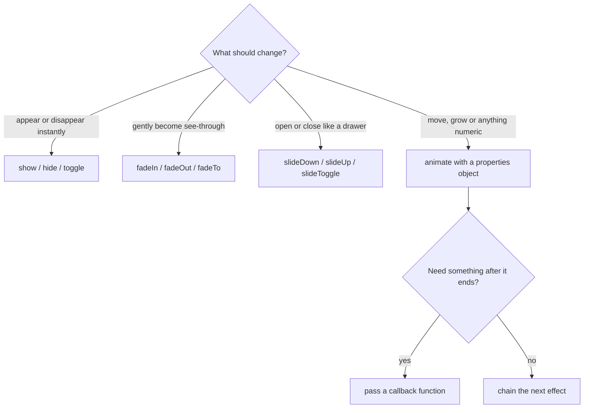
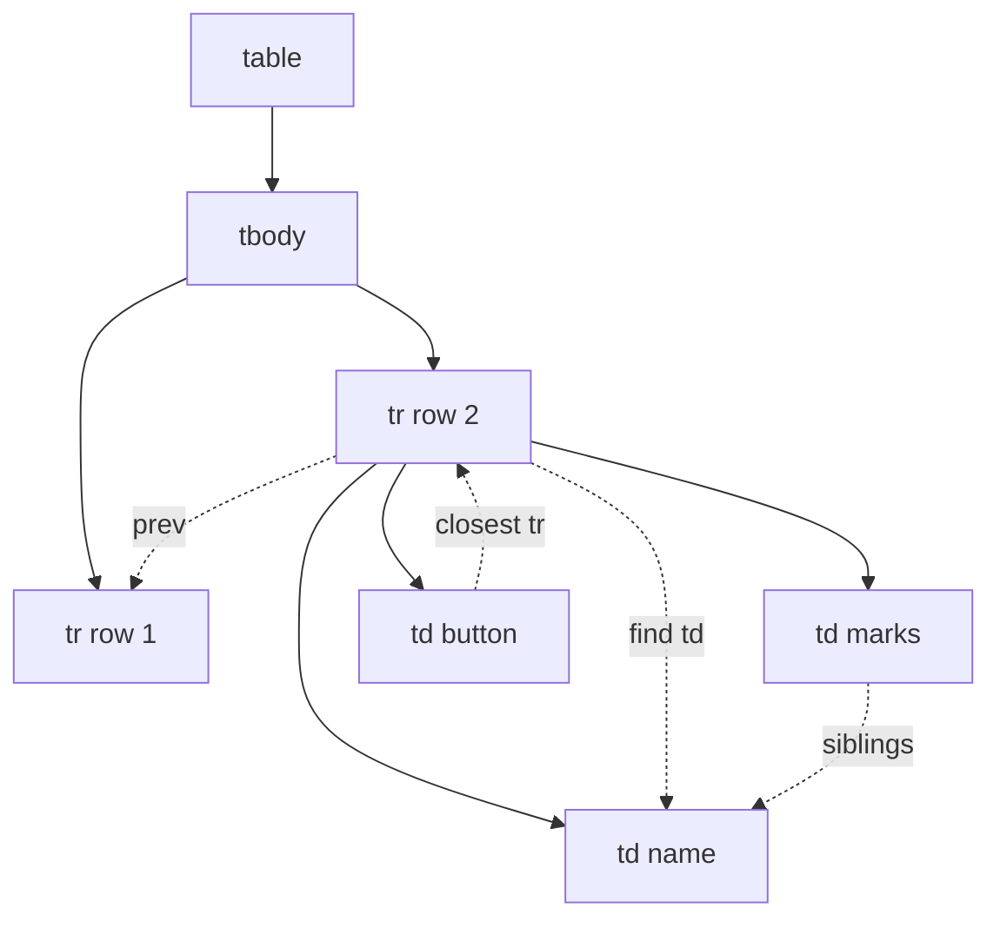
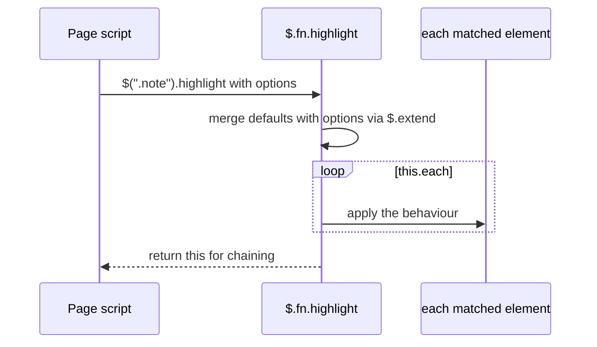
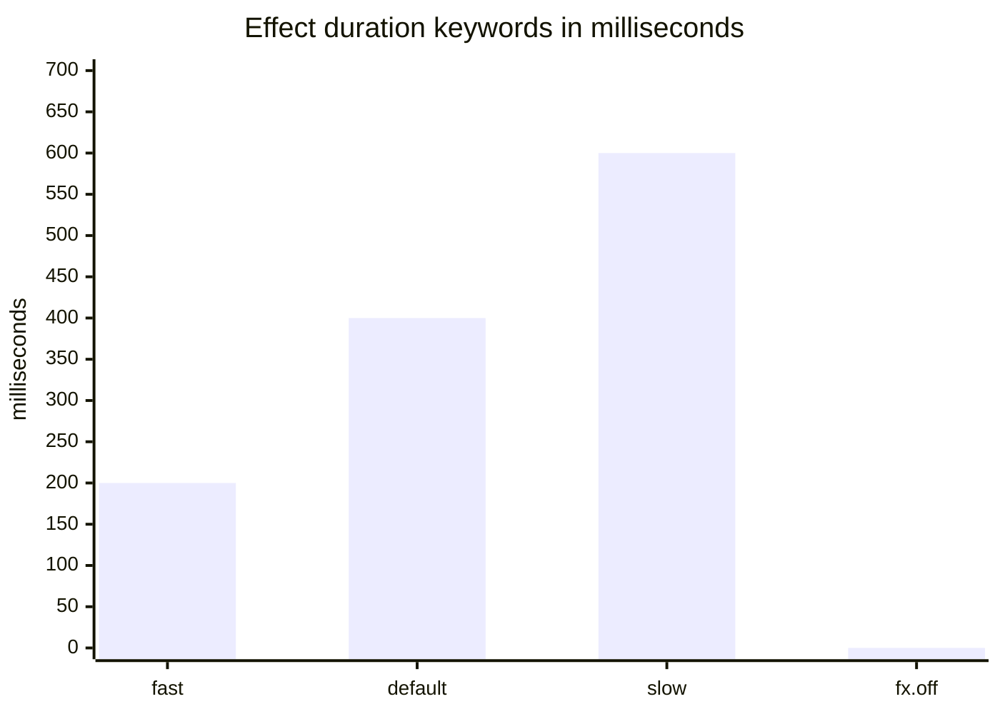

# Session 4 · Mastering jQuery Techniques

> [Prime AI – Software Engineering with AI](../../README.md) › [Term 1](../README.md) › [Bootstrap & jQuery for Responsive Web Pages](README.md) › **Session 4**

| ⏱ Estimated time | 🧩 Prerequisites |
|---|---|
| 3 hours | Session 3 (selectors and events) |

[⬅ Previous: Getting Started with jQuery](session-03-getting-started-with-jquery.md) &nbsp;|&nbsp; [Next: Designing Responsive Web Pages ➡](session-05-designing-responsive-web-pages.md)

---

## 🎯 Learning objectives

By the end of this session you will be able to:

- Apply jQuery effects – show/hide, fade, slide – and custom animations with `.animate()`, queues, `.stop()` and callbacks.
- Read and change content, attributes, properties, CSS and data with jQuery getters/setters.
- Insert, move, clone and remove elements, and traverse the DOM tree up, down and sideways.
- Integrate, configure and write jQuery plugins.
- Add jQuery UI widgets and interactions such as Datepicker, Dialog, Tabs and Sortable.

## 📖 Concepts

### 1. Effects – built-in animation

| Family | Methods | What changes |
|---|---|---|
| Basic | `.hide()`, `.show()`, `.toggle()` | `display` (with a duration, also width/height/opacity) |
| Fading | `.fadeIn()`, `.fadeOut()`, `.fadeToggle()`, `.fadeTo(speed, opacity)` | `opacity` |
| Sliding | `.slideDown()`, `.slideUp()`, `.slideToggle()` | `height` |
| Custom | `.animate({ props }, duration, easing, callback)` | any **numeric** CSS property |

**Duration**: milliseconds (`400`) or the words `'slow'` (600 ms) and `'fast'` (200 ms). Default 400 ms.
**Easing**: `'swing'` (default, slow–fast–slow) or `'linear'`; jQuery UI adds many more (`'easeOutBounce'`).
**Callback**: a function that runs when the animation **finishes** – the right place for "what happens next".

> 🎬 **Analogy – a queue at the bank counter.** Each effect you call on an element joins that element's **queue** and
> waits its turn. `.delay(500)` is a customer who stands there for half a second. `.stop()` is the manager who says
> "stop serving this person"; `.stop(true)` sends everyone home (clears the queue).

```js
$('#box').fadeOut(300).delay(200).fadeIn(300);      // runs one after another (queued)
$('#box').animate({ left: '200px', opacity: .5 }, 600, 'linear', function () {
  $(this).text('Done!');                             // callback: after the animation
});
$('#box').stop(true, true);                          // clear queue and jump to the end state
```

`.animate()` can only animate numbers (`width`, `left`, `opacity`, `fontSize`, `scrollTop` …), not colours (jQuery UI
adds colour animation). The element must be `position: relative/absolute` for `left/top` to have an effect. Use relative
values too: `{ left: '+=50px' }`. Respect users who prefer reduced motion: set `$.fx.off = true` when
`matchMedia('(prefers-reduced-motion: reduce)').matches`.

### 2. Getting and setting content, attributes and styles

| Method | Gets / sets | Example |
|---|---|---|
| `.text()` | Plain text (safe) | `$('#name').text('Ali')` |
| `.html()` | Inner HTML (parses tags – never with user input) | `$('#box').html('<b>Bold</b>')` |
| `.val()` | Value of input/select/textarea | `$('#qty').val()` |
| `.attr()` | HTML **attribute** as written in the markup | `$('img').attr('src', 'b.png')` |
| `.prop()` | Live DOM **property** (state) | `$('#agree').prop('checked')` |
| `.css()` | Inline style; object form for several | `$('p').css({ color: 'red', fontSize: '18px' })` |
| `.data()` | `data-*` values (auto-converted to numbers/booleans) | `$('li').data('price')` |
| Classes | `.addClass() .removeClass() .toggleClass() .hasClass()` | `$('#x').toggleClass('d-none', hide)` |

**`attr` vs `prop`** – use `.prop()` for states that change while the page runs: `checked`, `selected`, `disabled`.
`.attr('checked')` only tells you what the HTML **originally** said.

### 3. Inserting, moving and removing elements

```
             .before()
<div id="box">
    .prepend()   ← first child
    …existing children…
    .append()    ← last child
</div>
             .after()
```

| Method | Effect |
|---|---|
| `.append(x)` / `.appendTo(target)` | Add as the **last** child |
| `.prepend(x)` / `.prependTo(target)` | Add as the **first** child |
| `.after(x)` / `.before(x)` | Add as the next / previous **sibling** |
| `.remove()` | Delete the element (and its events/data) |
| `.empty()` | Delete all children, keep the element |
| `.clone(true)` | Copy (with `true`, also copy event handlers) |
| `.replaceWith(x)` | Swap the element for new content |
| `.wrap('<div class="x">')` | Surround with a new parent |

Create new elements with `$('<li class="item">')`, then fill them with `.text()` – this is safe and readable.
Appending an **existing** element *moves* it (an element can only be in one place).

### 4. Traversing – moving around the tree

> 🌳 **Analogy – a family tree.** From any person you can go **up** to parents and grandparents, **down** to children and
> grandchildren, or **sideways** to brothers and sisters. jQuery traversal methods are exactly those moves.

| Direction | Methods |
|---|---|
| Up | `.parent()` (one level), `.parents()` (all), `.closest(sel)` (nearest match, **starting with itself**) |
| Down | `.children(sel)` (one level), `.find(sel)` (all levels) |
| Sideways | `.siblings()`, `.next()`, `.prev()`, `.nextAll()`, `.prevAll()` |
| Filtering | `.first()`, `.last()`, `.eq(i)`, `.filter(sel or fn)`, `.not(sel)`, `.is(sel)`, `.has(sel)` |
| Looping | `.each(function (index, element) { … })`, `.map(fn).get()` |

`.closest()` is the hero of event handlers: "which **row** contains the button I clicked?" →
`$(this).closest('tr')`.

### 5. A quick word on AJAX

jQuery can also load data from a server without reloading the page: `$.getJSON('courses.json', data => { … })` or
`$.ajax({ url, method, data })`. Pages that do this must run on a web server (e.g. Live Server), not from `file://`.
Term 2 covers AJAX and `fetch()` in depth; here you only need to recognise it.

### 6. Plugins – extending jQuery

A **plugin** is a function added to `$.fn` (jQuery's prototype), so **every** jQuery object gains a new method.

**Using a plugin – step by step**
1. Load jQuery **first**.
2. Load the plugin's CSS (if any) and JS after jQuery.
3. Call it on a selection, usually with an **options object**: `$('#slider').somePlugin({ speed: 300 })`.
4. Read its documentation for options, methods and events.

**Writing your own plugin** – the standard pattern:

```js
(function ($) {                                   // 1. private scope, $ guaranteed to be jQuery
  $.fn.highlight = function (options) {
    const settings = $.extend({ color: '#fcd34d' }, options);   // 2. defaults merged with user options
    return this.each(function () {                // 3. work on every element, 4. return this for chaining
      $(this).css('background-color', settings.color);
    });
  };
})(jQuery);
// usage: $('.warning').highlight({ color: 'pink' }).fadeIn();
```

### 7. jQuery UI

**jQuery UI** is the official companion library of **widgets** (ready-made controls), **interactions** (mouse
behaviour) and **effects**, with downloadable **themes** (ThemeRoller).

| Category | Members | One-line use |
|---|---|---|
| Widgets | Datepicker, Dialog, Tabs, Accordion, Autocomplete, Slider, Progressbar, Spinner | `$('#date').datepicker({ dateFormat: 'dd/mm/yy' })` |
| Interactions | Draggable, Droppable, Resizable, Selectable, **Sortable** | `$('#list').sortable()` |
| Effects | colour animation, `bounce`, `shake`, `highlight`, easing functions | `$('#x').effect('shake')` |

Include the theme CSS and `jquery-ui.min.js` **after** jQuery. In a Bootstrap 5 project you will usually use
Bootstrap's own modal and accordion, and reach for jQuery UI for the things Bootstrap lacks – drag-and-drop sorting,
a date picker for old browsers, autocomplete.

## 🧭 Diagrams

### Which effect should I use?



### Traversal moves on the DOM tree



### Life of a jQuery plugin call



## 💻 Worked examples

### Example 1 — Effects, queues and callbacks – with real timing

Open the page and press each button to *see* the effects. The test below runs the **same chained effects with real
animation timing** and logs when each callback fires, proving that queued effects run one after another while normal code
does not wait.

```html
<!DOCTYPE html>
<html lang="en">
<head>
  <meta charset="UTF-8">
  <meta name="viewport" content="width=device-width, initial-scale=1">
  <title>jQuery effects</title>
  <link href="https://cdn.jsdelivr.net/npm/bootstrap@5.3.3/dist/css/bootstrap.min.css" rel="stylesheet"
        integrity="sha384-QWTKZyjpPEjISv5WaRU9OFeRpok6YctnYmDr5pNlyT2bRjXh0JMhjY6hW+ALEwIH" crossorigin="anonymous">
  <style>
    #box { position: relative; width: 120px; height: 120px; background: #ff6b1a; color: #fff;
           display: flex; align-items: center; justify-content: center; border-radius: 12px; }
    #panel { display: none; }
  </style>
</head>
<body class="container py-4">
  <h1 class="h3">Effects lab</h1>
  <div class="d-flex flex-wrap gap-2 mb-3">
    <button class="btn btn-primary" id="fade">fadeToggle</button>
    <button class="btn btn-primary" id="slide">slideToggle panel</button>
    <button class="btn btn-primary" id="move">animate → move + grow</button>
    <button class="btn btn-primary" id="chain">chain: fadeOut · delay · fadeIn</button>
    <button class="btn btn-danger" id="stop">stop(true)</button>
    <button class="btn btn-outline-secondary" id="reset">reset</button>
  </div>
  <div id="box">Box</div>
  <div id="panel" class="card card-body mt-3">I slide like a drawer.</div>
  <ol id="log" class="small mt-3"></ol>

  <script src="https://code.jquery.com/jquery-3.7.1.min.js"
          integrity="sha384-1H217gwSVyLSIfaLxHbE7dRb3v4mYCKbpQvzx0cegeju1MVsGrX5xXxAvs/HgeFs" crossorigin="anonymous"></script>
  <script>
    $(function () {
      const $box = $('#box');
      const log = msg => $('<li>').text(msg).appendTo('#log');

      // Respect users who ask the OS for less motion
      if (window.matchMedia && matchMedia('(prefers-reduced-motion: reduce)').matches) $.fx.off = true;

      $('#fade').on('click', () => $box.fadeToggle('slow', () => log('fadeToggle finished')));
      $('#slide').on('click', () => $('#panel').slideToggle(400));
      $('#move').on('click', () =>
        $box.animate({ left: '+=150px', width: '160px', opacity: 0.6 }, 800, 'swing', () => log('animate finished')));
      $('#chain').on('click', () => {
        $box.fadeOut(300, () => log('1. fadeOut done'))
            .delay(200)
            .fadeIn(300, () => log('2. fadeIn done'));
        log('0. this line runs immediately – effects are queued');
      });
      $('#stop').on('click', () => { $box.stop(true); log('queue cleared'); });
      $('#reset').on('click', () => { $box.stop(true, true).removeAttr('style'); $('#log').empty(); });
    });
  </script>
</body>
</html>
```

📄 Saved as [`code/session-04_effects.html`](code/session-04_effects.html)

**Output** (real run of `node session-04_effects-test.js`)

```text
[~0 ms] clicked "chain"; queue length now: 3
  log 1: 0. this line runs immediately – effects are queued
  log 2: 1. fadeOut done
  log 3: 2. fadeIn done
[~1000 ms] box opacity=1 display=flex
[~1500 ms] halfway: left=75px (still moving)
[~2100 ms] after stop(true): left=75px (was 75px when stopped) – no further movement
```

### Example 2 — DOM manipulation – a mini shopping cart

Products are listed in [`code/session-04_cart.html`](code/session-04_cart.html) with `data-name` and `data-price`
attributes. This script builds cart rows with `$('<tr>')`, updates quantities, removes rows, recalculates the total
and uses `.prop()` to enable/disable the checkout button.

```js
// session-04_cart.js – shopping cart for session-04_cart.html
$(function () {
  const $body = $('#cart tbody');
  const money = n => 'Rs ' + n.toLocaleString('en-US');

  function recalc() {
    let total = 0, items = 0;
    $body.find('tr').each(function () {
      const $row = $(this);
      const qty = Number($row.find('.qty').text());
      const line = qty * $row.data('price');             // .data() returns a number already
      $row.find('.line').text(money(line));
      total += line; items += qty;
    });
    $('#total').text(money(total));
    $('#items').text(items);
    $('#empty').toggle(items === 0);
    $('#checkout').prop('disabled', items === 0);     // prop for live state
  }

  // Add to cart (delegated on the product list)
  $('#products').on('click', '.add', function () {
    const $card = $(this).closest('.product');        // traverse UP to the product card
    const name = $card.data('name');
    const price = $card.data('price');
    const $existing = $body.find(`tr[data-name="${name}"]`);

    if ($existing.length) {                           // already in cart → increase qty
      const $q = $existing.find('.qty');
      $q.text(Number($q.text()) + 1);
    } else {                                          // create a new row
      const $row = $('<tr>').attr('data-name', name).data('price', price);
      $('<td>').text(name).appendTo($row);
      $('<td>').addClass('qty').text(1).appendTo($row);
      $('<td>').addClass('line').appendTo($row);
      $('<td>').append('<button class="btn btn-sm btn-outline-secondary minus" aria-label="One less">−</button> ')
               .append('<button class="btn btn-sm btn-outline-danger remove" aria-label="Remove">✕</button>')
               .appendTo($row);
      $body.append($row);
    }
    recalc();
  });

  // Minus one (remove the row when qty reaches 0)
  $body.on('click', '.minus', function () {
    const $row = $(this).closest('tr');
    const $q = $row.find('.qty');
    const n = Number($q.text()) - 1;
    n > 0 ? $q.text(n) : $row.remove();
    recalc();
  });

  // Remove the whole row
  $body.on('click', '.remove', function () {
    $(this).closest('tr').remove();
    recalc();
  });

  $('#clear').on('click', () => { $body.empty(); recalc(); });
  recalc();
});
```

📄 Saved as [`code/session-04_cart.js`](code/session-04_cart.js)

**Output** (real run of `node session-04_cart-test.js`)

```text
Start                        (empty)                                    total=Rs 0      checkoutDisabled=true
Add Notebook                 Notebook x1                                total=Rs 250    checkoutDisabled=false
Add Gel pen x3               Notebook x1, Gel pen x3                    total=Rs 490    checkoutDisabled=false
Add Geometry box             Notebook x1, Gel pen x3, Geometry box x1   total=Rs 1,140  checkoutDisabled=false
Minus one Gel pen            Notebook x1, Gel pen x2, Geometry box x1   total=Rs 1,060  checkoutDisabled=false
Remove Notebook              Gel pen x2, Geometry box x1                total=Rs 810    checkoutDisabled=false
Clear cart                   (empty)                                    total=Rs 0      checkoutDisabled=true
```

### Example 3 — Writing a reusable plugin: `$.fn.charLimit`

A real plugin you can drop into any project: it adds a live "characters left" counter under any input or textarea,
with options for the limit and the warning threshold, and supports chaining. The demo page is
[`code/session-04_plugin-demo.html`](code/session-04_plugin-demo.html).

```js
// session-04_charlimit-plugin.js – a small, complete jQuery plugin
// Usage: $('textarea').charLimit({ max: 140, warnAt: 20 });
(function ($) {
  'use strict';

  $.fn.charLimit = function (options) {
    // 1. Merge user options with defaults (later objects win)
    const settings = $.extend({}, $.fn.charLimit.defaults, options);

    // 2. Run for EVERY matched element and return `this` so calls can be chained
    return this.each(function () {
      const $field = $(this);
      if ($field.data('charLimit')) return;            // already initialised – do nothing

      const $counter = $('<div class="form-text char-limit"></div>').insertAfter($field);
      $field.attr('maxlength', settings.max);

      function update() {
        const left = settings.max - $field.val().length;
        $counter.text(settings.format(left, settings.max))
                .toggleClass(settings.warnClass, left <= settings.warnAt);
        $field.trigger('charlimit:update', [left]);      // custom event other code can listen to
      }

      $field.on('input.charLimit', update).data('charLimit', true);
      update();
    });
  };

  // 3. Public defaults – users can change them once for the whole site
  $.fn.charLimit.defaults = {
    max: 100,
    warnAt: 10,
    warnClass: 'text-danger',
    format: (left, max) => `${left} of ${max} characters left`,
  };
})(jQuery);
```

📄 Saved as [`code/session-04_charlimit-plugin.js`](code/session-04_charlimit-plugin.js)

**Output** (real run of `node session-04_plugin-test.js`)

```text
headline counter : 40 of 40 characters left | maxlength = 40
body counter     : 140 left | chained class border-primary: true
after 38 chars   : 2 of 40 characters left | warning: true
body 125 chars   : 15 left | warning: true | status: ok
counters after re-init: 2
defaults         : {"max":100,"warnAt":10}
```

### Example 4 — jQuery UI – Datepicker, Dialog, Tabs, Sortable and an effect

jQuery UI is loaded from the official jQuery CDN **after** jQuery. Its theme CSS gives the widgets their look.
(jQuery UI 1.14 supports jQuery 3.7.)

```html
<!DOCTYPE html>
<html lang="en">
<head>
  <meta charset="UTF-8">
  <meta name="viewport" content="width=device-width, initial-scale=1">
  <title>jQuery UI widgets</title>
  <!-- jQuery UI theme CSS -->
  <link rel="stylesheet" href="https://code.jquery.com/ui/1.14.1/themes/base/jquery-ui.css">
  <style>
    body { font-family: system-ui, sans-serif; max-width: 760px; margin: 2rem auto; padding: 0 1rem; }
    #priorities li { cursor: grab; padding: .5rem; margin: .25rem 0; background: #f5f3ff; border: 1px solid #a78bfa; list-style: none; }
  </style>
</head>
<body>
  <h1>jQuery UI playground</h1>

  <!-- TABS widget: a list of links to panel ids -->
  <div id="tabs">
    <ul>
      <li><a href="#t-date">Datepicker</a></li>
      <li><a href="#t-sort">Sortable</a></li>
      <li><a href="#t-dialog">Dialog</a></li>
    </ul>

    <div id="t-date">
      <label for="exam">Exam date: </label>
      <input id="exam" placeholder="click to choose">
      <p>You picked: <strong id="picked">nothing yet</strong></p>
    </div>

    <div id="t-sort">
      <p>Drag to order your study priorities:</p>
      <ul id="priorities">
        <li>Bootstrap grid</li><li>jQuery events</li><li>Effects</li><li>Plugins</li>
      </ul>
      <p>Current order: <span id="order"></span></p>
    </div>

    <div id="t-dialog">
      <button id="open-dialog">Delete my draft…</button>
      <p id="dialog-result"></p>
    </div>
  </div>

  <!-- The dialog's content is hidden until .dialog() opens it -->
  <div id="confirm" title="Delete draft?">
    <p>This cannot be undone. Are you sure?</p>
  </div>

  <script src="https://code.jquery.com/jquery-3.7.1.min.js"
          integrity="sha384-1H217gwSVyLSIfaLxHbE7dRb3v4mYCKbpQvzx0cegeju1MVsGrX5xXxAvs/HgeFs" crossorigin="anonymous"></script>
  <script src="https://code.jquery.com/ui/1.14.1/jquery-ui.min.js" crossorigin="anonymous"></script>
  <script>
    $(function () {
      $('#tabs').tabs();                                      // 1. Tabs

      $('#exam').datepicker({                                 // 2. Datepicker with options
        dateFormat: 'dd/mm/yy',
        minDate: 0,                                           // no past dates
        beforeShowDay: d => [d.getDay() !== 0, ''],           // Sundays disabled
        onSelect: text => $('#picked').text(text)
      });

      const showOrder = () => $('#order').text($('#priorities li').map((i, li) => $(li).text()).get().join(' → '));
      $('#priorities').sortable({ update: showOrder });       // 3. Sortable + update event
      showOrder();

      $('#confirm').dialog({                                  // 4. Dialog (modal, not opened yet)
        autoOpen: false, modal: true, width: 360,
        buttons: {
          Delete: function () { $('#dialog-result').text('Draft deleted.'); $(this).dialog('close'); },
          Cancel: function () { $(this).dialog('close'); $('#open-dialog').effect('shake'); }   // 5. effect
        }
      });
      $('#open-dialog').on('click', () => $('#confirm').dialog('open'));
    });
  </script>
</body>
</html>
```

📄 Saved as [`code/session-04_jquery-ui.html`](code/session-04_jquery-ui.html)

**🖥️ What you see in the browser**

```text
Three jQuery UI tabs. Datepicker tab: clicking the field opens a calendar where past days and Sundays are greyed
out; choosing a day writes it as dd/mm/yyyy. Sortable tab: list items can be dragged into a new order and the
"Current order" line updates. Dialog tab: the button opens a modal dialog with Delete / Cancel buttons; Cancel
closes it and shakes the button.
```

## 🧩 Real-life coding problem

**Scenario – a teacher's gradebook.** A lecturer wants a quick in-browser gradebook for a lab section:

1. A form adds a student (name + marks 0–100). Invalid marks are rejected with Bootstrap's `.is-invalid` style.
2. Every row has **Edit marks** and **Delete** buttons.
3. Rows below 50 are highlighted red (`table-danger`) and get a "Fail" badge; 85+ gets a "Distinction" badge.
4. A footer shows the **class average**, **highest** and **pass rate**, updated after every change.
5. A **"Show failing only"** switch hides passing rows with a slide effect.

**Techniques used:** `$('<tr>')` creation, `.closest('tr')`, `.find()`, `.each()`, `.data()`, `.toggleClass()` with a
boolean, `.slideUp()/.slideDown()` and delegation.

**Full solution:** page [`code/session-04_gradebook.html`](code/session-04_gradebook.html) +
script [`code/session-04_gradebook.js`](code/session-04_gradebook.js), tested by
[`code/session-04_gradebook-test.js`](code/session-04_gradebook-test.js). The heart of it is the statistics function:

```js
function refresh() {
  const marks = $tbody.find('tr').map((i, tr) => $(tr).data('marks')).get();
  $tbody.find('tr').each(function () {
    const m = $(this).data('marks');
    $(this).toggleClass('table-danger', m < 50)
           .find('.badge').text(m < 50 ? 'Fail' : m >= 85 ? 'Distinction' : 'Pass')
           .attr('class', 'badge ' + (m < 50 ? 'text-bg-danger' : m >= 85 ? 'text-bg-success' : 'text-bg-secondary'));
  });
  const avg = marks.length ? marks.reduce((a, b) => a + b, 0) / marks.length : 0;
  $('#avg').text(avg.toFixed(1));
  $('#max').text(marks.length ? Math.max(...marks) : '–');
  $('#rate').text(marks.length ? Math.round(marks.filter(m => m >= 50).length / marks.length * 100) + '%' : '–');
}
```

**Real test output:**

```text
Seeded                   avg=67.0 max=88 pass=67%     Ali Raza=72(Pass) Sana Javed=41(Fail) Hassan Mirza=88(Distinction)
Add marks=120            rejected: marks is-invalid=true
Add Nida 49              avg=62.5 max=88 pass=50%     Ali Raza=72(Pass) Sana Javed=41(Fail) Hassan Mirza=88(Distinction) Nida Khan=49(Fail)
Edit Sana -> 63          avg=68.0 max=88 pass=75%     Ali Raza=72(Pass) Sana Javed=63(Pass) Hassan Mirza=88(Distinction) Nida Khan=49(Fail)
Failing only ON          avg=68.0 max=88 pass=75%     Ali Raza=72(Pass,hidden) Sana Javed=63(Pass,hidden) Hassan Mirza=88(Distinction,hidden) Nida Khan=49(Fail)
Delete first row         avg=66.7 max=88 pass=67%     Sana Javed=63(Pass,hidden) Hassan Mirza=88(Distinction,hidden) Nida Khan=49(Fail)
```

## ⚠️ Common mistakes

| Mistake | Symptom | Fix |
|---|---|---|
| Starting a new effect on every click without `.stop()` | Animations pile up and keep running after you stop clicking | `$el.stop(true).fadeToggle()` |
| Code after an effect that expects it to be finished | It runs immediately, before the animation ends | Put it in the effect's **callback** |
| `.animate({ backgroundColor: 'red' })` | Nothing happens (colours are not numeric) | Use CSS transitions, or jQuery UI's colour animation |
| `.animate({ left: … })` on a static element | The element doesn't move | Give it `position: relative` |
| `.attr('checked')` to read a checkbox | Always shows the original HTML value | `.prop('checked')` |
| `.html(userInput)` | Typed `<script>` / `` runs (XSS) | `.text(userInput)` |
| `.parent()` when the button is wrapped in extra divs | Returns the wrong element | `.closest('tr')` / `.closest('.card')` |
| Plugin script loaded before jQuery | `jQuery is not defined` / `$(...).plugin is not a function` | Order: jQuery → plugin → your code |
| Forgetting `return this.each(...)` in a plugin | Chaining breaks: `undefined is not a function` | Always return `this` |

## 🌟 Best practices

- Keep effects short (200–400 ms) and purposeful; respect `prefers-reduced-motion`.
- Prefer toggling **CSS classes** (`.toggleClass('open')`) and let CSS transitions animate – jQuery then only manages state.
- Build new elements with `$('<tag>')` + `.text()`; insert them in one go (build rows, then append once) for speed.
- Store values in `data-*` attributes and read them with `.data()` instead of parsing visible text.
- Use `.closest()` for "the container of what was clicked"; delegate handlers for rows that come and go.
- Write plugins with an IIFE, `$.extend` defaults, `return this.each`, a namespaced event (`input.charLimit`) and a guard
  against double initialisation.
- Load only the jQuery UI components you need (custom download) in production.

## 🏗️ Mini project

**Mini project – a filterable portfolio gallery with lightbox.** Category buttons (All / Web / Mobile / Design) filter a
grid of 9 thumbnails with `fadeOut`/`fadeIn`; clicking a thumbnail opens a larger version in a **jQuery UI dialog**
with Previous/Next buttons that use `.next()` / `.prev()` traversal and wrap around.

Full solution: [`code/session-04_mini-project-gallery.html`](code/session-04_mini-project-gallery.html), tested by
[`code/session-04_gallery-test.js`](code/session-04_gallery-test.js):

```text
All items visible     : 9
After "Mobile" filter : 3 -> Rickshaw tracking app, Prayer times app, Expense tracker app
Opened                : Rickshaw tracking app | https://picsum.photos/seed/g2/1200/900
Next                  : Prayer times app
Next                  : Expense tracker app
Next (wraps around)   : Rickshaw tracking app
Previous (wraps back) : Expense tracker app
```

## 📦 Project files for this session

| File | What it is |
|---|---|
| 📄 [`code/session-04_effects-test.js`](code/session-04_effects-test.js) | Runs the chained effects with real timing and logs when each callback fires |
| 📄 [`code/session-04_cart.html`](code/session-04_cart.html) | Shopping cart page (behaviour in session-04_cart.js) |
| 📄 [`code/session-04_cart-test.js`](code/session-04_cart-test.js) | Automated test for the cart (add, repeat add, minus, remove, clear) |
| 📄 [`code/session-04_plugin-demo.html`](code/session-04_plugin-demo.html) | Demo page using the charLimit plugin on two fields with different options |
| 📄 [`code/session-04_plugin-test.js`](code/session-04_plugin-test.js) | Test for the charLimit plugin (defaults, options, warning class, chaining, double init) |
| 📄 [`code/session-04_gradebook.html`](code/session-04_gradebook.html) | Real-life problem solution – gradebook page |
| 📄 [`code/session-04_gradebook.js`](code/session-04_gradebook.js) | Real-life problem solution – gradebook behaviour (create, edit, delete, stats, filter) |
| 📄 [`code/session-04_gradebook-test.js`](code/session-04_gradebook-test.js) | Automated test for the gradebook |
| 📄 [`code/session-04_mini-project-gallery.html`](code/session-04_mini-project-gallery.html) | Mini project solution – filterable gallery with fade effects and a jQuery UI dialog lightbox |
| 📄 [`code/session-04_gallery-test.js`](code/session-04_gallery-test.js) | Test for the gallery: filter, open, next/previous with wrap-around |

## 📊 At a glance

**Default durations of jQuery effects (ms)**



| Need | Method | Returns |
|---|---|---|
| Read text safely | `.text()` | string |
| Is the box ticked *now*? | `.prop('checked')` | boolean |
| Original `href` in the HTML | `.attr('href')` | string |
| Price stored as `data-price="250"` | `.data('price')` | number 250 |
| Container of the clicked button | `$(this).closest('.card')` | jQuery object |
| All rows' marks as an array | `$('tr').map((i, tr) => $(tr).data('marks')).get()` | array |

## 🧪 Lab / practice tasks

**🟢 Easy** — Make an FAQ where clicking a question (`<h3 class="q">`) slides its answer (`<p class="a">` right after it) open or closed, and closes any other open answer.

<details><summary>💡 Hint</summary>

Use `$(this).next(".a").slideToggle()` and `$(".a").not(...).slideUp()`.

</details>

<details><summary>✅ Solution</summary>

```js
$(function () {
  $('.a').hide();
  $('.q').on('click', function () {
    const $answer = $(this).next('.a');
    $('.a').not($answer).slideUp(200);
    $answer.stop(true).slideToggle(200);
  });
});
```

</details>

**🟡 Medium** — Create a "notification" function `notify(message, type)` that prepends a Bootstrap alert to `#notices`, fades it in, waits 3 seconds and then fades it out and removes it.

<details><summary>💡 Hint</summary>

Build the alert with `$("<div>")`, `.hide().prependTo()`, then chain `.fadeIn().delay(3000).fadeOut(400, function(){ $(this).remove(); })`.

</details>

<details><summary>✅ Solution</summary>

```js
function notify(message, type = 'info') {
  $('<div role="status">')
    .addClass(`alert alert-${type}`)
    .text(message)
    .hide()
    .prependTo('#notices')
    .fadeIn(200)
    .delay(3000)
    .fadeOut(400, function () { $(this).remove(); });
}
notify('Saved!', 'success');
```

</details>

**🔴 Hard** — In the gradebook, add a **Sort by marks** button that re-orders the table rows from highest to lowest without rebuilding them.

<details><summary>💡 Hint</summary>

Get rows as an array with `.get()`, sort by `$(tr).data("marks")`, then `.append()` them back – appending existing elements moves them.

</details>

<details><summary>✅ Solution</summary>

```js
$('#sort').on('click', function () {
  const rows = $tbody.find('tr').get();
  rows.sort((a, b) => $(b).data('marks') - $(a).data('marks'));
  $tbody.append(rows);          // moves the existing rows into the new order
});
```

</details>

**🏆 Challenge** — Write a plugin `$.fn.typewriter({ speed: 50 })` that types out an element's text one character at a time, returns `this`, and triggers a custom `typewriter:done` event at the end. Test it in node with a fake timer or by waiting.

<details><summary>💡 Hint</summary>

Save the full text, empty the element, then use `setInterval` to add one character each tick; clear the interval and `.trigger("typewriter:done")` at the end.

</details>

<details><summary>✅ Solution</summary>

```js
(function ($) {
  $.fn.typewriter = function (options) {
    const s = $.extend({ speed: 50 }, options);
    return this.each(function () {
      const $el = $(this), full = $el.text();
      let i = 0;
      $el.text('');
      const timer = setInterval(() => {
        $el.text(full.slice(0, ++i));
        if (i >= full.length) { clearInterval(timer); $el.trigger('typewriter:done'); }
      }, s.speed);
    });
  };
})(jQuery);
$('#hero-title').typewriter({ speed: 40 }).on('typewriter:done', () => console.log('finished'));
```

</details>

## ✅ Quick quiz

**Q1. Which effect animates an element's height?**

- A) `fadeToggle()`
- B) `slideToggle()`
- C) `toggleClass()`
- D) `fadeTo()`

<details><summary>Show answer</summary>

**B** — Slide effects animate height.

</details>

**Q2. Where should code go that must run only after `fadeOut(400)` finishes?**

- A) On the next line
- B) In the callback argument
- C) Before the fadeOut
- D) In `$(window).load`

<details><summary>Show answer</summary>

**B** — Effects are asynchronous; the callback runs at the end.

</details>

**Q3. To read whether a checkbox is currently ticked, use:**

- A) `.attr("checked")`
- B) `.prop("checked")`
- C) `.val()`
- D) `.data("checked")`

<details><summary>Show answer</summary>

**B** — prop reads the live state.

</details>

**Q4. `$("#list").prepend("<li>A</li>")` puts the new item:**

- A) Before the list
- B) As the first child of the list
- C) As the last child
- D) After the list

<details><summary>Show answer</summary>

**B** — prepend = first child.

</details>

**Q5. Inside a plugin, why `return this.each(...)`?**

- A) To make it faster
- B) To process every matched element and keep chaining possible
- C) Because jQuery UI requires it
- D) To clear the queue

<details><summary>Show answer</summary>

**B** — Returning this preserves chaining.

</details>

## 📝 Summary / cheat-sheet

- Effects: `hide/show/toggle`, `fadeIn/Out/Toggle/To`, `slideUp/Down/Toggle`, custom `.animate()` for numeric CSS.
- Effects are queued per element; use callbacks for "after", `.delay()` to wait, `.stop(true, true)` to cancel.
- Get/set: `.text()` (safe), `.html()`, `.val()`, `.attr()` (markup), `.prop()` (live state), `.css()`, `.data()`, class methods.
- Insert: `append/prepend` (children), `after/before` (siblings); remove with `.remove()` / `.empty()`; copy with `.clone()`.
- Traverse: up `.parent() .closest()`, down `.children() .find()`, sideways `.siblings() .next() .prev()`, filter `.eq() .filter() .not()`.
- Plugins live on `$.fn`; pattern = IIFE + `$.extend` defaults + `return this.each`.
- jQuery UI adds widgets (Datepicker, Dialog, Tabs, Autocomplete), interactions (Sortable, Draggable) and effects.

## 🎤 Interview / viva questions

1. **What is the effects queue?**
   <details><summary>Model answer</summary>

   Each element has a list of pending animations (the fx queue); effects called one after another wait their turn, so chained effects run in sequence.

   </details>

2. **Difference between `.remove()` and `.empty()`?**
   <details><summary>Model answer</summary>

   .remove() deletes the element itself along with its data and events; .empty() deletes only its children and keeps the element.

   </details>

3. **`attr()` vs `prop()`?**
   <details><summary>Model answer</summary>

   attr reads/writes HTML attributes as written in markup; prop reads/writes the live DOM property, e.g. the current checked or disabled state.

   </details>

4. **Why is `.closest()` useful in event handlers?**
   <details><summary>Model answer</summary>

   It walks up from the clicked element to the nearest ancestor matching a selector, so one delegated handler can find the row or card that contains the button.

   </details>

5. **What does `$.extend({}, defaults, options)` do?**
   <details><summary>Model answer</summary>

   It copies defaults into a new object and then overwrites them with any user options, giving a merged settings object without changing the defaults.

   </details>

6. **When would you choose jQuery UI over Bootstrap?**
   <details><summary>Model answer</summary>

   For interactions Bootstrap lacks, such as drag-and-drop sorting, resizable elements, autocomplete or a themeable date picker, especially on sites already using jQuery.

   </details>

---

[⬅ Previous: Getting Started with jQuery](session-03-getting-started-with-jquery.md) &nbsp;|&nbsp; [Next: Designing Responsive Web Pages ➡](session-05-designing-responsive-web-pages.md)

<sub>Prepared by **Hamna Zahid Khan**, Junior Lecturer · Prime AI – Software Engineering with AI</sub>
