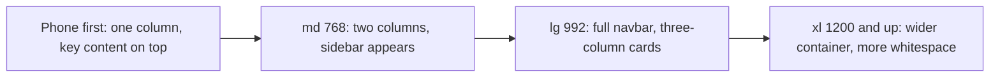
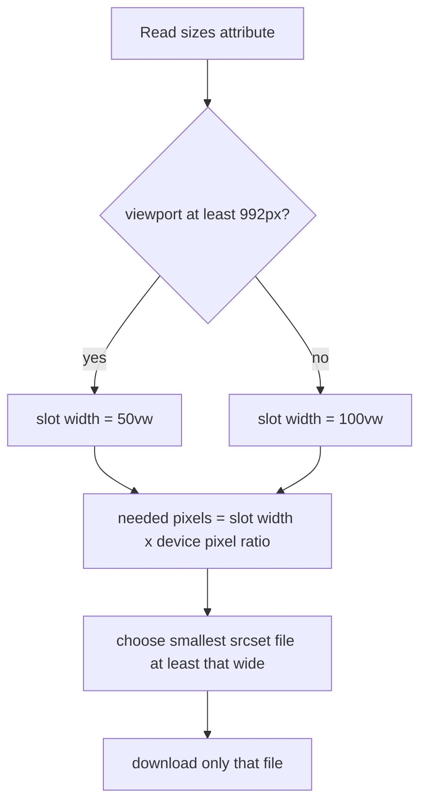
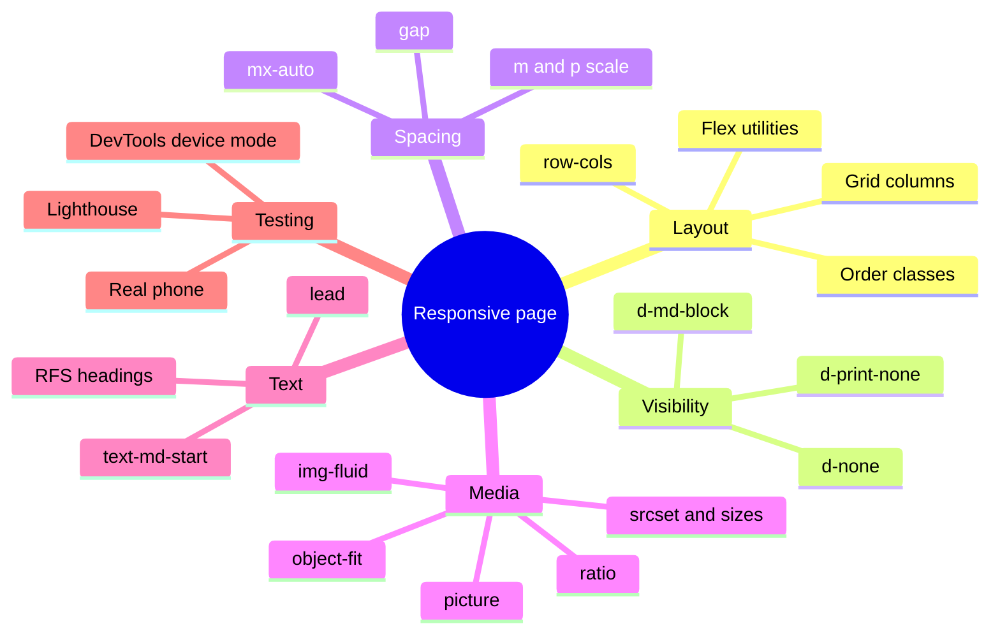
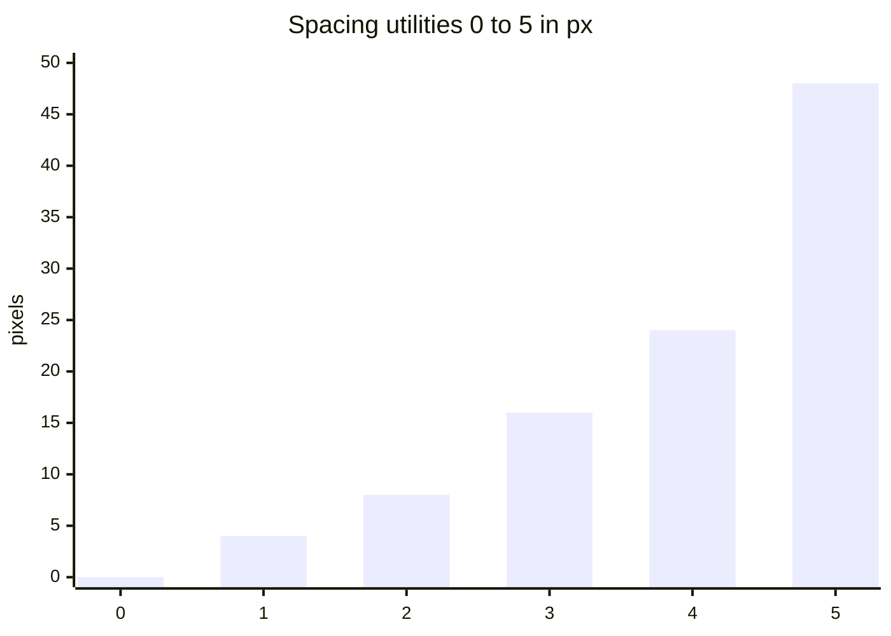
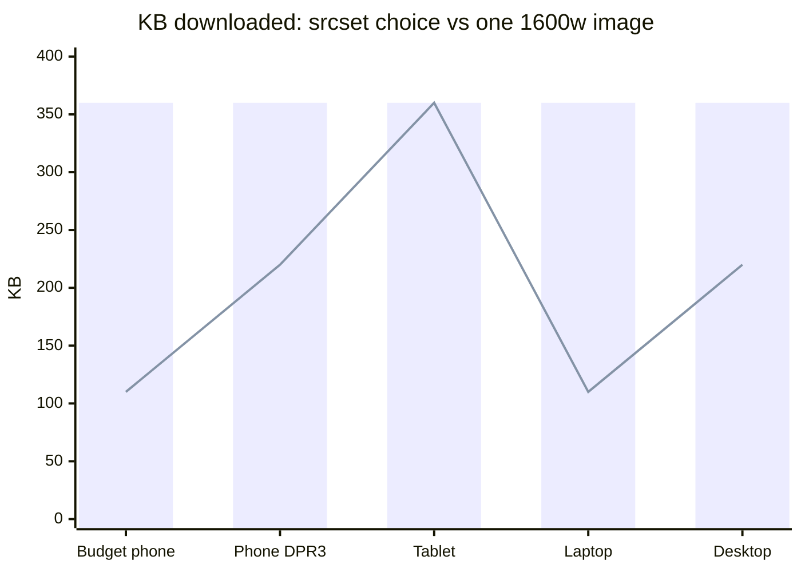

# Session 5 · Designing Responsive Web Pages

> [Prime AI – Software Engineering with AI](../../README.md) › [Term 1](../README.md) › [Bootstrap & jQuery for Responsive Web Pages](README.md) › **Session 5**

| ⏱ Estimated time | 🧩 Prerequisites |
|---|---|
| 3 hours | Sessions 1–2 (grid and components) |

[⬅ Previous: Mastering jQuery Techniques](session-04-mastering-jquery-techniques.md) &nbsp;|&nbsp; [Next: Integrating and Enhancing with Bootstrap and jQuery ➡](session-06-integrating-and-enhancing-with-bootstrap-and-jquery.md)

---

## 🎯 Learning objectives

By the end of this session you will be able to:

- List and apply the core principles of responsive web design, including mobile-first and content priority.
- Use Bootstrap responsive utilities for display, spacing, flexbox, sizing, text and visibility.
- Combine the Bootstrap grid, row-cols and the optional CSS Grid utilities to build multi-device layouts.
- Integrate responsive media: fluid images, `srcset`/`sizes`, `<picture>`, ratio embeds, `object-fit` and responsive tables.
- Test layouts on real breakpoints with DevTools and fix common responsive bugs.

## 📖 Concepts

### 1. What "responsive" really means

A **responsive** web page reorganises itself so that it is comfortable to use on **any** screen – a 360 px phone, a
768 px tablet, a 1440 px monitor – from **one** HTML file. The term was coined by **Ethan Marcotte in 2010**, who named
three ingredients:

| Ingredient | Meaning | Bootstrap tool |
|---|---|---|
| **Fluid grids** | Widths in percentages / fractions, not fixed pixels | `.row` + `.col-*` |
| **Flexible media** | Images and videos shrink with their container | `.img-fluid`, `.ratio` |
| **Media queries** | Change the layout at chosen widths | breakpoint classes (`-md-`, `-lg-` …) |

> 💧 **Analogy – water takes the shape of its container.** Pour the same water into a glass, a jug or a bowl and it fills
> each one perfectly. A responsive page is the water; screens are the containers.

### 2. Principles to design by

1. **Mobile-first.** Design the smallest screen first, then *add* layout for bigger screens. It forces you to decide
   what matters most, and phones download the least CSS. (Bootstrap is built this way.)
2. **Content priority.** On a phone, the most important content (price, "Book now", today's timetable) comes first.
3. **Touch-friendly targets.** Buttons and links at least **44 × 44 px** with space between them; no hover-only menus.
4. **Readable text.** Body text ≈ 16 px minimum; line length 45–75 characters (use `.col-lg-8` or `max-width`).
5. **Flexible everything.** No fixed widths wider than a phone; let images, tables and videos shrink or scroll.
6. **Performance.** Phones are often on slower networks: compress images, serve smaller images to small screens,
   lazy-load below-the-fold media (`loading="lazy"`).
7. **Test on real widths.** 360, 390, 768, 1024, 1280 and 1440 px cover most devices.

**The viewport meta tag** – `<meta name="viewport" content="width=device-width, initial-scale=1">` – tells the phone
"my page is as wide as your screen". Without it, nothing in this session works.

### 3. Bootstrap's responsive utilities

All utilities follow one naming pattern: **`{property}{sides}-{breakpoint}-{value}`**, and a utility without a
breakpoint applies at **all** sizes.

**Display** – `.d-{value}` and `.d-{bp}-{value}` where value is `none, inline, inline-block, block, flex, inline-flex, grid, table`.

| You want… | Classes |
|---|---|
| Hide on phones, show from md | `d-none d-md-block` |
| Show on phones only | `d-md-none` |
| Show only on lg | `d-none d-lg-block d-xl-none` |
| Hide when printing | `d-print-none` |

**Spacing** – `m` (margin) or `p` (padding) + side `t b s e x y` (top, bottom, start, end, horizontal, vertical, or
blank for all) + size:

| Size | 0 | 1 | 2 | 3 | 4 | 5 | auto |
|---|---|---|---|---|---|---|---|
| Value | 0 | 0.25rem (4 px) | 0.5rem (8 px) | 1rem (16 px) | 1.5rem (24 px) | 3rem (48 px) | `auto` (margins only) |

Examples: `mt-3`, `px-2`, `py-md-5` (vertical padding 3 rem from md), `ms-auto` (push to the right), `mx-auto` (centre a
block with a width), `gap-3` (space between flex/grid children).

**Flexbox** – `d-flex`, `flex-column`, `flex-md-row` (stack on phones, row from md), `justify-content-between`,
`align-items-center`, `flex-wrap`, `flex-grow-1`, `order-*`.

**Sizing** – `w-25 w-50 w-75 w-100 w-auto`, `h-100`, `mw-100`, `vh-100`, `min-vh-100`.

**Text** – `text-center text-md-start`, `text-truncate`, `text-wrap`, `fs-1`…`fs-6`, `fw-bold`, `lh-lg`.

**Position & misc** – `position-relative/absolute/sticky-top`, `top-0 start-50 translate-middle`, `shadow`, `rounded-3`,
`overflow-auto`, `float-md-end`, `visually-hidden`.

### 4. Responsive typography

Bootstrap 5 enables **RFS** (responsive font sizes): large headings (`h1`, `.display-*`) automatically shrink on small
screens. `.lead` makes intro text larger. Keep body text in `rem` units so it respects the user's browser font
setting. For your own headings you can use CSS `clamp()`: `font-size: clamp(1.75rem, 4vw + 1rem, 3.5rem);`.

### 5. Choosing a layout system

| Need | Use |
|---|---|
| Page-level columns that stack | Bootstrap grid (`row` / `col-md-*`) |
| A list of equal cards | `row row-cols-1 row-cols-md-3 g-4` |
| Align a few things inside a box | Flex utilities (`d-flex justify-content-between`) |
| Two-dimensional placement (rows **and** columns) | Bootstrap's opt-in **CSS Grid** (`.grid` with `$enable-cssgrid`) or your own CSS Grid |

Mixing is normal: grid for the page, flex utilities inside cards.

### 6. Responsive media

**Images**
- `.img-fluid` → `max-width: 100%; height: auto;` – never wider than the column.
- Always include `width` and `height` attributes (the browser reserves the space → no layout jump) plus `alt`.
- **`srcset` + `sizes`** – offer several file sizes; the browser picks the smallest that still looks sharp:

```html

```
`480w` = "this file is 480 px wide". `sizes` = "on screens ≥ 992 px the image fills half the viewport, otherwise the full
width". The browser multiplies the display width by the screen's **device pixel ratio** (DPR, 2 or 3 on modern phones)
and chooses the first file at least that wide.

- **`<picture>`** – *art direction*: a different crop for phones, or modern formats with a fallback:

```html
<picture>
  <source media="(max-width: 575.98px)" srcset="banner-square.webp">
  <source type="image/webp" srcset="banner-wide.webp">
  
</picture>
```

- **`object-fit: cover`** (Bootstrap: `.object-fit-cover`) crops an image to fill a fixed-height box without
  stretching – ideal for card thumbnails of different shapes.

**Video & maps** – wrap the `<iframe>` in `.ratio .ratio-16x9` (also `1x1`, `4x3`, `21x9`).

**Tables** – wrap in `.table-responsive` (or `.table-responsive-md` to scroll only below md).

**Dark mode** – `data-bs-theme="dark"` on `<html>` switches all components; you can toggle it with JavaScript.

### 7. Testing – step by step

1. Open DevTools (**F12**) → **Toggle device toolbar** (Ctrl + Shift + M).
2. Choose *Responsive* and drag the width slowly from 320 px to 1500 px; watch for overflow, overlapping text and
   cramped buttons at every breakpoint.
3. Turn on DevTools' *Show media queries* bar to jump straight to Bootstrap's breakpoints.
4. Check for **horizontal scrolling** on phones (the #1 bug) – usually a fixed width, a long word/URL, or a wide table.
5. Throttle the network to *Slow 4G* and reload to feel the image sizes.
6. Finally test on a real phone (Live Server shows a network URL you can open on the same Wi-Fi).

## 🧭 Diagrams

### Mobile-first: start small and add



### How the browser picks an image from srcset



### Responsive design toolkit



## 💻 Worked examples

### Example 1 — Responsive utilities in action

Resize the window slowly: each box tells you which classes are controlling it.

```html
<!DOCTYPE html>
<html lang="en">
<head>
  <meta charset="UTF-8">
  <meta name="viewport" content="width=device-width, initial-scale=1">
  <title>Responsive utilities</title>
  <link href="https://cdn.jsdelivr.net/npm/bootstrap@5.3.3/dist/css/bootstrap.min.css" rel="stylesheet"
        integrity="sha384-QWTKZyjpPEjISv5WaRU9OFeRpok6YctnYmDr5pNlyT2bRjXh0JMhjY6hW+ALEwIH" crossorigin="anonymous">
</head>
<body>
  <main class="container py-4">
    <!-- 1. A live breakpoint badge: exactly one of these is visible at any width -->
    <p class="fw-bold">Current breakpoint:
      <span class="badge text-bg-secondary d-inline d-sm-none">xs</span>
      <span class="badge text-bg-primary d-none d-sm-inline d-md-none">sm</span>
      <span class="badge text-bg-success d-none d-md-inline d-lg-none">md</span>
      <span class="badge text-bg-warning d-none d-lg-inline d-xl-none">lg</span>
      <span class="badge text-bg-danger d-none d-xl-inline d-xxl-none">xl</span>
      <span class="badge text-bg-dark d-none d-xxl-inline">xxl</span>
    </p>

    <!-- 2. Visibility -->
    <div class="alert alert-info d-md-none">📱 Phone-only tip: swipe the table sideways.</div>
    <div class="alert alert-success d-none d-md-block">💻 Shown from md (768px) up.</div>

    <!-- 3. Flex direction changes: stacked on phones, row from md -->
    <div class="d-flex flex-column flex-md-row gap-3 mb-4">
      <div class="p-3 border rounded flex-fill">flex-column → flex-md-row</div>
      <div class="p-3 border rounded flex-fill">gap-3 keeps a 1rem gap</div>
      <div class="p-3 border rounded flex-fill">flex-fill shares space</div>
    </div>

    <!-- 4. Spacing that grows with the screen -->
    <div class="bg-body-tertiary border rounded p-2 p-md-4 p-xl-5 mb-4">
      Padding: p-2 (8px) on phones → p-md-4 (24px) → p-xl-5 (48px)
    </div>

    <!-- 5. Text alignment and sizing -->
    <p class="text-center text-md-start fs-5">Centred on phones, left-aligned from md.</p>
    <div class="w-100 w-md-50 bg-warning-subtle p-2 mb-4" style="max-width: 100%">
      w-100 (Bootstrap has no w-md-50 – use the grid or your own CSS for responsive widths!)
    </div>

    <!-- 6. Header bar: brand left, actions right, wraps nicely on phones -->
    <div class="d-flex flex-wrap justify-content-between align-items-center gap-2 p-3 bg-dark text-white rounded">
      <strong>Dashboard</strong>
      <div class="d-flex gap-2">
        <button class="btn btn-sm btn-light">Export</button>
        <button class="btn btn-sm btn-warning">New report</button>
      </div>
    </div>

    <!-- 7. Responsive table: scrolls only below md -->
    <div class="table-responsive-md mt-4">
      <table class="table table-bordered text-nowrap">
        <thead><tr><th>Roll no</th><th>Name</th><th>Programme</th><th>Quiz 1</th><th>Quiz 2</th><th>Mid</th><th>Final</th><th>Total</th></tr></thead>
        <tbody><tr><td>BSCS-24-001</td><td>Areeba Zafar</td><td>BSCS</td><td>9</td><td>8</td><td>24</td><td>41</td><td>82</td></tr></tbody>
      </table>
    </div>
  </main>
  <script src="https://cdn.jsdelivr.net/npm/bootstrap@5.3.3/dist/js/bootstrap.bundle.min.js"
          integrity="sha384-YvpcrYf0tY3lHB60NNkmXc5s9fDVZLESaAA55NDzOxhy9GkcIdslK1eN7N6jIeHz" crossorigin="anonymous"></script>
</body>
</html>
```

📄 Saved as [`code/session-05_utilities-demo.html`](code/session-05_utilities-demo.html)

**🖥️ What you see in the browser**

```text
At 375 px: the "xs" badge, the phone tip, three stacked boxes, small padding, centred text, and a table you can
swipe sideways. At 800 px: "md" badge, the desktop alert replaces the phone tip, boxes sit in a row, padding grows
to 24 px, text is left-aligned and the table fits without scrolling. At 1300 px: "xl" badge and 48 px padding.
```

### Example 2 — Breakpoint inspector – what does each class do at each width?

A Node tool that applies Bootstrap's mobile-first rules to **display** and **spacing** utility combinations at the
widths you test in DevTools. Use it to predict a layout before you open the browser – or to check a classmate's
classes.

```js
// session-05_breakpoint-inspector.js  (run: node session-05_breakpoint-inspector.js)
// Predicts Bootstrap 5 display and spacing utilities at given viewport widths.

const BP = { xs: 0, sm: 576, md: 768, lg: 992, xl: 1200, xxl: 1400 };
const SPACE = { 0: '0', 1: '4px', 2: '8px', 3: '16px', 4: '24px', 5: '48px', auto: 'auto' };

const activeBp = w => Object.entries(BP).filter(([, min]) => w >= min).at(-1)[0];

// Generic mobile-first resolver: classes like "d-none d-md-block" -> value at width w
function resolve(classes, prefix, w) {
  let value = null;
  for (const [bp, min] of Object.entries(BP)) {
    if (w < min) break;
    for (const c of classes.split(/\s+/)) {
      const re = bp === 'xs' ? new RegExp(`^${prefix}-([\\w]+)$`) : new RegExp(`^${prefix}-${bp}-([\\w]+)$`);
      const m = c.match(re);
      if (m) value = m[1];
    }
  }
  return value;
}

const widths = [360, 600, 800, 1024, 1280, 1440];
const cases = [
  ['d-none d-md-block', 'd', v => (v === 'none' ? 'hidden' : v ?? 'default')],
  ['d-md-none', 'd', v => (v === 'none' ? 'hidden' : v ?? 'default')],
  ['d-none d-lg-flex d-xl-none', 'd', v => (v === 'none' ? 'hidden' : v ?? 'default')],
  ['p-2 p-md-4 p-xl-5', 'p', v => SPACE[v] ?? '0'],
  ['mt-1 mt-lg-5', 'mt', v => SPACE[v] ?? '0'],
];

console.log('width   bp  | ' + cases.map(([c]) => c.padEnd(26)).join('| '));
console.log('-'.repeat(12 + cases.length * 28));
for (const w of widths) {
  const cells = cases.map(([cls, prefix, fmt]) => fmt(resolve(cls, prefix, w)).padEnd(26));
  console.log(`${String(w).padStart(5)}px ${activeBp(w).padEnd(3)} | ${cells.join('| ')}`);
}
```

📄 Saved as [`code/session-05_breakpoint-inspector.js`](code/session-05_breakpoint-inspector.js)

**Output** (real run)

```text
width   bp  | d-none d-md-block         | d-md-none                 | d-none d-lg-flex d-xl-none| p-2 p-md-4 p-xl-5         | mt-1 mt-lg-5              
--------------------------------------------------------------------------------------------------------------------------------------------------------
  360px xs  | hidden                    | default                   | hidden                    | 8px                       | 4px                       
  600px sm  | hidden                    | default                   | hidden                    | 8px                       | 4px                       
  800px md  | block                     | hidden                    | hidden                    | 24px                      | 4px                       
 1024px lg  | block                     | hidden                    | flex                      | 24px                      | 48px                      
 1280px xl  | block                     | hidden                    | hidden                    | 48px                      | 48px                      
 1440px xxl | block                     | hidden                    | hidden                    | 48px                      | 48px
```

### Example 3 — Responsive media – srcset, picture, object-fit and ratio

Placeholder images come from picsum.photos so the page works without local files. Open DevTools › Network › Img,
reload at different widths and DPRs, and watch which file is downloaded.

```html
<!DOCTYPE html>
<html lang="en">
<head>
  <meta charset="UTF-8">
  <meta name="viewport" content="width=device-width, initial-scale=1">
  <title>Responsive media</title>
  <link href="https://cdn.jsdelivr.net/npm/bootstrap@5.3.3/dist/css/bootstrap.min.css" rel="stylesheet"
        integrity="sha384-QWTKZyjpPEjISv5WaRU9OFeRpok6YctnYmDr5pNlyT2bRjXh0JMhjY6hW+ALEwIH" crossorigin="anonymous">
  <style>
    .thumb { height: 180px; width: 100%; object-fit: cover; }   /* crop to fill, never stretch */
  </style>
</head>
<body>
  <main class="container py-4">
    <h1 class="h3">Responsive media</h1>

    <!-- 1. srcset + sizes: half width from lg, full width below -->
    <div class="row g-4 align-items-center mb-5">
      <div class="col-lg-6">
        
      </div>
      <div class="col-lg-6">
        <h2 class="h5">srcset + sizes</h2>
        <p>On a 390 px phone with DPR 3 the browser needs 1170 px → downloads the 1200w file.
           On a 1440 px laptop with DPR 1 the slot is 720 px → downloads the 800w file.</p>
      </div>
    </div>

    <!-- 2. picture: square crop for phones, wide crop for larger screens -->
    <h2 class="h5">picture (art direction)</h2>
    <picture>
      <source media="(max-width: 575.98px)" srcset="https://picsum.photos/id/1015/600/600">
      <source media="(min-width: 576px)" srcset="https://picsum.photos/id/1015/1400/500">
      
    </picture>

    <!-- 3. object-fit: images of different shapes become equal thumbnails -->
    <h2 class="h5">object-fit: cover</h2>
    <div class="row row-cols-2 row-cols-md-4 g-3 mb-5">
      <div class="col"></div>
      <div class="col"></div>
      <div class="col"></div>
      <div class="col"></div>
    </div>

    <!-- 4. ratio: a video that always keeps 16:9 -->
    <h2 class="h5">Responsive video</h2>
    <div class="ratio ratio-16x9 col-lg-8">
      <iframe src="https://www.youtube-nocookie.com/embed/aqz-KE-bpKQ" title="Sample video" loading="lazy"
              allow="accelerometer; encrypted-media; picture-in-picture" allowfullscreen></iframe>
    </div>
  </main>
  <script src="https://cdn.jsdelivr.net/npm/bootstrap@5.3.3/dist/js/bootstrap.bundle.min.js"
          integrity="sha384-YvpcrYf0tY3lHB60NNkmXc5s9fDVZLESaAA55NDzOxhy9GkcIdslK1eN7N6jIeHz" crossorigin="anonymous"></script>
</body>
</html>
```

📄 Saved as [`code/session-05_responsive-media.html`](code/session-05_responsive-media.html)

**🖥️ What you see in the browser**

```text
A skyline photo beside a short explanation (stacked on phones); a river banner that is a square crop on phones
and a wide panorama on larger screens; four thumbnails of different original shapes all cropped to the same 180 px
height without distortion; a 16:9 video that scales with the column.
```

### Example 4 — Simulating the browser's srcset choice

Why serve several image sizes? This script applies the same rules as the browser to the image above and adds up the
kilobytes for typical devices, using approximate file sizes for JPEGs of each width.

```js
// session-05_srcset-chooser.js  (run: node session-05_srcset-chooser.js)
// Applies the srcset/sizes selection rule and compares data used with a single 1600px image.

const candidates = [            // [file width in px, approximate size in KB]
  [480, 45], [800, 110], [1200, 220], [1600, 360],
];
// sizes="(min-width: 992px) 50vw, 100vw"
const slotWidth = vw => (vw >= 992 ? vw * 0.5 : vw);

function choose(vw, dpr) {
  const needed = slotWidth(vw) * dpr;
  // smallest candidate that is at least as wide as needed; otherwise the largest
  return candidates.find(([w]) => w >= needed) ?? candidates.at(-1);
}

const devices = [
  ['Budget phone', 360, 2],
  ['iPhone-class phone', 390, 3],
  ['Tablet portrait', 768, 2],
  ['Laptop', 1366, 1],
  ['Desktop monitor', 1920, 1],
];

let saved = 0;
console.log('Device               viewport DPR  slot   needed  picks   KB   (single 1600w = 360 KB)');
for (const [name, vw, dpr] of devices) {
  const [w, kb] = choose(vw, dpr);
  saved += 360 - kb;
  console.log(`${name.padEnd(20)} ${String(vw).padStart(6)}px ${String(dpr).padStart(3)}  ${String(slotWidth(vw)).padStart(5)}  ${String(slotWidth(vw) * dpr).padStart(6)}  ${String(w + 'w').padStart(5)}  ${String(kb).padStart(4)}`);
}
console.log(`\nTotal saved across these 5 visits: ${saved} KB (${Math.round((saved / (360 * devices.length)) * 100)}% less data)`);
```

📄 Saved as [`code/session-05_srcset-chooser.js`](code/session-05_srcset-chooser.js)

**Output** (real run)

```text
Device               viewport DPR  slot   needed  picks   KB   (single 1600w = 360 KB)
Budget phone            360px   2    360     720   800w   110
iPhone-class phone      390px   3    390    1170  1200w   220
Tablet portrait         768px   2    768    1536  1600w   360
Laptop                 1366px   1    683     683   800w   110
Desktop monitor        1920px   1    960     960  1200w   220

Total saved across these 5 visits: 780 KB (43% less data)
```

## 🧩 Real-life coding problem

**Scenario – "Karachi Times" news homepage.** The editor complains that the current site is a fixed 1000 px page:
phone readers must pinch and zoom. Redesign the homepage so that:

| Width | Layout required |
|---|---|
| Phone (< 768 px) | Breaking-news bar, lead story, then headlines as a simple list, **no sidebar ads**, hamburger menu |
| Tablet (768–991 px) | Lead story full width, other stories **2 per row**, "Most read" box below |
| Laptop (≥ 992 px) | Lead story **8 cols** + "Most read" **4 cols**; other stories **3 per row**; ad banner visible |

Also: images must never overflow, the breaking-news bar must not cause horizontal scrolling, and story thumbnails
must be equal height.

**Solution walkthrough**
1. Navbar `navbar-expand-lg` with toggler.
2. Breaking bar: `d-flex gap-2` + `.text-truncate` on the headline so a long sentence is cut with "…" instead of overflowing.
3. Top row: `col-lg-8` lead + `col-lg-4` most-read. On md the most-read column is full width and, with
   `order-last order-lg-0`, it moves **below** the story grid.
4. Story grid: `row row-cols-1 row-cols-md-2 row-cols-lg-3 g-4`, cards with `.object-fit-cover` thumbnails of fixed height.
5. Ad banner: `d-none d-lg-block`.
6. Headline images: `img-fluid` with `width`/`height`, lazy-loaded below the fold.

Full solution: [`code/session-05_news-homepage.html`](code/session-05_news-homepage.html). The breakpoint inspector
above confirms the ad class: `d-none d-lg-block` → hidden at 360/600/800 px, block from 1024 px.

## ⚠️ Common mistakes

| Mistake | Symptom | Fix |
|---|---|---|
| Fixed widths in your own CSS (`width: 900px`) | Horizontal scrollbar on phones | Use grid columns, `%`, `max-width` or `w-100` |
| Images without `.img-fluid` (or `max-width:100%`) | Images poke out of their column | Add `.img-fluid` |
| No `width`/`height` on images | Content jumps as images load (poor CLS score) | Add the intrinsic size attributes |
| Hiding content with `d-none` instead of removing it | Phones still download hidden images | Use `<picture>`/`srcset`, or load via JS |
| Expecting `.w-md-50` to exist | Class does nothing | Sizing utilities are not responsive by default – use the grid |
| Long URLs or words | Text overflows the card | `.text-break` or `overflow-wrap: anywhere` |
| Hover-only menus | Unusable on touch screens | Use click/tap (Bootstrap dropdowns already do) |
| Testing only by shrinking the desktop window | Misses DPR and touch issues | Use device mode and a real phone |

## 🌟 Best practices

- Write the phone layout first; add `md`/`lg` classes only where the layout must change.
- Prefer **content-based** breakpoints: change the layout where the design starts to look wrong, not only at device sizes.
- Keep line length readable: wrap long text in `.col-lg-8 mx-auto` or `max-width: 70ch`.
- Serve appropriately sized images with `srcset`; use WebP/AVIF with `<picture>` fallbacks; lazy-load below the fold.
- Ensure touch targets ≥ 44 px (`.btn` already is ≈ 38 px – use `.btn-lg` or padding for key actions on phones).
- Test with DevTools device mode, Lighthouse (Mobile) and at least one real phone before every release.

## 🏗️ Mini project

**Mini project – a responsive restaurant site.** Build "Biryani House": hero image using `<picture>` (square on phones),
an "About" section image/text that stacks, a menu as a responsive table (`.table-responsive-md`), a photo gallery of
`object-fit` thumbnails (2 / 3 / 4 per row), an embedded map in a `ratio`, a sticky "Call now" button that appears
**only on phones** (`d-md-none fixed-bottom`), and a dark-mode toggle.

Full solution: [`code/session-05_mini-project-restaurant.html`](code/session-05_mini-project-restaurant.html).

## 📦 Project files for this session

| File | What it is |
|---|---|
| 📄 [`code/session-05_news-homepage.html`](code/session-05_news-homepage.html) | Real-life problem solution – responsive news homepage (3 layouts from one page) |
| 📄 [`code/session-05_mini-project-restaurant.html`](code/session-05_mini-project-restaurant.html) | Mini project solution – responsive restaurant site with picture hero, table, gallery, map, phone-only call button and dark mode |

## 📊 At a glance

**Bootstrap spacing scale** (`m-*` / `p-*` sizes in pixels at the default 16 px root font size):



**Data downloaded per visit for the srcset image** (real output of `session-05_srcset-chooser.js`, KB):



*Bars = always sending the 1600w file; line = what `srcset` actually downloads.*

## 🧪 Lab / practice tasks

**🟢 Easy** — Add a "breakpoint badge" (like Example 1) to one of your earlier pages and check it shows the right name at 360, 800 and 1300 px.

<details><summary>💡 Hint</summary>

Each badge is visible in exactly one range: `d-none d-md-inline d-lg-none` is visible only on md.

</details>

<details><summary>✅ Solution</summary>

```html
<span class="badge text-bg-secondary d-sm-none">xs</span>
<span class="badge text-bg-primary d-none d-sm-inline d-md-none">sm</span>
<span class="badge text-bg-success d-none d-md-inline d-lg-none">md</span>
<span class="badge text-bg-warning d-none d-lg-inline d-xl-none">lg</span>
<span class="badge text-bg-danger d-none d-xl-inline">xl+</span>
```

</details>

**🟡 Medium** — Build a pricing section with three plans. Phones: plans stacked and the **recommended** plan first. md: 3 in a row with the recommended plan in the **middle** and slightly raised (`shadow-lg`, `border-primary`). All "Choose" buttons full width on phones, auto width from md.

<details><summary>💡 Hint</summary>

Use `order-first order-md-0` on the recommended column. Buttons: `w-100 w-md-auto` does not exist – use `d-grid d-md-block` on a wrapper.

</details>

<details><summary>✅ Solution</summary>

```html
<div class="row row-cols-1 row-cols-md-3 g-4 align-items-center">
  <div class="col"><div class="card"><div class="card-body"><h3>Basic</h3><p>Rs 999</p>
    <div class="d-grid d-md-block"><button class="btn btn-outline-primary">Choose</button></div></div></div></div>
  <div class="col order-first order-md-0"><div class="card border-primary shadow-lg"><div class="card-body py-5"><h3>Pro ⭐</h3><p>Rs 1,999</p>
    <div class="d-grid d-md-block"><button class="btn btn-primary">Choose</button></div></div></div></div>
  <div class="col"><div class="card"><div class="card-body"><h3>Team</h3><p>Rs 4,999</p>
    <div class="d-grid d-md-block"><button class="btn btn-outline-primary">Choose</button></div></div></div></div>
</div>
```

</details>

**🔴 Hard** — Take a deliberately broken page: a 1100 px fixed-width `div`, an image without `img-fluid`, a 12-column table and a long URL. Find each horizontal-scroll cause with DevTools and fix it.

<details><summary>💡 Hint</summary>

In DevTools Console run: `[...document.querySelectorAll("*")].filter(e => e.scrollWidth > document.documentElement.clientWidth)` to list the culprits.

</details>

<details><summary>✅ Solution</summary>

Fixes: replace `width:1100px` with `.container` or `max-width:1100px; width:100%`; add `.img-fluid`; wrap the table
in `.table-responsive`; add `.text-break` to the paragraph containing the URL. Re-run the console snippet – it should
return an empty array at 360 px.

</details>

**🏆 Challenge** — Extend `session-05_srcset-chooser.js` to compare **WebP** files (assume 30% smaller) and add a DPR-capped strategy (cap DPR at 2, as many sites do). Print a table of KB per device for: single JPEG, srcset JPEG, srcset WebP, srcset WebP capped.

<details><summary>💡 Hint</summary>

Map each candidate KB with `kb * 0.7` for WebP. For the cap, use `Math.min(dpr, 2)` in `choose()`.

</details>

<details><summary>✅ Solution</summary>

```js
const strategies = {
  'single JPEG': () => 360,
  'srcset JPEG': (vw, dpr) => choose(vw, dpr)[1],
  'srcset WebP': (vw, dpr) => Math.round(choose(vw, dpr)[1] * 0.7),
  'WebP, DPR≤2': (vw, dpr) => Math.round(choose(vw, Math.min(dpr, 2))[1] * 0.7),
};
for (const [name, vw, dpr] of devices) {
  console.log(name.padEnd(20), Object.values(strategies).map(f => String(f(vw, dpr)).padStart(5)).join(' '));
}
```

</details>

## ✅ Quick quiz

**Q1. Which three ingredients define responsive web design?**

- A) HTML, CSS, JS
- B) Fluid grids, flexible media, media queries
- C) Bootstrap, jQuery, Sass
- D) Viewport, fonts, colours

<details><summary>Show answer</summary>

**B** — Marcotte's original definition.

</details>

**Q2. `d-none d-md-block` makes an element:**

- A) Visible only on phones
- B) Hidden below 768 px and visible from 768 px
- C) Always hidden
- D) Visible only on md

<details><summary>Show answer</summary>

**B** — Mobile-first override.

</details>

**Q3. `px-3` means:**

- A) 3 px padding
- B) Horizontal padding of 1rem
- C) Padding on x-axis of 3rem
- D) Margin left and right 1rem

<details><summary>Show answer</summary>

**B** — p = padding, x = left + right, 3 = 1rem.

</details>

**Q4. In `srcset`, what does `800w` describe?**

- A) Display width on screen
- B) The intrinsic width of that image file
- C) Maximum viewport
- D) Weight in KB

<details><summary>Show answer</summary>

**B** — The w descriptor states the file's pixel width.

</details>

**Q5. Which technique serves a square crop to phones and a wide crop to laptops?**

- A) `.img-fluid`
- B) `<picture>` with `<source media>`
- C) `object-fit: contain`
- D) `.ratio-1x1`

<details><summary>Show answer</summary>

**B** — Art direction uses picture/source.

</details>

## 📝 Summary / cheat-sheet

- Responsive = fluid grids + flexible media + media queries; always include the viewport meta tag.
- Design mobile-first, put key content first, keep touch targets ≥ 44 px, text readable, images light.
- Utility pattern `{property}{side}-{bp}-{value}`: `d-md-none`, `p-2 p-md-4`, `text-md-start`, `flex-md-row`.
- Spacing scale 0–5 = 0, 4, 8, 16, 24, 48 px; `auto` for margins; `gap-*` in flex/grid.
- Media: `img-fluid` + width/height, `srcset`/`sizes` for resolution, `<picture>` for art direction, `object-fit-cover`, `.ratio`, `.table-responsive`.
- Test in DevTools device mode, hunt horizontal overflow, and confirm on a real phone.

## 🎤 Interview / viva questions

1. **Why is mobile-first preferred?**
   <details><summary>Model answer</summary>

   It forces content prioritisation, gives phones the lightest CSS, and matches how min-width media queries (and Bootstrap) layer styles upward for bigger screens.

   </details>

2. **What happens if the viewport meta tag is missing?**
   <details><summary>Model answer</summary>

   Mobile browsers render the page at a virtual width of about 980 px and scale it down, so media queries for small screens never apply and text is tiny.

   </details>

3. **srcset vs picture?**
   <details><summary>Model answer</summary>

   srcset/sizes lets the browser choose among resolutions of the same image; picture with source media lets the developer force a different image or crop at certain widths, or offer modern formats with fallbacks.

   </details>

4. **How do you find what causes horizontal scrolling?**
   <details><summary>Model answer</summary>

   Use DevTools to list elements whose scrollWidth exceeds the viewport, then fix fixed widths, non-fluid images, wide tables or unbroken long strings.

   </details>

5. **Why add width and height to images in a responsive layout?**
   <details><summary>Model answer</summary>

   The browser can compute the aspect ratio and reserve space before the image loads, preventing layout shift; CSS (img-fluid) still makes it scale.

   </details>

6. **Name three ways to hide or adapt content per breakpoint in Bootstrap.**
   <details><summary>Model answer</summary>

   Display utilities (d-none d-md-block), grid order/column classes, and responsive variants of flex, text-alignment and spacing utilities.

   </details>

---

[⬅ Previous: Mastering jQuery Techniques](session-04-mastering-jquery-techniques.md) &nbsp;|&nbsp; [Next: Integrating and Enhancing with Bootstrap and jQuery ➡](session-06-integrating-and-enhancing-with-bootstrap-and-jquery.md)

<sub>Prepared by **Hamna Zahid Khan**, Junior Lecturer · Prime AI – Software Engineering with AI</sub>
