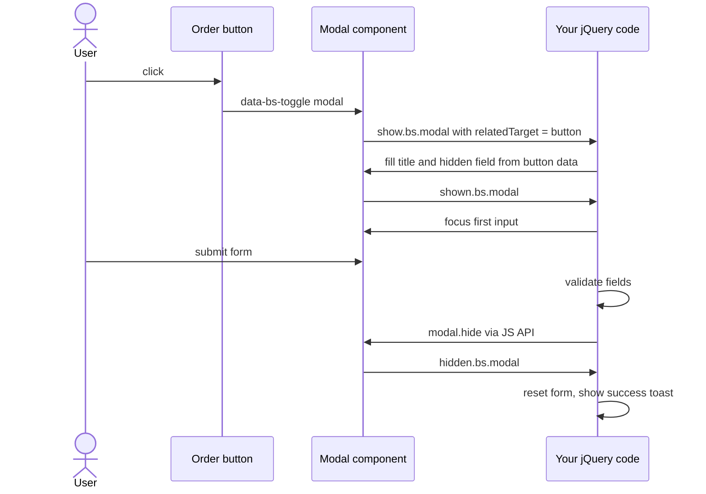
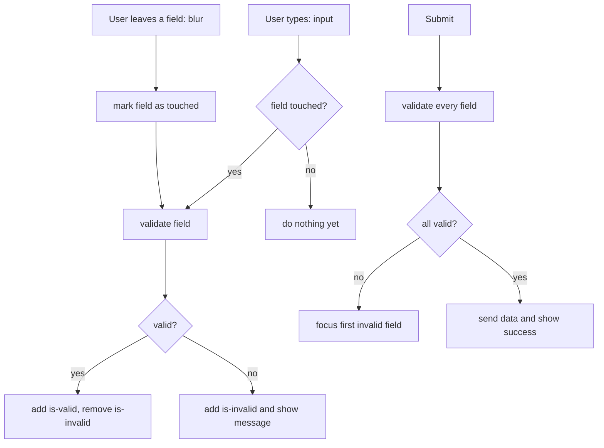
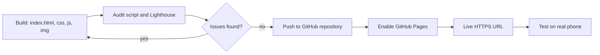
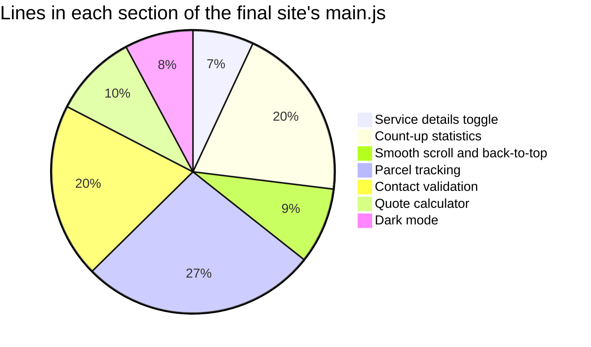

# Session 6 · Integrating and Enhancing with Bootstrap and jQuery

> [Prime AI – Software Engineering with AI](../../README.md) › [Term 1](../README.md) › [Bootstrap & jQuery for Responsive Web Pages](README.md) › **Session 6**

| ⏱ Estimated time | 🧩 Prerequisites |
|---|---|
| 3.5 hours | Sessions 1–5 |

[⬅ Previous: Designing Responsive Web Pages](session-05-designing-responsive-web-pages.md) &nbsp;|&nbsp; [Practice test ➡](practice-test.md)

---

## 🎯 Learning objectives

By the end of this session you will be able to:

- Control Bootstrap components from JavaScript and jQuery, and respond to their events.
- Validate forms in real time with jQuery and Bootstrap feedback styles.
- Integrate a third-party jQuery plugin (jQuery Validation) and add scroll-based enhancements.
- Apply best practices for performance, accessibility and maintainability in responsive sites.
- Build, audit and deploy a complete multi-section website to GitHub Pages or Netlify.

## 📖 Concepts

### 1. Bootstrap 5 + jQuery: who does what?

Bootstrap 5's JavaScript is written in **plain JavaScript** – it does not need jQuery. But the two work happily together:

| Job | Best tool |
|---|---|
| Layout, styling, components | Bootstrap CSS |
| Opening/closing components | Bootstrap JS (data attributes or its JS API) |
| Your page logic: validation, filtering, building content, effects | jQuery (or vanilla JS) |
| Old plugins (validation, sliders, date pickers) | jQuery plugins |

> 🤝 **Analogy – a restaurant.** Bootstrap is the furnished dining room and the trained waiters (components that already
> know how to open, close and slide). jQuery is the manager who gives instructions: "open table 4's menu", "when the
> guest pays, show the thank-you card".

### 2. Bootstrap's JavaScript API

Every interactive component is a **class** on the global `bootstrap` object:

```js
const el = document.getElementById('orderModal');
const modal = bootstrap.Modal.getOrCreateInstance(el);   // get the existing instance or create one
modal.show();      // also .hide(), .toggle(), .dispose()

bootstrap.Collapse.getOrCreateInstance('#faq1').toggle();
bootstrap.Carousel.getOrCreateInstance('#hero').to(2);    // go to slide 3
new bootstrap.Toast('#savedToast').show();
document.querySelectorAll('[data-bs-toggle="tooltip"]').forEach(t => new bootstrap.Tooltip(t));  // tooltips are opt-in
```

**Events** – components announce what is happening, in pairs: `show.bs.modal` (about to open – can be cancelled with
`preventDefault()`), `shown.bs.modal` (finished opening), `hide.bs.modal`, `hidden.bs.modal`. Similar events exist for
collapse, tab, carousel (`slide.bs.carousel`) and dropdown.

Because jQuery's `.on()` listens to native events, you can catch them with jQuery:

```js
$('#orderModal').on('show.bs.modal', function (e) {
  const $btn = $(e.relatedTarget);                 // the button that opened the modal
  $(this).find('.modal-title').text('Order: ' + $btn.data('cake'));
});
```

**jQuery interface.** If jQuery is present on `window`, Bootstrap 5 also registers jQuery-style plugins, so legacy code
such as `$('#orderModal').modal('show')` keeps working. Prefer the official API in new code.

### 3. Form validation – three levels

| Level | How | Pros / cons |
|---|---|---|
| **HTML5 attributes** | `required`, `type="email"`, `minlength`, `pattern` | Free, but default bubbles look different in every browser |
| **Bootstrap styles + your jQuery** | Add `novalidate`, check values yourself, toggle `.is-valid` / `.is-invalid`, show `.invalid-feedback` | Full control, consistent look |
| **A plugin** (jQuery Validation) | Declare rules; the plugin handles events, messages and focus | Fast to write for big forms; another dependency |

**Real-time validation pattern** – validate a field when the user **leaves** it (`blur`), then re-validate as they
**type** (`input`) once it has been touched, and validate everything on **submit**. Never rely only on the browser:
**always validate again on the server** – client-side checks are for user experience, not security.

**Accessibility of errors** – each `.invalid-feedback` should be linked with `aria-describedby`; set
`aria-invalid="true"` on bad fields; move focus to the first invalid field on submit.

### 4. Integrating third-party plugins – checklist

1. **Need it?** Could Bootstrap or 10 lines of your own code do it?
2. **Health check:** last release date, open issues, licence (MIT is common), size, jQuery version support.
3. **Load order:** jQuery → plugin CSS/JS → your script. Pin the version and use SRI.
4. **Initialise** inside document ready, with an options object; read the docs for events and methods.
5. **Style** it to match Bootstrap (many plugins expose `errorClass`, `validClass`, `errorPlacement` options).
6. **Test** on phones and with the keyboard.

### 5. Scroll enhancements without heavy plugins

- **Smooth scrolling** – CSS `html { scroll-behavior: smooth; }` (Bootstrap enables it when the user has not asked for
  reduced motion) or jQuery `$('html, body').animate({ scrollTop: target }, 500)` with an offset for a fixed navbar.
- **ScrollSpy** – Bootstrap highlights the navbar link of the section on screen:
  `<body data-bs-spy="scroll" data-bs-target="#mainNav">`.
- **Back-to-top button** – show it with `$(window).on('scroll')` when `scrollTop() > 400`.
- **Count-up numbers** – animate a number from 0 to a target the first time its section scrolls into view (jQuery
  `.animate()` on a plain object, or `IntersectionObserver`).
- Throttle scroll handlers (or use `IntersectionObserver`) so they don't run hundreds of times per second.

### 6. Best practices for responsive, interactive sites

| Area | Practice |
|---|---|
| **Performance** | Minified CDN files; scripts at the end of `<body>` or with `defer`; compress images (WebP); lazy-load; cache jQuery selections; delegate events |
| **Accessibility** | Semantic HTML, alt text, labels for every input, visible focus, colour contrast ≥ 4.5 : 1, keyboard-operable components, `prefers-reduced-motion` |
| **Maintainability** | Your CSS in `css/style.css`, your JS in `js/main.js`; comments; consistent naming; no inline `onclick` |
| **Security** | `.text()` for user content; SRI on CDN files; validate on the server too; HTTPS |
| **SEO basics** | One `<h1>`, descriptive `<title>` and meta description, meaningful link text (Module 4 goes deep) |

### 7. Creating and deploying a site – step by step

1. **Structure the folder**
   ```
   my-site/
   ├── index.html
   ├── css/style.css
   ├── js/main.js
   └── img/   (optimised images)
   ```
2. **Audit before publishing** – viewport, `<title>`, meta description, alt text, broken links, CDN files with SRI,
   image sizes (run the [pre-deploy audit](code/session-06_predeploy-audit.js) from this session).
3. **Run Lighthouse** in Chrome DevTools (Mobile) – aim for 90+ in Performance, Accessibility, Best Practices, SEO.
4. **Deploy to GitHub Pages** (free):
   - Create a public repository, upload the folder contents (or `git push` – Module 5 teaches Git).
   - *Settings › Pages › Build and deployment › Deploy from a branch › main / root › Save*.
   - After a minute the site is live at `https://<username>.github.io/<repo>/`.
5. **Or deploy to Netlify** – drag the folder onto the Netlify "Deploy manually" area; you get an HTTPS URL instantly
   and can attach a custom domain later.
6. **After launch** – open the live URL on a phone, re-run Lighthouse, fix and re-deploy.

⚠️ GitHub Pages URLs are case-sensitive and served from a sub-folder (`/repo/`), so always use **relative paths**
(`css/style.css`, not `/css/style.css` or `C:\Users\…`).

## 🧭 Diagrams

### Lifecycle of a Bootstrap modal and the events you can hook



### Real-time validation flow



### From folder to live website



## 💻 Worked examples

### Example 1 — Driving a Bootstrap modal with jQuery and the JS API

The page [`code/session-06_order-modal.html`](code/session-06_order-modal.html) has several "Order" buttons with
`data-cake` and `data-price`. One modal serves them all: jQuery listens for `show.bs.modal`, reads which button opened it
(`relatedTarget`), fills the modal, validates the quantity, closes the modal through the **Bootstrap API** and shows a
**toast**. The test fires the same events Bootstrap fires.

```js
// session-06_order-modal.js – one modal, many buttons (Bootstrap 5 + jQuery)
$(function () {
  const $modal = $('#orderModal');
  const orders = [];                                    // in a real site this would be sent to a server

  // 1. Before the modal opens, fill it from the button that triggered it
  $modal.on('show.bs.modal', function (e) {
    const $btn = $(e.relatedTarget);                    // the clicked "Order" button
    const cake = $btn.data('cake');
    const price = $btn.data('price');
    $(this).find('.modal-title').text(`Order: ${cake}`);
    $('#cakeName').val(cake);
    $('#unitPrice').val(price);
    $('#qty').val(1).removeClass('is-invalid');
    updateTotal();
  });

  // 2. After it has opened, put the cursor in the quantity box (accessibility)
  $modal.on('shown.bs.modal', () => $('#qty').trigger('focus'));

  // 3. Live total as the quantity changes
  function updateTotal() {
    const total = Number($('#qty').val()) * Number($('#unitPrice').val());
    $('#orderTotal').text(Number.isFinite(total) && total > 0 ? `Rs ${total.toLocaleString('en-US')}` : '–');
  }
  $('#qty').on('input', updateTotal);

  // 4. Submit: validate, save, close with the Bootstrap API, show a toast
  $('#orderForm').on('submit', function (e) {
    e.preventDefault();
    const qty = Number($('#qty').val());
    const ok = Number.isInteger(qty) && qty >= 1 && qty <= 10;
    $('#qty').toggleClass('is-invalid', !ok).attr('aria-invalid', String(!ok));
    if (!ok) return;

    orders.push({ cake: $('#cakeName').val(), qty, total: qty * Number($('#unitPrice').val()) });
    if (window.bootstrap) bootstrap.Modal.getOrCreateInstance($modal[0]).hide();
    $modal.trigger('order:placed', [orders.at(-1)]);     // custom event for other code (and our test)
  });

  // 5. When the modal has fully closed, reset the form and show a toast
  $modal.on('hidden.bs.modal', function () {
    $('#orderForm')[0].reset();
  });
  $modal.on('order:placed', function (e, order) {
    $('#toastBody').text(`${order.qty} × ${order.cake} added (Rs ${order.total.toLocaleString('en-US')}).`);
    $('#cartCount').text(orders.reduce((n, o) => n + o.qty, 0));
    if (window.bootstrap) bootstrap.Toast.getOrCreateInstance('#orderToast').show();
  });

  // 6. Opt-in components: tooltips must be initialised by you
  if (window.bootstrap) {
    $('[data-bs-toggle="tooltip"]').each(function () { bootstrap.Tooltip.getOrCreateInstance(this); });
  }
  window.getOrders = () => orders.slice();               // handy for debugging in the console
});
```

📄 Saved as [`code/session-06_order-modal.js`](code/session-06_order-modal.js)

**Output** (real run of `node session-06_order-modal-test.js`)

```text
Opened from Red Velvet  -> Order: Red Velvet | total Rs 2,800
Quantity 3              -> total Rs 8,400
Submitted               -> 3 × Red Velvet added (Rs 8,400). | cart 3
Opened from Lotus       -> Order: Lotus Biscoff | qty reset to 1
Quantity 25 submitted   -> is-invalid: true | aria-invalid: true | cart still 3
Orders so far           -> [{"cake":"Red Velvet","qty":3,"total":8400}]
```

### Example 2 — Real-time validation with jQuery + Bootstrap feedback

The registration form in [`code/session-06_validation.html`](code/session-06_validation.html) uses `novalidate` so
the browser stays quiet and our script decides. Rules live in one object, so adding a field is one line. Fields are
checked on `blur`, re-checked while typing once touched, and all at once on submit.

```js
// session-06_validation.js – real-time validation for session-06_validation.html
$(function () {
  const $form = $('#register');

  // One place for every rule: [test function, error message]
  const rules = {
    fullName: [v => v.trim().length >= 3, 'Please enter your full name (at least 3 letters).'],
    email: [v => /^[^\s@]+@[^\s@]+\.[^\s@]{2,}$/.test(v.trim()), 'Enter a valid email such as name@example.com.'],
    phone: [v => /^03\d{2}-?\d{7}$/.test(v.trim()), 'Use a Pakistani mobile number like 0300-1234567.'],
    password: [v => v.length >= 8 && /\d/.test(v) && /[A-Za-z]/.test(v), 'At least 8 characters with letters and a number.'],
    confirm: [v => v === $('#password').val() && v !== '', 'Passwords do not match.'],
    programme: [v => v !== '', 'Please choose a programme.'],
    terms: [(v, el) => el.checked, 'You must accept the terms.'],
  };

  // Validate one field; returns true/false and updates the UI
  function check(el) {
    const rule = rules[el.id];
    if (!rule) return true;
    const [test, message] = rule;
    const ok = test($(el).val() ?? '', el);
    $(el).toggleClass('is-valid', ok)
         .toggleClass('is-invalid', !ok)
         .attr('aria-invalid', String(!ok));
    $('#' + el.id + 'Error').text(ok ? '' : message);
    return ok;
  }

  // Leaving a field marks it "touched" and validates it
  $form.on('blur change', 'input, select', function () {
    $(this).data('touched', true);
    check(this);
    if (this.id === 'password' && $('#confirm').data('touched')) check($('#confirm')[0]);
  });

  // Typing re-validates only fields the user has already visited
  $form.on('input', 'input', function () {
    if ($(this).data('touched')) check(this);
  });

  // Password strength meter (a small extra)
  $('#password').on('input', function () {
    const v = $(this).val();
    const score = [v.length >= 8, /\d/.test(v), /[A-Z]/.test(v), /[^A-Za-z0-9]/.test(v)].filter(Boolean).length;
    $('#strength').css('width', score * 25 + '%')
                  .attr('aria-valuenow', score * 25)
                  .removeClass('bg-danger bg-warning bg-success')
                  .addClass(score <= 1 ? 'bg-danger' : score <= 3 ? 'bg-warning' : 'bg-success');
  });

  // Submit: validate everything, focus the first problem
  $form.on('submit', function (e) {
    e.preventDefault();
    const fields = $form.find('input, select').get();
    const results = fields.map(el => { $(el).data('touched', true); return check(el); });
    if (results.every(Boolean)) {
      $('#success').removeClass('d-none').text(`Welcome, ${$('#fullName').val().trim()}! Your account has been created.`);
      $form.addClass('d-none');
    } else {
      $form.find('.is-invalid').first().trigger('focus');
    }
  });
});
```

📄 Saved as [`code/session-06_validation.js`](code/session-06_validation.js)

**Output** (real run of `node session-06_validation-test.js`)

```text
1. Submit empty       fullName:ERR email:ERR phone:ERR password:ERR confirm:ERR programme:ERR terms:ERR
   focused field      fullName | Please enter your full name (at least 3 letters).
2. Name/email/phone   fullName:ok email:ERR phone:ok password:ERR confirm:ERR programme:ERR terms:ERR | Enter a valid email such as name@example.com.
3. Mismatch           fullName:ok email:ok phone:ok password:ok confirm:ERR programme:ERR terms:ERR | Passwords do not match.
   strength bar       75% progress-bar bg-warning
4. All fixed          fullName:ok email:ok phone:ok password:ok confirm:ok programme:ok terms:ok
5. Submit             Welcome, Areeba Zafar! Your account has been created. | form hidden: true
```

### Example 3 — Integrating a third-party plugin: jQuery Validation

The same kind of form, but the rules are declared for the **jQuery Validation** plugin (v1.21.0). Three options –
`errorClass`, `validClass` and `errorPlacement` – make the plugin produce Bootstrap's look. The test loads the real plugin
from npm and submits the form.

```html
<!DOCTYPE html>
<html lang="en">
<head>
  <meta charset="UTF-8">
  <meta name="viewport" content="width=device-width, initial-scale=1">
  <title>jQuery Validation plugin</title>
  <link href="https://cdn.jsdelivr.net/npm/bootstrap@5.3.3/dist/css/bootstrap.min.css" rel="stylesheet"
        integrity="sha384-QWTKZyjpPEjISv5WaRU9OFeRpok6YctnYmDr5pNlyT2bRjXh0JMhjY6hW+ALEwIH" crossorigin="anonymous">
</head>
<body>
  <main class="container py-4" style="max-width: 560px">
    <h1 class="h3">Workshop sign-up</h1>
    <form id="workshop" novalidate>
      <div class="mb-3">
        <label for="wName" class="form-label">Name</label>
        <input id="wName" name="wName" class="form-control">
      </div>
      <div class="mb-3">
        <label for="wEmail" class="form-label">Email</label>
        <input id="wEmail" name="wEmail" type="email" class="form-control">
      </div>
      <div class="mb-3">
        <label for="wSeats" class="form-label">Seats (1–4)</label>
        <input id="wSeats" name="wSeats" type="number" class="form-control">
      </div>
      <div class="mb-3">
        <label for="wCode" class="form-label">Student code</label>
        <input id="wCode" name="wCode" class="form-control" placeholder="e.g. KHI-2041">
      </div>
      <button class="btn btn-primary">Reserve</button>
    </form>
    <div id="done" class="alert alert-success d-none mt-3"></div>
  </main>

  <script src="https://code.jquery.com/jquery-3.7.1.min.js"
          integrity="sha384-1H217gwSVyLSIfaLxHbE7dRb3v4mYCKbpQvzx0cegeju1MVsGrX5xXxAvs/HgeFs" crossorigin="anonymous"></script>
  <!-- 1. Plugin AFTER jQuery, pinned version + SRI -->
  <script src="https://cdn.jsdelivr.net/npm/jquery-validation@1.21.0/dist/jquery.validate.min.js"
          integrity="sha384-INLNT6YPpjCRFM2xpOexEE3T4i2mIigf+Kr19b7a59RFtrVBZQzZWXkGuiMA/q1r" crossorigin="anonymous"></script>
  <script>
    $(function () {
      // 2. A custom rule: student codes look like ABC-1234
      $.validator.addMethod('studentCode', (value, el) => /^[A-Z]{3}-\d{4}$/.test(value),
        'Format: three capital letters, a dash and four digits.');

      // 3. Initialise with rules, messages and Bootstrap-friendly options
      $('#workshop').validate({
        rules: {
          wName: { required: true, minlength: 3 },
          wEmail: { required: true, email: true },
          wSeats: { required: true, digits: true, range: [1, 4] },
          wCode: { required: true, studentCode: true },
        },
        messages: {
          wName: { required: 'Tell us your name.', minlength: 'At least {0} characters.' },
          wSeats: { range: 'Choose between {0} and {1} seats.' },
        },
        errorClass: 'is-invalid',               // Bootstrap's red border
        validClass: 'is-valid',                 // Bootstrap's green border
        errorElement: 'div',
        errorPlacement: (error, element) => error.addClass('invalid-feedback').insertAfter(element),
        submitHandler: form => {                // runs only when every rule passes
          $('#done').removeClass('d-none').text(`Reserved ${$('#wSeats').val()} seat(s) for ${$('#wName').val()}.`);
          $(form).addClass('d-none');
        },
      });
    });
  </script>
</body>
</html>
```

📄 Saved as [`code/session-06_plugin-validate.html`](code/session-06_plugin-validate.html)

**Output** (real run of `node session-06_plugin-validate-test.js`)

```text
plugin loaded: $.validator exists = true
Empty submit ->
   wName: Tell us your name.
   wEmail: This field is required.
   wSeats: This field is required.
   wCode: This field is required.
Second try ->
   wSeats: Choose between 1 and 4 seats.
   wCode: Format: three capital letters, a dash and four digits.
   classes: wName=form-control is-valid | wSeats=form-control is-invalid
Fixed -> Reserved 2 seat(s) for Bilal. | valid(): true
```

### Example 4 — Pre-deploy audit – catch problems before you publish

A Node script that inspects every HTML file in a folder (here: the final project site) and checks the items on the
deployment checklist: viewport, title, meta description, one `h1`, alt text, labelled inputs, CDN files with SRI and
missing local files.

```js
// session-06_predeploy-audit.js  (run: node session-06_predeploy-audit.js [folder])
// Checks every .html file in a folder against a pre-deployment checklist.
const fs = require('fs');
const path = require('path');
const { JSDOM } = require('jsdom');

const folder = path.resolve(__dirname, process.argv[2] || 'session-06_final-site');
const htmlFiles = fs.readdirSync(folder).filter(f => f.endsWith('.html'));
let problems = 0;

for (const file of htmlFiles) {
  const doc = new JSDOM(fs.readFileSync(path.join(folder, file), 'utf8')).window.document;
  const checks = [];
  const add = (ok, label) => { checks.push(`${ok ? '✔' : '✘'} ${label}`); if (!ok) problems++; };

  add(!!doc.querySelector('meta[name="viewport"]'), 'viewport meta tag');
  const title = doc.title.trim();
  add(title.length >= 10 && title.length <= 60, `title length ${title.length} (10–60)`);
  const desc = doc.querySelector('meta[name="description"]')?.content ?? '';
  add(desc.length >= 50 && desc.length <= 160, `meta description length ${desc.length} (50–160)`);
  add(doc.querySelectorAll('h1').length === 1, `exactly one h1 (found ${doc.querySelectorAll('h1').length})`);

  const noAlt = [...doc.images].filter(i => !i.hasAttribute('alt'));
  add(noAlt.length === 0, `all ${doc.images.length} images have alt text`);

  const inputs = [...doc.querySelectorAll('input:not([type=hidden]), select, textarea')];
  const unlabeled = inputs.filter(i => !(i.id && doc.querySelector(`label[for="${i.id}"]`)) && !i.getAttribute('aria-label'));
  add(unlabeled.length === 0, `all ${inputs.length} form fields are labelled`);

  const cdn = [...doc.querySelectorAll('script[src^="http"], link[rel=stylesheet][href^="http"]')];
  const noSri = cdn.filter(el => !el.hasAttribute('integrity'));
  add(noSri.length === 0, `${cdn.length} CDN files, ${noSri.length} without SRI`);

  const local = [...doc.querySelectorAll('script[src], link[href], img[src], a[href]')]
    .map(el => el.getAttribute('src') || el.getAttribute('href'))
    .filter(u => u && !/^(https?:|mailto:|tel:|#|data:)/.test(u));
  const missing = local.filter(u => !fs.existsSync(path.join(folder, u.split('#')[0])));
  add(missing.length === 0, `${local.length} local links/assets, ${missing.length} missing${missing.length ? ': ' + missing.join(', ') : ''}`);

  const kb = (fs.statSync(path.join(folder, file)).size / 1024).toFixed(1);
  console.log(`\n${file} (${kb} KB)`);
  checks.forEach(c => console.log('  ' + c));
}

const assets = ['css/style.css', 'js/main.js'].filter(f => fs.existsSync(path.join(folder, f)))
  .map(f => `${f} ${(fs.statSync(path.join(folder, f)).size / 1024).toFixed(1)} KB`);
console.log(`\nAssets: ${assets.join(' · ')}`);
console.log(problems === 0 ? 'READY TO DEPLOY ✅' : `${problems} problem(s) to fix before deploying ❌`);
```

📄 Saved as [`code/session-06_predeploy-audit.js`](code/session-06_predeploy-audit.js)

**Output** (real run of `node session-06_predeploy-audit.js`)

```text
index.html (12.0 KB)
  ✔ viewport meta tag
  ✔ title length 45 (10–60)
  ✔ meta description length 133 (50–160)
  ✔ exactly one h1 (found 1)
  ✔ all 0 images have alt text
  ✔ all 6 form fields are labelled
  ✔ 3 CDN files, 0 without SRI
  ✔ 2 local links/assets, 0 missing

Assets: css/style.css 1.5 KB · js/main.js 6.0 KB
READY TO DEPLOY ✅
```

## 🧩 Real-life coding problem

**Scenario – the module capstone: "Indus Logistics" business website.** A Karachi courier company wants a one-page
site that looks professional on every device and actually *does* things:

| Section | Requirements |
|---|---|
| Navbar | Sticky, collapses on phones, **ScrollSpy** highlights the current section, smooth scroll with offset |
| Hero | Headline, sub-text, "Get a quote" button that opens a **modal** |
| Services | 6 cards (1/2/3 per row); clicking "Details" **slides** extra text open with jQuery |
| Stats | 4 numbers that **count up** the first time they scroll into view |
| Tracking | Input for a tracking number (`IL-` + 6 digits); jQuery validates it and shows a status from a small in-page dataset |
| Testimonials | Bootstrap **carousel** |
| Contact | Form with real-time jQuery validation and Bootstrap feedback |
| Extras | Back-to-top button, dark-mode toggle, footer |

**How the pieces map to what you learnt**
- Sessions 1, 2, 5 → layout, components and responsiveness.
- Session 3 → selectors and events (tracking form, delegated "Details" buttons).
- Session 4 → `.slideToggle()`, `.animate()` on numbers, DOM building for the tracking result.
- Session 6 → modal events, validation, scroll enhancements, audit and deployment.

The complete site lives in its own folder:

| File | Purpose |
|---|---|
| [`code/session-06_final-site/index.html`](code/session-06_final-site/index.html) | All sections, fully commented |
| [`code/session-06_final-site/css/style.css`](code/session-06_final-site/css/style.css) | Brand colours via Bootstrap CSS variables, hero, small custom styles |
| [`code/session-06_final-site/js/main.js`](code/session-06_final-site/js/main.js) | All jQuery behaviour |
| [`code/session-06_final-site/README.md`](code/session-06_final-site/README.md) | How to run, test and deploy it |

**Automated test of the finished site** – [`code/session-06_final-site-test.js`](code/session-06_final-site-test.js):

```text
Details toggle  : Hide details | aria-expanded true | panel shown true
Counters        : 12,500 · 35 · 98 · 240
Track 12345     : invalid format
Track IL-999999 : No parcel found for IL-999999. Check the number on your receipt.
Track il-204518 : IL-204518: Out for delivery | Gulshan-e-Iqbal hub | Out for delivery
Quote           : Rs 950
Contact empty   : cName, cEmail, cMsg | focus on cName
Contact valid   : Thank you, Sadia Malik! We will reply within one working day.
Theme           : dark | button ☀️ | saved dark
```

**Pre-deploy audit of the finished site** (Example 4 above):

```text

index.html (12.0 KB)
  ✔ viewport meta tag
  ✔ title length 45 (10–60)
  ✔ meta description length 133 (50–160)
  ✔ exactly one h1 (found 1)
  ✔ all 0 images have alt text
  ✔ all 6 form fields are labelled
  ✔ 3 CDN files, 0 without SRI
  ✔ 2 local links/assets, 0 missing

Assets: css/style.css 1.5 KB · js/main.js 6.0 KB
READY TO DEPLOY ✅
```

## ⚠️ Common mistakes

| Mistake | Symptom | Fix |
|---|---|---|
| Creating a new `bootstrap.Modal(el)` on every click | Duplicate backdrops, modal won't close | `bootstrap.Modal.getOrCreateInstance(el)` |
| Expecting tooltips to work from attributes alone | Nothing appears on hover | Tooltips/popovers are opt-in – initialise them in JS |
| Using `click` on the Order button to fill the modal | Works for mouse but not for keyboard/programmatic opening | Use `show.bs.modal` + `e.relatedTarget` |
| Only client-side validation | Anyone can bypass it with DevTools | Validate again on the server |
| Plugin initialised before the plugin script loads | `$(...).validate is not a function` | Load order: jQuery → plugin → your code |
| Scroll handler doing heavy work every pixel | Janky scrolling on phones | Do minimal work, use a flag (`once`) or `IntersectionObserver` |
| Absolute paths (`/css/style.css`) on GitHub Pages | Unstyled site (404 for CSS) | Use relative paths (`css/style.css`) |
| Forgetting to test the live URL | Mixed-content or case-sensitive file-name errors | Open the deployed site on a phone and in DevTools Console |

## 🌟 Best practices

- Let Bootstrap own component behaviour; use jQuery for **your** logic, wired through Bootstrap's events.
- One rules object per form; validate on blur/input/submit; link errors with `aria-describedby`; focus the first error.
- Evaluate plugins before adding them (maintenance, size, licence); pin versions with SRI.
- Keep structure, style and behaviour in separate files (`index.html`, `css/style.css`, `js/main.js`).
- Run an automated audit + Lighthouse before **every** deployment; keep the site in Git so you can roll back.

## 🏗️ Mini project

**Mini project – deploy your own version.** Copy `session-06_final-site/`, rebrand it for a real or imaginary local
business (a tuition centre, a tailoring shop, a café), change the services, colours and copy, run
`node session-06_predeploy-audit.js your-folder` until it prints **READY TO DEPLOY ✅**, then publish it with GitHub
Pages and share the URL with your class. The step-by-step deployment guide is in the site's
[README](code/session-06_final-site/README.md).

## 📦 Project files for this session

| File | What it is |
|---|---|
| 📄 [`code/session-06_order-modal.html`](code/session-06_order-modal.html) | Page for Example 1: cards with Order buttons, one shared modal, a toast and a tooltip |
| 📄 [`code/session-06_order-modal-test.js`](code/session-06_order-modal-test.js) | Test: fires show.bs.modal from two different buttons, submits valid and invalid quantities |
| 📄 [`code/session-06_validation.html`](code/session-06_validation.html) | Registration form page for the real-time validation example |
| 📄 [`code/session-06_validation-test.js`](code/session-06_validation-test.js) | Test: empty submit, fixing fields one by one, password mismatch, success |
| 📄 [`code/session-06_plugin-validate-test.js`](code/session-06_plugin-validate-test.js) | Test for the jQuery Validation plugin page using the real plugin from npm |
| 📄 [`code/session-06_scroll-effects.html`](code/session-06_scroll-effects.html) | Scroll enhancements: ScrollSpy, smooth scroll with offset, back-to-top, count-up stats |
| 📄 [`code/session-06_final-site/index.html`](code/session-06_final-site/index.html) | Final project – Indus Logistics one-page business site (HTML) |
| 📄 [`code/session-06_final-site/css/style.css`](code/session-06_final-site/css/style.css) | Final project – brand styles (Bootstrap CSS variables, hero, small helpers) |
| 📄 [`code/session-06_final-site/js/main.js`](code/session-06_final-site/js/main.js) | Final project – all jQuery behaviour (details, counters, tracking, validation, quote, theme, back-to-top) |
| 📄 [`code/session-06_final-site/README.md`](code/session-06_final-site/README.md) | Final project – how to run, test and deploy the site |
| 📄 [`code/session-06_final-site-test.js`](code/session-06_final-site-test.js) | Automated user-journey test of the final site |

## 📊 At a glance

**Validation approaches compared** (for the 7-field registration form in this session):

| Approach | Lines of JS we wrote | Consistent look | Real-time feedback | Custom rules | Extra download |
|---|---|---|---|---|---|
| HTML5 attributes only | 0 | ❌ browser bubbles | ⚠️ on submit | ⚠️ `pattern` only | none |
| jQuery + Bootstrap classes (Example 2) | ≈ 60 | ✅ | ✅ | ✅ any JS | none |
| jQuery Validation plugin (Example 3) | ≈ 25 | ✅ (3 options) | ✅ | ✅ `addMethod` | ≈ 25 KB minified |



*Measured from [`code/session-06_final-site/js/main.js`](code/session-06_final-site/js/main.js), including comments and blank lines. Tracking and validation – the parts that handle user input – take the most code.*

## 🧪 Lab / practice tasks

**🟢 Easy** — On the order-modal page, add a **Bootstrap tooltip** to each Order button ("Fresh today") and make sure it appears on hover and keyboard focus.

<details><summary>💡 Hint</summary>

Add `data-bs-toggle` cannot be used twice on one element, so wrap the button in a `<span data-bs-toggle="tooltip" data-bs-title="Fresh today" tabindex="0">`, then initialise tooltips in JS.

</details>

<details><summary>✅ Solution</summary>

```html
<span class="d-inline-block" tabindex="0" data-bs-toggle="tooltip" data-bs-title="Fresh today">
  <button class="btn btn-danger" data-bs-toggle="modal" data-bs-target="#orderModal" data-cake="Red Velvet" data-price="2800">Order</button>
</span>
```
```js
$('[data-bs-toggle="tooltip"]').each(function () { bootstrap.Tooltip.getOrCreateInstance(this); });
```

</details>

**🟡 Medium** — Add a **CNIC** field (format `12345-1234567-1`) to the registration form with live validation and an auto-dash: as the user types digits, insert the dashes automatically.

<details><summary>💡 Hint</summary>

On `input`, strip non-digits, cut to 13, then rebuild with `slice(0,5)`, `slice(5,12)`, `slice(12)`. Add a rule `/^\d{5}-\d{7}-\d$/`.

</details>

<details><summary>✅ Solution</summary>

```js
rules.cnic = [v => /^\d{5}-\d{7}-\d$/.test(v), 'CNIC format: 12345-1234567-1'];
$('#cnic').on('input', function () {
  const d = $(this).val().replace(/\D/g, '').slice(0, 13);
  const parts = [d.slice(0, 5), d.slice(5, 12), d.slice(12)].filter(Boolean);
  $(this).val(parts.join('-'));
});
```

</details>

**🔴 Hard** — Make the final site's "Get a quote" modal open **automatically once** per visitor after they have scrolled 60% of the page, using the Bootstrap API and `sessionStorage` so it does not pop up again in the same session.

<details><summary>💡 Hint</summary>

In the scroll handler compute `scrollTop / (docHeight - winHeight)`. Use `bootstrap.Modal.getOrCreateInstance("#quoteModal").show()` and set a flag in `sessionStorage`.

</details>

<details><summary>✅ Solution</summary>

```js
$(window).on('scroll.autoquote', function () {
  const progress = $(window).scrollTop() / ($(document).height() - $(window).height());
  if (progress > 0.6 && !sessionStorage.getItem('quoteShown')) {
    sessionStorage.setItem('quoteShown', '1');
    bootstrap.Modal.getOrCreateInstance('#quoteModal').show();
    $(window).off('scroll.autoquote');      // namespaced: remove only this handler
  }
});
```

</details>

**🏆 Challenge** — Deploy your rebranded final site to GitHub Pages. Run `node session-06_predeploy-audit.js <your-folder>` until it reports **READY TO DEPLOY ✅**, then run Lighthouse (Mobile) on the live URL and record the four scores. Fix the lowest score and redeploy.

<details><summary>💡 Hint</summary>

Common Lighthouse fixes: add `width`/`height` to images, compress the hero image, add `rel="noopener"` to external `target="_blank"` links, ensure colour contrast, and give every button an accessible name.

</details>

<details><summary>✅ Solution</summary>

A good submission includes: the live URL, a screenshot of the audit output, Lighthouse scores before and after, and a
short note of what you changed (e.g. "converted hero to WebP: Performance 78 → 93").

</details>

## ✅ Quick quiz

**Q1. Which method safely gets a Bootstrap modal instance without creating duplicates?**

- A) `new bootstrap.Modal(el)` every time
- B) `bootstrap.Modal.getOrCreateInstance(el)`
- C) `$(el).modal()` only
- D) `bootstrap.getModal(el)`

<details><summary>Show answer</summary>

**B** — It reuses an existing instance.

</details>

**Q2. In a `show.bs.modal` handler, `e.relatedTarget` is:**

- A) The modal
- B) The element that triggered the modal
- C) The backdrop
- D) Always undefined

<details><summary>Show answer</summary>

**B** — Bootstrap passes the triggering button.

</details>

**Q3. Why still validate on the server if jQuery validates the form?**

- A) Servers are faster
- B) Client-side checks can be bypassed, so they are only for user experience
- C) jQuery cannot read inputs
- D) Bootstrap requires it

<details><summary>Show answer</summary>

**B** — Never trust the client.

</details>

**Q4. Which option makes jQuery Validation add Bootstrap's red border?**

- A) `errorClass: "is-invalid"`
- B) `highlight: "red"`
- C) `bootstrap: true`
- D) `invalid: true`

<details><summary>Show answer</summary>

**A** — errorClass is added to invalid fields.

</details>

**Q5. On GitHub Pages your CSS does not load. The most likely cause is:**

- A) Bootstrap is too new
- B) An absolute path like /css/style.css instead of css/style.css
- C) jQuery version
- D) Missing alt text

<details><summary>Show answer</summary>

**B** — Project sites live under /repo/, so root-absolute paths break.

</details>

## 📝 Summary / cheat-sheet

- Bootstrap 5 JS is plain JavaScript; jQuery adds your page logic and can listen to Bootstrap events.
- API: `bootstrap.Modal.getOrCreateInstance(el).show()`; events `show/shown/hide/hidden.bs.modal`; `e.relatedTarget` = trigger.
- Tooltips and popovers are opt-in – initialise them in JS.
- Real-time validation: blur → touched + check, input → re-check, submit → check all and focus first error; mirror on the server.
- Plugins: evaluate, load after jQuery with SRI, initialise with options, style with Bootstrap classes.
- Scroll extras: ScrollSpy, smooth scroll with offset, back-to-top, count-up once; keep scroll handlers light.
- Deploy: relative paths, audit + Lighthouse, GitHub Pages (Settings › Pages) or Netlify drag-and-drop, test the live URL.

## 🎤 Interview / viva questions

1. **How can jQuery code react when a Bootstrap modal opens?**
   <details><summary>Model answer</summary>

   Bind a handler to the modal for show.bs.modal or shown.bs.modal with $(modal).on(...); Bootstrap dispatches these as DOM events which jQuery receives, including relatedTarget for the trigger.

   </details>

2. **What is the difference between `show.bs.modal` and `shown.bs.modal`?**
   <details><summary>Model answer</summary>

   show fires immediately when opening starts and can be cancelled; shown fires after the transition has finished, which is the right moment to move focus into the modal.

   </details>

3. **Describe a good real-time validation UX.**
   <details><summary>Model answer</summary>

   Do not shout errors before the user has visited a field; validate on blur, then live while typing, show clear messages next to fields linked by aria-describedby, and on submit focus the first invalid field.

   </details>

4. **What do you check before adding a third-party plugin?**
   <details><summary>Model answer</summary>

   Whether it is necessary, how actively it is maintained, its licence, size, compatibility with your jQuery/Bootstrap versions, accessibility and documentation; then pin the version with SRI.

   </details>

5. **List the steps to deploy a static site on GitHub Pages.**
   <details><summary>Model answer</summary>

   Push the files to a public repository, open Settings › Pages, deploy from the main branch root, wait for the build and open username.github.io/repo; use relative paths and test the live URL.

   </details>

6. **Name three performance best practices for a Bootstrap + jQuery site.**
   <details><summary>Model answer</summary>

   Use minified files from a CDN with caching, load scripts at the end of body or with defer, compress and lazy-load images with srcset, and cache jQuery selections/delegate events.

   </details>

---

[⬅ Previous: Designing Responsive Web Pages](session-05-designing-responsive-web-pages.md) &nbsp;|&nbsp; [Practice test ➡](practice-test.md)

<sub>Prepared by **Hamna Zahid Khan**, Junior Lecturer · Prime AI – Software Engineering with AI</sub>
