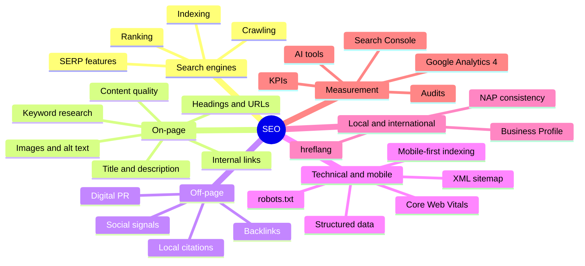

# Module 04 · Optimize Web for Search Engines (SEO)

> [Prime AI – Software Engineering with AI](../../README.md) › [Term 1](../README.md) › **Optimize Web for Search Engines (SEO)**

You can build a beautiful, responsive website – but if nobody can **find** it, it does not help anyone. **Search
Engine Optimization (SEO)** is the practice of making a site easy for search engines to understand and genuinely useful
for the people searching, so that it appears for the right searches without paying for ads.

In this module you will look **inside** a search engine (you will even build a tiny one in JavaScript), then learn the
on-page, off-page, mobile, technical, local and international techniques professionals use, and finish with the tools
and analytics that prove whether your work is paying off.

Every technique is practised on a small demo website – **Karachi Tutors**, a home-tuition business – which lives in
[`code/demo-site/`](code/demo-site/). It contains deliberate SEO mistakes; the Node.js tools you write in each session
find and fix them.

**Tools:** VS Code, Node.js 18+, a browser with DevTools/Lighthouse, and free accounts for Google Search Console and
Google Analytics 4 (optional but recommended).

## 🎯 Module objectives

- Explain the components of a search engine and how pages are crawled, indexed and ranked.
- Use Google search settings and advanced operators for research and quick audits.
- Research keywords by intent and optimise titles, descriptions, headings, URLs, images, content and internal links.
- Plan ethical off-page SEO: earning quality backlinks and integrating social media.
- Apply mobile and technical SEO: mobile-first indexing, Core Web Vitals, sitemaps, robots.txt and structured data.
- Apply local and international SEO (Google Business Profile, NAP, hreflang) and Social Media Optimization.
- Measure results with Search Console and Google Analytics 4, run a full audit and build a 30-day SEO plan, using AI tools responsibly.

## 🗂️ Sessions

| # | Session | Time | What you will cover |
|---|---|---|---|
| 1 | [Understanding Search Engines and SEO Components](session-01-understanding-search-engines-and-seo-components.md) | 3 hours | Identify the components of a search engine: crawler, index, ranking system and results page; Explain step by step how pages are crawled, indexed and ranked; Define SEO, its types (on-page, off-page, technical, local) and why it matters to a business |
| 2 | [On-page and Off-page Optimization Techniques](session-02-on-page-and-off-page-optimization.md) | 3.5 hours | Explain why on-page optimisation matters and what elements it covers; Carry out keyword research by search intent, volume, difficulty and opportunity, and map keywords to pages; Optimise titles, meta descriptions, headings, URLs, images, content and internal links on real pages |
| 3 | [Mobile SEO, Technical SEO and Local Content](session-03-mobile-seo-and-more.md) | 3.5 hours | Explain mobile SEO and mobile-first indexing, and why mobile visibility decides most rankings today; Describe factors that affect mobile rankings – Core Web Vitals, responsive design, usability – and build mobile-friendly XML sitemaps; Add structured data (JSON-LD) for rich results and validate it |
| 4 | [Advanced SEO Techniques and Tools](session-04-advanced-seo-techniques-and-tools.md) | 3.5 hours | Explain advanced SEO strategies: technical audits, canonicalisation, redirects, crawl budget, topic authority and AI-era search; Define localization and internationalization and apply international SEO tactics including hreflang; Outline the role of Social Media Optimization (SMO) and track campaigns with UTM parameters |
| 📝 | [Module practice test](practice-test.md) | 1 hour | 20 MCQs + 3 practical questions |

## 🧭 Concept map

## 📄 One-page cheat-sheet

| Area | Must-know facts |
|---|---|
| **How search works** | **Crawl** (bots follow links, obey robots.txt) → **Index** (store and understand pages) → **Rank** (order results for a query by relevance, quality, usability) → **SERP** |
| **Types of SEO** | On-page (content + HTML) · Off-page (links, mentions, social) · Technical (crawlability, speed, mobile, structured data) · Local · International |
| **Operators** | `site:example.com` · `"exact phrase"` · `-exclude` · `OR` · `intitle:` · `inurl:` · `filetype:pdf` · `before:2025-01-01` / `after:` · `*` wildcard |
| **Keyword intent** | Informational ("how to…") · Navigational (brand) · Commercial ("best… reviews") · Transactional ("buy… near me") · prefer long-tail for new sites |
| **Title tag** | Unique per page, ≈ 50–60 characters, main keyword near the start, brand at the end |
| **Meta description** | ≈ 120–160 characters, a persuasive summary with the keyword; not a ranking factor but affects CTR |
| **Headings & URLs** | One `<h1>` describing the page, logical `h2`/`h3`; short, lowercase, hyphenated URLs (`/maths-tuition-karachi`) |
| **Images** | Descriptive file names, `alt` text, compressed (WebP), `width`/`height`, lazy-load below the fold |
| **Links** | Descriptive internal anchor text; fix broken links; `rel="nofollow"`/`"sponsored"`/`"ugc"` for paid/untrusted links |
| **Backlinks** | Quality > quantity: relevant, trusted sites, natural anchors; never buy links or use link farms |
| **Mobile** | Google uses **mobile-first indexing**; responsive design, viewport tag, readable fonts, tap targets |
| **Core Web Vitals** | **LCP** ≤ 2.5 s good / > 4 s poor · **INP** ≤ 200 ms / > 500 ms · **CLS** ≤ 0.1 / > 0.25 (75th percentile of real users) |
| **Crawl control** | `robots.txt` (crawl rules + sitemap location) · `<meta name="robots" content="noindex">` (keep out of index) · `rel="canonical"` (preferred URL) · `sitemap.xml` |
| **Structured data** | JSON-LD `<script type="application/ld+json">` with schema.org types: `LocalBusiness`, `Article`, `FAQPage`, `Product`, `BreadcrumbList` |
| **Local SEO** | Google Business Profile, consistent **NAP** (Name, Address, Phone), reviews, local keywords, `LocalBusiness` schema |
| **International** | `hreflang` (`en-pk`, `ur-pk`, `x-default`), reciprocal links, one language per URL, ccTLD / sub-folder / sub-domain |
| **Metrics** | Impressions · Clicks · **CTR = clicks ÷ impressions** · average position · sessions · engagement rate · conversions |
| **Tools** | Search Console, GA4, Lighthouse/PageSpeed Insights, Screaming Frog, Semrush/Ahrefs/Ubersuggest, Yoast/Rank Math, schema validators |

## 🚀 How to study this module

1. Read each session in order; type every example yourself instead of copy-pasting.
2. Run the files in [`code/`](code/) and compare your output with the **Output** blocks.
3. Finish the 🟢 and 🟡 labs before class; attempt 🔴/🏆 labs with a partner.
4. Close the module with the [practice test](practice-test.md) and revise the cheat-sheet above.

---

Prepared by **Hamna Zahid Khan**, Junior Lecturer · Prime AI – Software Engineering with AI
