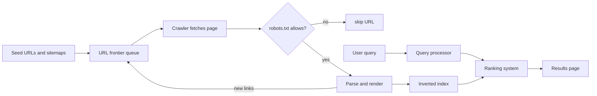
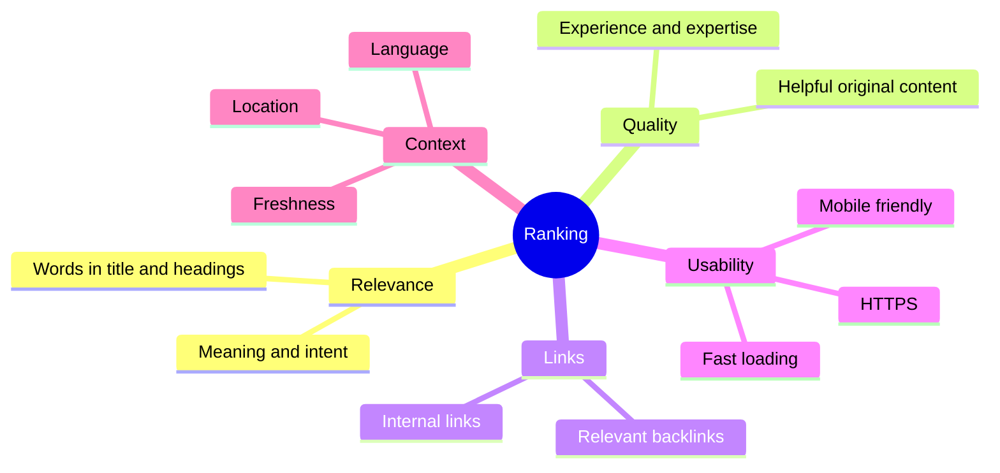
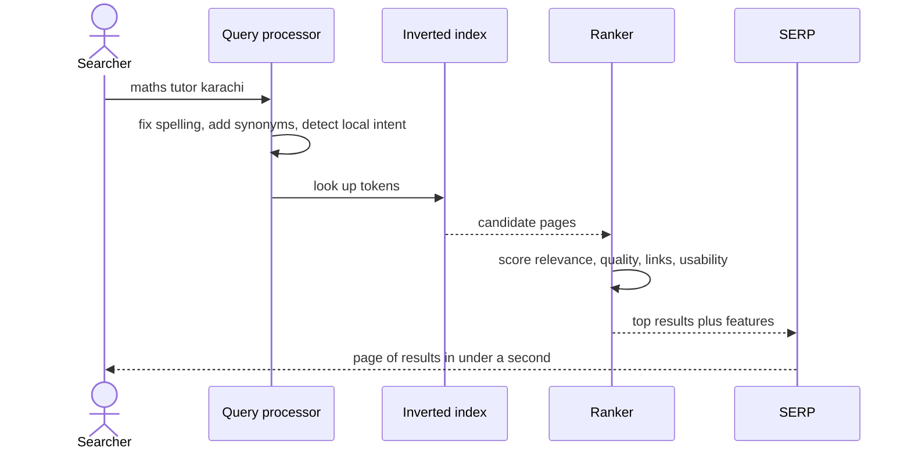
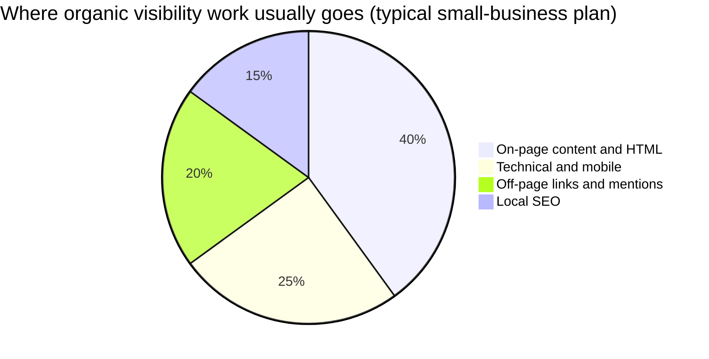

# Session 1 · Understanding Search Engines and SEO Components

> [Prime AI – Software Engineering with AI](../../README.md) › [Term 1](../README.md) › [Optimize Web for Search Engines (SEO)](README.md) › **Session 1**

| ⏱ Estimated time | 🧩 Prerequisites |
|---|---|
| 3 hours | Module 2 (HTML) – you should be able to read a web page's source |

[⬅ Module overview](README.md) &nbsp;|&nbsp; [Next: On-page and Off-page Optimization Techniques ➡](session-02-on-page-and-off-page-optimization.md)

---

## 🎯 Learning objectives

By the end of this session you will be able to:

- Identify the components of a search engine: crawler, index, ranking system and results page.
- Explain step by step how pages are crawled, indexed and ranked.
- Define SEO, its types (on-page, off-page, technical, local) and why it matters to a business.
- Outline basic, ethical SEO techniques and recognise black-hat tactics to avoid.
- Use Google Search settings and advanced search operators for research and quick site audits.

## 📖 Concepts

### 1. What is a search engine?

A **search engine** is software that collects billions of web pages, organises them, and – in a fraction of a second –
returns the most useful ones for whatever a person types. **Google** handles the large majority of web searches
worldwide (around 90% according to StatCounter), with **Bing**, **Yandex**, **Baidu** (China), **DuckDuckGo** and others
sharing the rest. YouTube, Amazon and app stores are search engines too.

> 📚 **Analogy – the world's biggest library.** Crawlers are librarians who walk every street collecting new books
> (pages). The **index** is the giant catalogue that records every word and where it appears. The **ranking system** is
> the expert librarian who, when you ask a question, picks the ten best books from the catalogue and hands them to you
> in order. The **SERP** is the desk where they are laid out.

### 2. The components of a search engine

| Component | Job | Real-world detail |
|---|---|---|
| **Crawler** (spider, bot – e.g. *Googlebot*) | Downloads pages and follows their links to discover new ones | Reads `robots.txt` first; revisits popular pages more often |
| **URL frontier / scheduler** | Queue of URLs waiting to be crawled, prioritised | Your **XML sitemap** helps fill it |
| **Parser & renderer** | Extracts text, links, titles, structured data; runs JavaScript | Google renders pages in a headless Chrome |
| **Index** | Database mapping every word (token) to the pages containing it – an **inverted index** | Also stores language, freshness, canonical URL, signals |
| **Ranking system** | Scores indexed pages for a query using hundreds of signals | Relevance, quality/trust, links, usability, location, freshness |
| **Query processor** | Understands what the user means: spelling, synonyms, intent | "cheap tutor khi" ≈ "affordable tutor Karachi" |
| **SERP** (Search Engine Results Page) | Displays results and features | Organic results, ads, map pack, featured snippet, People Also Ask, images, videos |

### 3. How it works – step by step

**Step 1 – Crawling.** Googlebot starts from known URLs (previous crawls, sitemaps, links from other sites), downloads
each page and adds every new link it finds to the queue. It obeys `robots.txt` rules such as `Disallow: /admin/`.
Pages that no link points to (**orphan pages**) may never be found.

**Step 2 – Indexing.** The page is parsed and rendered; its text is split into **tokens** (words), normalised
(lower-case, stemming "studies" → "studi") and stored in the **inverted index**:

| Token | Pages (with positions) |
|---|---|
| `maths` | index.html (12, 40), maths-tuition.html (3, 9, 27) |
| `tuition` | index.html (2), maths-tuition.html (4, 10), physics-tuition.html (8) |

Duplicate pages are grouped and one is chosen as the **canonical**. Pages marked `noindex`, very thin pages or spam may
be left out.

**Step 3 – Ranking.** When someone searches, the engine finds every page containing the query terms (thanks to the
inverted index this is instant) and orders them. Signals fall into families:

| Signal family | Examples |
|---|---|
| **Relevance** | Query words in the title, headings and body; meaning and synonyms; matching intent |
| **Quality & trust** | Expertise, helpful original content, reputation (often summarised as **E-E-A-T**: Experience, Expertise, Authoritativeness, Trust) |
| **Links** | How many relevant, trusted pages link to it (the idea behind **PageRank**) |
| **Usability** | Mobile-friendly, fast (Core Web Vitals), HTTPS, no intrusive pop-ups |
| **Context** | User location, language, device, freshness of the topic |

**Step 4 – Serving.** The SERP shows the results, often enriched with **rich results** (stars, FAQs, prices) when the
page has **structured data**.

### 4. What is SEO and why does it matter?

**SEO** = improving a website so it is **crawlable**, **understandable** and **genuinely the best answer**, in order to
earn more **organic** (unpaid) traffic from search engines.

- Organic results receive most clicks on a typical SERP, and the traffic keeps coming without paying per click.
- Searchers have **intent** – someone typing "maths tutor near me" is ready to act; that is very valuable traffic.
- SEO improves the site for humans too: faster, clearer, better organised.

**SEO vs SEM:** SEM (Search Engine Marketing) usually means **paid** search ads (Google Ads); SEO is the organic side.
Ads stop when the budget stops; SEO takes longer (months) but compounds.

### 5. Types of SEO

| Type | Focus | Examples |
|---|---|---|
| **On-page** | Content and HTML of each page | Keywords, titles, headings, content quality, images, internal links |
| **Off-page** | Signals from outside your site | Backlinks, brand mentions, reviews, social sharing |
| **Technical** | Can engines crawl, render and index it well? | robots.txt, sitemaps, speed, mobile, HTTPS, canonical tags, structured data |
| **Local** | Visibility for nearby searchers | Google Business Profile, NAP consistency, reviews |
| **International** | Right language/country version | hreflang, country targeting |

### 6. Basic SEO techniques (white hat) – and what to avoid

**White-hat basics** (follow search engine guidelines):
1. Research what your audience searches for, and create the best page for each topic.
2. Write a unique, descriptive `<title>` and meta description for every page.
3. Use one clear `<h1>` and logical headings; short readable URLs.
4. Link your pages together with descriptive anchor text; fix broken links.
5. Make the site fast, mobile-friendly and secure (HTTPS).
6. Submit an XML sitemap in Google Search Console.
7. Earn links by publishing things worth linking to.

**Black-hat tactics** (violate spam policies – can get a site demoted or removed): keyword stuffing, hidden text,
cloaking (showing bots different content), buying links, link farms/PBNs, auto-generated spam pages, fake reviews.

> ⚖️ **Analogy – exam preparation.** White-hat SEO is actually learning the subject: it works every year. Black-hat is
> smuggling notes into the exam hall: it may work once, but when you are caught you fail completely.

### 7. Google Search settings

At *google.com › Settings* (or *Search settings*) you can control: **SafeSearch** (filter explicit results), **language**
of the interface and results, **region**, whether **personal results** and search history personalise results, and
**auto-complete** with trending searches. For SEO research, remember your results are **personalised** – use a private
window, set the region you are researching, or use a rank-tracking tool to see neutral rankings.

### 8. Advanced search operators – your free research toolkit

| Operator | Example | Use in SEO |
|---|---|---|
| `site:` | `site:karachitutors.pk` | Roughly how many pages are indexed; find pages on one domain |
| `"…"` | `"home tuition in karachi"` | Exact-phrase competitors; find copies of your text |
| `-` | `tuition karachi -academy` | Exclude a word |
| `OR` | `maths OR physics tutor karachi` | Either term |
| `intitle:` | `intitle:"physics tuition" karachi` | Competitors targeting the phrase in titles |
| `inurl:` | `inurl:blog study tips` | Pages with a word in the URL |
| `filetype:` | `filetype:pdf o level physics syllabus` | PDFs and documents |
| `before:` / `after:` | `seo trends after:2025-06-01` | Date range |
| `*` | `"best * tutor in karachi"` | Wildcard for unknown words |
| Combined | `site:karachitutors.pk -inurl:blog` | Indexed pages except the blog |

*(Some older operators such as `cache:` and `related:` have been retired by Google.)*

**Quick 5-minute SEO audit with operators**
1. `site:yourdomain.com` – are the important pages indexed? Any junk (test pages, admin)?
2. Look at the titles and snippets shown – are they unique and compelling?
3. `site:yourdomain.com intitle:"home"` – lazy duplicate titles?
4. Search your main keyword in a private window – who ranks? What do their pages have that yours lacks?
5. `"a sentence from your page"` – has someone copied your content?

## 🧭 Diagrams

### How a search engine works – from crawl to results page



### Ranking signals at a glance



### Life of a query



## 💻 Worked examples

### Example 1 — Build a mini search engine: crawl → index → rank

The best way to understand a search engine is to build a tiny one. This script **crawls** the demo website starting
from `index.html` (obeying its `robots.txt`), builds an **inverted index**, computes a simplified **PageRank** from the
links between pages, and answers queries by combining **TF-IDF relevance** (with extra weight for words in the title and
headings) and link popularity. Everything is plain JavaScript plus `jsdom` to parse HTML.

```js
// session-01_mini-search-engine.js  (run: node session-01_mini-search-engine.js)
// A teaching-sized search engine: crawler + robots.txt + inverted index + TF-IDF + PageRank + SERP.
const fs = require('fs');
const path = require('path');
const { JSDOM } = require('jsdom');

const SITE = path.join(__dirname, 'demo-site');
const STOP = new Set('a an and are as at be by for from has in is it of on or our the to we with you your this that'.split(' '));

// ---------- 1. robots.txt: collect Disallow rules for "*" ----------
function loadRobots() {
  const rules = [];
  let applies = false;
  for (const raw of fs.readFileSync(path.join(SITE, 'robots.txt'), 'utf8').split('\n')) {
    const line = raw.split('#')[0].trim();
    const [key, ...rest] = line.split(':');
    const value = rest.join(':').trim();
    if (/^user-agent$/i.test(key)) applies = value === '*';
    else if (applies && /^disallow$/i.test(key) && value) rules.push(value);
  }
  return url => !rules.some(prefix => ('/' + url).startsWith(prefix));
}

// ---------- 2. Tokeniser: lower-case words, drop stop-words, light stemming ----------
const tokenize = text => (text.toLowerCase().match(/[a-z0-9]+/g) || [])
  .filter(w => !STOP.has(w))
  .map(w => w.replace(/(ies)$/, 'y').replace(/(s)$/, ''));

// ---------- 3. Crawler: breadth-first from index.html ----------
function crawl(start) {
  const allowed = loadRobots();
  const queue = [start], seen = new Set([start]), pages = {}, log = [];
  while (queue.length) {
    const url = queue.shift();
    if (!allowed(url)) { log.push(`blocked by robots.txt: ${url}`); continue; }
    const file = path.join(SITE, url);
    if (!fs.existsSync(file)) { log.push(`404 not found:       ${url}`); continue; }
    const doc = new JSDOM(fs.readFileSync(file, 'utf8')).window.document;
    const robotsMeta = doc.querySelector('meta[name="robots"]')?.content ?? '';
    const links = [...doc.querySelectorAll('a[href]')].map(a => a.getAttribute('href')).filter(h => !/^(https?:|mailto:|#)/.test(h));
    pages[url] = {
      title: doc.title,
      description: doc.querySelector('meta[name="description"]')?.content ?? '',
      headings: [...doc.querySelectorAll('h1, h2')].map(h => h.textContent).join(' '),
      body: doc.body.textContent.replace(/\s+/g, ' ').trim(),
      links: [...new Set(links)],
      noindex: /noindex/i.test(robotsMeta),
    };
    log.push(`crawled:             ${url} (${pages[url].links.length} links)`);
    for (const l of pages[url].links) if (!seen.has(l)) { seen.add(l); queue.push(l); }
  }
  return { pages, log };
}

// ---------- 4. Inverted index with field weights: title x3, headings x2, body x1 ----------
function buildIndex(pages) {
  const index = {};                                   // token -> { url: weightedCount }
  for (const [url, p] of Object.entries(pages)) {
    if (p.noindex) continue;
    const add = (text, weight) => tokenize(text).forEach(t => {
      index[t] ??= {};
      index[t][url] = (index[t][url] ?? 0) + weight;
    });
    add(p.title, 3); add(p.headings, 2); add(p.body, 1);
  }
  return index;
}

// ---------- 5. PageRank: a page is important if important pages link to it ----------
function pageRank(pages, d = 0.85, iterations = 20) {
  const urls = Object.keys(pages);
  let pr = Object.fromEntries(urls.map(u => [u, 1 / urls.length]));
  for (let i = 0; i < iterations; i++) {
    const next = Object.fromEntries(urls.map(u => [u, (1 - d) / urls.length]));
    for (const u of urls) {
      const out = pages[u].links.filter(l => pages[l]);
      for (const l of out) next[l] += d * pr[u] / out.length;
    }
    pr = next;
  }
  return pr;
}

// ---------- 6. Search: TF-IDF relevance x (1 + PageRank boost) ----------
function search(q, index, pages, pr) {
  const N = Object.values(pages).filter(p => !p.noindex).length;
  const scores = {};
  for (const t of tokenize(q)) {
    const postings = index[t] || {};
    const idf = Math.log(1 + N / (Object.keys(postings).length || 1));
    for (const [url, tf] of Object.entries(postings)) scores[url] = (scores[url] ?? 0) + (1 + Math.log(tf)) * idf;
  }
  return Object.entries(scores)
    .map(([url, s]) => [url, s * (1 + 2 * pr[url])])
    .sort((a, b) => b[1] - a[1]);
}

// ---------- Run it ----------
const { pages, log } = crawl('index.html');
console.log('CRAWL LOG'); log.forEach(l => console.log('  ' + l));
const index = buildIndex(pages);
const pr = pageRank(pages);
console.log(`\nINDEX: ${Object.keys(index).length} unique tokens from ${Object.values(pages).filter(p => !p.noindex).length} indexable pages`);
console.log('  "tuition" ->', JSON.stringify(index['tuition']));
console.log('\nPAGERANK');
Object.entries(pr).sort((a, b) => b[1] - a[1]).forEach(([u, v]) => console.log(`  ${v.toFixed(3)}  ${u}`));

for (const q of ['maths tuition karachi', 'physics tutor', 'exam study tips']) {
  console.log(`\nSERP for "${q}"`);
  search(q, index, pages, pr).slice(0, 3).forEach(([url, s], i) => {
    const p = pages[url];
    console.log(`  ${i + 1}. ${p.title}  [score ${s.toFixed(2)}]`);
    console.log(`     karachitutors.pk/${url}`);
    console.log(`     ${(p.description || p.body).slice(0, 90)}…`);
  });
}
```

📄 Saved as [`code/session-01_mini-search-engine.js`](code/session-01_mini-search-engine.js)

**Output** (real run)

```text
CRAWL LOG
  crawled:             index.html (5 links)
  crawled:             maths-tuition.html (5 links)
  crawled:             physics-tuition.html (5 links)
  crawled:             contact.html (5 links)
  crawled:             blog-study-tips.html (4 links)
  404 not found:       fees.html

INDEX: 214 unique tokens from 5 indexable pages
  "tuition" -> {"index.html":10,"maths-tuition.html":13,"physics-tuition.html":3,"contact.html":5,"blog-study-tips.html":4}

PAGERANK
  0.224  index.html
  0.224  maths-tuition.html
  0.224  physics-tuition.html
  0.224  contact.html
  0.106  blog-study-tips.html

SERP for "maths tuition karachi"
  1. Maths Tuition in Karachi – O & A Level Tutors | Karachi Tutors  [score 10.30]
     karachitutors.pk/maths-tuition.html
     Experienced maths tutors in Karachi for O Level, A Level and Matric students. Home or onli…
  2. Home Tuition in Karachi for O & A Level | Karachi Tutors  [score 8.91]
     karachitutors.pk/index.html
     Karachi Tutors connects O and A Level students with qualified maths, physics and chemistry…
  3. Home Tuition in Karachi for O & A Level | Karachi Tutors  [score 6.93]
     karachitutors.pk/contact.html
     Contact Karachi Tutors…

SERP for "physics tutor"
  1. Physics  [score 5.27]
     karachitutors.pk/physics-tuition.html
     Home | Maths tuition | Physics tuition | Contact Welcome Physics classes We are the best t…
  2. Maths Tuition in Karachi – O & A Level Tutors | Karachi Tutors  [score 5.19]
     karachitutors.pk/maths-tuition.html
     Experienced maths tutors in Karachi for O Level, A Level and Matric students. Home or onli…
  3. Home Tuition in Karachi for O & A Level | Karachi Tutors  [score 5.19]
     karachitutors.pk/index.html
     Karachi Tutors connects O and A Level students with qualified maths, physics and chemistry…

SERP for "exam study tips"
  1. 10 Study Tips for O & A Level Exams (2026 Guide) | Karachi Tutors  [score 11.23]
     karachitutors.pk/blog-study-tips.html
     Practical, teacher-tested study tips for O and A Level exams: spaced revision, past papers…
  2. Maths Tuition in Karachi – O & A Level Tutors | Karachi Tutors  [score 5.82]
     karachitutors.pk/maths-tuition.html
     Experienced maths tutors in Karachi for O Level, A Level and Matric students. Home or onli…
  3. Home Tuition in Karachi for O & A Level | Karachi Tutors  [score 4.26]
     karachitutors.pk/index.html
     Karachi Tutors connects O and A Level students with qualified maths, physics and chemistry…
```

### Example 2 — A robots.txt tester

Before launching, SEOs check that robots.txt does not accidentally block important pages (a classic disaster is
`Disallow: /` left over from a staging site). This tester implements the main matching rules: the **most specific
user-agent group** applies, and the **longest matching path** wins between Allow and Disallow, including `*` and `$`
wildcards.

```js
// session-01_robots-checker.js  (run: node session-01_robots-checker.js)
// Tests URLs against robots.txt rules: group selection by user-agent, longest-match wins, * and $ wildcards.

const robotsTxt = `
User-agent: *
Disallow: /admin/
Disallow: /*.pdf$
Allow: /admin/help.html

User-agent: Googlebot-Image
Disallow: /private-photos/

User-agent: BadBot
Disallow: /

Sitemap: https://karachitutors.pk/sitemap.xml
`;

function parse(txt) {
  const groups = []; let current = null; const sitemaps = [];
  for (const raw of txt.split('\n')) {
    const line = raw.split('#')[0].trim();
    if (!line.includes(':')) continue;
    const [k, ...rest] = line.split(':'); const key = k.trim().toLowerCase(); const val = rest.join(':').trim();
    if (key === 'user-agent') {
      if (!current || current.rules.length) { current = { agents: [], rules: [] }; groups.push(current); }
      current.agents.push(val.toLowerCase());
    } else if ((key === 'allow' || key === 'disallow') && current) {
      if (val) current.rules.push({ type: key, path: val });
    } else if (key === 'sitemap') sitemaps.push(val);
  }
  return { groups, sitemaps };
}

// Convert a robots path pattern to a RegExp: * = anything, $ = end of URL
const toRegex = p => new RegExp('^' + p.replace(/[.+?^{}()|[\]\\]/g, '\\$&').replace(/\*/g, '.*'));

function isAllowed(robots, agent, url) {
  const a = agent.toLowerCase();
  // most specific group: exact agent name match beats "*"
  const group = robots.groups.find(g => g.agents.includes(a)) || robots.groups.find(g => g.agents.includes('*'));
  if (!group) return { allowed: true, rule: '(no group)' };
  const matches = group.rules.filter(r => toRegex(r.path).test(url));
  if (!matches.length) return { allowed: true, rule: '(no matching rule)' };
  // longest pattern wins; on a tie, Allow wins
  matches.sort((x, y) => y.path.length - x.path.length || (x.type === 'allow' ? -1 : 1));
  return { allowed: matches[0].type === 'allow', rule: `${matches[0].type}: ${matches[0].path}` };
}

const robots = parse(robotsTxt);
const tests = [
  ['Googlebot', '/maths-tuition.html'],
  ['Googlebot', '/admin/login.html'],
  ['Googlebot', '/admin/help.html'],
  ['Googlebot', '/notes/physics.pdf'],
  ['Googlebot', '/notes/physics.pdf?v=2'],
  ['Googlebot-Image', '/private-photos/team.jpg'],
  ['Googlebot-Image', '/admin/login.html'],
  ['BadBot', '/index.html'],
];
console.log('Sitemaps declared:', robots.sitemaps.join(', '));
for (const [agent, url] of tests) {
  const r = isAllowed(robots, agent, url);
  console.log(`${r.allowed ? 'ALLOW   ' : 'BLOCK   '} ${agent.padEnd(16)} ${url.padEnd(28)} ← ${r.rule}`);
}
```

📄 Saved as [`code/session-01_robots-checker.js`](code/session-01_robots-checker.js)

**Output** (real run)

```text
Sitemaps declared: https://karachitutors.pk/sitemap.xml
ALLOW    Googlebot        /maths-tuition.html          ← (no matching rule)
BLOCK    Googlebot        /admin/login.html            ← disallow: /admin/
ALLOW    Googlebot        /admin/help.html             ← allow: /admin/help.html
BLOCK    Googlebot        /notes/physics.pdf           ← disallow: /*.pdf$
ALLOW    Googlebot        /notes/physics.pdf?v=2       ← (no matching rule)
BLOCK    Googlebot-Image  /private-photos/team.jpg     ← disallow: /private-photos/
ALLOW    Googlebot-Image  /admin/login.html            ← (no matching rule)
BLOCK    BadBot           /index.html                  ← disallow: /
```

### Example 3 — Operator query builder for competitor research

Typing operators by hand is error-prone. This little tool builds ready-to-paste Google queries for a
quick competitor and indexation check, and prints the clickable search URLs (encoded correctly).

```js
// session-01_operator-builder.js  (run: node session-01_operator-builder.js)
// Builds advanced-operator queries for a domain and keyword, with properly encoded Google URLs.

function build({ domain, keyword, city, competitor }) {
  return [
    ['Indexed pages on our site', `site:${domain}`],
    ['Our pages about the keyword', `site:${domain} "${keyword}"`],
    ['Competitors using the phrase in titles', `intitle:"${keyword}" ${city} -site:${domain}`],
    ['Blog posts on the topic', `inurl:blog "${keyword}" ${city}`],
    ['Downloadable syllabus PDFs (link-building ideas)', `filetype:pdf "${keyword.split(' ')[0]}" syllabus ${city}`],
    ['Fresh content since mid-2025', `"${keyword}" after:2025-06-01`],
    ['Competitor pages except their blog', `site:${competitor} -inurl:blog`],
    ['Who mentions the competitor but not us', `"${competitor}" -site:${competitor} -"${domain}"`],
  ];
}

const queries = build({ domain: 'karachitutors.pk', keyword: 'physics tuition', city: 'karachi', competitor: 'example-academy.pk' });
queries.forEach(([purpose, q], i) => {
  console.log(`${i + 1}. ${purpose}`);
  console.log(`   ${q}`);
  console.log(`   https://www.google.com/search?q=${encodeURIComponent(q)}`);
});
```

📄 Saved as [`code/session-01_operator-builder.js`](code/session-01_operator-builder.js)

**Output** (real run)

```text
1. Indexed pages on our site
   site:karachitutors.pk
   https://www.google.com/search?q=site%3Akarachitutors.pk
2. Our pages about the keyword
   site:karachitutors.pk "physics tuition"
   https://www.google.com/search?q=site%3Akarachitutors.pk%20%22physics%20tuition%22
3. Competitors using the phrase in titles
   intitle:"physics tuition" karachi -site:karachitutors.pk
   https://www.google.com/search?q=intitle%3A%22physics%20tuition%22%20karachi%20-site%3Akarachitutors.pk
4. Blog posts on the topic
   inurl:blog "physics tuition" karachi
   https://www.google.com/search?q=inurl%3Ablog%20%22physics%20tuition%22%20karachi
5. Downloadable syllabus PDFs (link-building ideas)
   filetype:pdf "physics" syllabus karachi
   https://www.google.com/search?q=filetype%3Apdf%20%22physics%22%20syllabus%20karachi
6. Fresh content since mid-2025
   "physics tuition" after:2025-06-01
   https://www.google.com/search?q=%22physics%20tuition%22%20after%3A2025-06-01
7. Competitor pages except their blog
   site:example-academy.pk -inurl:blog
   https://www.google.com/search?q=site%3Aexample-academy.pk%20-inurl%3Ablog
8. Who mentions the competitor but not us
   "example-academy.pk" -site:example-academy.pk -"karachitutors.pk"
   https://www.google.com/search?q=%22example-academy.pk%22%20-site%3Aexample-academy.pk%20-%22karachitutors.pk%22
```

## 🧩 Real-life coding problem

**Scenario – "Why can't parents find us?"** The owner of Karachi Tutors says: *"When I search our name we appear, but
for 'physics tuition karachi' we are nowhere."* Your job is to diagnose **discoverability** using only what you learnt
today.

**Step-by-step diagnosis**
1. **Crawl the site like a bot** – run the mini search engine. The crawl log shows `fees.html` is a **404** (two pages
   link to it) and that `/admin/` is correctly blocked.
2. **Look at the index** – the physics page's title is just "Physics", it has **no meta description** and its body is
   mostly **keyword stuffing** ("physics physics physics…"), which search engines treat as spam rather than relevance.
3. **Check links** – PageRank shows which pages receive the most internal links. The physics page is in the navigation,
   so it is linked from every page – links are not the problem, **content and HTML are**.
4. **Search the query** – our mini engine still returns the physics page for "physics tutor" (it is a tiny index with no
   competitors), but because there is **no meta description** the snippet is built from the page text – here the
   navigation menu ("Home | Maths tuition | …") – which no parent would click.
5. **Operators** – in the real world, `intitle:"physics tuition" karachi` would show competitors with descriptive titles.

**Findings to report**

| # | Problem | Evidence | Fix (Session 2 & 3) |
|---|---|---|---|
| 1 | Weak title "Physics" | crawl data | "Physics Tuition in Karachi – O & A Level Home Tutors" |
| 2 | Missing meta description | crawl data | Write a 120–160 character description |
| 3 | Two `<h1>`s, one says "Welcome" | page source | One descriptive h1 |
| 4 | Keyword stuffing | body text | Rewrite helpful content: syllabus, approach, fees, FAQs |
| 5 | Broken link to `fees.html` | 404 in crawl log | Create the fees page or remove the links |
| 6 | Image without alt and a camera file name | page source | `physics-tutor-karachi.webp` + alt text |

The full crawl output that supports this table is the **Example 1 output** above. In Session 2 you will write a tool
that detects all of these automatically.

## ⚠️ Common mistakes

| Mistake | Why it hurts | Fix |
|---|---|---|
| Thinking SEO = stuffing keywords | Spam policies demote it; users bounce | Write naturally for people; cover the topic fully |
| Blocking CSS/JS in robots.txt | Google cannot render the page properly | Allow resources needed for rendering |
| Using robots.txt to hide private pages | robots.txt is public and only a request | Use authentication; `noindex` to keep out of results |
| Leaving `Disallow: /` from staging | Whole site disappears from search | Check robots.txt at every launch |
| Orphan pages (no internal links) | Crawlers may never find them | Link to every important page; submit a sitemap |
| Judging rankings from your own logged-in browser | Results are personalised | Private window / Search Console / rank tracker |
| Expecting results in a week | Crawling, indexing and trust take time | Plan in months; measure trends |

## 🌟 Best practices

- Start every SEO project by checking **crawlability** (robots.txt, broken links, orphan pages) and **indexation** (`site:`).
- One topic per page, one clear `<h1>`, a unique title and description.
- Follow Google's Search Essentials and spam policies – white hat only.
- Keep a simple SEO log: what you changed, when, and why, so you can connect changes to results.
- Use operators and private windows for unbiased research; confirm with Search Console data.

## 🏗️ Mini project

**Mini project – extend the mini search engine.** Add (1) **snippet highlighting** – show the sentence that contains
the query words, with the words in `**bold**`; (2) a **"did you mean"** suggestion using edit distance against the
index's tokens (try the query `phyics tutr`); (3) a report of **orphan pages** (pages in the folder that the crawler
never reached).

Full solution: [`code/session-01_mini-project-search-plus.js`](code/session-01_mini-project-search-plus.js) – real output:

```text
Query: "phyics tutr"
  Did you mean: "physics tutor"?
  Physics
    physics-tuition.html
     Home | Maths tuition | **Physics** tuition | Contact Welcome **Physics** classes We are the best tutors.
  Home Tuition in Karachi for O & A Level | Karachi Tutors
    index.html
    Subjects we teach Maths tuition in Karachi **Physics** tuition in Karachi Why parents choose us Every **tutor** is inter
Query: "past papers"
  10 Study Tips for O & A Level Exams (2026 Guide) | Karachi Tutors
    blog-study-tips.html
    Practise **past** **papers** under timed conditions **Past** **papers** show the style of questions and the marking sche
  Maths Tuition in Karachi – O & A Level Tutors | Karachi Tutors
    maths-tuition.html
    Tutors focus on algebra, calculus, statistics and exam technique, with weekly **past**-paper practice and progress repor

HTML files on disk: 6 · reached by crawling: 5
Orphan / unlinked pages: admin/login.html
```

## 📦 Project files for this session

| File | What it is |
|---|---|
| 📄 [`code/demo-site/index.html`](code/demo-site/index.html) | Demo site – home page (fairly well optimised) |
| 📄 [`code/demo-site/maths-tuition.html`](code/demo-site/maths-tuition.html) | Demo site – maths tuition page (good example) |
| 📄 [`code/demo-site/physics-tuition.html`](code/demo-site/physics-tuition.html) | Demo site – physics page with deliberate mistakes (no description, weak title, image without alt, two h1s) |
| 📄 [`code/demo-site/blog-study-tips.html`](code/demo-site/blog-study-tips.html) | Demo site – long-form blog article |
| 📄 [`code/demo-site/contact.html`](code/demo-site/contact.html) | Demo site – contact page (duplicate title of the home page, links to a missing page) |
| 📄 [`code/demo-site/admin/login.html`](code/demo-site/admin/login.html) | Demo site – private admin page (blocked in robots.txt, marked noindex) |
| 📄 [`code/demo-site/img/tutor-teaching-maths.svg`](code/demo-site/img/tutor-teaching-maths.svg) | Demo site – illustration used on the home page |
| 📄 [`code/demo-site/img/maths-past-paper.svg`](code/demo-site/img/maths-past-paper.svg) | Demo site – illustration used on the maths page |
| 📄 [`code/demo-site/robots.txt`](code/demo-site/robots.txt) | Demo site – crawl rules for bots |
| 📄 [`code/package.json`](code/package.json) | Node dependencies for the SEO tools (`npm install` once) |
| 📄 [`code/session-01_mini-project-search-plus.js`](code/session-01_mini-project-search-plus.js) | Mini project solution – snippets with highlighting, "did you mean", orphan-page report |

## 📊 At a glance

**PageRank of the demo site's pages** (from the mini search engine's real output above). Pages in the navigation menu
are linked from every page, so they share the most "link equity"; the blog article is **not** in the menu and is reached
only through contextual links, so it scores lower:

| Page | Linked from | Lesson |
|---|---|---|
| Home, Maths, Physics, Contact | every page (navigation) | Menu links spread authority evenly across key pages |
| Blog article | home page + maths page only | Content outside the menu needs contextual internal links |
| `fees.html` | physics + contact pages | Broken target – link equity is wasted on a 404 |



*The pie is a planning guideline used in this course, not a measured statistic – every site's mix differs.*

## 🧪 Lab / practice tasks

**🟢 Easy** — Run five operator searches about a business you know (use `site:`, `intitle:`, `"…"`, `-` and `filetype:`). For each, write one sentence on what you learnt.

<details><summary>💡 Hint</summary>

Start with `site:` to see indexation, then look for competitors with `intitle:`.

</details>

<details><summary>✅ Solution</summary>

Example answers: `site:daraz.pk` → millions of pages indexed, mostly product pages. `intitle:"home tuition" karachi`
→ about a dozen competing academies with keyword-rich titles. `"karachi tutors" -site:karachitutors.pk` → two directory
listings mention the brand (link-building leads). `filetype:pdf o level physics syllabus` → official syllabus PDFs that
could be cited. `tuition karachi -academy` → removes large academies, revealing individual tutors.

</details>

**🟡 Medium** — Change the demo `robots.txt` to block `/blog-` pages for all bots, re-run the mini search engine and describe what changes in the crawl log, the index and the SERP for "exam study tips". Then restore the file.

<details><summary>💡 Hint</summary>

The Disallow rule uses path prefixes. The crawler compares `/` + url with each prefix.

</details>

<details><summary>✅ Solution</summary>

Adding `Disallow: /blog-` makes the crawl log show `blocked by robots.txt: blog-study-tips.html`; the index loses the
article's tokens (fewer unique tokens), PageRank is redistributed among 4 pages, and the query "exam study tips" no
longer returns the article at all – a vivid demonstration of how one robots.txt line can erase a page from search.

</details>

**🔴 Hard** — Extend the mini search engine so that words inside `<a>` anchor text pointing **to** a page count toward that page's relevance (weight 2) – the way real search engines use anchor text.

<details><summary>💡 Hint</summary>

While crawling, record for each link target the anchor text. In `buildIndex`, add those tokens to the target page.

</details>

<details><summary>✅ Solution</summary>

```js
// during crawl, for each <a>:
anchors[href] = (anchors[href] || '') + ' ' + a.textContent;
// in buildIndex after the page fields:
add(anchors[url] || '', 2);
```
After the change "maths tuition karachi" scores the maths page higher because the home page links to it with the anchor
"Maths tuition in Karachi".

</details>

**🏆 Challenge** — Real-world check: pick any small local business website and perform the **5-minute operator audit** from the concepts section. Write a half-page report with at least five findings and a prioritised fix list.

<details><summary>💡 Hint</summary>

Look for duplicate titles, missing pages in `site:`, junk pages indexed (test/staging/admin), copied content, and how competitors' titles differ.

</details>

<details><summary>✅ Solution</summary>

A strong report lists: indexation count vs expected pages; 2–3 duplicate or vague titles found in the `site:` results;
any indexed junk (e.g. `/wp-admin/`, `?replytocom=` URLs); whether the brand ranks for its main service keyword in a private
window; and a prioritised table (impact × effort) of fixes.

</details>

## ✅ Quick quiz

**Q1. The data structure that maps words to the pages containing them is the:**

- A) Sitemap
- B) Inverted index
- C) Robots file
- D) SERP

<details><summary>Show answer</summary>

**B** — It makes lookup by word instant.

</details>

**Q2. Which component discovers new pages by following links?**

- A) Ranker
- B) Crawler
- C) Query processor
- D) Index

<details><summary>Show answer</summary>

**B** — Crawlers (bots/spiders) fetch pages and queue new links.

</details>

**Q3. Which of these is a black-hat tactic?**

- A) Writing unique titles
- B) Cloaking – showing bots different content than users
- C) Submitting a sitemap
- D) Compressing images

<details><summary>Show answer</summary>

**B** — Cloaking violates spam policies.

</details>

**Q4. `intitle:"physics tuition"` finds pages that:**

- A) Link to physics tuition pages
- B) Have the phrase in their title
- C) Are PDFs
- D) Are on one domain

<details><summary>Show answer</summary>

**B** — intitle restricts matches to the title.

</details>

**Q5. Why might your own Google results differ from a customer's?**

- A) Google shows random results
- B) Results are personalised by location, language and history
- C) Only ads differ
- D) They never differ

<details><summary>Show answer</summary>

**B** — Use a private window and region settings for research.

</details>

## 📝 Summary / cheat-sheet

- A search engine = crawler + URL queue + parser/renderer + inverted index + ranking system + query processor + SERP.
- Process: crawl (obey robots.txt, follow links) → index (tokens, canonical, noindex) → rank (relevance, quality, links, usability, context) → serve.
- SEO earns organic traffic by making pages crawlable, understandable and genuinely the best answer.
- Types: on-page, off-page, technical, local, international. White hat only – avoid stuffing, cloaking, bought links.
- Operators: `site:`, `"…"`, `-`, `OR`, `intitle:`, `inurl:`, `filetype:`, `before:/after:`, `*`.
- Research in a private window; results are personalised.

## 🎤 Interview / viva questions

1. **Explain crawling, indexing and ranking.**
   <details><summary>Model answer</summary>

   Crawling is bots fetching pages and following links; indexing is parsing and storing the content in a searchable inverted index; ranking is ordering the indexed pages for a specific query by relevance and quality signals.

   </details>

2. **What is an inverted index and why is it fast?**
   <details><summary>Model answer</summary>

   A map from each term to the list of documents (and positions) containing it, so a query only reads the lists for its few terms instead of scanning every page.

   </details>

3. **What is PageRank in simple words?**
   <details><summary>Model answer</summary>

   A score where a page is important if important pages link to it; each page shares its score among its outgoing links over many iterations.

   </details>

4. **Difference between SEO and SEM?**
   <details><summary>Model answer</summary>

   SEO improves organic (unpaid) rankings; SEM usually refers to paid search advertising that appears while you pay per click.

   </details>

5. **Does robots.txt keep a page out of Google?**
   <details><summary>Model answer</summary>

   No – it only stops crawling; a blocked URL can still be indexed from links. Use noindex on a crawlable page, authentication, or remove the page.

   </details>

6. **Name three advanced operators and an SEO use for each.**
   <details><summary>Model answer</summary>

   site: to check indexed pages, intitle: to find competitors targeting a phrase, and "exact phrase" to find copies of your content.

   </details>

---

[⬅ Module overview](README.md) &nbsp;|&nbsp; [Next: On-page and Off-page Optimization Techniques ➡](session-02-on-page-and-off-page-optimization.md)

<sub>Prepared by **Hamna Zahid Khan**, Junior Lecturer · Prime AI – Software Engineering with AI</sub>
