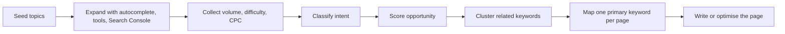
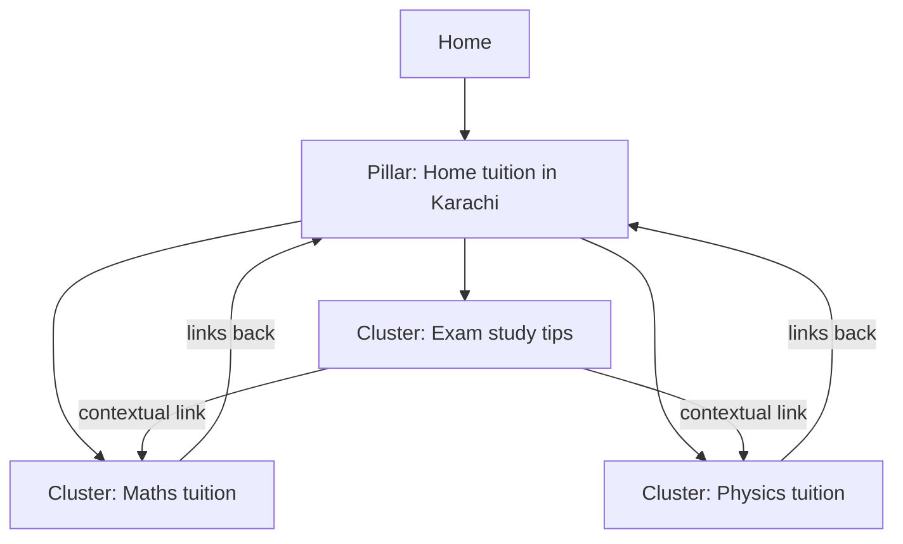
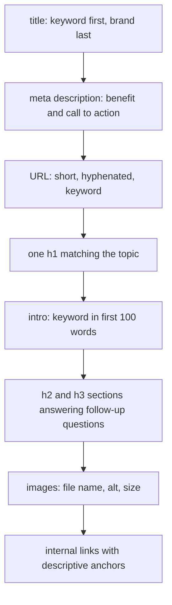
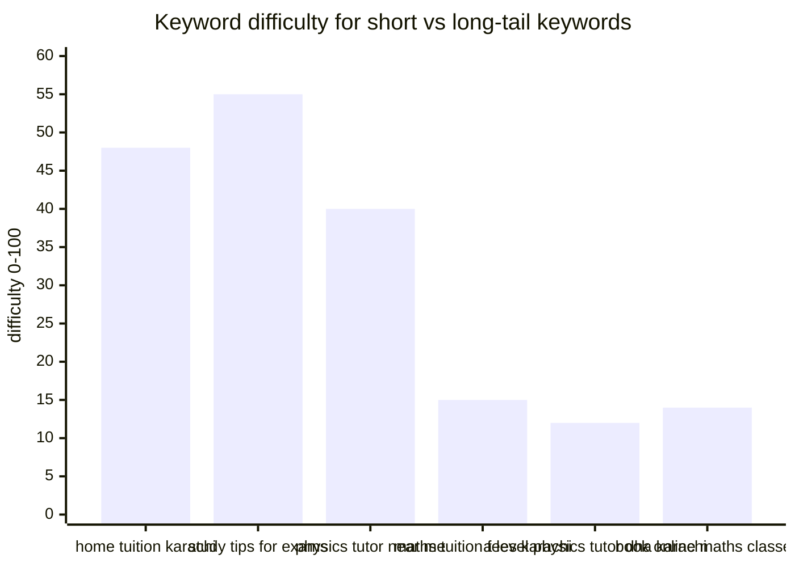

# Session 2 · On-page and Off-page Optimization Techniques

> [Prime AI – Software Engineering with AI](../../README.md) › [Term 1](../README.md) › [Optimize Web for Search Engines (SEO)](README.md) › **Session 2**

| ⏱ Estimated time | 🧩 Prerequisites |
|---|---|
| 3.5 hours | Session 1 |

[⬅ Previous: Understanding Search Engines and SEO Components](session-01-understanding-search-engines-and-seo-components.md) &nbsp;|&nbsp; [Next: Mobile SEO, Technical SEO and Local Content ➡](session-03-mobile-seo-and-more.md)

---

## 🎯 Learning objectives

By the end of this session you will be able to:

- Explain why on-page optimisation matters and what elements it covers.
- Carry out keyword research by search intent, volume, difficulty and opportunity, and map keywords to pages.
- Optimise titles, meta descriptions, headings, URLs, images, content and internal links on real pages.
- Summarise off-page techniques – backlinks, brand mentions, reviews, social – and their impact on visibility.
- Plan ethical strategies to earn high-quality backlinks and integrate social media campaigns with SEO.

## 📖 Concepts

### 1. On-page SEO – the part you fully control

**On-page SEO** is everything **on your own pages** that helps search engines understand them and helps people choose
them: the words you write, the HTML that wraps them, and how pages link to each other.

> 🏪 **Analogy – a shop on a busy street.** On-page SEO is your shop itself: a clear sign above the door (title tag), a
> window display that makes people step in (meta description), tidy aisles with labels (headings), well-lit products
> (images with alt text) and signs pointing to other departments (internal links). Off-page SEO is your **reputation** –
> what newspapers, neighbours and customers say about you.

### 2. Keyword research – step by step

A **keyword** is the phrase people type. Good research answers: *What do our customers search? How many? How hard is it to
rank? What do they want?*

1. **Brainstorm seeds** – services, products, problems: "maths tuition", "physics tutor", "O level past papers".
2. **Expand** – Google autocomplete, *People also ask*, *Related searches*, Search Console queries, tools such as
   Google Keyword Planner, Ubersuggest, Semrush, Ahrefs, AnswerThePublic.
3. **Collect metrics** – **search volume** (searches per month), **keyword difficulty** (how strong the ranking pages are,
   0–100), **CPC** (what advertisers pay – a clue to commercial value).
4. **Classify intent**:

| Intent | User wants to… | Signals | Page type to create |
|---|---|---|---|
| **Informational** | learn | how, what, why, tips, guide | Blog post, guide, FAQ |
| **Navigational** | reach a brand | brand names, "login" | Home / brand page |
| **Commercial** | compare before buying | best, top, review, vs, fees | Comparison, service page with prices |
| **Transactional** | act now | book, buy, hire, near me, price | Service / product page with clear CTA |

5. **Choose** – for a new site, target **long-tail** keywords (3+ words, lower volume, lower difficulty, clearer intent):
   "a level physics home tutor dha" beats "physics".
6. **Map** – one primary keyword (+ close variants) per page; avoid **keyword cannibalisation** (two pages competing for
   the same query).

**Related terms** (sometimes called LSI keywords) – words that naturally appear with the topic ("syllabus", "past
papers", "mechanics" for physics tuition). Using them shows depth; don't force them.

### 3. On-page elements – a checklist with examples

| Element | Best practice | Example for "maths tuition karachi" |
|---|---|---|
| **Title tag** | Unique, ≈ 50–60 chars, keyword near the front, brand last | `Maths Tuition in Karachi – O & A Level Home Tutors \| Karachi Tutors` |
| **Meta description** | 120–160 chars, benefit + keyword + call to action | `Experienced maths tutors in Karachi for O/A Level… free trial class.` |
| **URL** | Short, lowercase, hyphens, keyword, no dates or IDs | `/maths-tuition-karachi` not `/page.php?id=73` |
| **H1** | One per page, matches the topic | `Maths Tuition in Karachi` |
| **H2/H3** | Logical outline, natural variants | `What a maths tuition lesson includes`, `Fees` |
| **First 100 words** | State the topic and keyword early | "Our maths tuition in Karachi covers…" |
| **Body content** | Helpful, original, complete, readable; answer follow-up questions | Syllabus, approach, fees, FAQs, tutor profiles |
| **Images** | Descriptive file name, alt text, compressed, dimensions | `maths-past-paper.webp`, `alt="Student solving an A Level maths past paper"` |
| **Internal links** | Descriptive anchors to related pages; important pages get more links | "see our physics tuition" instead of "click here" |
| **Outbound links** | Cite authoritative sources where useful | Link to the official syllabus |
| **Canonical** | `<link rel="canonical">` to the preferred URL | Avoid duplicates from `?utm=` URLs |

**Keyword density** – the share of words that are the keyword. There is **no magic percentage**; if it reads unnaturally
it is too high. The stuffed demo physics page has a density over 30% – an instant red flag.

**Readability** – short sentences and paragraphs, sub-headings, bullet lists, plain words. The **Flesch Reading Ease**
score (0–100, higher = easier; 60–70 is plain English) is a handy check:
`206.835 − 1.015 × (words ÷ sentences) − 84.6 × (syllables ÷ words)`.

### 4. Content and site structure

Search engines and users both understand a site better when it is organised as a **hierarchy** with **topic
clusters**: a broad **pillar page** (e.g. "Home tuition in Karachi") linking to detailed **cluster pages** ("Maths
tuition", "Physics tuition", "Study tips"), which link back. Keep important pages **within 3 clicks** of the home page,
use **breadcrumbs**, and avoid thin or duplicate pages.

### 5. Off-page SEO

**Off-page SEO** is everything done **outside** your site that signals trust and popularity.

| Technique | What it is | Value |
|---|---|---|
| **Backlinks** | Links from other websites to yours | Strong ranking signal when relevant and trusted |
| **Brand mentions** | Your name cited, even without a link | Builds entity recognition and trust |
| **Reviews** | Google, Facebook, directories | Crucial for local rankings and conversions |
| **Social media** | Sharing content, community | Indirect: reach → visits → links and mentions |
| **Local citations** | Business listings with consistent NAP | Local trust (Session 3) |
| **Digital PR** | News stories, data studies, expert quotes | High-authority links |

**What makes a backlink valuable?**
1. **Relevance** – an education blog linking to a tuition site > a random car forum.
2. **Authority / trust** of the linking site (third-party metrics: Moz *Domain Authority*, Ahrefs *Domain Rating*, Semrush
   *Authority Score* – estimates, not Google numbers).
3. **Placement** – in the main content > footer/sidebar.
4. **Anchor text** – natural and varied (brand, URL, descriptive); 100% exact-match anchors look manipulative.
5. **Link attributes** – normal links pass value; `rel="nofollow"`, `"sponsored"` (paid) and `"ugc"` (user content) are
   hints that the link should not pass ranking credit.

### 6. Earning high-quality backlinks (white hat)

| Strategy | Example for a tuition business |
|---|---|
| **Linkable assets** | Free "O Level Physics Formula Sheet" PDF teachers link to |
| **Original data** | "Survey of 500 Karachi students' study habits" for news sites |
| **Guest articles** | Write for a parenting or education blog (real value, not spun text) |
| **Local partnerships** | Schools, libraries, community events list you as a sponsor/partner |
| **Unlinked mentions** | Find mentions of your brand without a link and politely ask for one |
| **Broken-link building** | Find broken resource links on other sites and offer your page as a replacement |
| **HARO-style expert quotes** | Answer journalists' requests for expert comment |

**Never:** buy links, join link exchanges or private blog networks, spam comments or forums, or use automated tools that
create links – these break spam policies and can trigger manual actions.

### 7. Social media and SEO

Social signals (likes, shares) are **not a direct ranking factor**, but social media **amplifies** content: more people
see it → more visits, brand searches, mentions and natural links. Integrate campaigns:

- Publish an SEO-focused blog post → share it with a short video on Instagram/TikTok/YouTube Shorts → pin it on Facebook
  groups where parents ask questions → measure with **UTM-tagged** links (Session 4).
- Use consistent profile names, bios and links (they also rank for brand searches).
- Add **Open Graph** tags (`og:title`, `og:description`, `og:image`) so shared links look attractive.

## 🧭 Diagrams

### Keyword research workflow



### Pillar page and topic cluster structure



### Anatomy of an optimised page



## 💻 Worked examples

### Example 1 — An on-page SEO analyser for any HTML page

This tool checks the on-page checklist automatically for each demo page and its target keyword: title and description
length and keyword use, `h1` count, keyword in the first 100 words, keyword density, image alt text, internal/broken links,
word count and Flesch Reading Ease. It prints a score out of 100 and a to-do list.

```js
// session-02_onpage-analyzer.js  (run: node session-02_onpage-analyzer.js)
// Scores pages against an on-page SEO checklist for a target keyword.
const fs = require('fs');
const path = require('path');
const { JSDOM } = require('jsdom');
const SITE = path.join(__dirname, 'demo-site');

const TARGETS = {                        // page -> primary keyword
  'maths-tuition.html': 'maths tuition',
  'physics-tuition.html': 'physics tuition',
  'blog-study-tips.html': 'study tips',
};

const syllables = w => Math.max(1, (w.toLowerCase().replace(/e$/, '').match(/[aeiouy]+/g) || []).length);
function flesch(text) {
  const sentences = Math.max(1, (text.match(/[.!?]+/g) || []).length);
  const words = text.match(/[A-Za-z']+/g) || [];
  const syl = words.reduce((n, w) => n + syllables(w), 0);
  return 206.835 - 1.015 * (words.length / sentences) - 84.6 * (syl / Math.max(1, words.length));
}

function analyse(file, keyword) {
  const doc = new JSDOM(fs.readFileSync(path.join(SITE, file), 'utf8')).window.document;
  doc.querySelectorAll('nav').forEach(n => n.remove());            // judge main content, not the menu
  const kw = keyword.toLowerCase();
  const title = doc.title;
  const desc = doc.querySelector('meta[name="description"]')?.content ?? '';
  const h1s = [...doc.querySelectorAll('h1')].map(h => h.textContent.trim());
  const text = doc.body.textContent.replace(/\s+/g, ' ').trim();
  const words = text.toLowerCase().match(/[a-z0-9']+/g) || [];
  const first100 = words.slice(0, 100).join(' ');
  const kwCount = (text.toLowerCase().match(new RegExp(kw.replace(' ', '\\s+'), 'g')) || []).length;
  const density = (kwCount * kw.split(' ').length / words.length) * 100;
  const imgs = [...doc.images];
  const links = [...doc.querySelectorAll('a[href]')].map(a => ({ href: a.getAttribute('href'), text: a.textContent.trim() }));
  const internal = links.filter(l => !/^(https?:|mailto:|#)/.test(l.href));
  const broken = internal.filter(l => !fs.existsSync(path.join(SITE, l.href)));
  const vague = internal.filter(l => /^(here|click here|more|read more)$/i.test(l.text));

  const checks = [
    [title.length >= 30 && title.length <= 65, 10, `title length ${title.length} (30–65)`],
    [title.toLowerCase().includes(kw), 10, 'keyword in title'],
    [desc.length >= 120 && desc.length <= 160, 10, `meta description length ${desc.length} (120–160)`],
    [desc.toLowerCase().includes(kw.split(' ')[0]), 5, 'keyword in description'],
    [h1s.length === 1, 10, `exactly one h1 (found ${h1s.length})`],
    [h1s.some(h => h.toLowerCase().includes(kw.split(' ')[0])), 10, 'keyword in h1'],
    [first100.includes(kw), 10, 'keyword in first 100 words'],
    [density > 0.5 && density < 4, 10, `keyword density ${density.toFixed(1)}% (0.5–4% reads naturally)`],
    [imgs.every(i => i.getAttribute('alt')), 5, `images with alt ${imgs.filter(i => i.getAttribute('alt')).length}/${imgs.length}`],
    [broken.length === 0, 5, `broken internal links ${broken.length}`],
    [vague.length === 0, 5, `vague anchor texts ${vague.length}`],
    [words.length >= 150, 10, `word count ${words.length} (≥150)`],
  ];
  const score = checks.reduce((s, [ok, pts]) => s + (ok ? pts : 0), 0);
  console.log(`\n${file}  ·  keyword "${keyword}"  ·  SCORE ${score}/100  ·  readability ${flesch(text).toFixed(0)}`);
  checks.forEach(([ok, pts, label]) => console.log(`  ${ok ? '✔' : '✘'} ${label}${ok ? '' : `  (−${pts})`}`));
  return score;
}

const scores = Object.entries(TARGETS).map(([f, k]) => analyse(f, k));
console.log(`\nAverage on-page score: ${(scores.reduce((a, b) => a + b, 0) / scores.length).toFixed(0)}/100`);
```

📄 Saved as [`code/session-02_onpage-analyzer.js`](code/session-02_onpage-analyzer.js)

**Output** (real run)

```text
maths-tuition.html  ·  keyword "maths tuition"  ·  SCORE 100/100  ·  readability 41
  ✔ title length 62 (30–65)
  ✔ keyword in title
  ✔ meta description length 145 (120–160)
  ✔ keyword in description
  ✔ exactly one h1 (found 1)
  ✔ keyword in h1
  ✔ keyword in first 100 words
  ✔ keyword density 3.5% (0.5–4% reads naturally)
  ✔ images with alt 1/1
  ✔ broken internal links 0
  ✔ vague anchor texts 0
  ✔ word count 172 (≥150)

physics-tuition.html  ·  keyword "physics tuition"  ·  SCORE 20/100  ·  readability 59
  ✘ title length 7 (30–65)  (−10)
  ✘ keyword in title  (−10)
  ✘ meta description length 0 (120–160)  (−10)
  ✘ keyword in description  (−5)
  ✘ exactly one h1 (found 2)  (−10)
  ✔ keyword in h1
  ✔ keyword in first 100 words
  ✘ keyword density 9.5% (0.5–4% reads naturally)  (−10)
  ✘ images with alt 0/1  (−5)
  ✘ broken internal links 1  (−5)
  ✘ vague anchor texts 1  (−5)
  ✘ word count 21 (≥150)  (−10)

blog-study-tips.html  ·  keyword "study tips"  ·  SCORE 100/100  ·  readability 61
  ✔ title length 65 (30–65)
  ✔ keyword in title
  ✔ meta description length 135 (120–160)
  ✔ keyword in description
  ✔ exactly one h1 (found 1)
  ✔ keyword in h1
  ✔ keyword in first 100 words
  ✔ keyword density 2.5% (0.5–4% reads naturally)
  ✔ images with alt 0/0
  ✔ broken internal links 0
  ✔ vague anchor texts 0
  ✔ word count 163 (≥150)

Average on-page score: 73/100
```

### Example 2 — Keyword planner: intent, opportunity score and clusters

The CSV [`code/session-02_keywords.csv`](code/session-02_keywords.csv) holds a keyword list with **illustrative**
monthly volumes and difficulty scores (the kind of numbers tools such as Keyword Planner or Ubersuggest give – they are
practice data, not real measurements). The script classifies intent from modifiers, computes an **opportunity score**
(volume weighted by intent value and how easy it is), groups keywords into clusters by their head term and proposes which
page should target each cluster.

```js
// session-02_keyword-planner.js  (run: node session-02_keyword-planner.js)
// Classifies keyword intent, scores opportunity and clusters keywords for page mapping.
const fs = require('fs');
const path = require('path');

const rows = fs.readFileSync(path.join(__dirname, 'session-02_keywords.csv'), 'utf8')
  .trim().split('\n').slice(1)
  .map(line => { const [keyword, volume, difficulty] = line.split(','); return { keyword, volume: +volume, difficulty: +difficulty }; });

const INTENT_RULES = [                    // first match wins
  ['transactional', /\b(book|hire|near me|price|fees?|cost|online classes)\b/],
  ['commercial', /\b(best|top|review|vs|compare)\b/],
  ['informational', /\b(how|what|why|tips|guide|syllabus|past papers|formula)\b/],
  ['navigational', /\b(login|karachi tutors)\b/],
  ['transactional', /\b(tuition|tutor)\b/],     // local service searches: people want to hire
];
const INTENT_VALUE = { transactional: 1.0, commercial: 0.8, informational: 0.5, navigational: 0.3, unclear: 0.4 };
const intentOf = k => (INTENT_RULES.find(([, re]) => re.test(k)) || ['unclear'])[0];

// Opportunity = volume × intent value × ease (difficulty 0 → ease 1, difficulty 100 → ease 0)
for (const r of rows) {
  r.intent = intentOf(r.keyword);
  r.words = r.keyword.split(' ').length;
  r.opportunity = Math.round(r.volume * INTENT_VALUE[r.intent] * (1 - r.difficulty / 100));
}

console.log('keyword                               vol  KD  words intent         opportunity');
for (const r of [...rows].sort((a, b) => b.opportunity - a.opportunity)) {
  console.log(`${r.keyword.padEnd(36)} ${String(r.volume).padStart(5)} ${String(r.difficulty).padStart(3)}  ${String(r.words).padStart(4)}  ${r.intent.padEnd(14)} ${String(r.opportunity).padStart(6)}`);
}

// Cluster by head topic and map to a page
// Informational keywords go to blog posts first; the rest are grouped by subject
const CLUSTERS = [['tips|past papers|syllabus|formula|how to', 'blog posts'], ['maths', 'maths-tuition.html'],
                  ['physics', 'physics-tuition.html'], ['chemistry', 'chemistry-tuition.html (new page)'], ['home tuition|tutor', 'index.html']];
console.log('\nCLUSTERS → target page');
for (const [head, page] of CLUSTERS) {
  const members = rows.filter(r => new RegExp(head).test(r.keyword) && !r.mapped);
  members.forEach(r => (r.mapped = true));
  if (!members.length) continue;
  const total = members.reduce((s, r) => s + r.volume, 0);
  const primary = members.sort((a, b) => b.opportunity - a.opportunity)[0];
  console.log(`  [${head}] ${members.length} keywords, ${total} searches/mo → ${page}`);
  console.log(`      primary: "${primary.keyword}"  variants: ${members.slice(1, 4).map(m => `"${m.keyword}"`).join(', ')}`);
}
const longTail = rows.filter(r => r.words >= 4);
console.log(`\nLong-tail (4+ words): ${longTail.length}/${rows.length} keywords, average KD ${Math.round(longTail.reduce((s, r) => s + r.difficulty, 0) / longTail.length)} vs ${Math.round(rows.filter(r => r.words < 4).reduce((s, r) => s + r.difficulty, 0) / rows.filter(r => r.words < 4).length)} for shorter terms`);
```

📄 Saved as [`code/session-02_keyword-planner.js`](code/session-02_keyword-planner.js)

**Output** (real run)

```text
keyword                               vol  KD  words intent         opportunity
home tuition karachi                  1900  48     3  transactional     988
physics tutor near me                 1300  40     4  transactional     780
o level maths past papers             2400  42     5  informational     696
maths tuition karachi                  880  35     3  transactional     572
physics tuition karachi                590  31     3  transactional     407
study tips for exams                  1600  55     4  informational     360
chemistry tuition karachi              480  29     3  transactional     341
best maths tutor in karachi            320  38     5  commercial        159
o level physics formula sheet          390  22     5  informational     152
maths tuition fees karachi             140  15     4  transactional     119
how to study for o level physics       210  18     7  informational      86
a level physics tutor dha karachi       90  12     6  transactional      79
book online maths classes for a level    70  14     7  transactional      60
karachi tutors login                    30   5     3  navigational        9

CLUSTERS → target page
  [tips|past papers|syllabus|formula|how to] 4 keywords, 4600 searches/mo → blog posts
      primary: "o level maths past papers"  variants: "study tips for exams", "o level physics formula sheet", "how to study for o level physics"
  [maths] 4 keywords, 1410 searches/mo → maths-tuition.html
      primary: "maths tuition karachi"  variants: "best maths tutor in karachi", "maths tuition fees karachi", "book online maths classes for a level"
  [physics] 3 keywords, 1980 searches/mo → physics-tuition.html
      primary: "physics tutor near me"  variants: "physics tuition karachi", "a level physics tutor dha karachi"
  [chemistry] 1 keywords, 480 searches/mo → chemistry-tuition.html (new page)
      primary: "chemistry tuition karachi"  variants: 
  [home tuition|tutor] 2 keywords, 1930 searches/mo → index.html
      primary: "home tuition karachi"  variants: "karachi tutors login"

Long-tail (4+ words): 9/14 keywords, average KD 28 vs 30 for shorter terms
```

### Example 3 — Backlink profile scorer

Off-page work starts with knowing your current links. The sample file
[`code/session-02_backlinks.json`](code/session-02_backlinks.json) imitates an export from a backlink tool. The script scores
each link (relevance, authority, placement, attribute), flags risky ones and checks whether the anchor-text mix looks
natural.

```js
// session-02_backlink-scorer.js  (run: node session-02_backlink-scorer.js)
// Scores backlinks, flags risky ones and summarises the anchor-text distribution.
const links = require('./session-02_backlinks.json');
const BRAND = /karachi tutors|karachitutors/i;

function score(l) {
  let s = 0;
  s += l.relevant ? 35 : 5;                                     // topical relevance matters most
  s += Math.min(30, l.authority * 0.3);                         // third-party authority estimate (0–100)
  s += l.placement === 'content' ? 20 : l.placement === 'sidebar' ? 8 : 4;
  s += l.rel === 'follow' ? 15 : l.rel === 'nofollow' ? 5 : 0;  // sponsored/ugc pass no credit
  return Math.round(s);
}
function risks(l) {
  const r = [];
  if (l.spam) r.push('spammy site');
  if (l.paid && l.rel !== 'sponsored') r.push('paid link not marked sponsored');
  if (!l.relevant && l.authority < 15) r.push('irrelevant, low authority');
  return r;
}

console.log('score  source                          anchor                         notes');
for (const l of links.map(l => ({ ...l, score: score(l), risks: risks(l) })).sort((a, b) => b.score - a.score)) {
  console.log(`${String(l.score).padStart(5)}  ${l.source.padEnd(31)} ${('"' + l.anchor + '"').padEnd(30)} ${l.risks.join('; ') || 'ok'}`);
}

// Anchor-text distribution
const types = { brand: 0, url: 0, exact: 0, partial: 0, generic: 0 };
for (const l of links) {
  const a = l.anchor.toLowerCase();
  if (BRAND.test(a)) types.brand++;
  else if (/^https?:|\.pk/.test(a)) types.url++;
  else if (a === 'physics tuition karachi' || a === 'maths tuition karachi') types.exact++;
  else if (/tuition|tutor/.test(a)) types.partial++;
  else types.generic++;
}
console.log('\nAnchor mix:', Object.entries(types).map(([k, v]) => `${k} ${Math.round((v / links.length) * 100)}%`).join(' · '));
const exactPct = types.exact / links.length;
console.log(exactPct > 0.3 ? '⚠ Exact-match anchors above 30% – looks manipulative' : '✔ Anchor profile looks natural (exact-match ≤ 30%)');
const toDisavow = links.filter(l => l.spam);
console.log(`Links to review for removal/disavow: ${toDisavow.map(l => l.source).join(', ') || 'none'}`);
```

📄 Saved as [`code/session-02_backlink-scorer.js`](code/session-02_backlink-scorer.js)

**Output** (real run)

```text
score  source                          anchor                         notes
   87  schoolnews.pk/exam-season       "study tips for O Level"       ok
   83  parentsguide.pk/best-tutors     "Karachi Tutors"               ok
   81  community-library.pk/partners   "Karachi Tutors home tuition"  ok
   75  instagram.com/karachitutors     "https://karachitutors.pk"     ok
   63  edu-forum.pk/thread/9921        "physics tutor"                ok
   57  karachi-directory.pk/education  "karachitutors.pk"             ok
   42  techblog.example.com/sponsor    "maths tuition karachi"        paid link not marked sponsored
   25  free-links-4u.example.net       "physics tuition karachi"      spammy site; irrelevant, low authority

Anchor mix: brand 50% · url 0% · exact 25% · partial 13% · generic 13%
✔ Anchor profile looks natural (exact-match ≤ 30%)
Links to review for removal/disavow: free-links-4u.example.net
```

## 🧩 Real-life coding problem

**Scenario – fix the physics page.** The analyser gives `physics-tuition.html` a very low score. Rewrite it so that it
targets **"physics tuition"** (+ "physics tutor karachi") properly, without stuffing, and re-run the analyser.

**Plan**
1. **Title** – `Physics Tuition in Karachi – O & A Level Tutors | Karachi Tutors` (64 characters, keyword first, brand last).
2. **Description** – 140–155 characters with keyword, benefit and call to action.
3. **One `h1`** – "Physics Tuition in Karachi"; logical `h2`s: what we teach, how lessons work, fees, FAQs.
4. **Helpful content** (≥ 150 words) – syllabus topics, teaching approach, past-paper practice; keyword in the first
   sentence, related terms (mechanics, electricity, practicals) naturally.
5. **Image** – `img/physics-circuit-lesson.svg` with descriptive alt text and dimensions.
6. **Links** – remove the broken `fees.html`; descriptive anchors to maths tuition and study tips.

**Full solution:** [`code/session-02_physics-tuition-optimised.html`](code/session-02_physics-tuition-optimised.html),
checked by [`code/session-02_compare-before-after.js`](code/session-02_compare-before-after.js), which runs the same
checklist on the old and new versions:

```text
check                       before   after
title length                     7      64
keyword in title              true    true
description length               0     145
h1 count                         2       1
h2 sections                      0       4
word count                      21     232
keyword density %             33.3     4.7
images missing alt               1       0
vague anchors                    1       0
links to fees.html (404)         1       0
```

## ⚠️ Common mistakes

| Mistake | Why it hurts | Fix |
|---|---|---|
| Same title on many pages ("Home") | Engines can't tell pages apart; low CTR | Unique, descriptive titles |
| Keyword stuffing | Spam signal, unreadable | Natural language, synonyms, cover the topic fully |
| Targeting only huge head terms | Impossible competition for a new site | Long-tail, high-intent keywords first |
| Two pages for one keyword | Cannibalisation – both rank worse | One primary keyword per page; merge or differentiate |
| "Click here" anchors | Wastes descriptive link signals | Anchor text that describes the target |
| Buying backlinks / link exchanges | Spam policy violation, manual actions | Earn links with linkable assets and outreach |
| Ignoring nofollow/sponsored on paid links | Treated as link schemes | Mark paid links `rel="sponsored"` |
| Writing for bots, not people | High bounce, no links | Answer the searcher's real questions |

## 🌟 Best practices

- Build a **keyword map** (spreadsheet: keyword, intent, volume, difficulty, target URL) before writing pages.
- Write the title and description **for humans** – they are your advert on the results page.
- Structure pages with headings that answer the questions people ask (use *People also ask*).
- Link from strong pages (home, popular posts) to the pages you want to rank, with descriptive anchors.
- Audit backlinks quarterly; pursue relevant links through genuinely useful content and local relationships.
- Share every new piece of content on social channels with UTM tags and Open Graph tags.

## 🏗️ Mini project

**Mini project – a keyword-to-content brief generator.** Given a primary keyword, its intent and a list of related terms,
generate a writer's **content brief**: recommended title and description (with length checks), URL slug, H1, an outline of
H2s based on intent, related terms to include, internal links to add and a target word count.

Full solution: [`code/session-02_mini-project-content-brief.js`](code/session-02_mini-project-content-brief.js) – real output:

```text
CONTENT BRIEF · "chemistry tuition karachi" (transactional)
  Title       : Chemistry Tuition Karachi – Qualified Tutors | Karachi Tutors
                ok (61)
  Description : Chemistry Tuition Karachi with qualified, trial-tested tutors. Home or online lessons and a free trial class – book today.
                ok (122)
  URL slug    : /chemistry-tuition-karachi
  H1          : Chemistry Tuition Karachi
  Outline (H2):
     1. What is included
     2. How it works
     3. Fees and booking
     4. Why choose us
     5. FAQs
  Include terms naturally: O Level chemistry, A Level chemistry, organic chemistry, practical paper, past papers
  Internal links: "physics tuition" → /physics-tuition.html; "study tips" → /blog-study-tips.html
  Target length: ~600 words · keyword in first 100 words · 1 image with alt text

CONTENT BRIEF · "how to study for o level physics" (informational)
  Title       : How To Study For O Level Physics – A Practical Guide | Karachi Tutors
                too long (69)
  Description : Learn how to study for o level physics with clear steps, examples and common mistakes to avoid. Free guide from Karachi Tutors.
                ok (127)
  URL slug    : /how-to-study-for-o-level-physics
  H1          : How To Study For O Level Physics
  Outline (H2):
     1. Quick answer
     2. Step-by-step guide
     3. Common mistakes
     4. Examples
     5. FAQs
  Include terms naturally: formula sheet, past papers, practicals, revision timetable, examiner reports
  Internal links: "physics tuition in Karachi" → /physics-tuition.html
  Target length: ~1500 words · keyword in first 100 words · 1 image with alt text
```

## 📦 Project files for this session

| File | What it is |
|---|---|
| 📄 [`code/session-02_keywords.csv`](code/session-02_keywords.csv) | Practice keyword list (illustrative volumes and difficulty, not real measurements) |
| 📄 [`code/session-02_backlinks.json`](code/session-02_backlinks.json) | Sample backlink export used by the backlink scorer |
| 📄 [`code/session-02_physics-tuition-optimised.html`](code/session-02_physics-tuition-optimised.html) | Real-life problem solution – the physics page rewritten with on-page best practices |
| 📄 [`code/session-02_compare-before-after.js`](code/session-02_compare-before-after.js) | Runs the on-page checklist on the old and the optimised physics page |
| 📄 [`code/session-02_mini-project-content-brief.js`](code/session-02_mini-project-content-brief.js) | Mini project solution – content brief generator from a keyword and its intent |
| 📄 [`code/demo-site/img/physics-circuit-lesson.svg`](code/demo-site/img/physics-circuit-lesson.svg) | Illustration for the optimised physics page |

## 📊 At a glance

**Opportunity vs difficulty** for the practice keyword list (from the keyword planner's output – long-tail and
transactional terms give the best return for a new site):



| Link type | Passes ranking credit? | When to use |
|---|---|---|
| Normal link | ✅ | Editorial, genuine recommendation |
| `rel="nofollow"` | Hint – usually no | Links you don't want to vouch for |
| `rel="sponsored"` | ❌ | Paid, affiliate, advertising links |
| `rel="ugc"` | Hint – usually no | Comments, forum posts |

## 🧪 Lab / practice tasks

**🟢 Easy** — Write an optimised title (≤ 60 chars) and meta description (120–160 chars) for three pages: a bakery's home page, its "custom birthday cakes" page and a blog post "how to store a cake overnight".

<details><summary>💡 Hint</summary>

Keyword near the start, a benefit, brand at the end of titles; descriptions end with a call to action.

</details>

<details><summary>✅ Solution</summary>

- Home: `Fresh Cakes & Bakery in Gulshan, Karachi | Karachi Bakes` · "Home-made cakes baked to order in Gulshan-e-Iqbal, Karachi. Chocolate fudge, red velvet and seasonal mango cream – order by 6 pm for tomorrow."
- Custom cakes: `Custom Birthday Cakes in Karachi – Any Theme | Karachi Bakes` · "Personalised birthday cakes in Karachi: cartoon, photo and number cakes in any flavour. Share your idea and get a free quote within an hour."
- Blog: `How to Store a Cake Overnight (Fresh Until Morning)` · "Keep cake moist and safe overnight: what to refrigerate, how to wrap cut cake and when room temperature is fine. Simple steps from our bakers."

</details>

**🟡 Medium** — Add five new keywords of your own to `session-02_keywords.csv` (at least two long-tail and one commercial). Re-run the planner and explain where each one landed and why.

<details><summary>💡 Hint</summary>

Commercial keywords need words such as "best" or "review"; long-tail = 4+ words.

</details>

<details><summary>✅ Solution</summary>

Example additions: `best online physics classes pakistan,170,33` → *commercial* ("best"), opportunity = 170 × 0.8 ×
0.67 ≈ 91. `a level chemistry home tutor clifton,40,10` → *transactional* via the tuition/tutor rule, 40 × 1.0 × 0.9 = 36.
`o level chemistry practical tips,260,20` → *informational* and clustered to **blog posts** because informational rules run
first. Students should notice that the score multiplies volume, intent value and ease, so a small but easy, high-intent keyword can beat a big hard one.

</details>

**🔴 Hard** — Run the analyser on `index.html` with the keyword "home tuition" by adding it to `TARGETS`. Fix any failing check without stuffing, and re-run until the score is ≥ 90.

<details><summary>💡 Hint</summary>

Check the description length and keyword density first – the analyser removes the nav before counting.

</details>

<details><summary>✅ Solution</summary>

```js
const TARGETS = { 'index.html': 'home tuition', /* … */ };
```
Typical fixes: lengthen the meta description to 120–160 characters, add one more natural mention of "home tuition" in
a sub-heading (e.g. "How home tuition works"), and ensure the image has alt text. Re-run and confirm the score.

</details>

**🏆 Challenge** — Design an **ethical link-building campaign** for Karachi Tutors: one linkable asset, five realistic target websites (types), an outreach email (≤ 120 words) and how you will measure success.

<details><summary>💡 Hint</summary>

Think: what would a teacher, school or newspaper genuinely want to link to?

</details>

<details><summary>✅ Solution</summary>

Asset: a free, printable "O Level Physics Formula Sheet 2026" + a short explainer video. Targets: school resource pages,
education bloggers, parenting groups' resource lists, local library e-resources, student societies. Outreach email:
personal greeting, mention a specific page of theirs, offer the sheet as a free resource for their students, no pressure,
signature. Measure: number of referring domains gained (backlink tool), referral visits (GA4), rankings for "o level
physics formula sheet" (Search Console).

</details>

## ✅ Quick quiz

**Q1. Which keyword is long-tail?**

- A) physics
- B) tuition
- C) a level physics home tutor dha karachi
- D) karachi

<details><summary>Show answer</summary>

**C** — Long-tail = longer, more specific, lower competition.

</details>

**Q2. "best maths tutor in karachi" has mainly which intent?**

- A) Navigational
- B) Commercial investigation
- C) Informational
- D) None

<details><summary>Show answer</summary>

**B** — "best" signals comparison before choosing.

</details>

**Q3. Which anchor text is most useful for SEO and users?**

- A) click here
- B) read more
- C) physics tuition in Karachi
- D) link

<details><summary>Show answer</summary>

**C** — Descriptive anchors explain the target page.

</details>

**Q4. A paid link in a sponsored article should use:**

- A) `rel="sponsored"`
- B) `rel="canonical"`
- C) `rel="author"`
- D) no attribute

<details><summary>Show answer</summary>

**A** — Paid links must be qualified.

</details>

**Q5. Keyword cannibalisation is when:**

- A) A competitor copies your keywords
- B) Two of your own pages compete for the same query
- C) You use too few keywords
- D) Bots eat your pages

<details><summary>Show answer</summary>

**B** — Map one primary keyword per page.

</details>

## 📝 Summary / cheat-sheet

- On-page SEO: titles, descriptions, URLs, headings, content, images, internal links, canonical – all under your control.
- Keyword research: seeds → expand → metrics (volume, difficulty, CPC) → intent → opportunity → cluster → map one keyword per page.
- Prefer long-tail, high-intent keywords for new sites; avoid cannibalisation and stuffing.
- Structure sites as pillar pages + clusters, important pages within 3 clicks, descriptive internal anchors.
- Off-page: relevant, trusted backlinks with natural anchors; mentions; reviews; social amplification.
- Earn links with linkable assets, original data, partnerships, broken-link building – never buy them; mark paid links `sponsored`.

## 🎤 Interview / viva questions

1. **What are the four types of search intent?**
   <details><summary>Model answer</summary>

   Informational (learn), navigational (find a brand/site), commercial (compare before buying) and transactional (act or buy now).

   </details>

2. **Why target long-tail keywords?**
   <details><summary>Model answer</summary>

   They have lower competition, clearer intent and often higher conversion, so a new site can rank and attract the right visitors sooner.

   </details>

3. **Is the meta description a ranking factor?**
   <details><summary>Model answer</summary>

   Not directly; it is a snippet that persuades users to click, so it improves click-through rate.

   </details>

4. **What makes a backlink high quality?**
   <details><summary>Model answer</summary>

   Relevance to your topic, trust/authority of the linking site, editorial placement in content, natural anchor text and a normal (followed) link.

   </details>

5. **What is the difference between nofollow, sponsored and ugc?**
   <details><summary>Model answer</summary>

   All are rel hints: nofollow for links you do not vouch for, sponsored for paid/affiliate links, ugc for user-generated content like comments.

   </details>

6. **How does social media help SEO if it is not a direct ranking factor?**
   <details><summary>Model answer</summary>

   It increases reach and visits, which leads to brand searches, mentions and natural backlinks, and social profiles themselves rank for brand queries.

   </details>

---

[⬅ Previous: Understanding Search Engines and SEO Components](session-01-understanding-search-engines-and-seo-components.md) &nbsp;|&nbsp; [Next: Mobile SEO, Technical SEO and Local Content ➡](session-03-mobile-seo-and-more.md)

<sub>Prepared by **Hamna Zahid Khan**, Junior Lecturer · Prime AI – Software Engineering with AI</sub>
