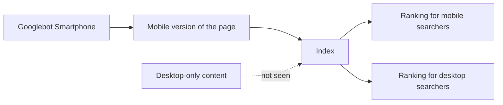
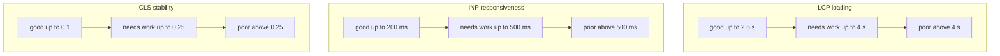
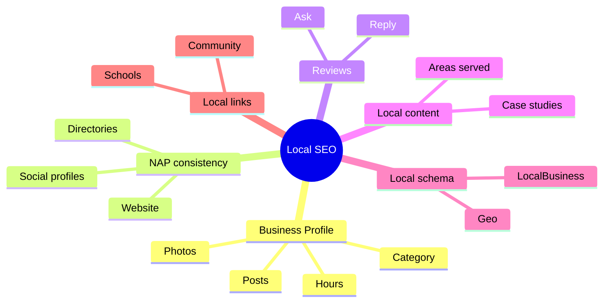
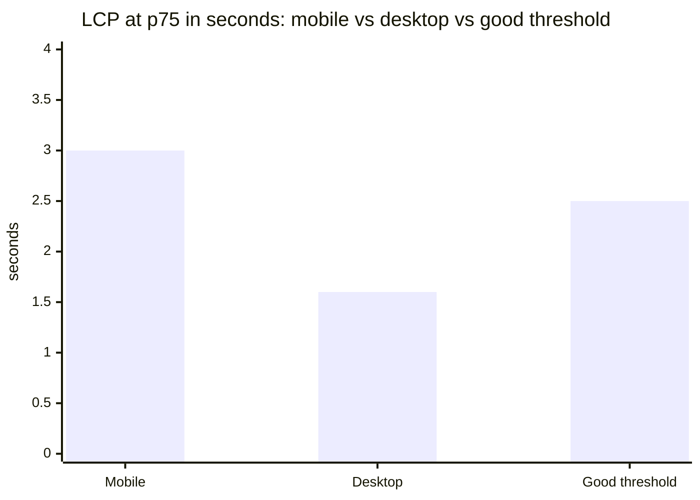

# Session 3 · Mobile SEO, Technical SEO and Local Content

> [Prime AI – Software Engineering with AI](../../README.md) › [Term 1](../README.md) › [Optimize Web for Search Engines (SEO)](README.md) › **Session 3**

| ⏱ Estimated time | 🧩 Prerequisites |
|---|---|
| 3.5 hours | Sessions 1–2; Module 3 Session 5 (responsive design) |

[⬅ Previous: On-page and Off-page Optimization Techniques](session-02-on-page-and-off-page-optimization.md) &nbsp;|&nbsp; [Next: Advanced SEO Techniques and Tools ➡](session-04-advanced-seo-techniques-and-tools.md)

---

## 🎯 Learning objectives

By the end of this session you will be able to:

- Explain mobile SEO and mobile-first indexing, and why mobile visibility decides most rankings today.
- Describe factors that affect mobile rankings – Core Web Vitals, responsive design, usability – and build mobile-friendly XML sitemaps.
- Add structured data (JSON-LD) for rich results and validate it.
- Create SEO-friendly content: helpful, readable, fresh, structured for featured snippets, with optimised images and video.
- Explain the value of local SEO content and list the main social networking platforms used to support it.

## 📖 Concepts

### 1. Mobile SEO and mobile-first indexing

Most searches now happen on phones, so Google switched to **mobile-first indexing**: Googlebot **Smartphone** crawls
your site and the **mobile version** of each page is what gets indexed and ranked – for desktop searchers too. If
content, links or structured data exist only on the desktop version, Google effectively does not see them.

> 📱 **Analogy – the shop window that matters.** Imagine a shop where 7 out of 10 customers only look through a small
> side window. If that window is dusty, half-empty or the door is stuck, it doesn't matter how beautiful the main
> entrance is. Mobile is that side window – and Google judges the shop by it.

**Three ways to serve mobile users**

| Approach | How | SEO verdict |
|---|---|---|
| **Responsive design** | Same HTML and URL, CSS adapts (Module 3) | ✅ Recommended – one URL, no duplication |
| Dynamic serving | Same URL, server sends different HTML by device | ⚠️ Needs `Vary: User-Agent`, error-prone |
| Separate mobile site (`m.example.com`) | Different URLs | ⚠️ Needs `rel="alternate"`/`canonical` pairs; easy to get wrong |

### 2. Factors that affect mobile rankings

| Factor | What to check | Tool |
|---|---|---|
| **Content parity** | Same text, headings, images, links and structured data on mobile | View page on a phone / URL Inspection in Search Console |
| **Viewport & responsive layout** | `<meta name="viewport">`, no horizontal scrolling, fluid images | DevTools device mode, Lighthouse |
| **Readable text & tap targets** | ≥ 16 px body text; buttons ≈ 48 px with spacing | Lighthouse accessibility audit |
| **Page experience** | HTTPS, no intrusive interstitials (full-screen pop-ups) | Search Console |
| **Core Web Vitals** | LCP, INP, CLS from real users | PageSpeed Insights, Search Console CWV report |
| **Crawlability on mobile** | Resources (CSS/JS/images) not blocked; lazy-loaded content still discoverable | URL Inspection › rendered HTML |

### 3. Core Web Vitals – the speed and stability metrics

Google measures **real users' experience** (field data from Chrome users) and judges each metric at the **75th
percentile** – i.e. 3 out of 4 visits must be "good".

| Metric | Measures | Good | Needs improvement | Poor | Common fixes |
|---|---|---|---|---|---|
| **LCP** – Largest Contentful Paint | Loading: when the main content (hero image/heading) appears | ≤ 2.5 s | 2.5–4 s | > 4 s | Compress/resize hero image, preload it, fast hosting/CDN, less render-blocking CSS/JS |
| **INP** – Interaction to Next Paint | Responsiveness: delay after taps/clicks (replaced FID in March 2024) | ≤ 200 ms | 200–500 ms | > 500 ms | Less JavaScript, break up long tasks, avoid heavy plugins |
| **CLS** – Cumulative Layout Shift | Visual stability: content jumping around | ≤ 0.1 | 0.1–0.25 | > 0.25 | `width`/`height` on images, reserve space for ads/embeds, avoid inserting content above existing content |

**Lab vs field data:** Lighthouse gives **lab** numbers from one simulated load (great for debugging); Search Console and
PageSpeed Insights show **field** data from real visitors (what ranking uses).

### 4. XML sitemaps (including mobile)

An **XML sitemap** lists the URLs you want indexed, with optional `<lastmod>` dates, and tells search engines about pages
they might miss. For a responsive site, **one** sitemap serves both mobile and desktop. Separate "mobile sitemaps"
(with the `<mobile:mobile/>` tag) were only for old feature-phone pages; for `m.` sites you list desktop URLs with
`<xhtml:link rel="alternate" media="only screen and (max-width: 640px)" href="https://m.…">`.

```xml
<?xml version="1.0" encoding="UTF-8"?>
<urlset xmlns="http://www.sitemaps.org/schemas/sitemap/0.9">
  <url>
    <loc>https://karachitutors.pk/maths-tuition.html</loc>
    <lastmod>2026-10-20</lastmod>
  </url>
</urlset>
```

Rules: only canonical, indexable, 200-status URLs; up to 50,000 URLs or 50 MB per file (use a sitemap index for more);
reference it in `robots.txt` and submit it in Search Console. Image and video sitemaps help media get found.

### 5. Structured data – speaking the search engine's language

**Structured data** is a standardised description of the page's meaning using the **schema.org** vocabulary. Google
recommends the **JSON-LD** format, placed in a `<script type="application/ld+json">` tag. It can make pages eligible for
**rich results** (stars, FAQs, prices, events, breadcrumbs) and helps engines understand entities (your business, its
address, opening hours).

| Type | Good for | Key properties |
|---|---|---|
| `LocalBusiness` (or a subtype such as `EducationalOrganization`) | Local businesses | name, address, telephone, geo, openingHours, url, image |
| `Organization` | Brand info | name, logo, sameAs (social profiles) |
| `Article` / `BlogPosting` | Blog posts | headline, author, datePublished, image |
| `FAQPage` | Q&A sections (rich result now shown mainly for authoritative government/health sites) | mainEntity › Question › acceptedAnswer |
| `BreadcrumbList` | Site hierarchy in results | itemListElement › ListItem (position, name, item) |
| `Product`, `Event`, `Course`, `Review` | Shops, events, courses | price, availability, startDate, rating |

Validate with Google's **Rich Results Test** and the **Schema Markup Validator**; the data must match what users see on
the page – marking up invisible or false information is spam.

### 6. SEO-friendly content

Search engines reward **helpful, people-first content**. Ask: *Would someone feel they learnt enough to reach their goal?*

1. **Match intent** – a "how to" query wants steps; a "fees" query wants prices.
2. **Answer first** – put a concise answer (40–60 words) right under the question heading; this is what **featured
   snippets** often quote. Lists and tables are also snippet-friendly.
3. **Structure** – descriptive headings, short paragraphs, bullets, tables, summaries.
4. **Depth & originality** – examples, data, photos, first-hand experience; cover follow-up questions (People Also Ask).
5. **Freshness** – update dates, statistics and syllabus changes; show "Last updated".
6. **E-E-A-T signals** – author bio with qualifications, sources cited, contact details, reviews.
7. **Media SEO** – images: descriptive file names, alt text, captions, WebP, lazy-loading; video: title, description,
   transcript/captions, thumbnail, `VideoObject` schema, host on YouTube and embed.
8. **Avoid** thin pages, duplicate pages, doorway pages ("tutor in DHA", "tutor in Clifton"… with identical text).

### 7. Local SEO content

**Local SEO** helps a business appear for searches with local intent – "tutor near me", "bakery in Gulshan" – in the
**map pack** (the map with three businesses) and local organic results.

| Pillar | Action |
|---|---|
| **Google Business Profile** | Claim and verify; exact name, category ("Tutoring service"), address or service area, hours, photos, services, posts, Q&A |
| **NAP consistency** | Same **N**ame, **A**ddress, **P**hone on the website, Business Profile, Facebook, directories (citations) |
| **Reviews** | Ask happy customers; reply to every review politely, including negative ones |
| **Local content** | Location pages with genuinely local information (areas served, local landmarks, case studies) – not copy-paste doorway pages |
| **Local structured data** | `LocalBusiness` JSON-LD with address, geo and hours |
| **Local links** | Schools, community groups, local news, chambers of commerce |

Local ranking is driven by **relevance** (does the profile match the search?), **distance** (how close to the searcher)
and **prominence** (reviews, links, how well known).

### 8. Social networking platforms

Social platforms support SEO indirectly (reach, links, brand searches) and are search engines themselves.

| Platform | Strength for a local business | Content that works |
|---|---|---|
| **Facebook** | Community groups, local reach, reviews | Posts, events, parent groups |
| **Instagram** | Visual brand, Reels | Before/after, behind-the-scenes, short tips |
| **YouTube** | Second-largest search engine; videos appear in Google | Tutorials, explainer videos with good titles |
| **TikTok** | Discovery among young audiences; used as a search engine by many | 30–60 s tips, trends |
| **LinkedIn** | B2B, professional credibility | Articles, company news, hiring |
| **X (Twitter)** | News, real-time updates | Announcements, threads |
| **WhatsApp** (channels/business) | Direct communication, very popular in Pakistan | Updates, catalogues |
| **Pinterest** | Visual search, recipes, DIY, design | Infographics, guides |

## 🧭 Diagrams

### Mobile-first indexing in one picture



### Core Web Vitals thresholds



### Local SEO ecosystem



## 💻 Worked examples

### Example 1 — Core Web Vitals checker from real-user samples

[`code/session-03_cwv-samples.json`](code/session-03_cwv-samples.json) contains 20 sample measurements per metric for a
mobile and a desktop page (the kind of field data a RUM tool collects – practice data). The script computes the **75th
percentile** exactly as Google does and rates each metric.

```js
// session-03_cwv-checker.js  (run: node session-03_cwv-checker.js)
// Rates Core Web Vitals at the 75th percentile using Google's thresholds.
const data = require('./session-03_cwv-samples.json');

const THRESHOLDS = {          // [good up to, poor above]
  LCP: [2500, 4000, 'ms'],
  INP: [200, 500, 'ms'],
  CLS: [0.1, 0.25, ''],
};

// 75th percentile (nearest-rank method)
function p75(values) {
  const sorted = [...values].sort((a, b) => a - b);
  return sorted[Math.ceil(0.75 * sorted.length) - 1];
}
const rate = (metric, v) => v <= THRESHOLDS[metric][0] ? 'GOOD' : v <= THRESHOLDS[metric][1] ? 'NEEDS IMPROVEMENT' : 'POOR';
const fmt = (metric, v) => metric === 'CLS' ? v.toFixed(2) : metric === 'LCP' ? (v / 1000).toFixed(1) + ' s' : v + ' ms';

for (const [page, metrics] of Object.entries(data)) {
  console.log(`\n${page}`);
  let allGood = true;
  for (const [metric, values] of Object.entries(metrics)) {
    const v = p75(values);
    const verdict = rate(metric, v);
    const goodShare = values.filter(x => x <= THRESHOLDS[metric][0]).length / values.length;
    if (verdict !== 'GOOD') allGood = false;
    console.log(`  ${metric}  p75 = ${fmt(metric, v).padEnd(8)} ${verdict.padEnd(18)} (${Math.round(goodShare * 100)}% of visits good)`);
  }
  console.log(`  → Core Web Vitals assessment: ${allGood ? 'PASSED' : 'FAILED'}`);
}
```

📄 Saved as [`code/session-03_cwv-checker.js`](code/session-03_cwv-checker.js)

**Output** (real run)

```text
Home page – mobile
  LCP  p75 = 3.0 s    NEEDS IMPROVEMENT  (50% of visits good)
  INP  p75 = 200 ms   GOOD               (75% of visits good)
  CLS  p75 = 0.09     GOOD               (75% of visits good)
  → Core Web Vitals assessment: FAILED

Home page – desktop
  LCP  p75 = 1.6 s    GOOD               (95% of visits good)
  INP  p75 = 90 ms    GOOD               (95% of visits good)
  CLS  p75 = 0.03     GOOD               (100% of visits good)
  → Core Web Vitals assessment: PASSED
```

### Example 2 — Generate an XML sitemap from the site folder

A sitemap should list only **canonical, indexable** pages that exist. This generator walks the demo site, skips pages
with `noindex` or paths blocked by robots.txt, reads each page's canonical URL, and writes `demo-site/sitemap.xml`.
(`lastmod` uses a fixed date here so the output is reproducible; a real build would use each file's modified date.)

```js
// session-03_sitemap-generator.js  (run: node session-03_sitemap-generator.js)
// Builds sitemap.xml for indexable, canonical pages of the demo site.
const fs = require('fs');
const path = require('path');
const { JSDOM } = require('jsdom');

const SITE = path.join(__dirname, 'demo-site');
const BASE = 'https://karachitutors.pk/';
const LASTMOD = '2026-10-20';                          // fixed for reproducible output
const blocked = fs.readFileSync(path.join(SITE, 'robots.txt'), 'utf8')
  .split('\n').filter(l => /^disallow:\s*\/\S+/i.test(l.trim())).map(l => l.split(':')[1].trim());

function walk(dir) {
  return fs.readdirSync(dir).flatMap(f => {
    const p = path.join(dir, f);
    return fs.statSync(p).isDirectory() ? walk(p) : f.endsWith('.html') ? [path.relative(SITE, p).split(path.sep).join('/')] : [];
  });
}

const entries = [], skipped = [];
for (const rel of walk(SITE).sort()) {
  const doc = new JSDOM(fs.readFileSync(path.join(SITE, rel), 'utf8')).window.document;
  const robots = doc.querySelector('meta[name="robots"]')?.content ?? '';
  const canonical = doc.querySelector('link[rel="canonical"]')?.href ?? BASE + rel;
  if (blocked.some(b => ('/' + rel).startsWith(b))) { skipped.push(`${rel} (blocked by robots.txt)`); continue; }
  if (/noindex/i.test(robots)) { skipped.push(`${rel} (noindex)`); continue; }
  if (canonical !== BASE + rel && !(rel === 'index.html' && canonical === BASE)) { skipped.push(`${rel} (canonical points elsewhere)`); continue; }
  entries.push({ loc: canonical, priority: rel === 'index.html' ? '1.0' : '0.8' });
}

const xml = ['<?xml version="1.0" encoding="UTF-8"?>',
  '<urlset xmlns="http://www.sitemaps.org/schemas/sitemap/0.9">',
  ...entries.map(e => `  <url>\n    <loc>${e.loc}</loc>\n    <lastmod>${LASTMOD}</lastmod>\n  </url>`),
  '</urlset>'].join('\n');
fs.writeFileSync(path.join(SITE, 'sitemap.xml'), xml + '\n');

console.log(xml);
console.log(`\n${entries.length} URLs written to demo-site/sitemap.xml`);
console.log('Skipped:', skipped.join('; ') || 'none');
```

📄 Saved as [`code/session-03_sitemap-generator.js`](code/session-03_sitemap-generator.js)

**Output** (real run)

```text
<?xml version="1.0" encoding="UTF-8"?>
<urlset xmlns="http://www.sitemaps.org/schemas/sitemap/0.9">
  <url>
    <loc>https://karachitutors.pk/blog-study-tips.html</loc>
    <lastmod>2026-10-20</lastmod>
  </url>
  <url>
    <loc>https://karachitutors.pk/contact.html</loc>
    <lastmod>2026-10-20</lastmod>
  </url>
  <url>
    <loc>https://karachitutors.pk/</loc>
    <lastmod>2026-10-20</lastmod>
  </url>
  <url>
    <loc>https://karachitutors.pk/maths-tuition.html</loc>
    <lastmod>2026-10-20</lastmod>
  </url>
  <url>
    <loc>https://karachitutors.pk/physics-tuition.html</loc>
    <lastmod>2026-10-20</lastmod>
  </url>
</urlset>

5 URLs written to demo-site/sitemap.xml
Skipped: admin/login.html (blocked by robots.txt)
```

### Example 3 — Structured data generator and validator (JSON-LD)

Hand-writing JSON-LD invites typos. This script builds `LocalBusiness` (as an `EducationalOrganization` subtype would
also work), `FAQPage` and `BreadcrumbList` objects from plain data, checks the properties Google requires or recommends,
and prints the `<script>` tags ready to paste into a page.

```js
// session-03_schema-generator.js  (run: node session-03_schema-generator.js)
// Builds JSON-LD structured data and checks required/recommended properties.

const business = {
  name: 'Karachi Tutors', url: 'https://karachitutors.pk/', telephone: '+92-21-0000000',
  street: 'Office 12, Shahrah-e-Faisal', city: 'Karachi', region: 'Sindh', postal: '75400', country: 'PK',
  lat: 24.8607, lng: 67.0011, hours: ['Mo-Fr 09:00-20:00', 'Sa 10:00-16:00'],
  image: 'https://karachitutors.pk/img/tutor-teaching-maths.svg',
  sameAs: ['https://www.facebook.com/karachitutors', 'https://www.instagram.com/karachitutors'],
};

const localBusiness = {
  '@context': 'https://schema.org',
  '@type': 'LocalBusiness',
  name: business.name, url: business.url, telephone: business.telephone, image: business.image,
  address: { '@type': 'PostalAddress', streetAddress: business.street, addressLocality: business.city,
             addressRegion: business.region, postalCode: business.postal, addressCountry: business.country },
  geo: { '@type': 'GeoCoordinates', latitude: business.lat, longitude: business.lng },
  openingHours: business.hours,
  sameAs: business.sameAs,
};

const faqs = [
  ['Do you offer online physics classes?', 'Yes. Online lessons use a shared whiteboard and weekly past-paper practice.'],
  ['Which areas of Karachi do you cover?', 'DHA, Clifton, Gulshan-e-Iqbal, PECHS and North Nazimabad, plus online lessons.'],
];
const faqPage = {
  '@context': 'https://schema.org', '@type': 'FAQPage',
  mainEntity: faqs.map(([q, a]) => ({ '@type': 'Question', name: q, acceptedAnswer: { '@type': 'Answer', text: a } })),
};

const crumbs = [['Home', 'https://karachitutors.pk/'], ['Physics tuition', 'https://karachitutors.pk/physics-tuition.html']];
const breadcrumb = {
  '@context': 'https://schema.org', '@type': 'BreadcrumbList',
  itemListElement: crumbs.map(([name, item], i) => ({ '@type': 'ListItem', position: i + 1, name, item })),
};

// Minimal validation rules (a subset of Google's documentation)
const RULES = {
  LocalBusiness: { required: ['name', 'address'], recommended: ['telephone', 'url', 'geo', 'openingHours', 'image'] },
  FAQPage: { required: ['mainEntity'], recommended: [] },
  BreadcrumbList: { required: ['itemListElement'], recommended: [] },
};
function validate(obj) {
  const r = RULES[obj['@type']];
  const missingReq = r.required.filter(k => !obj[k]);
  const missingRec = r.recommended.filter(k => !obj[k]);
  const extra = obj['@type'] === 'BreadcrumbList' && obj.itemListElement.some((li, i) => li.position !== i + 1) ? ['positions not sequential'] : [];
  return `${obj['@type'].padEnd(15)} required ${missingReq.length ? 'MISSING ' + missingReq : 'ok'} · recommended ${missingRec.length ? 'missing ' + missingRec : 'all present'}${extra.length ? ' · ' + extra : ''}`;
}

for (const obj of [localBusiness, faqPage, breadcrumb]) console.log(validate(obj));
console.log('\n<script type="application/ld+json">');
console.log(JSON.stringify(localBusiness, null, 2));
console.log('</script>');
console.log(`\n(FAQPage: ${faqPage.mainEntity.length} questions · BreadcrumbList: ${breadcrumb.itemListElement.length} items – printed the same way)`);
```

📄 Saved as [`code/session-03_schema-generator.js`](code/session-03_schema-generator.js)

**Output** (real run)

```text
LocalBusiness   required ok · recommended all present
FAQPage         required ok · recommended all present
BreadcrumbList  required ok · recommended all present

<script type="application/ld+json">
{
  "@context": "https://schema.org",
  "@type": "LocalBusiness",
  "name": "Karachi Tutors",
  "url": "https://karachitutors.pk/",
  "telephone": "+92-21-0000000",
  "image": "https://karachitutors.pk/img/tutor-teaching-maths.svg",
  "address": {
    "@type": "PostalAddress",
    "streetAddress": "Office 12, Shahrah-e-Faisal",
    "addressLocality": "Karachi",
    "addressRegion": "Sindh",
    "postalCode": "75400",
    "addressCountry": "PK"
  },
  "geo": {
    "@type": "GeoCoordinates",
    "latitude": 24.8607,
    "longitude": 67.0011
  },
  "openingHours": [
    "Mo-Fr 09:00-20:00",
    "Sa 10:00-16:00"
  ],
  "sameAs": [
    "https://www.facebook.com/karachitutors",
    "https://www.instagram.com/karachitutors"
  ]
}
</script>

(FAQPage: 2 questions · BreadcrumbList: 2 items – printed the same way)
```

### Example 4 — Mobile-friendliness checker

Google retired its stand-alone Mobile-Friendly Test in 2023; Lighthouse and Search Console now cover it. This script
performs the HTML-level checks you can automate on every page before launch: viewport, fixed-width elements, images
without dimensions (CLS risk), tiny inline font sizes, missing `srcset` on large images and blocking scripts in `<head>`.

```js
// session-03_mobile-check.js  (run: node session-03_mobile-check.js)
// HTML-level mobile-friendliness checks for the demo pages and a deliberately bad page.
const fs = require('fs');
const path = require('path');
const { JSDOM } = require('jsdom');

function check(name, html) {
  const doc = new JSDOM(html).window.document;
  const issues = [];
  const vp = doc.querySelector('meta[name="viewport"]')?.content ?? '';
  if (!/width=device-width/.test(vp)) issues.push('no responsive viewport meta tag');
  if (/user-scalable=no|maximum-scale=1(?!\d)/.test(vp)) issues.push('zoom disabled (accessibility problem)');
  doc.querySelectorAll('[style]').forEach(el => {
    const w = el.getAttribute('style').match(/width:\s*(\d+)px/);
    if (w && +w[1] > 400) issues.push(`fixed width ${w[1]}px on <${el.tagName.toLowerCase()}> (horizontal scroll)`);
    const f = el.getAttribute('style').match(/font-size:\s*(\d+)px/);
    if (f && +f[1] < 12) issues.push(`font-size ${f[1]}px too small on <${el.tagName.toLowerCase()}>`);
  });
  [...doc.images].forEach(img => {
    if (!img.getAttribute('width') || !img.getAttribute('height')) issues.push(`image ${img.getAttribute('src')} has no width/height (CLS risk)`);
  });
  doc.querySelectorAll('head script[src]:not([defer]):not([async])').forEach(s => issues.push(`render-blocking script ${s.getAttribute('src')} in <head>`));
  console.log(`${issues.length ? '✘' : '✔'} ${name}${issues.length ? '' : ' – no HTML-level mobile issues'}`);
  issues.forEach(i => console.log(`    - ${i}`));
}

const SITE = path.join(__dirname, 'demo-site');
for (const f of ['index.html', 'maths-tuition.html', 'physics-tuition.html']) check(f, fs.readFileSync(path.join(SITE, f), 'utf8'));
check('old-desktop-page.html (sample)', `<!DOCTYPE html><html><head>
  <meta name="viewport" content="width=1024, user-scalable=no"><script src="slider.js"></script></head>
  <body><div style="width: 980px">Our services</div><p style="font-size: 10px">Terms apply</p></body></html>`);
```

📄 Saved as [`code/session-03_mobile-check.js`](code/session-03_mobile-check.js)

**Output** (real run)

```text
✔ index.html – no HTML-level mobile issues
✔ maths-tuition.html – no HTML-level mobile issues
✘ physics-tuition.html
    - image img/IMG_0042.jpg has no width/height (CLS risk)
✘ old-desktop-page.html (sample)
    - no responsive viewport meta tag
    - zoom disabled (accessibility problem)
    - fixed width 980px on <div> (horizontal scroll)
    - font-size 10px too small on <p>
    - image banner.jpg has no width/height (CLS risk)
    - render-blocking script slider.js in <head>
```

## 🧩 Real-life coding problem

**Scenario – a local landing page that wins the map pack.** Karachi Tutors wants to rank for "**home tutor in DHA
Karachi**". Build a genuinely useful local landing page that is mobile-friendly, has local content (not a doorway page),
`LocalBusiness` + `BreadcrumbList` + `FAQPage` structured data and a fast, stable layout.

**Steps**
1. Plan content that is **specific to DHA**: phases covered, nearby schools whose syllabuses tutors know, typical lesson
   times after school, a short case study, local reviews.
2. Mobile-first HTML: viewport, one column, large tap targets, a click-to-call link (`tel:`), images with dimensions.
3. Add JSON-LD generated by the schema tool and check that every marked-up fact appears visibly on the page.
4. Add the page to the sitemap and link to it from the home page ("Areas we serve").
5. Measure: Search Console impressions for "dha" queries and Business Profile calls.

**Full solution:** [`code/session-03_local-landing-dha.html`](code/session-03_local-landing-dha.html), verified by
[`code/session-03_local-page-test.js`](code/session-03_local-page-test.js):

```text
title       : Home Tutor in DHA Karachi – Maths & Physics | Karachi Tutors (60 chars)
description : 146 chars
viewport    : width=device-width, initial-scale=1
click-to-call link: true | images with width/height: true
JSON-LD blocks parsed: LocalBusiness, BreadcrumbList, FAQPage
  telephone    "021-0000000" visible on page: true
  street       "Office 12, Shahrah-e-Faisal" visible on page: true
  postal code  "75400" visible on page: true
  FAQ "Which DHA phases do your tutors cover?" visible: true
  FAQ "What times are lessons available?" visible: true
```

## ⚠️ Common mistakes

| Mistake | Consequence | Fix |
|---|---|---|
| Hiding content on mobile ("read more" removed entirely) | Not indexed under mobile-first indexing | Keep full content on mobile (accordions are fine) |
| Huge unoptimised hero image | Poor LCP | Resize, compress (WebP), `fetchpriority="high"` on the hero |
| Images/ads without reserved space | High CLS | `width`/`height`, `aspect-ratio`, fixed ad slots |
| Full-screen pop-up on arrival | Intrusive interstitial, users leave | Small banners, show after interaction |
| Sitemap full of redirected, noindex or 404 URLs | Wastes crawl budget, mixed signals | Only canonical 200 pages |
| Structured data for content users can't see | Spam policy violation, rich results removed | Mark up visible content only |
| 30 identical "tutor in [area]" pages | Doorway pages – demoted | Fewer pages with genuinely local, unique content |
| Different phone numbers across listings | Weak NAP consistency | One canonical NAP everywhere |

## 🌟 Best practices

- Design and test **mobile first**; verify the rendered mobile HTML with Search Console's URL Inspection.
- Track Core Web Vitals in Search Console; debug with Lighthouse; fix LCP images and CLS dimensions first.
- Keep one clean sitemap (or sitemap index) referenced in robots.txt and submitted in Search Console.
- Use JSON-LD, validate it, and keep it in sync with visible content.
- Write content that answers the question first, then goes deep; refresh important pages regularly.
- For local businesses: complete Business Profile, consistent NAP, steady stream of genuine reviews, local pages with real value.

## 🏗️ Mini project

**Mini project – a "mobile SEO report card".** Combine today's tools into one script that, for every page in the demo site,
reports: mobile HTML issues, whether it is in the sitemap, whether it has structured data, its title/description status and
an overall grade A–F.

Full solution: [`code/session-03_mini-project-report-card.js`](code/session-03_mini-project-report-card.js) – real output
(run after the sitemap generator):

```text
page                   viewport imgDims sitemap schema title desc  points grade
blog-study-tips.html   yes      yes     yes     NO      yes   yes    5/6   A
contact.html           yes      yes     yes     NO      yes   NO     4/6   B
index.html             yes      yes     yes     NO      yes   yes    5/6   A
maths-tuition.html     yes      yes     yes     NO      yes   yes    5/6   A
physics-tuition.html   yes      NO      yes     NO      NO    NO     2/6   D

Next step for every page: add JSON-LD (Organization on home, BlogPosting on the article, LocalBusiness on contact).
```

## 📦 Project files for this session

| File | What it is |
|---|---|
| 📄 [`code/session-03_cwv-samples.json`](code/session-03_cwv-samples.json) | Practice field data: 20 LCP/INP/CLS samples for a mobile and a desktop page |
| 📄 [`code/session-03_local-landing-dha.html`](code/session-03_local-landing-dha.html) | Real-life problem solution – mobile-friendly local landing page with LocalBusiness, BreadcrumbList and FAQPage JSON-LD |
| 📄 [`code/session-03_local-page-test.js`](code/session-03_local-page-test.js) | Checks the local landing page: mobile basics, JSON-LD parsing and visible-content match |
| 📄 [`code/session-03_mini-project-report-card.js`](code/session-03_mini-project-report-card.js) | Mini project solution – combined mobile SEO report card with A–F grades |

## 📊 At a glance

**75th-percentile results from the CWV checker (real output above):** the same home page passes on desktop but the mobile
version is held back by slower loading – exactly why mobile-first indexing makes mobile performance decisive.



| Approach to mobile | URLs | Maintenance | Recommended |
|---|---|---|---|
| Responsive | 1 | Low | ✅ |
| Dynamic serving | 1 | Medium | ⚠️ |
| Separate `m.` site | 2 | High | ❌ for new sites |

## 🧪 Lab / practice tasks

**🟢 Easy** — Open PageSpeed Insights (or Lighthouse in DevTools, Mobile) for any website you use. Record LCP, INP (or TBT in lab mode) and CLS, and list the top two suggested fixes in your own words.

<details><summary>💡 Hint</summary>

Lighthouse lab data uses Total Blocking Time (TBT) as a stand-in for INP.

</details>

<details><summary>✅ Solution</summary>

Example: LCP 3.8 s (needs improvement) – the hero image is a 2.4 MB JPEG → convert to WebP at 1200 px and preload it.
CLS 0.18 – banner ads load without reserved space → give the ad container a fixed min-height. TBT 450 ms – large JavaScript
bundles → defer non-critical scripts.

</details>

**🟡 Medium** — Add the optimised physics page from Session 2 to the demo site (copy it over `demo-site/physics-tuition.html` in a scratch copy), re-run the sitemap generator and the report card, and compare the grades.

<details><summary>💡 Hint</summary>

The report card reads demo-site/sitemap.xml – run the generator first.

</details>

<details><summary>✅ Solution</summary>

The physics page moves from grade D/E (title, description failing) to B (only structured data missing). Adding a small
`BreadcrumbList` JSON-LD block lifts it to A. The sitemap is unchanged because the page was already canonical and indexable.

</details>

**🔴 Hard** — Extend `session-03_schema-generator.js` to output an `Article` (BlogPosting) object for `blog-study-tips.html`, reading the headline from the page's `<h1>` with jsdom, and validate required fields (`headline`, `datePublished`, `author`).

<details><summary>💡 Hint</summary>

Use `new JSDOM(fs.readFileSync(...))` then `doc.querySelector("h1").textContent`. Author should be an object with `@type: Person`.

</details>

<details><summary>✅ Solution</summary>

```js
const doc = new JSDOM(fs.readFileSync('demo-site/blog-study-tips.html', 'utf8')).window.document;
const article = {
  '@context': 'https://schema.org', '@type': 'BlogPosting',
  headline: doc.querySelector('h1').textContent.trim(),
  datePublished: '2026-09-01', dateModified: '2026-10-20',
  author: { '@type': 'Person', name: 'Hina Raza', jobTitle: 'Senior Physics Tutor' },
  image: 'https://karachitutors.pk/img/maths-past-paper.svg',
};
const missing = ['headline', 'datePublished', 'author'].filter(k => !article[k]);
console.log(missing.length ? 'MISSING ' + missing : 'Article ok');
```

</details>

**🏆 Challenge** — Plan the **local SEO** set-up for a real small business near you: Business Profile category and services, the exact NAP line, five citation sites, a review-request message (≤ 50 words) and two local content ideas that are not doorway pages.

<details><summary>💡 Hint</summary>

Pick the most specific primary category; NAP must be identical everywhere, including abbreviations.

</details>

<details><summary>✅ Solution</summary>

Strong answers choose one exact NAP (e.g. "Karachi Tutors, Office 12, Shahrah-e-Faisal, Karachi 75400, 021-0000000"),
list citations such as Facebook page, Apple Business Connect, Bing Places, a local business directory and a trade
association, write a polite review request with a direct review link, and propose content like "O Level exam timetable
2026 for Karachi schools" and a case study from a real neighbourhood.

</details>

## ✅ Quick quiz

**Q1. Under mobile-first indexing, Google ranks pages mainly using:**

- A) The desktop version
- B) The mobile version
- C) The AMP version only
- D) The sitemap

<details><summary>Show answer</summary>

**B** — The mobile version is indexed for all searchers.

</details>

**Q2. Which metric replaced FID as a Core Web Vital in 2024?**

- A) LCP
- B) CLS
- C) INP
- D) TTFB

<details><summary>Show answer</summary>

**C** — Interaction to Next Paint measures responsiveness.

</details>

**Q3. A page's CLS at p75 is 0.18. It is:**

- A) Good
- B) Needs improvement
- C) Poor
- D) Not measurable

<details><summary>Show answer</summary>

**B** — 0.1–0.25 needs improvement.

</details>

**Q4. Which pages belong in an XML sitemap?**

- A) Every URL including redirects
- B) Canonical, indexable pages returning 200
- C) Only the home page
- D) noindex pages

<details><summary>Show answer</summary>

**B** — Sitemaps should list URLs you want indexed.

</details>

**Q5. Local pack rankings depend mainly on:**

- A) Relevance, distance and prominence
- B) Keyword density
- C) Number of pages
- D) Social likes

<details><summary>Show answer</summary>

**A** — Google states these three factors.

</details>

## 📝 Summary / cheat-sheet

- Mobile-first indexing: the mobile version is indexed and ranked – keep full content parity on mobile.
- Responsive design is the recommended setup; check viewport, readable text, tap targets, no intrusive pop-ups.
- Core Web Vitals at p75 of real users: LCP ≤ 2.5 s, INP ≤ 200 ms, CLS ≤ 0.1.
- XML sitemap: canonical, indexable, 200-status URLs; referenced in robots.txt; submitted in Search Console.
- JSON-LD structured data with schema.org types (LocalBusiness, Article, FAQPage, BreadcrumbList) – only for visible content.
- SEO-friendly content: match intent, answer first, structure, depth, freshness, E-E-A-T, media SEO; avoid doorway pages.
- Local SEO: Business Profile, NAP consistency, reviews, local content and links; social platforms amplify reach.

## 🎤 Interview / viva questions

1. **What is mobile-first indexing and what does it mean for developers?**
   <details><summary>Model answer</summary>

   Google uses the smartphone crawler and indexes the mobile version of pages; developers must ensure the mobile version has the same content, links, metadata and structured data as desktop.

   </details>

2. **Explain LCP, INP and CLS with one fix each.**
   <details><summary>Model answer</summary>

   LCP measures when main content appears – compress and preload the hero image; INP measures delay after interactions – reduce long JavaScript tasks; CLS measures layout jumps – set image dimensions and reserve space for ads.

   </details>

3. **Why is field data different from lab data?**
   <details><summary>Model answer</summary>

   Field data comes from real users on varied devices and networks; lab data is one controlled simulation, useful for debugging but not what Google uses for page experience.

   </details>

4. **What is JSON-LD and why is it preferred?**
   <details><summary>Model answer</summary>

   A JSON format for linked data placed in a script tag; it is separate from the HTML, easy to maintain and the format Google recommends for structured data.

   </details>

5. **What is NAP consistency?**
   <details><summary>Model answer</summary>

   Using exactly the same business Name, Address and Phone number on the website, Business Profile, directories and social profiles so search engines trust the business data.

   </details>

6. **What is a doorway page?**
   <details><summary>Model answer</summary>

   One of many near-duplicate pages created only to rank for slight keyword or location variations, funnelling users elsewhere; it violates spam policies.

   </details>

---

[⬅ Previous: On-page and Off-page Optimization Techniques](session-02-on-page-and-off-page-optimization.md) &nbsp;|&nbsp; [Next: Advanced SEO Techniques and Tools ➡](session-04-advanced-seo-techniques-and-tools.md)

<sub>Prepared by **Hamna Zahid Khan**, Junior Lecturer · Prime AI – Software Engineering with AI</sub>
