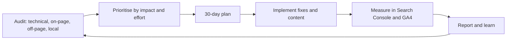
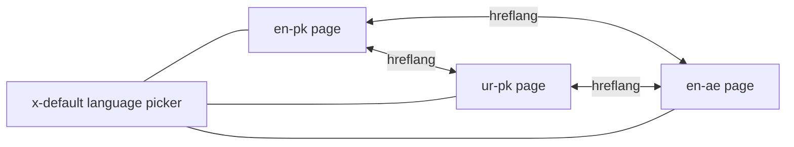
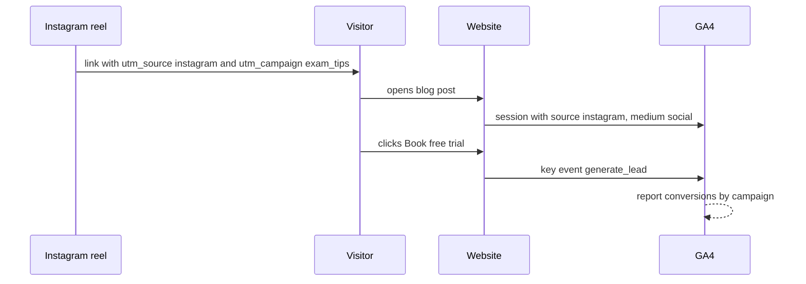
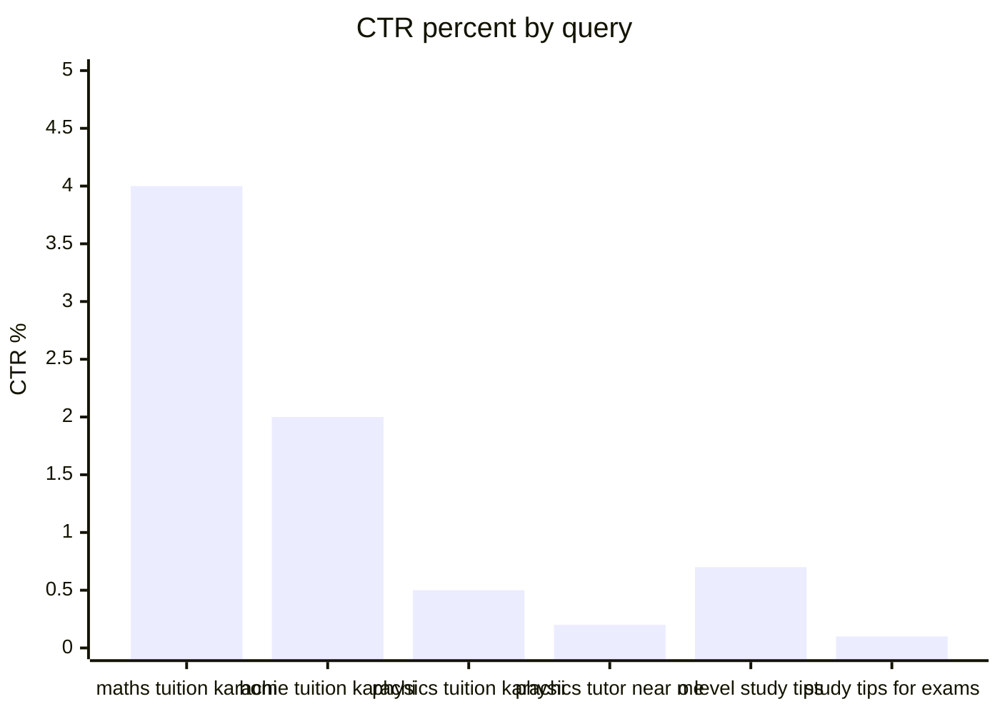

# Session 4 · Advanced SEO Techniques and Tools

> [Prime AI – Software Engineering with AI](../../README.md) › [Term 1](../README.md) › [Optimize Web for Search Engines (SEO)](README.md) › **Session 4**

| ⏱ Estimated time | 🧩 Prerequisites |
|---|---|
| 3.5 hours | Sessions 1–3 |

[⬅ Previous: Mobile SEO, Technical SEO and Local Content](session-03-mobile-seo-and-more.md) &nbsp;|&nbsp; [Practice test ➡](practice-test.md)

---

## 🎯 Learning objectives

By the end of this session you will be able to:

- Explain advanced SEO strategies: technical audits, canonicalisation, redirects, crawl budget, topic authority and AI-era search.
- Define localization and internationalization and apply international SEO tactics including hreflang.
- Outline the role of Social Media Optimization (SMO) and track campaigns with UTM parameters.
- Summarise essential SEO tools and explain the basics of Google Search Console and Google Analytics 4.
- Run a full site audit, interpret KPIs and build a 30-day SEO strategy, using AI tools responsibly.

## 📖 Concepts

### 1. Advanced strategies – beyond the basics

| Strategy | What it means | Practical example |
|---|---|---|
| **Technical audit** | Crawl the whole site like a bot and fix errors at scale | Broken links, duplicate titles, orphan pages, redirect chains |
| **Canonicalisation** | Tell engines which of several similar URLs is the master | `?sort=price` and `?utm_source=` versions point `rel="canonical"` to the clean URL |
| **Redirects** | Move pages without losing value | **301** (permanent) when a URL changes; avoid chains (A→B→C) and loops; 302 only for temporary |
| **Status codes** | Signal what happened | 200 OK · 301/308 moved · 404 not found · 410 gone · 5xx server error (fix fast) |
| **Crawl budget** | Large sites: bots crawl a limited number of URLs | Block infinite filters, fix soft-404s, keep sitemaps clean |
| **Topical authority** | Cover a subject thoroughly with interlinked content | Pillar + 15 cluster articles on "O Level physics" |
| **Content pruning/refresh** | Update or merge weak pages | Merge three thin "tips" posts into one strong guide with 301s |
| **SERP features** | Target snippets, People Also Ask, images, video | Q&A formatting, tables, video with chapters |
| **AI-era search** | AI overviews and answer engines summarise pages | Clear, factual, well-structured, cited content with strong E-E-A-T is what gets quoted |

### 2. Localization, internationalization and international SEO

- **Internationalization (i18n)** – *engineering* a site so it **can** support many languages/regions: UTF-8, text
  outside code, flexible layouts for longer words and right-to-left scripts (Urdu, Arabic: `dir="rtl"`), date/number/
  currency formats.
- **Localization (l10n)** – *adapting* content for a specific market: translation, local currency (PKR vs AED), units,
  examples, images, legal text, local keywords (people may search "tuition" in one country and "tutoring" in another).

> 🌍 **Analogy – a restaurant chain.** Internationalization is building kitchens that can cook any cuisine (the
> infrastructure). Localization is the actual menu in each city – biryani in Karachi, shawarma in Dubai.

**International SEO tactics**

| Decision | Options | Notes |
|---|---|---|
| **URL structure** | ccTLD (`example.pk`, `example.ae`) · sub-folder (`example.com/ur-pk/`) · sub-domain (`ur.example.com`) | Sub-folders are simplest and share authority; ccTLDs send the strongest country signal |
| **hreflang** | `<link rel="alternate" hreflang="en-pk" href="…">` for every version, **including itself** | Must be **reciprocal**; add `x-default` for the fallback/language picker |
| **Language codes** | ISO 639-1 language (`en`, `ur`, `ar`) + optional ISO 3166-1 region (`pk`, `ae`, `gb`) | `en-uk` is wrong – the region code is `gb` |
| **Content** | Real translation by people (AI drafts reviewed), local prices, contact numbers | Don't auto-redirect by IP; let users switch |
| **Signals** | `lang` attribute, local address/phone, local links, Business Profiles per country | Search Console international settings |

### 3. Social Media Optimization (SMO)

**SMO** = optimising your social presence and content so it is discovered, shared and drives traffic. It maximises SEO
impact indirectly: content gets seen → shared → linked → searched by brand name.

| SMO practice | Detail |
|---|---|
| Optimised profiles | Same name/handle, keyword-rich bio, website link, consistent branding |
| Shareable content | Short videos, carousels, infographics, quotes; native to each platform |
| Open Graph & Twitter cards | `og:title`, `og:image` (1200 × 630), `twitter:card` so links preview well |
| Share buttons & embeds | Make sharing easy from your pages |
| Community | Reply, join groups, collaborate with creators |
| Measurement | **UTM parameters** on every link → see social traffic and conversions in GA4 |

**UTM parameters** are tags added to a URL so analytics knows where a visit came from:
`?utm_source=instagram&utm_medium=social&utm_campaign=exam_tips_oct26&utm_content=reel1`. Use lower-case, consistent
names, and never put UTMs on internal links.

### 4. Essential SEO tools

| Tool | Free? | Use it for |
|---|---|---|
| **Google Search Console** | Free | Queries, impressions, clicks, CTR, position; indexing status; sitemaps; Core Web Vitals; manual actions; URL Inspection |
| **Google Analytics 4** | Free | What visitors do: sessions, engagement, conversions (key events), traffic sources |
| **Bing Webmaster Tools** | Free | Bing's equivalent of Search Console (also feeds some AI assistants) |
| **PageSpeed Insights / Lighthouse** | Free | Performance, accessibility, SEO audits |
| **Screaming Frog SEO Spider** | Free up to 500 URLs | Technical crawling: status codes, titles, canonicals, redirects |
| **Semrush / Ahrefs / Moz** | Paid (limited free) | Keywords, competitors, backlinks, rank tracking, site audits |
| **Ubersuggest, Google Keyword Planner, AnswerThePublic** | Free tiers | Keyword ideas and volumes |
| **Yoast SEO / Rank Math** | Free + paid | On-page SEO inside WordPress (Term 2 CMS module) |
| **Rich Results Test / Schema Validator** | Free | Structured data |
| **AI assistants (ChatGPT, Gemini, Copilot), Surfer, Frase** | Mixed | Ideas, outlines, meta drafts, FAQ ideas, clustering – always fact-check and edit |

### 5. Google Search Console – the essentials

1. **Add a property** (Domain property via DNS record, or URL-prefix via HTML file/tag) and verify ownership.
2. **Submit the sitemap** (*Indexing › Sitemaps*).
3. **Performance report** – queries and pages with **clicks**, **impressions**, **CTR** and **average position**; filter
   by device and country; compare date ranges.
4. **Pages (indexing) report** – which URLs are indexed and why others are not (noindex, duplicate, crawled – not
   indexed, 404).
5. **URL Inspection** – see Google's rendered HTML for one URL, request indexing after fixes.
6. **Experience** – Core Web Vitals and HTTPS; **Security & Manual actions** – penalties and hacking alerts.

### 6. Google Analytics 4 – the basics

GA4 is **event-based**: every interaction (page view, scroll, click, form submit) is an **event**.

| Term | Meaning |
|---|---|
| **User** | A browser/device (or signed-in person) |
| **Session** | A group of events from one visit (ends after 30 min inactivity by default) |
| **Engaged session** | Lasted > 10 s, **or** had a key event, **or** ≥ 2 page views |
| **Engagement rate** | Engaged sessions ÷ sessions |
| **Bounce rate** | 1 − engagement rate (GA4 definition) |
| **Key event** (conversion) | An event you mark as important: `generate_lead`, `purchase`, `contact_click` |
| **Default channel group** | Organic Search, Paid Search, Organic Social, Direct, Referral, Email … |

Set-up: create a property and web data stream, add the Google tag (`gtag.js`) or use Google Tag Manager, mark key events,
link Search Console. Respect privacy laws and consent (cookie banners where required).

### 7. SEO KPIs

| KPI | Formula / source | Why it matters |
|---|---|---|
| Impressions | Search Console | Visibility |
| Clicks | Search Console | Traffic from search |
| **CTR** | clicks ÷ impressions | Snippet quality |
| Average position | Search Console | Ranking trend (an average – read with care) |
| Organic sessions & engagement rate | GA4 › Organic Search | Visit quality |
| **Conversions / conversion rate** | key events ÷ sessions | Business value |
| Referring domains | Backlink tool | Authority growth |
| Core Web Vitals pass rate | Search Console | Experience |

### 8. Using AI in SEO – responsibly

AI tools can speed up **research and drafting**: generating keyword ideas, clustering keywords, outlining articles,
suggesting titles/meta descriptions and FAQs, summarising competitor pages, writing schema or regex. Google's guidance
focuses on **quality, not how content is produced** – but mass-producing unhelpful pages to manipulate rankings is spam.

**Rules of thumb:** fact-check every claim; add first-hand experience and examples AI cannot know; keep a human editor;
never generate fake reviews or author credentials; disclose AI use where your audience would expect it; don't paste
private customer data into public AI tools.

### 9. The audit → strategy cycle

A **full SEO audit** covers technical (crawl, index, speed, mobile), on-page (titles, content, links), off-page (backlinks,
mentions) and local (profile, NAP, reviews). Findings become a prioritised **30-day plan** (impact × effort), executed and
measured, then repeated monthly.

## 🧭 Diagrams

### Continuous SEO improvement cycle



### hreflang: every version lists every version



### From social post to measured conversion



## 💻 Worked examples

### Example 1 — A full site audit crawler with a health score

This is a miniature Screaming Frog. It crawls the demo site, records each URL's status, title, description, `h1`
count, canonical, word count, click depth and inlinks, then reports duplicate titles, missing descriptions, broken links,
thin pages, orphan pages and an overall **site health score**.

```js
// session-04_site-audit.js  (run: node session-04_site-audit.js)
// Crawls the demo site and reports technical/on-page issues with a health score.
const fs = require('fs');
const path = require('path');
const { JSDOM } = require('jsdom');
const SITE = path.join(__dirname, 'demo-site');

const pages = {}; const inlinks = {}; const queue = [['index.html', 0]]; const seen = new Set(['index.html']);
while (queue.length) {
  const [url, depth] = queue.shift();
  const file = path.join(SITE, url);
  if (!fs.existsSync(file)) { pages[url] = { status: 404, depth }; continue; }
  const doc = new JSDOM(fs.readFileSync(file, 'utf8')).window.document;
  const links = [...new Set([...doc.querySelectorAll('a[href]')].map(a => a.getAttribute('href')).filter(h => !/^(https?:|mailto:|tel:|#)/.test(h)))];
  doc.querySelectorAll('nav').forEach(n => n.remove());
  pages[url] = {
    status: 200, depth,
    title: doc.title.trim(),
    desc: doc.querySelector('meta[name="description"]')?.content ?? '',
    h1: doc.querySelectorAll('h1').length,
    canonical: doc.querySelector('link[rel="canonical"]')?.getAttribute('href') ?? '',
    words: (doc.body.textContent.match(/[A-Za-z0-9']+/g) || []).length,
    imgsNoAlt: [...doc.images].filter(i => !i.getAttribute('alt')).length,
    brokenImgs: [...doc.images].filter(i => !fs.existsSync(path.join(SITE, i.getAttribute('src')))).length,
  };
  for (const l of links) {
    (inlinks[l] ??= new Set()).add(url);
    if (!seen.has(l)) { seen.add(l); queue.push([l, depth + 1]); }
  }
}

// ---- Report table ----
console.log('URL                    status depth inlinks words h1 title-len desc-len');
for (const [u, p] of Object.entries(pages)) {
  console.log(`${u.padEnd(22)} ${String(p.status).padEnd(6)} ${String(p.depth).padEnd(5)} ${String(inlinks[u]?.size ?? 0).padEnd(7)} ${String(p.words ?? '-').padEnd(5)} ${String(p.h1 ?? '-').padEnd(2)} ${String(p.title?.length ?? '-').padEnd(9)} ${p.desc?.length ?? '-'}`);
}

// ---- Issues ----
const ok = Object.entries(pages).filter(([, p]) => p.status === 200);
const issues = [];
const byTitle = {};
ok.forEach(([u, p]) => (byTitle[p.title] ??= []).push(u));
Object.values(byTitle).filter(us => us.length > 1).forEach(us => issues.push(['high', `duplicate title on ${us.join(' & ')}`]));
Object.entries(pages).filter(([, p]) => p.status === 404).forEach(([u]) => issues.push(['high', `broken link target ${u} (linked from ${[...inlinks[u]].join(', ')})`]));
ok.forEach(([u, p]) => {
  if (!p.desc) issues.push(['medium', `missing meta description: ${u}`]);
  else if (p.desc.length < 70) issues.push(['low', `short meta description (${p.desc.length}): ${u}`]);
  if (p.h1 !== 1) issues.push(['medium', `${p.h1} h1 tags: ${u}`]);
  if (!p.canonical) issues.push(['low', `no canonical tag: ${u}`]);
  if (p.words < 100) issues.push(['medium', `thin content (${p.words} words): ${u}`]);
  if (p.imgsNoAlt) issues.push(['low', `${p.imgsNoAlt} image(s) without alt: ${u}`]);
  if (p.brokenImgs) issues.push(['medium', `${p.brokenImgs} broken image(s): ${u}`]);
  if (p.title.length < 30) issues.push(['medium', `short title "${p.title}": ${u}`]);
});
const weights = { high: 10, medium: 5, low: 2 };
const health = Math.max(0, 100 - issues.reduce((s, [sev]) => s + weights[sev], 0));
console.log(`\nISSUES (${issues.length})`);
for (const sev of ['high', 'medium', 'low']) issues.filter(i => i[0] === sev).forEach(([, msg]) => console.log(`  [${sev.toUpperCase().padEnd(6)}] ${msg}`));
console.log(`\nSite health score: ${health}/100`);
```

📄 Saved as [`code/session-04_site-audit.js`](code/session-04_site-audit.js)

**Output** (real run)

```text
URL                    status depth inlinks words h1 title-len desc-len
index.html             200    0     5       91    1  56        144
maths-tuition.html     200    1     5       172   1  62        145
physics-tuition.html   200    1     5       21    2  7         0
contact.html           200    1     5       19    1  56        22
blog-study-tips.html   200    1     2       163   1  65        135
fees.html              404    2     2       -     -  -         -

ISSUES (13)
  [HIGH  ] duplicate title on index.html & contact.html
  [HIGH  ] broken link target fees.html (linked from physics-tuition.html, contact.html)
  [MEDIUM] thin content (91 words): index.html
  [MEDIUM] missing meta description: physics-tuition.html
  [MEDIUM] 2 h1 tags: physics-tuition.html
  [MEDIUM] thin content (21 words): physics-tuition.html
  [MEDIUM] 1 broken image(s): physics-tuition.html
  [MEDIUM] short title "Physics": physics-tuition.html
  [MEDIUM] thin content (19 words): contact.html
  [LOW   ] no canonical tag: physics-tuition.html
  [LOW   ] 1 image(s) without alt: physics-tuition.html
  [LOW   ] short meta description (22): contact.html
  [LOW   ] no canonical tag: contact.html

Site health score: 37/100
```

### Example 2 — hreflang generator and validator

Karachi Tutors expands to Urdu speakers in Pakistan and English speakers in the UAE. The script generates the hreflang
`<link>` set for each page version, then validates a hand-written (buggy) set: wrong region code, missing self-reference
and missing return links.

```js
// session-04_hreflang.js  (run: node session-04_hreflang.js)
// Generates reciprocal hreflang tags and validates a buggy set.

const VERSIONS = {                         // hreflang code -> URL
  'en-pk': 'https://karachitutors.pk/en/',
  'ur-pk': 'https://karachitutors.pk/ur/',
  'en-ae': 'https://karachitutors.pk/ae/',
  'x-default': 'https://karachitutors.pk/',
};
const LANGS = ['en', 'ur', 'ar'];
const REGIONS = ['pk', 'ae', 'gb', 'us', 'sa'];

// 1. Generate: every page lists ALL versions, including itself
console.log('<!-- put this identical block in the <head> of every version -->');
for (const [code, url] of Object.entries(VERSIONS)) console.log(`<link rel="alternate" hreflang="${code}" href="${url}">`);

// 2. Validate a set of pages, each with the hreflang links it declares
const declared = {
  'https://karachitutors.pk/en/': { 'en-pk': 'https://karachitutors.pk/en/', 'ur-pk': 'https://karachitutors.pk/ur/', 'en-uk': 'https://karachitutors.pk/uk/' },
  'https://karachitutors.pk/ur/': { 'en-pk': 'https://karachitutors.pk/en/' },
  'https://karachitutors.pk/ae/': { 'en-ae': 'https://karachitutors.pk/ae/', 'en-pk': 'https://karachitutors.pk/en/' },
};

function validCode(code) {
  if (code === 'x-default') return true;
  const [lang, region] = code.split('-');
  return LANGS.includes(lang) && (!region || REGIONS.includes(region));
}

console.log('\nVALIDATION');
let problems = 0;
for (const [page, links] of Object.entries(declared)) {
  const msgs = [];
  if (!Object.values(links).includes(page)) msgs.push('missing self-reference');
  for (const [code, target] of Object.entries(links)) {
    if (!validCode(code)) msgs.push(`invalid code "${code}" (region for the UK is "gb")`);
    if (target !== page && declared[target] && !Object.values(declared[target]).includes(page)) msgs.push(`no return link from ${target}`);
    if (target !== page && !declared[target]) msgs.push(`target ${target} not found in crawl`);
  }
  if (!('x-default' in links)) msgs.push('no x-default');
  problems += msgs.length;
  console.log(`${page}\n   ${msgs.length ? msgs.join('\n   ') : 'ok'}`);
}
console.log(`\n${problems} hreflang problem(s) found`);
```

📄 Saved as [`code/session-04_hreflang.js`](code/session-04_hreflang.js)

**Output** (real run)

```text
<!-- put this identical block in the <head> of every version -->
<link rel="alternate" hreflang="en-pk" href="https://karachitutors.pk/en/">
<link rel="alternate" hreflang="ur-pk" href="https://karachitutors.pk/ur/">
<link rel="alternate" hreflang="en-ae" href="https://karachitutors.pk/ae/">
<link rel="alternate" hreflang="x-default" href="https://karachitutors.pk/">

VALIDATION
https://karachitutors.pk/en/
   invalid code "en-uk" (region for the UK is "gb")
   target https://karachitutors.pk/uk/ not found in crawl
   no x-default
https://karachitutors.pk/ur/
   missing self-reference
   no x-default
https://karachitutors.pk/ae/
   no return link from https://karachitutors.pk/en/
   no x-default

7 hreflang problem(s) found
```

### Example 3 — Search Console + GA4 report: KPIs and opportunities

Two practice exports: [`code/session-04_search-console.csv`](code/session-04_search-console.csv) (query, page, clicks,
impressions, position) and [`code/session-04_ga4-sessions.csv`](code/session-04_ga4-sessions.csv) (one row per session:
channel, landing page, engagement time, page views, key event). The script calculates CTR, engagement rate, bounce rate and
conversion rate by channel, and lists **opportunities**: queries on page 1–2 with many impressions but low CTR.

```js
// session-04_analytics-report.js  (run: node session-04_analytics-report.js)
// KPIs from a Search Console export and GA4 session data, plus opportunity finding.
const fs = require('fs');
const path = require('path');
const csv = f => {
  const [head, ...rows] = fs.readFileSync(path.join(__dirname, f), 'utf8').trim().split('\n');
  const keys = head.split(',');
  return rows.map(r => Object.fromEntries(r.split(',').map((v, i) => [keys[i], isNaN(v) ? v : +v])));
};
const pct = x => (x * 100).toFixed(1) + '%';

// ---- Search Console ----
const gsc = csv('session-04_search-console.csv');
const clicks = gsc.reduce((s, r) => s + r.clicks, 0);
const impr = gsc.reduce((s, r) => s + r.impressions, 0);
const avgPos = gsc.reduce((s, r) => s + r.position * r.impressions, 0) / impr;   // impression-weighted, like GSC
console.log(`SEARCH CONSOLE (28 days): ${clicks} clicks · ${impr} impressions · CTR ${pct(clicks / impr)} · avg position ${avgPos.toFixed(1)}`);
console.log('\nOpportunities – position ≤ 20, ≥ 500 impressions, CTR < 2%:');
gsc.filter(r => r.position <= 20 && r.impressions >= 500 && r.clicks / r.impressions < 0.02)
   .sort((a, b) => b.impressions - a.impressions)
   .forEach(r => console.log(`  "${r.query}" → ${r.page}  pos ${r.position}, ${r.impressions} impr, CTR ${pct(r.clicks / r.impressions)}  ⇒ ${r.position <= 10 ? 'rewrite title/description' : 'improve content + internal links to reach page 1'}`));

// ---- GA4 ----
const ga = csv('session-04_ga4-sessions.csv');
const engaged = s => s.engagement_sec > 10 || s.key_event === 1 || s.page_views >= 2;   // GA4's engaged-session rule
console.log('\nGA4 BY CHANNEL');
console.log('channel          sessions engaged  eng.rate bounce  key events conv.rate');
const channels = [...new Set(ga.map(s => s.channel))];
for (const ch of channels) {
  const rows = ga.filter(s => s.channel === ch);
  const e = rows.filter(engaged).length;
  const k = rows.filter(s => s.key_event === 1).length;
  console.log(`${ch.padEnd(16)} ${String(rows.length).padStart(8)} ${String(e).padStart(7)}  ${pct(e / rows.length).padStart(7)} ${pct(1 - e / rows.length).padStart(7)} ${String(k).padStart(10)} ${pct(k / rows.length).padStart(9)}`);
}
const all = ga.filter(engaged).length;
console.log(`${'ALL'.padEnd(16)} ${String(ga.length).padStart(8)} ${String(all).padStart(7)}  ${pct(all / ga.length).padStart(7)} ${pct(1 - all / ga.length).padStart(7)} ${String(ga.filter(s => s.key_event).length).padStart(10)} ${pct(ga.filter(s => s.key_event).length / ga.length).padStart(9)}`);
```

📄 Saved as [`code/session-04_analytics-report.js`](code/session-04_analytics-report.js)

**Output** (real run)

```text
SEARCH CONSOLE (28 days): 827 clicks · 34450 impressions · CTR 2.4% · avg position 11.4

Opportunities – position ≤ 20, ≥ 500 impressions, CTR < 2%:
  "study tips for exams" → /blog-study-tips.html  pos 18.9, 9800 impr, CTR 0.1%  ⇒ improve content + internal links to reach page 1
  "o level study tips" → /blog-study-tips.html  pos 14.8, 6100 impr, CTR 0.7%  ⇒ improve content + internal links to reach page 1
  "physics tutor near me" → /physics-tuition.html  pos 11.3, 2600 impr, CTR 0.2%  ⇒ improve content + internal links to reach page 1
  "physics tuition karachi" → /physics-tuition.html  pos 7.4, 1900 impr, CTR 0.5%  ⇒ rewrite title/description

GA4 BY CHANNEL
channel          sessions engaged  eng.rate bounce  key events conv.rate
Organic Search          8       5    62.5%   37.5%          2     25.0%
Organic Social          4       2    50.0%   50.0%          1     25.0%
Direct                  3       2    66.7%   33.3%          1     33.3%
Referral                2       1    50.0%   50.0%          0      0.0%
Email                   1       1   100.0%    0.0%          1    100.0%
ALL                    18      11    61.1%   38.9%          5     27.8%
```

### Example 4 — UTM link builder for social campaigns

Consistent UTM tags make SMO measurable. This builder normalises names (lower-case, underscores), rejects missing
required parameters and refuses to tag internal links.

```js
// session-04_utm-builder.js  (run: node session-04_utm-builder.js)
// Builds clean, consistent UTM-tagged URLs for social campaigns.

const norm = s => s.trim().toLowerCase().replace(/[^a-z0-9]+/g, '_').replace(/^_|_$/g, '');

function utm(base, { source, medium, campaign, content, term }) {
  if (!source || !medium || !campaign) throw new Error('source, medium and campaign are required');
  const url = new URL(base);
  if (url.hostname === 'karachitutors.pk' && medium === 'internal') throw new Error('never tag internal links');
  const params = { utm_source: source, utm_medium: medium, utm_campaign: campaign, utm_content: content, utm_term: term };
  for (const [k, v] of Object.entries(params)) if (v) url.searchParams.set(k, norm(v));
  return url.toString();
}

const base = 'https://karachitutors.pk/blog-study-tips.html';
const posts = [
  { source: 'Instagram', medium: 'social', campaign: 'Exam Tips Oct 2026', content: 'Reel 1 - spaced revision' },
  { source: 'Facebook', medium: 'social', campaign: 'Exam Tips Oct 2026', content: 'Parents group post' },
  { source: 'WhatsApp', medium: 'social', campaign: 'Exam Tips Oct 2026', content: 'Channel update' },
  { source: 'newsletter', medium: 'email', campaign: 'Exam Tips Oct 2026' },
  { source: 'YouTube', medium: 'social' },                               // missing campaign → error
];
for (const p of posts) {
  try { console.log(`${p.source.padEnd(10)} ${utm(base, p)}`); }
  catch (e) { console.log(`${p.source.padEnd(10)} ERROR: ${e.message}`); }
}
```

📄 Saved as [`code/session-04_utm-builder.js`](code/session-04_utm-builder.js)

**Output** (real run)

```text
Instagram  https://karachitutors.pk/blog-study-tips.html?utm_source=instagram&utm_medium=social&utm_campaign=exam_tips_oct_2026&utm_content=reel_1_spaced_revision
Facebook   https://karachitutors.pk/blog-study-tips.html?utm_source=facebook&utm_medium=social&utm_campaign=exam_tips_oct_2026&utm_content=parents_group_post
WhatsApp   https://karachitutors.pk/blog-study-tips.html?utm_source=whatsapp&utm_medium=social&utm_campaign=exam_tips_oct_2026&utm_content=channel_update
newsletter https://karachitutors.pk/blog-study-tips.html?utm_source=newsletter&utm_medium=email&utm_campaign=exam_tips_oct_2026
YouTube    ERROR: source, medium and campaign are required
```

## 🧩 Real-life coding problem

**Scenario – the 30-day SEO plan.** Using everything from this module, produce a 30-day plan for Karachi Tutors based on
**evidence** from the audit and analytics tools, not guesses.

**Inputs** – the site audit (Example 1), the analytics report (Example 3) and Session 2's on-page scores.

**Method**
1. List every finding with **impact** (1–3) and **effort** (1–3).
2. Priority = impact ÷ effort; quick wins first.
3. Group tasks into four weeks: *fix* (technical), *optimise* (on-page), *create* (content), *promote* (off-page/local/SMO).
4. Define KPIs and targets for day 30.

The planner script turns the findings into a schedule automatically –
[`code/session-04_seo-plan.js`](code/session-04_seo-plan.js):

```text
WEEK 1 (effort 5/5)
  [fix     ] p=3.00  Fix broken links to fees.html (create a fees page)
  [fix     ] p=2.00  Give contact page a unique title + description
  [fix     ] p=1.00  Add canonical tags to physics and contact pages
  [optimise] p=3.00  Rewrite titles/descriptions for low-CTR queries on page 1
  [optimise] p=2.00  Add LocalBusiness + BreadcrumbList JSON-LD
WEEK 2 (effort 5/5)
  [optimise] p=1.50  Rewrite physics page (title, description, content, one h1)
  [promote ] p=1.50  Claim and complete Google Business Profile, ask 10 reviews
  [promote ] p=1.00  Instagram reels with UTM links to the study-tips article
WEEK 3 (effort 5/5)
  [create  ] p=1.00  Expand study-tips article to reach page 1 (add sections, FAQs)
  [create  ] p=1.00  Create chemistry tuition page (new keyword cluster)
WEEK 4 (effort 5/5)
  [create  ] p=1.00  Create DHA local landing page
  [promote ] p=0.67  Publish formula-sheet PDF and do school outreach for links

KPI targets for day 30: CTR 2.4% → 3.5% · organic key events +30% · physics page on page 1 for "physics tuition karachi" · 10 new reviews · site health ≥ 85
```

A written version of the plan (with owners and KPI targets) is in
[`code/session-04_30-day-plan-template.md`](code/session-04_30-day-plan-template.md) – copy it for your own projects.

## ⚠️ Common mistakes

| Mistake | Consequence | Fix |
|---|---|---|
| 302 instead of 301 for permanent moves | Signals may not consolidate | Use 301/308 for permanent changes |
| Redirect chains and loops | Slow, lost link value, crawl waste | Redirect straight to the final URL |
| Canonical pointing to a noindex/404 page | Conflicting signals | Canonical to an indexable 200 page |
| hreflang without return links or self-reference | Tags ignored | Identical, reciprocal sets on every version |
| Auto-redirecting visitors by IP/language | Bots and users can't reach other versions | Suggest, don't force; provide a switcher |
| Tagging internal links with UTMs | Breaks session attribution | UTMs only on external campaign links |
| Reporting average position alone | Misleading (averages across many queries) | Combine with impressions, clicks, CTR by query |
| Publishing AI text unedited | Errors, generic content, no E-E-A-T | Human editing, fact-checking, real expertise |

## 🌟 Best practices

- Crawl your own site monthly (Screaming Frog or a script) and fix high-severity issues first.
- Keep a redirect map whenever URLs change; update internal links to the new URLs.
- Plan international sites with sub-folders and reciprocal hreflang; localise, don't just translate.
- Tag all campaign links with UTMs; define key events in GA4 and link GA4 with Search Console.
- Report monthly on a small set of KPIs (clicks, CTR, conversions, referring domains, CWV) with notes on what changed.
- Use AI for speed (ideas, outlines, drafts, regex, schema) and humans for truth, experience and judgement.

## 🏗️ Mini project

**Mini project / module wrap-up – a complete SEO audit report.** Run every tool in this module against the demo site and
write a professional report (2–3 pages) using the template in
[`code/session-04_audit-report-template.md`](code/session-04_audit-report-template.md): executive summary, technical,
on-page, off-page, local, analytics findings, prioritised recommendations and KPI targets. Present it to the class as if
the business owner were in the room.

## 📦 Project files for this session

| File | What it is |
|---|---|
| 📄 [`code/session-04_search-console.csv`](code/session-04_search-console.csv) | Practice Search Console export (query, page, clicks, impressions, position) |
| 📄 [`code/session-04_ga4-sessions.csv`](code/session-04_ga4-sessions.csv) | Practice GA4 session data (one row per session) |
| 📄 [`code/session-04_seo-plan.js`](code/session-04_seo-plan.js) | Real-life problem solution – turns audit findings into a prioritised 30-day plan |
| 📄 [`code/session-04_30-day-plan-template.md`](code/session-04_30-day-plan-template.md) | Template – 30-day SEO plan with owners and KPI targets |
| 📄 [`code/session-04_audit-report-template.md`](code/session-04_audit-report-template.md) | Template – professional SEO audit report structure |

## 📊 At a glance

**CTR by Search Console query (practice data, real output of the analytics script)** – page-1 queries with low CTR are the
quickest wins:



| Tool | Best for | Cost |
|---|---|---|
| Search Console | Queries, indexing, CWV, manual actions | Free |
| GA4 | Behaviour, conversions, channels | Free |
| Screaming Frog | Technical crawl | Free ≤ 500 URLs |
| Semrush / Ahrefs | Competitors, backlinks, rank tracking | Paid |
| Lighthouse / PSI | Speed, accessibility | Free |

## 🧪 Lab / practice tasks

**🟢 Easy** — Build UTM links for a week of posts promoting one blog article on three platforms, with two content variations each. Paste them into the UTM builder and check they are normalised.

<details><summary>💡 Hint</summary>

Keep `utm_campaign` identical for the whole campaign; vary `utm_content` per creative.

</details>

<details><summary>✅ Solution</summary>

Example: `?utm_source=instagram&utm_medium=social&utm_campaign=exam_tips_oct_2026&utm_content=reel_1` and `…reel_2`; the
same campaign for `facebook` (post_a, post_b) and `whatsapp` (channel_mon, channel_thu). In GA4, *Traffic acquisition*
filtered by session campaign shows which creative drove key events.

</details>

**🟡 Medium** — Fix the demo site so the audit's health score rises above 85: create `fees.html`, give the contact page a unique title and a full description, and replace the physics page with the optimised version. Re-run `session-04_site-audit.js`.

<details><summary>💡 Hint</summary>

Work in a copy of demo-site if you want to keep the original mistakes for other labs.

</details>

<details><summary>✅ Solution</summary>

After creating `demo-site/fees.html` (unique title, description, h1, canonical, 150+ words), updating `contact.html`
(`<title>Contact Karachi Tutors – Book a Free Trial Lesson</title>` + 130-character description + canonical) and swapping in
the optimised physics page, the audit reports only low-severity items (e.g. missing image on the blog) and a health score
around 90.

</details>

**🔴 Hard** — Extend `session-04_analytics-report.js` to compute **conversion rate by landing page** and flag pages with ≥ 3 sessions and 0 key events.

<details><summary>💡 Hint</summary>

Group GA4 rows by `landing_page`, count sessions and key events.

</details>

<details><summary>✅ Solution</summary>

```js
const byPage = {};
for (const s of ga) { const p = (byPage[s.landing_page] ??= { n: 0, k: 0 }); p.n++; p.k += s.key_event; }
for (const [page, { n, k }] of Object.entries(byPage)) {
  console.log(`${page.padEnd(24)} ${n} sessions, ${k} key events, ${pct(k / n)}${n >= 3 && k === 0 ? '  ⚠ no conversions' : ''}`);
}
```
With the practice data, `/blog-study-tips.html` has several sessions but few key events – add a clear call to action
("Book a free trial") inside the article.

</details>

**🏆 Challenge** — Use an AI assistant to draft meta descriptions for the five demo pages, then **evaluate** each draft against the on-page rules (length, keyword, accuracy, call to action). Record what you had to correct and why.

<details><summary>💡 Hint</summary>

Give the AI the page's purpose, keyword and facts; check every claim (e.g. "free trial") is true on the page.

</details>

<details><summary>✅ Solution</summary>

A good submission shows the prompt, the five drafts, a table of checks (length 120–160, keyword present, accurate,
CTA), and corrections – typically removing invented claims ("24/7 support", "#1 in Karachi"), fixing length and making the
wording less generic. Conclusion: AI saves time on drafts, but a human must verify facts and tone.

</details>

## ✅ Quick quiz

**Q1. A page moved permanently to a new URL. Which redirect?**

- A) 302
- B) 301
- C) 404
- D) 500

<details><summary>Show answer</summary>

**B** — 301/308 signal a permanent move.

</details>

**Q2. Which hreflang code is correct for English in the United Kingdom?**

- A) en-uk
- B) en-gb
- C) uk-en
- D) gb-en

<details><summary>Show answer</summary>

**B** — The ISO region code for the UK is GB.

</details>

**Q3. What do UTM parameters do?**

- A) Speed up pages
- B) Tell analytics the source, medium and campaign of a visit
- C) Improve rankings directly
- D) Block bots

<details><summary>Show answer</summary>

**B** — They tag campaign traffic.

</details>

**Q4. In GA4, a session is "engaged" if it:**

- A) Lasted at least 1 second
- B) Lasted > 10 s, had a key event or ≥ 2 page views
- C) Came from Google
- D) Had a scroll

<details><summary>Show answer</summary>

**B** — That is GA4's definition.

</details>

**Q5. Which tool shows the queries that triggered your pages in Google?**

- A) GA4 only
- B) Google Search Console
- C) Lighthouse
- D) Canva

<details><summary>Show answer</summary>

**B** — The Performance report lists queries.

</details>

## 📝 Summary / cheat-sheet

- Advanced SEO: technical audits, canonicals, 301 redirects (no chains), status codes, crawl budget, topical authority, content refresh, SERP features, AI-era search.
- Internationalization = engineering for many locales; localization = adapting content per market.
- International SEO: sub-folders/ccTLDs, reciprocal hreflang with self-reference and x-default, correct ISO codes, no forced IP redirects.
- SMO: optimised profiles, shareable native content, Open Graph tags, community, UTM-tagged links.
- Search Console = search visibility (queries, CTR, indexing, CWV); GA4 = behaviour (sessions, engagement rate, key events).
- KPIs: impressions, clicks, CTR, position, engagement, conversions, referring domains, CWV.
- Audit → prioritise (impact ÷ effort) → 30-day plan → measure → repeat; AI assists, humans verify.

## 🎤 Interview / viva questions

1. **Difference between a canonical tag and a 301 redirect?**
   <details><summary>Model answer</summary>

   A 301 sends users and bots to the new URL; a canonical keeps both URLs accessible but tells search engines which one to index and credit.

   </details>

2. **What are the most common hreflang errors?**
   <details><summary>Model answer</summary>

   Missing return links, missing self-reference, invalid language/region codes such as en-uk, pointing to non-canonical or broken URLs, and no x-default.

   </details>

3. **What is the difference between localization and internationalization?**
   <details><summary>Model answer</summary>

   Internationalization prepares the code and design to support multiple languages and regions; localization adapts the actual content, currency, units and keywords for one market.

   </details>

4. **Explain engagement rate and bounce rate in GA4.**
   <details><summary>Model answer</summary>

   Engagement rate is engaged sessions divided by all sessions; GA4 bounce rate is simply one minus the engagement rate.

   </details>

5. **How would you find quick SEO wins in Search Console?**
   <details><summary>Model answer</summary>

   Filter queries and pages with many impressions, positions roughly 3–15 and low CTR, then improve titles, descriptions and content or internal links for those pages.

   </details>

6. **How can AI tools help SEO without harming quality?**
   <details><summary>Model answer</summary>

   By speeding up research, clustering, outlines and draft metadata while humans fact-check, add real expertise and ensure the content is genuinely helpful.

   </details>

---

[⬅ Previous: Mobile SEO, Technical SEO and Local Content](session-03-mobile-seo-and-more.md) &nbsp;|&nbsp; [Practice test ➡](practice-test.md)

<sub>Prepared by **Hamna Zahid Khan**, Junior Lecturer · Prime AI – Software Engineering with AI</sub>
