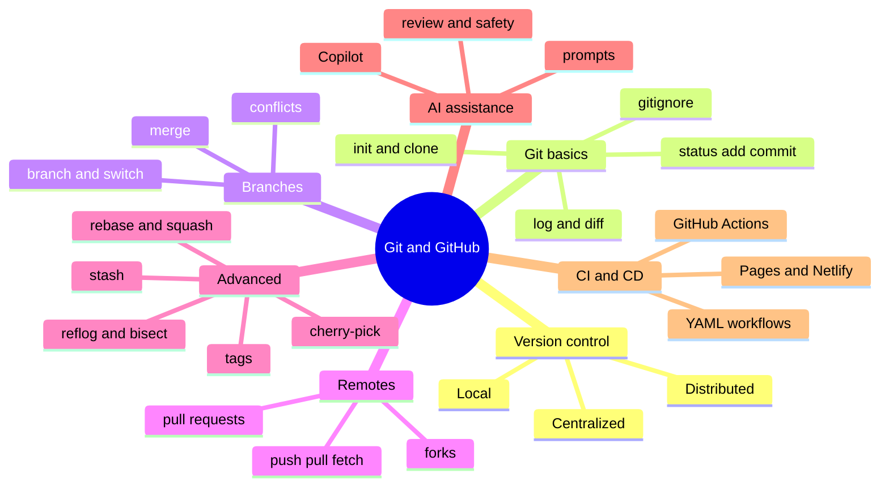

# Module 05 · Distributed Version Control with Git & GitHub

> [Prime AI – Software Engineering with AI](../../README.md) › [Term 1](../README.md) › **Distributed Version Control with Git & GitHub**

Every professional software team uses **version control**. It is the "undo history", the "time machine" and the
"collaboration hub" of a project all in one. In this module you learn **Git**, the distributed version control system
used by almost every developer today, and **GitHub**, the platform where teams host repositories, review each other's
work, automate tests and deploy websites.

You will start from zero (installing Git and making your first commit), move through everyday commands, branching,
merging and conflict resolution, master advanced tools such as rebase, stash, cherry-pick, tags and bisect, learn to use
**AI coding assistants** such as GitHub Copilot responsibly, and finish by building a **CI/CD pipeline** with GitHub
Actions that tests and deploys a project automatically.

**How the code in this module works:** every Git example is a real Bash script in [`code/`](code/). Each script creates a
throw-away repository in a temporary folder, runs the commands, and prints both the command and Git's real output – the
**Output (real run)** blocks on the session pages were produced exactly this way (with fixed dates so commit IDs are
reproducible). Run them yourself in **Git Bash** (Windows), Terminal (macOS) or any Linux shell.

## 🎯 Module objectives

- Trace the evolution of version control and classify local, centralized and distributed systems.
- Install and configure Git, create a GitHub account and repositories, and clone with HTTPS or SSH.
- Use the core workflow: status, add, commit, log, diff, restore, .gitignore, and meaningful commit messages.
- Create and manage branches, synchronise with remotes (push, pull, fetch) and undo safely (amend, reset, revert).
- Merge branches (fast-forward and three-way), resolve conflicts and collaborate with pull requests.
- Use advanced commands – rebase, interactive squash, stash, cherry-pick, tags, reflog, bisect – and fork-based workflows.
- Integrate AI coding assistants into a Git workflow and automate testing and deployment with GitHub Actions CI/CD.

## 🗂️ Sessions

| # | Session | Time | What you will cover |
|---|---|---|---|
| 1 | [Introduction to Version Control, Git and GitHub](session-01-introduction-to-version-control-git-and-github.md) | 3 hours | Outline the evolution of version control systems from manual copies to Git; Classify version control systems as local, centralized or distributed, with their pros and cons; Define Git and GitHub and explain why developers and companies rely on them |
| 2 | [Basic Git Commands](session-02-basic-git-commands.md) | 3 hours | Explain the file lifecycle: working directory → staging area → repository, and file states; Use status, add, commit, log, diff, show and restore confidently, and write meaningful commit messages; Ignore files with .gitignore and stop tracking files that should never be committed |
| 3 | [Branching, Merging and Conflict Resolution](session-03-branching-merging-and-conflict-resolution.md) | 3 hours | Explain why teams use feature branches and how branches are represented in Git; Perform simple (fast-forward) and complex (three-way) merges and read the resulting history graph; Identify the common causes of merge conflicts and read conflict markers |
| 4 | [Advanced Git Commands and Collaboration Workflows](session-04-advanced-git-and-collaboration-workflows.md) | 3.5 hours | Apply advanced commands: stash, cherry-pick, tags, reflog, bisect and blame; Define rebasing, compare it with merging and use interactive rebase to squash and reword commits; Manage files with Git: move, rename, delete and stop tracking, and clean up branches |
| 5 | [AI Integration with Git and GitHub](session-05-ai-integration-with-git-and-github.md) | 3 hours | Describe the variety of AI coding tools – GitHub Copilot, Copilot Chat, Amazon Q Developer, Gemini Code Assist, Tabnine, Cursor and others; Define GitHub Copilot, its features and plans, and set it up in VS Code; Explain how AI generates code: large language models, context, tokens and prediction – and why it can be wrong |
| 6 | [Continuous Integration and Deployment with GitHub](session-06-continuous-integration-and-deployment-with-github.md) | 3.5 hours | Define CI/CD (continuous integration, delivery and deployment) and explain why modern teams depend on it; Explain GitHub Actions concepts – workflows, events, jobs, steps, runners, actions, secrets – and YAML basics; Implement a CI workflow that lints and tests every push and pull request |
| 📝 | [Module practice test](practice-test.md) | 1 hour | 20 MCQs + 3 practical questions |

## 🧭 Concept map

## 📄 One-page cheat-sheet

| Task | Command |
|---|---|
| **One-time setup** | `git config --global user.name "Your Name"` · `git config --global user.email you@example.com` · `git config --global init.defaultBranch main` |
| **Start** | `git init` (new repo) · `git clone https://github.com/user/repo.git` · `git clone git@github.com:user/repo.git` (SSH) |
| **Everyday loop** | `git status` → `git add file` / `git add .` → `git commit -m "feat: add login form"` → `git push` |
| **Look around** | `git log --oneline --graph --all` · `git diff` (unstaged) · `git diff --staged` · `git show <commit>` |
| **Undo** | `git restore file` (discard edits) · `git restore --staged file` (unstage) · `git commit --amend` · `git revert <commit>` (safe, new commit) · `git reset --soft/--mixed/--hard <commit>` (rewrite – local only) |
| **Branches** | `git branch` · `git switch -c feature/x` (= `git checkout -b`) · `git switch main` · `git branch -d feature/x` |
| **Merge** | `git merge feature/x` (fast-forward or 3-way) · `git merge --no-ff` · conflicts: edit markers `<<<<<<< ======= >>>>>>>`, `git add`, `git commit` · `git merge --abort` |
| **Remotes** | `git remote add origin URL` · `git push -u origin main` · `git fetch` · `git pull` (= fetch + merge) · `git pull --rebase` |
| **Rebase** | `git rebase main` (replay my commits on top) · `git rebase -i HEAD~3` (squash/reword) · never rebase shared history |
| **Stash** | `git stash push -m "wip"` · `git stash list` · `git stash pop` |
| **Pick & tag** | `git cherry-pick <commit>` · `git tag -a v1.0 -m "First release"` · `git push --tags` |
| **Rescue** | `git reflog` (every position HEAD has been) · `git bisect start/bad/good/run` (find the bad commit) |
| **Files** | `git mv old new` · `git rm file` · `git rm --cached secret.env` (stop tracking) · `.gitignore` patterns `node_modules/` `*.log` `.env` |
| **Commit messages** | Conventional Commits: `type(scope): summary` – `feat`, `fix`, `docs`, `style`, `refactor`, `test`, `chore`, `ci` · imperative, ≤ 72 chars |
| **GitHub** | Repos · Issues · Pull requests (review, approve, merge/squash) · Forks · Actions · Pages · Releases · Projects |
| **CI/CD** | `.github/workflows/ci.yml`: `on:` events · `jobs:` · `runs-on: ubuntu-latest` · `steps:` `uses: actions/checkout@v4` / `run: npm test` · secrets in *Settings › Secrets* |

## 🚀 How to study this module

1. Read each session in order; type every example yourself instead of copy-pasting.
2. Run the files in [`code/`](code/) and compare your output with the **Output** blocks.
3. Finish the 🟢 and 🟡 labs before class; attempt 🔴/🏆 labs with a partner.
4. Close the module with the [practice test](practice-test.md) and revise the cheat-sheet above.

---

Prepared by **Hamna Zahid Khan**, Junior Lecturer · Prime AI – Software Engineering with AI
