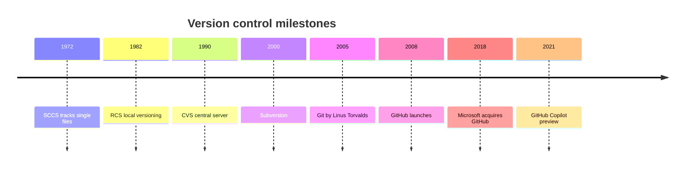
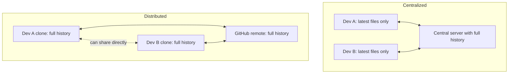
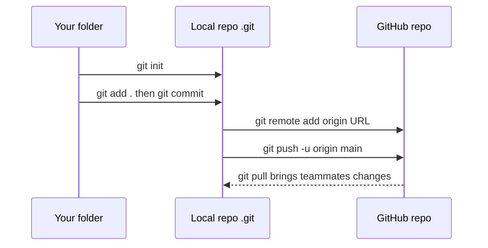
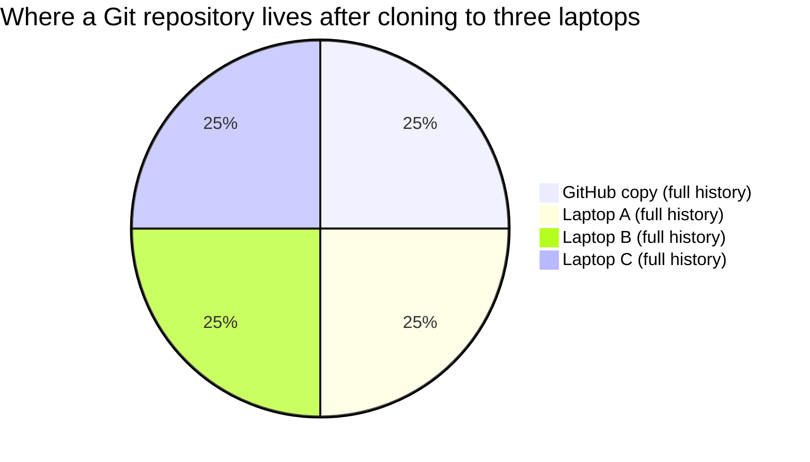

# Session 1 · Introduction to Version Control, Git and GitHub

> [Prime AI – Software Engineering with AI](../../README.md) › [Term 1](../README.md) › [Distributed Version Control with Git & GitHub](README.md) › **Session 1**

| ⏱ Estimated time | 🧩 Prerequisites |
|---|---|
| 3 hours | Comfortable with files and folders; Module 2–3 projects to put under version control |

[⬅ Module overview](README.md) &nbsp;|&nbsp; [Next: Basic Git Commands ➡](session-02-basic-git-commands.md)

---

## 🎯 Learning objectives

By the end of this session you will be able to:

- Outline the evolution of version control systems from manual copies to Git.
- Classify version control systems as local, centralized or distributed, with their pros and cons.
- Define Git and GitHub and explain why developers and companies rely on them.
- Install and configure Git, create a GitHub account and a repository.
- Perform basic repository actions: init, first commit, clone (HTTPS and SSH) and push a local project to GitHub.

## 📖 Concepts

### 1. Why version control?

Have you ever had files like `project-final.html`, `project-final-2.html`, `project-final-REAL.html`? That is manual
version control – and it breaks down quickly. A **version control system (VCS)** records every change to your files
over time so you can:

- see **what** changed, **when**, **who** changed it and **why** (the commit message);
- go back to any earlier version, or undo one bad change;
- work on new features without breaking the working version (**branches**);
- let many people work on the same project at the same time and **merge** their work.

> 🎮 **Analogy – save points in a video game.** Each **commit** is a save point. You can play on, try something risky,
> and if it goes wrong, reload the save. **Branches** are like saving into a different slot to try an alternative path
> without losing your main progress.

### 2. A short history of version control

| Year | Milestone | Model |
|---|---|---|
| 1970s–80s | **SCCS** (1972) and **RCS** (1982) track versions of single files on one computer | Local |
| 1990 | **CVS** – a central server many developers share | Centralized |
| 2000 | **Subversion (SVN)** – a better CVS; very popular in companies | Centralized |
| 2000s | **BitKeeper** (commercial) used for the Linux kernel; **Perforce** in games/enterprise | Distributed / centralized |
| 2005 | **Git** created by **Linus Torvalds** for Linux development after BitKeeper's free licence ended; **Mercurial** the same year | Distributed |
| 2008 | **GitHub** launches – Git hosting with a social, web interface | Platform |
| 2011–2014 | **Bitbucket** adds Git, **GitLab** launches | Platforms |
| 2018 | **Microsoft acquires GitHub** | – |
| 2021 → | **GitHub Copilot**, Codespaces, Actions – AI and automation built into the platform | – |

### 3. Types of version control systems

| Type | How it works | Pros | Cons | Examples |
|---|---|---|---|---|
| **Local** | A database of versions on your own computer | Simple | No collaboration; disk failure = everything lost | RCS |
| **Centralized (CVCS)** | One central server holds the history; developers check out the latest files | Easy to administer, fine-grained access | Server down = nobody can commit or see history; single point of failure | CVS, SVN, Perforce |
| **Distributed (DVCS)** | Every developer **clones** the full repository including all history | Work offline, fast, every clone is a backup, flexible workflows | Large binary files are awkward; more concepts to learn | **Git**, Mercurial |

> 📚 **Analogy.** Centralized VCS is a **library with one copy of each book**: you must go there to read or borrow it, and
> if the library closes, nobody can work. Distributed VCS gives **every member a full photocopy of the whole library** –
> you work at home, and later you exchange your new pages with the others.

### 4. What are Git and GitHub?

**Git** is free, open-source **software** that runs on your computer and tracks changes in a folder (a **repository**).
It is fast, works offline, and makes branching and merging cheap.

**GitHub** is a **website/platform** (owned by Microsoft) that hosts Git repositories online and adds collaboration
features. Alternatives include **GitLab**, **Bitbucket** and **Azure Repos**.

| Git | GitHub |
|---|---|
| Command-line tool installed locally | Cloud service accessed through a browser, Desktop app or CLI |
| Tracks history, branches, merges | Hosts repositories, **Issues**, **Pull Requests**, code review, **Actions** (CI/CD), **Pages** (hosting), **Projects** (boards), **Copilot** |
| Works with no internet | Needs internet to sync |
| Created 2005 by Linus Torvalds | Launched 2008 |

**Why developers rely on Git + GitHub:** industry standard (job requirement), safe experimentation with branches,
complete history for debugging, code review through pull requests, a public **portfolio** (your GitHub profile), free
hosting for open source, and automation (tests and deployments on every push).

### 5. How Git stores your project (the mental model)

- A **repository** = your project folder + a hidden **`.git`** folder that contains the whole history.
- A **commit** is a **snapshot** of all tracked files at a moment, plus author, date, message and a pointer to its
  **parent** commit(s). Commits form a chain (a graph).
- Every commit, file version (**blob**) and folder listing (**tree**) is identified by a **hash** – a 40-character
  SHA-1 fingerprint calculated from its content. Same content → same hash; any change → a completely different hash. This
  is why Git history is tamper-evident.
- A **branch** is just a movable label pointing to a commit. **HEAD** points to the branch you are on.

### 6. Installing and configuring Git – step by step

1. **Install**
   - Windows: download *Git for Windows* from **git-scm.com** – it includes **Git Bash**. Accept the defaults, but choose
     **VS Code** as the default editor and **"main"** as the default branch name.
   - macOS: `xcode-select --install` or `brew install git`. Linux: `sudo apt install git`.
   - Optional GUI: **GitHub Desktop**; VS Code also has Git built in (Source Control panel).
2. **Check:** `git --version`.
3. **Tell Git who you are** (stored in every commit):
   ```bash
   git config --global user.name "Ayesha Khan"
   git config --global user.email "ayesha@example.com"
   git config --global init.defaultBranch main
   git config --global core.editor "code --wait"
   git config --list
   ```
   Use the same email as your GitHub account so commits link to your profile.

### 7. Creating a GitHub account and repository

1. Sign up at **github.com** with a professional username (it becomes your portfolio URL) and enable **two-factor
   authentication**.
2. Click **New repository** → name (`portfolio-site`), description, **Public/Private**, optionally add a README,
   `.gitignore` template and licence → **Create repository**.
3. A repository page shows: *Code*, *Issues*, *Pull requests*, *Actions*, *Projects*, *Settings*.

### 8. Connecting local and remote – HTTPS vs SSH

| | HTTPS | SSH |
|---|---|---|
| URL | `https://github.com/ayesha/portfolio-site.git` | `git@github.com:ayesha/portfolio-site.git` |
| Authentication | Browser sign-in / Git Credential Manager or a **personal access token** (passwords are not accepted) | An SSH **key pair**: private key on your computer, public key added to GitHub |
| Good for | Beginners, any network | Daily use without typing credentials |

**SSH set-up:** `ssh-keygen -t ed25519 -C "ayesha@example.com"` → copy `~/.ssh/id_ed25519.pub` → GitHub *Settings › SSH
and GPG keys › New SSH key* → test with `ssh -T git@github.com`.

### 9. Basic repository actions

| Goal | Commands |
|---|---|
| Start versioning an existing folder | `git init` → `git add .` → `git commit -m "chore: initial commit"` |
| Put it on GitHub | create an **empty** repo on GitHub → `git remote add origin <url>` → `git push -u origin main` |
| Download an existing repo | `git clone <url>` (creates the folder, the history and the `origin` remote) |
| Get teammates' new commits | `git pull` |

On GitHub you will also use **README.md** (the project's front page, written in Markdown), **Issues** (bug reports and
tasks) and **Pull Requests** (proposed changes for review) – covered in depth in Sessions 3 and 4.

## 🧭 Diagrams

### Evolution of version control



### Centralized vs distributed



### From a local folder to GitHub



## 💻 Worked examples

### Example 1 — The shared demo environment used by every Git script

Every script in this module starts with `source ./git-demo-env.sh`. It creates a **temporary HOME** (so your real
global Git config is untouched), a temporary work folder, a fixed identity, and a `tick` function that gives each commit
a fixed timestamp – which is why the commit IDs in the outputs are reproducible on any computer.

```bash
# git-demo-env.sh – sourced by every demo script in this folder.
# Creates a throw-away environment so demos never touch your real repositories or settings.
set -e

export GIT_CONFIG_NOSYSTEM=1                 # ignore system-wide Git config
export HOME="$(mktemp -d)"                   # fresh, empty "global" config for this script only
git config --global user.name  "Ayesha Khan"
git config --global user.email "ayesha@example.com"
git config --global init.defaultBranch main
git config --global advice.detachedHead false
git config --global core.pager cat           # print output directly (no "less")
git config --global color.ui false

# Fixed, increasing timestamps => identical commit hashes on every computer
T=0
tick() {
  T=$((T + 1))
  export GIT_AUTHOR_DATE="2026-01-05T10:$(printf %02d "$T"):00+05:00"
  export GIT_COMMITTER_DATE="$GIT_AUTHOR_DATE"
}
tick

# run "command ..." – print the command like a terminal prompt, then run it
run() {
  local shown="\$"
  for a in "$@"; do
    if [[ "$a" =~ [[:space:]\"\'\|\<\>\&\;\(\)\$] ]]; then shown+=" \"$a\""; else shown+=" $a"; fi
  done
  echo "$shown"; "$@"; echo
}
# runsh 'cmd | with pipes' – same, for commands that need a shell
runsh() { echo "\$ $1"; eval "$1"; echo; }

exec 2>&1                                    # show Git's messages in order with normal output
WORK="$(mktemp -d)"
cd "$WORK"
```

📄 Saved as [`code/git-demo-env.sh`](code/git-demo-env.sh)

### Example 2 — Your first repository: init, configure, commit, log

A complete first session at the terminal: create a project folder, initialise Git, look inside `.git`, make two
commits and read the history.

```bash
#!/usr/bin/env bash
# session-01_first-repo.sh – your first Git repository, step by step.
source ./git-demo-env.sh

run git --version | sed 's/[0-9]*\.[0-9]*\.[0-9]*.*/2.x/'   # version varies by computer
run git config --global user.name
mkdir portfolio-site && cd portfolio-site

run git init -q
echo "What Git created (the hidden .git folder):"
ls .git | tr '\n' ' '; echo; echo

cat > index.html <<'EOF'
<!DOCTYPE html>
<html lang="en"><head><title>Ayesha Khan</title></head>
<body><h1>Ayesha Khan – Web Developer</h1></body></html>
EOF
run git status --short
run git add index.html
run git status --short
run git commit -q -m "chore: initial commit with home page"

tick
echo "<p>I build responsive websites.</p>" >> index.html
echo "# Portfolio site" > README.md
run git add .
run git commit -q -m "docs: add README and intro paragraph"

run git log --oneline
run git log -1 --format='Author: %an <%ae>%nDate:   %ad%nCommit: %H'
run git show --stat --format='%s' HEAD
```

📄 Saved as [`code/session-01_first-repo.sh`](code/session-01_first-repo.sh)

**Output** (real run)

```text
$ git --version
git version 2.x

$ git config --global user.name
Ayesha Khan

$ git init -q

What Git created (the hidden .git folder):
HEAD branches config description hooks info objects refs 

$ git status --short
?? index.html

$ git add index.html

$ git status --short
A  index.html

$ git commit -q -m "chore: initial commit with home page"

$ git add .

$ git commit -q -m "docs: add README and intro paragraph"

$ git log --oneline
1aa952b docs: add README and intro paragraph
95e9369 chore: initial commit with home page

$ git log -1 "--format=Author: %an <%ae>%nDate:   %ad%nCommit: %H"
Author: Ayesha Khan <ayesha@example.com>
Date:   Mon Jan 5 10:02:00 2026 +0500
Commit: 1aa952bf9f112b3a47a139e0e7a2205430cfc638

$ git show --stat --format=%s HEAD
docs: add README and intro paragraph

 README.md  | 1 +
 index.html | 1 +
 2 files changed, 2 insertions(+)
```

### Example 3 — How Git names things: computing a blob hash in Node.js

Git identifies every file version by the SHA-1 hash of `"blob <size>\0" + content`. This script computes the hash
itself with Node's `crypto` module and then asks real Git (`git hash-object`) for comparison – they match, proving Git
is **content-addressed**: same content, same ID; one character changed, a totally different ID.

```js
// session-01_hash-object.js  (run: node session-01_hash-object.js)
// Recreates Git's blob hashing and compares with `git hash-object`.
const crypto = require('crypto');
const { execSync } = require('child_process');

function gitBlobHash(content) {
  const body = Buffer.from(content, 'utf8');
  const header = Buffer.from(`blob ${body.length}\0`, 'utf8');
  return crypto.createHash('sha1').update(Buffer.concat([header, body])).digest('hex');
}

const versions = [
  '<h1>Hello</h1>\n',
  '<h1>Hello</h1>\n',            // identical content
  '<h1>Hello!</h1>\n',           // one character added
];

for (const v of versions) {
  const ours = gitBlobHash(v);
  const gits = execSync('git hash-object --stdin', { input: v }).toString().trim();
  console.log(`${JSON.stringify(v).padEnd(22)} ours ${ours}  git ${gits}  ${ours === gits ? 'MATCH' : 'DIFFERENT'}`);
}
console.log('\nSame content → same hash. One extra "!" → a completely different hash.');
```

📄 Saved as [`code/session-01_hash-object.js`](code/session-01_hash-object.js)

**Output** (real run)

```text
"<h1>Hello</h1>\n"     ours 986a4a1a25bc4928e95d7e0d6cfa67d9a9c7a808  git 986a4a1a25bc4928e95d7e0d6cfa67d9a9c7a808  MATCH
"<h1>Hello</h1>\n"     ours 986a4a1a25bc4928e95d7e0d6cfa67d9a9c7a808  git 986a4a1a25bc4928e95d7e0d6cfa67d9a9c7a808  MATCH
"<h1>Hello!</h1>\n"    ours f69bb09b2a0e95efb62c72adf3f7bb1064427c1f  git f69bb09b2a0e95efb62c72adf3f7bb1064427c1f  MATCH

Same content → same hash. One extra "!" → a completely different hash.
```

### Example 4 — Clone and push: simulating GitHub with a local "remote"

A real GitHub repository is a **remote**. To show the full cycle without needing internet access, this script uses a
**bare repository** (a repository with no working files – exactly what GitHub stores) as the remote. The commands are the
same ones you will use with a GitHub URL.

```bash
#!/usr/bin/env bash
# session-01_clone-and-push.sh – push a local project to a remote, then clone it elsewhere.
source ./git-demo-env.sh

git init -q --bare github.com/ayesha/portfolio-site.git      # stands in for an empty GitHub repo
echo "(an empty 'GitHub' repository was created as a bare repo)"; echo

mkdir laptop && cd laptop
git init -q
echo "<h1>Portfolio</h1>" > index.html
git add . && git commit -q -m "chore: initial commit"
run git remote add origin ../github.com/ayesha/portfolio-site.git
run git remote -v
runsh 'git push -u origin main 2>&1 | grep -v "^To "'

cd ..
echo "--- on another computer (or a teammate's laptop) ---"
runsh 'git clone -q github.com/ayesha/portfolio-site.git office-pc && echo "cloned into office-pc/"'
cd office-pc
run git log --oneline
run git branch -vv
```

📄 Saved as [`code/session-01_clone-and-push.sh`](code/session-01_clone-and-push.sh)

**Output** (real run)

```text
(an empty 'GitHub' repository was created as a bare repo)

$ git remote add origin ../github.com/ayesha/portfolio-site.git

$ git remote -v
origin	../github.com/ayesha/portfolio-site.git (fetch)
origin	../github.com/ayesha/portfolio-site.git (push)

$ git push -u origin main 2>&1 | grep -v "^To "
 * [new branch]      main -> main
branch 'main' set up to track 'origin/main'.

--- on another computer (or a teammate's laptop) ---
$ git clone -q github.com/ayesha/portfolio-site.git office-pc && echo "cloned into office-pc/"
cloned into office-pc/

$ git log --oneline
ceb4c60 chore: initial commit

$ git branch -vv
* main ceb4c60 [origin/main] chore: initial commit
```

## 🧩 Real-life coding problem

**Scenario – "my laptop died the week before submission".** A student kept their Module 3 final website only on their
laptop. It died. Design a routine so this never happens again, and so the student can show their lecturer the history
of their work.

**Solution routine**
1. Create a GitHub repository `bootstrap-final-site` (private while working, public for the portfolio).
2. In the project folder: `git init`, add a `.gitignore` (Session 2), `git add .`, `git commit -m "chore: initial commit"`.
3. `git remote add origin <url>` and `git push -u origin main`.
4. **Commit early, commit often** – after every meaningful step ("feat: add navbar", "fix: mobile menu overlap"), and
   `git push` at the end of each work session.
5. On any other computer: `git clone <url>` and continue.
6. Show progress with `git log --oneline` or the GitHub *Commits* page.

The script [`code/session-01_backup-routine.sh`](code/session-01_backup-routine.sh) simulates three days of work on a
laptop, the laptop being "lost", and recovery on a new computer with the full history:

```text
Day 1: committed and pushed -> feat: add navbar and hero
Day 2: committed and pushed -> feat: add services cards
Day 3: committed and pushed -> fix: mobile menu overlap

!!! The laptop is gone (folder deleted) !!!

$ git clone -q remote/bootstrap-final-site.git new-laptop && echo "cloned on the new laptop"
cloned on the new laptop

$ git log --oneline
c1732cb fix: mobile menu overlap
2791d33 feat: add services cards
5ed483a feat: add navbar and hero

$ ls
index.html
style.css
```

## ⚠️ Common mistakes

| Mistake | Symptom | Fix |
|---|---|---|
| Not setting `user.name`/`user.email` | Commits show the wrong author or Git refuses to commit | `git config --global user.name/user.email` |
| Running `git init` in your home folder | Git tracks your entire user folder | Delete the stray `.git` folder; init inside the project folder only |
| Creating the GitHub repo **with** a README, then pushing an existing project | Push rejected: "fetch first" | Create an **empty** repo, or `git pull --rebase origin main` first |
| Using your GitHub password over HTTPS | Authentication fails | Use the browser/credential manager, a personal access token, or SSH |
| Committing everything once a week | Huge commits, useless history | Small, focused commits with clear messages |
| Thinking GitHub = Git | Confusion about what works offline | Git is local; GitHub is the remote host |

## 🌟 Best practices

- Configure name, email, default branch `main` and your editor once, right after installing.
- Use SSH keys (or the credential manager) and enable two-factor authentication on GitHub.
- One repository per project; every repository gets a README that says what it is and how to run it.
- Commit small, meaningful snapshots; push at the end of every work session.
- Keep a clean GitHub profile – it is your portfolio for internships and jobs.

## 🏗️ Mini project

**Mini project – publish your Module 3 website.** Put your Bootstrap/jQuery final site under version control with at least
**five meaningful commits**, push it to a new GitHub repository with a proper README (title, screenshot, features, how to
run, live link), and enable **GitHub Pages** so it is live. The README template is in
[`code/session-01_README-template.md`](code/session-01_README-template.md).

## 📦 Project files for this session

| File | What it is |
|---|---|
| 📄 [`code/session-01_backup-routine.sh`](code/session-01_backup-routine.sh) | Real-life problem solution – three days of commits, a lost laptop, full recovery from the remote |
| 📄 [`code/session-01_README-template.md`](code/session-01_README-template.md) | README template for publishing a project on GitHub |

## 📊 At a glance

**Centralized vs distributed – what still works when the server is down?**

| Action | Centralized (SVN) | Distributed (Git) |
|---|---|---|
| View history | ❌ needs server | ✅ local |
| Commit | ❌ | ✅ (push later) |
| Create a branch | ⚠️ server-side copy | ✅ instant, local |
| Diff with an old version | ❌ | ✅ |
| Share with teammates | ❌ | ⚠️ needs the remote (or direct exchange) |



*Every copy is a complete backup – that is what "distributed" means.*

## 🧪 Lab / practice tasks

**🟢 Easy** — Install Git, configure your name, email and default branch, and run `git config --list --show-origin`. Explain what each of the three settings does.

<details><summary>💡 Hint</summary>

All three are `--global` settings stored in `~/.gitconfig`.

</details>

<details><summary>✅ Solution</summary>

```bash
git config --global user.name "Your Name"
git config --global user.email "you@example.com"
git config --global init.defaultBranch main
git config --list --show-origin
```
`user.name`/`user.email` are written into every commit you make (and link commits to your GitHub account when the email
matches); `init.defaultBranch` makes new repositories start on `main` instead of `master`.

</details>

**🟡 Medium** — Create a GitHub repository and push a small HTML project to it twice: once using HTTPS and once (in another repository) using SSH. Write down the remote URL formats and how you authenticated.

<details><summary>💡 Hint</summary>

Generate a key with `ssh-keygen -t ed25519`, add the `.pub` key on GitHub, test with `ssh -T git@github.com`.

</details>

<details><summary>✅ Solution</summary>

HTTPS: `git remote add origin https://github.com/you/site-https.git` → `git push -u origin main` → the Git Credential
Manager opens a browser sign-in (or you paste a personal access token). SSH: `git remote add origin
git@github.com:you/site-ssh.git` → `git push -u origin main` works without prompts once the public key is registered.

</details>

**🔴 Hard** — Run `session-01_hash-object.js`, then change one line of `index.html` in a test repo and use `git cat-file -p HEAD`, `git cat-file -p HEAD^{tree}` and `git cat-file -p <blob>` to explore the commit → tree → blob chain. Draw it.

<details><summary>💡 Hint</summary>

`git cat-file -p` pretty-prints any object; `HEAD^{tree}` is the tree of the latest commit.

</details>

<details><summary>✅ Solution</summary>

The commit object shows `tree <hash>`, `parent <hash>`, author, committer and message. The tree lists entries like
`100644 blob 8f3a… index.html`. The blob shows the raw file content. Changing one line creates a **new blob**, therefore a
**new tree**, therefore a **new commit** – while unchanged files keep their old blob hashes (Git re-uses them, which is why
repositories stay small).

</details>

**🏆 Challenge** — Write a short comparison report (≈ 300 words) for a company still using SVN, recommending whether to move to Git. Cover workflow, offline work, branching, tooling, hiring and a migration plan.

<details><summary>💡 Hint</summary>

Mention `git svn` / migration tools, training, and a pilot project.

</details>

<details><summary>✅ Solution</summary>

A strong report recommends Git: distributed (offline commits, every clone a backup), cheap branching enabling pull-request
review, the ecosystem (GitHub/GitLab, CI/CD, Copilot), and that most developers already know Git. Risks: large binary
assets (use Git LFS), retraining. Plan: pilot one team, migrate history with a migration tool, set branch protection and
PR rules, train staff, then migrate remaining projects.

</details>

## ✅ Quick quiz

**Q1. What problem does version control mainly solve?**

- A) Making code run faster
- B) Tracking changes over time and enabling safe collaboration
- C) Designing UI
- D) Hosting websites only

<details><summary>Show answer</summary>

**B** — History, undo and collaboration.

</details>

**Q2. Which VCS type has a single point of failure?**

- A) Distributed
- B) Centralized
- C) Neither
- D) Both

<details><summary>Show answer</summary>

**B** — If the central server is down, nobody can commit.

</details>

**Q3. What does `git clone` give you?**

- A) Only the latest files
- B) The full repository history plus a working copy and an origin remote
- C) Only the README
- D) A zip file

<details><summary>Show answer</summary>

**B** — Every clone is a full repository.

</details>

**Q4. A commit hash is calculated from:**

- A) A random number
- B) The content and metadata of the commit
- C) The time only
- D) The GitHub username

<details><summary>Show answer</summary>

**B** — Content-addressed SHA-1.

</details>

**Q5. Which URL is an SSH remote?**

- A) https://github.com/a/b.git
- B) git@github.com:a/b.git
- C) ftp://github.com/a
- D) www.github.com/a/b

<details><summary>Show answer</summary>

**B** — SSH remotes use git@host:owner/repo.git.

</details>

## 📝 Summary / cheat-sheet

- Version control records every change: what, when, who and why; enables undo, branches and teamwork.
- History: SCCS/RCS (local) → CVS/SVN (centralized) → Git/Mercurial (distributed, 2005) → GitHub (2008).
- Distributed = every clone holds the full history: offline work, speed, built-in backups.
- Git is the local tool; GitHub hosts repositories and adds issues, pull requests, Actions, Pages and Copilot.
- Commits are content-addressed snapshots linked to their parents; branches are movable pointers; HEAD marks where you are.
- Set up: install, `git config --global user.name/user.email/init.defaultBranch`; authenticate with the credential manager, a token or SSH keys.
- Basic actions: `git init`, `git add`, `git commit`, `git remote add origin`, `git push -u origin main`, `git clone`.

## 🎤 Interview / viva questions

1. **Difference between centralized and distributed version control?**
   <details><summary>Model answer</summary>

   Centralized keeps the only full history on a server that clients must contact; distributed gives every developer a full copy, so they can commit, branch and view history offline and every clone is a backup.

   </details>

2. **Why was Git created?**
   <details><summary>Model answer</summary>

   Linus Torvalds created it in 2005 for Linux kernel development after the free licence for BitKeeper was withdrawn, aiming for speed, distributed work and data integrity.

   </details>

3. **What is a commit?**
   <details><summary>Model answer</summary>

   A snapshot of the tracked files with author, date, message and a link to its parent commit, identified by a hash.

   </details>

4. **Git vs GitHub?**
   <details><summary>Model answer</summary>

   Git is version control software that runs locally; GitHub is an online platform that hosts Git repositories and adds collaboration and automation features.

   </details>

5. **Why use SSH keys?**
   <details><summary>Model answer</summary>

   They authenticate securely without typing credentials each time; the private key stays on your machine and GitHub stores only the public key.

   </details>

6. **What is the origin remote?**
   <details><summary>Model answer</summary>

   The default name Git gives to the remote repository a project was cloned from (or that you add), used by push, pull and fetch.

   </details>

---

[⬅ Module overview](README.md) &nbsp;|&nbsp; [Next: Basic Git Commands ➡](session-02-basic-git-commands.md)

<sub>Prepared by **Hamna Zahid Khan**, Junior Lecturer · Prime AI – Software Engineering with AI</sub>
