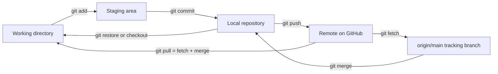
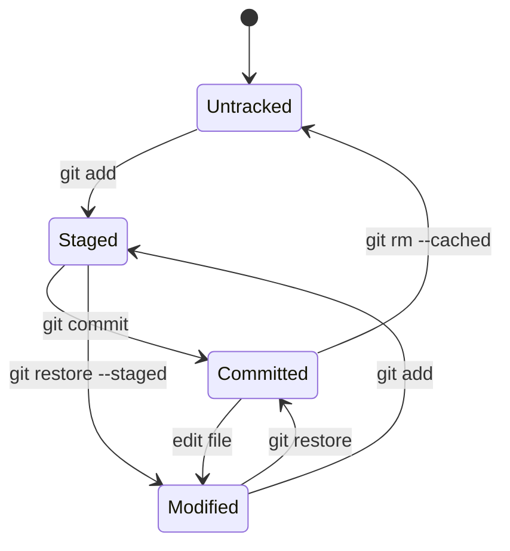
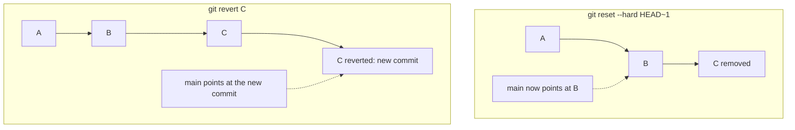
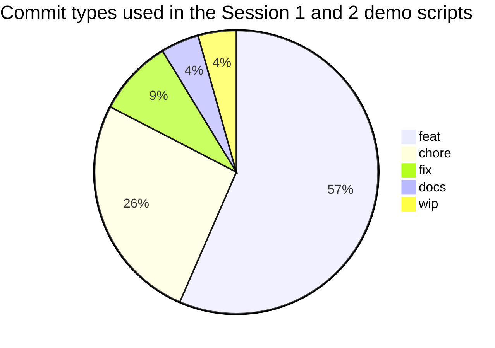

# Session 2 · Basic Git Commands

> [Prime AI – Software Engineering with AI](../../README.md) › [Term 1](../README.md) › [Distributed Version Control with Git & GitHub](README.md) › **Session 2**

| ⏱ Estimated time | 🧩 Prerequisites |
|---|---|
| 3 hours | Session 1 (Git installed and configured) |

[⬅ Previous: Introduction to Version Control, Git and GitHub](session-01-introduction-to-version-control-git-and-github.md) &nbsp;|&nbsp; [Next: Branching, Merging and Conflict Resolution ➡](session-03-branching-merging-and-conflict-resolution.md)

---

## 🎯 Learning objectives

By the end of this session you will be able to:

- Explain the file lifecycle: working directory → staging area → repository, and file states.
- Use status, add, commit, log, diff, show and restore confidently, and write meaningful commit messages.
- Ignore files with .gitignore and stop tracking files that should never be committed.
- Create, list, switch and delete branches.
- Synchronise with a remote using push, fetch and pull, and undo changes with amend, reset and revert.

## 📖 Concepts

### 1. The three areas and the file lifecycle

Git has **three places** your changes live in:

| Area | Also called | What's there |
|---|---|---|
| **Working directory** | working tree | The files you edit in VS Code |
| **Staging area** | index | The changes you have **chosen** for the next commit |
| **Repository** | `.git` folder, history | All committed snapshots |

> 📦 **Analogy – sending a parcel.** Your desk is the **working directory** (things you're working on). The open box is the
> **staging area** – you put in only the items you want to send (`git add`). Sealing and labelling the box is the
> **commit** (`git commit -m "label"`). Handing it to the courier is `git push`.

Each file is in one of these **states**: **untracked** (new, Git ignores it until added) → **staged** → **committed /
unmodified** → **modified** (edited since the last commit) → staged again …

### 2. The everyday commands

| Command | What it does | Tip |
|---|---|---|
| `git status` | Shows branch and the state of every changed file | Run it constantly; `-s` for short form |
| `git add <file>` / `git add .` | Stage changes | `git add -p` to stage parts of a file |
| `git commit -m "msg"` | Record the staged snapshot | Without `-m`, your editor opens for a longer message |
| `git log` | History | `--oneline --graph --all`, `-n 5`, `--author`, `-- path` |
| `git diff` | Unstaged changes | `git diff --staged` for what will be committed |
| `git show <commit>` | One commit's message and changes | `--stat` for a summary |
| `git restore <file>` | Discard working-directory edits | ⚠️ edits are lost |
| `git restore --staged <file>` | Unstage (keep edits) | Undo a wrong `git add` |
| `git rm <file>` / `git mv a b` | Delete / rename and stage it | Session 4 |

### 3. Writing meaningful commit messages – Conventional Commits

A commit message explains **why** a change was made. The widely used **Conventional Commits** format:

```
type(optional-scope): short imperative summary (≤ 72 chars)

Optional body: what and why, wrapped at 72 characters.
Optional footer: BREAKING CHANGE: …  or  Closes #12
```

| Type | Use for | Example |
|---|---|---|
| `feat` | New feature | `feat(cart): add quantity buttons` |
| `fix` | Bug fix | `fix: stop total showing NaN when cart is empty` |
| `docs` | Documentation | `docs: add setup steps to README` |
| `style` | Formatting only | `style: format CSS with Prettier` |
| `refactor` | Restructure without behaviour change | `refactor: extract price helper` |
| `test` | Tests | `test: cover discount edge cases` |
| `chore` / `build` / `ci` | Tooling, dependencies, pipelines | `ci: run tests on pull requests` |

Rules: imperative mood ("add", not "added"), no full stop, one logical change per commit. Bad: `update`, `changes`,
`final fix 2`.

### 4. `.gitignore` – what must never be committed

`.gitignore` lists **patterns** of files Git should not track:

| Pattern | Matches |
|---|---|
| `node_modules/` | the dependencies folder (re-installable with `npm install`) |
| `*.log` | every log file |
| `.env` | secrets – API keys, passwords |
| `dist/` `build/` | generated output |
| `.DS_Store` `Thumbs.db` | OS junk files |
| `!keep.log` | exception: do track this file |

If a file was already committed, adding it to `.gitignore` is not enough: run `git rm --cached file` to stop tracking it
(and if it contained a secret, **revoke/rotate** that secret – it is in the history). GitHub offers ready-made templates
(Node, Python, Visual Studio…) at github.com/github/gitignore.

### 5. Branches – parallel lines of work

A branch lets you develop a feature without disturbing `main`.

| Command | Meaning |
|---|---|
| `git branch` | List local branches (`*` marks the current one) |
| `git branch feature/navbar` | Create a branch (stay where you are) |
| `git switch feature/navbar` | Move to it (older syntax: `git checkout feature/navbar`) |
| `git switch -c feature/navbar` | Create **and** switch (older: `git checkout -b`) |
| `git branch -d feature/navbar` | Delete a merged branch (`-D` forces) |
| `git branch -m old new` | Rename |

Naming conventions: `feature/login-form`, `fix/cart-total`, `docs/readme`, `hotfix/1.0.1`.

### 6. Synchronising with a remote

| Command | Direction | What happens |
|---|---|---|
| `git push` | local → remote | Uploads your commits; rejected if the remote has commits you don't have |
| `git fetch` | remote → local (safe) | Downloads new commits into `origin/main` **without** changing your files |
| `git pull` | remote → local | `fetch` **+** `merge` (or `rebase` with `--rebase`) into your branch |
| `git push -u origin feature/x` | – | First push of a new branch; `-u` sets the upstream so later you just type `git push` |

`git status` tells you "Your branch is ahead of 'origin/main' by 2 commits" or "behind … by 1 commit" after a fetch.

### 7. Editing and undoing commits

| Situation | Command | Rewrites history? |
|---|---|---|
| Fix the **last** commit's message or add a forgotten file | `git commit --amend` | ✅ (only if not pushed!) |
| Move the branch back but keep changes **staged** | `git reset --soft HEAD~1` | ✅ |
| Move back, keep changes **unstaged** (default) | `git reset --mixed HEAD~1` | ✅ |
| Move back and **delete** the changes | `git reset --hard HEAD~1` | ✅ ⚠️ destructive |
| Undo a commit that's already pushed/shared | `git revert <commit>` | ❌ – adds a new "undo" commit |

> ⏪ **Analogy.** `reset` is tearing pages out of your own notebook – fine before anyone else has a copy. `revert` is writing
> a new page that says "ignore page 12" – the only polite option once the notebook has been shared.

## 🧭 Diagrams

### The three areas of Git



### File states



### reset vs revert



## 💻 Worked examples

### Example 1 — The file lifecycle, live

Watch one file travel from **untracked** to **staged** to **committed** to **modified**, with `git diff` and
`git diff --staged` showing exactly what Git sees at each step.

```bash
#!/usr/bin/env bash
# session-02_lifecycle.sh – a file's journey through Git's three areas.
source ./git-demo-env.sh
git init -q shop && cd shop

printf 'const items = [];\n' > cart.js
echo "1) New file:"; run git status --short          # ?? = untracked
run git add cart.js
echo "2) After git add:"; run git status --short      # A  = added to staging
run git commit -q -m "feat: create empty cart"
echo "3) After commit:"; run git status --short       # (nothing) = clean

tick
printf 'const items = [];\nconst TAX = 0.17;\n' > cart.js
echo "4) After editing:"; run git status --short      #  M = modified, not staged
run git diff
run git add cart.js
echo "5) Staged edit:"; run git status --short        # M  = modified and staged
run git diff --staged
run git commit -q -m "feat: add sales tax constant"

echo "6) Oops – a bad edit we want to throw away:"
echo "DELETE EVERYTHING" > cart.js
run git status --short
run git restore cart.js
run cat cart.js
run git log --oneline
```

📄 Saved as [`code/session-02_lifecycle.sh`](code/session-02_lifecycle.sh)

**Output** (real run)

```text
1) New file:
$ git status --short
?? cart.js

$ git add cart.js

2) After git add:
$ git status --short
A  cart.js

$ git commit -q -m "feat: create empty cart"

3) After commit:
$ git status --short

4) After editing:
$ git status --short
 M cart.js

$ git diff
diff --git a/cart.js b/cart.js
index 2ba8154..1c977a3 100644
--- a/cart.js
+++ b/cart.js
@@ -1 +1,2 @@
 const items = [];
+const TAX = 0.17;

$ git add cart.js

5) Staged edit:
$ git status --short
M  cart.js

$ git diff --staged
diff --git a/cart.js b/cart.js
index 2ba8154..1c977a3 100644
--- a/cart.js
+++ b/cart.js
@@ -1 +1,2 @@
 const items = [];
+const TAX = 0.17;

$ git commit -q -m "feat: add sales tax constant"

6) Oops – a bad edit we want to throw away:
$ git status --short
 M cart.js

$ git restore cart.js

$ cat cart.js
const items = [];
const TAX = 0.17;

$ git log --oneline
3f000b2 feat: add sales tax constant
8dc466e feat: create empty cart
```

### Example 2 — .gitignore in action (and rescuing a committed secret)

A Node project with `node_modules/`, a log file and a `.env` file containing an API key. First we see what Git would
track, then add a `.gitignore`, then fix the classic mistake: a `.env` that was already committed.

```bash
#!/usr/bin/env bash
# session-02_gitignore.sh – ignoring files, and untracking a file that was committed by mistake.
source ./git-demo-env.sh
git init -q weather-app && cd weather-app

mkdir -p node_modules/express src
echo "module.exports = {}" > node_modules/express/index.js
echo "console.log('app')" > src/app.js
echo "server started" > debug.log
echo "API_KEY=sk-demo-1234" > .env

echo "Before .gitignore – Git wants to track everything:"
run git status --short --untracked-files=all

# MISTAKE: commit everything including the secret
git add . && git commit -q -m "chore: initial commit"
tick
cat > .gitignore <<'EOF'
# dependencies – reinstall with npm install
node_modules/
# logs
*.log
# secrets
.env
EOF
echo "After adding .gitignore (files already committed are STILL tracked):"
run git ls-files

run git rm -r -q --cached node_modules .env debug.log
run git add .gitignore
run git commit -q -m "chore: stop tracking dependencies, logs and secrets"
run git ls-files
run git check-ignore -v .env debug.log node_modules/express/index.js
echo "⚠ .env is still in the FIRST commit's history – the API key must be revoked and replaced."
run git log --oneline --name-status
```

📄 Saved as [`code/session-02_gitignore.sh`](code/session-02_gitignore.sh)

**Output** (real run)

```text
Before .gitignore – Git wants to track everything:
$ git status --short --untracked-files=all
?? .env
?? debug.log
?? node_modules/express/index.js
?? src/app.js

After adding .gitignore (files already committed are STILL tracked):
$ git ls-files
.env
debug.log
node_modules/express/index.js
src/app.js

$ git rm -r -q --cached node_modules .env debug.log

$ git add .gitignore

$ git commit -q -m "chore: stop tracking dependencies, logs and secrets"

$ git ls-files
.gitignore
src/app.js

$ git check-ignore -v .env debug.log node_modules/express/index.js
.gitignore:6:.env	.env
.gitignore:4:*.log	debug.log
.gitignore:2:node_modules/	node_modules/express/index.js

⚠ .env is still in the FIRST commit's history – the API key must be revoked and replaced.
$ git log --oneline --name-status
554c1b0 chore: stop tracking dependencies, logs and secrets
D	.env
A	.gitignore
D	debug.log
D	node_modules/express/index.js
9c502d5 chore: initial commit
A	.env
A	debug.log
A	node_modules/express/index.js
A	src/app.js
```

### Example 3 — Branches, push, fetch and pull with two developers

Ali and Sara both clone the same remote (a bare repository standing in for GitHub). Ali pushes a feature branch and
then `main`; Sara **fetches** (nothing changes in her files), sees she is behind, and **pulls**. This is the daily rhythm
of team work.

```bash
#!/usr/bin/env bash
# session-02_remote-sync.sh – branches and remote synchronisation between two developers.
source ./git-demo-env.sh
git init -q --bare origin.git
git clone -q origin.git seed 2>/dev/null && cd seed
echo "# Team site" > README.md && git add . && git commit -q -m "chore: initial commit" && git push -q origin main
cd .. && rm -rf seed
git clone -q origin.git ali
git clone -q origin.git sara

echo "===== ALI ====="; cd ali
git config user.name "Ali Raza"
run git switch -c feature/contact-page
tick; echo "<h1>Contact</h1>" > contact.html
git add . && git commit -q -m "feat: add contact page"
run git branch
runsh 'git push -u origin feature/contact-page 2>&1 | grep -E "new branch|set up"'
run git switch -q main
run git merge -q feature/contact-page
run git push -q origin main
run git branch -d feature/contact-page

echo "===== SARA ====="; cd ../sara
run git fetch -q
run git status -sb
run ls
run git pull -q
run ls
run git log --oneline --format='%h %an: %s'
```

📄 Saved as [`code/session-02_remote-sync.sh`](code/session-02_remote-sync.sh)

**Output** (real run)

```text
===== ALI =====
$ git switch -c feature/contact-page
Switched to a new branch 'feature/contact-page'

$ git branch
* feature/contact-page
  main

$ git push -u origin feature/contact-page 2>&1 | grep -E "new branch|set up"
 * [new branch]      feature/contact-page -> feature/contact-page
branch 'feature/contact-page' set up to track 'origin/feature/contact-page'.

$ git switch -q main

$ git merge -q feature/contact-page

$ git push -q origin main

$ git branch -d feature/contact-page
Deleted branch feature/contact-page (was 87c38f3).

===== SARA =====
$ git fetch -q

$ git status -sb
## main...origin/main [behind 1]

$ ls
README.md

$ git pull -q

$ ls
README.md
contact.html

$ git log --oneline "--format=%h %an: %s"
87c38f3 Ali Raza: feat: add contact page
99ca7c3 Ayesha Khan: chore: initial commit
```

### Example 4 — Undo toolkit: amend, reset (soft/mixed/hard) and revert

Each undo command demonstrated on a fresh line of commits, showing exactly where `main` points afterwards and what
happened to the changes.

```bash
#!/usr/bin/env bash
# session-02_undo.sh – amend, reset and revert side by side.
source ./git-demo-env.sh
git init -q undo-lab && cd undo-lab
commit() { tick; echo "$1" >> notes.txt; git add notes.txt; git commit -q -m "$2"; }

commit "A" "feat: add A"
commit "B" "feat: add B"
commit "C" "feat: add c with typo"
echo "--- amend: fix the last message (not pushed yet) ---"
run git commit -q --amend -m "feat: add C"
run git log --oneline

echo "--- reset --soft HEAD~1: commit undone, change still STAGED ---"
run git reset -q --soft HEAD~1
run git status --short
git commit -q -m "feat: add C"

echo "--- reset --mixed HEAD~1: commit undone, change UNSTAGED ---"
run git reset -q --mixed HEAD~1
run git status --short
git add . && git commit -q -m "feat: add C"

echo "--- reset --hard HEAD~1: commit AND change deleted ---"
run git reset -q --hard HEAD~1
run git log --oneline
run cat notes.txt

echo "--- revert: safely undo B with a NEW commit (for shared history) ---"
tick
run git revert --no-edit HEAD
run git log --oneline
run cat notes.txt
```

📄 Saved as [`code/session-02_undo.sh`](code/session-02_undo.sh)

**Output** (real run)

```text
--- amend: fix the last message (not pushed yet) ---
$ git commit -q --amend -m "feat: add C"

$ git log --oneline
d86bcfd feat: add C
3b79c14 feat: add B
12cd098 feat: add A

--- reset --soft HEAD~1: commit undone, change still STAGED ---
$ git reset -q --soft HEAD~1

$ git status --short
M  notes.txt

--- reset --mixed HEAD~1: commit undone, change UNSTAGED ---
$ git reset -q --mixed HEAD~1

$ git status --short
 M notes.txt

--- reset --hard HEAD~1: commit AND change deleted ---
$ git reset -q --hard HEAD~1

$ git log --oneline
3b79c14 feat: add B
12cd098 feat: add A

$ cat notes.txt
A
B

--- revert: safely undo B with a NEW commit (for shared history) ---
$ git revert --no-edit HEAD
[main 683035c] Revert "feat: add B"
 Date: Mon Jan 5 10:05:00 2026 +0500
 1 file changed, 1 deletion(-)

$ git log --oneline
683035c Revert "feat: add B"
3b79c14 feat: add B
12cd098 feat: add A

$ cat notes.txt
A
```

### Example 5 — A Conventional Commits checker

Teams enforce message rules automatically (tools such as *commitlint*). This small checker validates messages against
the Conventional Commits format and common style rules, and explains each failure – the logic you could put in a Git
`commit-msg` hook.

```js
// session-02_commit-lint.js  (run: node session-02_commit-lint.js)
// Validates commit messages against Conventional Commits + style rules.
const TYPES = ['feat', 'fix', 'docs', 'style', 'refactor', 'perf', 'test', 'build', 'ci', 'chore', 'revert'];
const PATTERN = /^(\w+)(\([\w\-./]+\))?(!)?: (.+)$/;

function lint(message) {
  const [subject] = message.split('\n');
  const errors = [];
  const m = subject.match(PATTERN);
  if (!m) return ['format must be "type(scope): summary"'];
  const [, type, , , summary] = m;
  if (!TYPES.includes(type)) errors.push(`unknown type "${type}" (use ${TYPES.slice(0, 6).join(', ')}…)`);
  if (subject.length > 72) errors.push(`subject is ${subject.length} chars (max 72)`);
  if (/\.$/.test(summary)) errors.push('no full stop at the end');
  if (/^[A-Z]/.test(summary)) errors.push('start the summary in lower case');
  if (/^(added|fixed|updated|changed|removed)\b/i.test(summary)) errors.push('use the imperative mood ("add", not "added")');
  if (/^(update|changes?|stuff|wip|misc)$/i.test(summary.trim())) errors.push('summary is not descriptive');
  return errors;
}

const samples = [
  'feat(cart): add quantity buttons',
  'fix: stop total showing NaN when cart is empty',
  'Fixed stuff',
  'feat: Added login page.',
  'chore: update',
  'docs(readme): explain how to run the tests locally and how to deploy the site to GitHub Pages',
  'feature: add search',
  'ci!: drop Node 16 from the test matrix',
];
for (const msg of samples) {
  const errors = lint(msg);
  console.log(`${errors.length ? '✘' : '✔'} ${msg}`);
  errors.forEach(e => console.log(`     - ${e}`));
}
```

📄 Saved as [`code/session-02_commit-lint.js`](code/session-02_commit-lint.js)

**Output** (real run)

```text
✔ feat(cart): add quantity buttons
✔ fix: stop total showing NaN when cart is empty
✘ Fixed stuff
     - format must be "type(scope): summary"
✘ feat: Added login page.
     - no full stop at the end
     - start the summary in lower case
     - use the imperative mood ("add", not "added")
✘ chore: update
     - summary is not descriptive
✘ docs(readme): explain how to run the tests locally and how to deploy the site to GitHub Pages
     - subject is 93 chars (max 72)
✘ feature: add search
     - unknown type "feature" (use feat, fix, docs, style, refactor, perf…)
✔ ci!: drop Node 16 from the test matrix
```

## 🧩 Real-life coding problem

**Scenario – the hotfix while you're mid-feature.** You are on `feature/gallery` with half-finished work when the
lecturer reports that the live site's footer shows the wrong year. You must: keep your feature work safe, fix the footer on
`main`, push the fix, then return to your feature and bring the fix into it.

**Steps**
1. Commit your work-in-progress on the feature branch (`git commit -m "wip: gallery grid"` – fine on a private branch).
2. `git switch main` and `git pull` (make sure you're up to date).
3. `git switch -c fix/footer-year`, fix, commit `fix: show current year in footer`.
4. Merge into main and push: `git switch main && git merge fix/footer-year && git push`.
5. Return: `git switch feature/gallery`, then `git merge main` to include the fix.
6. Delete the fix branch.

Full simulation: [`code/session-02_hotfix-workflow.sh`](code/session-02_hotfix-workflow.sh):

```text
1) Feature work committed on feature/gallery
$ git switch -q main

$ git pull -q

$ git switch -q -c fix/footer-year

$ git switch -q main

$ git merge -q fix/footer-year

$ git push origin main 2>&1 | tail -1
   06fd0c5..9b4abd9  main -> main

$ git branch -d fix/footer-year
Deleted branch fix/footer-year (was 9b4abd9).

$ git switch -q feature/gallery

$ git merge -q --no-edit main

$ cat footer.html
<footer>&copy; 2026 Ayesha</footer>

$ git log --oneline --graph --all
*   72a51e2 Merge branch 'main' into feature/gallery
|\  
| * 9b4abd9 fix: show current year in footer
* | 364f3df wip: gallery grid
|/  
* 06fd0c5 chore: initial site
```
(Session 4 shows a neater alternative using `git stash`.)

## ⚠️ Common mistakes

| Mistake | Symptom | Fix |
|---|---|---|
| `git commit` without `git add` | "nothing added to commit" | Stage first (or `git commit -am` for tracked files) |
| `git add .` in the wrong folder | Unrelated files staged | Check `git status` before committing |
| Committing `node_modules/` or `.env` | Huge repo / leaked secrets | `.gitignore` from day one; `git rm --cached`; rotate leaked keys |
| `git push` rejected (non-fast-forward) | "Updates were rejected… fetch first" | `git pull` (or `git pull --rebase`), resolve, then push |
| Working directly on `main` | Broken main, messy history | Feature branches + pull requests |
| `git reset --hard` with unsaved work | Work lost | Commit or stash first; `git reflog` may rescue commits |
| Amending or resetting pushed commits | Teammates' history diverges | Use `git revert` for shared commits |

## 🌟 Best practices

- `git status` before and after every command until it becomes a habit.
- Small, focused commits with Conventional Commit messages; review `git diff --staged` before committing.
- Create `.gitignore` before the first commit; never commit secrets, dependencies or build output.
- One branch per feature or fix, named `type/short-description`; delete branches after merging.
- `git fetch` often to see what changed; pull before you start work and before you push.
- Prefer `git revert` on shared branches; keep `reset`/`--amend` for local, unpushed work.

## 🏗️ Mini project

**Mini project – a `commit-msg` hook.** Turn the commit checker into a real Git **hook** that rejects bad messages
automatically. The script [`code/session-02_mini-project-hook.sh`](code/session-02_mini-project-hook.sh) installs the
hook in a demo repository and tries a good and a bad commit:

```text
$ git commit -q -m "Updated stuff." || echo "(commit was blocked)"
✘ commit rejected: "Updated stuff."
  use: type(scope): summary   e.g. feat(cart): add quantity buttons
(commit was blocked)

$ git commit -q -m "feat: add home page heading"
✔ message ok: feat: add home page heading

$ git log --oneline
5ca02bb feat: add home page heading
```

Copy `.git/hooks/commit-msg` from the script into your own projects (hooks are local – each teammate installs them, or the
team uses a tool such as Husky).

## 📦 Project files for this session

| File | What it is |
|---|---|
| 📄 [`code/session-02_node.gitignore`](code/session-02_node.gitignore) | Ready-to-use .gitignore for Node/web projects (rename to .gitignore) |
| 📄 [`code/session-02_hotfix-workflow.sh`](code/session-02_hotfix-workflow.sh) | Real-life problem solution – hotfix on main while a feature is in progress |
| 📄 [`code/session-02_mini-project-hook.sh`](code/session-02_mini-project-hook.sh) | Mini project solution – installs a commit-msg hook that enforces Conventional Commits |

## 📊 At a glance

**Which undo should I use?**

| Command | Changes history? | Keeps your edits? | Safe after push? |
|---|---|---|---|
| `git restore file` | ❌ | ❌ discards edits | ✅ |
| `git restore --staged file` | ❌ | ✅ | ✅ |
| `git commit --amend` | ✅ last commit | ✅ | ❌ |
| `git reset --soft` | ✅ | ✅ staged | ❌ |
| `git reset --mixed` | ✅ | ✅ unstaged | ❌ |
| `git reset --hard` | ✅ | ❌ | ❌ |
| `git revert` | ❌ adds a commit | ✅ | ✅ |



*Counted with `grep` over the scripts in [`code/`](code/) – most commits in a young project add features.*

## 🧪 Lab / practice tasks

**🟢 Easy** — In a new repo, create `index.html`, then make **four** commits: add the page, add a navbar, fix a typo, add a README. Use Conventional Commit messages and show `git log --oneline`.

<details><summary>💡 Hint</summary>

Use `feat:` for the page and navbar, `fix:` for the typo, `docs:` for the README.

</details>

<details><summary>✅ Solution</summary>

```bash
git init portfolio && cd portfolio
echo "<h1>Ayesa</h1>" > index.html && git add . && git commit -m "feat: add home page"
echo "<nav>Home | Projects</nav>" >> index.html && git commit -am "feat: add navbar"
sed -i 's/Ayesa/Ayesha/' index.html && git commit -am "fix: correct name spelling"
echo "# Portfolio" > README.md && git add README.md && git commit -m "docs: add README"
git log --oneline
```

</details>

**🟡 Medium** — Create a `.gitignore` for a Python project (virtual environment `venv/`, `__pycache__/`, `*.pyc`, `.env`) and prove it works with `git status --ignored` and `git check-ignore -v`.

<details><summary>💡 Hint</summary>

`git status --ignored` lists ignored files in their own section.

</details>

<details><summary>✅ Solution</summary>

```text
venv/
__pycache__/
*.pyc
.env
```
`git check-ignore -v venv/bin/python` prints `.gitignore:1:venv/  venv/bin/python`, proving which rule matched.

</details>

**🔴 Hard** — With a partner (or two clones of the same remote), reproduce a **rejected push**: both commit to `main`, the first pushes, the second's push is rejected. Fix it with `git pull --rebase` and push again. Explain the difference between `pull` (merge) and `pull --rebase`.

<details><summary>💡 Hint</summary>

The error says "Updates were rejected because the remote contains work that you do not have locally".

</details>

<details><summary>✅ Solution</summary>

After `git pull --rebase`, the second developer's commit is replayed **on top** of the first developer's commit, so the
history is a straight line and the push succeeds. A plain `git pull` would instead create a merge commit joining the two
lines. Both are valid; many teams prefer `--rebase` for local, unpublished commits to keep history linear.

</details>

**🏆 Challenge** — Extend `session-02_commit-lint.js` to read messages from `git log --format=%s` of a real repository (use `child_process.execSync`) and print a quality score (% of valid messages) plus the three most common problems.

<details><summary>💡 Hint</summary>

Split the output on newlines, run `lint()` on each, and count error strings in an object.

</details>

<details><summary>✅ Solution</summary>

```js
const { execSync } = require('child_process');
const msgs = execSync('git log --format=%s', { encoding: 'utf8' }).trim().split('\n');
const counts = {};
let valid = 0;
for (const m of msgs) { const e = lint(m); if (!e.length) valid++; e.forEach(x => (counts[x] = (counts[x] || 0) + 1)); }
console.log(`Valid: ${valid}/${msgs.length} (${Math.round(valid / msgs.length * 100)}%)`);
Object.entries(counts).sort((a, b) => b[1] - a[1]).slice(0, 3).forEach(([e, n]) => console.log(`${n}× ${e}`));
```

</details>

## ✅ Quick quiz

**Q1. After `git add file.txt`, the change is in the:**

- A) Working directory only
- B) Staging area
- C) Remote
- D) Stash

<details><summary>Show answer</summary>

**B** — add moves changes into the index.

</details>

**Q2. Which command shows changes that are staged but not committed?**

- A) git diff
- B) git diff --staged
- C) git log
- D) git show

<details><summary>Show answer</summary>

**B** — Plain diff shows unstaged changes.

</details>

**Q3. A file committed before it was added to `.gitignore`:**

- A) Is automatically removed
- B) Stays tracked until `git rm --cached`
- C) Is deleted from disk
- D) Causes an error

<details><summary>Show answer</summary>

**B** — gitignore only affects untracked files.

</details>

**Q4. `git fetch`:**

- A) Changes your working files
- B) Downloads remote commits without merging them
- C) Pushes commits
- D) Deletes branches

<details><summary>Show answer</summary>

**B** — It updates origin/* tracking branches.

</details>

**Q5. Which reset mode deletes your uncommitted changes?**

- A) --soft
- B) --mixed
- C) --hard
- D) None

<details><summary>Show answer</summary>

**C** — --hard resets the working directory too.

</details>

## 📝 Summary / cheat-sheet

- Three areas: working directory → (git add) → staging area → (git commit) → repository → (git push) → remote.
- Everyday: `status`, `add`, `commit`, `log --oneline --graph`, `diff`, `diff --staged`, `show`, `restore`.
- Conventional Commits: `type(scope): imperative summary` – feat, fix, docs, style, refactor, test, chore, ci.
- `.gitignore` keeps dependencies, build output, logs and secrets out; `git rm --cached` untracks; rotate leaked secrets.
- Branches: `git switch -c feature/x`, `git branch`, `git branch -d`; names like `feature/…`, `fix/…`.
- Sync: `push`, `fetch` (safe), `pull` (= fetch + merge/rebase), `push -u origin branch`.
- Undo: `--amend`, `reset --soft/--mixed/--hard` for local history; `revert` for shared history.

## 🎤 Interview / viva questions

1. **Why does Git have a staging area?**
   <details><summary>Model answer</summary>

   It lets you choose exactly which changes go into the next commit, so commits stay small and focused even if you edited many files.

   </details>

2. **What is the difference between git fetch and git pull?**
   <details><summary>Model answer</summary>

   fetch downloads new remote commits into tracking branches without touching your work; pull fetches and then merges or rebases them into your current branch.

   </details>

3. **When would you use git revert instead of git reset?**
   <details><summary>Model answer</summary>

   When the commit has already been pushed or shared; revert adds a new commit that undoes it without rewriting history others depend on.

   </details>

4. **What should a .gitignore for a web project contain?**
   <details><summary>Model answer</summary>

   Dependencies such as node_modules, build output, logs, editor/OS files and environment files with secrets such as .env.

   </details>

5. **What makes a good commit message?**
   <details><summary>Model answer</summary>

   A short imperative summary of one logical change, ideally in a convention like type(scope): summary, with a body explaining why when needed.

   </details>

6. **What does -u do in git push -u origin main?**
   <details><summary>Model answer</summary>

   It sets the upstream (tracking) branch so future git push and git pull on that branch need no arguments.

   </details>

---

[⬅ Previous: Introduction to Version Control, Git and GitHub](session-01-introduction-to-version-control-git-and-github.md) &nbsp;|&nbsp; [Next: Branching, Merging and Conflict Resolution ➡](session-03-branching-merging-and-conflict-resolution.md)

<sub>Prepared by **Hamna Zahid Khan**, Junior Lecturer · Prime AI – Software Engineering with AI</sub>
