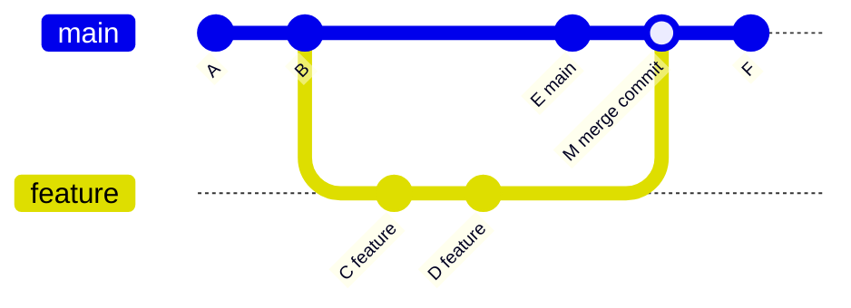
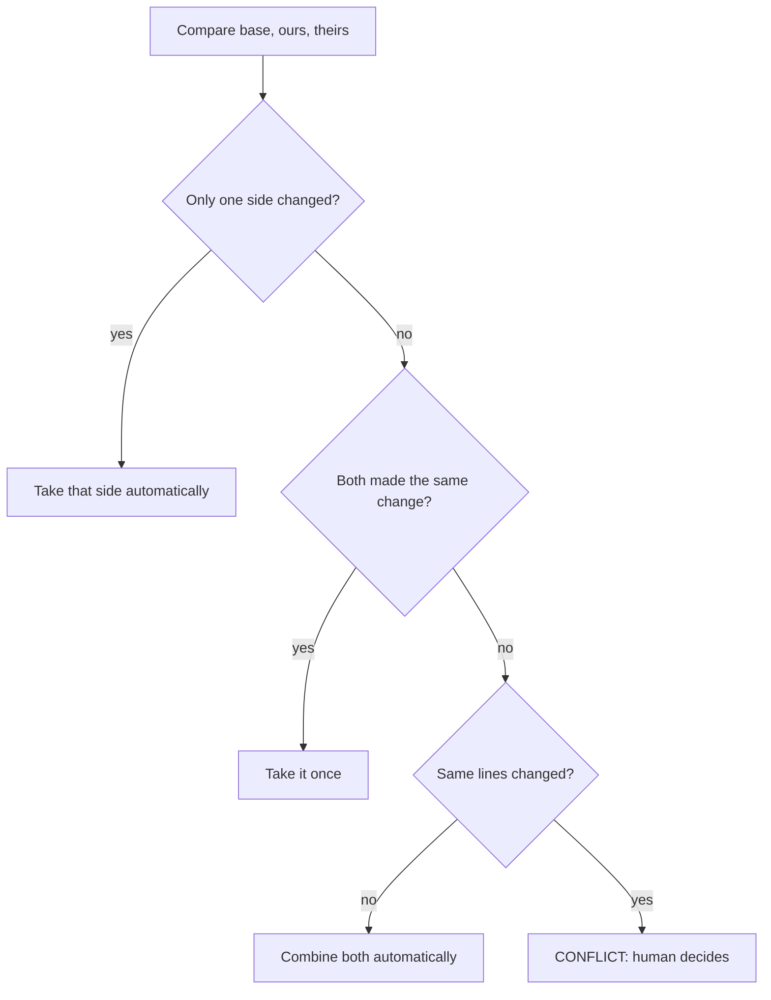
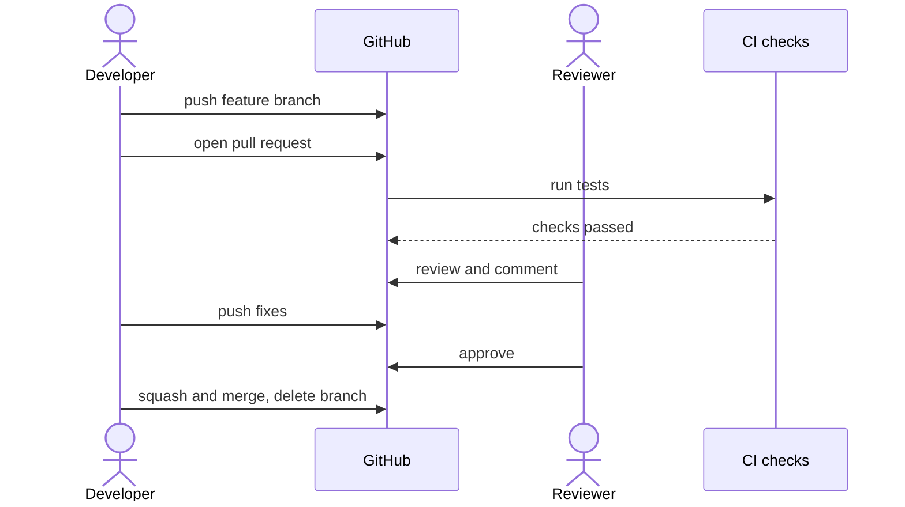
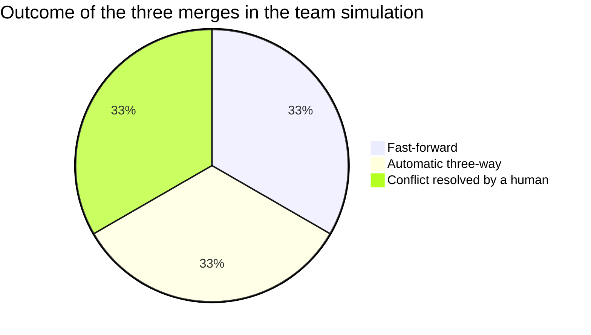

# Session 3 · Branching, Merging and Conflict Resolution

> [Prime AI – Software Engineering with AI](../../README.md) › [Term 1](../README.md) › [Distributed Version Control with Git & GitHub](README.md) › **Session 3**

| ⏱ Estimated time | 🧩 Prerequisites |
|---|---|
| 3 hours | Session 2 |

[⬅ Previous: Basic Git Commands](session-02-basic-git-commands.md) &nbsp;|&nbsp; [Next: Advanced Git Commands and Collaboration Workflows ➡](session-04-advanced-git-and-collaboration-workflows.md)

---

## 🎯 Learning objectives

By the end of this session you will be able to:

- Explain why teams use feature branches and how branches are represented in Git.
- Perform simple (fast-forward) and complex (three-way) merges and read the resulting history graph.
- Identify the common causes of merge conflicts and read conflict markers.
- Resolve conflicts on the command line, in VS Code and on GitHub, and abort a merge safely.
- Collaborate through GitHub pull requests with reviews and different merge methods.

## 📖 Concepts

### 1. Why branch?

`main` should always contain **working, deployable** code. New work happens on **feature branches**, which are merged
back only when finished and reviewed.

> 🛣️ **Analogy – a road diversion.** The main road (main) stays open for traffic. Road workers build a new section on a side
> road (feature branch). When it is finished and inspected, it is connected to the main road (merge) – drivers were never
> stuck.

Benefits: isolate unfinished work, several features in parallel, easy code review, simple to throw away a failed
experiment (just delete the branch).

**What a branch really is:** a tiny file containing one commit ID. Creating a branch is instant, no files are copied.
`HEAD` points to the current branch; each new commit moves that branch forward.

### 2. Two kinds of merge

| Merge type | When it happens | Result |
|---|---|---|
| **Fast-forward** (simple) | `main` has **no new commits** since the feature branch started | Git just moves the `main` label forward – a straight line, no merge commit |
| **Three-way** (complex) | **Both** branches have new commits | Git compares the two tips with their **common ancestor** (merge base) and creates a **merge commit** with two parents |

`git merge --no-ff feature/x` forces a merge commit even when fast-forward is possible – some teams like it because the
graph then shows where each feature started and ended. `git merge --squash` combines all feature commits into one set of
changes you commit yourself.

### 3. How a three-way merge decides

For every file, Git looks at three versions: **base** (common ancestor), **ours** (current branch) and **theirs** (the
branch being merged).

| Base | Ours | Theirs | Git's decision |
|---|---|---|---|
| A | A | B | take **B** (only theirs changed) |
| A | B | A | take **B** (only ours changed) |
| A | B | B | take **B** (both made the same change) |
| A | B | C | **CONFLICT** – both changed the same lines differently |

Changes to **different** lines or **different** files merge automatically.

### 4. Common causes of conflicts

- Two people edit the **same lines** of the same file (e.g. both change the navbar).
- One person **edits** a file another **deleted** or renamed (*modify/delete* conflict).
- Long-lived branches that drift far from `main`.
- Re-formatting whole files (Prettier, line endings CRLF vs LF) at the same time as someone else edits them.

Reduce them with small, short-lived branches; pull/merge `main` into your branch often; agree on a formatter and
`.gitattributes` line-ending settings; communicate who is working on what.

### 5. Reading and resolving a conflict – step by step

```text
<<<<<<< HEAD
<h1>Welcome to Karachi Bakes</h1>          ← "ours" (the branch you are on)
=======
<h1>Fresh Cakes Every Day</h1>              ← "theirs" (the branch you are merging in)
>>>>>>> feature/new-headline
```

1. `git status` lists files as **both modified**.
2. Open each file; decide the correct final content – ours, theirs, or a combination.
3. Delete **all** markers (`<<<<<<<`, `=======`, `>>>>>>>`).
4. `git add <file>` to mark it resolved.
5. `git commit` (Git pre-fills "Merge branch …").
6. Changed your mind mid-way? `git merge --abort` returns everything to before the merge.

Shortcuts: `git checkout --ours file` / `git checkout --theirs file` keep one side completely.

**Tools:** VS Code shows *Accept Current / Accept Incoming / Accept Both / Compare* buttons above each conflict and a
3-way *Merge Editor*; GitHub Desktop and the GitHub web editor (*Resolve conflicts* button on a pull request) help with
simple text conflicts.

### 6. Pull requests (PRs) on GitHub

A **pull request** asks: "please review my branch and merge it into `main`".

1. Push your branch: `git push -u origin feature/new-headline`.
2. On GitHub, click **Compare & pull request**; write a clear title and description (what, why, screenshots, `Closes #12`).
3. Reviewers read the **Files changed** tab, leave comments, **request changes** or **approve**.
4. Automated checks (CI, Session 6) run on the PR.
5. Merge with one of three buttons:

| Button | History result | Good for |
|---|---|---|
| **Create a merge commit** | All commits + a merge commit | Keeping full detail |
| **Squash and merge** | One commit on main | Tidy history from messy branches |
| **Rebase and merge** | Commits replayed linearly | Linear history with individual commits |

6. Delete the branch. Protect `main` with **branch protection rules** (require PR reviews and passing checks).

### 7. Forking vs cloning (preview of Session 4)

**Cloning** copies a repository to your computer. **Forking** copies a repository to **your GitHub account** – needed
when you don't have permission to push to the original (open source). You then clone your fork, push to it, and open a
pull request from the fork to the original.

## 🧭 Diagrams

### Fast-forward vs three-way merge



### Merge decision for each file



### Pull request lifecycle



## 💻 Worked examples

### Example 1 — Fast-forward and three-way merges, with the history graph

Two scenarios in one script: first a feature merged when `main` has not moved (fast-forward), then a feature merged
after `main` has moved on (three-way merge with a merge commit). `git log --graph` draws the difference.

```bash
#!/usr/bin/env bash
# session-03_merge-types.sh – fast-forward vs three-way merge.
source ./git-demo-env.sh
git init -q site && cd site
c() { tick; echo "$1" >> "$2"; git add "$2"; git commit -q -m "$3"; }

c "<h1>Home</h1>" index.html "feat: home page"
echo "===== 1. FAST-FORWARD ====="
git switch -q -c feature/about
c "<h1>About</h1>" about.html "feat: about page"
c "<p>Our story</p>" about.html "feat: about story"
git switch -q main
run git merge feature/about
run git log --oneline --graph

echo "===== 2. THREE-WAY MERGE ====="
git switch -q -c feature/contact
c "<h1>Contact</h1>" contact.html "feat: contact page"
git switch -q main
c "<footer>2026</footer>" index.html "fix: footer year"        # main moves on too
run git merge --no-edit feature/contact
run git log --oneline --graph
run git log -1 --format='Merge commit %h has parents: %p'
run git merge-base --is-ancestor feature/contact main
echo "feature/contact is now an ancestor of main → safe to delete"
run git branch -d feature/about feature/contact
```

📄 Saved as [`code/session-03_merge-types.sh`](code/session-03_merge-types.sh)

**Output** (real run)

```text
===== 1. FAST-FORWARD =====
$ git merge feature/about
Updating 00b1f58..baff23c
Fast-forward
 about.html | 2 ++
 1 file changed, 2 insertions(+)
 create mode 100644 about.html

$ git log --oneline --graph
* baff23c feat: about story
* 5f9f28f feat: about page
* 00b1f58 feat: home page

===== 2. THREE-WAY MERGE =====
$ git merge --no-edit feature/contact
Merge made by the 'ort' strategy.
 contact.html | 1 +
 1 file changed, 1 insertion(+)
 create mode 100644 contact.html

$ git log --oneline --graph
*   462b73e Merge branch 'feature/contact'
|\  
| * 0f468a7 feat: contact page
* | 6cb8d36 fix: footer year
|/  
* baff23c feat: about story
* 5f9f28f feat: about page
* 00b1f58 feat: home page

$ git log -1 "--format=Merge commit %h has parents: %p"
Merge commit 462b73e has parents: 6cb8d36 0f468a7

$ git merge-base --is-ancestor feature/contact main

feature/contact is now an ancestor of main → safe to delete
$ git branch -d feature/about feature/contact
Deleted branch feature/about (was baff23c).
Deleted branch feature/contact (was 0f468a7).
```

### Example 2 — Trigger a merge conflict and resolve it

Ali and Sara both change the headline of `index.html`. The second merge stops with a conflict. The script shows the
conflict markers, resolves by combining both ideas, and finishes the merge – then shows `git merge --abort` on a second
conflict.

```bash
#!/usr/bin/env bash
# session-03_conflict.sh – create, inspect, resolve and abort merge conflicts.
source ./git-demo-env.sh
git init -q bakery && cd bakery
printf '<h1>Karachi Bakes</h1>\n<p>Order online.</p>\n' > index.html
git add . && git commit -q -m "feat: home page"

tick; git switch -q -c ali/headline
sed -i 's|<h1>.*</h1>|<h1>Welcome to Karachi Bakes</h1>|' index.html
git commit -q -am "feat: friendlier headline"
tick; git switch -q main; git switch -q -c sara/headline
sed -i 's|<h1>.*</h1>|<h1>Fresh Cakes Every Day</h1>|' index.html
git commit -q -am "feat: headline with value proposition"

git switch -q main
run git merge -q ali/headline                       # fast-forward, fine
runsh 'git merge sara/headline || true'             # CONFLICT
run git status --short
run cat index.html

echo "--- resolve: keep both ideas, remove ALL markers ---"
printf '<h1>Welcome to Karachi Bakes – Fresh Cakes Every Day</h1>\n<p>Order online.</p>\n' > index.html
run git add index.html
tick
run git commit -q --no-edit
run git log --oneline --graph
run cat index.html

echo "--- a second conflict, this time we abort ---"
tick; git switch -q -c experiment
sed -i 's|<p>.*</p>|<p>Closed on Mondays.</p>|' index.html; git commit -q -am "docs: closing day"
git switch -q main
sed -i 's|<p>.*</p>|<p>Open every day.</p>|' index.html; tick; git commit -q -am "docs: open daily"
runsh 'git merge -q experiment || true'
run git merge --abort
run git status --short
echo "(clean again – nothing was changed)"
```

📄 Saved as [`code/session-03_conflict.sh`](code/session-03_conflict.sh)

**Output** (real run)

```text
$ git merge -q ali/headline

$ git merge sara/headline || true
Auto-merging index.html
CONFLICT (content): Merge conflict in index.html
Automatic merge failed; fix conflicts and then commit the result.

$ git status --short
UU index.html

$ cat index.html
<<<<<<< HEAD
<h1>Welcome to Karachi Bakes</h1>
=======
<h1>Fresh Cakes Every Day</h1>
>>>>>>> sara/headline
<p>Order online.</p>

--- resolve: keep both ideas, remove ALL markers ---
$ git add index.html

$ git commit -q --no-edit

$ git log --oneline --graph
*   6b63922 Merge branch 'sara/headline'
|\  
| * ffb05eb feat: headline with value proposition
* | d918c53 feat: friendlier headline
|/  
* 7d499d6 feat: home page

$ cat index.html
<h1>Welcome to Karachi Bakes – Fresh Cakes Every Day</h1>
<p>Order online.</p>

--- a second conflict, this time we abort ---
$ git merge -q experiment || true
Auto-merging index.html
CONFLICT (content): Merge conflict in index.html
Automatic merge failed; fix conflicts and then commit the result.

$ git merge --abort

$ git status --short

(clean again – nothing was changed)
```

### Example 3 — A conflict-marker resolver in JavaScript

What does a merge tool actually do? This script parses conflict markers from a file's text and produces the result for
each strategy – **ours**, **theirs** or **both** – and refuses to save a file that still contains markers (a check you can
also run in CI).

```js
// session-03_conflict-resolver.js  (run: node session-03_conflict-resolver.js)
// Parses Git conflict markers and resolves them with a chosen strategy.

const conflicted = `const SHOP = 'Karachi Bakes';
<<<<<<< HEAD
const DELIVERY = 250;
=======
const DELIVERY = 300;
const FREE_ABOVE = 5000;
>>>>>>> feature/price
function total(sum) {
<<<<<<< HEAD
  return sum + DELIVERY;
=======
  return sum >= FREE_ABOVE ? sum : sum + DELIVERY;
>>>>>>> feature/price
}`;

function parse(text) {
  const parts = []; let mode = 'normal'; let ours = [], theirs = [];
  for (const line of text.split('\n')) {
    if (line.startsWith('<<<<<<<')) { mode = 'ours'; ours = []; theirs = []; }
    else if (line.startsWith('=======') && mode === 'ours') mode = 'theirs';
    else if (line.startsWith('>>>>>>>') && mode === 'theirs') { parts.push({ ours, theirs }); mode = 'normal'; }
    else if (mode === 'ours') ours.push(line);
    else if (mode === 'theirs') theirs.push(line);
    else parts.push(line);
  }
  return parts;
}

function resolve(text, strategy) {
  return parse(text).flatMap(p => typeof p === 'string' ? [p]
    : strategy === 'ours' ? p.ours : strategy === 'theirs' ? p.theirs : [...p.ours, ...p.theirs]).join('\n');
}

const hasMarkers = t => /^(<{7}|={7}|>{7})( |$)/m.test(t);

const conflicts = parse(conflicted).filter(p => typeof p !== 'string').length;
console.log(`Conflicts found: ${conflicts} | file still has markers: ${hasMarkers(conflicted)}\n`);
for (const s of ['ours', 'theirs']) {
  const out = resolve(conflicted, s);
  console.log(`--- strategy: ${s} (markers left: ${hasMarkers(out)}) ---\n${out}\n`);
}
// "both" blindly concatenates: often WRONG for code – a human must check
console.log(`--- strategy: both ---\n${resolve(conflicted, 'both')}`);
console.log('\n⚠ "both" produced two DELIVERY constants and two return statements – always review the result.');
```

📄 Saved as [`code/session-03_conflict-resolver.js`](code/session-03_conflict-resolver.js)

**Output** (real run)

```text
Conflicts found: 2 | file still has markers: true

--- strategy: ours (markers left: false) ---
const SHOP = 'Karachi Bakes';
const DELIVERY = 250;
function total(sum) {
  return sum + DELIVERY;
}

--- strategy: theirs (markers left: false) ---
const SHOP = 'Karachi Bakes';
const DELIVERY = 300;
const FREE_ABOVE = 5000;
function total(sum) {
  return sum >= FREE_ABOVE ? sum : sum + DELIVERY;
}

--- strategy: both ---
const SHOP = 'Karachi Bakes';
const DELIVERY = 250;
const DELIVERY = 300;
const FREE_ABOVE = 5000;
function total(sum) {
  return sum + DELIVERY;
  return sum >= FREE_ABOVE ? sum : sum + DELIVERY;
}

⚠ "both" produced two DELIVERY constants and two return statements – always review the result.
```

## 🧩 Real-life coding problem

**Scenario – a three-person team builds a landing page.** Hira builds the navbar, Bilal the pricing section, Zara changes
the colour scheme in `style.css` – and Zara and Hira both touch the `.navbar` rule. Simulate the team workflow with feature
branches, merge each into `main`, resolve the one real conflict, and finish with a clean history.

**Steps**
1. Shared start: `index.html` and `style.css` on `main`.
2. Three branches from the same commit: `feature/navbar`, `feature/pricing`, `feature/theme`.
3. Merge pricing (fast-forward – nobody else has merged yet).
4. Merge navbar (three-way, automatic – different lines/files).
5. Merge theme → **conflict** in `style.css` on the `.navbar` rule (Hira set `background: white`, Zara `background:
   #0A0716`). Team decision: dark theme wins, keep Hira's `position: sticky`.
6. Verify with `git log --graph` and delete merged branches.

Full simulation: [`code/session-03_team-merge.sh`](code/session-03_team-merge.sh):

```text
1) merge pricing:
$ git merge feature/pricing | head -2
Updating 98181b0..2422c44
Fast-forward

2) merge navbar:
$ git merge --no-edit feature/navbar | head -2
Merge made by the 'ort' strategy.
 index.html | 2 +-

3) merge theme:
$ git merge --no-edit feature/theme || true
Auto-merging style.css
CONFLICT (content): Merge conflict in style.css
Automatic merge failed; fix conflicts and then commit the result.

$ git diff --name-only --diff-filter=U
style.css

$ cat style.css
.navbar {
<<<<<<< HEAD
  background: white;
  position: sticky;
=======
  background: #0A0716;
>>>>>>> feature/theme
}
body { font-family: sans-serif; color: #F5EEFF; }

Team decision: dark background wins, keep sticky position, keep text colour.
$ git log --oneline --graph "--format=%h %an: %s"
*   e58fcf1 Ayesha Khan: Merge branch 'feature/theme'
|\  
| * 7eeedd4 Zara: style: dark theme colours
* |   e50cc40 Ayesha Khan: Merge branch 'feature/navbar'
|\ \  
| * | 1f32ba6 Hira: feat: sticky navbar with links
| |/  
* / 2422c44 Bilal: feat: pricing section
|/  
* 98181b0 Ayesha Khan: chore: starter page

$ git branch -d feature/pricing feature/navbar feature/theme
Deleted branch feature/pricing (was 2422c44).
Deleted branch feature/navbar (was 1f32ba6).
Deleted branch feature/theme (was 7eeedd4).
```

## ⚠️ Common mistakes

| Mistake | Symptom | Fix |
|---|---|---|
| Leaving conflict markers in the file | Site shows `<<<<<<< HEAD`; JS syntax errors | Search for `<<<<<<<` before committing; CI check |
| Accepting "both" blindly | Duplicate code, broken logic | Read and test the combined result |
| Committing with unresolved files | Git refuses: "unmerged paths" | Resolve each file, `git add`, then commit |
| Long-lived feature branches | Painful, large conflicts | Small branches; merge `main` into your branch daily |
| Panicking mid-merge | Random edits make it worse | `git merge --abort` and start again calmly |
| Merging without pulling first | Merge based on stale `main` | `git pull` on main before merging |
| Self-merging PRs without review | Bugs reach main | Branch protection: required reviews and checks |

## 🌟 Best practices

- Keep `main` deployable; do all work on short-lived, well-named feature branches.
- Pull often, merge `main` into long branches regularly, and communicate on shared files.
- Resolve conflicts in an editor with a 3-way view (VS Code Merge Editor); run the app/tests before committing the merge.
- Use pull requests for every change: clear description, screenshots, linked issue, small diff.
- Choose a team merge method (squash is popular for small teams) and protect `main` with required reviews and CI.

## 🏗️ Mini project

**Mini project – a "PR description generator".** Write a Node script that reads `git log main..feature --format=%s`
style data and builds a pull-request description: title, grouped changes (features/fixes/docs), a checklist and a
"Closes #N" line if a commit mentions an issue.

Solution: [`code/session-03_mini-project-pr-description.js`](code/session-03_mini-project-pr-description.js) – real output:

```text
# Order form

Merges `feature/order-form` into `main` (6 commits).

## ✨ Features
- **order:** add order form with name, phone and cake fields
- **order:** validate phone numbers

## 🐛 Fixes
- **order:** keep modal open when validation fails

## 📝 Documentation
- describe the order flow in README

## ✅ Tests
- **order:** cover invalid phone formats

## 🎨 Style
- align form labels on mobile

## Checklist
- [ ] Tested on mobile and desktop
- [ ] No console errors
- [ ] Screenshots attached
- [ ] README updated

Closes #14
```

## 📦 Project files for this session

| File | What it is |
|---|---|
| 📄 [`code/session-03_team-merge.sh`](code/session-03_team-merge.sh) | Real-life problem solution – three feature branches, fast-forward, auto three-way and a resolved conflict |
| 📄 [`code/session-03_mini-project-pr-description.js`](code/session-03_mini-project-pr-description.js) | Mini project solution – generates a pull-request description from commit subjects |

## 📊 At a glance

**How the team-merge simulation's three merges behaved** (real output above):

| Merge | Type | Merge commit? | Conflict? | Why |
|---|---|---|---|---|
| `feature/pricing` | Fast-forward | No | No | `main` had not moved since the branch started |
| `feature/navbar` | Three-way | Yes | No | Different lines/files changed |
| `feature/theme` | Three-way | Yes | **Yes** | Same `.navbar` lines changed differently |



## 🧪 Lab / practice tasks

**🟢 Easy** — Create a repo with `main`, make a branch `feature/footer`, add two commits and merge it back. Was it a fast-forward? Prove it with `git log --oneline --graph`.

<details><summary>💡 Hint</summary>

If `main` did not change meanwhile, the merge prints "Fast-forward" and the graph is one straight line.

</details>

<details><summary>✅ Solution</summary>

```bash
git switch -c feature/footer
echo "<footer>© 2026</footer>" >> index.html && git commit -am "feat: add footer"
echo "<footer>Contact</footer>" >> index.html && git commit -am "feat: footer contact link"
git switch main && git merge feature/footer      # "Fast-forward"
git log --oneline --graph                         # straight line, no merge commit
```

</details>

**🟡 Medium** — Repeat the lab, but this time add a commit on `main` before merging so a merge commit is created. Then repeat again using `git merge --squash` and compare the three histories.

<details><summary>💡 Hint</summary>

`--squash` stages the combined changes but does not commit – you write one commit message yourself.

</details>

<details><summary>✅ Solution</summary>

Three-way merge → graph shows two lines joining at a merge commit with two parents. `git merge --squash feature/x &&
git commit -m "feat: footer"` → `main` gets **one** ordinary commit containing all feature changes; the feature branch's
individual commits are not in `main`'s history (delete the branch with `-D`).

</details>

**🔴 Hard** — Create a modify/delete conflict: on one branch delete `about.html`, on another edit it. Merge both and resolve by keeping the edited file. Explain what `git status` reports.

<details><summary>💡 Hint</summary>

Status shows "deleted by us" or "deleted by them". Keep the file with `git add about.html`, or confirm deletion with `git rm about.html`.

</details>

<details><summary>✅ Solution</summary>

```text
CONFLICT (modify/delete): about.html deleted in HEAD and modified in feature/about-edit.
```
`git status` lists `deleted by us: about.html`. Keep it: the working copy already contains the modified version, so
`git add about.html && git commit` finishes the merge with the edited file restored.

</details>

**🏆 Challenge** — On GitHub, practise the full PR cycle with a classmate: protect `main` (require 1 approval), open a PR, request a change, fix it, approve and **squash-merge**. Screenshot each step.

<details><summary>💡 Hint</summary>

Settings › Branches › Add branch protection rule › "Require a pull request before merging".

</details>

<details><summary>✅ Solution</summary>

A complete submission shows: the protection rule, the PR with description and linked issue, a review comment with
"Request changes", the follow-up commit, the approval, the squash-merge commit on `main` and the deleted branch.

</details>

## ✅ Quick quiz

**Q1. A fast-forward merge creates:**

- A) A merge commit with two parents
- B) No new commit – the branch pointer moves forward
- C) A conflict
- D) A tag

<details><summary>Show answer</summary>

**B** — No divergence = no merge commit.

</details>

**Q2. A merge commit has how many parents?**

- A) 0
- B) 1
- C) 2 (or more)
- D) None

<details><summary>Show answer</summary>

**C** — It joins two lines of history.

</details>

**Q3. Which change ALWAYS causes a conflict?**

- A) Edits to different files
- B) Both branches editing the same lines differently
- C) Adding a new file
- D) Editing different lines of one file

<details><summary>Show answer</summary>

**B** — Git cannot choose between them.

</details>

**Q4. To cancel a merge in progress:**

- A) git reset main
- B) git merge --abort
- C) git delete merge
- D) git stash merge

<details><summary>Show answer</summary>

**B** — Returns to the pre-merge state.

</details>

**Q5. "Squash and merge" on GitHub results in:**

- A) All branch commits on main
- B) One combined commit on main
- C) A deleted repository
- D) A fork

<details><summary>Show answer</summary>

**B** — Useful for tidy history.

</details>

## 📝 Summary / cheat-sheet

- Feature branches keep `main` deployable; a branch is just a pointer to a commit.
- Fast-forward merge: main had no new commits → pointer moves. Three-way merge: both moved → merge commit with two parents.
- Git merges per file using base/ours/theirs; same-line changes on both sides = conflict.
- Resolve: open file → choose content → remove all markers → `git add` → `git commit`; or `git merge --abort`.
- Avoid conflicts: small, short-lived branches; merge main often; shared formatter; communication.
- Pull requests: push branch → open PR → review + CI → merge (merge commit / squash / rebase) → delete branch; protect main.

## 🎤 Interview / viva questions

1. **Explain the difference between a fast-forward and a three-way merge.**
   <details><summary>Model answer</summary>

   Fast-forward happens when the target has no new commits, so Git simply moves its pointer; a three-way merge is needed when both branches have diverged, and Git uses the common ancestor to create a merge commit.

   </details>

2. **What is the merge base?**
   <details><summary>Model answer</summary>

   The most recent common ancestor commit of the two branches; Git compares both tips against it to decide what each side changed.

   </details>

3. **What causes merge conflicts and how can teams reduce them?**
   <details><summary>Model answer</summary>

   Conflicting edits to the same lines or modify/delete changes; reduce them with small short-lived branches, frequent integration with main, consistent formatting and communication.

   </details>

4. **Walk through resolving a conflict.**
   <details><summary>Model answer</summary>

   Run git status to find conflicted files, edit each to the correct content removing all markers, test, git add the files and git commit to complete the merge.

   </details>

5. **What is a pull request?**
   <details><summary>Model answer</summary>

   A GitHub request to merge one branch into another, providing a place for discussion, code review and automated checks before merging.

   </details>

6. **Merge commit vs squash vs rebase merge on GitHub?**
   <details><summary>Model answer</summary>

   Merge commit keeps all commits plus a merge commit; squash combines the branch into one commit; rebase-and-merge replays each commit linearly without a merge commit.

   </details>

---

[⬅ Previous: Basic Git Commands](session-02-basic-git-commands.md) &nbsp;|&nbsp; [Next: Advanced Git Commands and Collaboration Workflows ➡](session-04-advanced-git-and-collaboration-workflows.md)

<sub>Prepared by **Hamna Zahid Khan**, Junior Lecturer · Prime AI – Software Engineering with AI</sub>
