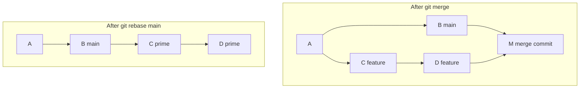
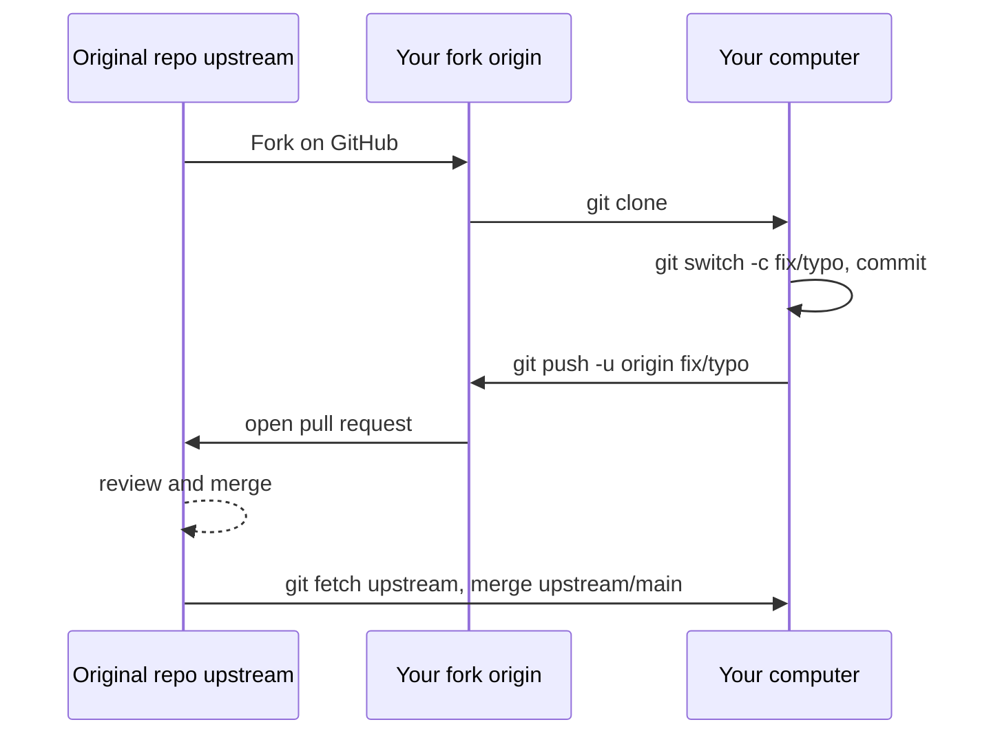
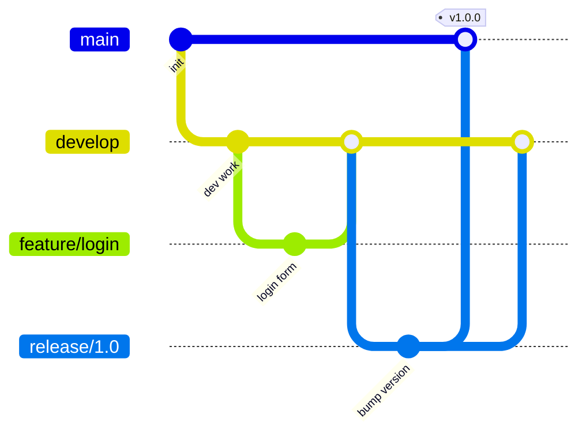
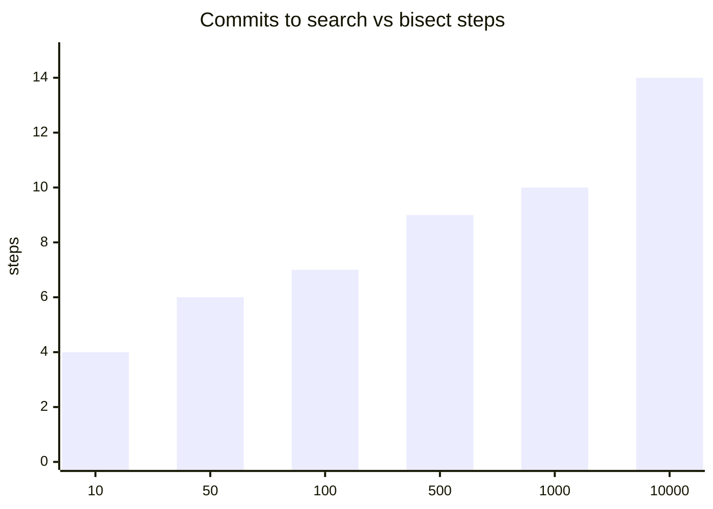

# Session 4 · Advanced Git Commands and Collaboration Workflows

> [Prime AI – Software Engineering with AI](../../README.md) › [Term 1](../README.md) › [Distributed Version Control with Git & GitHub](README.md) › **Session 4**

| ⏱ Estimated time | 🧩 Prerequisites |
|---|---|
| 3.5 hours | Session 3 |

[⬅ Previous: Branching, Merging and Conflict Resolution](session-03-branching-merging-and-conflict-resolution.md) &nbsp;|&nbsp; [Next: AI Integration with Git and GitHub ➡](session-05-ai-integration-with-git-and-github.md)

---

## 🎯 Learning objectives

By the end of this session you will be able to:

- Apply advanced commands: stash, cherry-pick, tags, reflog, bisect and blame.
- Define rebasing, compare it with merging and use interactive rebase to squash and reword commits.
- Manage files with Git: move, rename, delete and stop tracking, and clean up branches.
- Define forking and the feature-branch workflow, and contribute to another repository with a fork and pull request.
- Choose a team workflow (GitHub Flow, Gitflow, trunk-based) and keep history clean.

## 📖 Concepts

### 1. Rebase – rewriting where your branch starts

`git rebase main` (run on a feature branch) takes your feature commits, temporarily removes them, moves the branch to the
**tip of main**, and **replays** your commits one by one on top. The result is a **linear** history, as if you had started
the feature today.

> 🧱 **Analogy – moving your LEGO tower.** Merging builds a bridge between your tower and the main tower. Rebasing lifts your
> blocks off and stacks them, in the same order, on top of the newest main tower. Same blocks, cleaner skyline – but they
> are technically *new* blocks (new commit IDs).

| | Merge | Rebase |
|---|---|---|
| History | True record, with merge commits | Linear, tidy |
| Commit IDs | Unchanged | Rewritten (new hashes) |
| Conflicts | Resolved once | May be resolved per commit |
| Safe on shared branches? | ✅ | ❌ **Never rebase commits others have pulled** |

**The golden rule:** rebase only your own **local / unpublished** commits. If you must update an already-pushed personal
branch after rebasing, use `git push --force-with-lease` (refuses if someone else pushed meanwhile).

### 2. Interactive rebase – edit history before sharing

`git rebase -i HEAD~4` opens a list of the last four commits:

```text
pick a1b2c3 feat: gallery grid
pick d4e5f6 wip
pick 789abc fix typo
pick 0de1f2 feat: lightbox
```

Change the verbs: `pick` (keep), `reword` (change message), `squash`/`fixup` (combine into the previous commit), `edit`,
`drop` (delete), or reorder lines. Typical use: squash "wip" and "fix typo" commits into meaningful ones before opening a
pull request. `git commit --fixup <commit>` + `git rebase -i --autosquash` automates it.

### 3. Stash – a temporary shelf

`git stash` saves uncommitted changes and gives you a clean working directory – perfect when you must switch branches
mid-task.

| Command | Effect |
|---|---|
| `git stash push -m "half-done gallery"` | Save tracked changes (`-u` also untracked files) |
| `git stash list` | `stash@{0}: On feature/gallery: half-done gallery` |
| `git stash pop` | Re-apply the latest stash and remove it |
| `git stash apply stash@{1}` | Re-apply but keep it in the list |
| `git stash drop` / `clear` | Delete one / all |

### 4. Cherry-pick – copy one commit

`git cherry-pick <commit>` applies the changes of a single commit onto the current branch (as a new commit). Use it for
**hotfixes** (bring a fix from `develop` to a release branch) or to rescue a commit made on the wrong branch. Overusing it
duplicates history – prefer merging when you want everything.

### 5. Tags and releases

A **tag** marks a specific commit, usually a release version.

| Command | Meaning |
|---|---|
| `git tag v1.0.0` | Lightweight tag (just a name) |
| `git tag -a v1.0.0 -m "First public release"` | **Annotated** tag (author, date, message) – use for releases |
| `git tag` / `git show v1.0.0` | List / inspect |
| `git push origin v1.0.0` / `git push --tags` | Tags are **not** pushed by default |

**Semantic Versioning:** `MAJOR.MINOR.PATCH` – breaking change → major, new feature → minor, bug fix → patch
(1.4.2 → 1.5.0 for a new feature). On GitHub, a **Release** is built from a tag with notes and downloadable files.

### 6. Rescue and investigation tools

| Tool | What it answers |
|---|---|
| `git reflog` | "Where has HEAD been?" – every commit you were on, even after reset or a deleted branch. `git reset --hard HEAD@{2}` or `git branch rescue <id>` brings lost work back (kept ~90 days). |
| `git bisect` | "Which commit introduced this bug?" – binary search: mark a good and a bad commit; Git checks out the middle; you (or a script with `git bisect run`) say good/bad until it names the culprit. 100 commits need only ~7 steps. |
| `git blame file` | "Who last changed each line, and in which commit?" – for context, not for blaming people! |
| `git log -S "text"` | "Which commit added or removed this text?" |

### 7. Managing files with Git

| Task | Command | Why not just use the file explorer? |
|---|---|---|
| Rename / move | `git mv old.html new.html` | Git records it as a rename in one step |
| Delete | `git rm file` | Deletes and stages the deletion |
| Stop tracking but keep the file | `git rm --cached file` | e.g. a config file that should be in `.gitignore` |
| Remove untracked junk | `git clean -n` (preview) then `git clean -f` | Removes files Git doesn't track |
| Clean up branches | `git branch --merged` · `git branch -d name` · `git push origin --delete name` · `git fetch --prune` | Keeps the branch list readable |

### 8. Forks and the feature-branch workflow

**Forking workflow (open source / no write access):**
1. **Fork** the repository on GitHub → your copy `you/project`.
2. `git clone` your fork; add the original as **upstream**: `git remote add upstream https://github.com/owner/project.git`.
3. `git switch -c fix/typo-in-docs`, commit, `git push -u origin fix/typo-in-docs`.
4. Open a **pull request** from your fork's branch to the original's `main`.
5. Keep your fork updated: `git fetch upstream && git switch main && git merge upstream/main && git push`.

**Team workflows**

| Workflow | Branches | Best for |
|---|---|---|
| **GitHub Flow** | `main` + short feature branches + PRs; deploy from main | Web apps, small–medium teams (most common) |
| **Gitflow** | `main`, `develop`, `feature/*`, `release/*`, `hotfix/*` | Versioned software with scheduled releases |
| **Trunk-based** | Everyone merges small changes to `main` daily, feature flags | Mature teams with strong CI |

## 🧭 Diagrams

### Merge vs rebase of the same feature



### Fork and pull-request workflow



### Gitflow branches



## 💻 Worked examples

### Example 1 — Rebase a feature branch and squash messy commits

A feature branch with four commits (two of them "wip" and "fix typo") falls behind `main`. We rebase it onto `main`
for a linear history, then use a **non-interactive** interactive rebase (a scripted editor) to squash the noise – exactly
what you would do by hand in the editor.

```bash
#!/usr/bin/env bash
# session-04_rebase-squash.sh – rebase onto main, then squash with interactive rebase.
source ./git-demo-env.sh
git init -q gallery && cd gallery
c() { tick; echo "$1" >> "$2"; git add "$2"; git commit -q -m "$3"; }
c "<h1>Home</h1>" index.html "feat: home page"

git switch -q -c feature/gallery
c "<div class=grid>" gallery.html "feat: gallery grid"
c "<!-- todo -->" gallery.html "wip"
c "" gallery.html "fix typo"
c "<dialog>" gallery.html "feat: lightbox dialog"
git switch -q main
c "<footer>2026</footer>" index.html "fix: footer year"

echo "BEFORE: the branches have diverged"
run git log --oneline --graph --all
git switch -q feature/gallery
tick
run git rebase main
echo "AFTER REBASE: linear – feature commits now sit on top of main (new IDs)"
run git log --oneline --graph --all

# Interactive rebase, scripted: squash commits 2 and 3 into commit 1 of the feature
export GIT_SEQUENCE_EDITOR="sed -i -e '2s/^pick/fixup/' -e '3s/^pick/fixup/'"
tick
run git rebase -i -q main
echo "AFTER SQUASH: 'wip' and 'fix typo' were folded into 'feat: gallery grid'"
run git log --oneline main..feature/gallery
run git show --stat --format='%s' HEAD~1
```

📄 Saved as [`code/session-04_rebase-squash.sh`](code/session-04_rebase-squash.sh)

**Output** (real run)

```text
BEFORE: the branches have diverged
$ git log --oneline --graph --all
* 31b1ebc fix: footer year
| * 70e96a7 feat: lightbox dialog
| * 4421cfe fix typo
| * 4f10a22 wip
| * f13e8bf feat: gallery grid
|/  
* 00b1f58 feat: home page

$ git rebase main
Rebasing (1/4)
Rebasing (2/4)
Rebasing (3/4)
Rebasing (4/4)
Successfully rebased and updated refs/heads/feature/gallery.

AFTER REBASE: linear – feature commits now sit on top of main (new IDs)
$ git log --oneline --graph --all
* 70bf6ba feat: lightbox dialog
* e4723fd fix typo
* d21865e wip
* 98c15c6 feat: gallery grid
* 31b1ebc fix: footer year
* 00b1f58 feat: home page

$ git rebase -i -q main

AFTER SQUASH: 'wip' and 'fix typo' were folded into 'feat: gallery grid'
$ git log --oneline main..feature/gallery
ae9a647 feat: lightbox dialog
ac476c5 feat: gallery grid

$ git show --stat --format=%s HEAD~1
feat: gallery grid

 gallery.html | 3 +++
 1 file changed, 3 insertions(+)
```

### Example 2 — Stash, cherry-pick and tags

You are mid-task when an urgent bug arrives: **stash** the work, fix the bug on `main`, **tag** a patch release,
**cherry-pick** the fix onto the old release branch, then pop the stash and carry on.

```bash
#!/usr/bin/env bash
# session-04_stash-cherry-tag.sh – stash, cherry-pick and annotated tags.
source ./git-demo-env.sh
git init -q shop && cd shop
c() { tick; printf '%s\n' "$1" >> "$2"; git add "$2"; git commit -q -m "$3"; }
c "total = price * qty" cart.js "feat: cart total"
run git tag -a v1.0.0 -m "First release"
git branch release/1.0                       # long-lived branch for the 1.0 line
c "discount = 0" cart.js "feat: discount field"

echo "--- working on something when a bug report arrives ---"
echo "coupon = 'EID'" >> cart.js
run git status --short
run git stash push -m "half-done coupon feature"
run git stash list
run git status --short

echo "--- fix the bug on main and tag a patch release ---"
c "if (qty < 0) qty = 0" validate.js "fix: prevent negative quantity"
FIX=$(git rev-parse --short HEAD)
run git tag -a v1.1.1 -m "Patch: negative quantity"

echo "--- copy ONLY the fix to the 1.0 line with cherry-pick ---"
git switch -q release/1.0
tick
runsh "git cherry-pick $FIX | head -1"
run git tag -a v1.0.1 -m "Patch release for 1.0"
run git log --oneline release/1.0

echo "--- back to work ---"
git switch -q main
run git stash pop
run git tag -n
```

📄 Saved as [`code/session-04_stash-cherry-tag.sh`](code/session-04_stash-cherry-tag.sh)

**Output** (real run)

```text
$ git tag -a v1.0.0 -m "First release"

--- working on something when a bug report arrives ---
$ git status --short
 M cart.js

$ git stash push -m "half-done coupon feature"
Saved working directory and index state On main: half-done coupon feature

$ git stash list
stash@{0}: On main: half-done coupon feature

$ git status --short

--- fix the bug on main and tag a patch release ---
$ git tag -a v1.1.1 -m "Patch: negative quantity"

--- copy ONLY the fix to the 1.0 line with cherry-pick ---
$ git cherry-pick 0d0964b | head -1
[release/1.0 b9592a8] fix: prevent negative quantity

$ git tag -a v1.0.1 -m "Patch release for 1.0"

$ git log --oneline release/1.0
b9592a8 fix: prevent negative quantity
1971204 feat: cart total

--- back to work ---
$ git stash pop
On branch main
Changes not staged for commit:
  (use "git add <file>..." to update what will be committed)
  (use "git restore <file>..." to discard changes in working directory)
	modified:   cart.js

no changes added to commit (use "git add" and/or "git commit -a")
Dropped refs/stash@{0} (821df53afc491889fa8828d0ca62987e4c054133)

$ git tag -n
v1.0.0          First release
v1.0.1          Patch release for 1.0
v1.1.1          Patch: negative quantity
```

### Example 3 — git bisect run – find the commit that broke the tests

Twelve commits; somewhere a "refactor" broke the price calculation. Instead of checking each commit by hand, we give
`git bisect run` a test command. Git binary-searches and names the guilty commit in about four steps. Finally `git reflog`
shows everything HEAD visited.

```bash
#!/usr/bin/env bash
# session-04_bisect.sh – automated bug hunting with git bisect run, plus reflog.
source ./git-demo-env.sh
git init -q pricing && cd pricing

# A tiny program and its test
cat > price.js <<'EOF'
module.exports = (price, qty) => price * qty;
EOF
cat > test.js <<'EOF'
const total = require('./price.js');
process.exit(total(250, 4) === 1000 ? 0 : 1);   // exit 0 = good, 1 = bad
EOF
git add . && git commit -q -m "feat: price calculation with test"

for i in $(seq 2 12); do
  tick
  if [ "$i" -eq 7 ]; then
    echo 'module.exports = (price, qty) => price + qty;   // refactor' > price.js   # the bug!
    msg="refactor: simplify price function"
  else
    echo "change $i" >> CHANGELOG.md; msg="docs: changelog entry $i"
  fi
  git add . && git commit -q -m "$msg"
done
run git log --oneline
runsh 'node test.js && echo "tests pass" || echo "tests FAIL on the latest commit"'

run git bisect start HEAD "$(git rev-list --max-parents=0 HEAD)"
runsh 'git bisect run node test.js | grep -E "is the first bad commit|^    refactor|running" | sed "s/^running .*/(bisect tested a commit)/"'
run git bisect reset
run git reflog -6 --format='%h %gs'
```

📄 Saved as [`code/session-04_bisect.sh`](code/session-04_bisect.sh)

**Output** (real run)

```text
$ git log --oneline
1c61667 docs: changelog entry 12
fb3259b docs: changelog entry 11
83c3801 docs: changelog entry 10
573d141 docs: changelog entry 9
f206026 docs: changelog entry 8
b93cae4 refactor: simplify price function
a358487 docs: changelog entry 6
8b7906c docs: changelog entry 5
14cfabd docs: changelog entry 4
17dea4c docs: changelog entry 3
ea94e92 docs: changelog entry 2
aeb5baf feat: price calculation with test

$ node test.js && echo "tests pass" || echo "tests FAIL on the latest commit"
tests FAIL on the latest commit

$ git bisect start HEAD aeb5baf7742b3015856a10e3df7e49a854fc4a4c
Bisecting: 5 revisions left to test after this (roughly 3 steps)
[a358487a0508761549f01ebb27622d8ee804d4e0] docs: changelog entry 6

$ git bisect run node test.js | grep -E "is the first bad commit|^    refactor|running" | sed "s/^running .*/(bisect tested a commit)/"
(bisect tested a commit)
(bisect tested a commit)
(bisect tested a commit)
(bisect tested a commit)
b93cae49e7ca75f4454f9b139074328a002b2875 is the first bad commit
    refactor: simplify price function

$ git bisect reset
Previous HEAD position was b93cae4 refactor: simplify price function
Switched to branch 'main'

$ git reflog -6 "--format=%h %gs"
1c61667 checkout: moving from b93cae49e7ca75f4454f9b139074328a002b2875 to main
b93cae4 checkout: moving from f2060262c381c46ff2238612437283c7d66f07ee to b93cae49e7ca75f4454f9b139074328a002b2875
f206026 checkout: moving from 573d1415c00a49eb9f1181a1fc3cfdefb27386c1 to f2060262c381c46ff2238612437283c7d66f07ee
573d141 checkout: moving from a358487a0508761549f01ebb27622d8ee804d4e0 to 573d1415c00a49eb9f1181a1fc3cfdefb27386c1
a358487 checkout: moving from main to a358487a0508761549f01ebb27622d8ee804d4e0
1c61667 commit: docs: changelog entry 12
```

### Example 4 — Managing files and cleaning up branches

Rename, move, delete and untrack files the Git way, preview and remove untracked junk, and tidy up merged branches.

```bash
#!/usr/bin/env bash
# session-04_file-ops.sh – git mv, git rm, git rm --cached, git clean and branch cleanup.
source ./git-demo-env.sh
git init -q site && cd site
touch index.html aboutus.html old-banner.png config.local.json
git add . && git commit -q -m "chore: initial files"

tick; mkdir -p pages
run git mv aboutus.html pages/about.html
run git rm -q old-banner.png
run git rm -q --cached config.local.json
echo "config.local.json" > .gitignore && git add .gitignore
run git status --short
git commit -q -m "chore: reorganise pages, drop old banner, untrack local config"
run git log -1 --stat --format='%s'

echo "--- untracked junk ---"
touch debug.tmp notes-scratch.txt
run git clean -n
run git clean -f -q
run git status --short --ignored

echo "--- branch cleanup ---"
for b in feature/a feature/b fix/c; do git branch "$b"; done
tick; git switch -q -c experiment && echo x > x.txt && git add x.txt && git commit -q -m "feat: experiment" && git switch -q main
run git branch --merged
runsh 'git branch --merged | grep -vE "^\*|main" | xargs git branch -d'
run git branch --no-merged
run git branch -D experiment
run git branch
```

📄 Saved as [`code/session-04_file-ops.sh`](code/session-04_file-ops.sh)

**Output** (real run)

```text
$ git mv aboutus.html pages/about.html

$ git rm -q old-banner.png

$ git rm -q --cached config.local.json

$ git status --short
A  .gitignore
D  config.local.json
D  old-banner.png
R  aboutus.html -> pages/about.html

$ git log -1 --stat --format=%s
chore: reorganise pages, drop old banner, untrack local config

 .gitignore                       | 1 +
 config.local.json                | 0
 old-banner.png                   | 0
 aboutus.html => pages/about.html | 0
 4 files changed, 1 insertion(+)

--- untracked junk ---
$ git clean -n
Would remove debug.tmp
Would remove notes-scratch.txt

$ git clean -f -q

$ git status --short --ignored
!! config.local.json

--- branch cleanup ---
$ git branch --merged
  feature/a
  feature/b
  fix/c
* main

$ git branch --merged | grep -vE "^\*|main" | xargs git branch -d
Deleted branch feature/a (was 5c647c4).
Deleted branch feature/b (was 5c647c4).
Deleted branch fix/c (was 5c647c4).

$ git branch --no-merged
  experiment

$ git branch -D experiment
Deleted branch experiment (was 0dc6da3).

$ git branch
* main
```

## 🧩 Real-life coding problem

**Scenario – contribute to an open-source project.** You found a typo in the documentation of a popular project on GitHub.
You don't have write access. Contribute a fix with the **fork workflow**, keep your fork in sync while you wait, and squash
your commits before the maintainer merges.

**Steps**
1. Fork `owner/awesome-lib` on GitHub → `you/awesome-lib`.
2. `git clone` your fork; `git remote add upstream <original URL>`.
3. `git switch -c docs/fix-install-typo`; commit; push to `origin`.
4. Open a pull request to `upstream/main`.
5. While waiting, upstream gets new commits: `git fetch upstream`, `git rebase upstream/main` on your branch (your own,
   unshared branch – rebase is fine), `git push --force-with-lease`.
6. Maintainer asks for a single commit → interactive rebase/squash → force-with-lease again → merged.

Full simulation with three local repositories standing in for upstream, your fork and your laptop –
[`code/session-04_fork-workflow.sh`](code/session-04_fork-workflow.sh):

```text
upstream.git = the original project on GitHub
fork.git     = your fork (you/awesome-lib)

$ git clone -q fork.git laptop

$ git remote add upstream ../upstream.git

$ git remote -v
origin	../fork.git (fetch)
origin	../fork.git (push)
upstream	../upstream.git (fetch)
upstream	../upstream.git (push)

$ git push -u origin docs/fix-install-typo 2>&1 | grep "new branch"
 * [new branch]      docs/fix-install-typo -> docs/fix-install-typo

→ open a pull request: you:docs/fix-install-typo → owner:main

$ git fetch -q upstream

$ git rebase -q upstream/main

$ git rebase -i -q upstream/main

$ git push --force-with-lease 2>&1 | grep -o "+ .*(forced update)" || true
+ 56bcaf8...83de564 docs/fix-install-typo -> docs/fix-install-typo (forced update)

$ git log --oneline --graph upstream/main docs/fix-install-typo
* 83de564 docs: fix install typo
* d10b6be chore: add licence
* b046d5b docs: readme
```

## ⚠️ Common mistakes

| Mistake | Consequence | Fix |
|---|---|---|
| Rebasing a shared branch (e.g. `main`) | Teammates' histories diverge; duplicate commits | Only rebase your own unpublished commits |
| `git push --force` after rebase | Can wipe others' commits | `git push --force-with-lease` |
| Forgetting `git stash pop` | "My changes disappeared!" | `git stash list` – they are still there |
| Cherry-picking instead of merging everything | Duplicate commits, confusing history | Cherry-pick only isolated fixes |
| Lightweight tags for releases | No author/date/message | `git tag -a vX.Y.Z -m "…"` and push tags |
| Panicking after `reset --hard` | Thinking work is lost | `git reflog` → `git branch rescue <id>` |
| Fork never synced with upstream | Huge conflicts in your PR | `git fetch upstream` + merge/rebase regularly |

## 🌟 Best practices

- Rebase your feature branch on `main` (or merge `main` in) before opening a PR; squash noise commits.
- Use `--force-with-lease`, never plain `--force`, and only on your own branches.
- Stash with messages (`-m`) and don't let stashes pile up; prefer a WIP commit on a branch for long pauses.
- Tag every release with an annotated SemVer tag and create a GitHub Release with notes.
- Learn `reflog` and `bisect` before you need them – they turn disasters into five-minute fixes.
- Pick one team workflow (GitHub Flow for most web projects), document it in `CONTRIBUTING.md`, and protect `main`.

## 🏗️ Mini project

**Mini project – a release-notes generator from tags.** Write a script that, given two tags, lists the commits between them
grouped by Conventional Commit type and suggests the next SemVer version (major if any `!`/BREAKING, minor if any `feat`,
otherwise patch).

Solution: [`code/session-04_mini-project-release-notes.sh`](code/session-04_mini-project-release-notes.sh) – real output:

```text
Release notes since v1.2.0

## ✨ Features
- cart: save cart in localStorage

## 🐛 Fixes
- ui: navbar overlap on small phones
- correct VAT rounding

## 📝 Docs
- update README screenshots

## 🔧 Maintenance
- bump jQuery to 3.7.1

Suggested next version: v1.3.0  (contains new features → minor bump)
```

## 📦 Project files for this session

| File | What it is |
|---|---|
| 📄 [`code/session-04_fork-workflow.sh`](code/session-04_fork-workflow.sh) | Real-life problem solution – fork, upstream remote, PR branch, sync with rebase, squash and force-with-lease |
| 📄 [`code/session-04_mini-project-release-notes.sh`](code/session-04_mini-project-release-notes.sh) | Mini project solution – release notes and next SemVer version from commits between tags |

## 📊 At a glance

**git bisect efficiency** – steps needed to find one bad commit by binary search (log₂ n, rounded up):



| Command | Rewrites history? | Typical use |
|---|---|---|
| `merge` | ❌ | Integrate branches (shared) |
| `rebase` | ✅ | Update/tidy your own branch |
| `cherry-pick` | ❌ (new commit) | Copy one fix |
| `revert` | ❌ (new commit) | Undo shared commit |
| `reset` | ✅ | Undo local commits |
| `stash` | – | Shelve uncommitted work |

## 🧪 Lab / practice tasks

**🟢 Easy** — Practise stash: edit two files, `git stash push -m "experiment"`, switch branches, come back, `git stash list`, then `git stash pop`. What happens if you `pop` when the same lines were changed meanwhile?

<details><summary>💡 Hint</summary>

A pop can conflict like a merge; resolve the file and `git stash drop` if it was not removed automatically.

</details>

<details><summary>✅ Solution</summary>

```bash
git stash push -m "experiment"
git switch other-branch && git switch -
git stash list           # stash@{0}: On main: experiment
git stash pop            # changes restored, stash removed
```
If the same lines changed meanwhile, `pop` reports a conflict, keeps the stash in the list, and you resolve the markers
then run `git stash drop`.

</details>

**🟡 Medium** — Make three commits on a branch, one of which has a bad message. Use `git rebase -i HEAD~3` to **reword** it and **squash** the other two into one. Show `git log --oneline` before and after.

<details><summary>💡 Hint</summary>

In the editor, change `pick` to `reword` and `squash` on the right lines, save and close; Git then opens editors for the new messages.

</details>

<details><summary>✅ Solution</summary>

Before: `c3 feat: add filter buttons` / `b2 fix stuf` / `a1 feat: add gallery`. Editor: `pick a1`, `squash b2`, `reword c3`.
After: two commits – `feat: add gallery` (now including the fix) and `feat: add category filter buttons` (reworded). IDs
change because history was rewritten.

</details>

**🔴 Hard** — Simulate a disaster: make five commits, run `git reset --hard HEAD~3`, then recover the lost commits using `git reflog`. Explain why reflog can rescue them.

<details><summary>💡 Hint</summary>

Look for the entry just before "reset: moving to HEAD~3" and create a branch at it.

</details>

<details><summary>✅ Solution</summary>

```bash
git reset --hard HEAD~3          # three commits "gone"
git reflog                        # e.g. 9f8e7d6 HEAD@{1}: commit: feat: step 5
git branch rescue 9f8e7d6         # or: git reset --hard HEAD@{1}
git log --oneline rescue
```
Commits are not deleted immediately; reset only moved the branch label. The reflog records every position of HEAD for
about 90 days, so the commits are still reachable by ID until garbage collection.

</details>

**🏆 Challenge** — Make a real open-source contribution: find a repository with a `good first issue` label (or fix a typo in documentation), fork it, create a branch, commit, push and open a pull request following its `CONTRIBUTING.md`.

<details><summary>💡 Hint</summary>

github.com/topics/good-first-issue and the "good first issue" label filter are good starting points.

</details>

<details><summary>✅ Solution</summary>

Submit the PR link and a short reflection: what the contributing guide required (commit format, tests, signing), what
feedback maintainers gave, and how you synced your fork with upstream before the merge.

</details>

## ✅ Quick quiz

**Q1. Which statement about rebase is correct?**

- A) It never changes commit IDs
- B) It replays commits on a new base, creating new commit IDs
- C) It is safe on any shared branch
- D) It deletes branches

<details><summary>Show answer</summary>

**B** — Rebased commits are new commits.

</details>

**Q2. Which command shelves uncommitted changes temporarily?**

- A) git shelf
- B) git stash
- C) git save
- D) git hold

<details><summary>Show answer</summary>

**B** — Restore with git stash pop.

</details>

**Q3. An annotated tag differs from a lightweight tag because it:**

- A) Can only point to main
- B) Stores author, date and a message
- C) Is pushed automatically
- D) Cannot be deleted

<details><summary>Show answer</summary>

**B** — Use annotated tags for releases.

</details>

**Q4. `git bisect` helps you:**

- A) Split a repository
- B) Find the commit that introduced a bug by binary search
- C) Merge two branches
- D) Delete history

<details><summary>Show answer</summary>

**B** — git bisect run automates it.

</details>

**Q5. In the fork workflow, `upstream` usually refers to:**

- A) Your fork
- B) The original repository
- C) Your laptop
- D) A tag

<details><summary>Show answer</summary>

**B** — origin = your fork, upstream = original.

</details>

## 📝 Summary / cheat-sheet

- Rebase replays your commits on a new base for linear history; never rebase shared commits; use `--force-with-lease`.
- Interactive rebase (`-i`) rewords, squashes, reorders or drops commits before sharing.
- Stash shelves work in progress; cherry-pick copies one commit; annotated SemVer tags mark releases.
- `reflog` rescues "lost" commits; `bisect run` finds a bad commit in log₂(n) steps; `blame` and `log -S` give context.
- File ops: `git mv`, `git rm`, `git rm --cached`, `git clean -n/-f`; tidy branches with `--merged`, `-d`, `--prune`.
- Fork workflow: fork → clone → add upstream → branch → push to fork → PR → keep fork synced.
- Workflows: GitHub Flow (most web teams), Gitflow (scheduled releases), trunk-based (strong CI).

## 🎤 Interview / viva questions

1. **When would you choose rebase over merge?**
   <details><summary>Model answer</summary>

   To update or tidy my own unpublished feature branch so it sits on top of the latest main with a linear history; I would merge when integrating shared branches.

   </details>

2. **What is the golden rule of rebasing?**
   <details><summary>Model answer</summary>

   Never rebase commits that others have already pulled, because it rewrites history they depend on.

   </details>

3. **Explain git stash with a real situation.**
   <details><summary>Model answer</summary>

   When I am halfway through a feature and must fix an urgent bug, I stash my uncommitted changes, switch branches to fix the bug, then return and pop the stash.

   </details>

4. **How does git bisect work?**
   <details><summary>Model answer</summary>

   It binary-searches the history between a known good and bad commit; at each step you or a test script mark the checked-out commit good or bad until Git identifies the first bad commit.

   </details>

5. **What is the difference between cloning and forking?**
   <details><summary>Model answer</summary>

   Cloning copies a repository to your computer; forking copies it to your own account on GitHub so you can push changes and open a pull request to the original.

   </details>

6. **What does force-with-lease protect against?**
   <details><summary>Model answer</summary>

   It refuses to overwrite the remote branch if someone else pushed commits since your last fetch, unlike plain force which overwrites them.

   </details>

---

[⬅ Previous: Branching, Merging and Conflict Resolution](session-03-branching-merging-and-conflict-resolution.md) &nbsp;|&nbsp; [Next: AI Integration with Git and GitHub ➡](session-05-ai-integration-with-git-and-github.md)

<sub>Prepared by **Hamna Zahid Khan**, Junior Lecturer · Prime AI – Software Engineering with AI</sub>
