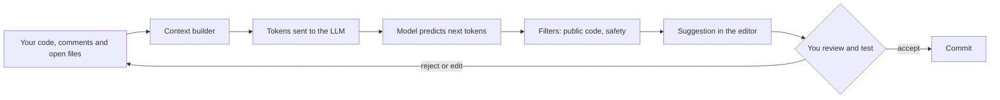
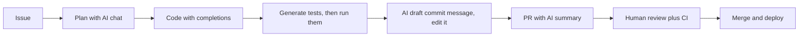
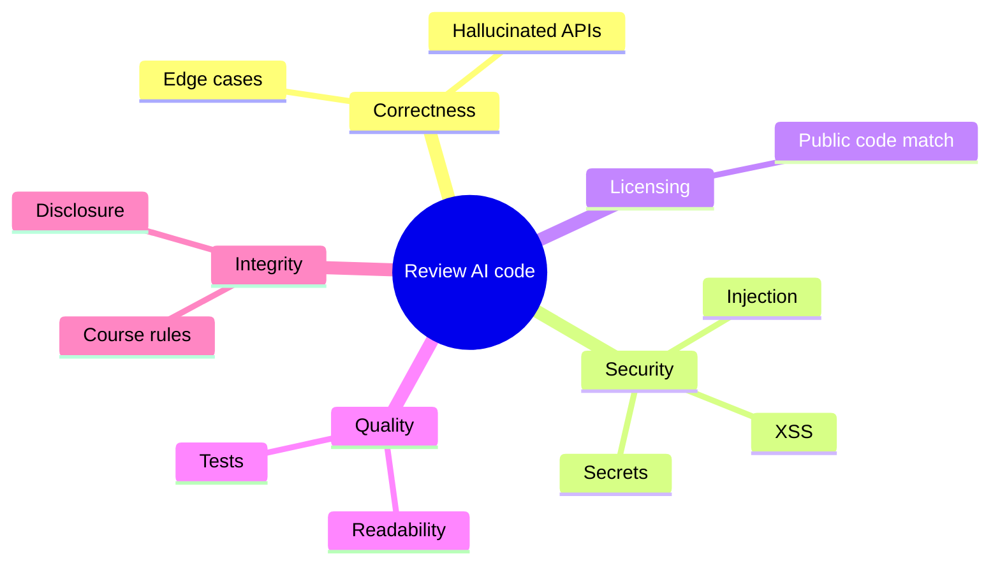
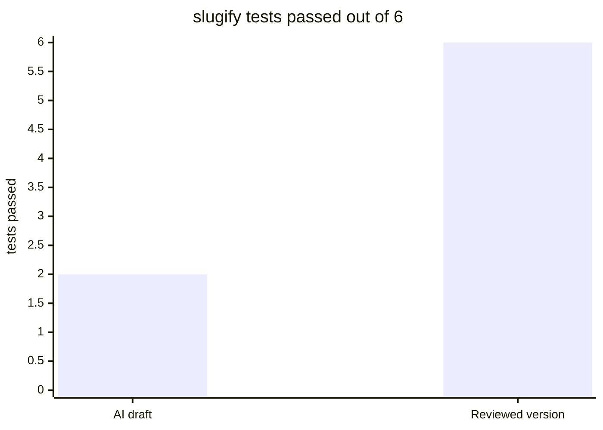

# Session 5 · AI Integration with Git and GitHub

> [Prime AI – Software Engineering with AI](../../README.md) › [Term 1](../README.md) › [Distributed Version Control with Git & GitHub](README.md) › **Session 5**

| ⏱ Estimated time | 🧩 Prerequisites |
|---|---|
| 3 hours | Sessions 1–4; basic JavaScript (Module 2) |

[⬅ Previous: Advanced Git Commands and Collaboration Workflows](session-04-advanced-git-and-collaboration-workflows.md) &nbsp;|&nbsp; [Next: Continuous Integration and Deployment with GitHub ➡](session-06-continuous-integration-and-deployment-with-github.md)

---

## 🎯 Learning objectives

By the end of this session you will be able to:

- Describe the variety of AI coding tools – GitHub Copilot, Copilot Chat, Amazon Q Developer, Gemini Code Assist, Tabnine, Cursor and others.
- Define GitHub Copilot, its features and plans, and set it up in VS Code.
- Explain how AI generates code: large language models, context, tokens and prediction – and why it can be wrong.
- Integrate AI into a Git workflow: prompts, tests, commit messages, pull-request summaries and documentation.
- Apply safety rules: review, testing, secret protection, licensing and academic integrity.

## 📖 Concepts

### 1. AI coding assistants – the landscape

| Tool | Made by | Where it works | Highlights |
|---|---|---|---|
| **GitHub Copilot** | GitHub / Microsoft | VS Code, Visual Studio, JetBrains, Neovim, GitHub.com, CLI | Inline completions, **Copilot Chat**, code review, PR summaries, coding agent; free tier and **free for verified students** |
| **Amazon Q Developer** (formerly CodeWhisperer) | AWS | VS Code, JetBrains, CLI | AWS-aware suggestions, security scans |
| **Gemini Code Assist** | Google | VS Code, JetBrains, Cloud | Large context, Google Cloud integration |
| **Tabnine** | Tabnine | Most IDEs | Privacy options, can run on private infrastructure |
| **Cursor / Windsurf** | Independent | Own editors (VS Code-based) | Whole-project chat and multi-file edits |
| **General chat assistants** (ChatGPT, Claude, Gemini, Copilot) | Various | Browser/apps | Explanations, debugging help, regex, documentation |

> 🧑‍✈️ **Analogy – a co-pilot, not the pilot.** A co-pilot reads the instruments, suggests actions and handles routine
> tasks – but the captain stays responsible for the flight. You remain responsible for every line you commit.

### 2. GitHub Copilot in detail

- **Inline suggestions** – grey "ghost text" while you type; `Tab` accepts, `Esc` rejects, `Alt+]`/`Alt+[` cycles.
- **Copilot Chat** – ask questions about the open file or selection: `/explain`, `/fix`, `/tests`, `/doc`; reference files
  with `#file`, the workspace with `@workspace`.
- **Edits / agent mode** – describe a change; Copilot edits several files and you review the diff.
- **On GitHub.com** – PR summaries, code review suggestions, Copilot explaining a repository, assigning an issue to the
  coding agent (on supported plans).
- **CLI** – suggest and explain shell/Git commands.

**Set-up (VS Code):** sign in to GitHub → install the *GitHub Copilot* and *GitHub Copilot Chat* extensions → sign in when
prompted → check the Copilot icon in the status bar. Students can apply for the **GitHub Student Developer Pack** to get
Copilot Pro free. Organisation admins can block suggestions matching public code and set data-retention policies.

### 3. How AI generates code

1. Code assistants are powered by **large language models (LLMs)** trained on huge amounts of text and code.
2. Your **prompt** – the current file, nearby open files, comments, function names, the chat question – is converted into
   **tokens** (word pieces) and sent as **context**.
3. The model predicts the **most likely next tokens**, one after another, producing a suggestion.
4. The tool filters the result (e.g. for blocked public-code matches or insecure patterns) and shows it.

> 🔮 **Analogy – a super-powered autocomplete.** Your phone keyboard guesses the next word from what you typed. An LLM does
> the same with code, having "read" millions of programs – so its guesses are often excellent, but they are still
> **guesses**: plausible is not the same as correct.

**Consequences you must remember**
- **Hallucinations** – it can invent functions, APIs or library options that don't exist.
- **Outdated knowledge** – training has a cut-off; new library versions may differ.
- **Context-limited** – it only "knows" what is in the context window; better context → better suggestions.
- **Security** – it can reproduce insecure patterns (SQL built by string concatenation, `innerHTML` with user input).
- **Licensing** – suggestions can resemble public code; use the public-code filter and follow your organisation's policy.

### 4. Prompting techniques that work

| Technique | Example |
|---|---|
| Descriptive comment first | `// Return the cart total in PKR: sum of price × qty, minus 10% if total > 5000` |
| Meaningful names | `function calculateDeliveryFee(distanceKm)` beats `function f(x)` |
| Give examples | `// slugify("Hello World!") -> "hello-world"` |
| State constraints | "Use vanilla JS, no libraries, handle empty input, add JSDoc." |
| Iterate | "Now add input validation and unit tests with node:test." |
| Ask for explanations | `/explain` on code you don't understand – then verify |
| Keep files focused | Small files and open related files give better context |

### 5. Integrating AI into the Git workflow

| Stage | AI help | Your responsibility |
|---|---|---|
| Planning | Break an issue into tasks, draft acceptance criteria | Check scope and feasibility |
| Coding | Completions, boilerplate, regex, refactors | Understand every line |
| **Testing** | Generate unit-test cases and edge cases | Run them; add the cases AI missed |
| **Commit messages** | Copilot's ✨ button in Source Control drafts a message from the staged diff | Edit to Conventional Commits, keep it truthful |
| **Pull requests** | PR summary, reviewer suggestions | Add context, screenshots, linked issues |
| **Documentation** | Draft README sections, JSDoc, changelogs | Verify commands and facts |
| **Code review** | AI review comments | Humans approve; AI is a second pair of eyes |
| Learning Git | "How do I undo my last commit but keep the changes?" | Check the command before running destructive ones |

### 6. Safety rules – non-negotiable

1. **Review and test everything** AI produces; never commit code you can't explain.
2. **Never paste secrets** (API keys, passwords, customer data) into prompts; keep `.env` in `.gitignore`; enable GitHub
   **secret scanning / push protection**; add a pre-commit secret check.
3. **Security review** – watch for injection, XSS, hard-coded credentials, missing validation.
4. **Licensing & attribution** – respect licences, enable public-code filtering where available.
5. **Academic integrity** – follow your course's rules on AI use; disclose it when required. In exams and graded
   assignments, unauthorised AI use is cheating.
6. **Keep humans in the loop** – required PR reviews and CI apply to AI-written code too.

## 🧭 Diagrams

### How an AI code suggestion is produced



### AI in every stage of the Git workflow



### Risks to check in AI-generated code



## 💻 Worked examples

### Example 1 — An "AI-style" commit-message assistant (rule-based, runs offline)

Copilot's commit-message button reads your **staged diff** and summarises it. This script imitates the idea without any
API: it creates a demo repository, stages a change, reads `git diff --cached --numstat --name-status`, infers the type and
scope, and proposes a Conventional Commit message for you to edit. Understanding the inputs helps you judge AI drafts.

```js
// session-05_commit-message-assistant.js  (run: node session-05_commit-message-assistant.js)
// Suggests a Conventional Commit message from the staged diff of a demo repository.
const { execSync } = require('child_process');
const fs = require('fs');
const os = require('os');
const path = require('path');

const dir = fs.mkdtempSync(path.join(os.tmpdir(), 'cm-'));
const sh = cmd => execSync(cmd, { cwd: dir, encoding: 'utf8', env: { ...process.env, GIT_CONFIG_NOSYSTEM: '1',
  GIT_AUTHOR_NAME: 'Demo', GIT_AUTHOR_EMAIL: 'demo@example.com', GIT_COMMITTER_NAME: 'Demo', GIT_COMMITTER_EMAIL: 'demo@example.com' } });

// --- demo repo with an initial commit ---
sh('git init -q -b main');
fs.mkdirSync(path.join(dir, 'src')); fs.mkdirSync(path.join(dir, 'test'));
fs.writeFileSync(path.join(dir, 'src/cart.js'), 'exports.total = items => items.reduce((s, i) => s + i.price * i.qty, 0);\n');
sh('git add . && git commit -q -m "feat: cart total"');

function suggest() {
  const files = sh('git diff --cached --name-status').trim().split('\n').map(l => l.split('\t'));
  const stats = sh('git diff --cached --numstat').trim().split('\n').map(l => l.split('\t'));
  const paths = files.map(f => f[1]);
  const added = stats.reduce((s, [a]) => s + +a, 0), removed = stats.reduce((s, [, r]) => s + +r, 0);
  let type = 'chore';
  if (paths.every(p => /^test\/|\.test\./.test(p))) type = 'test';
  else if (paths.every(p => /\.md$/.test(p))) type = 'docs';
  else if (paths.some(p => /^\.github\/workflows/.test(p))) type = 'ci';
  else if (files.some(([s, p]) => s === 'A' && p.startsWith('src/'))) type = 'feat';
  else if (paths.some(p => p.startsWith('src/')) && removed >= added) type = 'refactor';
  else if (paths.some(p => p.startsWith('src/'))) type = 'feat';
  const scopes = [...new Set(paths.map(p => path.basename(p).replace(/(\.test)?\.\w+$/, '')))];
  const scope = scopes.length === 1 ? `(${scopes[0]})` : '';
  const verb = { feat: 'add', test: 'add tests for', docs: 'document', ci: 'update workflow for', refactor: 'simplify', chore: 'update' }[type];
  return { msg: `${type}${scope}: ${verb} ${scopes.join(', ')}`, detail: `${files.length} file(s), +${added} −${removed}` };
}

const scenarios = [
  ['add a discount function', () => {
    fs.writeFileSync(path.join(dir, 'src/discount.js'), 'exports.apply = (t) => (t > 5000 ? t * 0.9 : t);\n'); }],
  ['add tests only', () => {
    fs.writeFileSync(path.join(dir, 'test/cart.test.js'), "const t=require('node:test');\nt('total',()=>{});\n"); }],
  ['shorten existing code', () => {
    fs.writeFileSync(path.join(dir, 'src/cart.js'), 'exports.total = i => i.reduce((s, x) => s + x.price * x.qty, 0);\n'); }],
  ['update the README', () => { fs.writeFileSync(path.join(dir, 'README.md'), '# Cart\nRun the tests with node --test.\n'); }],
];
for (const [label, change] of scenarios) {
  change(); sh('git add -A');
  const { msg, detail } = suggest();
  console.log(`${label.padEnd(26)} → ${msg.padEnd(36)} [${detail}]`);
  sh(`git commit -q -m "${msg}"`);
}
console.log('\nA draft is a starting point: edit it so it says WHY, e.g. "feat(discount): give 10% off orders above Rs 5,000".');
fs.rmSync(dir, { recursive: true, force: true });
```

📄 Saved as [`code/session-05_commit-message-assistant.js`](code/session-05_commit-message-assistant.js)

**Output** (real run)

```text
add a discount function    → feat(discount): add discount         [1 file(s), +1 −0]
add tests only             → test(cart): add tests for cart       [1 file(s), +2 −0]
shorten existing code      → refactor(cart): simplify cart        [1 file(s), +1 −1]
update the README          → docs(README): document README        [1 file(s), +2 −0]

A draft is a starting point: edit it so it says WHY, e.g. "feat(discount): give 10% off orders above Rs 5,000".
```

### Example 2 — Reviewing AI-drafted code with tests (node:test)

Below, `session-05_slugify-ai-draft.js` is the kind of code an assistant might suggest for "turn a title into a URL
slug". It *looks* right. The test file [`code/session-05_slugify.test.js`](code/session-05_slugify.test.js) (with edge cases a
human added) runs against the draft **and** the reviewed version [`code/session-05_slugify.js`](code/session-05_slugify.js).
The draft fails three cases. Durations are stripped from the output so it is reproducible.

```bash
#!/usr/bin/env bash
# session-05_review-ai-code.sh – run the same tests against the AI draft and the reviewed version.
cd "$(dirname "$0")"
for impl in session-05_slugify-ai-draft.js session-05_slugify.js; do
  echo "=== testing $impl ==="
  SLUGIFY_IMPL="./$impl" node --test --test-reporter=spec session-05_slugify.test.js 2>&1 \
    | sed -E 's/ \([0-9.]+m?s\)//' | grep -E '^\s*(✔|✖|ℹ (tests|pass|fail))' | sed -E 's/^\s+//' | awk '!seen[$0]++'
  echo
done
```

📄 Saved as [`code/session-05_review-ai-code.sh`](code/session-05_review-ai-code.sh)

**Output** (real run)

```text
=== testing session-05_slugify-ai-draft.js ===
✔ simple title
✔ punctuation is removed
✖ multiple spaces collapse to one hyphen
✖ dashes and symbols in titles
✖ accents become plain letters
✖ no leading or trailing hyphens
ℹ tests 6
ℹ pass 2
ℹ fail 4
✖ failing tests:

=== testing session-05_slugify.js ===
✔ simple title
✔ punctuation is removed
✔ multiple spaces collapse to one hyphen
✔ dashes and symbols in titles
✔ accents become plain letters
✔ no leading or trailing hyphens
ℹ tests 6
ℹ pass 6
ℹ fail 0
```

### Example 3 — A pre-commit secret scanner

Pasting code into AI tools and moving fast increases the risk of committing a secret. This scanner checks text (e.g. the
output of `git diff --cached`) for patterns that look like credentials and **masks** them in its report. In a real project,
call it from a `pre-commit` hook and also enable GitHub secret scanning with push protection. The sample "secrets" are
built at runtime and are fake.

```js
// session-05_secret-scanner.js  (run: node session-05_secret-scanner.js)
// Scans added lines of a diff for likely secrets and prints a masked report.

const RULES = [
  ['GitHub token', /\bgh[pousr]_[A-Za-z0-9]{36}\b/],
  ['Private key block', /-----BEGIN [A-Z ]*PRIVATE KEY-----/],
  ['Generic API key assignment', /\b(api[_-]?key|secret|token)\s*[:=]\s*['"]?([A-Za-z0-9_\-]{16,})['"]?/i],
  ['Password in code', /\bpassword\s*[:=]\s*['"][^'"]{6,}['"]/i],
  ['Connection string with password', /\b(?:mongodb(?:\+srv)?|mysql|postgres(?:ql)?):\/\/[^:\s]+:[^@\s]+@/i],
];
const mask = s => s.length <= 8 ? '****' : s.slice(0, 4) + '…' + '*'.repeat(6);

function scan(diff) {
  const findings = [];
  diff.split('\n').forEach((line, i) => {
    if (!line.startsWith('+') || line.startsWith('+++')) return;      // only newly added lines
    for (const [name, re] of RULES) {
      const m = line.match(re);
      if (m) findings.push({ line: i + 1, name, sample: mask(m[2] || m[0]) });
    }
  });
  return findings;
}

// Fake values assembled at runtime (not real credentials)
const fakeToken = 'gh' + 'p_' + 'Ab3'.repeat(12);
const fakeKey = 'demo_' + 'x7Q'.repeat(6);
const diff = [
  'diff --git a/src/config.js b/src/config.js',
  '+++ b/src/config.js',
  '+const API_KEY = "' + fakeKey + '";',
  '+const githubToken = "' + fakeToken + '";',
  '+const db = "mongodb+srv://admin:' + 'Pa55word' + '@cluster0.example.net/shop";',
  '+const greeting = "hello world";',
  '-const password = "old-removed-line";',
  '+// password reset handled by the server',
].join('\n');

const findings = scan(diff);
findings.forEach(f => console.log(`✘ line ${f.line}: ${f.name.padEnd(32)} ${f.sample}`));
console.log(findings.length ? `\n${findings.length} possible secret(s) – commit BLOCKED. Move them to .env and rotate any real key.` : 'No secrets found.');
process.exitCode = 0;   // demo: don't fail the build here; a real hook would exit 1
```

📄 Saved as [`code/session-05_secret-scanner.js`](code/session-05_secret-scanner.js)

**Output** (real run)

```text
✘ line 3: Generic API key assignment       demo…******
✘ line 4: GitHub token                     ghp_…******
✘ line 5: Connection string with password  mong…******

3 possible secret(s) – commit BLOCKED. Move them to .env and rotate any real key.
```

## 🧩 Real-life coding problem

**Scenario – adding a feature with an AI assistant, the professional way.** The bakery site needs a function that formats
prices in PKR (`Rs 2,400`) and calculates delivery: free above Rs 5,000, otherwise Rs 250. You use Copilot (or any assistant).
Do it so the result is correct, tested, secure and well-documented in Git.

**Workflow**
1. `git switch -c feature/pricing-helpers`.
2. Write a **descriptive comment and examples** as the prompt; accept a suggestion; read it line by line.
3. Ask the assistant for **unit tests**, then add edge cases yourself (0, negative, non-numbers, exactly 5000).
4. Run the tests – fix what fails (assistants often get boundaries such as "above" vs "at least" wrong).
5. Stage, let the assistant draft a commit message, **edit** it into Conventional Commits.
6. Push, open a PR with an AI summary + your own notes, and let CI (Session 6) run the tests.

**The reviewed result:** [`code/session-05_pricing.js`](code/session-05_pricing.js) with tests in
[`code/session-05_pricing.test.js`](code/session-05_pricing.test.js). Running the tests:

```text
✔ formats thousands with commas
✔ rounds paisa away
✔ rejects non-numbers
✔ Rs 250 below the threshold
✔ exactly Rs 5,000 is NOT above the threshold
✔ free above Rs 5,000
✔ empty cart has no delivery fee
✔ negative subtotal is rejected
ℹ tests 8
ℹ pass 8
ℹ fail 0
```

## ⚠️ Common mistakes

| Mistake | Consequence | Fix |
|---|---|---|
| Accepting long suggestions without reading | Hidden bugs, wrong logic | Accept in small pieces; read and test |
| Trusting AI-invented APIs | Runtime errors (`function not found`) | Check official documentation |
| Pasting secrets or private data into prompts | Data leak | Redact; use `.env`; follow company policy |
| Letting AI write the commit message unedited | Vague or untrue history | Edit to describe what and why |
| No tests for AI code | Edge-case bugs reach users | Generate *and* extend tests; run them in CI |
| Using AI in graded work against the rules | Academic misconduct | Read and follow the course policy; disclose use |
| Turning off review because "AI checked it" | Security issues merged | Human review + CI remain mandatory |

## 🌟 Best practices

- Write clear comments, names and examples before asking for code; keep related files open for context.
- Use chat for explanations (`/explain`) – then verify with documentation.
- Treat AI output like a junior teammate's PR: review, test, refactor, document.
- Use AI to draft tests, commit messages, PR descriptions and READMEs – and always edit them.
- Protect secrets: `.gitignore`, pre-commit scanning, GitHub push protection; never paste credentials.
- Track what AI contributed when your team or course requires disclosure.

## 🏗️ Mini project

**Mini project – AI-assisted README.** Use an AI assistant to draft a README for your Module 3 project, then **verify** every
command and fact, add screenshots and a "What I learned" section in your own words, and commit it with an edited
Conventional Commit message. Record your prompts in
[`code/session-05_prompt-log-template.md`](code/session-05_prompt-log-template.md) – the template also contains a prompt
library for common Git/GitHub tasks.

## 📦 Project files for this session

| File | What it is |
|---|---|
| 📄 [`code/session-05_slugify-ai-draft.js`](code/session-05_slugify-ai-draft.js) | An AI-style first draft of slugify – looks fine, has edge-case bugs |
| 📄 [`code/session-05_slugify.js`](code/session-05_slugify.js) | The reviewed slugify after testing (handles spaces, accents, symbols, empty input) |
| 📄 [`code/session-05_slugify.test.js`](code/session-05_slugify.test.js) | Unit tests (node:test) used to review both slugify versions |
| 📄 [`code/session-05_pricing.js`](code/session-05_pricing.js) | Real-life problem solution – reviewed pricing helpers (PKR formatting and delivery rule) |
| 📄 [`code/session-05_pricing.test.js`](code/session-05_pricing.test.js) | Tests for the pricing helpers including edge cases a human added |
| 📄 [`code/session-05_run-pricing-tests.sh`](code/session-05_run-pricing-tests.sh) | Runs the pricing tests with the built-in Node test runner (durations stripped) |
| 📄 [`code/session-05_prompt-log-template.md`](code/session-05_prompt-log-template.md) | Prompt library for Git/GitHub tasks + a log template for disclosing AI use |

## 📊 At a glance

**Test results: AI draft vs reviewed code** (real output of the review script above):



| AI task | Value | Risk level | Must-do check |
|---|---|---|---|
| Boilerplate / repetitive code | High | Low | Read it |
| Unit-test ideas | High | Low | Run + add edge cases |
| Commit / PR text | Medium | Low | Edit for truth and "why" |
| Security-sensitive code (auth, SQL, payments) | Medium | **High** | Expert review |
| Explaining unfamiliar code | High | Medium | Verify against docs |

## 🧪 Lab / practice tasks

**🟢 Easy** — Set up GitHub Copilot (or another assistant) in VS Code. Write the comment `// function that returns true if a year is a leap year` and accept a suggestion. Then write three test cases and check it, including the year 1900 and 2000.

<details><summary>💡 Hint</summary>

Leap year rule: divisible by 4, except centuries, unless divisible by 400.

</details>

<details><summary>✅ Solution</summary>

A correct function: `const isLeap = y => (y % 4 === 0 && y % 100 !== 0) || y % 400 === 0;`. Tests: 2024 → true,
1900 → false, 2000 → true. Many quick suggestions only check `y % 4`, failing 1900 – exactly why tests matter.

</details>

**🟡 Medium** — Stage a real change in one of your repositories and compare three commit messages: (1) your own, (2) the assistant's draft, (3) the output of `session-05_commit-message-assistant.js` style rules. Which is best and why? Commit the improved final version.

<details><summary>💡 Hint</summary>

Judge by: correct type, specific summary, imperative mood, explains why in the body.

</details>

<details><summary>✅ Solution</summary>

Typically the AI draft is accurate but generic ("Update index.html"), the rule-based draft has the right type but no
"why", and the best final message combines them: `feat(nav): add sticky navbar so links stay visible on long pages`.

</details>

**🔴 Hard** — Add the secret scanner to a repository as a `pre-commit` hook that blocks the commit (exit code 1) when a secret is found in `git diff --cached`. Prove it blocks a fake key and allows a clean commit.

<details><summary>💡 Hint</summary>

In the hook: `git diff --cached | node path/to/scanner.js`; make the scanner read stdin and set `process.exitCode = 1` when findings exist.

</details>

<details><summary>✅ Solution</summary>

```bash
# .git/hooks/pre-commit
#!/usr/bin/env bash
git diff --cached -U0 | node scripts/secret-scan.js || { echo "Commit blocked: possible secret"; exit 1; }
```
Change the scanner to `const diff = require('fs').readFileSync(0, 'utf8');` and `process.exitCode = findings.length ? 1 : 0;`.
Committing a file with `API_KEY = "demo_x7Qx7Qx7Q…"` is blocked; a clean change commits normally.

</details>

**🏆 Challenge** — Run an experiment: implement the same small feature (e.g. a to-do filter) once without AI and once with AI. Record time taken, number of bugs found by tests and how much code you had to change. Write a 300-word reflection on when AI helped and when it slowed you down.

<details><summary>💡 Hint</summary>

Keep both versions on separate branches so you can compare diffs with `git diff branch-a branch-b`.

</details>

<details><summary>✅ Solution</summary>

Good reflections give numbers (e.g. "AI version: 18 min, 2 bugs found by tests; manual: 35 min, 1 bug"), concrete examples of
helpful suggestions (boilerplate, test ideas) and harmful ones (wrong boundary, invented jQuery method), and a conclusion
about using AI for speed while keeping understanding and tests.

</details>

## ✅ Quick quiz

**Q1. GitHub Copilot is best described as:**

- A) A version control system
- B) An AI pair programmer that suggests code and answers questions
- C) A hosting service
- D) A test runner

<details><summary>Show answer</summary>

**B** — It assists; you stay responsible.

</details>

**Q2. AI code assistants generate code by:**

- A) Copying from Stack Overflow live
- B) Predicting likely next tokens with a large language model using your context
- C) Running your program
- D) Asking other developers

<details><summary>Show answer</summary>

**B** — LLMs predict tokens.

</details>

**Q3. An AI "hallucination" in coding means:**

- A) A visual bug
- B) Confidently suggesting code or APIs that are wrong or don't exist
- C) A merge conflict
- D) A slow computer

<details><summary>Show answer</summary>

**B** — Always verify.

</details>

**Q4. Which should NEVER be pasted into an AI prompt?**

- A) A function you wrote
- B) An error message
- C) A production API key
- D) A test case

<details><summary>Show answer</summary>

**C** — Secrets must stay secret.

</details>

**Q5. The best way to trust AI-generated code is to:**

- A) Accept it if it compiles
- B) Review it, write/run tests and pass code review
- C) Ask the AI if it is correct
- D) Deploy and see

<details><summary>Show answer</summary>

**B** — Same standards as human code.

</details>

## 📝 Summary / cheat-sheet

- AI assistants: GitHub Copilot (inline, chat, edits, PR summaries), Amazon Q Developer, Gemini Code Assist, Tabnine, Cursor, chat assistants.
- LLMs predict likely next tokens from context – helpful, fast, but can hallucinate, be outdated or insecure.
- Good prompts: descriptive comments, clear names, examples, constraints, iteration, related files open.
- Use AI across the workflow: planning, code, tests, commit messages, PR summaries, docs, review – always editing and verifying.
- Safety: review and test, never share secrets, scan for secrets, respect licences, follow academic-integrity rules, keep human review and CI.

## 🎤 Interview / viva questions

1. **How does an AI code assistant decide what to suggest?**
   <details><summary>Model answer</summary>

   It sends the surrounding code, comments and other context as tokens to a large language model, which predicts the most likely continuation; filters may then be applied before it is shown.

   </details>

2. **Name three risks of AI-generated code and a mitigation for each.**
   <details><summary>Model answer</summary>

   Incorrect logic – unit tests; security flaws – code review and scanners; licensing issues – public-code filters and policy; plus secret leaks – never paste credentials.

   </details>

3. **How can AI help with Git specifically?**
   <details><summary>Model answer</summary>

   Drafting commit messages from staged diffs, summarising pull requests, explaining Git commands, generating changelogs and README content – all of which must be reviewed.

   </details>

4. **What makes a good prompt for code generation?**
   <details><summary>Model answer</summary>

   A clear description of intent, inputs/outputs and constraints, examples of expected behaviour, meaningful names and relevant files in context, followed by iterative refinement.

   </details>

5. **Why are tests especially important with AI code?**
   <details><summary>Model answer</summary>

   Because suggestions are plausible guesses that often miss edge cases; tests verify behaviour objectively and protect against regressions.

   </details>

6. **What is your responsibility when using AI in coursework?**
   <details><summary>Model answer</summary>

   Follow the course policy, understand and be able to explain everything submitted, and disclose AI assistance where required.

   </details>

---

[⬅ Previous: Advanced Git Commands and Collaboration Workflows](session-04-advanced-git-and-collaboration-workflows.md) &nbsp;|&nbsp; [Next: Continuous Integration and Deployment with GitHub ➡](session-06-continuous-integration-and-deployment-with-github.md)

<sub>Prepared by **Hamna Zahid Khan**, Junior Lecturer · Prime AI – Software Engineering with AI</sub>
